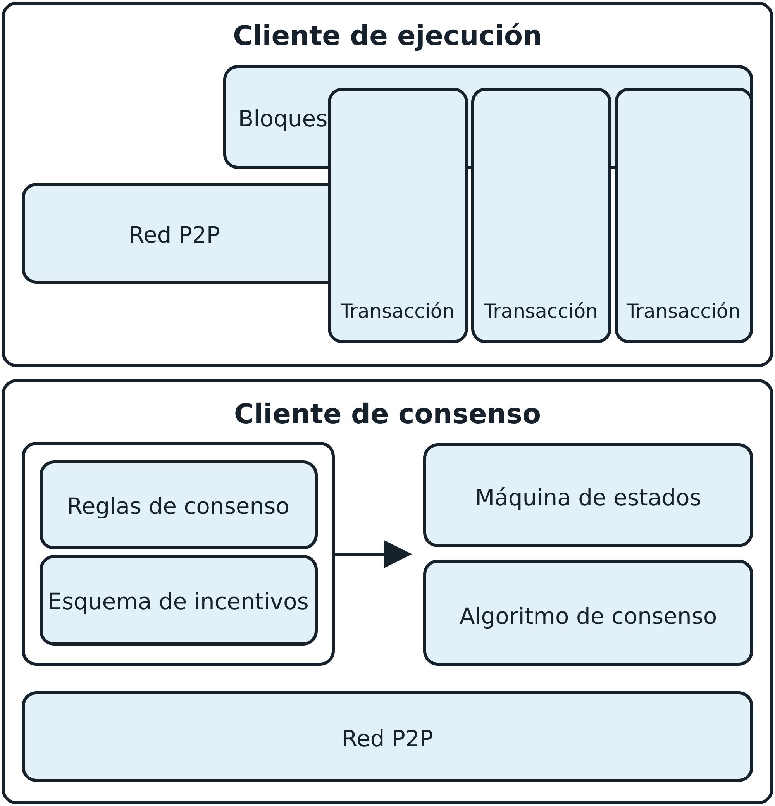

# Capítulo 1. ¿Qué es Ethereum?

A menudo se describe a Ethereum como la «computadora mundial». Pero ¿qué significa eso? Comencemos con una descripción desde la perspectiva de las ciencias de la computación y luego intentemos interpretarla mediante un análisis más práctico de las capacidades y características de Ethereum, comparándolo con Bitcoin y otras plataformas descentralizadas de intercambio de información (o *blockchains*, para ser precisos).

Desde la perspectiva de las ciencias de la computación, Ethereum es una máquina de estados determinista, pero prácticamente ilimitada, compuesta por un estado único (*singleton*) accesible globalmente y una máquina virtual que aplica cambios a ese estado.

Desde una perspectiva más práctica, Ethereum es una infraestructura de cómputo de código abierto y descentralizada a escala global que ejecuta programas llamados *contratos inteligentes* (*smart contracts*). Utiliza una blockchain para sincronizar y almacenar los cambios de estado del sistema, junto con una criptomoneda llamada *ether* para medir y limitar los costos de los recursos de ejecución.

La plataforma Ethereum permite a los desarrolladores crear potentes aplicaciones descentralizadas con funciones económicas integradas. Ofrece alta disponibilidad, auditabilidad, transparencia y neutralidad, al tiempo que reduce o elimina la censura y reduce ciertos riesgos de contraparte.

## Ethereum en comparación con Bitcoin

Muchas personas se acercan a Ethereum con cierta experiencia previa en criptomonedas, en particular con Bitcoin. Ethereum comparte muchos elementos con otras blockchains abiertas: una red entre pares (P2P) que conecta a los participantes; un algoritmo de consenso tolerante a fallas bizantinas para sincronizar las actualizaciones de estado; el uso de primitivas criptográficas, como firmas digitales y hashes; y una moneda digital (ether). Sin embargo, en muchos aspectos, tanto el propósito como la construcción de Ethereum son marcadamente diferentes de los de las blockchains abiertas que lo precedieron, incluido Bitcoin.

El propósito principal de Ethereum no es ser una red de pagos con moneda digital. Si bien la moneda digital ether es una parte integral y necesaria del funcionamiento de Ethereum, está concebida como una *moneda de utilidad* para pagar por el uso de la plataforma Ethereum como computadora mundial.

A diferencia de Bitcoin, que tiene un lenguaje de scripting muy limitado, Ethereum está diseñado como una blockchain programable de propósito general que ejecuta una máquina virtual capaz de ejecutar código de complejidad arbitraria e ilimitada. Mientras que el lenguaje Script de Bitcoin está restringido intencionalmente a evaluar condiciones de gasto cuyo resultado es verdadero o falso, el lenguaje de Ethereum es *Turing completo*, lo que significa que Ethereum puede funcionar como una computadora de propósito general.

En septiembre de 2022, Ethereum se diferenció aún más de Bitcoin con la actualización The Merge, al pasar de un modelo de consenso de prueba de trabajo (proof of work, PoW) a uno de proof of stake (PoS). Este cambio importante no solo subraya el compromiso de Ethereum con la reducción de su impacto ambiental —en consonancia con su visión innovadora—, sino que también mejora sus características de escalabilidad y seguridad.

## Componentes de una blockchain

Los componentes de una blockchain abierta y pública son, por lo general, los siguientes:

- Una red P2P que conecta a los participantes y propaga transacciones y bloques de transacciones verificadas, basada en un protocolo «gossip» estandarizado
- Mensajes, en forma de transacciones, que representan transiciones de estado
- Un conjunto de reglas de consenso que determinan qué constituye una transacción y qué hace válida una transición de estado
- Una máquina de estados que procesa las transacciones según las reglas de consenso
- Una cadena de bloques protegidos criptográficamente que actúa como registro de todas las transiciones de estado verificadas y aceptadas
- Un algoritmo de consenso que descentraliza el control de la blockchain al obligar a los participantes a cooperar en el cumplimiento de las reglas de consenso
- Un esquema de incentivos sólido desde el punto de vista de la teoría de juegos (por ejemplo, los costos de PoW más las recompensas por bloque) para dar seguridad económica a la máquina de estados en un entorno abierto
- Una o más implementaciones de código abierto de estos componentes («clientes»)

Todos o la mayoría de estos componentes suelen combinarse en un único cliente de software. Por ejemplo, en Bitcoin, la implementación de referencia es desarrollada por el proyecto de código abierto Bitcoin Core e implementada como el cliente de Bitcoin. Inicialmente, Ethereum también requería un único cliente antes de su transición a PoS. Sin embargo, Ethereum utiliza ahora dos clientes distintos: uno de consenso y otro de ejecución. En lugar de una implementación de referencia, Ethereum se basa en una especificación de referencia: una descripción matemática detallada en el [«Yellow Paper»](https://oreil.ly/IJ7_B), que se ha actualizado de forma continua a lo largo del desarrollo de Ethereum. La comunidad de Ethereum está migrando actualmente hacia una especificación de referencia escrita en Python tanto para los clientes de [consenso](https://oreil.ly/yjU6s) como para los de [ejecución](https://oreil.ly/ggODg). Se han desarrollado varios clientes conforme a la especificación de referencia. Profundizaremos en este tema en el capítulo 3.

La figura 1-1 muestra una representación gráfica de los componentes de una blockchain.

**Figura 1-1.** Componentes de una blockchain

En el pasado, utilizábamos el término *blockchain* para representar todos los componentes enumerados, como una forma abreviada de referirnos a la combinación de tecnologías que reúne todas las características descritas. Hoy, sin embargo, existe una gran variedad de blockchains con propiedades diferentes. Necesitamos calificativos que nos ayuden a comprender las características de la blockchain en cuestión, como *abierta*, *pública*, *global*, *descentralizada*, *neutral* y *resistente a la censura*, para identificar las importantes características emergentes de un sistema «blockchain» que estos componentes hacen posibles.

No todas las blockchains son iguales. A pesar de la enorme cantidad de propiedades que presentan, podemos clasificarlas, en términos generales, en blockchains con permiso o sin permiso, y públicas o privadas:

**Sin permiso**

Las blockchains sin permiso, como Bitcoin y Ethereum, son accesibles para cualquier persona. Estas redes descentralizadas permiten que cualquiera se una, participe en el proceso de consenso y lea y escriba datos, lo que promueve la confianza mediante la transparencia.

**Con permiso**

Las blockchains con permiso restringen el acceso y solo permiten que los participantes autorizados se unan a la red y realicen ciertas acciones.

**Públicas**

Las blockchains públicas son descentralizadas y están abiertas a todos, lo que permite una amplia participación en las actividades de la red y garantiza la transparencia mediante una distribución extensa y mecanismos de consenso.

**Privadas**

Las blockchains privadas limitan el acceso a un grupo específico de participantes, a menudo dentro de organizaciones o entre socios de confianza.

## El nacimiento de Ethereum

Todas las grandes innovaciones resuelven problemas reales, y Ethereum no es la excepción. Ethereum se concibió en un momento en que las personas reconocían el potencial del modelo de Bitcoin e intentaban ir más allá de las aplicaciones de criptomonedas. Pero los desarrolladores se enfrentaban a un dilema: debían construir sobre Bitcoin o crear una nueva blockchain. Construir sobre Bitcoin significaba convivir con las restricciones intencionales de la red e intentar encontrar alternativas para sortearlas. El conjunto limitado de tipos de transacciones, tipos de datos y tamaños de almacenamiento de datos parecía restringir las clases de aplicaciones que podían ejecutarse directamente sobre Bitcoin; cualquier otra cosa requería capas adicionales fuera de la cadena (*off-chain*), y eso anulaba de inmediato muchas de las ventajas de utilizar una blockchain pública. Para los proyectos que requerían más libertad y flexibilidad sin salir de la cadena (*on-chain*), una nueva blockchain era la única opción. Pero eso implicaba mucho trabajo: poner en marcha todos los elementos de infraestructura, realizar pruebas exhaustivas, etcétera.

Hacia finales de 2013, Vitalik Buterin, un joven programador y entusiasta de Bitcoin, comenzó a pensar en cómo ampliar aún más las capacidades de Bitcoin y Mastercoin (un protocolo superpuesto que extendía Bitcoin para ofrecer contratos inteligentes rudimentarios). En octubre de ese año, Buterin propuso al equipo de Mastercoin un enfoque más general que permitía reemplazar el lenguaje de contratos especializado de Mastercoin por contratos flexibles y programables mediante scripts (aunque no Turing completos). Si bien el equipo de Mastercoin quedó impresionado, la propuesta suponía un cambio demasiado radical para encajar en su hoja de ruta de desarrollo.

En diciembre de 2013, Buterin comenzó a compartir un documento técnico (*whitepaper*) que esbozaba la idea detrás de Ethereum: una blockchain Turing completa y de propósito general. Unas pocas decenas de personas vieron este primer borrador y aportaron comentarios que ayudaron a Buterin a desarrollar la propuesta.

Los dos autores originales de este libro, Andreas M. Antonopoulos y el Dr. Gavin Wood, recibieron un primer borrador del whitepaper e hicieron comentarios al respecto. Antonopoulos se sintió intrigado por la idea y le hizo muchas preguntas a Buterin sobre el uso de una blockchain independiente para hacer cumplir las reglas de consenso en la ejecución de contratos inteligentes y sobre las implicaciones de un lenguaje Turing completo. Antonopoulos siguió el progreso de Ethereum con gran interés, pero estaba en las primeras etapas de la escritura de su libro *Mastering Bitcoin* y no participó directamente en Ethereum hasta mucho después. Wood, en cambio, fue una de las primeras personas en contactar a Buterin y ofrecer ayuda con sus conocimientos de programación en C++. Wood se convirtió en cofundador, codiseñador y director de tecnología (CTO) de Ethereum.

Buterin relata en su [publicación «A Prehistory of the Ethereum Protocol»](https://oreil.ly/kEjpX):

> Este fue el período en que el protocolo de Ethereum era enteramente una creación mía. A partir de ese momento, sin embargo, comenzaron a sumarse nuevos participantes. Por mucho, el más destacado en lo relativo al protocolo fue Gavin Wood.

También se le puede atribuir en gran medida a Wood el cambio sutil de visión: de ver a Ethereum como una plataforma para crear dinero programable, con contratos basados en blockchain capaces de mantener activos digitales y transferirlos según reglas preestablecidas, a verlo como una plataforma de cómputo de propósito general. Esto comenzó con cambios sutiles de énfasis y terminología, y más adelante esta influencia se fortaleció con la creciente importancia del conjunto «Web3», que consideraba a Ethereum como una pieza de un conjunto de tecnologías descentralizadas, cuyas otras dos piezas eran Whisper y Swarm. A partir de diciembre de 2013, Buterin y Wood refinaron y desarrollaron la idea, y construyeron juntos la capa de protocolo que se convirtió en Ethereum.

Los fundadores de Ethereum pensaban en una blockchain sin un propósito específico, que pudiera admitir una amplia variedad de aplicaciones mediante su *programación*. La idea era que, al utilizar una blockchain de propósito general como Ethereum, un desarrollador pudiera programar su aplicación particular sin tener que implementar los mecanismos subyacentes de las redes P2P, las blockchains, los algoritmos de consenso y otros elementos similares. Ethereum abstrae esos detalles y ofrece un entorno determinista y seguro para escribir aplicaciones descentralizadas. Este cambio de enfoque no solo facilitó el desarrollo, sino que amplió de manera fundamental lo que podían hacer las blockchains. Sentó las bases de sectores completamente nuevos, como las finanzas descentralizadas, los NFT y las organizaciones autónomas descentralizadas (DAO), que no habrían sido viables con las anteriores blockchains de propósito único.

Al igual que Satoshi Nakamoto (el desarrollador de Bitcoin que utilizó ese seudónimo), Buterin y Wood no se limitaron a inventar una nueva tecnología: combinaron nuevas invenciones con tecnologías existentes de una manera novedosa y entregaron el código de un prototipo para demostrar sus ideas al mundo.

Los fundadores trabajaron durante años para construir y refinar su visión. Y el 30 de julio de 2015 se minó el primer bloque de Ethereum. La computadora mundial comenzó a servir al mundo.

> **Nota**
>
> El artículo de Vitalik Buterin [«A Prehistory of the Ethereum Protocol»](https://oreil.ly/kEjpX) se publicó en septiembre de 2017 y ofrece un fascinante relato en primera persona de los primeros momentos de Ethereum.

## Etapas de desarrollo de Ethereum

El desarrollo de Ethereum se planificó en cuatro etapas distintas, con cambios importantes en cada una. Una etapa puede incluir versiones intermedias, conocidas como *hard forks*, que modifican la funcionalidad de una manera incompatible con versiones anteriores.

Las cuatro etapas principales de desarrollo tienen los nombres en clave Frontier, Homestead, Metropolis y Serenity. Al momento de escribir este libro, nos encontramos en la última etapa: Serenity. A su vez, la etapa Serenity se ha dividido en seis subetapas con los nombres en clave The Merge, The Surge, The Scourge, The Verge, The Purge y The Splurge.

Veamos ahora las cuatro etapas de desarrollo y sus objetivos principales:

**Frontier (30 de julio de 2015)**

Lanzada en el bloque génesis (cuando se minó el primer bloque de Ethereum), Frontier preparó las bases para mineros y desarrolladores al permitir la instalación de equipos de minería, el inicio del intercambio de tokens ETH y las pruebas de aplicaciones descentralizadas (DApps) en un entorno de red mínimo. Inicialmente, los bloques tenían un límite de gas de cinco mil, pero este se elevó en septiembre de 2015, lo que permitió realizar transacciones e introdujo la «bomba de dificultad». La *bomba de dificultad* de Ethereum es un mecanismo diseñado para aumentar exponencialmente la dificultad de la minería con el tiempo, hasta volverla inviable. Esto incentiva la transición del consenso PoW original al modelo PoS, más eficiente en términos energéticos y actualmente en uso.

**Homestead (14 de marzo de 2016)**

Iniciada en el bloque 1,150,000, Homestead hizo que Ethereum fuera más seguro y estable mediante actualizaciones clave del protocolo (EIP-2, EIP-7 y EIP-8). Estas actualizaciones facilitaron el trabajo de los desarrolladores y prepararon el camino para nuevas mejoras del protocolo, aunque la red permaneció en fase beta.

**Metropolis (16 de octubre de 2017)**

A partir del bloque 4,370,000, Metropolis tuvo como objetivo ampliar la funcionalidad de la red e impulsar la creación de DApps y la utilidad general de la red. Durante esta fase, bifurcaciones importantes como Byzantium, Constantinople e Istanbul optimizaron los costos de gas, mejoraron la seguridad e introdujeron soluciones de escalado de capa 2 (L2). Byzantium redujo las recompensas de minería e incorporó mecanismos criptográficos, mientras que Constantinople optimizó aún más los costos de gas y permitió interacciones con direcciones aún no creadas. Istanbul hizo que la red fuera más resistente a los ataques distribuidos de denegación de servicio (DDoS) e introdujo pruebas criptográficas de conocimiento cero (zk-SNARKs y STARKs) para mejorar la escalabilidad y la privacidad. En conjunto, estas mejoras prepararon el terreno para Ethereum 2.0 y representaron la fase final de Ethereum 1.0.

**Serenity (15 de septiembre de 2022)**

Serenity, conocida comúnmente como *Ethereum 2.0*, representa una actualización importante destinada a transformar Ethereum de un mecanismo de consenso PoW a uno PoS. Serenity se centra en hacer que Ethereum sea más sostenible y capaz de atender a un número creciente de usuarios y aplicaciones. Esta etapa aborda problemas críticos, como el alto consumo energético y la congestión de la red, y abre el camino hacia una blockchain más robusta y eficiente.

La actualización Serenity se divide en varias subetapas, cada una de las cuales aborda aspectos específicos de la evolución de la red. Si bien las cuatro etapas principales de desarrollo se han implementado de forma secuencial, las cinco subetapas de Serenity se están desarrollando al mismo tiempo. Este enfoque en paralelo representa un cambio estratégico respecto del método de desarrollo anterior y es posible porque el trabajo fundamental realizado en las cuatro etapas iniciales era necesario para el desarrollo simultáneo de las subetapas de Serenity. Cada una de estas subetapas mejora la cadena de Ethereum en un aspecto diferente, independiente de los demás, lo que permite un proceso de actualización más flexible y dinámico:

**The Merge**

The Merge combina la red principal de Ethereum con la Beacon Chain (la cadena lateral que gestiona el consenso PoS), lo que marca la transición oficial de la red a PoS y reduce significativamente el consumo energético.

**The Surge**

The Surge introduce sharding, que aumenta la escalabilidad de Ethereum al dividir la red en partes más pequeñas y manejables, lo que permite procesar más transacciones por segundo.

**The Scourge**

The Scourge aborda los problemas de centralización y resistencia a la censura, y garantiza que Ethereum siga siendo una red descentralizada y abierta.

**The Verge**

The Verge implementa árboles de Verkle, lo que reduce el almacenamiento de datos requerido por los nodos y, por lo tanto, mejora la eficiencia y la escalabilidad de la red.

**The Purge**

The Purge busca reducir los datos históricos almacenados en Ethereum, simplificar la operación de los nodos y disminuir la congestión de la red.

**The Splurge**

The Splurge incluye diversas actualizaciones menores y optimizaciones para garantizar que Ethereum funcione de manera fluida y eficiente una vez implementados todos los cambios importantes.

## Ethereum: una blockchain de propósito general

La blockchain original —es decir, la de Bitcoin— registra el estado de las unidades de bitcoin y su propiedad. Podemos pensar en Bitcoin como una *máquina de estados* con consenso distribuido, donde las transacciones provocan una *transición de estado* global que modifica la propiedad de las monedas. Las transiciones de estado están restringidas por las reglas de consenso, lo que permite que todos los participantes converjan, con el tiempo, en un estado común (de consenso) del sistema, después de que se minen varios bloques.

Ethereum también es una máquina de estados distribuida. Pero, en lugar de registrar únicamente el estado de la propiedad de la moneda, Ethereum registra las transiciones de estado de un almacén de datos de propósito general; es decir, un almacén que puede contener cualquier dato expresable como una *tupla clave-valor*. Un almacén de datos clave-valor contiene valores arbitrarios, cada uno referenciado por una clave: por ejemplo, el valor «Mastering Ethereum» referenciado por la clave «Título del libro». En algunos aspectos, esto cumple la misma función que el modelo de almacenamiento de datos de la memoria de acceso aleatorio (RAM) utilizada por la mayoría de las computadoras de propósito general.

Ethereum tiene una memoria que almacena tanto código como datos, y utiliza su blockchain para registrar cómo cambia esta memoria con el tiempo. Al igual que una computadora de propósito general con programa almacenado, Ethereum puede cargar código en su máquina de estados y *ejecutarlo*, y almacenar en su blockchain los cambios de estado resultantes. Dos de las diferencias fundamentales respecto de la mayoría de las computadoras de propósito general son que los cambios de estado de Ethereum están regidos por las reglas de consenso y que el estado está distribuido globalmente. Ethereum responde a la pregunta: «¿Qué pasaría si pudiéramos registrar cualquier estado arbitrario y programar la máquina de estados para crear una computadora mundial que opere bajo consenso?».

## Componentes de Ethereum

En Ethereum, los componentes de un sistema blockchain (descritos en «Componentes de una blockchain») son, más específicamente, los siguientes:

**Red P2P**

Ethereum funciona en la *red principal de Ethereum*, a la que se puede acceder a través del puerto TCP 30303, y utiliza un protocolo llamado [*ÐΞVp2p*](https://oreil.ly/pUfGC).

**Reglas de consenso**

El protocolo de consenso original de Ethereum era Ethash, un modelo PoW definido en la especificación de referencia: el «Yellow Paper». Luego evolucionó a PoS en septiembre de 2022, durante la actualización The Merge (véase el capítulo 15).

**Transacciones**

Las transacciones de Ethereum son mensajes de red que incluyen, entre otras cosas, un remitente, un destinatario, un valor y una carga de datos.

**Máquina de estados**

Las transiciones de estado de Ethereum son procesadas por la *máquina virtual de Ethereum* (Ethereum Virtual Machine, EVM), una máquina virtual basada en pila que ejecuta *bytecode* (instrucciones en lenguaje de máquina). Los programas de la EVM llamados *contratos inteligentes* se escriben en lenguajes de alto nivel (por ejemplo, Solidity) y se compilan a bytecode para ejecutarse en la EVM.

**Estructuras de datos**

El estado de Ethereum se almacena localmente en cada nodo como una *base de datos* (generalmente LevelDB de Google), que contiene las transacciones y el estado del sistema en una estructura de datos serializada y basada en hashes llamada *trie de Merkle-Patricia*.

**Algoritmo de consenso**

Ethereum pasó de un mecanismo de consenso PoW a uno PoS para mejorar la eficiencia energética y la escalabilidad. En PoS, los validadores hacen staking de sus criptomonedas para obtener el derecho a validar transacciones, crear nuevos bloques y mantener la seguridad de la red. El PoS de Ethereum es la fusión de dos algoritmos distintos: Casper the Friendly Finality Gadget (FFG) y GHOST (Greedy Heaviest Observed Subtree), con actualizaciones basadas en el último mensaje (latest message driven, LMD). Veremos más sobre esto en el capítulo 15.

**Seguridad económica**

Ethereum utiliza un algoritmo PoS llamado Gasper que proporciona seguridad económica a la blockchain. Exploraremos en detalle el funcionamiento de Gasper en el capítulo 15, incluido su papel en la finalidad y la coordinación de los validadores.

**Clientes**

Ethereum tiene varias implementaciones interoperables de su software de cliente de ejecución y de consenso. Las más destacadas son *go-ethereum* (Geth) y Nethermind para ejecución, y Prysm y Lighthouse para consenso.

Estas referencias proporcionan información adicional sobre las tecnologías mencionadas aquí:

- [«Yellow Paper» de Ethereum](https://oreil.ly/IJ7_B)
- [Especificaciones en Python del cliente de consenso](https://oreil.ly/yjU6s)
- [Especificaciones en Python del cliente de ejecución](https://oreil.ly/ggODg)

## Ethereum y la completitud de Turing

En cuanto comencemos a leer sobre Ethereum, encontraremos el término *Turing completo*. Se dice que Ethereum es Turing completo, a diferencia de Bitcoin. ¿Qué significa exactamente?

El término hace referencia al matemático inglés Alan Turing, considerado el padre de las ciencias de la computación. En 1936, creó un modelo matemático de una computadora compuesto por una máquina de estados que manipula símbolos al leerlos y escribirlos en una memoria secuencial (semejante a una cinta de papel de longitud infinita). Con esta construcción, Turing proporcionó una base matemática para responder, de manera negativa, preguntas sobre la *computabilidad universal*, es decir, si todos los problemas tienen solución. Demostró que existen clases de problemas que no son computables. En particular, demostró que el *problema de la parada* (si es posible, dados un programa arbitrario y su entrada, determinar si el programa dejará de ejecutarse en algún momento) no tiene solución.

Además, Turing definió que un sistema es *Turing completo* si puede utilizarse para simular cualquier máquina de Turing. Un sistema de este tipo se denomina *máquina universal de Turing* (universal Turing machine, UTM).

La capacidad de Ethereum de ejecutar un programa almacenado —en una máquina de estados llamada EVM— mientras lee y escribe datos en memoria lo convierte en un sistema Turing completo y, por lo tanto, en una UTM. Ethereum puede calcular cualquier algoritmo que pueda calcular una máquina de Turing, dadas las limitaciones de una memoria finita.

La innovación revolucionaria de Ethereum consiste en combinar la arquitectura de cómputo de propósito general de una computadora con programa almacenado con una blockchain descentralizada, para crear así una computadora mundial distribuida con un único estado (*singleton*). Los programas de Ethereum se ejecutan «en todas partes», pero producen un estado común protegido por las reglas de consenso.

## La completitud de Turing como «característica»

Al escuchar que Ethereum es Turing completo, podríamos concluir que esta es una *característica* que, de alguna manera, le falta a un sistema que no es Turing completo. En realidad, ocurre lo contrario. La completitud de Turing es muy fácil de lograr; de hecho, [la máquina de estados Turing completa más simple que se conoce](https://oreil.ly/JhL2o) tiene cuatro estados y utiliza seis símbolos, con una definición de estado de tan solo 22 instrucciones. A veces incluso se descubre que ciertos sistemas son «accidentalmente Turing completos» (aquí hay una [referencia entretenida de esos sistemas](https://oreil.ly/7pt2q)).

Sin embargo, la completitud de Turing es muy peligrosa, en particular en sistemas de acceso abierto como las blockchains públicas, debido al problema de la parada descrito en la sección anterior. Por ejemplo, las impresoras modernas son Turing completas y se les pueden enviar archivos para imprimir que las dejen bloqueadas. El hecho de que Ethereum sea Turing completo significa que puede ejecutar cualquier programa de cualquier complejidad. Pero esa flexibilidad trae consigo algunos problemas difíciles de seguridad y gestión de recursos. Una impresora que no responde puede apagarse y volver a encenderse. Eso no es posible con una blockchain pública.

## Implicaciones de la completitud de Turing

Turing demostró que no se puede predecir si un programa terminará simulándolo en una computadora. En términos simples, no podemos predecir el recorrido de un programa sin ejecutarlo. Los sistemas Turing completos pueden ejecutar *bucles infinitos*, una expresión que se utiliza, de manera simplificada, para describir un programa que no termina. Es trivial crear un programa que ejecute un bucle que nunca termine. Pero los bucles interminables no intencionales pueden surgir sin previo aviso debido a interacciones complejas entre las condiciones iniciales y el código. En Ethereum, esto plantea un desafío: cada nodo participante (cliente) debe validar cada transacción y ejecutar los contratos inteligentes que esta invoque. Pero, como demostró Turing, Ethereum no puede predecir si un contrato inteligente terminará o cuánto tiempo se ejecutará sin ejecutarlo realmente (quizás para siempre). Ya sea por accidente o de forma deliberada, se puede crear un contrato inteligente que se ejecute para siempre cuando un nodo intente validarlo. Esto constituye, en la práctica, un ataque de denegación de servicio (DoS). Y, por supuesto, entre un programa que tarda un milisegundo en validarse y uno que se ejecuta para siempre, existe un rango infinito de programas problemáticos que acaparan recursos, saturan la memoria y sobrecalientan la CPU, y que simplemente desperdician recursos. En una computadora mundial, un programa que abusa de los recursos puede abusar de los recursos de todo el mundo. ¿Cómo limita Ethereum los recursos utilizados por un contrato inteligente si no puede predecir su uso de antemano?

Para responder a este desafío, Ethereum introdujo un mecanismo de medición llamado *gas*. Mientras la EVM ejecuta un contrato inteligente, lleva una cuenta minuciosa de cada instrucción (cómputo, acceso a datos, etcétera). Cada instrucción tiene un costo predeterminado en unidades de gas. Cuando una transacción desencadena la ejecución de un contrato inteligente, debe incluir una cantidad de gas que establezca el límite máximo que se puede consumir al ejecutarlo. La EVM detendrá la ejecución si la cantidad de gas consumida por el cómputo excede el gas disponible en la transacción. El gas es el mecanismo que utiliza Ethereum para permitir cómputo Turing completo y, al mismo tiempo, limitar los recursos que puede consumir cualquier programa.

La siguiente pregunta es: ¿cómo se obtiene gas para pagar por el cómputo en la computadora mundial de Ethereum? No encontraremos gas en ninguna plataforma de intercambio. Solo puede comprarse como parte de una transacción y únicamente con ether. Debe enviarse ether junto con la transacción, y debe destinarse explícitamente a la compra de gas, junto con un precio de gas aceptable. Al igual que en una estación de servicio, el precio del gas no es fijo. Se compra gas para la transacción, se ejecuta el cómputo y el gas no utilizado se devuelve al remitente de la transacción.

## De las blockchains de propósito general a las DApps

Ethereum comenzó como una forma de crear una blockchain de propósito general que pudiera programarse para distintos usos. Pero, muy pronto, su visión se amplió hasta convertirse en una plataforma para programar DApps. Las DApps representan una perspectiva más amplia que los contratos inteligentes. Como mínimo, una DApp es un contrato inteligente y una interfaz de usuario web. En un sentido más amplio, una DApp es una aplicación web construida sobre servicios de infraestructura P2P abiertos y descentralizados.

Una DApp se compone, como mínimo, de:

- Contratos inteligentes en una blockchain
- Una interfaz de usuario web de frontend

Además, muchas DApps incluyen otros componentes descentralizados, como:

- Un protocolo y una plataforma de almacenamiento descentralizados (P2P)
- Un protocolo y una plataforma de mensajería descentralizados (P2P)

Desde una perspectiva práctica, la biblioteca de JavaScript web3.js conecta las aplicaciones JavaScript que se ejecutan en el navegador con la blockchain de Ethereum. Originalmente, incluía una red de almacenamiento P2P llamada Swarm y un servicio de mensajería P2P llamado Whisper, herramientas que permitían desarrollar DApps Web3 completamente descentralizadas. A pesar del atractivo de este diseño de DApps totalmente descentralizado, no logró una gran adopción en los años siguientes. Hubo que aceptar compromisos para mejorar la experiencia de usuario e impulsar la adopción, y hoy lo habitual en una DApp es un sitio web Web2 centralizado que interactúa con contratos inteligentes.

## La tercera era de internet

En 2004, el término *Web 2.0* cobró relevancia como denominación de la evolución de la web hacia el contenido generado por los usuarios, las interfaces que responden con agilidad y la interactividad. Web 2.0 no es una especificación técnica, sino un término que describe el nuevo enfoque de las aplicaciones web.

El concepto de las DApps busca llevar la web a su siguiente etapa evolutiva natural e introducir la descentralización mediante protocolos P2P en cada aspecto de una aplicación web. El término utilizado para describir esta evolución es *Web3*, es decir, la tercera «versión» de la web. Propuesto por primera vez por Gavin Wood, Web3 representa una nueva visión y un nuevo enfoque para las aplicaciones web: pasar de aplicaciones cuya propiedad y gestión están centralizadas a aplicaciones construidas sobre protocolos descentralizados.

## La cultura de desarrollo de Ethereum

Hasta ahora, hemos hablado de cómo los objetivos y la tecnología de Ethereum difieren de los de otras blockchains que lo precedieron, como Bitcoin. Ethereum también tiene una cultura de desarrollo muy diferente.

En Bitcoin, el desarrollo se guía por principios conservadores: todos los cambios se estudian cuidadosamente para garantizar que no se altere el funcionamiento de ninguno de los sistemas existentes. En su mayoría, los cambios solo se implementan si son compatibles con versiones anteriores. Los clientes existentes pueden optar por adoptarlos, pero seguirán funcionando si deciden no actualizarse. Este enfoque cauteloso está en consonancia con el modelo de gobernanza de Bitcoin, donde los cambios pasan por el proceso de propuestas de mejora de Bitcoin (Bitcoin Improvement Proposal, BIP), un procedimiento deliberadamente lento y basado en el consenso, diseñado para preservar la estabilidad.

En Ethereum, en cambio, la cultura de desarrollo de la comunidad se centra en el futuro más que en el pasado. El lema (que no es del todo serio) es «avanzar rápido y romper cosas». Si se necesita un cambio, se implementa, incluso si eso implica invalidar supuestos previos, romper la compatibilidad u obligar a los clientes a actualizarse. La gobernanza de Ethereum refleja este estilo más activo: la coordinación se realiza públicamente mediante reuniones frecuentes de AllCoreDevs, donde investigadores, equipos de clientes y actores del ecosistema discuten y acuerdan los próximos cambios. Es un proceso más ágil e iterativo que sacrifica algo de estabilidad a cambio de un ritmo de innovación más rápido.

Para quienes desarrollan, esto significa que deben mantener la flexibilidad y prepararse para reconstruir su infraestructura a medida que cambian algunos de los supuestos subyacentes. Uno de los grandes desafíos que enfrentan los desarrolladores en Ethereum es la contradicción inherente entre desplegar código en un sistema inmutable y utilizar una plataforma de desarrollo que sigue evolucionando. No es posible simplemente «actualizar» los contratos inteligentes. Es necesario estar preparados para desplegar otros nuevos; migrar usuarios, aplicaciones y fondos; y comenzar de nuevo.

Irónicamente, esto también significa que el objetivo de construir sistemas con mayor autonomía y menor control centralizado todavía no se ha alcanzado por completo. La autonomía y la descentralización requieren un poco más de estabilidad en la plataforma de la que probablemente ofrezca Ethereum en los próximos años. Para «hacer evolucionar» la plataforma, hay que estar dispuestos a descartar los contratos inteligentes y empezar de nuevo, lo que significa que es necesario conservar cierto grado de control sobre ellos.

Pero, como aspecto positivo, Ethereum avanza muy rápido. Hay pocas oportunidades para el *bike-shedding*: una expresión que significa retrasar el desarrollo al discutir detalles menores, como la manera de construir un cobertizo para bicicletas en la parte trasera de una central nuclear. Si nos ponemos a discutir esos detalles, de pronto podríamos descubrir que, mientras estábamos distraídos, el resto del equipo de desarrollo cambió el plan y descartó las bicicletas en favor de aerodeslizadores autónomos.

Con el tiempo, el desarrollo de la plataforma Ethereum se desacelerará y sus interfaces se estabilizarán. Pero, mientras tanto, la innovación es el principio rector. Habrá que seguir el ritmo, porque nadie irá más despacio para esperarnos.

## ¿Por qué aprender Ethereum?

Las blockchains tienen una curva de aprendizaje muy pronunciada porque combinan varias disciplinas en un solo ámbito: programación, seguridad de la información, criptografía, economía, sistemas distribuidos, redes P2P, etcétera. Ethereum reduce considerablemente esa dificultad, lo que permite comenzar rápidamente. Pero, justo debajo de la superficie de un entorno aparentemente sencillo, hay mucho más. A medida que aprendemos y comenzamos a profundizar, siempre aparece otra capa de complejidad y asombro.

Ethereum es una gran plataforma para aprender sobre blockchains y está construyendo una enorme comunidad de desarrolladores, más rápido que cualquier otra plataforma blockchain. Más que ninguna otra, Ethereum es una *blockchain para desarrolladores*, construida por desarrolladores para desarrolladores. Quien esté familiarizado con las aplicaciones JavaScript puede adentrarse en Ethereum y comenzar a producir código funcional muy rápidamente. Durante los primeros años de Ethereum, era común ver camisetas que anunciaban que se podía crear un token con solo cinco líneas de código. Por supuesto, esto es un arma de doble filo. Es fácil escribir código, pero es muy difícil escribir código *bueno* y *seguro*.

Muchos proyectos blockchain, como las L2, se basan en Ethereum. Aprender Ethereum ayuda a comprender mejor estos proyectos y proporciona las herramientas para explorar nuevos desarrollos en el mundo blockchain. Este conocimiento es fundamental para cualquiera que quiera involucrarse en los avances más recientes de la tecnología blockchain.

## Conclusión

Ethereum se destaca como una plataforma revolucionaria en el panorama blockchain. Su diseño como sistema Turing completo permite crear aplicaciones descentralizadas con lógica sofisticada y programable, que va más allá de la funcionalidad más sencilla de Bitcoin.

Para los desarrolladores y profesionales de la tecnología, comprender Ethereum abre las puertas a un conocimiento más profundo de la tecnología blockchain y sus posibles aplicaciones. Al dominar Ethereum, se obtienen las herramientas para participar y contribuir a la evolución continua de internet, y situarse a la vanguardia de este apasionante campo.
