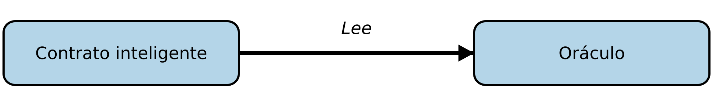
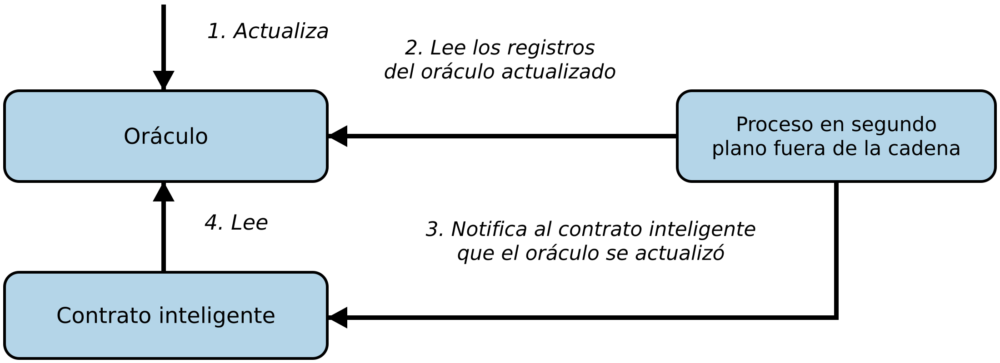
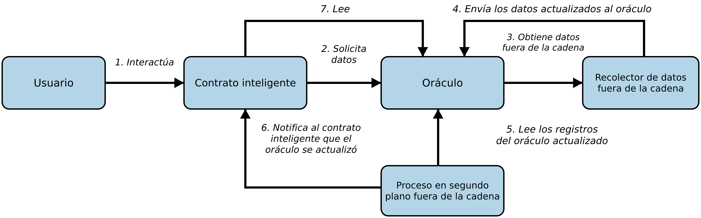
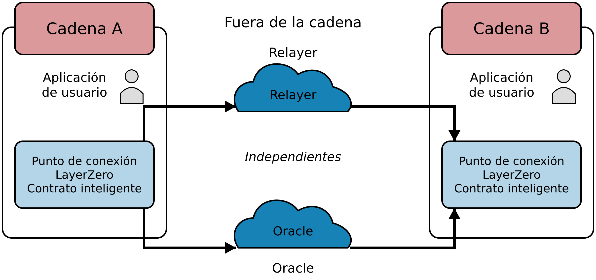
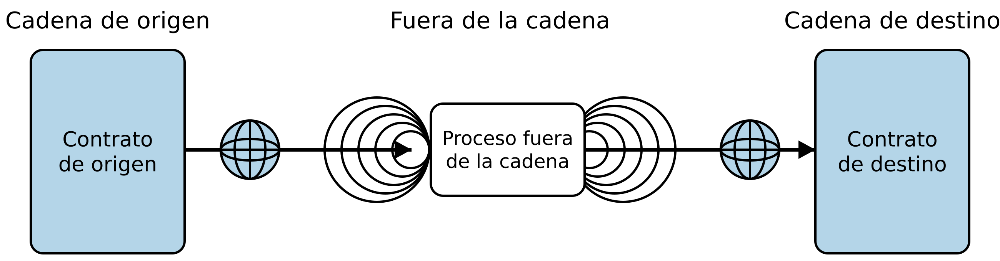

# Capítulo 11. Oráculos

En este capítulo, analizamos los *oráculos*, que son sistemas capaces de proporcionar fuentes de datos externas a los contratos inteligentes de Ethereum. El término *oráculo* proviene de la mitología griega, donde se refería a una persona en comunicación con los dioses que podía tener visiones del futuro. En el contexto de las blockchains, un oráculo es un sistema capaz de responder preguntas externas a Ethereum. Idealmente, los oráculos son sistemas que no requieren confianza, lo que significa que no es necesario confiar en ellos porque operan según principios descentralizados.

## Por qué se necesitan oráculos

Un componente clave de la plataforma Ethereum es la EVM, con su capacidad de ejecutar programas y actualizar el estado de Ethereum, bajo las restricciones de las reglas de consenso, en cualquier nodo de la red descentralizada. Para mantener el consenso, la ejecución de la EVM debe ser totalmente determinista y basarse únicamente en el contexto compartido del estado de Ethereum y las transacciones firmadas. Esto tiene dos consecuencias particularmente importantes: la primera es que no puede haber una fuente intrínseca de aleatoriedad con la que puedan trabajar la EVM y los contratos inteligentes, y la segunda es que los datos extrínsecos solo pueden introducirse como carga de datos de una transacción.

Analicemos esas dos consecuencias con más detalle. Para comprender la prohibición de una función verdaderamente aleatoria en la EVM que proporcione aleatoriedad a los contratos inteligentes, consideremos su efecto sobre los intentos de alcanzar consenso después de ejecutar dicha función: el nodo A ejecutaría el comando y guardaría 3 en el almacenamiento persistente del contrato inteligente, mientras que el nodo B, al ejecutar el mismo contrato inteligente, guardaría 7 en su lugar. Así, los nodos A y B llegarían a conclusiones diferentes sobre cuál debería ser el estado resultante, pese a haber ejecutado exactamente el mismo código en el mismo contexto. De hecho, podría obtenerse un estado resultante diferente cada vez que se evalúe el contrato inteligente. Por lo tanto, no habría manera de que la red, con su multitud de nodos ejecutándose de forma independiente alrededor del mundo, llegara alguna vez a un consenso descentralizado sobre cuál debería ser el estado resultante. En la práctica, la situación empeoraría muy rápidamente respecto de este ejemplo porque los efectos en cadena, incluidas las transferencias de ether, se acumularían exponencialmente.

Hay que tener en cuenta que las funciones seudoaleatorias, como las funciones hash criptográficamente seguras (que son deterministas y, por lo tanto, pueden formar parte de la EVM, y de hecho lo hacen), no son suficientes para muchas aplicaciones. Pensemos en un juego de apuestas que simula lanzamientos de monedas para determinar los pagos de las apuestas y que necesita generar cara o cruz al azar: un proponente de bloques puede obtener una ventaja al participar en el juego e incluir sus transacciones únicamente en bloques en los que vaya a ganar. Entonces, ¿cómo sorteamos este problema? Todos los nodos pueden ponerse de acuerdo sobre el contenido de las transacciones firmadas, de modo que la información extrínseca, incluidas las fuentes de aleatoriedad, la información de precios, los pronósticos meteorológicos y demás, puede introducirse como parte de los datos de las transacciones enviadas a la red. Sin embargo, sencillamente no se puede confiar en esos datos porque provienen de fuentes no verificables. Por lo tanto, solo hemos pospuesto el problema. Utilizamos oráculos para intentar resolver estos problemas, que analizaremos en detalle en el resto de este capítulo.

## Casos de uso y ejemplos de oráculos

Idealmente, los oráculos proporcionan una manera que no requiere confianza (o que casi no la requiere) de incorporar información extrínseca (es decir, del "mundo real" o fuera de la cadena) a la plataforma Ethereum para que la utilicen los contratos inteligentes, como los resultados de partidos de fútbol, el precio del oro o números verdaderamente aleatorios. También pueden utilizarse para transmitir datos de forma segura directamente a los frontends de las DApps. Por lo tanto, los oráculos pueden entenderse como un mecanismo que conecta el mundo fuera de la cadena con los contratos inteligentes. Principalmente, se utilizan para transmitir información entre distintas blockchains, como los precios de los tokens.

Permitir que los contratos inteligentes hagan cumplir relaciones contractuales basadas en eventos y datos del mundo real amplía enormemente su alcance. Sin embargo, esto también puede introducir riesgos externos en el modelo de seguridad de Ethereum. Consideremos un contrato de "testamento inteligente" que distribuye activos cuando una persona muere. Esto se discute con frecuencia en el ámbito de los contratos inteligentes y pone de relieve los riesgos de un oráculo de confianza. Si el monto de la herencia controlada por un contrato de este tipo es lo suficientemente alto, el incentivo para vulnerar[^1] el oráculo y activar la distribución de activos antes de que muera el propietario es muy alto.

[^1]: Esto también podría significar corromper al operador humano de un oráculo centralizado.

Hay que tener en cuenta que algunos oráculos proporcionan datos propios de una fuente privada específica, como certificados académicos o documentos de identidad gubernamentales. Se confía plenamente en la fuente de esos datos, como una universidad o una dependencia gubernamental, y la veracidad de los datos es subjetiva (la verdad solo se determina apelando a la autoridad de la fuente). Por lo tanto, esos datos no pueden proporcionarse sin confianza, es decir, sin confiar en una fuente, ya que no existe una verdad objetiva verificable de manera independiente. Por ello, incluimos estas fuentes de datos en nuestra definición de lo que se considera un "oráculo", porque también proporcionan un puente de datos para los contratos inteligentes. Los datos que proporcionan generalmente adoptan la forma de atestaciones, como pasaportes o registros de logros. Las atestaciones serán una parte importante del éxito de las plataformas blockchain en el futuro, particularmente en lo relacionado con la verificación de identidad o reputación, por lo que es importante explorar cómo pueden proporcionarlas las plataformas blockchain.

Otros ejemplos de datos que pueden proporcionar los oráculos incluyen:

- Números aleatorios o entropía de fuentes físicas, como procesos cuánticos o térmicos (por ejemplo, para seleccionar de manera justa a un ganador en un contrato inteligente de lotería)

- Activadores paramétricos vinculados a amenazas naturales (por ejemplo, la activación de contratos inteligentes de bonos catastróficos, como las mediciones en la escala de Richter para un bono contra terremotos)

- Datos de tipos de cambio (por ejemplo, para vincular con precisión las criptomonedas a una moneda fíat)

- Datos de los mercados de capitales (por ejemplo, la valoración de canastas de activos o valores tokenizados)

- Datos de referencia de indicadores (por ejemplo, la incorporación de tasas de interés a derivados financieros inteligentes)

- Datos estáticos o seudoestáticos (por ejemplo, identificadores de valores, códigos de países, códigos de monedas, etc.)

- Datos de tiempo e intervalos para activadores de eventos basados en mediciones precisas del tiempo

- Datos meteorológicos (por ejemplo, cálculos de primas de seguros basados en pronósticos meteorológicos)

- Eventos políticos para la resolución de mercados de predicción

- Eventos deportivos para la resolución de mercados de predicción y contratos de deportes de fantasía

- Datos de geolocalización (por ejemplo, los utilizados en el seguimiento de cadenas de suministro)

- Verificación de daños para contratos de seguros

- Eventos que ocurren en otras blockchains para funciones de interoperabilidad

- Precio de mercado del ether (por ejemplo, para oráculos del precio del gas en moneda fíat)

- Estadísticas de vuelos (por ejemplo, las utilizadas por grupos y clubes para la compra conjunta de boletos de avión)

En las siguientes secciones, examinaremos algunas de las maneras en que pueden implementarse los oráculos, incluidos los patrones básicos de oráculos, los oráculos de cómputo, los oráculos descentralizados y las implementaciones de clientes de oráculos en Solidity.

## Patrones de diseño de oráculos

Por definición, todos los oráculos proporcionan algunas funciones clave. Entre ellas se incluye la capacidad de:

- Recopilar datos de una fuente fuera de la cadena (off-chain)

- Transferir los datos a la cadena (on-chain) mediante un mensaje firmado

- Poner los datos a disposición

Una vez que los datos están disponibles en un contrato inteligente, otros contratos inteligentes pueden acceder a ellos mediante llamadas de mensajes que invocan una función `retrieve` del contrato inteligente del oráculo; los nodos de Ethereum o los clientes con conexión a la red también pueden acceder a ellos directamente.

Las tres maneras principales de configurar un oráculo pueden clasificarse como lectura inmediata, publicación-suscripción y solicitud-respuesta.

### Lectura inmediata

Comencemos con el tipo más sencillo de oráculo. Los oráculos de lectura inmediata son aquellos que proporcionan datos necesarios únicamente para una decisión inmediata, como "¿Cuál es la dirección de ethereumbook.info?" o "¿Esta persona tiene más de 18 años?". Esto se ilustra en la Figura 11-1.

Figura 11-1. Oráculo de lectura inmediata

Quienes desean consultar este tipo de datos suelen hacerlo "justo a tiempo"; la consulta se realiza cuando se necesita la información y posiblemente nunca más. Entre los ejemplos de estos oráculos se encuentran los que contienen datos sobre organizaciones o emitidos por ellas, como certificados académicos, códigos de marcación telefónica, membresías institucionales, identificadores de aeropuertos, identificaciones autosoberanas y similares.

Este tipo de oráculo guarda los datos una vez en el almacenamiento persistente de su contrato, donde cualquier otro contrato inteligente puede consultarlos mediante una llamada de solicitud al contrato del oráculo. Los datos pueden actualizarse. Los datos del almacenamiento persistente del oráculo también están disponibles para su consulta directa por parte de aplicaciones con acceso a la blockchain (es decir, conectadas a un cliente de Ethereum), sin tener que pasar por los trámites ni incurrir en los costos de gas de emitir una transacción. Una tienda que necesite verificar la edad de un cliente que quiere comprar alcohol podría utilizar un oráculo de esta manera. Este tipo de oráculo resulta atractivo para una organización o empresa que, de otro modo, podría tener que ejecutar y mantener servidores para responder a esas solicitudes de datos.

Hay que tener en cuenta que es probable que los datos guardados por el oráculo no sean los datos sin procesar que este proporciona, por razones de eficiencia o privacidad, por ejemplo. Una universidad podría configurar un oráculo para los certificados de logros académicos de sus exalumnos. Sin embargo, guardar todos los detalles de los certificados (que podrían abarcar páginas de cursos realizados y calificaciones obtenidas) sería excesivo. En su lugar, basta con un hash del certificado. Del mismo modo, un gobierno podría querer incorporar las identificaciones de sus ciudadanos a la plataforma Ethereum, donde claramente los detalles incluidos deben mantenerse privados. De nuevo, aplicar hash a los datos (con más cuidado, en árboles de Merkle con sales) y guardar únicamente el hash raíz en el almacenamiento persistente del contrato inteligente sería una manera eficiente de organizar ese servicio.

### Publicación-suscripción

La siguiente configuración es publicación-suscripción, donde un oráculo que proporciona, en la práctica, un servicio de difusión de datos que se espera que cambien (quizás tanto de manera regular como frecuente) es consultado periódicamente por un contrato inteligente en la cadena o vigilado por un proceso en segundo plano fuera de la cadena para detectar actualizaciones, como se muestra en la Figura 11-2.

Figura 11-2. Oráculo de publicación-suscripción

> **Nota**  
>
> También es posible eliminar el proceso en segundo plano fuera de la cadena. El oráculo puede guardar la marca de tiempo de la actualización y pasarla al contrato inteligente cuando se leen los datos. De esta manera, el contrato inteligente conoce la última actualización de los datos y puede decidir si utilizarlos o no.

Esta categoría tiene un patrón similar al de las fuentes RSS, WebSub y otros servicios similares, donde el oráculo se actualiza con información nueva y un indicador señala que hay nuevos datos disponibles para quienes se consideran "suscritos". Las partes interesadas deben consultar periódicamente al oráculo para comprobar si la información más reciente ha cambiado o escuchar las actualizaciones de los contratos de oráculos y actuar cuando ocurran. Entre los ejemplos se incluyen fuentes de precios, información meteorológica, estadísticas económicas o sociales, datos de tráfico, etc.

Las consultas periódicas son muy ineficientes en el mundo de los servidores web, pero no tanto en el contexto P2P de las plataformas blockchain. Los clientes de Ethereum tienen que mantenerse al día con todos los cambios de estado, incluidos los cambios en el almacenamiento persistente de los contratos, por lo que consultar cambios en los datos es una llamada local a un cliente sincronizado. Los registros de eventos de Ethereum facilitan especialmente que las aplicaciones detecten actualizaciones de los oráculos, por lo que, en cierto modo, este patrón puede incluso considerarse un servicio de envío proactivo.

### Solicitud-respuesta

La categoría solicitud-respuesta es la más complicada: en ella, el espacio de datos es demasiado grande para guardarse en un contrato inteligente y se espera que los usuarios necesiten solo una pequeña parte del conjunto de datos total cada vez, como se muestra en la Figura 11-3. También es un modelo aplicable a las empresas proveedoras de datos.

Figura 11-3. Oráculo de solicitud-respuesta

En términos prácticos, un oráculo de este tipo podría implementarse como un sistema de contratos inteligentes en la cadena e infraestructura fuera de la cadena que se utiliza para monitorear solicitudes y obtener y devolver datos. Una solicitud de datos de una aplicación descentralizada normalmente sería un proceso asíncrono que implica varios pasos. En este patrón, primero una EOA realiza una transacción con una aplicación descentralizada, lo que da lugar a una interacción con una función definida en el contrato inteligente del oráculo. Esta función inicia la solicitud al oráculo, con los argumentos asociados que detallan los datos solicitados, además de información complementaria que podría incluir funciones de devolución de llamada y parámetros de programación temporal. Una vez validada esta transacción, la solicitud al oráculo puede observarse como un evento de la EVM emitido por el contrato del oráculo o como un cambio de estado; los argumentos pueden recuperarse y utilizarse para realizar la consulta efectiva a la fuente de datos fuera de la cadena. El oráculo también puede requerir un pago por procesar la solicitud, un pago de gas para la devolución de llamada y permisos de acceso a los datos solicitados. Por último, el propietario del oráculo firma los datos resultantes, atestiguando su validez en un momento determinado, y estos se entregan mediante una transacción a la aplicación descentralizada que realizó la solicitud, ya sea directamente o a través del contrato del oráculo, como se muestra en la Figura 11-3. Según los parámetros de programación temporal, el oráculo puede difundir transacciones adicionales que actualicen los datos a intervalos regulares (por ejemplo, información de precios al cierre del día).

Los pasos de un oráculo de solicitud-respuesta pueden resumirse de la siguiente manera:

1. Recibir una consulta de una DApp.

2. Analizar la consulta.

3. Comprobar que se proporcionen el pago y los permisos de acceso a los datos.

4. Obtener los datos pertinentes de una fuente fuera de la cadena (y cifrarlos si es necesario).

5. Firmar la(s) transacción(es) con los datos incluidos.

6. Difundir la(s) transacción(es) a la red.

7. Programar cualquier otra transacción necesaria, como notificaciones y similares.

También son posibles otros esquemas; por ejemplo, los datos pueden solicitarse a una EOA y ser devueltos directamente por ella, lo que elimina la necesidad de un contrato inteligente de oráculo. Del mismo modo, la solicitud y la respuesta podrían enviarse hacia y desde un sensor de hardware conectado al internet de las cosas. Por lo tanto, los oráculos pueden ser humanos, software o hardware.

El patrón solicitud-respuesta descrito aquí se observa comúnmente en las arquitecturas cliente-servidor. Si bien es un patrón de mensajería útil que permite a las aplicaciones mantener una conversación bidireccional, quizás no sea apropiado en determinadas condiciones. Por ejemplo, un bono inteligente que requiera una tasa de interés de un oráculo podría tener que solicitar los datos diariamente bajo un patrón solicitud-respuesta[^2] para asegurarse de que la tasa sea siempre correcta. Dado que las tasas de interés cambian con poca frecuencia, un patrón publicación-suscripción puede ser más apropiado en este caso, especialmente si se tiene en cuenta el ancho de banda limitado de Ethereum.

[^2]: Debido a esta asincronía, la DApp o el contrato solicitante debe diseñarse para manejar respuestas demoradas y no puede esperar recibir datos inmediatamente en la misma transacción.

Publicación-suscripción es un patrón en el que los publicadores (en este contexto, los oráculos) no envían mensajes directamente a los receptores, sino que clasifican los mensajes publicados en categorías distintas. Los suscriptores pueden expresar interés en una o más categorías y obtener únicamente los mensajes que les interesan. Con este patrón, un oráculo podría escribir la tasa de interés en su propio almacenamiento persistente interno cada vez que cambie. Varias DApps suscritas pueden sencillamente leerla del contrato del oráculo, lo que reduce el impacto sobre el ancho de banda de la red y minimiza los costos de almacenamiento persistente.

En un patrón de difusión o multidifusión, un oráculo publicaría todos los mensajes en un canal y los contratos suscritos escucharían el canal bajo distintos modos de suscripción. Por ejemplo, un oráculo podría publicar mensajes en un canal de tipos de cambio de criptomonedas. Un contrato inteligente suscrito podría solicitar el contenido completo del canal si necesitara la serie temporal para, por ejemplo, calcular un promedio móvil; otro podría requerir únicamente el tipo de cambio más reciente para calcular un precio al contado. Un patrón de difusión es apropiado cuando el oráculo no necesita conocer la identidad del contrato suscrito.

## Autenticación de datos

Si suponemos que la fuente de datos consultada por una DApp tiene autoridad y es confiable (un supuesto nada menor), queda una pregunta pendiente: dado que el oráculo y el mecanismo solicitud-respuesta pueden ser operados por entidades distintas, ¿cómo podemos confiar en este mecanismo? Existe una posibilidad concreta de que los datos sean manipulados en tránsito, por lo que es fundamental que los métodos fuera de la cadena puedan atestiguar la integridad de los datos devueltos. Dos enfoques comunes para la autenticación de datos son las *pruebas de autenticidad* y los *entornos de ejecución de confianza* (TEE).

Las pruebas de autenticidad se basan en garantías criptográficas de que los datos no han sido alterados en su recorrido desde la fuente hasta la blockchain. Estas pruebas trasladan la confianza del mecanismo de transporte a un atestador verificable, como un proveedor de datos, un tercero seguro o incluso una red descentralizada de nodos. Al validar firmas criptográficas o atestaciones de conocimiento cero en la cadena, un contrato inteligente puede confirmar que la información que recibe proviene efectivamente de la autoridad adecuada y no ha sido manipulada, a menudo sin necesidad de que la fuente de datos original implemente una lógica de firma especial.

> **Nota**  
>
> Un ejemplo práctico sería Chainlink VRF. En la documentación de Chainlink, podemos leer: "Para cada solicitud, Chainlink VRF genera uno o más valores aleatorios y una prueba criptográfica de cómo se determinaron esos valores. La prueba se publica y verifica en la cadena antes de que cualquier aplicación que la consuma pueda utilizarla". Por lo tanto, Chainlink VRF puede demostrar cómo generó el valor aleatorio y eso es, de hecho, una prueba de autenticidad.
>
> Chainlink VRF funciona haciendo que un contrato inteligente desplegado solicite un número aleatorio a la red de oráculos de Chainlink, proporcionando una pista que el oráculo no puede predecir. Cada oráculo utiliza su clave privada para generar un número aleatorio fuera de la cadena y luego publica el resultado y una prueba criptográfica correspondiente en la cadena. El contrato inteligente puede utilizar la clave pública del oráculo y la pista original para verificar que esta salida aleatoria no haya sido manipulada. Como la prueba se valida íntegramente en la cadena, un atacante no puede manipular el resultado sin invalidar las comprobaciones criptográficas. En caso de que un nodo se vea comprometido o deje de responder, su falla se registra en la cadena y, en última instancia, se lo excluye de proporcionar más aleatoriedad.

Los TEE refuerzan estas garantías al aprovechar enclaves de hardware especializados que protegen y atestiguan el código y los datos. Cuando un cómputo se ejecuta dentro de uno de estos enclaves, la CPU garantiza que los procesos externos no puedan interferir con él ni ver los datos subyacentes, lo que preserva tanto la integridad como la confidencialidad. El enclave puede proporcionar entonces una "atestación" (o prueba) firmada digitalmente de que un fragmento de código determinado, identificado mediante un hash criptográfico, se está ejecutando dentro del entorno seguro. Esto permite que los contratos inteligentes tengan garantías más sólidas de que los datos o cómputos externos no han sido alterados maliciosamente antes de llegar a la cadena. Los enclaves seguros también permiten funciones de privacidad, ya que las entradas sensibles pueden cifrarse y procesarse dentro del enclave sin revelarse nunca al resto del mundo.

En muchas redes de oráculos modernas, estos métodos pueden combinarse para reforzar aún más la autenticación de datos. Algunas se basan en conjuntos descentralizados de nodos independientes que obtienen y verifican datos de distintas fuentes y luego alcanzan consenso sobre el resultado correcto. Este sistema de múltiples operadores reduce considerablemente el riesgo de que un único actor malicioso comprometa la fuente de datos, ya que los nodos reciben incentivos y a menudo deben aportar garantías económicas para mantenerse honestos. Otras incorporan protocolos criptográficos avanzados para demostrar que los datos se obtuvieron de un punto de acceso determinado sin exponer los detalles subyacentes, lo que reduce la dependencia de verificadores totalmente centralizados. Algunos operadores de redes también despliegan enclaves de hardware para ejecutar su lógica de obtención de datos y garantizar que, incluso si el entorno anfitrión se ve comprometido, los resultados finales enviados a la blockchain permanezcan inalterados y puedan verificarse de manera independiente.

Independientemente de la implementación específica, el mayor desafío es garantizar que todos los datos obtenidos y pasados a una DApp sean precisos y confiables. Las pruebas de autenticidad proporcionan una manera robusta de rastrear y verificar dónde y cómo se obtuvieron los datos, mientras que los TEE ofrecen un medio respaldado por hardware para proteger todo el proceso de recopilación y transmisión de información fuera de la cadena.

> **Advertencia**  
>
> Como los TEE son relativamente nuevos, aún no se han sometido a pruebas exhaustivas y podrían contener numerosas vulnerabilidades no descubiertas, por lo que es probable que en el futuro se descubran y exploten nuevas vulnerabilidades.

## Oráculos de cómputo

Hasta ahora, solo hemos analizado los oráculos en el contexto de la solicitud y entrega de datos. Sin embargo, los oráculos también pueden utilizarse para realizar cómputos arbitrarios, una función que puede ser especialmente útil dado el límite de gas por bloque inherente a Ethereum y sus costos de cómputo comparativamente elevados. En lugar de limitarse a transmitir los resultados de una consulta, los oráculos de cómputo pueden utilizarse para realizar cómputos sobre un conjunto de entradas y devolver un resultado calculado que podría haber sido inviable calcular en la cadena. Por ejemplo, se podría utilizar un oráculo de cómputo para realizar un cálculo de regresión computacionalmente intensivo con el fin de estimar el rendimiento de un contrato de bonos.

Lagrange y Brevis, conocidos como *coprocesadores ZK*, permiten que los contratos inteligentes ejecuten cómputos intensivos fuera de la cadena y, aun así, garanticen la verificación en la cadena. Brevis, por ejemplo, permite que las DApps soliciten tareas complejas o datos históricos sin generar de antemano una prueba de conocimiento cero. En su lugar, la red publica los resultados de manera "optimista", suponiendo que son correctos. Una vez que los resultados se publican en la cadena, hay un período de impugnación durante el cual cualquiera puede cuestionarlos. Si los resultados se impugnan, el proponente debe producir una prueba completa de conocimiento cero para validar el resultado. Si no se proporciona ninguna prueba o si la prueba muestra que los resultados iniciales eran incorrectos, se recompensa a quienes los impugnaron y se penaliza a quienes enviaron resultados falsos. Si no surgen impugnaciones, los resultados se aceptan como válidos, lo que reduce drásticamente la cantidad de pruebas de conocimiento cero necesarias y los costos.

## Oráculos descentralizados

Si bien los oráculos centralizados de datos o de cómputo son suficientes para muchas aplicaciones, representan puntos únicos de falla en la red Ethereum. Se han propuesto varios esquemas en torno a la idea de oráculos descentralizados como medio para garantizar la disponibilidad de datos y crear una red de proveedores de datos individuales con un sistema de agregación de datos en la cadena.

Chainlink ha propuesto una red de oráculos descentralizada que consta de tres contratos inteligentes clave, un contrato de reputación, un contrato de emparejamiento de órdenes y un contrato de agregación, y un registro de proveedores de datos fuera de la cadena. El contrato de reputación se utiliza para llevar un registro del desempeño de los proveedores de datos. Las puntuaciones del contrato de reputación se utilizan para poblar el registro fuera de la cadena. El contrato de emparejamiento de órdenes selecciona ofertas de los oráculos utilizando el contrato de reputación. Luego formaliza un acuerdo de nivel de servicio, que incluye los parámetros de la consulta y la cantidad de oráculos necesarios. Esto significa que el comprador no necesita realizar transacciones directamente con los oráculos individuales. El contrato de agregación recopila respuestas (enviadas mediante un esquema de compromiso y revelación) de varios oráculos, calcula el resultado colectivo final de la consulta y, por último, devuelve los resultados al contrato de reputación.

Uno de los principales desafíos de un enfoque descentralizado de este tipo es la formulación de la función de agregación. Chainlink propone calcular una respuesta ponderada, lo que permite informar una puntuación de validez para cada respuesta de un oráculo. Detectar una puntuación inválida en este caso no es trivial, ya que depende de la premisa de que los datos atípicos, medidos por sus desviaciones respecto de las respuestas proporcionadas por pares, son incorrectos. Calcular una puntuación de validez basada en la ubicación de la respuesta de un oráculo dentro de una distribución de respuestas corre el riesgo de penalizar las respuestas correctas frente a las promedio. Por lo tanto, Chainlink ofrece un conjunto estándar de contratos de agregación, pero también permite especificar contratos de agregación personalizados.

Una idea relacionada es el *protocolo SchellingCoin*. En él, varios participantes informan valores y se toma la mediana como respuesta "correcta". Quienes informan deben proporcionar un depósito que se redistribuye en favor de los valores más cercanos a la mediana, lo que incentiva a informar valores similares a los de los demás. Se espera que un valor común, también conocido como *punto de Schelling*, que los participantes podrían considerar el objetivo natural y obvio en torno al cual coordinarse, sea cercano al valor real.

## Protocolos de mensajería entre cadenas

Numerosas aplicaciones requieren con frecuencia transferencias de datos e interacciones entre varias cadenas, cada una con su propia gobernanza comunitaria, reglas de consenso y estándares de tokens. Los protocolos entre cadenas han surgido como herramientas fundamentales para facilitar la comunicación entre blockchains, lo que permite que los contratos inteligentes y las aplicaciones descentralizadas accedan a una gama más amplia de servicios, liquidez y datos. Mientras que los oráculos incorporan información externa a una sola blockchain, los protocolos entre cadenas amplían ese concepto al conectar ecosistemas completos.

Una manera de entender los protocolos entre cadenas es como "capas de comunicación" especializadas que conectan blockchains. En lugar de utilizarse únicamente para incorporar datos externos, estos protocolos facilitan la transferencia de información entre cadenas.

Entre las iniciativas populares entre cadenas, LayerZero ofrece un marco para el intercambio ligero de mensajes entre blockchains. Su objetivo es proporcionar una capa de interoperabilidad más eficiente y flexible, centrándose en el "transporte" y la "validación" de mensajes. El diseño de LayerZero gira en torno a dos entidades clave fuera de la cadena, el Oracle y el Relayer, que colaboran para verificar transacciones entre cadenas, como se ilustra en la Figura 11-4.

Figura 11-4. Arquitectura entre cadenas de LayerZero

El Oracle realiza una consulta independiente sobre la prueba de una transacción o el encabezado de un bloque, mientras que el Relayer transmite la prueba en sí. Puede utilizarse un conjunto de Oracles y Relayers configurable por el usuario para descentralizar la confianza. Si el Oracle y el Relayer proporcionan los mismos datos, los contratos inteligentes de LayerZero en la cadena de destino aceptan el mensaje como válido, lo que permite que los desarrolladores creen soluciones complejas de interoperabilidad sin depender de un único proveedor de puentes o de una entidad centralizada.

Otro proyecto conocido, Wormhole, surgió para permitir transferencias principalmente entre Solana y Ethereum. Desde entonces, se ha ampliado para incluir otras redes, como Binance Smart Chain, Hyperliquid y Avalanche. El enfoque de Wormhole se basa en una red de guardianes que monitorean eventos en una sola cadena y firman mensajes que los atestiguan. Una vez que han firmado suficientes guardianes, la atestación se considera válida, lo que permite que el evento correspondiente (como una transferencia de tokens) se reconozca en la cadena de destino, como se ilustra en la Figura 11-5. Este esquema puede ayudar no solo con los puentes de tokens, sino también con tareas más complejas, como propuestas de gobernanza entre cadenas y transferencias de NFT. Wormhole busca reducir el riesgo de un punto único de falla mediante la seguridad combinada de varios guardianes; sin embargo, esto requiere seleccionar y mantener cuidadosamente los conjuntos de guardianes.

Figura 11-5. Arquitectura entre cadenas de Wormhole

Cross-Chain Interoperability Protocol (CCIP) de Chainlink se basa en la red de oráculos existente de la organización para proporcionar un marco generalizado de mensajería segura y transferencias de tokens entre blockchains. Se centra en ofrecer un alto grado de minimización de la confianza, apoyándose en oráculos descentralizados para verificar eventos en distintas redes. CCIP puede bloquear o quemar tokens en una cadena de origen y luego acuñarlos o desbloquearlos en la cadena de destino, lo que permite que las DApps amplíen sus funcionalidades a varios ecosistemas. Al reutilizar la infraestructura robusta que Chainlink ha desarrollado para fuentes de datos descentralizadas y aleatoriedad verificable, CCIP ofrece una vía natural para que los proyectos que ya dependen de estos servicios se amplíen hacia operaciones entre cadenas.

> **Nota**  
>
> También cabe mencionar Cross-Chain Transfer Protocol (CCTP) de Circle. Funciona de manera similar a CCIP, pero su uso principal es transferir USDC entre distintas cadenas mediante un puente. Chainlink ha integrado CCTP en CCIP.

Junto con estos protocolos, existe una cantidad creciente de capas de interoperabilidad y soluciones de puentes, cada una de las cuales ocupa un nicho ligeramente distinto. Proyectos como Polkadot y Cosmos, por ejemplo, se construyeron desde cero con capacidades entre cadenas, utilizando diseños como parachains y hubs para promover un intercambio fluido de activos y datos. El protocolo Inter-Blockchain Communication (IBC) de Cosmos utiliza la verificación mediante clientes, donde cada cadena conectada guarda "clientes ligeros" de otras cadenas. Polkadot protege las parachains mediante un conjunto compartido de validadores en la Relay Chain, agrupando las transacciones de cada parachain en un consenso unificado. Estas arquitecturas priorizan la escalabilidad y la seguridad, pero introducen sus propias curvas de aprendizaje, especialmente para los desarrolladores acostumbrados a entornos similares a Ethereum.

## Conclusión

Como puede verse, los protocolos entre cadenas y los oráculos proporcionan una función esencial a los contratos inteligentes al incorporar información externa a la ejecución del contrato. Con ello, por supuesto, los oráculos también introducen un riesgo significativo: si son fuentes de confianza y pueden verse comprometidos, pueden comprometer la ejecución de los contratos inteligentes a los que proporcionan datos. Al considerar el uso de un oráculo, en general se debe prestar mucha atención al modelo de confianza. Un contrato inteligente puede ser vulnerable a entradas potencialmente erróneas si se da por sentado que se puede confiar en el oráculo. Sin embargo, si los supuestos de seguridad se analizan con cuidado, los oráculos pueden ser muy útiles.

Los oráculos descentralizados pueden resolver algunas de estas inquietudes y ofrecer datos externos que no requieren confianza para los contratos inteligentes de Ethereum. Con una elección cuidadosa, se puede comenzar a explorar el puente entre Ethereum y el "mundo real" que ofrecen los oráculos.

También vimos cómo los protocolos entre cadenas actúan como puente entre Ethereum y otros ecosistemas, conservando gran parte del potencial y el riesgo asociados con los oráculos, pero ampliando aún más la gama de casos de uso y funcionalidades.
