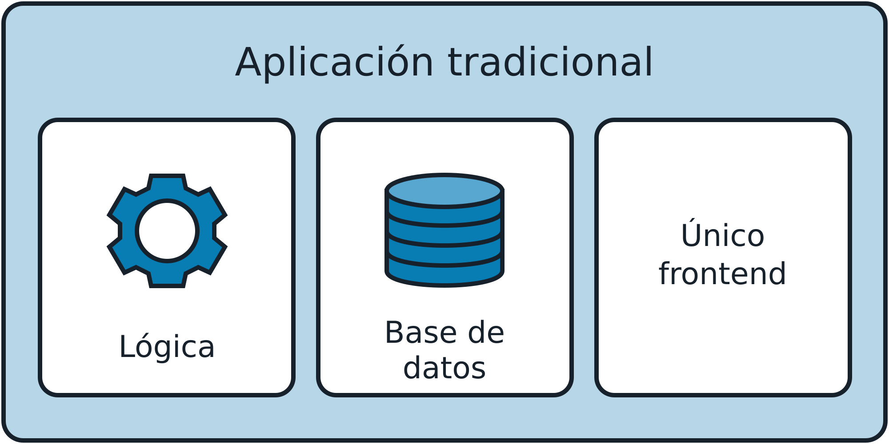
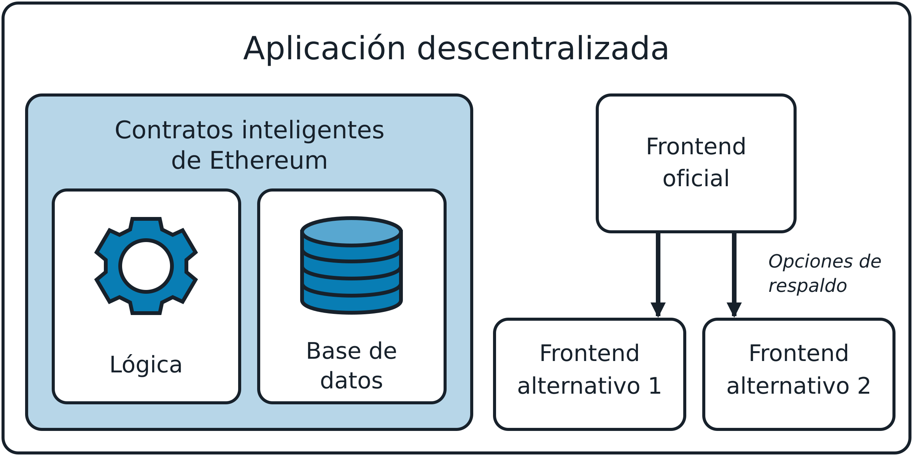
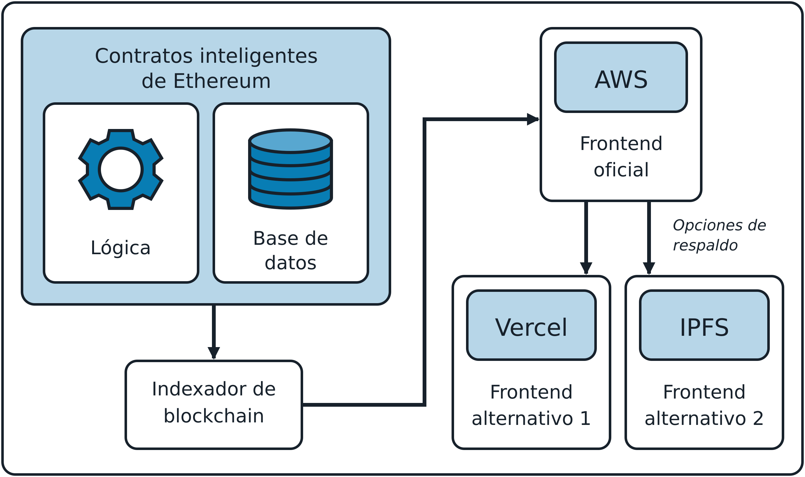
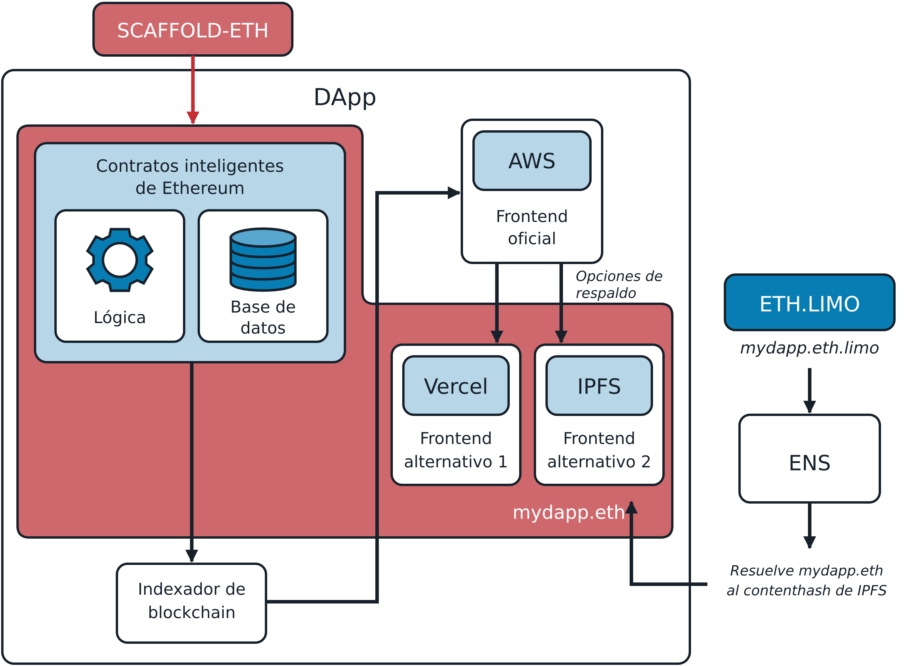

# Capítulo 12. Aplicaciones descentralizadas

En este capítulo, desmitificaremos las DApps y explicaremos qué son, cómo funcionan y cómo se estructura su arquitectura principal. Después de cubrir los fundamentos, recorreremos un ejemplo práctico en el que construiremos nuestra primera DApp desde cero. Esto incluye desplegar los contratos inteligentes necesarios, integrar un frontend y preparar toda la pila para un entorno cercano al de producción. Al terminar, tendremos tanto una DApp funcional como una comprensión sólida de los conceptos principales que sustentan estas aplicaciones innovadoras.

## ¿Qué es una DApp?

*DApp* significa *aplicación descentralizada*; representa un cambio de paradigma completamente nuevo frente a las aplicaciones tradicionales, que suelen tener la siguiente arquitectura, como se muestra en la Figura 12-1:

- Código cerrado para la parte lógica de la aplicación
- Una base de datos centralizada para almacenar los datos de la aplicación
- Un único frontend para que los usuarios accedan a la aplicación



Figura 12-1. Arquitectura general de una aplicación tradicional

Pensemos en Instagram, TikTok, nuestro banco o cualquier aplicación que tengamos ahora en el teléfono. Probablemente dependen de una arquitectura muy similar. Solo tenemos acceso a la aplicación si el equipo que la desarrolla quiere que accedamos a ella; no hay sitios web alternativos que podamos visitar para iniciar sesión en nuestra cuenta de Instagram si el oficial está fuera de servicio.

Las DApps tienen dos objetivos claros: no tener un punto único de falla y ser un producto que las personas puedan seguir usando incluso si todo el equipo desaparece. Su arquitectura se puede simplificar de la siguiente manera, como se muestra en la Figura 12-2:

- Varios contratos inteligentes de Ethereum constituyen la base de la parte lógica de la DApp. La mayoría de las veces, el código de Solidity (o Vyper) también es de código abierto.
- Los contratos inteligentes también pueden contener datos, funcionar como una verdadera base de datos y recopilar toda la información necesaria de los usuarios.
- Las personas pueden acceder a la aplicación mediante un frontend oficial, que se puede reemplazar fácilmente por uno alternativo (incluso uno creado por la comunidad) si el principal no funciona por cualquier motivo.



Figura 12-2. Arquitectura general de una DApp

> **Nota**  
>
> Las DApps también pueden tener algunos componentes fuera de la cadena (off-chain) con cierto grado de centralización, pero, por lo general, estos componentes no son fundamentales para la lógica principal de la aplicación. Pueden ser útiles para acelerar la aplicación en el caso habitual, pero siempre debería ser posible depender por completo de los datos en la cadena (on-chain) en el peor de los casos. Esto no siempre se cumple, y sin duda hay DApps con partes de su lógica principal que dependen de componentes centralizados. No son verdaderas aplicaciones descentralizadas, sino una forma híbrida entre las aplicaciones tradicionales y las totalmente descentralizadas.

En las siguientes secciones, exploraremos con más detalle cada componente de la pila de una DApp para comprender mejor cómo funcionan y cómo se relacionan entre sí y con el protocolo Ethereum.

## Backend (contrato inteligente)

En una DApp, la lógica de negocio principal y el almacenamiento persistente de datos se codifican en contratos inteligentes y se ejecutan en la blockchain de Ethereum, en lugar de residir en un servidor centralizado. La blockchain actúa como un backend descentralizado donde la red, en lugar de una sola entidad, hace cumplir la ejecución de las transacciones, los cambios de estado y el mantenimiento de los registros sin necesidad de confianza.

Los usuarios no necesitan confiar en ningún equipo centralizado para acceder a una DApp, porque pueden esperar que la red Ethereum siempre funcione correctamente, gestione todas sus transacciones y actualice correctamente el estado de los contratos inteligentes, sin importar el día ni la hora.

Además, esta arquitectura introduce una propiedad muy poderosa: la *resistencia a la censura*. Con las aplicaciones tradicionales, es muy frecuente que haya una lista de países a los que se les prohíbe acceder a la aplicación por leyes gubernamentales o cualquier otro motivo. Por ejemplo, en 2025, Facebook está prohibido en Brasil, China, Irán, Corea del Norte, Myanmar, Rusia, Turkmenistán y Uganda. Las personas de esos países no pueden crear un perfil ni iniciar sesión en la plataforma.

Con las DApps construidas sobre Ethereum, este tipo de censura ya no es posible. Aunque todavía se puede prohibir el sitio web oficial de una DApp en particular, nadie puede impedir que una dirección interactúe con ciertos contratos inteligentes en la cadena. Cualquiera podría intervenir y crear un frontend alternativo para la DApp, y todos podrían usarlo para volver a interactuar con ella.

### La saga de Tornado Cash

Vale la pena mencionar aquí la historia de Tornado Cash. Tornado Cash es un servicio de mezcla descentralizado que permite a cualquier persona, en cualquier lugar, mezclar criptomonedas rastreables o "contaminadas" con otras, ocultando el rastro hasta su origen al romper todos los vínculos entre el verdadero remitente y el destinatario de los fondos.

El 8 de agosto de 2022, la Oficina de Control de Activos Extranjeros del Departamento del Tesoro de Estados Unidos incluyó a Tornado Cash en su lista de bloqueo, lo que en la práctica prohibió su uso a ciudadanos y empresas estadounidenses. Se acusó a la plataforma de lavar más de $7 mil millones en criptomonedas. Dos días después, el 10 de agosto, uno de los desarrolladores de Tornado Cash, Alexey Pertsev, fue arrestado en Ámsterdam por el solo delito de crear la plataforma. Se eliminó el repositorio oficial de GitHub y se suspendieron las cuentas de los desarrolladores. En diciembre de 2024, el sitio web oficial sigue siendo inaccesible.

Ante todo esto, podríamos suponer que la DApp Tornado Cash dejó de funcionar, pero nada más lejos de la realidad. Aunque el servicio ha recibido menos atención (y liquidez) desde estos acontecimientos, el protocolo sigue siendo plenamente funcional y accesible mediante diversas pasarelas alojadas en IPFS. En otras palabras, cualquier persona del mundo puede seguir usando Tornado Cash tanto como antes, incluso sin el sitio web oficial original.

## Almacenamiento de datos

El almacenamiento de datos se refiere a la solución utilizada para guardar los datos de los usuarios. Es posible almacenar datos en contratos inteligentes y leerlos desde ellos, pero es una operación costosa que no escala bien; además, no todo necesita guardarse en la cadena.

Por lo general, los contratos inteligentes almacenan información de estado crítica y hacen cumplir la lógica de la DApp. La información clave, como los saldos de las cuentas, los registros de propiedad o los resultados de los cómputos, se almacena directamente en el contrato inteligente. Esto garantiza que los datos sensibles y con valor sigan siendo totalmente transparentes, resistentes a la manipulación y accesibles para cualquiera que tenga un nodo de Ethereum.

Toda la demás información se puede guardar en una solución de almacenamiento de datos menos descentralizada, como una base de datos clásica. Por ejemplo, los desarrolladores de DApps suelen usar indexadores para consultar datos rápidamente o bases de datos centralizadas para almacenar datos de los usuarios, de modo que el frontend no necesite interactuar en absoluto con la cadena de Ethereum.

> **Nota**  
>
> Un *indexador de blockchain* es una herramienta que permite a los desarrolladores consultar y analizar los datos almacenados en la blockchain de manera rápida y eficiente. Toma los datos de las transacciones, los transforma en datos legibles tanto por máquinas como por personas y los carga en una base de datos para facilitar su consulta.
>
> De hecho, no se pueden "buscar" datos directamente en la blockchain. Por ejemplo, supongamos que queremos saber cuántos tokens USDC tenía cierta cuenta en el bloque 15364050. No basta con ir al contrato inteligente de USDC y buscarlos, porque no almacena datos históricos. Podríamos tomar todas las transacciones que ocurrieron desde ese bloque hasta ahora, filtrarlas y extraer toda la información de transferencias de USDC relacionada con esa cuenta, y entonces, finalmente, obtener la respuesta. Como podemos imaginar, no es un enfoque deseable. Aquí es donde entran en juego los indexadores. Mantienen una estructura similar a una base de datos que permite ejecutar de inmediato una consulta para obtener cualquier información que necesitemos, incluida la información histórica, y recibir una respuesta rápidamente.

La idea es que solo necesitamos almacenar los datos esenciales y la lógica de la aplicación en la cadena para que cualquiera pueda verificar que la DApp funciona correctamente; todo lo demás puede y debe quedar fuera de la cadena.

### IPFS

*IPFS* es un sistema de almacenamiento descentralizado y direccionable por contenido que distribuye los objetos almacenados entre pares de una red P2P. *Direccionable por contenido* significa que se calcula el hash de cada elemento de contenido (archivo) y se usa ese hash para identificar el archivo. Luego, podemos recuperar cualquier archivo desde cualquier nodo de IPFS solicitándolo por su hash.

IPFS pretende reemplazar a HTTP como protocolo preferido para distribuir aplicaciones web. En lugar de almacenar una aplicación web en un solo servidor, los archivos se almacenan en IPFS y se pueden recuperar desde cualquier nodo de IPFS. Consulte la documentación de IPFS para obtener más información.

### Árboles de Merkle

Una solución interesante y de uso frecuente consiste en guardar los datos fuera de la cadena con una estructura de árbol de Merkle y almacenar solo la raíz de Merkle en la cadena. Así, no es necesario almacenar todos los datos en los contratos inteligentes, lo que costaría mucho dinero en comisiones de gas, pero aun así se puede realizar algún tipo de validación en la cadena.

> **Nota**  
>
> Nota editorial: los siguientes ejemplos de código hacen referencia a "whitelist" en un contexto técnico muy específico. Aunque este término tiene connotaciones problemáticas, también se usa ampliamente en la industria y su documentación. Si bien valoramos mucho la inclusión, los autores han optado por conservar el término tal como está para mantener la claridad en esta presentación de conceptos técnicos.

El caso de uso más común ocurre al crear una colección de NFT y querer incluir distintas direcciones en una lista de permitidos para que puedan acuñar esos NFT a un precio menor antes de que la venta pública se abra a todos. Hay dos opciones.

La primera es crear una variable de almacenamiento persistente dentro del contrato inteligente que asocie cada dirección con un valor booleano, que será verdadero para todas las direcciones de la lista de permitidos. Luego, se puede usar este mapeo para verificar si cierta dirección está efectivamente en la lista. El usuario no tiene que proporcionar nada al enviar la transacción de acuñación; el contrato simplemente comprueba que `msg.sender` esté incluido en el mapeo de permitidos, de la siguiente manera:

```solidity
// SPDX-License-Identifier: MIT
pragma solidity 0.8.28;

// Importar los contratos de OpenZeppelin.
import "@openzeppelin/contracts/token/ERC721/ERC721.sol";
import "@openzeppelin/contracts/access/Ownable.sol";

// Un contrato NFT simplificado con una función de acuñación con lista de permitidos que usa un mapeo para 
// almacenar las direcciones permitidas.
contract MyWhitelistNFT is ERC721, Ownable {
    // ... resto del contrato
    
    // Mapeo de direcciones permitidas
    mapping(address => bool) public isWhitelisted;
    
    /**
     * @notice Whitelist mint function.
     */
    function whitelistMint() external payable {
        // ... resto de la función
        
        // Comprobar si el usuario está en la lista de permitidos.
        require(isWhitelisted[msg.sender], "You are not whitelisted");
        
        // Acuñar el NFT.
        _safeMint(msg.sender, nextTokenId);
       // Reservar el ID del token antes de llamar al contrato receptor.
       uint256 tokenId = nextTokenId++;
       // Acuñar el NFT.
       _safeMint(msg.sender, tokenId);
    }
}
```

La segunda es crear un árbol de Merkle fuera de la cadena y almacenar la raíz de Merkle en el contrato, en la cadena. Luego, se entrega a cada usuario de la lista de permitidos su prueba de Merkle. El usuario envía la prueba de Merkle al contrato, que verifica en la cadena la validez de esa prueba (por lo general mediante algunas bibliotecas), de la siguiente manera:

```solidity
// SPDX-License-Identifier: MIT
pragma solidity 0.8.28;

// Importar los contratos de OpenZeppelin.
import "@openzeppelin/contracts/token/ERC721/ERC721.sol";
import "@openzeppelin/contracts/access/Ownable.sol";
import "@openzeppelin/contracts/utils/cryptography/MerkleProof.sol";

// Un contrato NFT simplificado con una función de acuñación con lista de permitidos que usa un árbol de Merkle para 
// almacenar las direcciones permitidas.
contract MyWhitelistNFT is ERC721, Ownable {
    // ... resto del contrato
    
    // La raíz de Merkle del árbol de Merkle generado fuera de la cadena.
    bytes32 public merkleRoot;
    
    /**
     * @notice Whitelist mint function.
     * @dev User must provide a merkle proof to prove they are whitelisted.
     * @param _merkleProof The proof that msg.sender is whitelisted.
     */
    function whitelistMint(bytes32[] calldata _merkleProof) external payable {
        // ... resto de la función
        
        // Verificar que (msg.sender) esté en el árbol de Merkle mediante la prueba proporcionada.
        bytes32 leaf = keccak256(abi.encodePacked(msg.sender));
        bool isValidLeaf = MerkleProof.verify(_merkleProof, merkleRoot, leaf);
        require(isValidLeaf, "Invalid Merkle Proof: Not whitelisted");
               
       // Reservar el ID del token antes de llamar al contrato receptor.
       uint256 tokenId = nextTokenId++;
       // Acuñar el NFT.
       _safeMint(msg.sender, tokenId);
    }  
}
```

La segunda opción es mucho más económica y eficiente que la primera, especialmente para listas de permitidos grandes.

> **Nota**  
>
> Este método reduce mucho los costos de gas, pero introduce el posible riesgo de un creador deshonesto de la lista de permitidos, a menos que el árbol y las pruebas sean auditables. Lo ideal es que la lista original utilizada para generar el árbol sea de código abierto y accesible, de modo que cualquiera pueda verificar la validez de la raíz de Merkle resultante.

## Frontend (interfaz web de usuario)

El frontend de una DApp se crea con cualquiera de los frameworks Web2 más conocidos, como React, Angular o Vue. La interacción con la cadena de Ethereum, si es necesaria, se abstrae mediante bibliotecas como `viem` o `ethers.js`.

Un enfoque ingenuo para construir el frontend de una DApp consiste en leer los datos solo directamente de la cadena para actualizar todos los componentes. Por ejemplo, si necesitamos mostrar los saldos de algunos tokens que posee una cuenta, podríamos consultar la blockchain y obtener la respuesta, y repetir este paso con cada bloque nuevo.

El principal problema de este enfoque ingenuo es que el sitio web se vuelve muy lento, y a los usuarios les podría resultar muy frustrante interactuar con un frontend así. Por eso, como mencionamos antes, los desarrolladores suelen usar componentes centralizados de almacenamiento de datos en la arquitectura de sus DApps para minimizar la interacción con la cadena: mejora toda la experiencia del usuario. Por lo tanto, se suele terminar con un frontend que depende de algunos componentes centralizados, pero siempre se puede verificar toda la información contrastándola con la blockchain. Llegado el caso, podríamos crear nuestro propio frontend alternativo para una DApp en particular si no confiamos en el oficial o sencillamente no nos gusta.

La Figura 12-3 muestra una arquitectura completa (simplificada) de una DApp.



Figura 12-3. Arquitectura completa de una DApp

## Un ejemplo básico de DApp

Hasta ahora, hemos explorado los conceptos básicos de una DApp. Es momento de ponernos manos a la obra y construir una DApp por nuestra cuenta.

Se pueden encontrar muchos tutoriales en línea para construir una primera DApp en Ethereum desde cero, pero recomendamos especialmente [Speedrun Ethereum](https://oreil.ly/Onygc). Es la manera más eficaz de aprender rápido y empezar de inmediato a construir cosas interesantes. Para ampliar los conocimientos sobre la creación de DApps en Ethereum, sugerimos completar todos los desafíos disponibles en Speedrun Ethereum y unirse a la [comunidad BuidlGuidl](https://buidlguidl.com).

En esta sección, construiremos una aplicación descentralizada muy básica, una especie de DApp "Hello World". No se necesita experiencia previa; solo una computadora y una conexión a internet.

### Requisitos de instalación

Para seguir este tutorial, es necesario instalar [node.js](http://node.js) y [yarn](https://oreil.ly/dq_hw) en la computadora. Consulte los sitios web oficiales para descargarlos e instalarlos. Usaremos [Scaffold-ETH 2](https://scaffoldeth.io), una herramienta muy útil que permite crear el entorno de desarrollo con mucha rapidez.

### Creación de la DApp

Abramos una terminal y ejecutemos el siguiente comando:

```bash
$ npx create-eth@latest
```

Se solicitará un nombre de proyecto. Elegimos "mastering-ethereum" para esta demostración:

```
 +-+-+-+-+-+-+-+-+-+-+-+-+-+-+ 
 | Create Scaffold-ETH 2 app | 
 +-+-+-+-+-+-+-+-+-+-+-+-+-+-+

? Your project name: mastering-ethereum
```

Luego, se solicitará el framework de Solidity que queremos usar. Aquí usaremos Hardhat, pero se puede elegir aquel con el que se tenga más familiaridad:

```
? What solidity framework do you want to use?
❯ hardhat
   foundry
  none
```

Después de un par de segundos, debería aparecer un mensaje "Congratulations" y unos "Next steps" similares a estos:

```
  Congratulations! Your project has been scaffolded! 🎉

  Next steps:

  cd mastering-ethereum
  
        Start the local development node
  
        yarn chain
  
        In a new terminal window, deploy your contracts
  
        yarn deploy
  
    In a new terminal window, start the frontend
  
    yarn start
  
 Thanks for using Scaffold-ETH 2 🙏 , Happy Building!
```

### Inicio de la cadena

Ya tenemos todo listo para empezar a construir nuestra DApp. Ingresemos a la carpeta del proyecto:

```bash
$ cd mastering-ethereum
```

Aquí se puede encontrar un contrato inteligente de ejemplo llamado `YourContract.sol` al ingresar en `packages/hardhat/contracts`. La carpeta `contracts` es donde se deben colocar todos los contratos inteligentes necesarios para el proyecto de DApp.

Dentro de `packages/nextjs`, encontraremos la estructura del framework nextjs ya preparada para el frontend de nuestra DApp.

Como este es un tutorial muy básico, no escribiremos contratos desde cero ni modificaremos el frontend. Usaremos los valores predeterminados para mostrar rápidamente el flujo de trabajo habitual.

Primero, es necesario iniciar una cadena para el desarrollo local. De hecho, aunque el producto final usará contratos inteligentes desplegados en la red principal de Ethereum, no se debería usar una cadena real para construir y probar la DApp. Sería muy lento y también un gran desperdicio de dinero. Scaffold-ETH incluye un comando muy útil y sencillo para iniciar de inmediato una nueva cadena de desarrollo local. Solo hay que ejecutar:

```bash
$ yarn chain
```

### Despliegue del contrato

Ahora, es necesario desplegar el contrato en la cadena local que se configuró en el paso anterior. De nuevo, Scaffold-ETH tiene un comando sencillo para hacerlo. Abramos una nueva terminal y escribamos:

```bash
$ yarn deploy
```

Debería aparecer algo como esto:

```
Generating typings for: 2 artifacts in dir: typechain-types for target: ethers-v6
Successfully generated 6 typings!
Compiled 2 Solidity files successfully (evm target: paris).
deploying "YourContract" (tx: 0x8ec9ba16869588c2826118a0043f63bc679a4e947f739e8032e911475e77dcb4)...: deployed at 0x5FbDB2315678afecb367f032d93F642f64180aa3 with 532743 gas
👋  Initial greeting: Building Unstoppable Apps!!!
📝  Updated TypeScript contract definition file on ../nextjs/contracts/deployedContracts.ts
```

Como se puede ver, este comando despliega el contrato llamado `YourContract`, el contrato inteligente de ejemplo, en la cadena local. En el futuro, al construir una DApp nueva, será necesario ir a `packages/hardhat/deploy` y modificar el archivo `00_deploy_your_contract.ts` para poder desplegar todos los contratos que realmente se necesiten.

Si volvemos a la terminal donde ejecutamos antes el comando `yarn chain`, debería haber nuevos registros, en particular uno similar a este:

```
eth_sendTransaction
  Contract deployment: <UnrecognizedContract>
  Contract address:    0x5fbdb2315678afecb367f032d93f642f64180aa3
  Transaction:         0x8ec9ba16869588c2826118a0043f63bc679a4e947f739e8032e911475e77dcb4
  From:                0xf39fd6e51aad88f6f4ce6ab8827279cfffb92266
  Value:               0 ETH
  Gas used:            532743 of 532743
  Block #1:            0xa7b8e3b6f82eccb3542279573dbf8efa2b876ff00807a8619feef191007e06d9
```

Observemos las líneas `Contract deployment` y `Contract address`. Eso demuestra que el contrato se desplegó correctamente en la cadena local en esa dirección de contrato específica.

### Inicio del frontend

El ejemplo de Scaffold-ETH incluye un frontend básico integrado para poder empezar a interactuar de inmediato con los contratos mediante una interfaz gráfica. Abramos una nueva ventana de terminal y escribamos:

```bash
$ yarn start
```

Debería devolver algo como lo siguiente:

```
yarn start
  ▲ Next.js 14.2.21
  - Local:        http://localhost:3000
 
 ✓ Starting...
 ✓ Ready in 1767ms
```

Ahora copiemos la URL de localhost, abramos el navegador y peguemos el enlace. Debería aparecer el frontend, como se muestra en la Figura 12-4.


Figura 12-4. Frontend de Scaffold-ETH

### Interacción con el contrato

Felicitaciones, ya está todo listo. Ahora podemos experimentar e interactuar con nuestra DApp. Hay un par de funciones muy útiles que resultarán fundamentales para el flujo de trabajo de desarrollo:

- Billeteras desechables
- Sección Debug Contracts

Como se puede ver en la Figura 12-4, en la esquina superior derecha ya estamos conectados al sitio web con una billetera que puede parecer aleatoria y desconocida. Esto se debe a que es una *billetera desechable*: una dirección generada automáticamente cuya clave privada se guarda de forma temporal en el navegador web. De hecho, si intentamos actualizar la página, notaremos que la dirección desechable no cambia.

Las billeteras desechables son una función extraordinaria para el flujo de trabajo de desarrollo, porque no es necesario abrir la billetera Web3 y conectarla al sitio web cada vez. Aun así, se puede hacerlo cuando se esté listo; solo hay que hacer clic en el menú desplegable y seleccionar Disconnect; luego, se puede hacer clic en Connect Wallet y elegir la billetera preferida de la lista, como se muestra en las Figuras 12-5, 12-6 y 12-7.


Figura 12-5. Desconectar la billetera desechable


Figura 12-6. Botón Connect Wallet


Figura 12-7. Elegir una billetera

La segunda función extraordinaria es la sección Debug Contracts. Para abrirla, basta con hacer clic en el enlace Debug Contracts en el centro de la página. Con el ejemplo predeterminado, ahora debería aparecer algo similar a la Figura 12-8.


Figura 12-8. Sección Debug Contracts

Aquí se puede interactuar fácilmente con todos los contratos sin tener que construir ningún tipo de frontend sobre ellos. Esto es muy útil durante el desarrollo para comprobar constantemente que los contratos funcionen como se espera.

Hagamos una pequeña demostración. Primero, necesitamos depositar fondos en nuestra billetera desechable para después poder enviar algunas transacciones e interactuar con el contrato desplegado. Para hacerlo, basta con hacer clic en el botón del extremo derecho, como se muestra en la Figura 12-9. Recibiremos algunos ETH casi de inmediato y veremos aumentar nuestro saldo de ETH.


Figura 12-9. Botón Grab funds

Ahora vayamos a la sección `setGreeting` y escribamos `hello world` en el campo "_newGreeting" y `0.1` en el campo "payable value". Luego, hagamos clic en el asterisco a la derecha del campo "payable value": transformará el valor en ETH en la misma cantidad representada en wei (1 ETH = 10<sup>18</sup> wei). Por último, podemos hacer clic en Send para enviar la transacción y ver cómo cambia el estado del contrato.

La Figura 12-10 muestra el estado del contrato antes de presionar el botón Send. Podemos ver que el contrato tiene 0 ETH, el saludo es "Building Unstoppable Apps!!!", premium es false y totalCounter es igual a 0.


Figura 12-10. Estado del contrato antes de la transacción

La Figura 12-11 muestra el estado del contrato después de enviar la transacción. Podemos ver de inmediato que el contrato ahora tiene 0.1 ETH, el saludo es "hello world", premium es true y totalCounter es igual a 1.


Figura 12-11. Estado del contrato después de la transacción

Podemos experimentar con esto y ver cómo se comporta el contrato según las entradas y acciones que realicemos.

### Despliegue del contrato en una blockchain real

Ahora que hemos experimentado con los contratos, es momento de desplegarlos en una blockchain real antes de publicar nuestra dApp para el mundo. Hasta ahora, ejecutar `yarn deploy` solo ha desplegado los contratos en nuestra red de pruebas local, a la que nadie más puede acceder, lo que significa que la dApp no funcionaría para nadie más que nosotros.

El primer paso es generar una cuenta de despliegue, es decir, la cuenta en la cadena que enviará la transacción para desplegar los contratos.

```bash
$ yarn generate
```

Se solicitará una contraseña opcional. Si todo sale bien, debería aparecer una salida similar a esta:

```bash
👛 Generating new Wallet

✔ Enter a password to encrypt your private key:
✔ Confirm password:

📄 Encrypted Private Key saved to packages/hardhat/.env file
🪄 Generated wallet address: 0x3a08bC7AF33bfED880C41A90FeE0D2776C98e3BF

⚠️ Make sure to remember your password! You'll need it to decrypt the private key.
```

Luego, es necesario depositar algunos ETH en la cuenta recién generada en la blockchain de destino. Para ver los detalles de la cuenta y su saldo actual, ejecutemos:

```bash
$ yarn account
```

Ahora estamos listos para desplegar el contrato en Ethereum ejecutando:

```bash
$ yarn deploy --network mainnet
```

Para completar la configuración, actualicemos el archivo `scaffold.config.ts` para que apunte a la red donde se hizo el despliegue (Ethereum en nuestro ejemplo). Cambiemos:

```bash
targetNetworks: [chains.hardhat],
```

por:

```bash
targetNetworks: [chains.mainnet],
```

El frontend ahora se conectará a los contratos que hemos desplegado en la red principal de Ethereum.

Opcionalmente, se pueden verificar los contratos en Etherscan con:

```bash
$ yarn verify --network mainnet
```

> **Nota**  
>
> Verificar un contrato en Etherscan permite a cualquiera ver y leer su código fuente en el explorador de bloques más popular de Ethereum, y confirmar que coincide con el bytecode que realmente se desplegó.

### Despliegue en Vercel

Cuando estemos satisfechos con nuestra aplicación descentralizada, podemos publicarla en un entorno de producción como Vercel. Vercel es una herramienta muy útil de frontend como servicio que permite desplegar fácilmente una aplicación en internet. También se puede vincular un dominio personalizado que se haya comprado para que las personas accedan a la DApp con solo escribir el nombre de dominio.

Scaffold-ETH vuelve a ayudarnos al proporcionar un único comando para desplegar de inmediato la DApp en Vercel. Abramos una terminal y escribamos:

```bash
$ yarn vercel:yolo
```

Será necesario vincular la cuenta de Vercel (o crear una si no se tiene) y elegir un nombre para el proyecto; eso es todo. Después de unos minutos, tendremos toda la DApp desplegada en Vercel y cualquier persona del mundo podrá probarla.

Si vamos a nuestro perfil de Vercel, ahora podremos ver el proyecto recién creado. Como se muestra en la Figura 12-12, hay un campo Domains donde se puede encontrar el dominio del sitio web que Vercel generó automáticamente.


Figura 12-12. Página del proyecto en Vercel

## Mayor descentralización de la DApp

En la sección anterior, desplegamos nuestra DApp en Vercel. Aunque Vercel es una de las soluciones más populares para alojar DApps, no es un servicio descentralizado. Todo reside en sus servidores propietarios, lo que significa que Vercel podría censurar a cualquier usuario según sus políticas y rastrear las direcciones IP de todas las personas que interactúen con nuestra DApp.

Para descentralizar aún más nuestra DApp, podemos alojar el frontend en soluciones como IPFS, una red P2P global de nodos. Un servicio emergente que vale la pena mencionar es `eth.limo`, que busca igualar la experiencia de usuario de los sitios web convencionales, por lo general servidos mediante plataformas centralizadas, con la solidez y la descentralización que ofrecen IPFS y tecnologías similares.

### Sitios web descentralizados

[Eth.limo](https://eth.limo/) es la pieza que falta para crear mejores sitios web descentralizados, también llamados *DWebsites*, a los que se puede acceder de la misma manera que a una aplicación clásica. Se basa en la tecnología ENS, que hace que las direcciones de Ethereum sean fáciles de usar mediante nombres de dominio `.eth`. Vitalik Buterin, uno de los cofundadores de Ethereum, usa ENS para vincular la dirección de su billetera, `0xd8dA6BF26964aF9D7eEd9e03E53415D37aA96045`, con el nombre fácil de recordar `vitalik.eth`.

ENS va más allá de vincular un dominio con una dirección de Ethereum: también puede resolver a un sitio web de IPFS (en realidad, al hash del contenido), algo como `bafybeif3dy…ga4zu`. El principal problema de los sitios web de IPFS es que los navegadores web más populares no pueden resolverlos correctamente y mostrar su contenido al usuario. Aquí es donde entra en juego `eth.limo`: opera un proxy inverso para nombres ENS y contenido de IPFS. Captura todas las solicitudes a `*.eth.limo` (básicamente, todos los sitios web que terminan en `.eth.limo`) y resuelve automáticamente el contenthash de IPFS del registro ENS solicitado, devolviendo el contenido estático correspondiente mediante HTTPS. Por ejemplo, al visitar el [blog oficial de Vitalik Buterin](https://vitalik.eth.limo), esto es lo que ocurre internamente:

1. Eth.limo detecta las solicitudes entrantes al dominio ENS `vitalik.eth`.
2. Lo resuelve al contenthash de IPFS (que Buterin configuró previamente) que contiene la página de inicio de su sitio web.
3. Devuelve el contenido estático correspondiente mediante HTTPS.

De esta manera, cualquier persona del mundo con un navegador web puede acceder fácilmente al contenido almacenado en IPFS sin necesidad de configuración ni preparación alguna.

### Limitaciones

Aunque los DWebsites en general, y `eth.limo` en particular, son tecnologías en evolución y mejoran con bastante rapidez, todavía existen algunas limitaciones al momento de escribir este capítulo (junio de 2025). En primer lugar, IPFS solo puede manejar archivos estáticos, por lo que no puede realizar ningún tipo de cómputo del lado del servidor. Además, para usar `eth.limo`, es necesario comprar un ENS y vincularlo al contenthash de IPFS del frontend. Y siempre se debe usar el dominio personalizado `*.eth.limo`; no se puede quitar la parte final `.limo`, o el navegador web no podrá resolver el nombre ENS al frontend de IPFS de la DApp. Probablemente por eso la mayoría de las DApps no usan `eth.limo`.

> **Consejo**  
>
> Aunque es cierto que la mayoría de los navegadores web todavía no son compatibles con ENS e IPFS, algunos están empezando a incorporar soporte para ellos. Un ejemplo es [Brave](https://oreil.ly/LlJT7).

Hay que señalar que `eth.limo` es otro tercero potencialmente centralizado que podría dejar de funcionar sin previo aviso. Si eso ocurriera, las DApps seguirían siendo accesibles mediante IPFS, pero la URL `.eth.limo` ya no redirigiría a los usuarios hacia ellas.

Si interesa profundizar en esta solución para construir sitios web totalmente descentralizados, se pueden encontrar muchos más detalles en el [sitio web oficial](https://eth.limo).

### Despliegue en IPFS

Scaffold-ETH 2 tiene otro comando sencillo que permite subir rápidamente una DApp a IPFS. Solo hay que abrir una nueva terminal y escribir:

```bash
$ yarn ipfs
```

¡Y listo! Debería aparecer algo como esto:

```
   Creating an optimized production build ...
 
 ✓ Compiled successfully
 ✓ Linting and checking validity of types
    
 ✓ Collecting page data
    
 ✓ Generating static pages (8/8)
 ✓ Collecting build traces
    
 ✓ Finalizing page optimization

…

🚀  Upload complete! Your site is now available at: https://community.bgipfs.com/ipfs/bafybei…
```

Si visitamos el sitio web mostrado, deberíamos ver nuestra DApp funcionando correctamente con el frontend alojado en IPFS. La cadena "bafy…" es el contenthash de IPFS. Todavía es necesario configurar `eth.limo` si se tiene un ENS personal y se quiere redirigirlo a este sitio alojado en IPFS.

Esto es lo que realmente ocurre internamente al ejecutar el comando `yarn ipfs`:

1. Se compila el frontend para tener los archivos estáticos listos para subir a IPFS.
2. Los archivos estáticos se suben a IPFS mediante el nodo comunitario de IPFS de BuidlGuidl (quienes mantienen Scaffold-ETH 2).
3. Se devuelve una URL que redirige a los archivos estáticos y funciona como proxy inverso para el contenido de IPFS (`community.bgipfs.com/<ipfs-content-hash>`).

Consulte [BuidlGuidl IPFS](https://www.bgipfs.com) para aprender a ejecutar su propio nodo de IPFS y fijar un clúster.

## De aplicación a DApp

A lo largo de las últimas secciones, hemos construido gradualmente una aplicación descentralizada. Usamos una herramienta llamada Scaffold-ETH para facilitar nuestro flujo de trabajo de desarrollo: iniciamos una cadena local, desplegamos nuestro contrato y pusimos en marcha un frontend local para empezar a interactuar de inmediato con nuestra DApp y probarla. Luego, publicamos el frontend de la DApp en Vercel para mostrar lo sencillo que es desplegar una DApp en un entorno preparado para producción. Por último, exploramos cómo descentralizar aún más nuestra DApp al publicar el frontend en IPFS y usar soluciones como ENS y `eth.limo`, lo que permite a cualquiera acceder a ella sin instalar una aplicación especial.

La Figura 12-13 ofrece una descripción concisa de la pila de ingeniería necesaria para crear una aplicación totalmente descentralizada.



Figura 12-13. Descripción concisa de la pila completa de ingeniería de una DApp

## Conclusión

En este capítulo, exploramos cómo construir una DApp básica desde cero con herramientas modernas para agilizar el flujo de trabajo de desarrollo. En el próximo capítulo, examinaremos con más detalle algunas de las DApps y categorías de DApps más importantes de Ethereum, que en conjunto crean lo que se conoce como DeFi.
