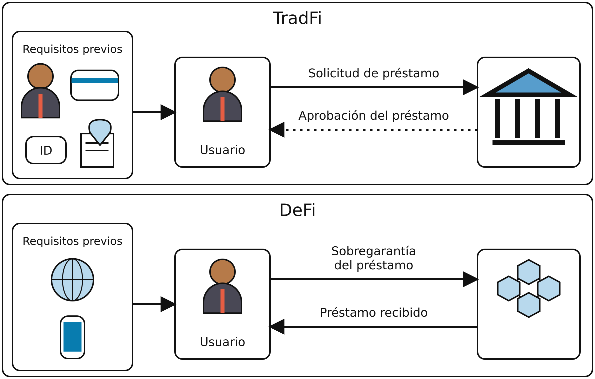
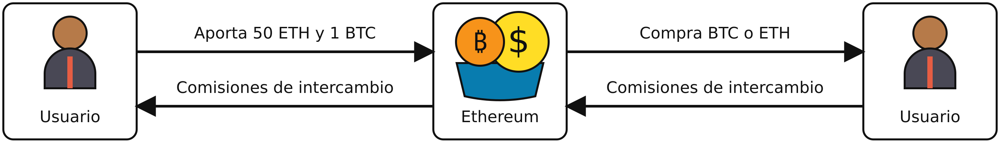
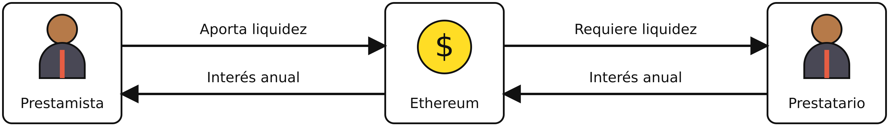
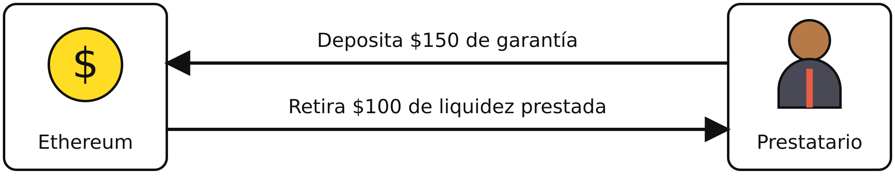
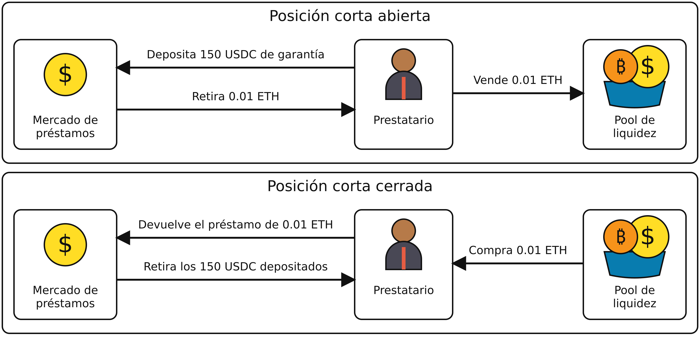
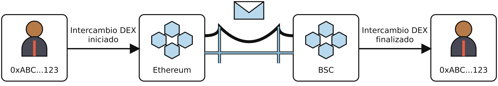

# Capítulo 13. Finanzas descentralizadas

Los contratos inteligentes de Ethereum han abierto un mundo de posibilidades más allá de las simples transacciones con criptomonedas. Las *finanzas descentralizadas* (DeFi) llevan esto al siguiente nivel al crear un ecosistema financiero completo que opera íntegramente en la blockchain. Imaginemos servicios financieros tradicionales como otorgar y obtener préstamos, operar e invertir, pero sin necesidad de bancos, corredores ni ninguna autoridad centralizada. En su lugar, los contratos inteligentes en la blockchain de Ethereum se encargan de todo, dando paso a una nueva era de autonomía e innovación financieras.

Este enfoque descentralizado democratiza el acceso a los servicios financieros e introduce un nivel de transparencia y seguridad que suele faltar en las finanzas tradicionales. Cada transacción en la blockchain queda registrada públicamente y es inmutable, lo que permite que cualquiera verifique la autenticidad e integridad de los datos. Este nivel de transparencia reduce el riesgo de fraude y corrupción y crea un entorno financiero más confiable.

DeFi también abre oportunidades de inclusión financiera a escala global. En regiones donde la infraestructura bancaria tradicional está poco desarrollada o es inaccesible, DeFi ofrece una alternativa viable. Las personas pueden participar en la economía global con solo un teléfono inteligente y una conexión a internet. Esta capacidad podría mejorar las condiciones de vida de millones de personas al brindarles acceso a crédito, cuentas de ahorro y oportunidades de inversión que antes estaban fuera de su alcance. La programabilidad de los contratos inteligentes de Ethereum permite crear instrumentos y servicios financieros complejos que son difíciles o imposibles de implementar en el sistema financiero tradicional.

Actualmente, los principales usuarios de DeFi probablemente no sean las poblaciones con acceso limitado o nulo a servicios bancarios de los países en desarrollo, sino personas de países del primer mundo que buscan aprovechar la naturaleza altamente especulativa de las criptomonedas. Aunque siempre habrá espacio para la especulación, es importante asegurar que los productos financieros inclusivos sean accesibles para todas las personas del mundo.

## DeFi frente a las finanzas tradicionales

DeFi es la respuesta cryptopunk al sistema financiero tradicional (TradFi) y representa un campo que sigue evolucionando, pero que ya ha encontrado su nicho de usuarios comprometidos y creadores innovadores. La distinción entre DeFi y TradFi es compleja. Sin embargo, las diferencias más importantes radican en los medios de intercambio y las propiedades inherentes de la blockchain, como la apertura y la transparencia. DeFi utiliza principalmente criptomonedas, que suelen estar descentralizadas en distintos grados, mientras que TradFi depende de monedas fíat, que siempre están centralizadas al máximo.

Los sistemas TradFi suelen tener barreras de entrada elevadas. Abrir una cuenta bancaria, obtener un préstamo o invertir en los mercados financieros normalmente requiere abundante documentación y el cumplimiento de diversos requisitos regulatorios. Este proceso puede excluir a grandes segmentos de la población mundial, en particular a quienes viven en regiones con acceso limitado a servicios bancarios. Esto puede verse en la Figura 13-1.



Figura 13-1. Requisitos para préstamos en las finanzas tradicionales frente a DeFi

Un usuario común necesita cumplir muchos requisitos previos para iniciar una solicitud de préstamo, como una identificación, una dirección física comprobable, un número de Seguro Social, una cuenta bancaria, documentos firmados y un buen puntaje crediticio. Incluso con todo esto, la solicitud podría ser rechazada y, si se aprueba, probablemente transcurra mucho tiempo hasta que eso ocurra.

En DeFi solo se necesitan tres requisitos previos: un teléfono, una conexión a internet y suficientes activos para sobregarantizar el préstamo. Una vez cumplidos, el préstamo es instantáneo, descentralizado y sin permiso.

Por diseño, DeFi es más accesible. Cualquier persona con una conexión a internet puede interactuar con los protocolos DeFi, lo que abre los servicios financieros a miles de millones de personas excluidas del sistema tradicional. La gran accesibilidad de DeFi dificulta o imposibilita aplicar los mecanismos de TradFi para evaluar la solvencia crediticia y resolver fraudes, algo que algunos consideran una desventaja y otros, una mejora.

Otro aspecto fascinante de DeFi es su capacidad para crear nuevos instrumentos financieros imposibles dentro del sistema financiero tradicional. Por ejemplo, los préstamos flash permiten a los usuarios obtener fondos prestados sin garantía, siempre que devuelvan el préstamo dentro de la misma transacción. Esta capacidad, exclusiva de DeFi, abre un abanico de posibilidades para el arbitraje, los intercambios de garantías y otras maniobras financieras complejas que sencillamente no pueden replicarse en TradFi.

## Primitivas de DeFi

Mientras que criptomonedas como Bitcoin buscan mejorar y descentralizar el concepto de dinero, los proyectos DeFi se apoyan en esta base para descentralizar y mejorar los servicios financieros. Para comprender plenamente los servicios financieros que ofrece DeFi, es esencial entender varios conceptos clave.

### Aceptabilidad de los tokens en DeFi

En el ecosistema DeFi de Ethereum, cada token opera como un contrato distinto. Esto puede causar confusión entre principiantes, ya que puede haber tokens con nombres y funciones similares que, en realidad, son formas de dinero completamente diferentes.

Tomemos, por ejemplo, el rollup Arbitrum en Ethereum, donde dos tokens, USDC.e y USDC, parecen casi idénticos, pero difieren significativamente en términos de riesgo y aceptabilidad. Tanto USDC.e como USDC buscan mantener un valor vinculado a un dólar. Sin embargo, USDC se emite de forma nativa en la cadena Arbitrum, mientras que USDC.e es una versión de USDC transferida mediante un puente, que representa tokens trasladados de otra cadena a Arbitrum.

Los perfiles de riesgo de estos dos tokens son marcadamente diferentes. USDC.e conlleva todos los riesgos inherentes de USDC, pero añade el riesgo adicional asociado al proceso de transferencia mediante un puente, como la posibilidad de vulnerabilidades en los contratos inteligentes. La aceptabilidad, definida por cuán ampliamente se acepta una moneda o un token en diversos servicios financieros DeFi, también varía entre ambos. Algunos protocolos pueden admitir solo USDC.e, otros pueden admitir exclusivamente USDC y algunos pueden aceptar ambos.

### Plataformas de intercambio descentralizadas

Una *plataforma de intercambio descentralizada* (DEX) es una plataforma donde se pueden intercambiar criptomonedas directamente con otros usuarios sin necesidad de una autoridad central ni un intermediario. En lugar de depender de una empresa para facilitar las operaciones, las DEX usan contratos inteligentes para gestionar las transacciones automáticamente. Esto permite mantener el control de los fondos.

#### La evolución de las DEX

Quien haya operado en una plataforma de intercambio centralizada conoce el modelo de libro de órdenes. En este modelo, las órdenes de compra y venta se enumeran con los precios que los usuarios están dispuestos a pagar o aceptar. Cuando una orden de compra coincide con una de venta, se ejecuta la operación. El libro de órdenes muestra todas las órdenes pendientes, lo que permite a los operadores ver la profundidad y la liquidez del mercado.

En la cadena, este modelo nunca llegó a afianzarse porque las blockchains son mucho más lentas y costosas de usar que los sitios web tradicionales. La latencia al operar en el libro de órdenes y la necesidad de pagar la transacción de cada orden hacían que la experiencia del usuario fuera terrible. En 2017–2018, EtherDelta intentó implementar un libro de órdenes en la cadena, y después se probaron otros modelos puros de libro de órdenes, pero no lograron mucha adopción.

Bancor fue pionero en el modelo de *creador de mercado automatizado* (AMM). A diferencia del modelo de libro de órdenes, los AMM no dependen de que compradores y vendedores coloquen órdenes. En su lugar, usan pools de liquidez donde los usuarios aportan pares de tokens.[^1] Los precios se determinan mediante una fórmula basada en la proporción de tokens del pool. Este modelo permite mantener la liquidez y las operaciones de forma continua.

Uniswap mejoró significativamente y popularizó el modelo AMM con su fórmula sencilla pero eficaz *x × y = k*, donde el producto de las cantidades de los dos tokens permanece constante. En esta fórmula, *x* e *y* representan las cantidades de los dos tokens del pool y *k* es un valor constante. Cuando se realiza una operación, las cantidades de tokens cambian, pero el producto de las dos cantidades permanece igual, lo que asegura que el pool siempre proporcione liquidez. Esta innovación hizo que operar en plataformas de intercambio descentralizadas fuera más accesible y eficiente.

[^1]: Los tokens no siempre tienen que estar en pares, porque algunos pools de liquidez pueden tener tres o más tokens, pero la disposición más común y sencilla es en pares.

Una DEX permite que cualquiera se convierta en creador de mercado al aportar liquidez y obtener comisiones por sus aportes. Mientras haya suficiente liquidez, las operaciones pueden realizarse rápidamente y sin necesidad de permiso de una autoridad central, como puede verse en la Figura 13-2.[^2]

[^2]: A partir de la Figura 13-2, podría parecer que BTC se puede intercambiar de forma nativa en las DEX. Sin embargo, no es así. En las DEX, BTC suele estar representado por contratos derivados como Wrapped Bitcoin (WBTC), que son activos vinculados al precio de BTC, pero que conllevan un riesgo significativamente mayor que el BTC nativo en la blockchain de BTC. Los activos nativos normalmente solo están disponibles en sus respectivas cadenas nativas. En este ejemplo, el BTC utilizado en el pool no es BTC nativo, sino un derivado, de forma similar a como las stablecoins representan dinero fíat.



Figura 13-2. Pool de liquidez de una plataforma de intercambio descentralizada

#### Pérdida impermanente

Aportar liquidez en una DEX no está exento de riesgos. Además de los hackeos de contratos inteligentes, existe un riesgo más sutil llamado *pérdida impermanente*. Para entender la pérdida impermanente, primero necesitamos comprender el modelo básico de pool de Uniswap V2.

Muchas DEX populares, como Uniswap V2, usan la fórmula de producto constante *x × y = k*, donde *x* e *y* son las cantidades de dos tokens en un pool de liquidez y *k* es una constante. El precio de un token se determina por la proporción de tokens del pool. Por ejemplo, si un pool contiene 100 USDC y 10 ETH, el precio de 1 ETH es 100 ÷ 10 = 10 USDC. Si el pool cambia a 200 USDC y 10 ETH (debido a operaciones), el precio de 1 ETH pasa a ser 200 ÷ 10 = 20 USDC.

Esta fórmula es una manera simplificada de entender cómo funcionan los pools. Al aportar liquidez, se actúa como creador de mercado. Cuando los usuarios compran ETH del pool, se vende ETH y se recibe USDC; cuando venden ETH, se compra ETH y se entrega USDC. A cambio, se obtienen comisiones por las operaciones. Sin embargo, este proceso expone a la pérdida impermanente, que ocurre cuando el precio de los tokens del pool cambia respecto del momento en que se depositaron. Si el precio de ETH sube o baja significativamente, el valor de las tenencias en el pool puede ser menor que si se hubieran conservado los tokens originales, aunque se cobren comisiones.

Esta apertura también presenta un desafío importante para las DEX. Como cualquiera puede crear una blockchain y lanzar una DEX, ahora existen más de cien DEX (probablemente muchas más) en diversas blockchains. Esta abundancia fragmenta la liquidez y hace que los intercambios, en los que los usuarios cambian una criptomoneda por otra, sean menos eficientes de lo que serían en plataformas con liquidez consolidada. Esta fragmentación puede provocar un mayor *deslizamiento*, que es la diferencia entre el precio esperado de una operación y el precio real al que se ejecuta. Un deslizamiento elevado ocurre cuando no hay suficiente liquidez, lo que hace que las operaciones se ejecuten a precios menos favorables de lo previsto.

#### Por qué funciona la fórmula de producto constante

La elegancia de la fórmula *x × y = k* reside en su forma matemática: una hipérbola. Esto no es una simple coincidencia, sino una decisión de diseño deliberada que protege a los pools de liquidez de ser vaciados por completo.

**El problema de los precios lineales**

Imaginemos que una DEX usara en su lugar una fórmula de precios lineal (constante) sencilla, donde intercambiar 1 ETH siempre diera exactamente 2 USDC, sin importar cuánta liquidez quedara. Esto crea un entorno de negociación muy desfavorable: cada vez que esa tasa fija difiere del precio en el resto del mercado, quienes realizan arbitraje tienen un incentivo para operar contra el pool hasta agotar uno de los lados de las reservas:

1. Si el pool fija un precio de ETH inferior al del mercado (como en nuestro ejemplo de 2 USDC por ETH cuando ETH cotiza mucho más alto en otros lugares), cualquiera puede seguir intercambiando USDC por ETH hasta que prácticamente no quede ETH en el pool.
2. Si, en cambio, el pool fija un precio de ETH demasiado alto, los operadores venden ETH al pool y agotan USDC de la misma manera.
3. El pool no se reequilibra únicamente por el flujo de operaciones: las reservas permanecen sesgadas hacia un token hasta que se agota un activo, porque el precio cotizado nunca se ajusta a la liquidez restante.

Por eso las curvas de precio fijo o lineales son fundamentalmente inadecuadas para los AMM: permiten vaciar el pool por completo.

**La solución de la hipérbola**

La fórmula de producto constante *x × y = k* produce una curva hiperbólica que tiene una propiedad crítica: nunca toca ninguno de los ejes. A medida que se intenta comprar cada vez más de un token, el precio aumenta exponencialmente, lo que hace matemáticamente imposible reducir a cero cualquiera de los tokens.

```
Token Y (p. ej., USDC)
    │
200 ┤·
    │ ·
    │  ·
150 ┤   ·
    │    ·
    │     ·
100 ┤       ·    ← x × y = k (hipérbola)
    │         ·
    │           ··
 50 ┤              ···
    │                  ······
    │                          ·················
  0 ┼────────────────────────────────────────────→ Token X (p. ej., ETH)
    0        50       100       150       200
```

Consideremos un pool con 100 ETH y 200 USDC (k = 20,000):

- **Intercambiar 1 ETH por USDC**: se reciben aproximadamente 1.98 USDC (cerca de la proporción 1:2)
- **Intercambiar 50 ETH por USDC**: se reciben solo 66.67 USDC (no 100, como sugeriría un modelo lineal)
- **Intentar obtener los 200 USDC**: sería necesario aportar una cantidad infinita de ETH

La fórmula para calcular la cantidad de salida es:

```
Δy = (y × Δx) / (x + Δx)
```

Donde *Δx* es la cantidad de entrada y *Δy* es la cantidad de salida. A medida que *Δx* tiende a infinito, *Δy* se aproxima a *y* (la reserva total), pero nunca la alcanza.

Este comportamiento asintótico es lo que hace seguros a los AMM. Cuanto mayor sea la operación en relación con el tamaño del pool, peor será la tasa de intercambio. Esto crea *deslizamiento*, la diferencia entre el precio esperado y el precio real de ejecución, que desalienta de forma natural las operaciones que agotarían significativamente el pool.

La curva hiperbólica asegura que los pools de liquidez se protejan a sí mismos: cuanto más escaso se vuelve un token, más caro resulta, lo que crea una barrera económica que impide vaciarlo por completo. Esta elegante propiedad matemática fue lo que hizo revolucionaria la sencilla fórmula de Uniswap al permitir operaciones sin necesidad de confianza ni permiso.

> **Nota**
>
> Uniswap, que podría considerarse uno de los proyectos más importantes del panorama actual de DeFi, se inspiró en una publicación de Vitalik Buterin en Reddit de 2016. Hayden Adams, quien según se informa no tenía experiencia previa en programación, dedicó un año a desarrollar Uniswap V1 con el lenguaje de programación Vyper.

### Mercados de préstamos

Un *mercado de préstamos* o *mercado monetario* es una plataforma descentralizada que facilita otorgar y obtener préstamos en criptomonedas mediante contratos inteligentes que automatizan y aseguran todo el proceso. A diferencia de los sistemas financieros tradicionales, los mercados de préstamos operan sin intermediarios como los bancos y ofrecen una manera más transparente y eficiente de gestionar préstamos.

En un mercado de préstamos, los usuarios que quieren obtener intereses sobre sus criptoactivos pueden depositar sus fondos en un pool de préstamos. Estos depósitos contribuyen a la liquidez general de la plataforma. Los prestamistas obtienen intereses sobre sus depósitos, con tasas que suelen determinarse algorítmicamente según la oferta y la demanda dentro del pool. Cuanta más demanda de préstamos haya, mayores serán las tasas de interés, lo que incentiva a más prestamistas a aportar sus activos al pool.

Los prestatarios, por su parte, pueden acceder a estos fondos al aportar una garantía que normalmente vale más que la cantidad que desean pedir prestada. Esta sobregarantía es crucial en los préstamos para mitigar el riesgo de incumplimiento, principalmente porque la mayoría de los criptoactivos son muy volátiles y podrían dejar al mercado de préstamos con deuda incobrable[^3] si el préstamo no estuviera sobregarantizado. La garantía queda bloqueada en un contrato inteligente, lo que asegura que, si el prestatario no devuelve el préstamo, pueda liquidarse para cubrir el importe pendiente.

[^3]: La deuda incobrable ocurre cuando un prestatario incumple un préstamo y la garantía restante es insuficiente para cubrir el importe adeudado. Esto puede suceder por volatilidad repentina del mercado o por una valoración incorrecta de la garantía. A diferencia de la liquidación, en la que se vende la garantía para cubrir la deuda, la deuda incobrable permanece sin poder cobrarse, lo que causa una pérdida al protocolo de préstamos y sus usuarios.

Este sistema protege a los prestamistas y asegura que el pool de préstamos siga siendo solvente. En la Figura 13-3 puede verse una versión simplificada: el prestamista aporta liquidez y cobra intereses anuales pagados por el prestatario, quien retira la liquidez aportada.



Figura 13-3. Flujo básico de un mercado de préstamos

Las tasas de interés en los mercados de préstamos son dinámicas y fluctúan según las condiciones del mercado. Los algoritmos de la plataforma ajustan continuamente las tasas para equilibrar la oferta de fondos disponibles y la demanda de préstamos. Esto crea un ecosistema financiero eficiente y con capacidad de respuesta donde tanto prestamistas como prestatarios pueden beneficiarse de tasas justas determinadas por el mercado.

Los índices de garantía son otro aspecto importante de los mercados de préstamos. Estos índices determinan la cantidad de garantía necesaria para respaldar un préstamo. Por ejemplo, un índice de garantía común podría ser del 150%, lo que significa que, para obtener un préstamo de $100 en criptomonedas, un prestatario necesitaría depositar al menos $150 en garantías, como se muestra en la Figura 13-4. Esto asegura que haya un margen para absorber posibles pérdidas por la volatilidad de los precios.



Figura 13-4. Garantías de un mercado de préstamos

Si el valor de la garantía cae por debajo de un umbral determinado, los contratos inteligentes de la plataforma inician un proceso de liquidación. Esto implica vender la garantía para devolver el préstamo y proteger así a los prestamistas de posibles pérdidas. Los mecanismos de liquidación son esenciales para mantener la estabilidad y solvencia del pool de préstamos.

#### Incentivos en DeFi

La mayoría de los aspectos de DeFi son abiertos y dependen en gran medida de incentivos adecuados para funcionar eficazmente. Por ejemplo, el proceso de liquidación en la mayoría de los mercados de préstamos depende de que los usuarios vigilen continuamente si hay préstamos que puedan liquidarse. Cuando identifican estos préstamos, proceden a liquidarlos. Para motivar a los usuarios a realizar estas tareas, reciben una parte del importe liquidado como recompensa.

Este concepto de incentivos es una parte fundamental de la blockchain y DeFi. Muchos mecanismos de estos sistemas se diseñan en torno a principios de teoría de juegos para asegurar que los participantes actúen de maneras que mantengan y mejoren la funcionalidad y seguridad de la red. Los incentivos alinean las acciones de los usuarios con los objetivos generales del protocolo y crean un ecosistema autosostenible.

Como ocurre con la mayoría de las cosas en DeFi, la composabilidad es clave. Por sí solos, los mercados de préstamos pueden no parecer especialmente impresionantes, sobre todo porque la mayoría exige sobregarantías para solicitar un préstamo. Sin embargo, al combinar la capacidad de solicitar un préstamo con otras primitivas de DeFi, se obtiene una combinación potente que puede lograr diversos resultados.

Por ejemplo, se puede recrear un instrumento financiero llamado *venta en corto* al combinar un mercado de préstamos con una DEX. La venta en corto es una estrategia que se usa cuando se espera que el precio de un activo baje. En esencia, se pide prestado el activo y se vende al precio actual, con la esperanza de volver a comprarlo más adelante a un precio menor, devolver el activo prestado y quedarse con la diferencia.

Así se puede lograr una posición corta en DeFi:

1. **Aportar el activo A como garantía**: depositar el activo A como garantía en un mercado de préstamos.

2. **Obtener un préstamo del activo B**: pedir prestado el activo B, sobre el que se quiere abrir una posición corta.

3. **Vender el activo B en una DEX**: vender el activo B prestado en una plataforma de intercambio descentralizada.

Al hacer esto, se abre efectivamente una posición corta sobre el activo B con un apalancamiento de 1x.[^4] Si el precio del activo B baja, se puede volver a comprar al precio menor, devolver el préstamo y conservar la diferencia, como se muestra en la Figura 13-5. Esto demuestra cómo la composabilidad de los protocolos DeFi puede recrear estrategias financieras tradicionales en un entorno descentralizado.

[^4]: El tamaño de la posición corta está directamente relacionado con el importe prestado.



Figura 13-5. Estrategia de venta en corto mediante DeFi

Las aplicaciones de un mercado de préstamos son extensas y pueden no resultar evidentes de inmediato. Cabe preguntarse: ¿por qué obtener un préstamo sobregarantizado cuando se tiene el dinero? ¿Por qué no usar los fondos propios? En algunos escenarios, eso sería cierto. Sin embargo, los mercados de préstamos combinados con las DEX pueden recrear instrumentos financieros e incluso permitir abrir una posición larga sobre un activo en lugar de una posición corta. Otro beneficio de los mercados de préstamos es la posibilidad de evitar hechos imponibles. En muchas jurisdicciones, pedir prestado un activo no se considera un hecho imponible, mientras que venderlo sí.

Los posibles usos de los mercados de préstamos son vastos y exceden el alcance de este libro. Sin embargo, los mercados de préstamos mejoran la eficiencia del capital y, al combinarse con otros protocolos, ofrecen a los usuarios una flexibilidad considerable. También existen mercados de préstamos que no requieren sobregarantías, aunque actualmente no tienen una adopción significativa.

### Oráculos

Un oráculo para Ethereum, que analizamos en detalle en el Capítulo 11, es un servicio que lleva datos del mundo real a la blockchain y permite que los contratos inteligentes interactúen con información externa. Por ejemplo, puede proporcionar datos de precios de criptomonedas, condiciones meteorológicas o resultados deportivos, lo que permite ejecutar contratos inteligentes basándose en estos datos externos.

Los oráculos son esenciales para muchos aspectos de DeFi, incluida la seguridad de los mercados de préstamos. En estos mercados, el precio de un token puede obtenerse de las DEX. Sin embargo, depender únicamente de estas plataformas de intercambio puede hacer que el mercado de préstamos sea vulnerable a ataques con préstamos flash. En uno de estos ataques, un atacante pide prestada una gran suma de dinero, manipula el precio de una moneda o un token en una DEX y aprovecha ese cambio de precio para obtener ganancias.

Otra función vital de los oráculos es su capacidad para llevar números seudoaleatorios a la cadena. Como Ethereum es determinista, cada cómputo debe producir el mismo resultado cada vez, lo que permite que los nodos validen todos los bloques y transacciones de forma coherente. Sin embargo, esta naturaleza determinista significa que no puede existir verdadera aleatoriedad dentro de los componentes de Ethereum. Por ejemplo, si se construyera una plataforma de casino, generar números aleatorios sería esencial. Un método consiste en usar marcas de tiempo de bloques, hashes o cantidades de transacciones para crear números seudoaleatorios, pero este enfoque es vulnerable a ataques, ya que los proponentes de bloques podrían predecir o manipular estas propiedades de antemano para aprovecharse del casino.

Los oráculos permiten que la blockchain de Ethereum use datos externos, lo que abre muchas más posibilidades para distintas aplicaciones.

> **Consejo**  
>
> A partir de esta descripción, podría parecer que los oráculos son una entidad central y que hacen que DeFi, que se supone descentralizada, dependa de ellos. Sin embargo, aunque algunos aspectos de DeFi sí dependen de oráculos, los propios oráculos suelen estar muy descentralizados y no tienen un único punto de falla.

### Stablecoins

Las *stablecoins* son un tipo de criptomoneda diseñado para mantener un valor estable, normalmente vinculado a un activo de reserva como el dólar estadounidense, el euro o una canasta de bienes. Buscan combinar los beneficios de las criptomonedas, como la seguridad y la descentralización, con la estabilidad de las monedas fíat tradicionales.

Las stablecoins logran su estabilidad mediante distintos mecanismos. Las *stablecoins respaldadas por moneda fíat* están respaldadas por reservas de moneda fíat mantenidas en bancos u otros custodios de confianza. Por ejemplo, cada token USDC o USDT suele estar respaldado por una cantidad equivalente de dólares estadounidenses (USD).

Las *stablecoins respaldadas por criptomonedas* adoptan un enfoque distinto al estar respaldadas por otras criptomonedas. Dada la naturaleza volátil de los criptoactivos, estas stablecoins suelen estar sobregarantizadas para asegurar que puedan mantener su paridad. Un ejemplo conocido es DAI de MakerDAO,[^5] donde los usuarios bloquean Ethereum u otras criptomonedas como garantía para acuñar DAI. La sobregarantía proporciona un margen frente a la volatilidad de los activos subyacentes.

[^5]: MakerDAO ahora es Sky y DAI ahora es USDS.

También están las *stablecoins algorítmicas*, que no dependen de garantías, sino que usan algoritmos y contratos inteligentes para gestionar la oferta de la stablecoin y mantener estable su valor. Estas stablecoins ajustan la oferta según la demanda del mercado, expandiéndola o contrayéndola para mantener el precio objetivo. TerraUSD (UST) fue un ejemplo destacado de stablecoin algorítmica, aunque enfrentó problemas importantes que llevaron a su colapso.

No ha habido una stablecoin algorítmica exitosa y bien capitalizada; todos los intentos de construir una fracasaron de manera catastrófica o no encontraron un ajuste entre producto y mercado.

Las stablecoins también contribuyen significativamente a la liquidez en las DEX. Al ofrecer un activo estable y predecible, facilitan operaciones más fluidas y una mayor eficiencia del mercado. Los operadores pueden entrar y salir de posiciones fácilmente sin preocuparse por las fluctuaciones de precios, lo que es importante para el funcionamiento eficiente del mercado.

#### Limitaciones de las stablecoins respaldadas por moneda fíat

Un concepto interesante es que las stablecoins como USDC o USDT, que pueden canjearse por dólares en plataformas como Coinbase y Bitfinex, respectivamente, tienen un potencial de crecimiento limitado en cuanto a su capitalización de mercado. La *capitalización de mercado* es el valor total de todas las monedas en circulación, calculado al multiplicar el precio actual de la moneda por la oferta total.

El motivo de esta limitación es que, si el valor total de la stablecoin en una blockchain determinada supera el costo de atacar esa blockchain, se crean incentivos importantes para que actores maliciosos intenten un ataque. Esto se debe a que las posibles recompensas por comprometer la blockchain podrían superar los costos, lo que lo convierte en un riesgo real y cuantificable.

Afortunadamente, atacar una blockchain robusta y segura como Ethereum no es fácil ni barato. El alto costo y la complejidad de un ataque de este tipo actúan como fuertes disuasivos. Sin embargo, es importante tener siempre presente este concepto al considerar la escalabilidad y seguridad de las stablecoins en cualquier blockchain.

### Staking líquido

El *staking líquido* es un mecanismo que permite a los usuarios hacer staking de sus criptoactivos en una red PoS y conservar la liquidez de esos activos. Normalmente, cuando se hace staking de tokens, estos quedan bloqueados y no se puede acceder a ellos ni negociarlos hasta que termina el período de staking. El staking líquido resuelve este problema al emitir un token derivado que representa los activos en staking. Este token derivado puede negociarse, transferirse o usarse en otros protocolos DeFi, lo que permite a los usuarios mantener la liquidez mientras siguen obteniendo recompensas de staking.

Por ejemplo, si se hace staking de ETH en una plataforma de staking líquido, se podría recibir un token derivado como stETH. Mientras el ETH permanece en staking y sigue generando recompensas, el token stETH puede negociarse libremente o usarse en otras actividades DeFi, lo que brinda los beneficios del staking sin perder acceso a los fondos.

> **Nota**  
>
> Está surgiendo un nuevo tipo de derivado similar al staking líquido, conocido como *restaking líquido*. Con protocolos como EigenLayer, los tokens no solo se usan para hacer staking en la cadena Ethereum, sino también para asegurar otros servicios en un proceso llamado restaking. Este nuevo desarrollo ha suscitado preocupaciones sobre una posible sobrecarga del mecanismo de consenso de Ethereum.

El token recibido, como stETH emitido por Lido, actúa como una stablecoin vinculada al precio de ETH. Esto significa que conlleva no solo los riesgos típicos asociados a las stablecoins, como las vinculadas al dólar, sino también riesgos adicionales relacionados con el slashing. Los protocolos de staking líquido toman el ETH depositado por los usuarios, crean nodos validadores y obtienen recompensas de staking, que luego se redistribuyen a los tenedores del token derivado. Este proceso introduce el riesgo de slashing, por el que podría perderse parte del ETH en staking si los nodos validadores no operan correctamente.

Más allá de estos riesgos, el staking líquido podría crear riesgos sistémicos para la propia blockchain. Por ejemplo, al momento de escribir este libro, Lido tiene el 29% de todo el ETH en staking. Si este porcentaje aumenta al 33% o más, podría plantear problemas importantes.[^6] En junio de 2022 hubo una votación en la DAO de Lido para limitar el poder de staking de Lido e impedir que superara el umbral del 33%, con el fin de evitar un posible riesgo sistémico para Ethereum. Lamentablemente, la propuesta no fue aprobada.

[^6]: Si algún participante que hace staking tiene más del 33% del ETH en staking, en teoría podría atacar la cadena y detener el proceso de finalidad.

> **Nota**  
>
> También hubo controversia en torno a la votación, ya que la mayor parte de la oposición provino de unas pocas billeteras.

### Activos del mundo real

En el contexto de DeFi, los *activos del mundo real* (RWA) son activos tangibles o financieros tradicionales que se tokenizan y se llevan a la blockchain. Pueden incluir desde bienes raíces y materias primas hasta acciones, bonos e incluso obras de arte. La tokenización de estos activos implica convertir su valor en tokens digitales que pueden negociarse, prestarse o pedirse prestados en plataformas de blockchain.

Los RWA son algo controvertidos porque suelen requerir un custodio, lo que contradice el principio de las blockchains de no requerir confianza. Este sector es uno de los últimos en surgir realmente en DeFi y, hasta ahora, no ha habido problemas importantes con los protocolos de RWA. A pesar de ir en contra de los principios fundamentales de las criptomonedas, los RWA abren numerosas posibilidades nuevas.

Una aplicación importante de los RWA ha sido llevar bonos a la cadena, lo que permite a los usuarios acceder a la tasa relativamente libre de riesgo. Esto ha permitido que personas que no son ciudadanas estadounidenses accedan a las tasas de interés del 5% disponibles en Estados Unidos en 2023–2024. Otro uso valioso de los RWA es el fraccionamiento de activos tokenizados, como poseer una fracción de un inmueble.

Dado que este sector todavía está en sus primeras etapas, aún no hemos descubierto todo su potencial. Sin embargo, los riesgos asociados a la custodia son reales y preocupantes.

### Puentes y protocolos omnichain

A medida que evoluciona el ecosistema de blockchain, se ha desarrollado una gran variedad de redes con características y beneficios únicos. Sin embargo, estas redes suelen operar de forma aislada, lo que limita la transferencia fluida de activos y datos entre ellas. Los puentes y los protocolos omnichain buscan resolver este problema al facilitar interacciones entre cadenas y crear, en última instancia, un ecosistema de blockchain más interconectado.

> **Nota**  
>
> Los puentes suelen estar muy centralizados porque la mayoría de las blockchains desconocen el estado de otras cadenas. Al transferir fondos de la cadena A a la cadena B, normalmente hay una autoridad central que aprueba la operación del puente y desbloquea la liquidez en la cadena B. Esta centralización es una de las razones por las que los puentes se encuentran entre los protocolos más hackeados de DeFi.

Los *puentes* son protocolos especializados que facilitan la transferencia de activos y datos entre distintas blockchains, como se muestra en la Figura 13-6. Actúan como conectores y permiten que los tokens y otros activos digitales pasen de una cadena a otra. Por ejemplo, si se quieren transferir tokens de Ethereum a Binance Smart Chain (BSC), se usaría un puente.


Figura 13-6. Puente que conecta dos blockchains

Existen muchos modelos diferentes para transferir tokens de una cadena a otra mediante puentes. Cada puente usa un modelo específico. Los más comunes son los siguientes:

**Puentes de tokens envueltos (bloqueo y acuñación)**

En este modelo, un puente recibe tokens en la cadena A, los bloquea en un contrato inteligente y acuña un token envuelto (o "propietario") en la cadena B. El token envuelto actúa como un recibo que representa los tokens bloqueados. Para recuperar los tokens originales, se quema el token envuelto en la cadena B, lo que desbloquea los tokens en la cadena A.

Por ejemplo, supongamos que se usa "Mastering Bridge" para transferir ETH de Ethereum a BSC. Se envía ETH al contrato inteligente del puente en Ethereum y el puente acuña un token envuelto, como "MasteringETH", en BSC. Para regresar a Ethereum, se quema MasteringETH en BSC y el puente libera el ETH original. Estos tokens envueltos suelen tener que intercambiarse en una DEX para obtener el token nativo en la cadena B.

**Acuñación y quema**

Este modelo se usa comúnmente en proyectos que controlan las funciones de acuñación y quema de sus tokens. En lugar de bloquear tokens, el puente quema tokens en la cadena A (reduciendo la oferta) y acuña una cantidad equivalente en la cadena B. Esto requiere que el proyecto tenga autoridad sobre el contrato inteligente del token. Por ejemplo, un proyecto podría quemar tokens basados en ETH en Ethereum y acuñar el mismo token en BSC, manteniendo la oferta total entre cadenas.

**Puentes de liquidez**

El tipo más común, los puentes de liquidez, depende de pools de tokens en múltiples cadenas. Cuando se transfiere un token mediante un puente, este usa su liquidez para enviar el token equivalente en la cadena de destino, normalmente a cambio de una comisión. A diferencia de los puentes de tokens envueltos, no se acuñan tokens nuevos; el puente ya posee tokens en ambas cadenas.

Siguiendo el ejemplo anterior, si se transfiere ETH de Ethereum a BSC mediante un puente, se envía ETH al puente en Ethereum. Luego, el puente libera ETH de su pool de liquidez en BSC. Si el puente no controla la acuñación, debe mantener suficiente liquidez en BSC para facilitar las transferencias. Este modelo es popular por su sencillez, pero depende de la capacidad del puente para gestionar la liquidez de forma segura.

Los *protocolos omnichain*, analizados en el Capítulo 11 como protocolos de mensajería entre cadenas, amplían el concepto de interacciones entre cadenas al permitir una comunicación e interoperabilidad fluidas entre múltiples blockchains de forma simultánea. Estos protocolos buscan crear una capa unificada donde distintas blockchains puedan interactuar sin fricciones y permitir la transferencia de activos, datos e incluso funcionalidades de contratos inteligentes entre cadenas. La Figura 13-7 muestra un protocolo sencillo de mensajería omnichain que permite a los usuarios iniciar un intercambio en Ethereum y completarlo, recibiendo los fondos, en BSC.



Figura 13-7. Ejemplo de protocolo omnichain

## Finanzas (des)centralizadas

La descentralización siempre es difícil de definir y, la mayoría de las veces, es más una forma de expresar un resultado deseado que de describir una realidad. La mayoría de los protocolos DeFi no están verdaderamente descentralizados; suelen depender de direcciones con privilegios importantes o de decisiones tomadas por un equipo central de desarrollo, lo que crea una centralización del poder dentro de un sistema supuestamente descentralizado.

DeFi sigue en sus primeras etapas, y depende de quienes la adoptan primero dar forma a su futuro y encaminarla en la dirección correcta. Aunque la descentralización es el objetivo, es importante reconocer que no siempre es la realidad actual. Los mercados emergentes como DeFi pueden beneficiarse de cierto grado de centralización para tomar decisiones e implementar cambios rápidamente. Esta toma de decisiones centralizada puede proporcionar la agilidad necesaria para adaptarse y crecer en un entorno que evoluciona con rapidez.

A medida que DeFi siga madurando, el objetivo debería ser reducir progresivamente la centralización y avanzar hacia un modelo más descentralizado. Quienes adoptan DeFi primero tienen gran importancia en esta transición, al equilibrar la necesidad actual de eficiencia y decisiones rápidas con la visión final de descentralización. Al comprender y abordar las disyuntivas inherentes, la comunidad DeFi puede orientar la evolución del sistema para que se ajuste mejor a sus principios fundacionales de apertura, transparencia e inclusión.

## Riesgos y desafíos de DeFi

DeFi conlleva su propio conjunto de riesgos y desafíos, que los usuarios, incluidos los expertos, suelen malinterpretar. Cada protocolo DeFi presenta riesgos económicos específicos y riesgos generales de los contratos inteligentes. Además, según el grado de descentralización, puede haber riesgos de custodia o problemas de centralización.

Los riesgos de los contratos inteligentes son más fáciles de generalizar: los contratos inteligentes pueden ser hackeados y los custodios pueden actuar de forma maliciosa o cometer errores. Los riesgos económicos son más complejos y específicos de cada primitiva o protocolo DeFi. Por ejemplo, el riesgo en un mercado de préstamos es la liquidación, que a veces puede ocurrir indebidamente si el mercado no usa un oráculo adecuado. El riesgo al aportar liquidez a una DEX es la pérdida impermanente. En las stablecoins o el staking líquido, el principal riesgo es la pérdida de la paridad.

Es crucial comprender todos los riesgos involucrados en un protocolo DeFi antes de usarlo. Más allá de los riesgos, DeFi enfrenta desafíos importantes. Muchos protocolos son bifurcaciones de otros existentes que intentan realizar un "ataque vampiro" contra los ya establecidos sin ofrecer una innovación real. Esto no solo fragmenta la liquidez y los usuarios, sino que también diluye la eficacia general del ecosistema.

La liquidez es esencial para la mayoría de los protocolos. Aunque pueden funcionar bien en un mercado en auge, suelen deteriorarse significativamente durante las caídas. La mayoría de los protocolos DeFi no son autosuficientes y tienden a funcionar solo cuando se incentiva su uso, ya sea porque los usuarios no están realmente interesados en el producto o porque los costos superan las ganancias.

Aunque DeFi muestra cierto ajuste entre producto y mercado, su futuro sigue siendo incierto. Podría convertirse en una pieza atractiva de la infraestructura global, que es el resultado más probable, o seguir siendo un mercado de nicho para un grupo selecto de usuarios.

Un desafío importante para DeFi es la regulación. El entorno regulatorio varía mucho entre países y organismos reguladores, y la mayoría de los reguladores se opone a un sistema completamente descentralizado. Aunque los reguladores no pueden detener directamente estos sistemas, ya que no pueden intervenir directamente si un contrato inteligente es inmutable y está desplegado en la cadena, sí pueden actuar contra desarrolladores y usuarios, dificultándoles el uso de estos contratos inteligentes.

Un ejemplo es Tornado Cash, cuyo desarrollador, Alexey Pertsev, fue condenado a 64 meses de prisión en los Países Bajos. Fue arrestado en agosto de 2022 acusado de lavado de dinero, después de que el Departamento del Tesoro de Estados Unidos incluyera a Tornado Cash en su lista de bloqueo por su presunto uso por parte del grupo de hackers norcoreano Lazarus para lavar fondos ilícitos. El protocolo Tornado Cash sigue disponible, pero su liquidez ha disminuido significativamente, lo que empeora la experiencia del usuario. Además, las direcciones que usan Tornado Cash son marcadas en las plataformas de intercambio centralizadas, lo que complica su uso.

En otros ecosistemas están ocurriendo situaciones similares. Por ejemplo, los desarrolladores de Samourai Wallet también han enfrentado acciones legales. Este patrón ilustra que, aunque los reguladores no pueden atacar la propia blockchain, sí pueden actuar contra sus usuarios y desarrolladores.

> **Nota**  
>
> Aunque los autores de este libro quizá no tengan los conocimientos jurídicos necesarios para comprender plenamente los casos relacionados con Samourai Wallet o Tornado Cash y otras situaciones similares, no apoyamos las acciones legales contra personas por escribir código descentralizado. El código debe seguir siendo libre, y quien crea una herramienta no debería ser castigado por el uso indebido que otros hagan de ella. Esperamos que ningún desarrollador más tenga que enfrentar consecuencias tan injustas.

## Conclusión

DeFi permite a los usuarios ser más flexibles con su dinero y crea nuevas oportunidades y primitivas financieras innovadoras, como los préstamos flash. Como mercado emergente dentro del espacio de las criptomonedas, DeFi se desarrolla rápidamente, pero aún no ha encontrado un ajuste adecuado al mercado más allá de los intercambios de tokens, las stablecoins y la creación de derivados.
