# Capítulo 14. La máquina virtual de Ethereum

En el centro del protocolo y del funcionamiento de Ethereum se encuentra la *máquina virtual de Ethereum* (Ethereum Virtual Machine), o *EVM* para abreviar. Como se puede deducir de su nombre, es un motor de cómputo, no muy distinto de las máquinas virtuales del framework .NET de Microsoft o de los intérpretes de otros lenguajes de programación compilados a bytecode, como Java. En este capítulo, examinamos en detalle la EVM, incluidos su conjunto de instrucciones, su estructura y su funcionamiento, en el contexto de las actualizaciones del estado de Ethereum.

## ¿Qué es la EVM?

La EVM es la parte de Ethereum que se encarga del despliegue y la ejecución de contratos inteligentes. En la práctica, las transacciones simples de transferencia de valor de una EOA a otra no necesitan involucrarla, pero todo lo demás implica una actualización de estado calculada por la EVM. A grandes rasgos, la EVM que se ejecuta en la blockchain de Ethereum puede concebirse como una computadora global descentralizada que contiene millones de objetos ejecutables, cada uno con su propio almacén permanente de datos.

La EVM es una máquina de estados *cuasi-Turing completa*: "cuasi" porque todos los procesos de ejecución están limitados a un número finito de pasos de cómputo por la cantidad de gas disponible para cada ejecución de un contrato inteligente. De este modo, se "resuelve" el *problema de la parada* (todas las ejecuciones de programas se detendrán) y se evita la situación en que una ejecución pudiera continuar para siempre, de manera accidental o maliciosa, y paralizar así toda la plataforma Ethereum. Exploraremos el problema de la parada con más detalle en secciones posteriores.

La EVM tiene una *arquitectura basada en pila* y guarda todos los valores en memoria en una pila. Trabaja con un tamaño de palabra de 256 bits, principalmente para facilitar las operaciones nativas de hash y de curvas elípticas, y tiene varios componentes de datos direccionables:

- Una ROM inmutable de código de programa, cargada con el bytecode del contrato inteligente que se ejecutará
- Una memoria volátil, con cada posición inicializada explícitamente en cero
- Un almacenamiento transitorio que dura solo una transacción (y no forma parte del estado de Ethereum)
- Un almacenamiento persistente que forma parte del estado de Ethereum, también inicializado en cero

También hay un conjunto de variables de entorno y datos disponibles durante la ejecución. Los veremos con más detalle más adelante en este capítulo.

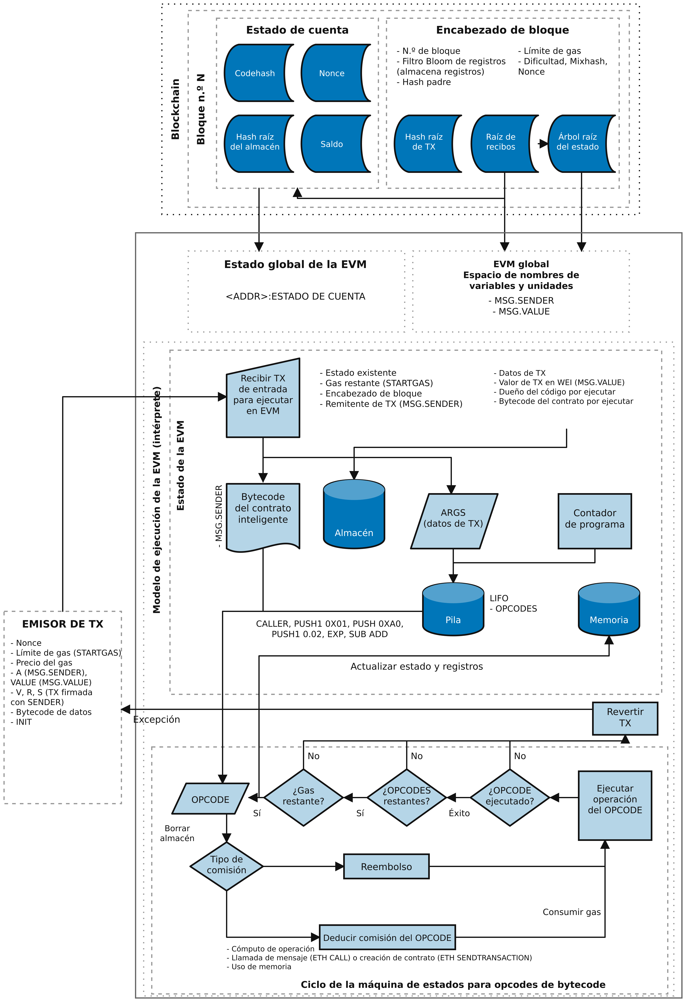

Figura 14-1. Arquitectura de la EVM y contexto de ejecución

## Comparación con tecnologías existentes

El término *máquina virtual* suele aplicarse a la virtualización de una computadora real, normalmente mediante un hipervisor como VirtualBox o QEMU, o de una instancia completa de un sistema operativo, como KVM de Linux. Estos deben proporcionar una abstracción de software, respectivamente, del hardware real y de las llamadas al sistema y otras funciones del kernel.

La EVM opera en un ámbito mucho más limitado: es solo un motor de cómputo y, como tal, proporciona una abstracción únicamente del cómputo y el almacenamiento, similar, por ejemplo, a la especificación de la máquina virtual de Java (JVM). Desde una perspectiva general, la JVM está diseñada para proporcionar un entorno de ejecución independiente del sistema operativo o del hardware del equipo anfitrión, lo que permite la compatibilidad con una amplia variedad de sistemas. Los lenguajes de programación de alto nivel, como Java o Scala (que usan la JVM) o C# (que usa .NET), se compilan al conjunto de instrucciones de bytecode de sus respectivas máquinas virtuales. Del mismo modo, la EVM ejecuta su propio conjunto de instrucciones de bytecode (descrito en la siguiente sección), al cual se compilan lenguajes de programación de contratos inteligentes de más alto nivel, como Solidity, Vyper y Yul.

Por lo tanto, la EVM no tiene capacidad de planificación, porque el orden de ejecución se organiza fuera de ella: los clientes de Ethereum recorren las transacciones de bloques verificados para determinar qué contratos inteligentes deben ejecutarse y en qué orden. En este sentido, la computadora mundial de Ethereum tiene un solo hilo, como JavaScript. La EVM tampoco maneja ninguna "interfaz de sistema" ni ofrece "soporte de hardware": no hay ninguna máquina física con la cual interactuar. La computadora mundial de Ethereum es completamente virtual.

## ¿Qué hacen otras blockchains?

La EVM es, sin duda, la máquina virtual más utilizada en el ámbito de las criptomonedas. La mayoría de las blockchains alternativas de L1 y L2 usan la EVM para mantener la compatibilidad con todas las herramientas y los frameworks existentes y para atraer proyectos y desarrolladores directamente de la comunidad de Ethereum.

Sin embargo, en los últimos años han surgido varias máquinas virtuales diferentes: Solana VM, Wasm VM, Cairo VM y Move VM son probablemente las más conocidas e interesantes, cada una con sus propias ventajas y desventajas. Adoptan distintos enfoques para el desarrollo de contratos inteligentes:

**Lenguajes personalizados**

Algunas plataformas, como Cairo y Move, han creado lenguajes de programación especializados específicamente para escribir contratos inteligentes. Esto es similar a cómo Ethereum usa Solidity y Vyper para su máquina virtual, la EVM.

**Lenguajes estándar**

Otras, como Solana y las que usan WebAssembly (Wasm), permiten que los desarrolladores escriban contratos inteligentes con lenguajes de programación de uso extendido. Por ejemplo, estas plataformas suelen admitir Rust para el desarrollo de contratos inteligentes.

Otro ámbito en que estas máquinas virtuales alternativas difieren de la EVM es la *paralelización* de las transacciones. Ya dijimos que la EVM procesa las transacciones de manera secuencial, sin ningún tipo de paralelización. Algunos proyectos tomaron esta desventaja e intentaron mejorarla. Por ejemplo, tanto Solana VM como Move VM pueden manejar la ejecución paralela de transacciones, aunque no siempre es posible: cuando dos transacciones modifican la misma parte del almacenamiento persistente al interactuar con los mismos contratos, no pueden ejecutarse en paralelo.

Debemos señalar que estos esfuerzos por mejorar el rendimiento de la máquina virtual no se realizan únicamente fuera de Ethereum. De hecho, muchos equipos trabajan para superar los límites actuales de la EVM e intentan agregar paralelización y otras funciones interesantes, como la compilación *anticipada* (AOT) o *justo a tiempo* (JIT) del bytecode de la EVM a código máquina nativo.

## El conjunto de instrucciones de la EVM (operaciones de bytecode)

El conjunto de instrucciones de la EVM ofrece la mayoría de las operaciones que cabría esperar, entre ellas:

- Operaciones aritméticas y de lógica bit a bit
- Consultas del contexto de ejecución
- Acceso a la pila, la memoria y el almacenamiento persistente
- Operaciones de flujo de control
- Operadores de registro de eventos, llamadas y otros

Además de las operaciones típicas de bytecode, la EVM tiene acceso a información de las cuentas (p. ej., dirección y saldo) y de los bloques (p. ej., número de bloque y precio actual del gas).

Comencemos a explorar la EVM con más detalle examinando los *códigos de operación* (opcodes) disponibles y lo que hacen. Como cabría esperar, todos los operandos se toman de la pila y el resultado (cuando corresponde) suele colocarse de nuevo en la cima de la pila.

Los opcodes disponibles pueden dividirse en las siguientes categorías:

### Operaciones aritméticas

Las instrucciones de opcodes aritméticos incluyen:

```
ADD        //Sumar los dos elementos superiores de la pila
MUL        //Multiplicar los dos elementos superiores de la pila
SUB        //Restar los dos elementos superiores de la pila
DIV        //División entera
SDIV       //División entera con signo
MOD        //Operación de módulo (resto)
SMOD       //Operación de módulo con signo
ADDMOD     //Suma módulo cualquier número
MULMOD     //Multiplicación módulo cualquier número
EXP        //Operación de exponenciación
SIGNEXTEND //Extender la longitud de un entero con signo en complemento a dos
SHA3       //Calcular el hash Keccak-256 de un bloque de memoria
```

Cabe señalar que toda la aritmética se realiza módulo 2^256 (salvo que se indique lo contrario) y que la potencia cero de cero, 0^0, se considera igual a 1.

### Operaciones de pila

Las instrucciones de gestión de la pila, la memoria y el almacenamiento persistente incluyen:

```
POP     //Quitar el elemento superior de la pila
MLOAD   //Cargar una palabra desde la memoria
MSTORE  //Guardar una palabra en la memoria
MSTORE8 //Guardar un byte en la memoria
SLOAD   //Cargar una palabra desde el almacenamiento persistente
SSTORE  //Guardar una palabra en el almacenamiento persistente
TLOAD   //Cargar una palabra desde el almacenamiento transitorio
TSTORE  //Guardar una palabra en el almacenamiento transitorio
MSIZE   //Obtener el tamaño de la memoria activa en bytes
PUSH0   //Colocar el valor 0 en la pila
PUSHx   //Colocar un elemento de x bytes en la pila, donde x puede ser cualquier entero de
        // 1 a 32 (palabra completa), inclusive
DUPx    //Duplicar el elemento x de la pila, donde x puede ser cualquier entero de
        // 1 a 16, inclusive
SWAPx   //Intercambiar los elementos 1 y (x+1) de la pila, donde x puede ser cualquier
        // entero de 1 a 16, inclusive
```

### Operaciones de flujo del proceso

Las instrucciones de flujo de control incluyen:

```
STOP      //Detener la ejecución
JUMP      //Establecer el contador de programa en cualquier valor
JUMPI     //Modificar condicionalmente el contador de programa
PC        //Obtener el valor del contador de programa (antes del incremento
          //correspondiente a esta instrucción)
JUMPDEST  //Marcar un destino válido para los saltos
```

### Operaciones del sistema

Los opcodes del sistema que ejecuta el programa incluyen:

```
LOGx          //Agregar un registro de evento con x temas, donde x es cualquier entero
              //de 0 a 4, inclusive
CREATE        //Crear una cuenta nueva con código asociado
CALL          //Realizar una llamada de mensaje a otra cuenta, es decir, ejecutar el
              //código de otra cuenta
CALLCODE      //Realizar una llamada de mensaje a esta cuenta con el código de
              //otra cuenta
RETURN        //Detener la ejecución y devolver datos de salida
DELEGATECALL  //Realizar una llamada de mensaje a esta cuenta con el código de otra
              //cuenta, pero conservando los valores actuales de
              //remitente y valor
STATICCALL    //Realizar una llamada de mensaje estática a una cuenta, es decir, no puede cambiar
              //el estado de ninguna cuenta
REVERT        //Detener la ejecución, revirtiendo los cambios de estado pero devolviendo
              //datos y el gas restante
INVALID       //La instrucción designada como inválida
SELFDESTRUCT  //Detener la ejecución y, si se ejecuta en la misma transacción en que se
              //creó un contrato, registrar la cuenta para su eliminación. Cabe señalar
              //que se desaconseja firmemente su uso y que el opcode se
              //considera obsoleto
```

### Operaciones lógicas

Los opcodes de comparación y lógica bit a bit incluyen:

```
LT     //Comparación de menor que
GT     //Comparación de mayor que
SLT    //Comparación de menor que con signo
SGT    //Comparación de mayor que con signo
EQ     //Comparación de igualdad
ISZERO //Operador NOT simple
AND    //Operación AND bit a bit
OR     //Operación OR bit a bit
XOR    //Operación XOR bit a bit
NOT    //Operación NOT bit a bit
BYTE   //Obtener un solo byte de una palabra completa de 256 bits
```

### Operaciones del entorno

Los opcodes que manejan información del entorno de ejecución incluyen:

```
GAS            //Obtener la cantidad de gas disponible (después de descontar el de
               //esta instrucción)
ADDRESS        //Obtener la dirección de la cuenta que se está ejecutando
BALANCE        //Obtener el saldo de cualquier cuenta dada
ORIGIN         //Obtener la dirección de la EOA que inició esta ejecución de la
               //EVM
CALLER         //Obtener la dirección del llamador directamente responsable
               //de esta ejecución
CALLVALUE      //Obtener la cantidad de ether depositada por el llamador responsable
               //de esta ejecución
CALLDATALOAD   //Obtener los datos de entrada enviados por el llamador responsable de
               //esta ejecución
CALLDATASIZE   //Obtener el tamaño de los datos de entrada
CALLDATACOPY   //Copiar los datos de entrada a la memoria
CODESIZE       //Obtener el tamaño del código que se ejecuta en el entorno actual
CODECOPY       //Copiar el código que se ejecuta en el entorno actual a la
               //memoria
GASPRICE       //Obtener el precio del gas especificado por la transacción
               //de origen
EXTCODESIZE    //Obtener el tamaño del código de una cuenta
EXTCODECOPY    //Copiar el código de una cuenta a la memoria
RETURNDATASIZE //Obtener el tamaño de los datos de salida de la llamada anterior
               //en el entorno actual
RETURNDATACOPY //Copiar los datos de salida de la llamada anterior a la memoria
```

### Operaciones de bloque

Los opcodes para acceder a información del bloque actual incluyen:

```
BLOCKHASH  //Obtener el hash de uno de los 256 bloques completados más
           //recientemente
COINBASE   //Obtener la dirección del beneficiario del bloque para la recompensa del bloque
TIMESTAMP  //Obtener la marca de tiempo del bloque
NUMBER     //Obtener el número del bloque
PREVRANDAO //Obtener la mezcla RANDAO del bloque anterior. Este opcode sustituye al
           //opcode DIFFICULTY desde el hard fork The Merge.
GASLIMIT   //Obtener el límite de gas del bloque
```

## Estado de Ethereum

La función de la EVM es actualizar el estado de Ethereum calculando transiciones de estado válidas como resultado de la ejecución del código de contratos inteligentes, según lo definido por el protocolo de Ethereum. Este aspecto lleva a describir Ethereum como una *máquina de estados basada en transacciones*, lo que refleja que actores externos (es decir, titulares de cuentas y validadores) inician las transiciones de estado al crear, aceptar y ordenar transacciones. En este punto, resulta útil considerar qué constituye el estado de Ethereum.

En el nivel superior tenemos el *estado global* de Ethereum. El estado global es un mapeo de direcciones de Ethereum (valores de 160 bits) a cuentas. En un nivel inferior, cada dirección de Ethereum representa una cuenta que comprende un saldo de ether (almacenado como el número de wei que posee la cuenta), un nonce (que representa el número de transacciones enviadas correctamente desde esta cuenta si es una EOA, o el número de contratos creados por ella si es una cuenta de contrato), el almacenamiento persistente de la cuenta (un almacén permanente de datos que solo usan los contratos inteligentes) y el código de programa de la cuenta (de nuevo, solo si la cuenta es una cuenta de contrato inteligente). Tradicionalmente, una EOA nunca tendría código y su almacenamiento persistente estaría vacío. Sin embargo, [EIP-7702](https://eips.ethereum.org/EIPS/eip-7702) (activada en la actualización Pectra en mayo de 2025) cambia este supuesto al permitir que las EOA deleguen la ejecución de código a contratos inteligentes. Cuando una EOA opta por la delegación, su campo de código se establece en una *designación de delegación* de 23 bytes con el formato `0xef0100 || address`, donde `address` es la dirección de 20 bytes del contrato de destino. El byte `0xef` es un opcode prohibido según [EIP-3541](https://eips.ethereum.org/EIPS/eip-3541), lo que garantiza que esta designación no pueda confundirse con código de contrato desplegable. Cuando la EVM encuentra una llamada a una EOA delegada, carga y ejecuta el código de la dirección de destino en el contexto de la EOA. Esto significa que `EXTCODESIZE` sobre una EOA delegada devuelve 23 (el tamaño de la designación de delegación), mientras que `CODESIZE` ejecutado dentro del código delegado devuelve el tamaño del código del contrato de destino. La EOA también puede usar almacenamiento persistente al ejecutar código delegado, aunque el protocolo recomienda usar distribuciones de almacenamiento con espacios de nombres de [ERC-7201](https://eips.ethereum.org/EIPS/eip-7201) para evitar colisiones al migrar entre contratos delegados. Es importante destacar que las EOA delegadas aún pueden originar transacciones: siguen siendo EOA que pueden firmar y enviar transacciones, pero ahora con capacidades de contrato inteligente. La delegación puede eliminarse delegando a la dirección cero (`0x0000000000000000000000000000000000000000`).

Cuando una transacción da lugar a la ejecución de código de un contrato inteligente, se crea una instancia de la EVM con toda la información necesaria sobre el bloque actual que se está creando y la transacción específica que se está procesando. En particular, la ROM de código de programa de la EVM se carga con el código de la cuenta de contrato que se llama, el contador de programa se establece en cero, el almacenamiento persistente se carga desde el de la cuenta de contrato, la memoria se pone completamente en ceros y se establecen todas las variables de bloque y de entorno. Una variable clave es la reserva de gas para esta ejecución, que se establece en la cantidad de gas que el remitente pagó al inicio de la transacción (consulte "Contabilización del gas durante la ejecución" para obtener más detalles). A medida que avanza la ejecución del código, la reserva de gas se reduce según el costo de gas de las operaciones ejecutadas. Si en algún momento la reserva de gas es menor que cero, se produce una excepción por *agotamiento de gas* (OOG): la ejecución se detiene inmediatamente y la transacción se abandona. No se aplica ningún cambio al estado de Ethereum, salvo el incremento del nonce del remitente y la reducción de su saldo de ether para pagar al beneficiario del bloque por los recursos utilizados para ejecutar el código hasta el punto de detención. En este momento, puede concebirse que la EVM se ejecuta sobre una copia aislada del estado global de Ethereum, y que esta versión aislada se descarta por completo si la ejecución no puede completarse por cualquier motivo. Sin embargo, si la ejecución se completa correctamente, el estado global real se actualiza para coincidir con la versión aislada, incluidos los cambios en los datos del almacenamiento persistente del contrato llamado, los nuevos contratos creados y las transferencias de saldo de ether que se hayan iniciado.

La ejecución del código es un proceso recursivo. Un contrato puede llamar a otros contratos, y cada llamada da lugar a la creación de otra instancia de la EVM en torno al nuevo destino de la llamada. El estado global aislado de cada instancia se inicializa a partir del entorno aislado de la EVM del nivel superior. A cada instancia (contexto) también se le asigna una cantidad específica de gas como reserva (que, por supuesto, no supera la cantidad de gas restante en el nivel superior), por lo que también puede detenerse con una excepción si recibe muy poco gas para completar su ejecución. De nuevo, en esos casos se descarta el estado aislado y la ejecución regresa a la EVM del nivel superior.

## Ethereum sin estado

Aunque al momento de escribir este libro (junio de 2025) todos los nodos de Ethereum deben calcular y mantener el último estado, es decir, lo que antes llamamos estado global, para poder comprobar la validez de cada bloque nuevo volviendo a ejecutar todas las transacciones que contiene, existen planes para eliminar esa necesidad, al menos parcialmente.

La idea es tener un conjunto restringido de actores, como los buscadores y los constructores, que aún necesiten acceder al estado para crear y publicar nuevos bloques, mientras que todos los demás nodos puedan verificar criptográficamente esos bloques sin él. Esto se llama *ausencia de estado*.

La ausencia de estado aún se encuentra lejos en el futuro de la hoja de ruta de Ethereum porque requiere algunas modificaciones del protocolo central:

**Separación entre proponentes y constructores integrada en el protocolo (ePBS)**

Separar el trabajo de crear un bloque llenándolo con transacciones del trabajo de proponerlo a la red P2P. El primero lo realizan entidades muy especializadas llamadas buscadores y constructores, capaces de crear bloques sumamente optimizados, mientras que el segundo lo realizan los nodos validadores de Ethereum. Esto ya es una realidad en la red principal, aunque aún no está integrado en el protocolo. De hecho, la mayoría de los bloques de Ethereum ya son construidos por un conjunto muy pequeño de grandes constructores.

**Árboles de Verkle**

Un reemplazo de la estructura de datos que Ethereum usa actualmente para almacenar el estado: el trie de Merkle-Patricia. Esto reduce enormemente el tamaño de la prueba criptográfica necesaria para verificar la validez del estado y hace que su verificación sea más rápida que con el trie de Merkle-Patricia tradicional.

> **Nota**  
>
> Se están probando otros árboles binarios basados en hashes como posibles reemplazos de los árboles de Verkle. La idea central es simplemente contar con una estructura de datos para el estado que permita crear pruebas pequeñas, rápidas y fáciles de verificar.

La combinación de estas dos actualizaciones puede dar lugar a un escenario en el que solo las grandes entidades con hardware más potente que quieran crear bloques necesiten almacenar y acceder al estado completo. Junto con los nuevos bloques, crearán un *testigo criptográfico*: el conjunto mínimo de datos que demuestra que el nuevo estado se calculó correctamente a partir de las transacciones que incluyeron en los bloques.

Todos los demás nodos (incluidos los nodos validadores) almacenan solo la *raíz del estado*, que es el hash del estado completo. Cuando reciben un bloque nuevo, usan el testigo correspondiente para verificar su validez.

Esto hace que ejecutar un nodo de Ethereum sea muy ligero, porque no es necesario almacenar el estado completo ni siquiera volver a ejecutar todas las transacciones (dentro de la EVM), pero sigue siendo posible verificar que todo es correcto sin tener que confiar en terceros. Incluso se podría ejecutar un nodo en un teléfono inteligente…

Aunque la investigación avanza rápidamente, probablemente aún falten algunos años para contar con ausencia de estado en la red principal.

## Trie de Merkle-Patricia

Actualmente, el estado de Ethereum se almacena mediante una estructura de datos muy particular llamada *trie de Merkle-Patricia modificado*. Mencionamos brevemente el árbol de Merkle-Patricia (lo llamaremos MPT) en la sección anterior, pero es muy importante entender cómo funciona y por qué, así como de qué manera Ethereum lo usa para almacenar el estado (y no solo eso…), porque el mismo razonamiento se aplica a los tries de Verkle. Antes de profundizar en los MPT, es necesario conocer los árboles de Merkle, porque representan la base sobre la cual se construyen los MPT.

### Árboles de Merkle

Los árboles de Merkle son una estructura de datos muy antigua, inventada por Ralph Merkle en 1988 en un intento de construir mejores firmas digitales. Son muy eficientes cuando se necesita verificar que ciertos datos existen en una base de datos y no han sido manipulados, sin tener que enviar la base de datos completa para demostrarlo.

Es bastante fácil crear un árbol de Merkle a partir de una colección de datos. Hay que separar los datos en varios fragmentos; luego, se calculan los hashes de esos fragmentos juntos y se repite este último paso de manera recursiva hasta obtener un único fragmento final. Ese fragmento representa la *raíz de Merkle*: una especie de huella digital de todos los datos usados para crear el árbol.

Creemos desde cero un árbol de Merkle binario, la forma más sencilla de árbol de Merkle, para familiarizarnos un poco más con él. Comenzamos con ocho fragmentos de datos, que podrían concebirse como distintas palabras del idioma inglés. Calculamos el hash de cada fragmento mediante una función hash específica, Ethereum usa la función hash Keccak-256, como ya se mencionó en el capítulo 4, y obtenemos las hojas del árbol de Merkle, representadas en la figura 14-2 como hash_1, hash_2 y así sucesivamente. Luego, concatenamos cada par de hojas y volvemos a calcular su hash, creando hash_12, hash_34 y así sucesivamente. Repetimos este proceso de concatenación y cálculo de hash otras dos veces hasta obtener un único resultado final que representa nuestra raíz de Merkle: hash_12345678.

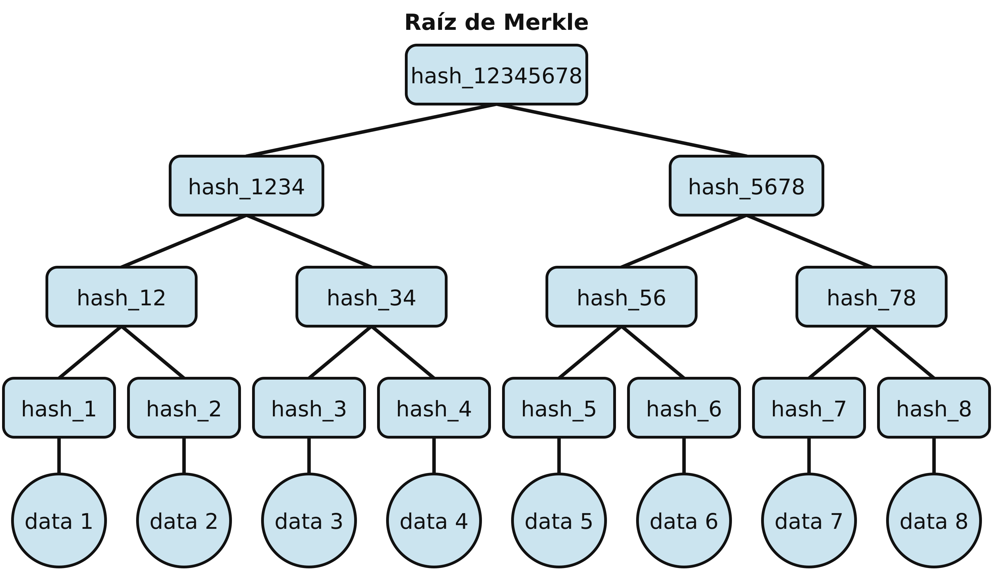

Figura 14-2. Un árbol de Merkle binario

Ahora quizá surja la pregunta de por qué necesitamos un árbol de Merkle para almacenar los datos. ¿No es más complicado que simplemente almacenar cada fragmento en una base de datos clásica?

La respuesta es sí, es mucho más complejo que almacenar cada fragmento en una base de datos clave-valor o SQL. La única razón por la que usamos este tipo de estructuras de datos es que son muy eficientes para proporcionar una prueba criptográfica de bajo costo de que cualquiera de los fragmentos está presente en la colección completa de datos y no ha sido manipulado. De hecho, si usáramos una base de datos normal para almacenar datos y nos pidieran una prueba de que tenemos un fragmento específico, tendríamos que publicar todo nuestro conjunto de datos para que el lector pudiera estar seguro de que no mentimos.

Usemos nuestro ejemplo anterior para verlo en la práctica. Supongamos que queremos demostrar que data_1 está incluido en el conjunto de datos. El enfoque ingenuo consiste en proporcionar todo el conjunto de datos, desde data_1 hasta data_8: ocho elementos en total. Con un árbol de Merkle, solo necesitamos proporcionar hash_2, hash_34 y hash_5678. Luego, cualquiera puede calcular por su cuenta la raíz de Merkle y compararla con la que calculamos inicialmente (que se comparte públicamente). Si coinciden, se puede tener plena certeza de que data_1 forma parte del conjunto de datos inicial, como puede verse en la figura 14-3.

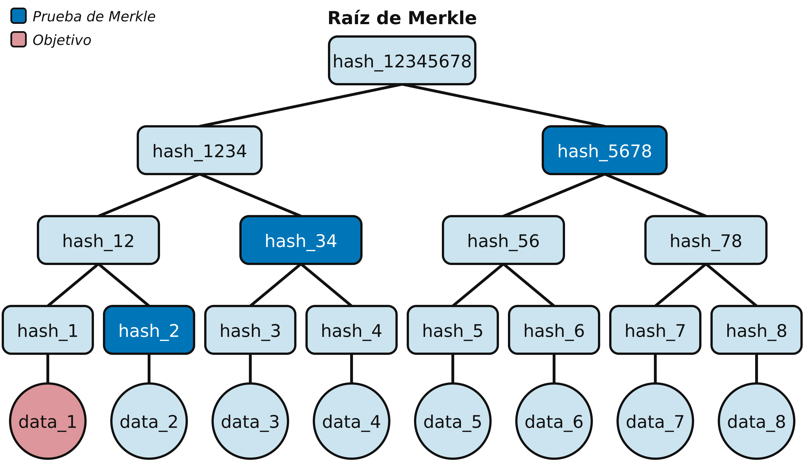

Figura 14-3. La prueba de Merkle para verificar que data_1 está contenido en el árbol

> **Consejo**  
>
> Para reconstruir el árbol de Merkle, se pueden seguir estos pasos:
>
> 1. Calcular el hash de data_1 y obtener hash_1.
> 2. Concatenar hash_1 con el hash_2 proporcionado, calcular su hash y obtener hash_12.
> 3. Concatenar hash_12 con el hash_34 proporcionado, calcular su hash y obtener hash_1234.
> 4. Concatenar hash_1234 con el hash_5678 proporcionado, calcular su hash y obtener la raíz de Merkle final.

Nótese que usamos solo tres elementos, frente a los ocho que necesitaríamos con el enfoque ingenuo sin el árbol de Merkle. Y este es solo un ejemplo de juguete: cuando hay muchos datos, el ahorro es mucho mayor.

En términos matemáticos, los árboles de Merkle ofrecen una complejidad O(log(n)) frente a la complejidad lineal O(n) del enfoque ingenuo, como se muestra en la figura 14-4.

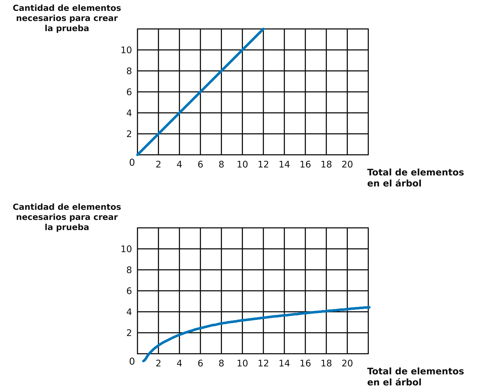

Figura 14-4. Complejidad lineal O(n) (arriba) frente a complejidad O(log(n)) (abajo)

En el mundo de Ethereum, esto significa que es más barato y fácil proporcionar pruebas sobre el saldo de una dirección, el resultado de una transacción o el bytecode de un contrato inteligente específico.

### Árboles de Merkle en Bitcoin

Bitcoin fue pionero en el uso de árboles de Merkle en la tecnología blockchain. De hecho, cada bloque de Bitcoin contiene la raíz de Merkle de todas las transacciones incluidas en ese mismo bloque, de modo que ninguna de ellas pueda modificarse sin modificar todo el encabezado del bloque (comprometiendo también la PoW).

### Trie de Merkle-Patricia en Ethereum

Ethereum tomó el mismo concepto y lo aplicó a sí mismo, con algunas modificaciones para sus necesidades específicas. Los árboles de Merkle son perfectamente adecuados para datos permanentes que nunca cambian, como las transacciones de Bitcoin. Sin embargo, el estado de Ethereum cambia constantemente, por lo que necesitamos ajustar los árboles de Merkle para mantener sus propiedades útiles y a la vez poder cambiar con frecuencia los datos subyacentes.

Aquí entra en escena el trie de Merkle-Patricia. El nombre proviene de la unión de los árboles de Merkle, Patricia (Practical Algorithm to Retrieve Information Coded in Alphanumeric) y la palabra *trie*, que se origina en *retrieval* (recuperación), y nos recuerda para qué están optimizados.

En esencia, los tries de Merkle-Patricia son árboles de Merkle modificados con 16 hijos por nodo. Son muy adecuados para datos como el estado de Ethereum, donde hay muchos elementos clave-valor (en los que las claves son las direcciones y los valores son la información de la cuenta de cada dirección, como el saldo, el nonce y el código, si lo hay), porque la propia clave está codificada en la ruta que hay que seguir para llegar a la posición correcta en el árbol.

Supongamos que queremos almacenar el siguiente elemento clave-valor:

```
car → Schumacher
```

Car se codifica en hexadecimal como (0x) 6 3 6 1 7 2, por lo que habría que tomar el sexto hijo a partir de la raíz de Merkle, luego bajar al tercer hijo y repetir este proceso hasta llegar al valor final, donde puede leerse el valor asociado con esa clave, Schumacher en este ejemplo, como se muestra en la figura 14-5.

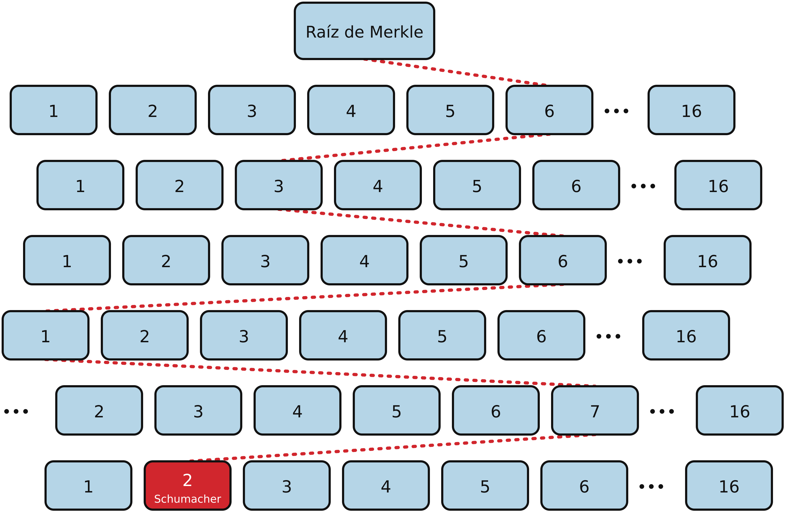

Figura 14-5. Codificación del elemento clave-valor car --> Schumacher en un trie de Merkle-Patricia

En particular, Ethereum usa cuatro tries de Merkle-Patricia:

**Trie de estado**

Para almacenar el estado completo

**Trie de transacciones**

Para almacenar todas las transacciones incluidas en un bloque

**Trie de recibos**

Para almacenar los resultados de todas las transacciones incluidas en un bloque

**Trie de almacenamiento persistente**

Para almacenar datos de contratos inteligentes

El encabezado de cada bloque de Ethereum contiene la raíz de Merkle de los tries de estado, transacciones y recibos, mientras que cada cuenta (contenida en el trie de estado) almacena su propia raíz de Merkle del trie de almacenamiento persistente.

## Una mirada en profundidad a los componentes de la EVM

En esta sección, examinaremos con más detalle cómo funciona cada componente de la EVM. Finalmente, analizaremos un ejemplo real para ver todo en acción.

### Pila

La pila es una estructura de datos muy sencilla que sigue un orden de *último en entrar, primero en salir* (LIFO) para realizar operaciones, donde cada elemento es un objeto de 32 bytes. Puede alojar hasta 1,024 elementos al mismo tiempo.

La EVM puede insertar y extraer elementos de la pila mediante distintos tipos de opcodes y puede manipular el orden de sus elementos, como puede verse en la figura 14-6.

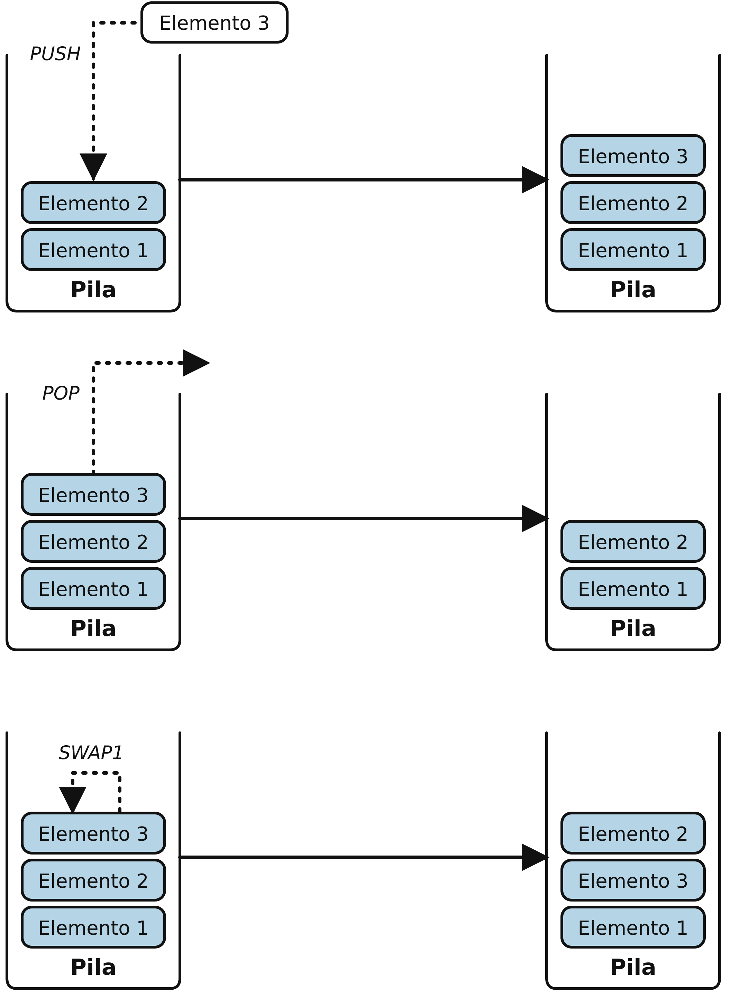

Figura 14-6. La pila de la EVM sigue un orden de operaciones LIFO

### Memoria

La memoria de la EVM es una estructura de datos direccionable por byte: en esencia, un arreglo de bytes muy largo. De hecho, cada byte de la memoria es accesible mediante una clave de 32 bytes (256 bits), lo que significa que puede contener hasta 2^256 bytes. Es volátil, es decir, se elimina al terminar la ejecución, y siempre se inicializa en 0.

Aunque es posible leer y escribir bytes individuales desde y hacia la memoria, la mayoría de las operaciones requieren leer o escribir fragmentos de datos mayores, normalmente de 32 bytes, como se muestra en la figura 14-7.

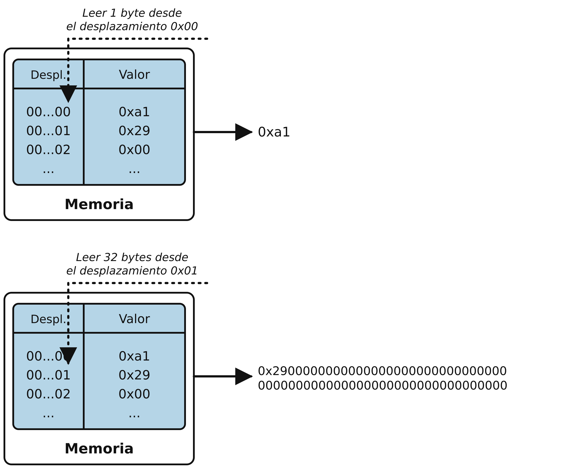

Figura 14-7. La memoria de la EVM es una estructura de datos volátil, direccionable por byte

> **Nota**  
>
> Técnicamente, no se puede leer un solo byte de la EVM. Solo se puede leer una palabra completa de 32 bytes. Para obtener el mismo resultado que al leer un solo byte, la EVM debe cargar la palabra completa que contiene ese byte y luego "recortarla" para devolver únicamente el byte seleccionado.

### Almacenamiento persistente

El almacenamiento persistente de la EVM es una estructura de datos clave-valor donde tanto las claves (más comúnmente llamadas *slots*) como los valores tienen una longitud de 32 bytes. Esta es la memoria persistente de cada contrato inteligente: todos los valores guardados en ella se conservan indefinidamente a través de distintas transacciones y bloques. Cada contrato inteligente solo puede acceder y modificar su propio almacenamiento persistente, y si se intenta acceder a un slot que no contiene ningún valor, siempre devolverá el valor 0 sin generar ningún error. La figura 14-8 muestra una representación muy básica del almacenamiento persistente de dos contratos.

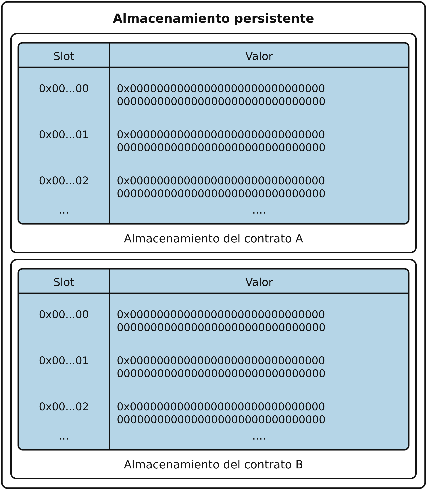

Figura 14-8. El almacenamiento persistente de la EVM es una memoria permanente con una estructura de datos clave-valor

También existe el *almacenamiento transitorio*, agregado con [EIP-1153](https://oreil.ly/fRvKl), que se comporta igual que el almacenamiento persistente normal, con la única diferencia de que se descarta por completo después de la ejecución de la transacción. Por este motivo, es mucho más barato de usar que el almacenamiento persistente normal.

### Calldata

Calldata es una estructura de datos inmutable que siempre contiene los bytes enviados como entrada al siguiente *marco de llamada* (es decir, un entorno aislado de la EVM). Por ejemplo, en una transacción de creación de contrato, calldata contiene el bytecode del contrato que se va a desplegar. También puede estar vacío, como en las transferencias simples de ETH.

## Unamos todo con un ejemplo concreto

Se está ejecutando una transacción que opera sobre el contrato A y se tiene el siguiente bytecode de la EVM: `60425F525F3560AB145F515500`.

También se tiene un calldata inicial:

```
00000000000000000000000000000000000000000000000000000000000000ab
```

Representemos el bytecode de la EVM en un formato legible para las personas:

```
[00]            PUSH1            42
[02]            PUSH0
[03]            MSTORE
[04]            PUSH0
[05]            CALLDATALOAD
[06]            PUSH1            AB
[08]            EQ
[09]            PUSH0
[0a]            MLOAD
[0b]            SSTORE
[0c]            STOP
```

> **Nota**  
>
> Cada opcode de la EVM se identifica mediante un valor único de 1 byte (de 0x00 a 0xFF). Por ejemplo, 0x60 es el opcode PUSH1, 0x5F es PUSH0 y así sucesivamente. Para obtener una lista completa de todos los opcodes y sus representaciones hexadecimales, consulte [EVM codes](https://www.evm.codes).

Veamos cómo la EVM ejecuta estos opcodes y cómo se manipulan la pila, la memoria y el almacenamiento persistente. La figura 14-9 muestra el estado inicial de la EVM.

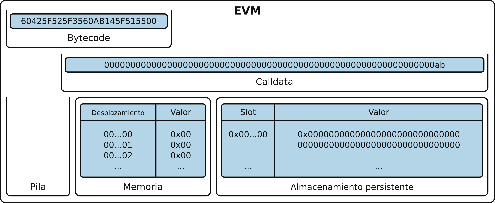

Figura 14-9. Estado inicial de la EVM

El primer opcode inserta 0x42 en la pila (figura 14-10). Nótese que todos los opcodes push toman sus datos (que se insertarán) de los siguientes bytes disponibles en el propio bytecode.

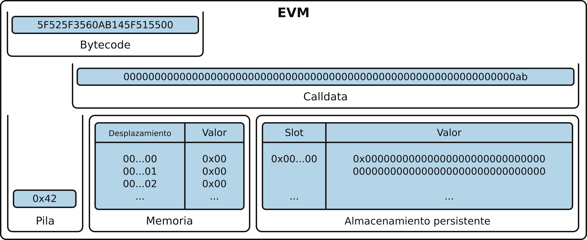

Figura 14-10. EVM después de PUSH1 0x42

A continuación, PUSH0 inserta 0x00 en la pila (figura 14-11).


Figura 14-11. EVM después de PUSH0

MSTORE extrae dos elementos de la pila e interpreta el primero como el desplazamiento (en bytes) y el segundo como el valor que se escribirá en la memoria a partir de ese desplazamiento. Nótese que hay muchos ceros iniciales en la memoria (31 bytes iguales a cero) antes del byte 0x42. Esto es correcto porque cada valor de la pila es un valor de 32 bytes. La mayoría de las veces, podemos ignorar los ceros iniciales al escribir (en la figura 14-12 puede verse el elemento 0x42), pero siempre debe recordarse que son valores de 32 bytes.

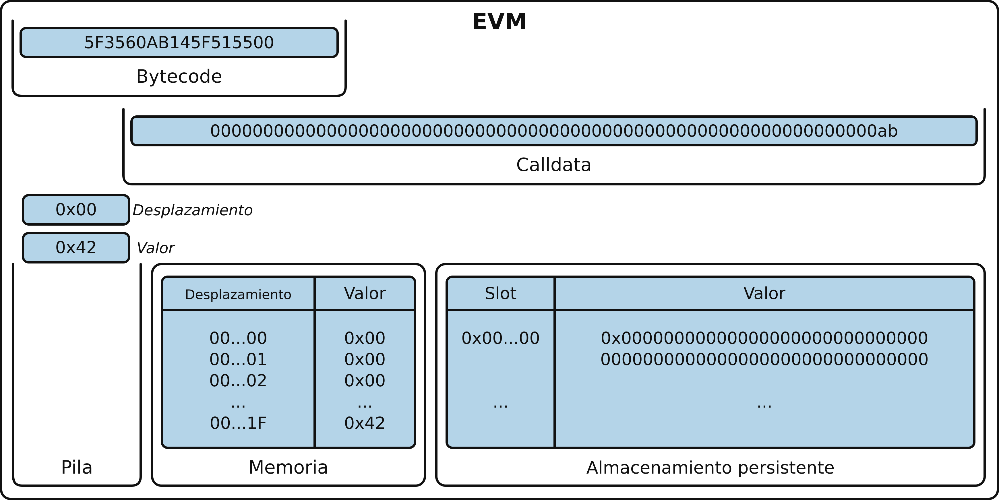

Figura 14-12. EVM después de MSTORE

Luego, tenemos de nuevo un PUSH0 que inserta 0x00 en la pila (figura 14-13).

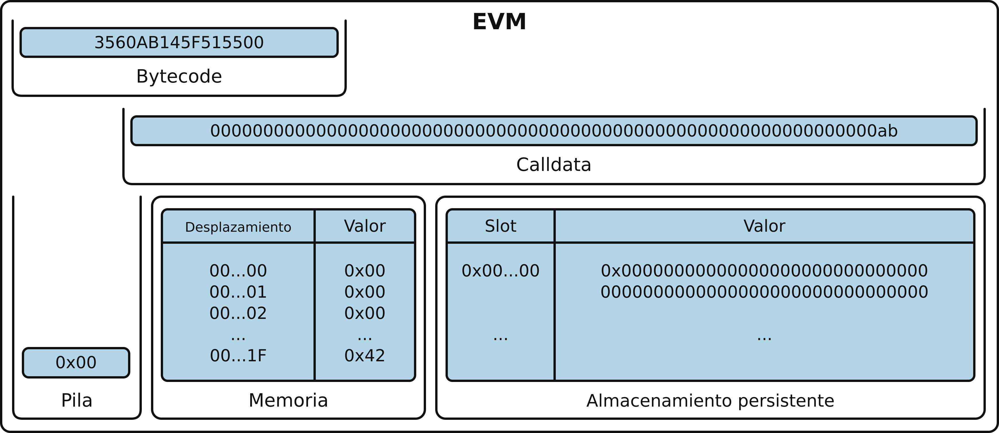

Figura 14-13. EVM después de PUSH0

CALLDATALOAD toma un elemento de la pila, interpretado como un desplazamiento, y devuelve el valor de 32 bytes de calldata que comienza en ese desplazamiento; luego lo inserta en la pila. Aquí devuelve 0xab (nótese que podemos ignorar todos los ceros iniciales porque no son significativos), como se muestra en la figura 14-14.

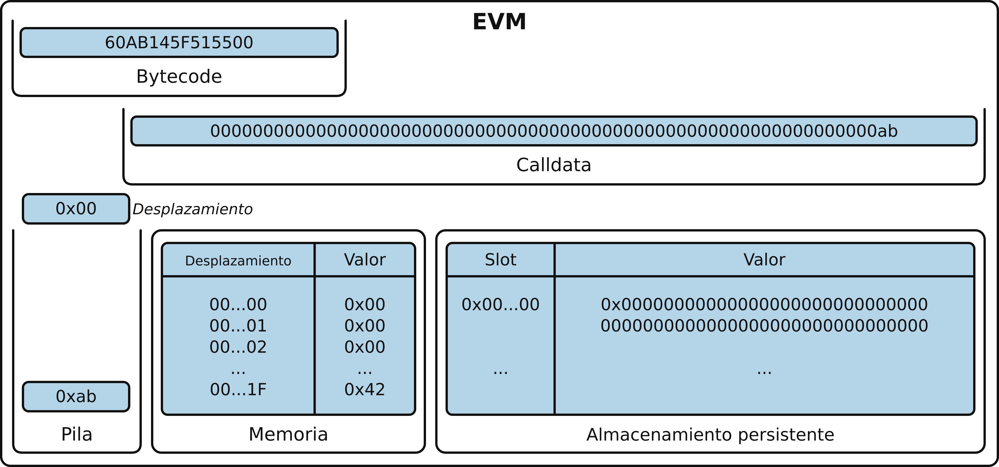

Figura 14-14. EVM después de CALLDATALOAD

PUSH1 inserta 0xab en la pila (figura 14-15).

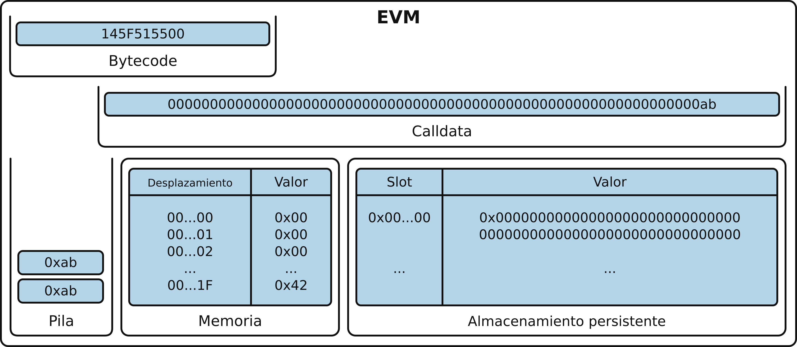

Figura 14-15. EVM después de PUSH1 0xab

EQ extrae dos elementos de la pila, los compara y devuelve 1 si son iguales o 0 en caso contrario. En este ejemplo, devuelve 0x01 porque los dos valores son iguales, como se muestra en la figura 14-16.

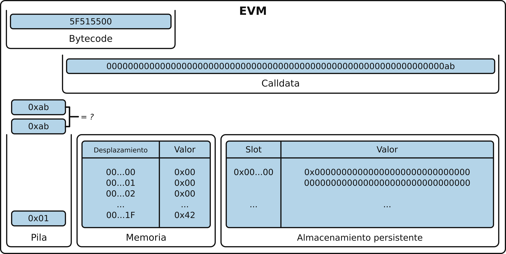

Figura 14-16. EVM después de EQ

De nuevo, un PUSH0 inserta 0x00 en la pila (figura 14-17).

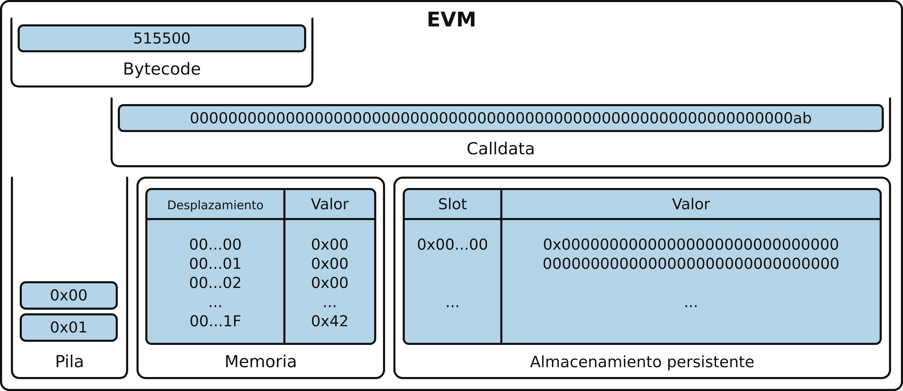

Figura 14-17. EVM después de PUSH0

MLOAD toma un elemento de la pila, lo interpreta como el desplazamiento y lee 32 bytes de la memoria a partir de ese desplazamiento; luego inserta el resultado en la pila (figura 14-18).

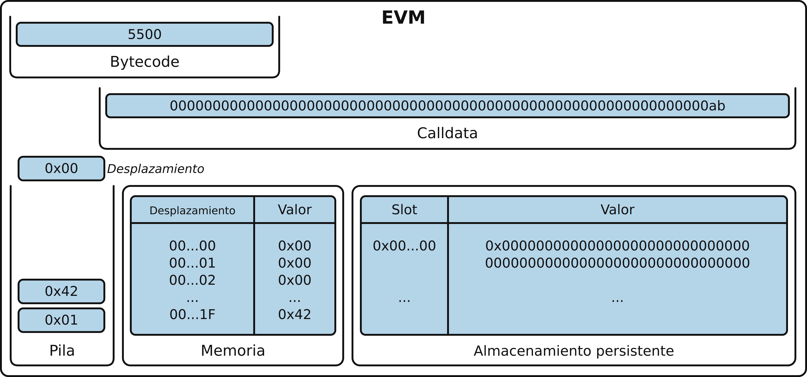

Figura 14-18. EVM después de MLOAD

Ahora, SSTORE extrae dos elementos de la pila e interpreta el primero como el slot y el segundo como el valor que se guardará en el almacenamiento persistente del contrato en ese número de slot, como se muestra en la figura 14-19.

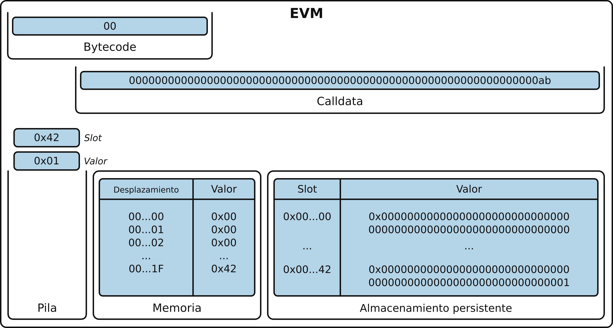

Figura 14-19. EVM después de SSTORE

Finalmente, tenemos el opcode STOP, que detiene la ejecución, y la EVM retorna correctamente, como puede verse en la figura 14-20.

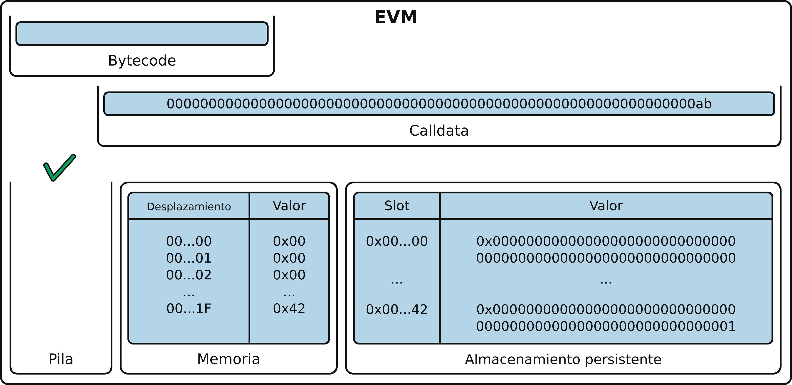

Figura 14-20. EVM después de STOP

> **Consejo**  
>
> En el ejemplo anterior usamos el opcode PUSH0. Es importante señalar que no todas las blockchains compatibles con la EVM han integrado este opcode, por lo que debe tenerse en cuenta al desplegar un contrato entre cadenas. [EVM Diff](https://www.evmdiff.com) es un sitio web muy interesante que muestra todas estas diferencias sutiles entre cadenas compatibles con la EVM.

## Compilación de Solidity a bytecode de la EVM

Ya exploramos Solidity en el capítulo 7. Ahora veremos cómo se compila a bytecode de la EVM que esta puede interpretar.

La compilación de un archivo fuente de Solidity a bytecode de la EVM puede realizarse de varias maneras. En el capítulo 2 usamos el compilador en línea Remix. En este capítulo usaremos el ejecutable `solc` desde la línea de comandos. Para instalar Solidity en una computadora, [siga los pasos](https://oreil.ly/JW--z).

Para obtener una lista de opciones, ejecute el siguiente comando:

```bash
$ solc --help
```

Es fácil generar la secuencia de opcodes sin procesar de un archivo fuente de Solidity con la opción de línea de comandos `--opcodes`. Esta secuencia de opcodes omite cierta información (la opción `--asm` produce la información completa), pero es suficiente para esta explicación. Por ejemplo, para compilar un archivo de ejemplo de Solidity, `Example.sol`, y enviar la salida de opcodes a un directorio llamado `BytecodeDir`, se usa el siguiente comando:

```bash
$ solc -o BytecodeDir --opcodes Example.sol
```

También se puede usar `--asm` para producir una salida más legible para las personas:

```bash
$ solc -o BytecodeDir --asm Example.sol
```

El siguiente comando producirá el bytecode binario de nuestro programa de ejemplo:

```bash
$ solc -o BytecodeDir --bin Example.sol
```

Los archivos de opcodes de salida generados dependerán de los contratos específicos contenidos en el archivo fuente de Solidity. Nuestro sencillo archivo de Solidity `Example.sol` tiene un solo contrato, llamado Example:

```solidity
// SPDX-License-Identifier: GPL-3.0
pragma solidity 0.8.27;

contract Example {
  address contractOwner;
  
  function test() public {
    contractOwner = msg.sender;
  }
}
```

Como puede verse, lo único que hace este contrato es mantener una variable de estado persistente, que se establece en la dirección de la última cuenta que ejecutó este contrato.

Al consultar el directorio `BytecodeDir`, se verá el archivo de opcodes `Example.opcode`, que contiene las instrucciones de opcodes de la EVM del contrato de ejemplo. Al abrir el archivo `Example.opcode` en un editor de texto, se verá lo siguiente:

```
PUSH1 0x80 PUSH1 0x40 MSTORE CALLVALUE DUP1 ISZERO PUSH1 0xE JUMPI PUSH0 PUSH0 REVERT JUMPDEST POP PUSH1 0xA9 DUP1 PUSH1 0x1A PUSH0 CODECOPY PUSH0 RETURN INVALID PUSH1 0x80 PUSH1 0x40 MSTORE CALLVALUE DUP1 ISZERO PUSH1 0xE JUMPI PUSH0 PUSH0 REVERT JUMPDEST POP PUSH1 0x4 CALLDATASIZE LT PUSH1 0x26 JUMPI PUSH0 CALLDATALOAD PUSH1 0xE0 SHR DUP1 PUSH4 0xF8A8FD6D EQ PUSH1 0x2A JUMPI JUMPDEST PUSH0 PUSH0 REVERT JUMPDEST PUSH1 0x30 PUSH1 0x32 JUMP JUMPDEST STOP JUMPDEST CALLER PUSH0 PUSH0 PUSH2 0x100 EXP DUP2 SLOAD DUP2 PUSH20 0xFFFFFFFFFFFFFFFFFFFFFFFFFFFFFFFFFFFFFFFF MUL NOT AND SWAP1 DUP4 PUSH200xFFFFFFFFFFFFFFFFFFFFFFFFFFFFFFFFFFFFFFFF AND MUL OR SWAP1 SSTORE POP JUMP INVALID LOG2 PUSH5 0x6970667358 0x22 SLT KECCAK256 JUMPI 0xBB RETURNDATACOPY SWAP15 CALLVALUE 0xB3 0xB1 SMOD BLOBHASH STATICCALL MCOPY PUSH10 0x856E7132D8FEED4D83B6 0xB2 0xBE PUSH30 0x8B43532C818BFD64736F6C634300081B0033000000000000000000000000
```

Compilar el ejemplo con la opción `--asm` produce un archivo llamado `Example.evm` en nuestro directorio `BytecodeDir`. Este contiene una descripción de un nivel ligeramente superior de las instrucciones de bytecode de la EVM, junto con algunas anotaciones útiles:

```
/* "Example.sol":61:171  contract Example {... */
  mstore(0x40, 0x80)
  callvalue
  dup1
  iszero
  tag_1
  jumpi
  revert(0x00, 0x00)
tag_1:
  pop
  dataSize(sub_0)
  dup1
  dataOffset(sub_0)
  0x00
  codecopy
  0x00
  return
stop

sub_0: assembly {
        /* "Example.sol":61:171  contract Example {... */
      mstore(0x40, 0x80)
      callvalue
      dup1
      iszero
      tag_1
      jumpi
      revert(0x00, 0x00)
    tag_1:
      pop
      jumpi(tag_2, lt(calldatasize, 0x04))
      shr(0xe0, calldataload(0x00))
      dup1
      0xf8a8fd6d
      eq
      tag_3
      jumpi
    tag_2:
      revert(0x00, 0x00)
        /* "Example.sol":109:169  function test() public {... */
    tag_3:
      tag_4
      tag_5
      jump    // in
    tag_4:
      stop
    tag_5:
        /* "Example.sol":154:164  msg.sender */
      caller
        /* "Example.sol":138:151  contractOwner */
      0x00
      0x00
        /* "Example.sol":138:164  contractOwner = msg.sender */
      0x0100
      exp
      dup2
      sload
      dup2
      0xffffffffffffffffffffffffffffffffffffffff
      mul
      not
      and
      swap1
      dup4
      0xffffffffffffffffffffffffffffffffffffffff
      and
      mul
      or
      swap1
      sstore
      pop
        /* "Example.sol":109:169  function test() public {... */
      jump    // out
    auxdata: 0xa264697066735822122057bb3e9e34b3b10749fa5e69856e7132d8feed4d83b6b2be7d8b43532c818bfd64736f6c634300081b0033
}
```

La opción `--bin` produce el bytecode hexadecimal legible por máquina:

```
6080604052348015600e575f5ffd5b5060a980601a5f395ff3fe6080604052348015600e575f5ffd5b50600436106026575f3560e01c8063f8a8fd6d14602a575b5f5ffd5b60306032565b005b335f5f6101000a81548173ffffffffffffffffffffffffffffffffffffffff021916908373ffffffffffffffffffffffffffffffffffffffff16021790555056fea264697066735822122057bb3e9e34b3b10749fa5e69856e7132d8feed4d83b6b2be7d8b43532c818bfd64736f6c634300081b0033
```

Se puede investigar en detalle lo que ocurre aquí mediante la lista de opcodes presentada en "El conjunto de instrucciones de la EVM (operaciones de bytecode)". Sin embargo, es una tarea considerable, así que comencemos examinando únicamente las primeras cuatro instrucciones:

```
PUSH1 0x80 PUSH1 0x40 MSTORE CALLVALUE
```

Aquí tenemos `PUSH1` seguido de un byte sin procesar con valor `0x80`. Esta instrucción de la EVM toma el único byte que sigue al opcode en el código del programa (como valor literal) y lo inserta en la pila. Es posible insertar en la pila valores de hasta 32 bytes de tamaño, como en:

```
PUSH32 0x436f6e67726174756c6174696f6e732120536f6f6e20746f206d617374657221
```

El segundo opcode `PUSH1` de `example.opcode` guarda `0x40` en la cima de la pila (desplazando el `0x80` que ya estaba allí una posición hacia abajo).

A continuación está `MSTORE`, una operación de escritura en memoria que guarda un valor en la memoria de la EVM. Toma dos argumentos y, como la mayoría de las operaciones de la EVM, los obtiene de la pila. Para cada argumento se realiza una extracción de la pila, es decir, se retira el valor superior y todos los demás valores se desplazan una posición hacia arriba. El primer argumento de `MSTORE` es la dirección de la palabra en memoria donde se colocará el valor que se desea guardar. En este programa tenemos `0x40` en la cima de la pila, por lo que se retira y se usa como dirección de memoria. El segundo argumento es el valor que se guardará, que aquí es `0x80`. Después de ejecutar la operación `MSTORE`, nuestra pila vuelve a estar vacía, pero tenemos el valor `0x80` (128 en decimal) en la posición de memoria `0x40`.

El siguiente opcode es `CALLVALUE`, un opcode de entorno que inserta en la cima de la pila la cantidad de ether (medida en wei) enviada con la llamada de mensaje que inició esta ejecución.

Podríamos seguir recorriendo este programa paso a paso de esta manera hasta comprender por completo los cambios de estado de bajo nivel que produce este código, pero en este momento no nos sería útil. Volveremos a ello más adelante en el capítulo.

## Código de despliegue de contratos

Existe una diferencia importante pero sutil entre el código usado al crear y desplegar un contrato nuevo en la plataforma Ethereum y el código del propio contrato. Para crear un contrato nuevo se necesita una transacción especial con el campo `to` vacío (null) y el campo `data` establecido en el *código de inicialización* del contrato. Cuando se procesa una transacción de creación de contrato de este tipo, el código de la nueva cuenta de contrato no es el código del campo `data` de la transacción. En su lugar, se crea una instancia de la EVM con el código del campo `data` de la transacción cargado en su ROM de código de programa, y luego se toma la salida de la ejecución de ese código de despliegue como código de la nueva cuenta de contrato. Esto permite inicializar los nuevos contratos de manera programática usando el estado global de Ethereum en el momento del despliegue, estableciendo valores en el almacenamiento persistente del contrato e incluso enviando ether o creando más contratos nuevos.

Al compilar un contrato sin conexión, por ejemplo, usando `solc` desde la línea de comandos, se puede obtener el *bytecode de despliegue* o el *bytecode de ejecución*. El bytecode de despliegue se usa para todos los aspectos de la inicialización de una nueva cuenta de contrato, incluido el bytecode que realmente terminará ejecutándose cuando las transacciones llamen a este nuevo contrato (es decir, el bytecode de ejecución) y el código para inicializar todo a partir del constructor del contrato. El bytecode de ejecución, en cambio, es exactamente el bytecode que termina ejecutándose cuando se llama al nuevo contrato y nada más; no incluye el bytecode necesario para inicializar el contrato durante el despliegue.

Tomemos como ejemplo el sencillo contrato `Faucet.sol` que creamos en capítulos anteriores:

```solidity
// SPDX-License-Identifier: GPL-3.0
pragma solidity 0.8.27;

contract Faucet {
  // Entregar ether a cualquiera que lo solicite
  function withdraw(uint256 _withdrawAmount, address payable _to) public {
    // Limitar la cantidad del retiro
    require(_withdrawAmount <= 1000000000000);
    // Enviar la cantidad a la dirección que la solicitó
    _to.transfer(_withdrawAmount);
  }
  
  // Función para recibir Ether. msg.data debe estar vacío
  receive() external payable {}
  
  // La función fallback se llama cuando msg.data no está vacío
  fallback() external payable {}
}
```

Para obtener el bytecode de despliegue, ejecutaríamos `solc --bin Faucet.sol`. Si quisiéramos únicamente el bytecode de ejecución, ejecutaríamos `solc --bin-runtime Faucet.sol`. Al comparar las salidas de estos comandos, se verá que el bytecode de ejecución es un subconjunto del bytecode de despliegue. En otras palabras, el bytecode de ejecución está contenido por completo dentro del bytecode de despliegue.

### CREATE frente a CREATE2 para desplegar contratos en la cadena

`CREATE` y `CREATE2` son los únicos dos opcodes que permiten desplegar un contrato nuevo en la cadena. La principal diferencia entre ellos está relacionada con la dirección resultante del contrato recién creado. Con `CREATE`, la dirección de destino se calcula de la siguiente manera:

```
address = keccak256[rlp(sender_address ++ sender_nonce)][12:]
```

Son los 20 bytes del extremo derecho del hash Keccak-256 de la codificación RLP de la dirección del remitente seguida de su nonce.

`CREATE2` se agregó durante el hard fork Constantinople en 2019 para permitir que los desarrolladores creen contratos nuevos cuya dirección resultante no dependa del estado (es decir, del nonce) del remitente. De hecho, se comporta exactamente igual que el opcode `CREATE`, pero la dirección de destino se calcula así:

```
address = keccak256(0xff ++ sender_address ++ salt ++ keccak256(init_code))[12:]
```

donde:

- `init_code` es el bytecode de despliegue del nuevo contrato.
- `salt` es un valor de 32 bytes (tomado de la pila)

## Desensamblado del bytecode

Desensamblar el bytecode de la EVM es una excelente manera de entender cómo actúa Solidity de alto nivel en la EVM. Hay algunos desensambladores que pueden usarse para hacerlo:

- [**Ethersplay**](https://oreil.ly/xW6fH) es un complemento de la EVM para Binary Ninja, un desensamblador. Por cierto, para usar complementos es necesario comprar la aplicación completa de Binary Ninja.
- [**Heimdall**](https://oreil.ly/klTJ3) es un conjunto avanzado de herramientas para contratos inteligentes de la EVM, especializado en analizar bytecode y extraer información de contratos no verificados.

En esta sección usaremos Heimdall para producir la figura 14-21. Después de obtener el bytecode de ejecución de `Faucet.sol`, podemos proporcionárselo a Heimdall para ver cómo son las instrucciones de la EVM.


Figura 14-21. Desensamblado del bytecode de ejecución de Faucet

### Instalación de Heimdall

Primero, hay que asegurarse de que Rust esté instalado en la computadora. Si no lo está, ejecute el siguiente comando:

```bash
$ curl https://sh.rustup.rs -sSf | sh
```

Luego, ejecute estos dos comandos, uno después del otro:

```bash
$ curl -L http://get.heimdall.rs | bash
$ bifrost
```

Ahora Heimdall debería estar instalado correctamente. Puede comprobarse ejecutando:

```bash
$ heimdall --version
```

Debería verse algo como esto:

```bash
$ heimdall --version
heimdall 0.8.4
```

> **Nota**  
>
> Para obtener la información más reciente sobre cómo instalar Heimdall, consulte la documentación oficial que se encuentra en el [repositorio de GitHub](https://oreil.ly/klTJ3).

### Desensamblado del bytecode con Heimdall

Ahora que hemos instalado Heimdall correctamente, estamos listos para generar el mismo grafo que se vio en la figura 14-21. A partir del bytecode de ejecución de nuestro contrato `Faucet.sol`, se puede ejecutar el siguiente comando:

```bash
$ heimdall cfg <insert the runtime bytecode here>
```

Este es un ejemplo de cómo debería verse el comando:

```bash
$ heimdall cfg 608060405260043610610…
```

Ahora debería verse una carpeta nueva llamada `output`. Entre en ella y luego en la carpeta generada llamada `local`. Allí debería encontrarse el archivo `cfg.dot`:

```bash
$ cd output
$ cd local
$ ls # ahora debería verse el archivo
```

Como es un archivo `.dot`, necesitamos un programa especial para abrirlo correctamente. En este ejemplo usaremos un sitio web que permite pegar el contenido del archivo `.dot` y luego genera el grafo por nosotros.

Primero, hay que copiar el contenido del archivo `.dot`:

```bash
$ cat cfg.dot
```

Este comando imprime en pantalla todo el contenido del archivo; cópielo, abra un [generador en línea de *grafos de flujo de control* (CFG)](https://oreil.ly/swOsK) y péguelo en el lado izquierdo de la página web, como se muestra en la figura 14-22.


Figura 14-22. El grafo de flujo de control (CFG) del contrato Faucet.sol

La figura 14-23 muestra el bytecode inicial del contrato `Faucet.sol`. Como puede verse, comienza con el mismo patrón que el contrato `Example.sol` anterior: `PUSH1 0x80 PUSH1 0x40 MSTORE`.


Figura 14-23. Acercamiento a la primera parte del grafo CFG

Cuando se envía una transacción a un contrato inteligente compatible con la ABI (puede suponerse que todos los contratos lo son), la transacción interactúa primero con el *despachador* de ese contrato inteligente. El despachador lee el campo `data` de la transacción y envía la parte pertinente a la función adecuada. Podemos ver un ejemplo de despachador al principio del bytecode de ejecución desensamblado de nuestro `Faucet.sol`. Después de la conocida instrucción `MSTORE`, vemos las siguientes instrucciones:

```
PUSH1 0x04
CALLDATASIZE
LT
PUSH2 0x0020
JUMPI
```

Como hemos visto, `PUSH1 0x04` coloca `0x04` en la cima de la pila, que por lo demás está vacía. `CALLDATASIZE` obtiene el tamaño en bytes de los datos enviados con la transacción (conocidos como calldata) e inserta ese número en la pila. Después de ejecutar estas operaciones, la pila se ve así:

```
Pila
<longitud de calldata de la tx>
0x4
```

La siguiente instrucción es `LT`, abreviatura de "less than" (menor que). La instrucción `LT` comprueba si el elemento superior de la pila es menor que el siguiente elemento. En nuestro caso, comprueba si el resultado de `CALLDATASIZE` es menor que 4 bytes.

¿Por qué la EVM comprueba que el calldata de la transacción tenga al menos 4 bytes? Por cómo funcionan los *identificadores de función*. Cada función de Solidity se identifica por los primeros 4 bytes de su hash Keccak-256. Al introducir el nombre de la función y todos los argumentos que recibe en una función hash `keccak256`, podemos deducir su identificador de función. En nuestro caso, tenemos:

```
keccak256("withdraw(uint256,address)") = 0x00f714ce...
```

Por lo tanto, el identificador de la función `withdraw(uint256,address)` es `0x00f714ce`, ya que estos son los primeros 4 bytes del hash resultante. Un identificador de función siempre tiene una longitud de 4 bytes, por lo que, si todo el campo de datos de la transacción enviada al contrato tiene menos de 4 bytes, no hay ninguna función con la que la transacción pudiera estar comunicándose, salvo que se haya definido una función fallback. Como implementamos una función fallback de este tipo en `Faucet.sol`, la EVM salta a esta función cuando la longitud de calldata es menor que 4 bytes.

`LT` extrae los dos valores superiores de la pila y, si el campo de datos de la transacción tiene menos de 4 bytes, inserta 1 en ella. En caso contrario, inserta 0. En nuestro ejemplo, supongamos que el campo de datos de la transacción enviada a nuestro contrato tenía menos de 4 bytes.

La instrucción `PUSH2 0x0020` inserta los bytes `0x0020` en la pila. Después de esta instrucción, la pila se ve así:

```
Pila
0x0020
0x1
```

La siguiente instrucción es `JUMPI`, que significa "jump if" (saltar si). Funciona de la siguiente manera:

```
jumpi(label, cond) // Saltar a "label" si "cond" es verdadero
```

En nuestro caso, `label` es `0x0020`, que es donde se encuentra nuestra función fallback en el contrato inteligente. El argumento `cond` es 1, que fue el resultado de la instrucción `LT` anterior. Para expresar toda esta secuencia con palabras, el contrato salta a la función fallback si los datos de la transacción tienen menos de 4 bytes.

En `0x20`, después de dos instrucciones `JUMPDEST`, solo sigue una instrucción `STOP` porque, aunque declaramos una función fallback, la dejamos vacía. Como puede verse en la figura 14-24, si no hubiéramos implementado una función fallback, el contrato generaría una excepción.


Figura 14-24. Instrucción JUMPI que conduce a la función fallback

> **Nota**  
>
> Heimdall representa el bytecode comenzando con un desplazamiento igual a 0x01, aunque la EVM en realidad lo interpreta como si comenzara con un desplazamiento de 0x00. En el ejemplo anterior, la instrucción JUMPI le indica a la EVM que vaya al desplazamiento 0x20 si la condición es verdadera, pero en el grafo el desplazamiento 0x20 se representa aquí como 0x21. Como regla práctica, basta con sumar uno a cada desplazamiento de la EVM para encontrarlo en el grafo.

Examinemos el bloque central del despachador. Suponiendo que recibimos un calldata de más de 4 bytes de longitud, la instrucción `JUMPI` no saltaría a la función fallback. En su lugar, la ejecución del código continuaría con las siguientes instrucciones:

```
PUSH0 0x0
CALLDATALOAD
PUSH1 0xe0
SHR
DUP1
PUSH3 0xf714ce
EQ
PUSH2 0X23
JUMPI
```

`PUSH0` inserta 0 en la pila, que por lo demás vuelve a estar vacía. `CALLDATALOAD` acepta como argumento un índice dentro del calldata enviado al contrato inteligente y lee 32 bytes a partir de ese índice, de esta manera:

```
calldataload(p) //cargar 32 bytes de calldata a partir de la posición de byte p
```

Como 0 fue el índice que le pasó el comando `PUSH0`, `CALLDATALOAD` lee 32 bytes de calldata a partir del byte 0 y luego los inserta en la cima de la pila (después de extraer el `0x0` original). Después de la instrucción `PUSH1 0xe0`, la pila queda así:

```
Pila
0xe0
<32 bytes de calldata a partir del byte 0>
```

`SHR` realiza un desplazamiento lógico a la derecha de `0xe0` bits (224 bits, 28 bytes) sobre el elemento de valor de 32 bytes de la pila. Al desplazar calldata 28 bytes a la derecha, aísla sus primeros 4 bytes. De hecho, al desplazar a la derecha, se descartan todos los bits desplazados más allá del primero, mientras que los nuevos bits se establecen en 0. Recuerde que los primeros 4 bytes de calldata representan el identificador de la función que queremos activar.

### Ejemplo de desplazamiento lógico de bits

Esto puede entenderse mejor con un ejemplo. Supongamos que la pila es:

```
Pila
0x1234567890 // un elemento de 5 bytes
```

Queremos obtener únicamente los primeros dos bytes (es decir, `0x1234`). Para lograrlo usando solo opcodes de la EVM, podemos hacer lo siguiente:

```
PUSH1 0x18 // esto representa el número 24 en hexadecimal, 24 bits = 3 bytes
SHR
```

De hecho, al desplazar la pila de elementos 3 bytes a la derecha (recuerde que aquí cada byte se representa con 2 dígitos hexadecimales), obtenemos el siguiente elemento:

```
0x0000001234 | 4567890
```

La parte `4567890` se descarta y lo único que queda es:

```
Pila
0x1234
```

Pueden ignorarse todos los ceros iniciales porque no son significativos.

---

La nueva pila es:

```
Pila
<identificador de función enviado en data>
```

La siguiente instrucción es `DUP1`, que duplica el primer elemento de la pila. La pila ahora es:

```
Pila
<identificador de función enviado en data>
<identificador de función enviado en data>
```

Ahora hay una instrucción `PUSH3`, seguida de los datos push `0xf714ce`. Este opcode simplemente inserta los datos (push) en la pila. Después de este opcode, la pila se ve así:

```
Pila
0xf714ce
<identificador de función enviado en data>
<identificador de función enviado en data>
```

Ahora, ¿resulta familiar `0xf714ce`? ¿Recuerda cuál es el identificador de nuestra función `withdraw(uint256,address)`? Es `0x00f714ce`… Nótese que son el mismo número, ya que los ceros iniciales pueden ignorarse.

La siguiente instrucción, `EQ`, extrae los dos elementos superiores de la pila y los compara. Aquí es donde el despachador realiza su tarea principal: compara si el identificador de función enviado en el campo `msg.data` de la transacción coincide con el de `withdraw(uint256,address)`. Si son iguales, `EQ` inserta 1 en la pila, que finalmente se usará para saltar a la función withdraw. En caso contrario, `EQ` inserta 0 en la pila.

Suponiendo que la transacción enviada a nuestro contrato efectivamente comenzaba con el identificador de la función `withdraw(uint256,address)`, nuestra pila se ha convertido en:

```
Pila
1
<identificador de función enviado en data> (ahora sabemos que es 0x00f714ce)
```

A continuación tenemos `PUSH2 0x23`, que es la dirección en la que se encuentra la función `withdraw(uint256,address)` dentro del contrato. Después de esta instrucción, la pila se ve así:

```
Pila
0x23
1
<identificador de función enviado en msg.data>
```

La siguiente es la instrucción `JUMPI`, que una vez más acepta como argumentos los dos elementos superiores de la pila. En este caso tenemos `JUMPI(0x23, 1)`, que le indica a la EVM que ejecute el salto a la ubicación de la función `withdraw(uint256,address)`, y la ejecución del código de esa función puede continuar.

## Completitud de Turing y gas

Como ya mencionamos, en términos sencillos un sistema o lenguaje de programación es *Turing completo* si puede ejecutar cualquier programa. Sin embargo, esta capacidad viene con una salvedad muy importante: algunos programas tardan una eternidad en ejecutarse. Un aspecto importante es que no podemos saber, con solo mirar un programa, si su ejecución tardará para siempre o no. Para averiguarlo, tenemos que ejecutar realmente el programa y esperar a que termine. Por supuesto, si va a tardar para siempre en ejecutarse, tendremos que esperar para siempre para saberlo. Esto se llama el *problema de la parada* y sería un enorme problema para Ethereum si no se abordara.

Debido al problema de la parada, la computadora mundial de Ethereum corre el riesgo de que se le pida ejecutar un programa que nunca se detenga. Esto podría ocurrir por accidente o de manera maliciosa. Hemos descrito cómo Ethereum actúa como una máquina de un solo hilo, sin ningún planificador, por lo que, si quedara atrapado en un bucle infinito, Ethereum se volvería inutilizable.

Sin embargo, con el gas hay una solución: si después de realizar una cantidad máxima de cómputo especificada de antemano la ejecución no ha terminado, la EVM detiene la ejecución del programa. Esto convierte a la EVM en una máquina cuasi-Turing completa: puede ejecutar cualquier programa que se le proporcione, pero solo si el programa termina dentro de una cantidad determinada de cómputo. Ese límite no es fijo en Ethereum: se puede pagar para aumentarlo hasta un máximo (llamado *límite de gas del bloque*), y todos pueden acordar aumentar ese máximo con el tiempo. No obstante, en cualquier momento dado existe un límite y se detienen las transacciones que consumen demasiado gas durante su ejecución.

En las siguientes secciones, examinaremos el gas y veremos en detalle cómo funciona.

### ¿Qué es el gas?

El gas es la unidad de Ethereum para medir los recursos de cómputo y almacenamiento necesarios para realizar acciones en la blockchain de Ethereum. A diferencia de Bitcoin, cuyas comisiones de transacción solo tienen en cuenta el tamaño de una transacción en kilobytes, Ethereum debe contabilizar cada paso de cómputo realizado por las transacciones y la ejecución del código de contratos inteligentes.

Cada operación realizada por una transacción o un contrato cuesta una cantidad fija de gas. Algunos ejemplos del "Yellow Paper" de Ethereum incluyen:

- Sumar dos números cuesta 3 gas
- Calcular un hash Keccak-256 cuesta 30 gas + 6 gas por cada 256 bits de datos a los que se calcula el hash
- Enviar una transacción cuesta 21,000 gas

El gas es un componente fundamental de Ethereum y cumple una doble función: amortigua la relación entre el precio (volátil) del ether y la recompensa a los validadores por el trabajo que realizan, y sirve de defensa contra los ataques DoS. Para evitar bucles infinitos accidentales o maliciosos u otros desperdicios de cómputo en la red, quien inicia cada transacción debe establecer un límite a la cantidad de cómputo por la que está dispuesto a pagar. Así, el sistema de gas desincentiva que los atacantes envíen transacciones de "spam", ya que deben pagar proporcionalmente por los recursos de cómputo, ancho de banda y almacenamiento que consumen.

### Contabilización del gas durante la ejecución

Cuando se necesita una EVM para completar una transacción, inicialmente se le da una reserva de gas igual a la cantidad especificada por el límite de gas de la transacción. Cada opcode ejecutado tiene un costo en gas, por lo que la reserva de gas de la EVM disminuye a medida que esta recorre el programa. Antes de cada operación, la EVM comprueba que haya suficiente gas para pagar su ejecución. Si no hay suficiente gas, la ejecución se detiene y la transacción se revierte.

Si la EVM llega correctamente al final de la ejecución sin agotar el gas, el costo del gas utilizado se paga al validador como comisión de transacción, convertido a ether según el precio del gas especificado en la transacción:

```
validator fee = gas cost × gas price
```

El gas que queda en la reserva se reembolsa al remitente, de nuevo convertido a ether según el precio del gas especificado en la transacción:

```
remaining gas = gas limit – gas cost
refunded ether = remaining gas × gas price
```

Si la transacción "se queda sin gas" durante la ejecución, la operación termina inmediatamente y genera una excepción OOG. La transacción se revierte y se deshacen todos los cambios de estado. Aunque la transacción no haya tenido éxito, se cobrará al remitente una comisión de transacción porque los validadores ya realizaron el trabajo de cómputo hasta ese momento y deben recibir una compensación por ello.

#### Consideraciones sobre la contabilización del gas

Los costos relativos de gas de las distintas operaciones que puede realizar la EVM se han elegido cuidadosamente para proteger de la mejor manera a la blockchain de Ethereum contra ataques. Las operaciones que requieren más cómputo cuestan más gas. Por ejemplo, ejecutar la función `SHA3` es 10 veces más costoso (30 gas) que la operación `ADD` (3 gas). Más importante aún, algunas operaciones, como `EXP`, requieren un pago adicional según el tamaño del operando. También hay un costo de gas por usar la memoria de la EVM y por guardar datos en el almacenamiento persistente en la cadena de un contrato.

La importancia de hacer coincidir el costo de gas con el costo real de los recursos quedó demostrada en 2016, cuando un atacante encontró y explotó un desajuste en los costos. El ataque generó transacciones muy costosas en términos de cómputo y casi paralizó la red principal de Ethereum. Este desajuste se resolvió mediante un hard fork (con el nombre en clave "Tangerine Whistle") que ajustó los costos relativos de gas.

#### Contabilización del gas en el futuro de Ethereum

La medición del gas fue y sigue siendo una parte sumamente importante de cómo Ethereum maneja toda la carga de transacciones de la red. Es muy importante entender que los costos de gas son un incentivo clave para ciertos tipos de comportamiento. En el futuro, podría haber cambios en la cantidad de gas que consumen los distintos opcodes.

Por ejemplo, antes de la actualización Cancun que introdujo las transacciones de blobs de EIP-4844, todas las L2 publicaban sus datos en Ethereum como parte del calldata de una transacción. Esos datos se almacenan para siempre en todos los nodos de Ethereum. Ahora que las L2 tienen una mejor manera de publicar sus datos en Ethereum mediante transacciones de blobs, es posible que en el futuro calldata se vuelva incluso más costoso que ahora, para incentivar a los rollups a usar transacciones de blobs y reducir la carga que supone para los nodos almacenar todos esos datos para siempre.

#### Costo del gas frente a precio del gas

Mientras que el *costo del gas* es una medida del cómputo y el almacenamiento utilizados por una transacción en la EVM, el gas en sí también tiene un *precio* medido en ether. Al realizar una transacción, el remitente especifica el precio de gas que está dispuesto a pagar (en ether) por cada unidad de gas, lo que permite que el mercado decida la relación entre el precio del ether y el costo de las operaciones de cómputo (medido en gas):

```
transaction fee = total gas used × gas price paid (in ether)
```

Al construir un bloque nuevo, los validadores de la red Ethereum pueden elegir entre las transacciones pendientes seleccionando las que ofrecen pagar un precio de gas mayor. Por lo tanto, ofrecer un precio de gas mayor incentivará a los validadores a incluir la transacción y confirmarla más rápido.

En la práctica, el remitente de una transacción establecerá un límite de gas mayor o igual que la cantidad de gas que se espera utilizar. Si el límite de gas se establece por encima de la cantidad consumida, el remitente recibirá un reembolso del excedente, ya que los validadores solo reciben compensación por el trabajo que realmente realizan.

Es importante tener clara la distinción entre el costo del gas y el precio del gas. En resumen:

- El *costo del gas* es el número de unidades de gas necesarias para realizar una operación determinada.
- El *precio del gas* es la cantidad de ether que se está dispuesto a pagar por unidad de gas al enviar una transacción a la red Ethereum.

> **Consejo**  
>
> Aunque el gas tiene un precio, no puede "poseerse" ni "gastarse". El gas existe solo dentro de la EVM, como un conteo de cuánto trabajo de cómputo se está realizando. Al remitente se le cobra una comisión de transacción en ether, que se convierte a gas para la contabilidad de la EVM y luego de nuevo a ether como comisión de transacción pagada a los validadores.

#### Costos negativos de gas

Ethereum incentiva la eliminación de variables usadas del almacenamiento persistente reembolsando parte del gas utilizado durante la ejecución del contrato. Solo hay una operación en la EVM con costos negativos de gas: cambiar una dirección de almacenamiento persistente de un valor distinto de cero a cero (`SSTORE[x] = 0`) da derecho a un reembolso. La cantidad de gas reembolsada no es fija y depende de los valores del slot de almacenamiento persistente antes y después de esta operación. Para evitar que se explote el mecanismo de reembolso, el reembolso máximo de una transacción se establece en una quinta parte del costo total de gas (redondeada hacia abajo).

En el pasado había otra operación con un costo negativo de gas: `SELFDESTRUCT`. Eliminar un contrato (mediante `SELFDESTRUCT`) daba derecho a un reembolso de 24,000 gas. Actualmente, el opcode `SELFDESTRUCT` está obsoleto y se recomienda dejar de usarlo.

> **Consejo**  
>
> Los reembolsos de gas se aplican al final de la transacción. Por lo tanto, si una transacción no tiene suficiente gas para llegar al final de la ejecución, falla y no se otorga ningún reembolso.

### Límite de gas del bloque

El límite de gas del bloque es la cantidad máxima de gas que pueden consumir todas las transacciones de un bloque. Restringe cuántas transacciones caben en un bloque.

Por ejemplo, supongamos que tenemos cinco transacciones cuyos límites de gas se han establecido en 30,000, 30,000, 40,000, 50,000 y 50,000. Si el límite de gas del bloque es 180,000, cualquier grupo de cuatro de esas transacciones cabe en un bloque, mientras que la quinta tendrá que esperar a un bloque futuro. Como se explicó antes, los validadores deciden qué transacciones incluir en un bloque. Es probable que distintos validadores seleccionen combinaciones diferentes, principalmente porque reciben las transacciones de la red en distinto orden.

Si un validador intenta incluir una transacción que requiere más gas que el límite de gas actual del bloque, la red rechazará el bloque. La mayoría de los clientes de Ethereum impedirán emitir una transacción de este tipo mediante una advertencia similar a "transaction exceeds block gas limit". Según [Etherscan](https://etherscan.io), el límite de gas del bloque en la red principal de Ethereum es de 36 millones de gas al momento de escribir este libro (junio de 2025), lo que significa que en un bloque cabrían alrededor de 1,428 transacciones básicas, es decir, de transferencia de ETH (cada una consume 21,000 gas).

#### ¿Quién elige el límite de gas del bloque?

Antes de la introducción de EIP-1559 el 5 de agosto de 2021, los mineros (Ethereum usaba entonces un algoritmo de consenso basado en PoW) tenían un mecanismo integrado con el que podían votar sobre el límite de gas del bloque, de modo que la capacidad pudiera aumentar o disminuir en los bloques posteriores. El minero de un bloque podía votar para ajustar el límite de gas del bloque en un factor de 1/1024 (0.0976%) en cualquiera de las dos direcciones. El resultado era un tamaño de bloque ajustable según las necesidades de la red, siguiendo la potencia de hash de los mineros.

Ahora los validadores votan sobre el *objetivo de gas*, es decir, cuánto gas debería consumir un bloque en promedio, y el límite de gas se define como el doble del objetivo. El factor de ajuste de 1/1024 que cada validador debe respetar se mantiene igual que antes.

#### ¿Por qué no aumenta el límite de gas del bloque?

Quizá surja la pregunta: si los validadores pueden votar sobre el objetivo de gas, que se traduce directamente en el límite de gas, ¿por qué el límite de gas del bloque no sube a mil millones en vez de permanecer casi fijo en 30 millones? Un límite de gas del bloque mayor significaría que cabrían más transacciones en un bloque, por lo que las transacciones serían más baratas para los usuarios finales.

La respuesta es que aumentar el límite de gas tiene algunas desventajas relacionadas con la descentralización de la red. De hecho, aunque los bloques más grandes pueden incluir más transacciones, también se vuelven más difíciles de verificar a tiempo, lo que podría llevar a la desaparición de los nodos de Ethereum construidos con hardware común y dejar solo servidores potentes para validar bloques completos. Además, los bloques más grandes también implican un mayor crecimiento del estado. El resultado final es el mismo de antes: los grandes servidores serían los únicos capaces de ejecutar un nodo por completo.

Históricamente, el límite de gas del bloque se ha aumentado de una sola vez durante las actualizaciones del protocolo, como puede verse en la figura 14-25. Y su valor generalmente se establece en un nivel sugerido por los desarrolladores del protocolo en el que estamos seguros de que todos los clientes pueden manejar la carga de transacciones y procesar los bloques a tiempo.


Figura 14-25. Gráfico del límite de gas promedio de Ethereum

#### ¿Por qué no aumentar el límite de gas del bloque?

Aunque el límite de gas del bloque parece haber estado "fijo" en 30 millones durante más de tres años, con PBS (consulte "Ethereum sin estado"), donde actores con hardware sofisticado construyen los bloques, los constructores, y los envían a los proponentes, los validadores, para publicarlos en la red P2P, existe un incentivo para aumentar indefinidamente el límite de gas del bloque manteniendo casi constante el gas realmente utilizado.

De hecho, según EIP-1559, si el objetivo de gas del bloque es mucho mayor que el gas realmente utilizado, la comisión base sigue disminuyendo hasta el punto en que casi toda la comisión de gas va a los validadores en lugar de quemarse (la comisión base se quema, eliminando esos ETH de la oferta).

Por lo tanto, las ventajas para los validadores son dos:

- Pueden quedarse con las comisiones de gas, en lugar de quemarlas y reducir la oferta de ETH.
- Cuando es necesario, pueden crear bloques más grandes que capturen mucha actividad de MEV y les generen aún más comisiones.

Si le interesa el tema, puede leer más en el [artículo de James Prestwich](https://oreil.ly/EImcE).

## Implementaciones concretas

Cada nodo de Ethereum tiene una implementación concreta de la EVM descrita en este capítulo. Esta es una lista de las más conocidas y utilizadas:

**Go-ethereum EVM**

Geth es el cliente de ejecución más adoptado y más antiguo. Contiene una implementación completa de la EVM escrita en Go.

**Execution-spec EVM**

La Ethereum Foundation mantiene un repositorio de Python en GitHub que contiene la especificación relacionada con el cliente de ejecución de Ethereum. Tiene una implementación completa de la EVM escrita en Python.

**Revm**

Revm es una de las implementaciones de la EVM más utilizadas fuera de los clientes normales de Ethereum, gracias a su gran capacidad de personalización y adaptación.

**Evmone**

Evmone es probablemente la implementación más rápida de la EVM. Está escrita en C++ y la mantiene el equipo Ipsilon de la Ethereum Foundation.

**Besu EVM**

Besu es un cliente de ejecución mantenido por Consensys. Tiene una implementación completa de la EVM escrita en Java.

**Nethermind EVM**

Nethermind EVM es un cliente de ejecución escrito en C# que mantiene una implementación completa de la EVM.

## La mayor actualización de la EVM: EVM Object Format

*EVM Object Format* (EOF) es la mayor actualización de la EVM desde su nacimiento en 2015. De hecho, aunque ha habido modificaciones de la EVM en el pasado, centradas principalmente en la medición del gas o en la introducción de nuevos opcodes, la EVM es casi idéntica a como la creó originalmente Gavin Wood.

La EVM sigue siendo excelente. Todas las actividades que ocurren hoy en Ethereum (y en todas las demás blockchains compatibles con la EVM) solo son posibles gracias a ella. Tampoco es perfecta y, durante los últimos años, los desarrolladores de contratos inteligentes han tenido que lidiar con distintos aspectos de ella y aprender algunos trucos para superar sus restricciones.

EOF es un formato de contenedor extensible y versionado para la EVM, con una validación única en el momento del despliegue. En esta sección exploraremos todas las limitaciones principales de la EVM y cómo EOF pretende superarlas.

> **Nota**  
>
> Al momento de la revisión final de este libro (junio de 2025), la actualización EOF se ha pospuesto indefinidamente debido a la falta de consenso suficiente dentro de la comunidad de Ethereum. Actualmente no hay un cronograma claro para su implementación y es posible que, en última instancia, nunca se adopte. No obstante, creemos que esta sección sigue siendo valiosa para entender cómo EOF podría afectar a la EVM y al ecosistema más amplio de Ethereum.

### Análisis de jumpdest

La EVM tradicional no valida en el momento de la creación el bytecode publicado en la cadena. Por un lado, esto puede parecer bueno porque permite publicar cualquier contrato: se puede desplegar bytecode que contenga opcodes inexistentes o agregar código que nunca se alcanza o que se trunca en medio de una operación `PUSH` sin proporcionar el siguiente valor inmediato que debe tener para ejecutarse correctamente. En realidad, esto agrega muchas ineficiencias. De hecho, la EVM debe comprobar todo durante la ejecución, lo que agrega complejidad y reduce el rendimiento general. Este es un ejemplo de un opcode inexistente incluido dentro de un bytecode de la EVM:

```
600C600052602060000C
```

Este es el bytecode traducido a opcodes legibles para las personas:

```
[00]            PUSH1            0C
[02]            PUSH1            00
[04]            MSTORE
[05]            PUSH1            20
[07]            PUSH1            00
[09]            NOT-EXISTING
```

El opcode `0C` no existe y, cuando la EVM llega a ese punto, entra en pánico y retorna de forma anticipada. Nótese que el segundo byte del bytecode anterior también es `0C`, pero la EVM no falla allí. La diferencia es que, mientras que el último byte `0C` se interpreta como un opcode y falla porque no es válido, el otro se interpreta como datos push, ya que es el valor inmediato del primer opcode `PUSH1`.

Una parte clave de esta comprobación durante la ejecución es el *análisis de jumpdest*. Cada cliente debe realizarlo durante la ejecución cada vez que se ejecuta un contrato. Dediquemos un momento a entender este análisis de jumpdest y por qué es necesario en la EVM tradicional.

> **Consejo**  
>
> Para no tener que realizar el análisis de jumpdest durante la ejecución cada vez que se llama a un contrato, algunas implementaciones de nodos de Ethereum guardan un mapa de jumpdest para cada contrato. Este mapa se crea al desplegar el contrato y se guarda en la base de datos del nodo.

La EVM tradicional solo tiene saltos dinámicos (los opcodes `JUMP` y `JUMPI`) para gestionar el flujo de control del bytecode. Esto resulta muy práctico porque permite cambiar el flujo normal de las operaciones con solo dos opcodes. La desventaja es que los saltos dinámicos son muy costosos y requieren una validación profunda durante la ejecución, aunque la mayoría de las veces no hay necesidad de que el salto sea dinámico. De hecho, muy a menudo el valor al que se debe saltar se inserta en la pila inmediatamente antes del propio opcode `JUMP`. Este es un pequeño ejemplo:

```
…6009566006016101015b6001…
```

Y traducido a opcodes legibles para las personas:

```
[00]            PUSH1            09
[02]            JUMP
[03]            PUSH1            06
[05]            ADD
[06]            PUSH2            0101
[09]            JUMPDEST
[0a]            PUSH1            01
```

Como puede verse, el destino del salto, es decir, el desplazamiento `0x09` al que se debe saltar, se inserta en la pila mediante un opcode `PUSH1` inmediatamente antes del opcode `JUMP`. La EVM inserta `0x09` en la pila y luego ejecuta el opcode `JUMP`, que toma como entrada el `0x09` insertado previamente y mueve la ejecución a la instrucción en ese desplazamiento. En `0x09` se encuentra un opcode `JUMPDEST`, por lo que se considera un destino de salto válido y la ejecución puede continuar correctamente.

La validación durante la ejecución es necesaria para no saltar a destinos inválidos. Los únicos destinos válidos son las instrucciones `JUMPDEST` que no forman parte de los datos push. Es muy importante entender esto: la EVM tradicional no tiene una separación adecuada entre código y datos. Por lo tanto, cada vez que se encuentra el byte `0x5b`, el opcode `JUMPDEST`, en algún bytecode, no se puede tener plena certeza de si es un opcode `JUMPDEST` real o si forma parte de los datos push sin analizar el contrato completo.

Observe el siguiente ejemplo, que muestra esta sutil diferencia:

```
…6009566006016101015b6001…
…6009566006016201015b6001…
```

Estos dos bytecodes parecen casi idénticos; de hecho, solo difieren en un bit. Pero eso basta para producir una enorme diferencia en el resultado. El primer bytecode es el mismo que se mostró en el ejemplo anterior. El segundo se ve así en formato legible para las personas:

```
[00]            PUSH1            09
[02]            JUMP
[03]            PUSH1            06
[05]            ADD
[06]            PUSH3            01015b
[0a]            PUSH1            01
```

Si se intenta ejecutar este segundo código, fallará por un destino de salto inválido. Puede parecer un poco extraño porque en el desplazamiento `0x09` sigue estando el byte `0x5b`, que representa el opcode `JUMPDEST`. El problema radica en que, en este caso, el byte `0x5b` forma parte de los datos push, por lo que no puede considerarse un destino de salto válido. Por eso la ejecución falla en ese punto.

El análisis de jumpdest es el proceso de analizar un contrato para saber qué destinos de salto son válidos y cuáles no, de modo que, cuando la EVM ejecuta el contrato, pueda detectar un destino de salto inválido y entrar en pánico.

Supongamos que se envía una transacción que interactúa con el contrato A. Cuando la EVM lo carga, realiza inmediatamente el análisis de jumpdest para guardar el mapa de destinos de salto válidos y luego comienza la ejecución real de la transacción:

```
…6009566006016101015b60016015566006016201015b6001…
```

Aquí está en formato legible para las personas:

```
[00]            PUSH1            09
[02]            JUMP
[03]            PUSH1            06
[05]            ADD
[06]            PUSH2            0101
[09]            JUMPDEST
[0a]            PUSH1            01
[0c]            PUSH1            15
[0e]            JUMP
[0f]            PUSH1            06
[11]            ADD
[12]            PUSH3            01015b
[16]            PUSH1            01
```

La EVM recorre todo el bytecode y crea un mapa en el que cada byte `0x5b` se marca como destino de salto válido o inválido, como puede verse en la figura 14-26.

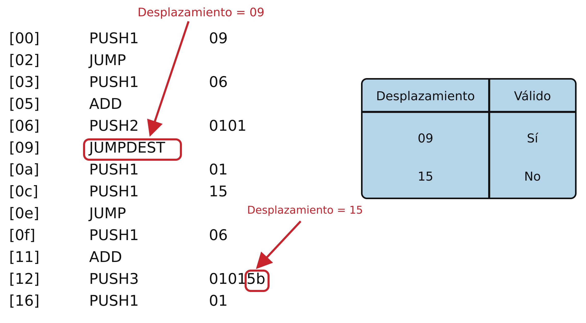

Figura 14-26.  El cliente crea un mapa de jumpdest para separar los destinos de salto válidos de los inválidos

### Incorporación y declaración de obsolescencia de funciones

Agregar o declarar obsoleto un opcode o una función específica no es tan fácil como podría parecer. Si bien es cierto que se han agregado distintos opcodes, como `BLOBHASH`, `BLOBBASEFEE`, `BASEFEE` y otros, esto siempre resulta complicado debido al bytecode no estructurado y no validado de la EVM.

Observe el siguiente ejemplo, que contiene un opcode inválido, específicamente `0x0C`. Supongamos que es un contrato real desplegado en la red principal de Ethereum:

```
600C600052602060000C
```

Aquí está en formato legible para las personas:

```
[00]            PUSH1            0C
[02]            PUSH1            00
[04]            MSTORE
[05]            PUSH1            20
[07]            PUSH1            00
[09]            NOT-EXISTING
```

Si se intenta ejecutar este pequeño bytecode dentro de una EVM, se verá que, cuando la ejecución llega al opcode inexistente, falla.

Supongamos que una actualización futura agrega un opcode nuevo, el opcode `MAX`, que toma dos elementos de la pila y devuelve el que contiene el valor mayor. El byte que se le asigna es `0x0C`. Considere de nuevo el bytecode anterior (recuerde que suponemos que es un contrato real desplegado en la red principal):

```
[00]            PUSH1            0C
[02]            PUSH1            00
[04]            MSTORE
[05]            PUSH1            20
[07]            PUSH1            00
[09]            MAX
```

Ahora este bytecode tiene un resultado completamente distinto. De hecho, ya no falla y retorna correctamente. Esto podría crear problemas si hubiera contratos que dependieran del supuesto de que este contrato siempre fallaba por un opcode (anteriormente) inexistente.

Declarar obsoleta una función es aún más difícil, ya que no se puede recurrir a un sistema de versiones de la EVM. Por lo tanto, si se elimina un opcode o se cambia su funcionamiento, los contratos antiguos que lo usaban podrían dejar de funcionar, y nada salvo una intervención manual (creando un contrato nuevo) puede solucionarlo.

Cuando se introdujo [EIP-2929](https://oreil.ly/_9kTv) para cambiar la medición del gas de los opcodes de acceso al estado, algunos contratos dejaron de funcionar porque tenían fijada en el código la cantidad de gas que debían usar o esperar. La solución para que volvieran a funcionar fue introducir *listas de acceso*, en las que se pueden precargar algunas cuentas y slots de almacenamiento persistente que se sabe que la transacción tocará, y reducir los costos de gas.

Otros aspectos importantes de la EVM tradicional que dificultan las actualizaciones son la *introspección del código* y la *observabilidad del gas*. La observabilidad del gas es posible gracias a opcodes como `GAS` o incluso todos los opcodes `*CALL` que reciben gas como entrada, mientras que la introspección del código se logra mediante opcodes como `CODESIZE`, `CODECOPY`, `EXTCODESIZE`, `EXTCODECOPY` y `EXTCODEHASH`.

El problema radica en que, si la EVM puede acceder al gas restante en un punto determinado de la ejecución, se puede hacer que la lógica de un contrato inteligente dependa de ello. Y si en el futuro hay un cambio en la medición del gas de algunos opcodes (algo que no es tan raro), podrían surgir problemas para todos los contratos inteligentes que dependían de la medición de gas anterior. Lo mismo se aplica a la introspección del código.

> **Nota**  
>
> Sin introspección del código, es posible que las versiones futuras de EOF cambien por completo la máquina virtual subyacente por algo como Cairo VM, Wasm o cualquier otra, transformando automáticamente el código de todos los contratos al código de la nueva VM con la misma funcionalidad.

### Separación de código y datos

La EVM tradicional no impone una estructura al bytecode que se publica en la cadena. No hay distinción entre el código real y los datos que se usan dentro de ese código. Todo son simplemente bytes, y la EVM los interpreta paso a paso durante la ejecución.

Es imposible decir si una parte determinada del bytecode es código o datos sin examinar el contrato completo. Observe el siguiente ejemplo:

```
…730102030405060708090a0b0c0d0e0f101112131431…
[00]            PUSH20    0102030405060708090a0b0c0d0e0f1011121314
[15]            BALANCE
```

Sin profundizar en el código, no se puede saber de inmediato que `0102030405060708090a0b0c0d0e0f1011121314` no debe interpretarse como una serie de opcodes, `0x01`: `ADD`, `0x02`: `MUL` y así sucesivamente, sino que son datos push que representan una dirección fija cuyo saldo queremos consultar. Esto es perjudicial para las herramientas de análisis estático y la verificación formal, y dificulta que los contratos inteligentes puedan procesar correctamente código ejecutable directamente en la cadena.

### Pila demasiado profunda

Ahora examinaremos una de las limitaciones más odiadas de la EVM: el error "stack too deep". Si se intenta compilar el siguiente contrato inteligente, se obtendrá inmediatamente:

```solidity
// SPDX-License-Identifier: MIT
pragma solidity 0.8.27;

contract StackTooDeep {
    function add(
        uint256 a,uint256 b,uint256 c,uint256 d,uint256 e,uint256 f,uint256 g,uint256 h,uint256 i
    ) external pure returns(uint256) {
        return a+b+c+d+e+f+g+h+i;
    }
}
```

Esta es la salida al intentar compilar el contrato:

```
solc StackTooDeep.sol --bin
Error: Stack too deep. Try compiling with `--via-ir` (cli) or the equivalent `viaIR: true` (standard JSON) while enabling the optimizer. Otherwise, try removing local variables.
 --> StackTooDeep.sol:8:16:
  |
8 |         return a+b+c+d+e+f+g+h+i;
  |                                ^
```

Este error es muy sutil porque es una consecuencia directa de cómo funciona la EVM. De hecho, aunque el número máximo de elementos que se pueden insertar en la pila es 1,024, la EVM solo puede acceder fácilmente a sus 16 elementos superiores mediante opcodes como `DUP1..16` y `SWAP1..16`.

En nuestro ejemplo `StackTooDeep`, la función `add` recibe nueve parámetros diferentes, cada uno de los cuales debe colocarse en la pila. Luego realiza ocho sumas para obtener el resultado final. El problema radica en estos detalles. Aunque la operación final puede parecer una sola suma grande, en realidad el compilador debe dividir cada una y crear una variable temporal que contenga el resultado intermedio que debe guardarse en la pila. Por lo tanto, terminamos con nueve parámetros más ocho resultados intermedios, con un total de 17 elementos necesarios en la pila. Cuando el compilador intenta hacer referencia a una variable que está en la posición 17 o superior de la pila, falla porque no tiene ningún opcode que pueda acceder fácilmente a ella.

Para visualizar aún mejor el problema, puede observarse la figura 14-27, que muestra en detalle la composición de la pila en cada paso. Es fácil ver que la variable `i` está a una profundidad de 17 al final de la ejecución. El compilador no permite que una variable local o un parámetro no sean fácilmente accesibles dentro del ámbito de la función, por lo que genera el error "stack too deep".

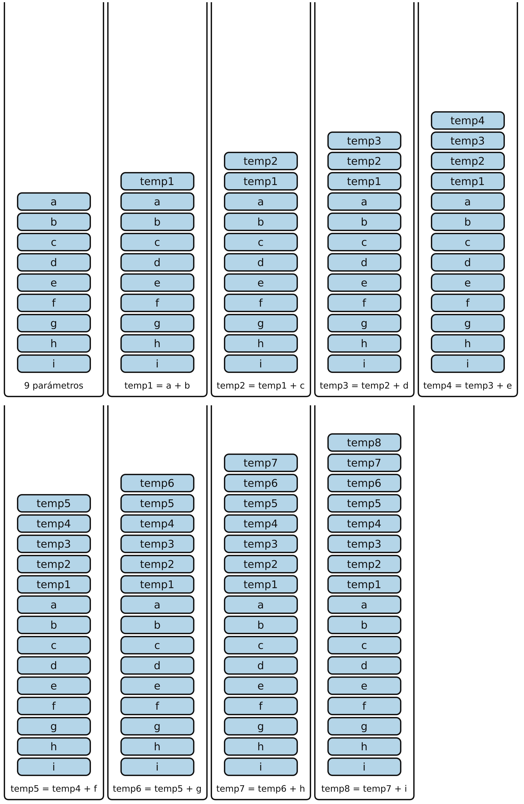

Figura 14-27. Composición de la pila en cada paso

Este es solo un ejemplo muy sencillo que muestra uno de los problemas que los desarrolladores de contratos inteligentes deben superar en su trabajo diario. Aunque los compiladores han mejorado cada vez más en el análisis y manejo automático de este tipo de situaciones, la EVM impone algunas limitaciones estrictas basadas en su funcionamiento actual.

### EOF

EOF aborda todos estos problemas al introducir un formato de contenedor para el bytecode de la EVM con validación en el momento del despliegue, un sistema de versiones y una separación completa entre código y datos. Este es un ejemplo de bytecode válido para EOF:

```
EF00010100040200010008030001003004002000008000045F5FD1005FEC0000EF00010100040200010004030001001404000000008000025F5FEE00EF00010100040200010001040000000080000000000102030405060708090a0b0c0d0e0f10111213141516171819101a1b1c1d1e
```

Aquí está traducido a un formato legible para las personas:

```
Bytes mágicos                    EF00
Versión de EOF                   01
Datos de validación de pila      01 0004
Secciones de código              02 0001 0008
Tamaño de subcontenedores        03 0001 0030
Tamaño de sección de datos       04 0020
Terminador del encabezado        00
Pila: #ent., #sal., altura máx.  00 80 0004
Código                           5F5FD1005FEC0000
Subcontenedores                  EF00010100040200010004030001001404000000008000025F5FEE00
                                 EF00010100040200010001040000000080000000
Datos                            000102030405060708090a0b0c0d0e0f10111213141516171819101
                                 a1b1c1d1e
```

Un momento: explicaremos todo en las siguientes secciones.

#### Mejoras

El análisis de jumpdest y todos los opcodes de introspección del gas y del código se eliminan por completo y ahora se consideran no definidos. Todos los opcodes de la sección de código deben ser válidos, los valores inmediatos (como los datos push) deben estar presentes en el código y no debe haber instrucciones inalcanzables. La validación de la pila también se realiza en el momento de la creación. Esto hace imposibles el subdesbordamiento y el desbordamiento de la pila durante la ejecución, y elimina la necesidad de realizar todas esas comprobaciones durante la ejecución, porque la EVM puede suponer que los contratos ya respetan todas las reglas, ya que se validaron al desplegarse.

> **Consejo**  
>
> Estas garantías de validación mejoran la viabilidad de compilar el bytecode de la EVM a código máquina nativo mediante AOT o JIT.

También se eliminan los saltos dinámicos y se introducen saltos relativos estáticos con tres opcodes nuevos: `RJUMP`, `RJUMPI` y `RJUMPV`, que reciben valores inmediatos, de manera similar a los opcodes `PUSH`. Nótese que con EOF es posible agregar instrucciones nuevas que reciban valores inmediatos porque ya no hay análisis de jumpdest y todo se comprueba en el momento de la creación en lugar de durante la ejecución.

Como puede verse en el contenedor EOF de la sección anterior, EOF introduce el concepto de *funciones* (es decir, secciones de código), aislando la pila de cada una. La EVM tradicional solo puede imitar este comportamiento mediante saltos dinámicos: las funciones de Solidity o Vyper son solo una representación interna.

Por ese motivo se agregan tres opcodes, `CALLF`, `RETF` y `JUMPF`, y una *pila de retorno* (completamente separada de la pila de operandos habitual de la EVM). En particular, la pila de retorno es necesaria para guardar información de ejecución antes de saltar a una función, de modo que sea posible regresar al llamador sin perder datos. La figura 14-28 puede ayudar a visualizar mejor cómo funciona esto.

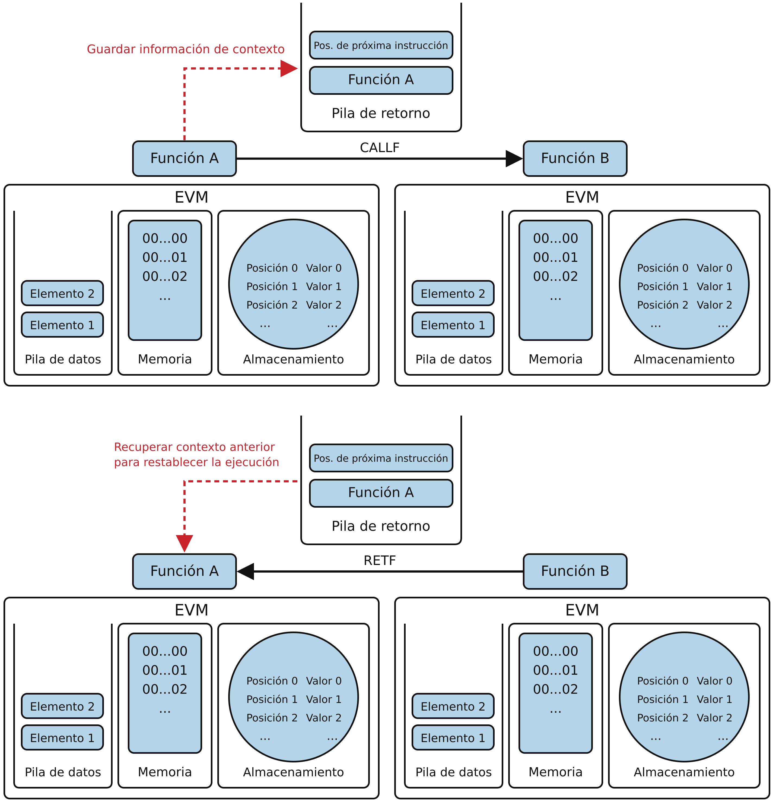

Figura 14-28. EOF introduce el concepto de funciones o secciones de código

El problema "stack too deep" se resuelve agregando tres opcodes nuevos: `DUPN`, `SWAPN` y `EXCHANGE`. Las primeras dos instrucciones son análogas a las antiguas `DUP1..16` y `SWAP1..16`, con la única diferencia de que reciben un valor inmediato que representa el índice del elemento que se debe duplicar o intercambiar. Ese índice puede llegar hasta 256, mucho más que el límite estricto anterior de 16.

El opcode `EXCHANGE` es un opcode nuevo que permite intercambiar dos elementos diferentes de la pila (nótese que `SWAPN` siempre intercambia el elemento n con el primero, mientras que `EXCHANGE` puede intercambiar elementos arbitrarios entre sí). Esto resulta particularmente útil para los compiladores que implementan *algoritmos de planificación de la pila*, que intentan minimizar el tráfico de la pila a partir de un conjunto de variables y un análisis de uso.

`CREATE` y `CREATE2` quedan obsoletos en los contratos EOF. En su lugar se introducen `EOFCREATE` y `RETURNCONTRACT` para proporcionar una manera de crear nuevos contratos EOF.

Por último, se agregan nuevas instrucciones `CALL` para reemplazar las antiguas, que se eliminan: `EXTCALL`, `EXTDELEGATECALL`, `EXTSTATICCALL` y `RETURNDATALOAD`. No permiten especificar un límite de gas (no hay observabilidad del gas) ni requieren un búfer de salida donde la EVM guardaría los datos de retorno de la subllamada. `RETURNDATALOAD` se introduce específicamente para colocar los datos de retorno de la última subllamada ejecutada en la pila del llamador.

#### EOF en acción

Analicemos el contrato EOF mostrado al principio de esta sección:

```
EF00010100040200010008030001003004002000008000045F5FD1005FEC0000EF00010100040200010004030001001404000000008000025F5FEE00EF00010100040200010001040000000080000000000102030405060708090a0b0c0d0e0f10111213141516171819101a1b1c1d1e
```

Primero tenemos el encabezado de EOF, compuesto por:

```
Bytes mágicos                  EF00
```

Los bytes mágicos son necesarios para distinguir los contratos EOF de los tradicionales (ningún otro contrato comienza con `EF00` en la red principal de Ethereum gracias a EIP-3541).

Luego está la versión de EOF, que puede permitir futuras actualizaciones del formato EOF de manera ordenada:

```
Versión de EOF                 01
```

Los datos de validación de la pila siempre comienzan con el identificador `01`, seguido del tamaño de la parte "Pila". En este ejemplo tenemos una sección "Pila" de 4 bytes de longitud:

```
Datos de validación de pila      01 0004
```

Las secciones de código comienzan con el identificador `02`, seguido del número de secciones de código (también llamadas funciones) y su tamaño correspondiente. Aquí tenemos una sección de código de 8 bytes de longitud:

```
Secciones de código          02 0001 0008
```

El tamaño de la sección de subcontenedores comienza con el identificador `03`, seguido del número de subcontenedores y sus tamaños correspondientes. Aquí tenemos un subcontenedor de 48 bytes de longitud (recuerde que siempre se usa el formato hexadecimal):

```
Tamaño de subcontenedores        03 0001 0030
```

El tamaño de la sección de datos comienza con el identificador `04`, seguido del tamaño de la sección de datos. Aquí tenemos 32 bytes en la sección de datos:

```
Tamaño de sección de datos       04 0020
```

Por último, está el terminador del encabezado `00`, que siempre marca el final del encabezado de EOF:

```
Terminador del encabezado        00
```

La sección Pila muestra el número de entradas y salidas y la altura máxima de la pila para cada sección de código (solo una en este ejemplo). Tenemos cero entradas y una función que no retorna (`80` es un byte especial que representa una función que no retorna), y la altura máxima de la pila es igual a 4:

```
Pila: #ent., #sal., altura máx.      00 80 0004
```

Aquí están todas las secciones de código que contienen bytecode de la EVM ejecutado por esta:

```
Código                      5F5FD1005FEC0000
```

Tenemos una sola función (sección de código), que contiene los siguientes opcodes:

```
PUSH0 PUSH0 DATALOADN 0 PUSH0 EOFCREATE 0 STOP
```

Este código primero inserta `0-0` en la pila gracias a los primeros dos opcodes `PUSH0`. Luego lee 32 bytes de la sección de datos, a partir del desplazamiento cero (el siguiente valor inmediato en el código), y los inserta en la pila. Después se inserta otro `0` mediante el último `PUSH0`. Por último, se llama a `EOFCREATE` con `0` como argumento inmediato, lo que llama a la primera sección de código del primer subcontenedor:

```
Subcontenedores              EF00010100040200010004030001001404000000008000025F5FEE00EF0001
                             0100040200010001040000000080000000
```

La sección de subcontenedores incluye todos los subcontenedores EOF incluidos en el bytecode EOF. En este ejemplo tenemos un subcontenedor. Los subcontenedores son bytecode con formato EOF: la idea es que se pueden anidar contenedores EOF dentro de otros contenedores EOF. Esto es útil para los contratos fábrica.

Al final está la sección de datos, que contiene todos los datos que el contrato necesita para ejecutarse. Aquí tenemos 32 bytes de datos:

```
Datos                       000102030405060708090a0b0c0d0e0f10111213141516171819101a1b1c1d1e
```

Este análisis podría aplicarse recursivamente al subcontenedor de este bytecode EOF para comprender por completo lo que hace, pero lo dejamos al lector si le interesa adentrarse aún más en las profundidades de la EVM.

## El futuro de la EVM

El futuro de la EVM, además de EOF, es incierto y dependerá de cómo los desarrolladores y los distintos proyectos la utilicen. Sin embargo, hay algunas áreas interesantes a las que la EVM podría expandirse, como la *zk-EVM*, que proporcionaría pruebas de conocimiento cero adjuntas a cada bloque para demostrar su correcta ejecución. Además, [*EVMMAX*](https://oreil.ly/ioqSx) y [*SIMD*](https://oreil.ly/7q0Dq) aportarían más potencia a la EVM y harían mucho más rápido realizar grandes cantidades de procesamiento criptográfico, lo que sería particularmente beneficioso para aplicaciones que dependen de la criptografía, como los protocolos de privacidad o las L2.

## Conclusión

En este capítulo exploramos la EVM, seguimos la ejecución de varios contratos inteligentes y examinamos cómo ejecuta el bytecode. También examinamos el gas, el mecanismo de contabilidad de la EVM, y vimos cómo resuelve el problema de la parada y protege a Ethereum de ataques DoS. Además, analizamos EOF y cómo intenta corregir distintos aspectos del funcionamiento de la EVM tradicional.

A continuación, en el capítulo 15, exploraremos el mecanismo que usa Ethereum para lograr un consenso descentralizado.
