# Capítulo 15. Consenso

A lo largo de este libro hemos hablado de las *reglas de consenso*, las reglas que todos deben aceptar para que el sistema funcione de manera descentralizada pero determinista. En ciencias de la computación, el término *consenso* es anterior a las blockchains y se relaciona con el problema más amplio de sincronizar el estado en sistemas distribuidos, de modo que todos los participantes de un sistema distribuido acuerden, eventualmente, un único estado para todo el sistema. A esto se le llama *alcanzar consenso*.

En las funciones centrales del registro y la verificación descentralizados, puede resultar problemático depender únicamente de la confianza para garantizar que la información derivada de las actualizaciones de estado sea correcta. Este desafío bastante general es especialmente marcado en las redes descentralizadas porque no hay una entidad central que decida qué es verdadero. La ausencia de una entidad central de toma de decisiones es uno de los principales atractivos de las plataformas blockchain por su capacidad resultante de resistir la censura y por no depender de una autoridad para obtener permiso de acceso a la información. Sin embargo, estos beneficios tienen un costo: sin un árbitro de confianza, cualquier desacuerdo, engaño o diferencia debe conciliarse por otros medios. Los algoritmos de consenso son el mecanismo utilizado para conciliar la seguridad y la descentralización.

En las blockchains, el consenso es una propiedad crítica del sistema. En pocas palabras, ¡hay dinero en juego! Así que, en el contexto de las blockchains, el consenso consiste en poder llegar a un estado común manteniendo la descentralización. En otras palabras, el consenso busca producir un sistema de reglas estrictas sin gobernantes. No hay una persona, organización o grupo "a cargo"; en cambio, el poder y el control se distribuyen entre una amplia red de participantes a quienes les conviene seguir las reglas y comportarse honestamente.

La capacidad de alcanzar consenso en una red distribuida, bajo condiciones adversas y sin centralizar el control, es el principio central de todas las blockchains abiertas y públicas. Para abordar este desafío y mantener la valiosa propiedad de la descentralización, la comunidad continúa experimentando con diferentes modelos de consenso. Este capítulo explora estos modelos de consenso y su impacto esperado en las blockchains de contratos inteligentes como Ethereum.

> **Nota**  
>
> Aunque los algoritmos de consenso son una parte importante del funcionamiento de las blockchains, operan en una capa fundamental, muy por debajo de la abstracción de los contratos inteligentes. En otras palabras, la mayoría de los detalles del consenso están ocultos para quienes escriben contratos inteligentes. No es necesario saber cómo funcionan para usar Ethereum, del mismo modo que no es necesario saber cómo funciona el enrutamiento para usar internet.

## Principios del consenso

En la tecnología blockchain, en particular en Ethereum, comprender los principios del consenso nos ayuda a entender cómo la red mantiene su integridad y funciona de manera eficaz. Para tener una idea más clara de cómo funciona todo, repasemos las ideas centrales.

### Seguridad

En el contexto de los mecanismos de consenso, la *seguridad* consiste en garantizar que la red acuerde de manera consistente el estado actual de la blockchain sin errores. Esto significa evitar problemas como el doble gasto y los conflictos entre transacciones, manteniendo la consistencia en toda la red. En un sistema seguro, cada nodo tiene una visión idéntica del historial de la cadena y, en la práctica, se comporta como una implementación centralizada que ejecuta las operaciones de forma atómica, una a la vez.

### Finalidad

La *finalidad* es una de las características de seguridad más importantes del mecanismo de consenso de Ethereum. Marca el punto en el que las transacciones se consideran completas e irreversibles, lo que garantiza que, una vez que una transacción se ha agregado a la blockchain, no puede alterarse ni eliminarse. Esta naturaleza irreversible de las transacciones inspira un alto grado de confianza en el sistema y brinda a los usuarios la certeza de que sus transacciones quedan registradas permanentemente.

Básicamente, la finalidad pone en práctica la idea de seguridad, convirtiéndola de un concepto en algo práctico. Garantiza que, aunque distintas partes de la red puedan tener sus propias visiones locales, exista un punto de acuerdo irrevocable que deje fijo e inmutable el historial de la cadena.

### Vivacidad

Mientras que la seguridad garantiza que no ocurra nada malo en la red, la *vivacidad* garantiza que siempre ocurra algo bueno, eventualmente. En otras palabras, la red Ethereum seguirá procesando transacciones y agregando nuevos bloques, pase lo que pase.

Desde otra perspectiva, la vivacidad también puede entenderse en términos de disponibilidad. En la práctica, esto significa que, cada vez que enviamos una transacción válida a un nodo que actúa honestamente dentro de la red, podemos esperar que la transacción se incluya en un próximo bloque que contribuya a extender la blockchain. Esta expectativa de inclusión y procesamiento de transacciones es necesaria para lograr la confianza de los usuarios y la eficacia general de la plataforma Ethereum.

### Árboles de bloques y bifurcaciones

No es posible diseñar un protocolo de consenso que sea seguro y tenga vivacidad bajo todas las circunstancias; hay que favorecer una de las dos propiedades. Aunque el protocolo de consenso de Ethereum ofrece tanto seguridad como vivacidad en buenas condiciones de red, prioriza la vivacidad cuando las cosas se vuelven caóticas. Lo hace mediante el concepto de bifurcación.

En una blockchain, cada bloque, excepto el bloque especial Génesis, se construye sobre un bloque padre y apunta a él. Así, obtenemos una cadena de bloques: una blockchain. En las cadenas que implementan protocolos de consenso con bifurcaciones, esta condición lineal a menudo no se cumple en la práctica: en condiciones reales, podemos terminar con algo más parecido a un árbol de bloques, como se ve en la Figura 15-1, que a una blockchain, y el objetivo del protocolo de consenso es que todos los nodos de la red acuerden la misma secuencia lineal de bloques.

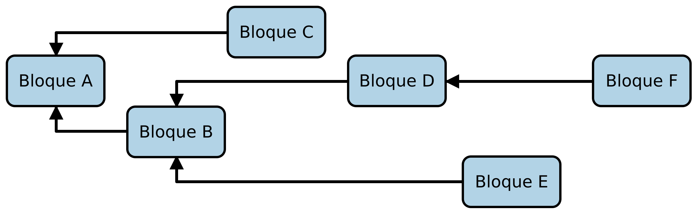

Figura 15-1. Estructura de un árbol de bloques

Las distintas ramas del árbol de bloques se llaman *bifurcaciones*. Las bifurcaciones ocurren naturalmente como consecuencia de los retrasos de red y procesamiento, o de fallas de los clientes y comportamientos maliciosos de estos.

Si consultáramos nodos que siguen distintas bifurcaciones, nos darían respuestas diferentes sobre el estado del sistema. Aquí radica la resiliencia de los protocolos de consenso con bifurcaciones: en lugar de detenerse por completo en condiciones desfavorables, se bifurcan. En última instancia, queremos que todos los nodos correctos de la red acuerden una visión lineal idéntica del historial y, por lo tanto, una visión común del estado del sistema. La función de la *regla de elección de bifurcación* del protocolo es lograr este acuerdo: dado un árbol de bloques y algunos criterios de decisión, la regla de elección de bifurcación está diseñada para seleccionar, entre todas las ramas disponibles, la que tenga más probabilidades de terminar formando parte de la cadena canónica lineal final. La desventaja de un protocolo con bifurcaciones es que los nodos que siguen ramas que no terminan en la cadena canónica tendrán que retroceder su visión de la realidad y revertir las transacciones recientes que hayan procesado para incorporarse a la rama correcta. Esto se llama *reorganización* o *reversión* y causa trastornos, por lo que los protocolos buscan minimizarlo tanto como sea posible.

Ahora podemos comprender el poder de la finalidad en el protocolo de consenso de Ethereum: la bifurcación es un medio poderoso para lograr vivacidad, pero, para que la red sea utilizable, esta flexibilidad debe equilibrarse con algunas garantías de seguridad.

## Consenso mediante prueba de trabajo

El creador de la blockchain original, Bitcoin, inventó un algoritmo de consenso basado en la *prueba de trabajo* (proof of work, PoW). Podría decirse que PoW es la invención más importante que sustenta a Bitcoin. El término coloquial para PoW es *minería*, lo que genera un malentendido sobre el propósito principal del consenso. A menudo se supone que el propósito de la minería es crear moneda nueva, ya que el propósito de la minería en el mundo real es extraer metales preciosos u otros recursos. Sin embargo, el verdadero propósito de la minería, y de todos los demás modelos de consenso, es proteger la blockchain y mantener el control del sistema descentralizado y distribuido entre tantos participantes como sea posible. La recompensa en moneda recién emitida es un incentivo para quienes contribuyen a la seguridad del sistema: un medio para alcanzar un fin. En ese sentido, la recompensa es el medio y la seguridad descentralizada es el fin.

En el consenso PoW también existe un "castigo" correspondiente: el costo de la energía necesaria para participar en la minería. Este consumo significativo de energía no es un defecto; es clave en un diseño deliberado de seguridad e incentivos. Si los participantes no siguen las reglas y obtienen la recompensa, arriesgan los fondos que ya han gastado en electricidad para minar. Por lo tanto, el consenso PoW es un equilibrio cuidadoso entre riesgo y recompensa que impulsa a los participantes a comportarse honestamente por interés propio.

Ethereum comenzó como una blockchain PoW siguiendo el ejemplo de Bitcoin, en el sentido de que utilizaba un algoritmo PoW con el mismo sistema básico de incentivos para el mismo objetivo básico: proteger la blockchain y descentralizar el control. El algoritmo PoW de Ethereum era ligeramente diferente del de Bitcoin y se llamaba *Ethash*.

### Ethash: el algoritmo PoW de Ethereum

Antes de que Ethereum pasara a PoS, dependía de un algoritmo PoW llamado Ethash. Utilizaba una evolución del algoritmo Dagger-Hashimoto, que es una combinación del algoritmo Dagger de Vitalik Buterin y el algoritmo Hashimoto de Thaddeus Dryja. Ethash depende de la generación y el análisis de un gran conjunto de datos, conocido como *grafo acíclico dirigido* o, más sencillamente, "el DAG". El DAG tenía un tamaño inicial de aproximadamente 1 GB y seguía creciendo de forma lenta y lineal, actualizándose una vez por época, cada 30,000 bloques o aproximadamente 125 horas.

El propósito del DAG era hacer que el algoritmo PoW Ethash dependiera del mantenimiento de una estructura de datos grande a la que se accediera con frecuencia. A su vez, esto buscaba hacer que Ethash fuera resistente a los ASIC, lo que significa que resultaba más difícil fabricar equipos de minería con circuitos integrados de aplicación específica (ASIC) que fueran órdenes de magnitud más rápidos que una GPU rápida. Los fundadores de Ethereum querían evitar la centralización de la minería PoW, en la que quienes tuvieran acceso a fábricas especializadas de chips de silicio y grandes presupuestos pudieran dominar la infraestructura de minería y socavar la seguridad del algoritmo de consenso.

Utilizar GPU de consumo para realizar la PoW en la red Ethereum significaba que más personas de todo el mundo podían participar en el proceso de minería. Una mayor cantidad de mineros independientes significaba que la potencia de minería estaba más descentralizada, lo que permitía evitar una situación como la de Bitcoin, donde gran parte de la potencia de minería se concentra en manos de unas pocas operaciones industriales de minería de gran tamaño. La desventaja de usar GPU para la minería fue que precipitó una escasez mundial de GPU en 2017, lo que disparó sus precios y provocó protestas entre los aficionados a los videojuegos. Esto llevó a los comercios a imponer restricciones de compra, limitando a los compradores a una o dos GPU por cliente.

Hasta 2017, la amenaza de los mineros ASIC en la red Ethereum era prácticamente inexistente. Usar ASIC para Ethereum requería el diseño, la fabricación y la distribución de hardware altamente personalizado. Producirlo requería una inversión considerable de tiempo y dinero. Los planes de los desarrolladores de Ethereum de pasar a un algoritmo de consenso PoS, expresados durante mucho tiempo y ya concretados, probablemente disuadieron a los proveedores de ASIC de enfocarse en la red Ethereum durante mucho tiempo.

## Consenso mediante proof of stake

Históricamente, PoW no fue el primer algoritmo de consenso propuesto. Antes, muchos investigadores exploraron ideas basadas en stake financiero o reputacional. Incluso antes, algunos de los primeros modelos de consenso eran con permiso: los validadores se seleccionaban por autoridad o identidad, no mediante competencia abierta. La *tolerancia práctica a fallas bizantinas* (PBFT), por ejemplo, requiere un conjunto fijo o seleccionado de validadores, un modelo que aún hoy sustenta muchos sistemas distribuidos tradicionales.

Uno de los grandes avances del consenso basado en PoW fue que permitió participar sin permiso: cualquiera con la potencia de cómputo disponible podía contribuir y recibir recompensas sin necesitar aprobación para unirse. Esto fue un gran logro para la descentralización. En cierto sentido, PoW se inventó como una alternativa sin permiso a los modelos más cerrados.

Tras el éxito de Bitcoin, muchas blockchains adoptaron PoW. Pero la explosión de investigaciones sobre consenso reavivó el interés en PoS y produjo grandes avances. Desde el principio, los fundadores de Ethereum esperaban migrar eventualmente a PoS. De hecho, la cadena PoW original de Ethereum incluía un obstáculo incorporado, la llamada *bomba de dificultad*, diseñado para dificultar gradualmente la minería con el tiempo y forzar al sistema hacia la transición eventual. La versión de PoS de Ethereum, aunque es sin permiso, tiene algunas raíces conceptuales en los sistemas anteriores basados en autoridad: aquí, la identidad y la participación provienen de aportar stake. Pero, dado que cualquiera con ETH puede hacerlo, conserva el espíritu de acceso abierto del diseño de Nakamoto.

En general, un algoritmo PoS funciona de la siguiente manera. La blockchain lleva un registro de un conjunto de validadores, y cualquiera que posea la criptomoneda base de la blockchain, ether en el caso de Ethereum, puede convertirse en validador enviando un tipo especial de transacción que bloquea su ether en un depósito. Los validadores se turnan para proponer y votar el siguiente bloque válido, y el peso del voto de cada validador depende del tamaño de su depósito, es decir, su stake. Los validadores obtienen pequeñas recompensas proporcionales a su stake cuando participan correctamente en el protocolo. Si cometen errores, como publicar atestaciones incorrectas o tardías, pueden incurrir en pequeñas penalizaciones, aproximadamente de la misma escala que las recompensas. Pero existe una consecuencia mucho más grave llamada *slashing*, que ocurre solo cuando se puede demostrar que un validador es malicioso, por ejemplo, al publicar atestaciones contradictorias o bloques incompatibles. Así, PoS obliga a los validadores a actuar honestamente y seguir las reglas de consenso mediante un sistema de recompensas y castigos. La principal diferencia entre PoS y PoW es que el castigo en PoS es intrínseco a la blockchain, por ejemplo, la pérdida de ether en staking, mientras que en PoW el castigo es extrínseco, por ejemplo, la pérdida de los fondos gastados en electricidad.

Desde el lanzamiento de Ethereum en 2015, existía la intención de pasar a un protocolo de consenso PoS. El primer paso concreto en esa dirección llegó el 1 de diciembre de 2020 con el lanzamiento de Beacon Chain. Inicialmente, Beacon Chain era una blockchain vacía que permitía a cualquiera convertirse en validador depositando 32 ETH en un contrato de depósito específico y solo gestionaba su consenso interno de validadores y sus respectivos saldos. En ese momento, la blockchain de Ethereum todavía utilizaba Ethash como protocolo de consenso.

El 15 de septiembre de 2022 se produjo el hard fork The Merge, y Beacon Chain, con su propio conjunto de validadores, extendió su protocolo de consenso basado en PoS a la blockchain principal de Ethereum, lo que puso fin al uso de Ethash. Sin embargo, persistían algunas limitaciones, incluida la imposibilidad de que los validadores retiraran su capital y abandonaran el conjunto de validadores. Estos problemas se resolvieron por completo el 12 de abril de 2023 con la actualización Shapella, que completó el trabajo de transición de Ethereum de un protocolo de consenso PoW a uno PoS.

El protocolo de consenso PoS utilizado por Ethereum se llama *Gasper*. En las siguientes secciones exploraremos cómo funciona, comenzando por la terminología básica y avanzando hacia la regla de elección de bifurcación (LMD-GHOST) y el mecanismo de finalidad (Casper FFG). Concluiremos con un ejemplo para aclarar los conceptos teóricos que hemos tratado.

## Terminología de PoS

En esta sección nos enfocaremos en los componentes y la terminología del consenso PoS de Ethereum.

### Nodos y validadores

Los *nodos* forman la columna vertebral de la red Ethereum. Se comunican entre sí y son responsables de verificar el cumplimiento del consenso. Los *validadores*, responsables de proponer nuevos bloques y votar sobre ellos, están conectados a estos nodos, pero, a pesar de lo que su nombre pueda sugerir, en realidad no validan los bloques por sí mismos. En cambio, es el software del nodo el que verifica si los bloques y las transacciones siguen las reglas del protocolo. Un solo nodo puede alojar múltiples validadores, y las tareas de los validadores se realizan ejecutando tanto un cliente de ejecución como un cliente de consenso. En las próximas secciones veremos exactamente cuáles son esas tareas.

Una propiedad peculiar de PoS que conviene tener presente es que se conoce el conjunto de validadores activos: esto será clave para lograr finalidad, ya que podemos identificar cuándo hemos alcanzado una mayoría de votos de los participantes.

### Bloques y atestaciones

La gestión estricta del tiempo es una propiedad importante de PoS de Ethereum. Los dos intervalos clave en PoS son el *slot*, que dura exactamente 12 segundos, y la *época*, que abarca 32 slots.

En cada slot se selecciona exactamente un validador para proponer un bloque. Durante cada época, cada validador puede compartir su visión del mundo exactamente una vez, en forma de una *atestación*. Una atestación contiene votos para la cabeza de la cadena que utilizará el protocolo LMD-GHOST y votos para puntos de control que utilizará el protocolo Casper FFG, donde FFG significa "Friendly Finality Gadget". Compartir atestaciones consume mucho ancho de banda, por lo que se distribuye a lo largo de cada época, en lugar de cada bloque, para repartir la carga de trabajo necesaria y mantenerla manejable.

El protocolo incentiva la producción y la precisión de bloques y atestaciones mediante un sistema de recompensas y penalizaciones para los validadores, pero tolera slots y atestaciones vacíos, lo que puede ocurrir tanto por razones naturales, por ejemplo, que un nodo se desconecte, como por motivos de lucro. Ampliaremos este tema en la sección posterior "Juegos de temporización".

## LMD-GHOST

LMD-GHOST es la parte principal del protocolo de consenso de Ethereum: es el algoritmo de la regla de elección de bifurcación. Selecciona el bloque más reciente que un nodo debe considerar válido en su visión local de la blockchain. Este bloque también se llama la *cabeza de la cadena*.

Para comprender por completo cómo funciona, es necesario conocer algunos conceptos básicos del protocolo PoS de Ethereum. En un protocolo de consenso clásico basado en PoW, las entidades responsables de crear nuevos bloques y agregarlos a la cadena, es decir, los mineros, no necesitan cumplir ningún requisito especial. Si publican un bloque que satisface la PoW, toda la red lo acepta. En el protocolo de consenso de Ethereum basado en PoS, los validadores deben hacer staking de una gran cantidad de ETH como garantía, actualmente al menos 32 ETH, tan solo para entrar al conjunto de validadores.

Como ya mencionamos brevemente, los validadores tienen dos tareas principales:

**Proponer bloques**

En cada slot se selecciona un validador de forma seudoaleatoria para crear y proponer el siguiente bloque de la cadena.

**Crear atestaciones**

En cada slot se selecciona una proporción de los validadores para publicar sus votos por el bloque que consideran la mejor cabeza de la cadena. Este voto se comparte después con todos los validadores en forma de una atestación.

Cuando un validador vota por cierto bloque dentro de una atestación, en realidad le está asignando una puntuación. Esta puntuación es exactamente igual a la cantidad de ETH que el validador tiene en staking al momento de publicar la atestación. Pero hay más: este voto no es solo un voto por ese bloque, sino también por todos los bloques ancestros que se encuentran en la misma bifurcación del bloque seleccionado, como se ve en la Figura 15-2.

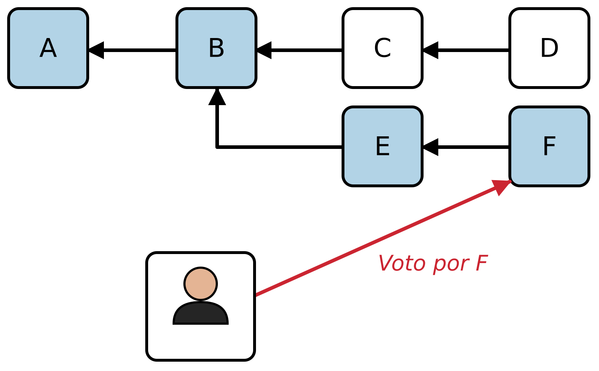

Figura 15-2. Propagación de votos a los ancestros

Podríamos decir que un voto por un bloque se propaga hacia atrás a todos sus ancestros. Para aclarar aún más este concepto, podemos asignar una puntuación a todas las ramas. Una *rama* es el enlace que conecta un bloque con su padre, como se muestra en la Figura 15-3.

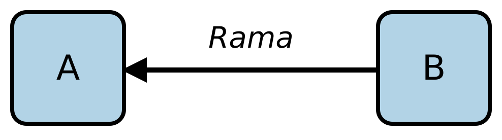

Figura 15-3. Definición de rama

Definimos la puntuación de una rama como la suma de la puntuación del bloque que da origen a esa rama, el bloque B en la Figura 15-3, más la puntuación de todas sus ramas descendientes directas.

La Figura 15-4 muestra una cadena de bloques donde cada bloque tiene una puntuación igual a 1. La rama que conecta E con D tiene una puntuación exactamente igual a la del bloque E porque no hay bloques descendientes. Para calcular la puntuación de la rama D→C, hay que sumar la puntuación del bloque D a la de todas las ramas descendientes. En este caso, solo hay una rama descendiente: la rama E→D. Por lo tanto, es 1 (puntuación del bloque D) + 1 (puntuación de la rama E→D) = 2. Luego tenemos la rama C→B: su puntuación es 1 (puntuación del bloque C) + 2 (puntuación de la rama D→C) = 3. Aquí tenemos una pequeña bifurcación con el bloque C′; debemos asignar una puntuación a la rama C′→B. Su puntuación es solo 1 (puntuación del bloque C′) porque el bloque C′ no tiene descendientes directos. Por último, tenemos la rama B→A; para calcular su puntuación, debemos sumar 1 (puntuación del bloque B) + 1 (puntuación de la rama C′→B) + 3 (puntuación de la rama C→B) = 5.

Figura 15-4. Ejemplo de cálculo de puntuación de ramas

La Figura 15-5 contiene un escenario más complejo con varias bifurcaciones donde cada bloque tiene una puntuación diferente. Obsérvela y asegúrese de comprender cómo se calcula la puntuación de cada rama.

Figura 15-5. Puntuación de ramas compleja

Después del último ejemplo, debería quedar claro que la puntuación de un bloque no solo influye en ese bloque, sino también en todos sus ancestros, ya que se propaga hacia atrás a todas las ramas anteriores. La idea es que, si un validador vota, en forma de una atestación, por un bloque para que sea la cabeza de la cadena, también está considerando válidos a todos sus ancestros y como parte de la cadena correcta.

Ahora podemos finalmente entrar en los detalles de cómo funciona realmente LMD-GHOST y cómo selecciona el bloque que se considerará la cabeza de la cadena. Comencemos analizando su nombre. LMD-GHOST está formado por dos siglas: *latest message driven* y *greediest heaviest observed subtree*.

### Guiado por el mensaje más reciente

Para asignar una puntuación a cada bloque y rama, solo hay que considerar la atestación más reciente de cada validador. Esto significa que, si se reciben dos atestaciones de un validador V, no hay que contarlas dos veces; hay que verificar cuál es la más reciente y descartar la otra.

La Figura 15-6 muestra un validador que publica una atestación sobre el bloque B en la que comparte que considera al bloque B la cabeza de la cadena. Luego, en un momento posterior, durante el bloque F, el validador vuelve a ser seleccionado para publicar una nueva atestación en la que expresa su preferencia por el bloque F como nueva cabeza de la cadena. Cuando ese validador publica la nueva atestación en el bloque F, los demás validadores deben descartar la anterior, publicada durante el bloque B, y considerar solo la más reciente.

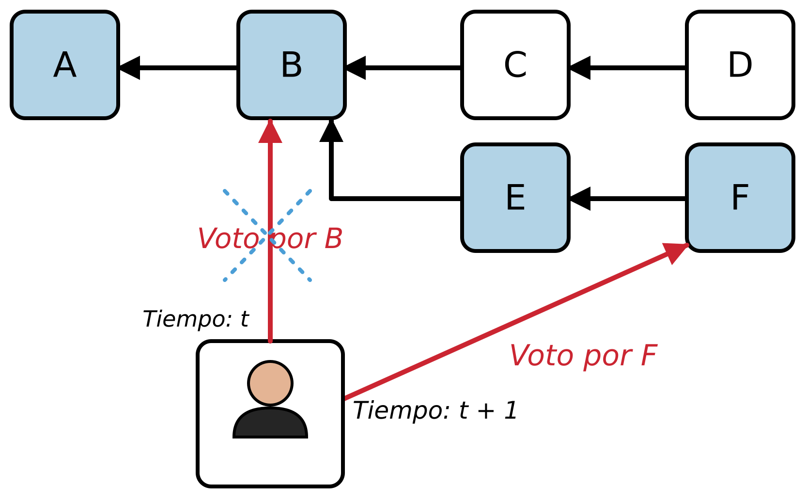

Figura 15-6. Ejemplo de selección guiada por el mensaje más reciente

### Selección voraz del subárbol observado más pesado

GHOST es el aspecto clave de la regla de elección de bifurcación. El bloque cabeza es el bloque sin más descendientes que forma parte de la bifurcación con la mayor votación.

Veámoslo en la práctica para comprender mejor cómo funciona LMD-GHOST en un escenario real. La Figura 15-7 representa el mismo escenario que usamos anteriormente.

Figura 15-7. Escenario de LMD-GHOST

LMD-GHOST siempre parte de un bloque inicial que se considera parte de la cadena finalizada. Al principio es el bloque Génesis, pero, con el protocolo completo de consenso de Ethereum basado en PoS, se va actualizando con el último bloque de punto de control justificado, terminología que exploraremos en "Casper FFG: el mecanismo de finalidad". No es crucial saber todavía qué es un punto de control justificado; solo hay que saber que siempre existe un bloque de partida.

En este ejemplo, el bloque A es el bloque inicial. Supongamos que somos un validador que debe emitir una atestación o que ha sido seleccionado para proponer el siguiente bloque. Debemos ejecutar LMD-GHOST para saber qué bloque es la cabeza de la cadena, de modo que podamos publicar la atestación correspondiente o construir el siguiente bloque sobre el bloque cabeza anterior correcto. Ya hemos recopilado las atestaciones de otros validadores hasta este momento, considerando solo la más reciente de cada validador, siguiendo la regla LMD del protocolo. Así, tenemos la puntuación de todos los bloques, formada por la suma de las puntuaciones que cada validador asignó a cada uno.

En este punto, LMD-GHOST funciona en dos pasos:

1. Asigna una puntuación a todas las ramas, siguiendo la misma metodología que explicamos antes: propaga hacia atrás la puntuación de cada bloque a todas las ramas anteriores. La Figura 15-8 muestra las puntuaciones finales de todas las ramas.

Figura 15-8. Puntuaciones calculadas de las ramas

2. Luego, partiendo del bloque inicial, la parte GHOST del protocolo procede de manera voraz a seleccionar la rama con la puntuación más alta hasta llegar a un bloque sin descendientes. Ese es el bloque cabeza que devuelve la regla de elección de bifurcación LMD-GHOST.

Veamos cómo se ejecuta esto paso a paso en nuestro ejemplo. LMD-GHOST comienza en el bloque inicial A y pasa inmediatamente al bloque B siguiendo la rama B→A, ya que no hay ramas alternativas entre las que elegir, como se muestra en la Figura 15-9.

Figura 15-9. LMD-GHOST, paso 1

Ahora hay dos ramas entre las que elegir:

- Rama C→B con una puntuación igual a 8
- Rama D→B con una puntuación igual a 6

GHOST selecciona de manera voraz la rama C→B porque es la que tiene la puntuación más alta, como se muestra en la Figura 15-10. Nótese que no importa que el bloque D tenga una puntuación mayor que el bloque C, porque LMD-GHOST no considera la puntuación de un bloque individual, sino la de toda la bifurcación en la que se encuentra ese bloque.

Figura 15-10. LMD-GHOST, paso 2

Ahora tenemos dos ramas diferentes entre las que elegir:

- Rama E→C con una puntuación igual a 4
- Rama F→C con una puntuación igual a 3

GHOST selecciona la rama E→C, como se muestra en la Figura 15-11.

Figura 15-11. LMD-GHOST, paso 3

En este punto solo tenemos una rama entre la que elegir, la rama H→E, así que esa es la que selecciona GHOST, como se muestra en la Figura 15-12.

Figura 15-12. LMD-GHOST, paso 4

El bloque H no tiene descendientes. LMD-GHOST se detiene y lo devuelve como el nuevo bloque cabeza de la cadena.

### Incentivos

LMD-GHOST ofrece diversos incentivos explícitos para los validadores que siguen estrictamente las reglas y castigos para quienes actúan de manera maliciosa. En esta sección exploraremos cómo impide que los actores maliciosos infrinjan las reglas y cómo recompensa a quienes actúan de buena fe.

Los validadores deben realizar dos tareas diferentes:

- Proponer bloques
- Crear atestaciones

Para cada una de ellas, LMD-GHOST incluye varias formas de garantizar que todos se comporten de acuerdo con las reglas.

#### Proponer bloques

Cuando se selecciona un validador para proponer un nuevo bloque a la cadena, debe crear un solo bloque válido. Al hacerlo, el validador obtiene la suma de las comisiones de prioridad de todas las transacciones incluidas en el bloque que ha creado, más algunos ETH recién emitidos, como se ve en la Figura 15-13.

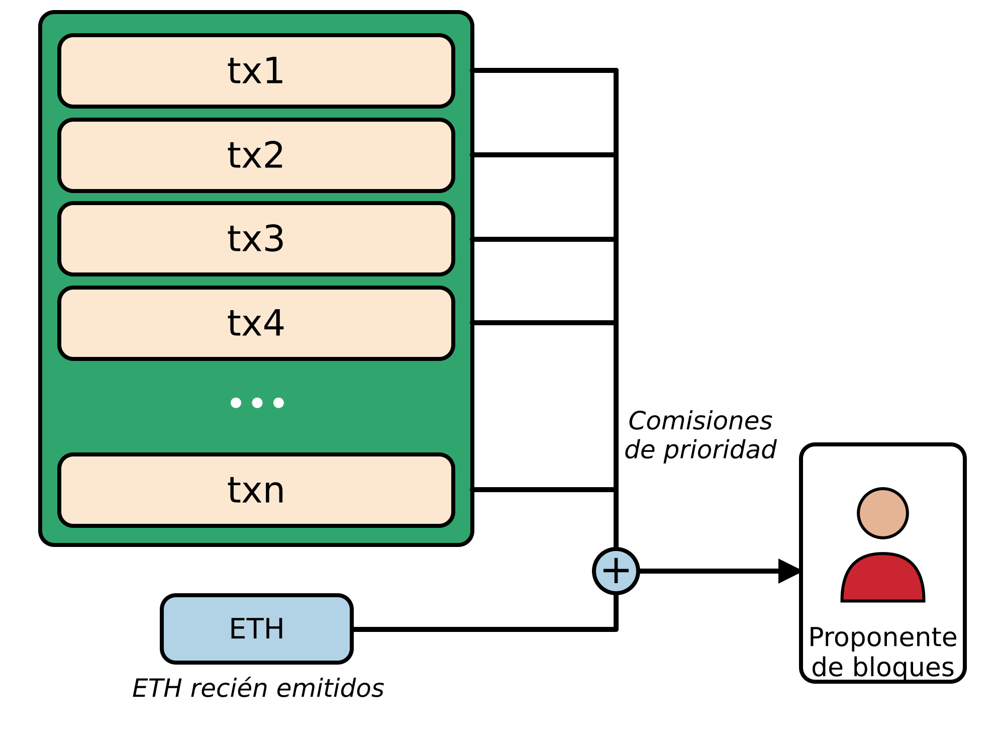

Figura 15-13. Recompensa por proponer un bloque

Si el validador intenta hacer trampa creando más de un bloque, el protocolo lo castiga explícitamente aplicando slashing a una proporción de su stake. De hecho, para formar parte del conjunto de validadores, hay que hacer staking de algunos ETH como garantía, al menos 32 ETH. Este stake también es necesario para que el protocolo pueda castigarlo mediante slashing, es decir, quitándole algunos ETH, como se muestra en la Figura 15-14.

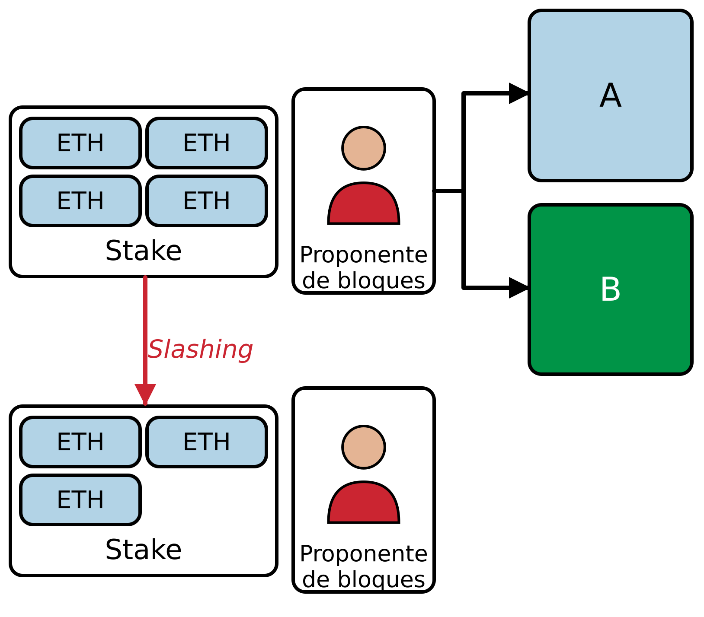

Figura 15-14. Slashing por propuesta de bloques

> **Nota**  
>
> Es interesante señalar aquí que el castigo explícito es una gran diferencia entre el protocolo de consenso PoS de Ethereum y el PoW de Bitcoin. Los mineros de Bitcoin reciben una recompensa si su bloque pasa a formar parte de la cadena más pesada. Si crean más de un bloque para un mismo número de bloque, no hay un castigo explícito.
>
> Quizá se pregunte por qué. Es porque los sistemas basados en PoW requieren realizar cierto trabajo para crear un bloque válido, la propia PoW. Si un minero crea más de un bloque, solo está desperdiciando tiempo y dinero, porque al final solo un bloque terminará en la cadena más pesada, así que recibirá una recompensa por solo uno de ellos.
>
> El protocolo PoS de Ethereum no requiere que los validadores realicen una PoW para crear un bloque válido. Esto significa que crear más de un bloque es casi gratuito para los validadores. Por eso necesitamos un castigo explícito para cualquiera que intente hacer trampa de esta manera.

#### Crear atestaciones

Cuando se selecciona un validador para compartir su visión de la red en forma de una atestación, debe publicar solo una que sea válida. Al hacerlo, obtiene una pequeña comisión, mucho menor que la que recibe el proponente del bloque, como se ve en la Figura 15-15.

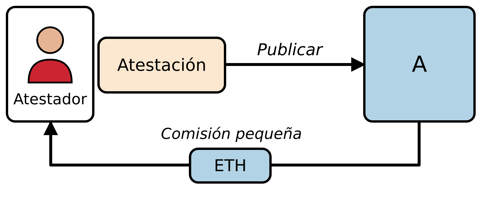

Figura 15-15. Recompensa por atestación

Si el validador intenta hacer trampa creando más de una atestación o atestaciones contradictorias, el protocolo lo castiga explícitamente aplicando slashing a una proporción de su stake, como se muestra en la Figura 15-16.

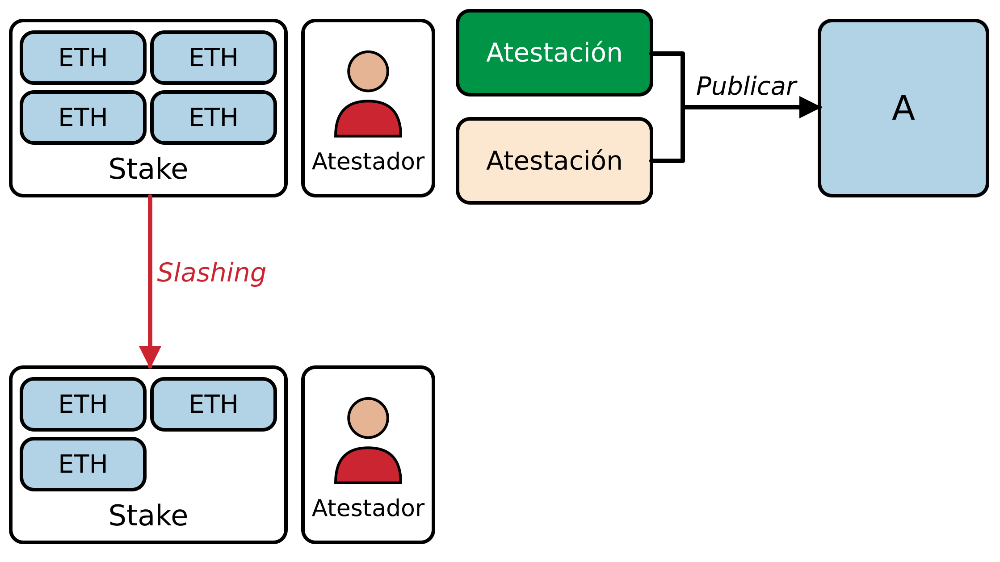

Figura 15-16. Slashing por atestación

Si el validador sigue comportándose de manera maliciosa durante bastante tiempo, el protocolo tiene la facultad de expulsarlo por la fuerza del conjunto de validadores.

## Casper FFG: el mecanismo de finalidad

Casper FFG es una especie de protocolo de metaconsenso. Es una capa superpuesta que puede ejecutarse sobre un protocolo de consenso subyacente para agregarle finalidad.

En el consenso PoS de Ethereum, el protocolo subyacente es LMD-GHOST, que no proporciona finalidad. La finalidad garantiza que, una vez confirmados los bloques en la cadena, no puedan revertirse: formarán parte de la cadena para siempre. Así que, en esencia, Casper FFG funciona como un mecanismo de finalidad y lo usamos para agregar finalidad a LMD-GHOST.

Casper FFG aprovecha que, en un protocolo PoS, sabemos quiénes son nuestros participantes: los validadores que gestionan el ether en staking. Esto significa que podemos contar votos para determinar cuándo hemos visto una mayoría de los votos de los validadores honestos o, más precisamente, votos de validadores que gestionan la mayoría del stake. En todo lo que sigue, el voto de cada validador está ponderado por el valor del stake que gestiona, pero, por simplicidad, no lo aclararemos cada vez.

Casper FFG, como todos los protocolos clásicos tolerantes a fallas bizantinas (BFT), puede garantizar finalidad siempre que menos de un tercio de los validadores sean defectuosos o adversarios. Una vez que una mayoría de validadores honestos ha declarado finalizado un bloque, todos los validadores honestos están de acuerdo, lo que hace irreversible ese bloque. Al requerir que los validadores honestos constituyan más de dos tercios del total, el sistema garantiza que el consenso represente con precisión la visión de la mayoría honesta. Cabe destacar que Casper FFG se distingue de los protocolos BFT tradicionales por ofrecer finalidad económica, sobre la que encontrará más detalles en "Seguridad con atribución de responsabilidad y vivacidad plausible", incluso si más de un tercio de los validadores están comprometidos.

### Épocas y puntos de control

Casper FFG garantiza el consenso al requerir votos de más de dos tercios de los validadores dentro de una época y distribuir la votación entre 32 slots para gestionar eficientemente el gran conjunto de validadores, como se muestra en la Figura 15-17. Una época se divide en 32 slots, cada uno de los cuales suele contener un bloque. El primer slot de una época es su *punto de control*.

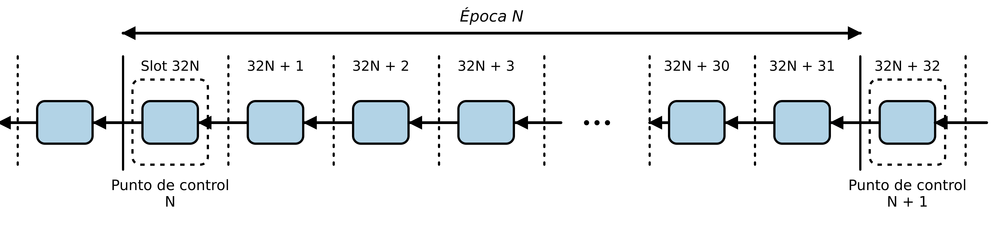

Figura 15-17. Épocas y puntos de control

Los validadores votan una vez por época sobre un punto de control, el primer slot, para mantener un objetivo común de votación. Este proceso, que incorpora tanto los votos de Casper FFG como los de LMD-GHOST por eficiencia, busca finalizar puntos de control, en el contexto de Casper FFG, no épocas enteras, lo que aclara que la finalidad se extiende al punto de control y al contenido que lo precede.

### Justificación y finalización

Casper FFG, al igual que los protocolos BFT tradicionales, asegura el acuerdo de la red en dos etapas. Inicialmente, los validadores difunden y recopilan opiniones sobre un punto de control propuesto. Si una mayoría significativa está de acuerdo, el punto de control queda *justificado*, lo que indica un acuerdo provisional. En la ronda siguiente, si los validadores confirman un apoyo amplio al punto de control justificado, este alcanza la *finalización*, lo que significa que hay acuerdo unánime sobre él y que es irreversible. Este proceso pone de relieve el esfuerzo colaborativo para garantizar la consistencia y la seguridad de la red, con el objetivo de justificar y luego finalizar los puntos de control dentro de plazos específicos y mejorar la confiabilidad del mecanismo de consenso.

#### Orígenes y destinos, enlaces y conflictos

En Casper FFG, los votos comprenden puntos de control de origen y destino que representan los compromisos de los validadores con el estado de la blockchain en diferentes momentos. Estos votos se emiten como un par enlazado que indica los puntos de consenso actual y propuesto de un validador. El voto de origen refleja el reconocimiento del validador de que existe un apoyo amplio a un punto de control, mientras que el voto de destino representa un compromiso condicional con un nuevo punto de control, dependiente de un apoyo similar de los demás. Este sistema de voto dual facilita un avance estructurado hacia la finalización de bloques y garantiza la integridad y la continuidad de la red.

#### Enlaces de supermayoría

En Casper FFG, se establece un *enlace de supermayoría* entre los puntos de control de origen y destino, *s→t*, cuando más de dos tercios de los validadores, según el peso de su stake, respaldan el mismo enlace y sus votos están incluidos en la blockchain. Este mecanismo garantiza el consenso y la seguridad al validar la secuencia de puntos de control mediante un acuerdo amplio de los validadores.

#### Justificación

En Casper FFG, cuando un nodo observa que una mayoría de los validadores acuerda una transición de un punto de control a otro, justifica el punto de control anterior. Esto significa que el nodo ha visto evidencia de consenso de una parte significativa del conjunto de validadores, como se muestra en la Figura 15-18, y se compromete a no volver a un estado anterior a menos que se demuestre un consenso abrumador a favor de una ruta alternativa.

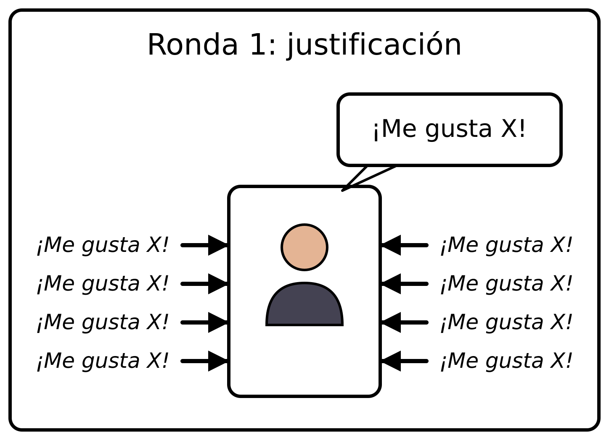

Figura 15-18. Proceso de justificación[^1]

[^1]: El nodo ha visto un enlace de supermayoría CN → CN + 1, por lo que marca CN + 1 como justificado. Dado que CN + 1 es un hijo directo de CN en el árbol de puntos de control, también marca CN como finalizado. Los puntos de control finalizados tienen un rayado cruzado y están marcados con F.

#### Finalización

Cuando un nodo observa un consenso, un enlace de supermayoría, desde un punto de control justificado hasta su hijo directo, finaliza el punto de control padre, como se muestra en la Figura 15-19. Esto indica un compromiso de toda la red de no retroceder desde este punto, respaldado por el apoyo de una fuerte mayoría de validadores. La finalización garantiza la estabilidad y la seguridad de la red al hacer inmutable el historial de la blockchain anterior a ese punto de control e impedir reversiones sin consecuencias significativas para los validadores.

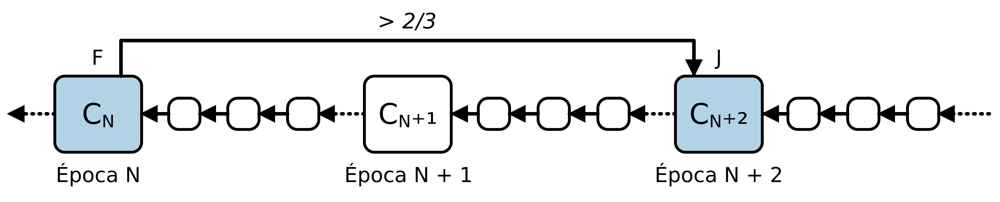

Figura 15-19. Proceso de finalización

### Slashing

Casper FFG implementa un mecanismo de slashing para penalizar a los validadores por infracciones de las reglas del protocolo, con el objetivo de proteger el consenso de la red. Esta medida disuade acciones que podrían socavar la integridad de la blockchain, como finalizar puntos de control contradictorios. La detección de estas infracciones, especialmente en escenarios complejos como los votos envolventes, véase "Regla de elección de bifurcación", puede depender de servicios externos especializados debido a sus desafíos técnicos. Las consecuencias del slashing son proporcionales a la gravedad de la conducta indebida y al estado general de la red, y las penalizaciones se ajustan según el comportamiento colectivo dentro de un período específico, lo que garantiza equidad y responsabilidad en las acciones de los validadores.

### Regla de elección de bifurcación

Casper FFG modifica la regla tradicional de elección de bifurcación LMD-GHOST y exige que los nodos prioricen la cadena con el punto de control justificado más alto; este punto de control se convierte entonces, en la práctica, en el bloque inicial del protocolo LMD-GHOST. Esta adaptación, que es una evolución del enfoque del protocolo LMD-GHOST, garantiza que la red alcance finalidad al comprometerse con puntos de control acordados por una supermayoría de validadores. En la práctica, garantiza que, una vez justificado un punto de control, la red no pueda retroceder más allá de él, reforzando la seguridad y la estabilidad de la blockchain. Esta regla también está diseñada para mantener la vivacidad de la red, en consonancia con los objetivos fundamentales de Casper.

### Los mandamientos de Casper

En Casper FFG, los puntos de control son fundamentales para garantizar el consenso y la seguridad de la red. Están marcados con números de época que aumentan a medida que avanza la blockchain. Los validadores deben cumplir reglas estrictas de votación: no pueden votar por resultados diferentes para el mismo punto de control, de modo que no se permite el voto doble, como se muestra en la Figura 15-20. Si esta regla de votación no existiera, una reorganización sería mucho más probable y la cadena sería muy inestable.

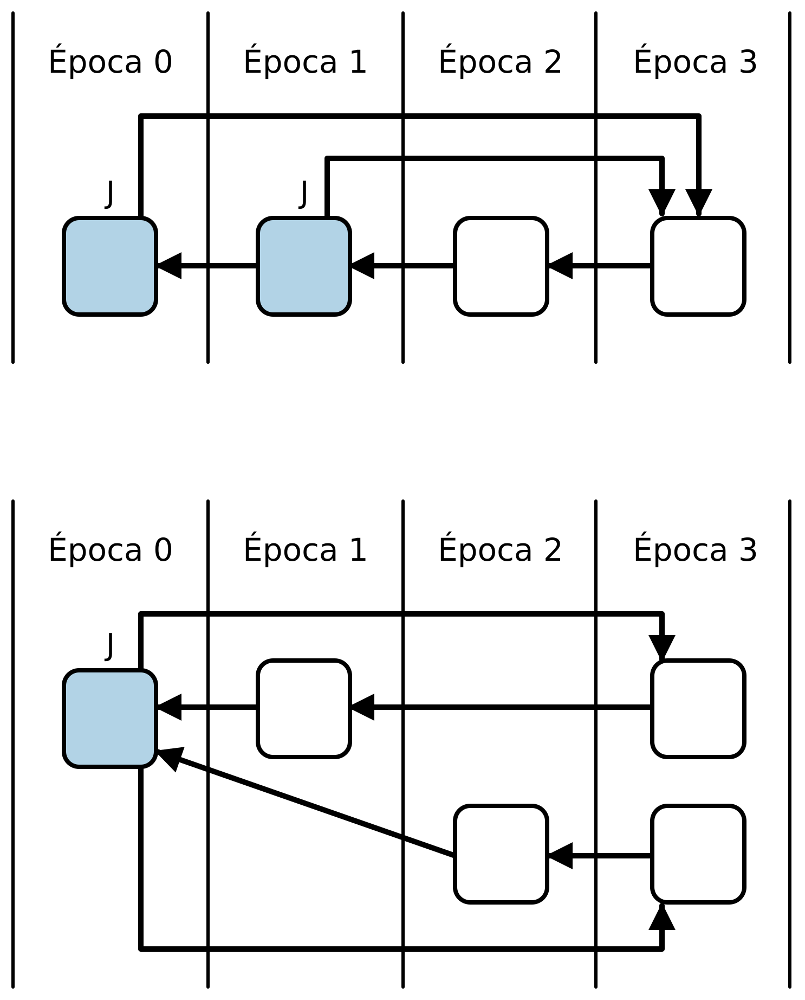

Figura 15-20. Regla de prohibición del voto doble

Los validadores también deben evitar crear votos que puedan interpretarse como contradictorios con compromisos anteriores: no se permite el voto envolvente. Infringir estos principios conlleva slashing, una penalización diseñada para mantener la integridad y la responsabilidad del mecanismo de consenso, como se muestra en la Figura 15-21.

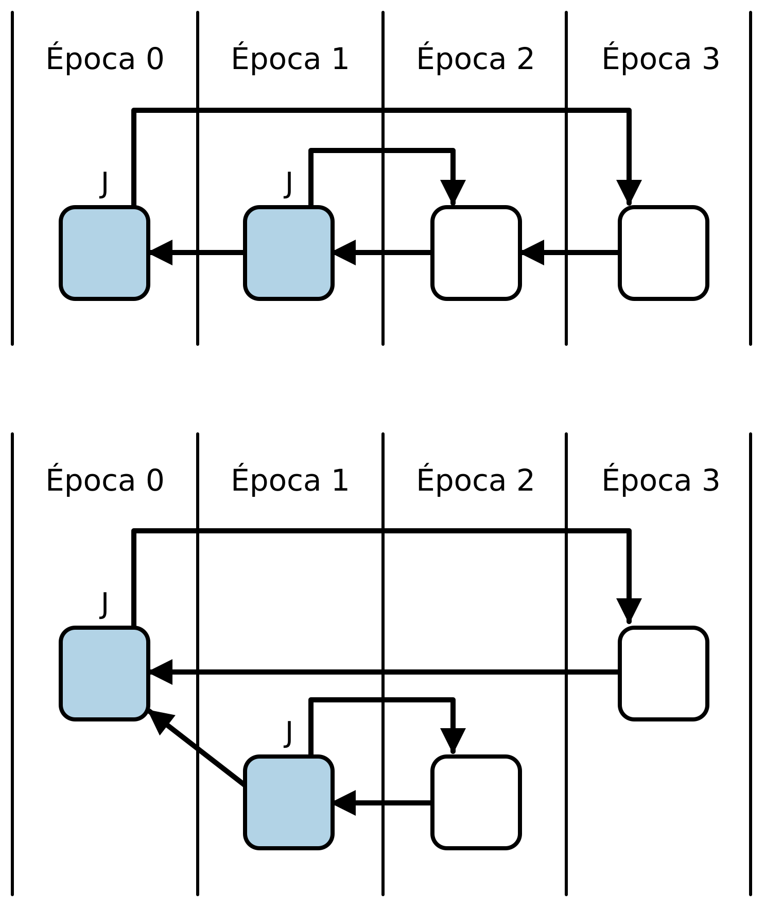

Figura 15-21. Regla de prohibición del voto envolvente

### Seguridad con atribución de responsabilidad y vivacidad plausible

El protocolo de consenso Casper FFG ofrece dos garantías análogas, pero diferentes, a los conceptos de seguridad y vivacidad del consenso clásico: *seguridad con atribución de responsabilidad* y *vivacidad plausible*.

#### Seguridad con atribución de responsabilidad y finalidad económica

La prueba de seguridad con atribución de responsabilidad de Casper FFG demuestra que no pueden finalizarse puntos de control contradictorios a menos que más de un tercio de los validadores infrinja las reglas del protocolo. Este sistema garantiza que los puntos de control finalizados con menos de un tercio de validadores adversarios sigan siendo irreversibles, imponiendo tanto la seguridad de la red como penalizaciones económicas por comportamiento deshonesto.

La finalidad económica en Casper FFG introduce un costo para los posibles atacantes y refuerza la seguridad no solo mediante reglas del protocolo, sino también mediante desincentivos económicos. Los validadores que intentan socavar la red finalizando puntos de control contradictorios enfrentan penalizaciones severas y pierden una parte significativa de sus stakes. Este enfoque contrasta con los mecanismos tradicionales de consenso al agregar una capa de consecuencias económicas, lo que garantiza que finalizar un bloque implique un costo considerable para los actores maliciosos y, de ese modo, mejora la integridad de la blockchain y su resiliencia ante ataques.

#### Vivacidad plausible

Casper FFG garantiza que la red permanezca activa y pueda alcanzar consenso siempre sin que ningún validador honesto sea penalizado, plasmando el concepto de vivacidad plausible. Esto significa que, siempre que una supermayoría de validadores sea honesta, el protocolo puede seguir justificando y finalizando nuevos puntos de control, evitando situaciones de bloqueo en las que el progreso se detenga por temor al slashing. Este principio garantiza la resiliencia y el funcionamiento continuo de la red y pone de relieve la adaptabilidad de Casper para mantener el consenso incluso bajo condiciones difíciles.

## Un ejemplo práctico: el ciclo de vida de un punto de control

Recorramos juntos el ciclo de vida de un punto de control en el mecanismo Casper FFG de Ethereum.

La comunidad de validadores de Ethereum puede ser inmensamente grande, con potencialmente cientos de miles de participantes. No resulta práctico procesar todos estos votos a la vez. Entonces, ¿cómo lo gestionamos?

Los votos se distribuyen a lo largo de lo que llamamos una época, que se divide en 32 slots de 12 segundos cada uno. De esta manera, cada validador vota exactamente una vez por época, y aproximadamente 1/32 del conjunto de validadores vota en cada slot. La Figura 15-22 muestra un grupo de estos validadores.

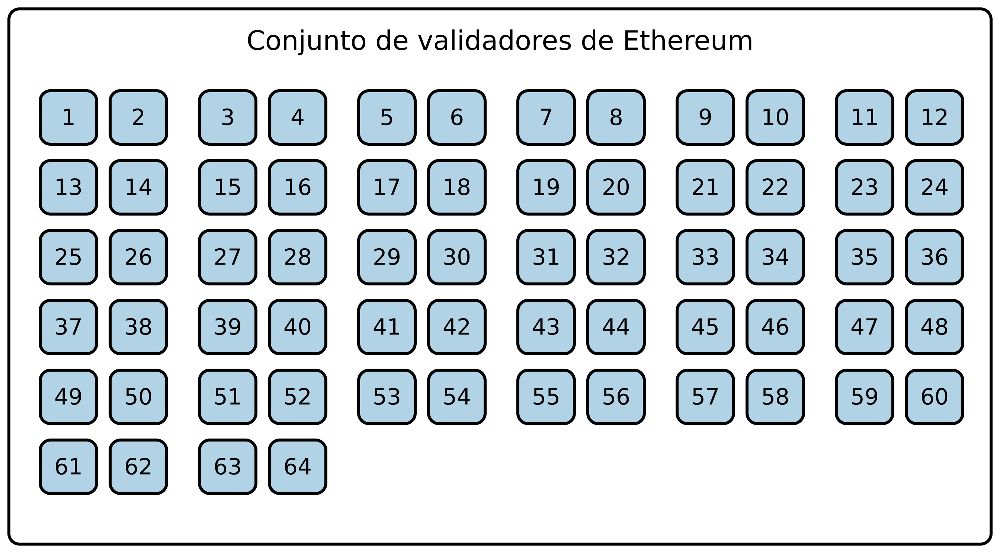

Figura 15-22. Grupo de validadores

En este ejemplo, la cantidad de validadores es, por supuesto, mucho más limitada que en la red Ethereum real, pero contamos con 64 nodos divididos en 32 grupos. Cada grupo votará en un slot de la época, como se muestra en la Figura 15-23.

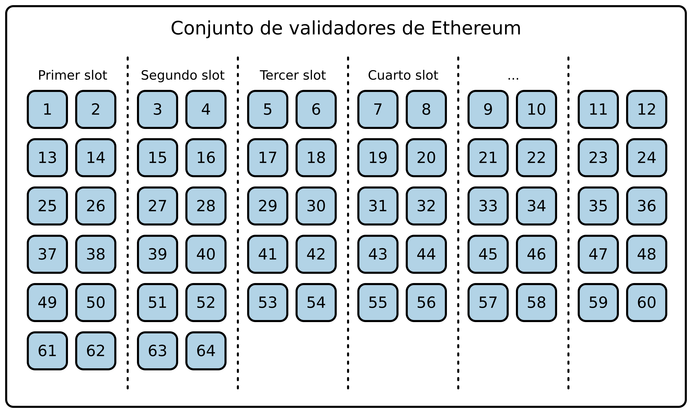

Figura 15-23. Validadores divididos en grupos

Ahora bien, ¿sobre qué votan? Votan sobre un punto de control: específicamente, el primer slot de una época.[^2] Este punto de control actúa como un objetivo común para los validadores que votan en diferentes momentos.

[^2]: Un punto de control siempre es el primer slot de una época, pero su hash de bloque puede ser el de un bloque anterior si falta el bloque propio del punto de control.

> **Nota**  
>
> Es importante aclarar algo aquí: aunque a menudo hablamos de finalizar épocas, en términos técnicos estamos finalizando puntos de control, que son estos primeros slots. Una vez finalizado un punto de control, todo lo anterior hasta ese slot inclusive queda fijado, seguro e inmutable.

La Figura 15-24 muestra una representación de una época, en este caso la época N. El punto de control N es el slot 32N; una vez finalizado ese punto de control, el slot 32N-1 y todos los slots anteriores se considerarán finalizados.

Figura 15-24. Representación de una época

El proceso para lograr esta seguridad es riguroso y se asemeja a los mecanismos tradicionales de consenso BFT. En las próximas secciones describiremos cómo funciona.

### Primera ronda: justificación

Cada validador difunde a la red su propia visión del punto de control de la época actual. Luego escucha para determinar si una supermayoría de la red coincide con su perspectiva. Si es así, este punto de control queda "justificado". En esta etapa, los validadores creen que la mayoría de la red respalda la finalización de este punto de control, aunque todavía no están completamente seguros de que todos estén de acuerdo.

El problema clave es que los validadores aún no pueden estar seguros de que los actores maliciosos de la red no les estén proporcionando información falsa sobre el estado de la red, diciéndoles una cosa a ellos y otra a los demás. Este es un punto muy importante que suele pasarse por alto. Si todos los participantes fueran siempre honestos, la justificación implicaría la finalización y podría evitarse todo el proceso de dos rondas.

Cuando un validador justifica un punto de control, ha recibido la aprobación de dos tercios de la red para ese punto de control específico, como se muestra en la Figura 15-25, pero esta primera ronda de aprobación solo es local para el propio validador. Es posible, especialmente bajo condiciones adversas, que no haya suficientes validadores que hayan alcanzado consenso. Los mecanismos tradicionales de consenso de estilo PBFT, como los utilizados en Algorand, Dfinity y Cosmos, se detendrían en esta etapa y perderían vivacidad. Ethereum, en cambio, sigue adelante. Si no puede justificar un punto de control, no hay problema: pasa al siguiente e intenta justificarlo. Esto funciona porque Ethereum depende de LMD-GHOST para la vivacidad, mientras que Casper FFG es solo una capa superpuesta, algo "deseable, pero no indispensable". Por lo tanto, si la finalidad se detiene temporalmente, no es un problema crítico.

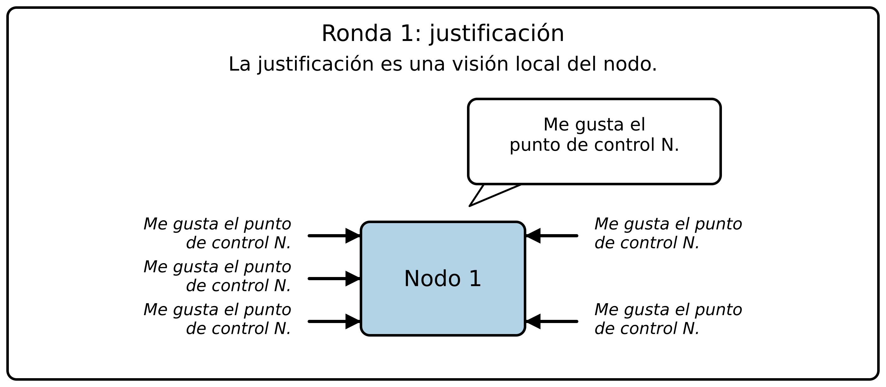

Figura 15-25. Ronda de justificación

### Segunda ronda: finalización

Los validadores anuncian que han escuchado de una supermayoría que también apoya este punto de control. Vuelven a verificar si el resto de la red confirma que esta supermayoría existe realmente. Si es así, los validadores pueden "finalizar" el punto de control, como se muestra en la Figura 15-26. La finalización es un paso poderoso: significa que ningún validador honesto revertirá jamás este punto de control. Puede que aún no lo hayan marcado como finalizado en su visión local, pero al menos lo han marcado como justificado y no puede revertirse sin acciones sancionables.

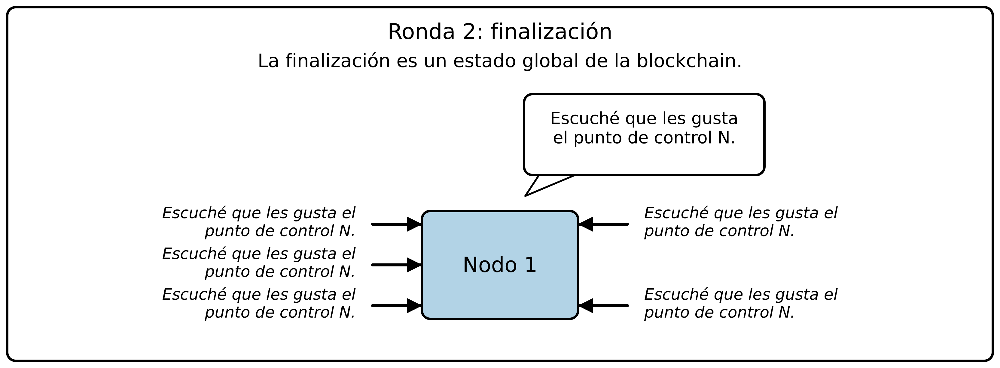

Figura 15-26. Ronda de finalización

En la práctica, cada ronda idealmente abarca una época, lo que significa que se necesita una época para justificar un punto de control y otra para finalizarlo. Esto suma aproximadamente 12.8 minutos. Sin embargo, gracias al diseño en etapas superpuestas de Casper FFG, podemos finalizar un punto de control cada 6.4 minutos, una vez por época.

> **Nota**  
>
> También cabe señalar que, desde una perspectiva externa, podríamos ver indicios de que un punto de control probablemente se finalizará antes de que transcurran los 12.8 minutos, ya que los votos se acumulan gradualmente a medida que avanza la época, suponiendo que no haya una reorganización significativa de la cadena. Sin embargo, las acciones oficiales de justificación y finalización dentro del protocolo ocurren solo al final de una época.

Muchas cosas pueden salir mal durante la justificación y la finalización de puntos de control. Analicemos dos casos importantes y cómo los gestiona este mecanismo amistoso de finalidad.

### Justificación contradictoria

Resulta útil pensar por qué necesitamos tanto el estado "justificado" como el estado "finalizado" para los puntos de control. ¿Por qué no basta con finalizar inmediatamente un punto de control una vez que una supermayoría de dos tercios ha votado a su favor?

Esta es la distinción: la justificación se refiere al acuerdo local, mientras que la finalidad se refiere al consenso global.

Justificar un punto de control significa que yo, como validador, he recibido confirmación de dos tercios de los validadores de que aprueban el punto de control. Sin embargo, esta aprobación representa solo mi perspectiva local. Es posible que otros validadores tengan información diferente; no puedo estar seguro. A pesar de esta incertidumbre, como validador honesto, me comprometo a no revertir nunca ningún punto de control que haya justificado con base en mis datos locales.

Finalizar un punto de control, en cambio, lleva esto un paso más allá. Ocurre cuando he recibido garantías de dos tercios de los validadores de que ellos también han escuchado de dos tercios de sus pares la confirmación de la validez del punto de control. Esto significa que una supermayoría de la red, no solo mi visión local, reconoce este punto de control y se compromete con él. Este consenso amplio es lo que protege al punto de control de una reversión global. Por lo tanto, un punto de control finalizado no solo se reconoce localmente, sino que está protegido globalmente.

Exploremos un escenario extremo para comprender mejor el proceso de consenso. Supongamos que tenemos cuatro validadores, A, B, C y D, como se muestra en la Figura 15-27. Todos son honestos, pero la red en la que operan puede experimentar retrasos indefinidos. Para este ejemplo, imaginemos que hay un punto de control en cada altura de bloque.

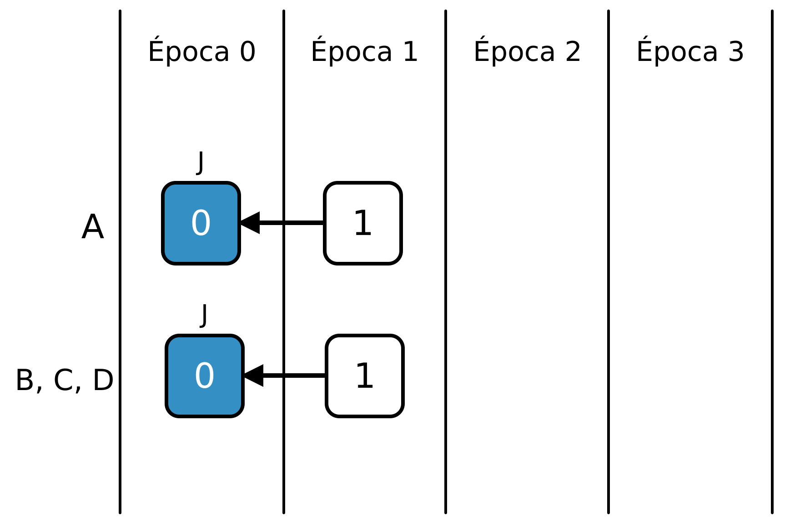

Figura 15-27. Escenario con cuatro validadores

Cada validador del escenario tiene el bloque 0 y, por lo tanto, puede justificar el punto de control 0; así, 0, el origen, está justificado localmente para los cuatro validadores, y 1 es el destino, véase "Orígenes y destinos, enlaces y conflictos".

Ahora imaginemos que A tiene un retraso grave en su conexión de red y que también es elegido para proponer un bloque. A propone un bloque en la época 2. Este bloque contiene los cuatro votos para justificar el punto de control 1, pero, dado que su conexión de red está muy retrasada, los demás validadores nunca lo ven.

A tiene un enlace de supermayoría, véase "Enlaces de supermayoría", entre el origen 0 y el destino 1, por lo que finalizará el punto de control 0 y justificará el punto de control 1. Mientras tanto, B, C y D no vieron votos en la época actual, así que solo tienen justificado el punto de control 0. También votarán por un punto de control vacío en esta época, que es el punto de control X, como se muestra en la Figura 15-28.

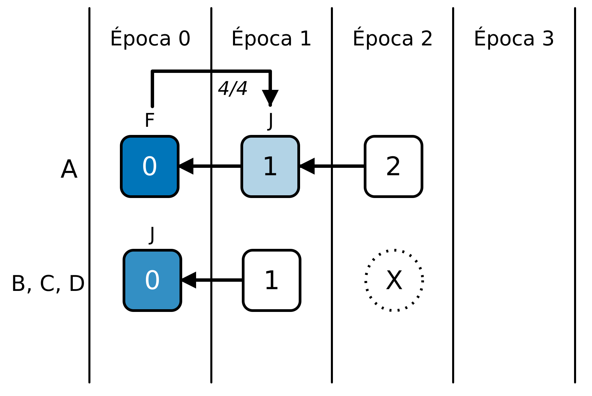

Figura 15-28. Escenario de retraso de red, paso 1

En la época 3, se elige a un validador entre B, C y D para proponer un bloque.

Este bloque contiene tres votos con el punto de control 0 como origen y el punto de control X como destino; por lo tanto, existe un enlace de supermayoría entre 0 y X que permite a los validadores B, C y D tener el punto de control 0 como finalizado y el punto de control X como justificado, como se muestra en la Figura 15-29. A, por su parte, considera inválido este bloque porque, en su visión local, 1 está justificado y no puede revertirse. La única solución para que la cadena del validador A continúe es borrar su memoria y volver a sincronizarse con el resto de la red.

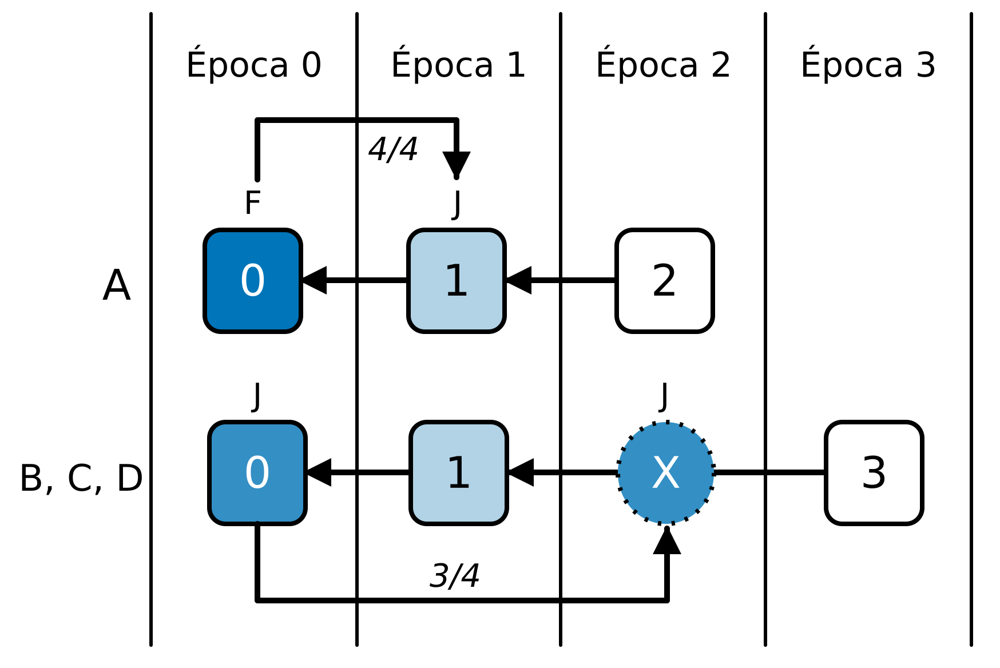

Figura 15-29. Escenario de retraso de red, paso 2

> **Nota**  
>
> Es importante recordar que, en este ejemplo, los validadores B, C y D nunca vieron el bloque propuesto por A. Dado que no observaron el bloque 2, el bloque que habría justificado el punto de control 1, no pueden acordar el bloque 1 y, por lo tanto, no pueden justificar el punto de control 1. Como resultado, votan por un punto de control vacío.

Este ejemplo demuestra que incluso los retrasos de red simples pueden hacer que los nodos tengan visiones diferentes de la justificación y la finalización. Sin embargo, esto por sí solo no justifica la necesidad de dos fases separadas: la justificación seguida de la finalización. El razonamiento detrás de las dos fases es muy sencillo: si no tuviéramos un paso de justificación, A habría finalizado el punto de control 1, que el resto de los validadores habría considerado inválido, como se muestra en la Figura 15-30.

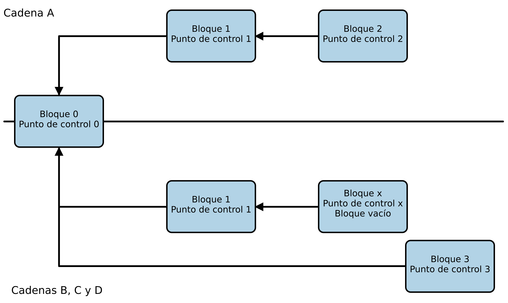

Figura 15-30. Sin el paso de justificación

En el ejemplo anterior, A tuvo que borrar su memoria y volver a sincronizarse con el resto de la red. Esto se debe a que la justificación, como dijimos antes, es similar a un paso local y puede revertirse. Sin embargo, esto no habría sido posible si A hubiera finalizado directamente el punto de control 1. Sin las dos fases, se habría revertido un bloque finalizado de A y B, C y D habrían podido dejar huérfano al bloque 1 sin sufrir slashing. La única forma de garantizar seguridad es mediante un compromiso en dos fases: justificación y finalización.

## Gasper: un ejemplo real

Hasta ahora hemos visto cómo funcionan Casper FFG y LMD-GHOST por separado. Veamos ahora cómo se combinan en Gasper y se utilizan dentro del protocolo de consenso PoS de Ethereum.

La mejor manera de comprender por completo cómo funciona Gasper es seguir un ejemplo real de una blockchain que lo utilice para alcanzar consenso sobre el historial de bloques. No usaremos la red principal de Ethereum para nuestro ejemplo. En cambio, crearemos una red simulada con tres validadores para describir mejor lo que ocurre durante cada fase del protocolo de consenso, como se verá en la Figura 15-31.

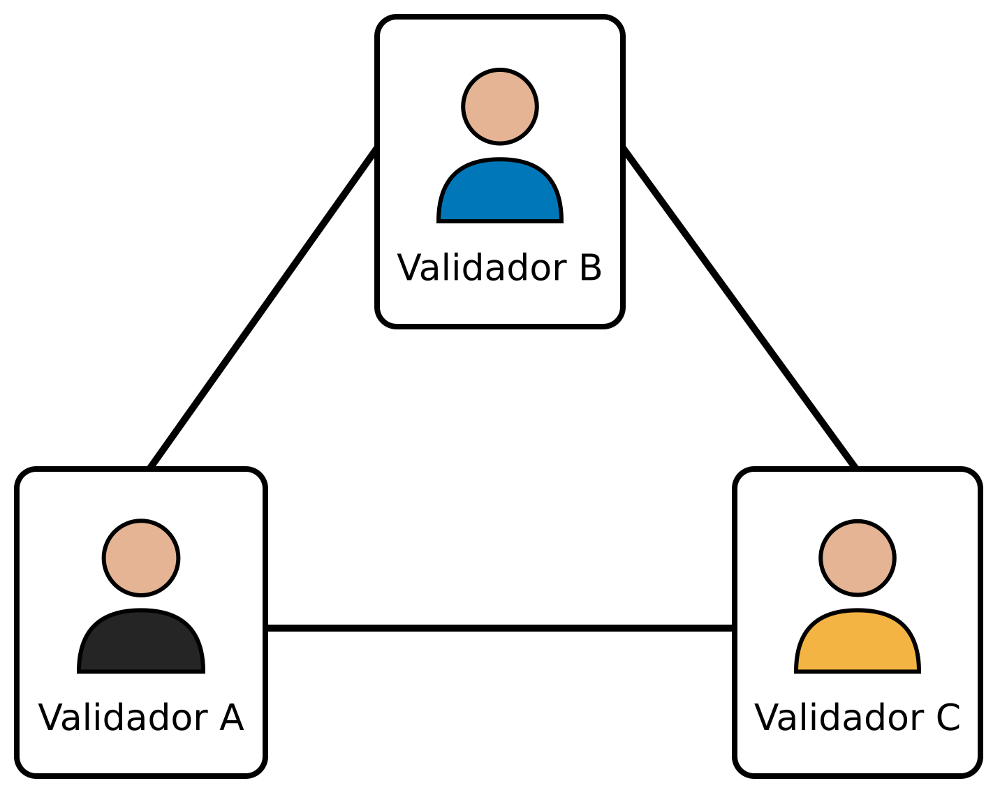

Figura 15-31. Red simulada de Gasper

Los tres validadores tienen la misma cantidad de ETH en stake, por lo que su poder de voto, es decir, su contribución a la puntuación de cada bloque por el que votan, es el mismo. Además, cada validador publica una atestación en cada bloque, en lugar de una vez por época como en la red principal de Ethereum.

Nuestro objetivo es ver la vida de un bloque desde su publicación hasta que primero se justifica y luego se finaliza.

En nuestra red simplificada, cada época consta de tres slots, como se muestra en la Figura 15-32.

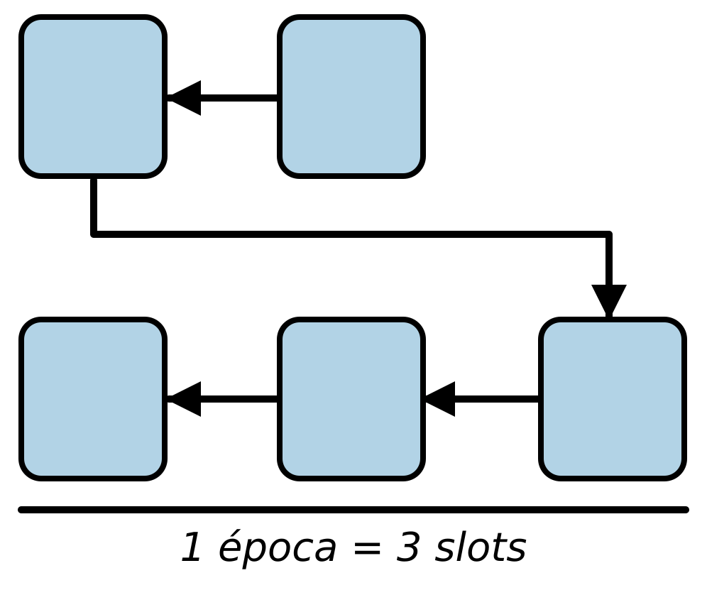

Figura 15-32. Estructura simplificada de una época

Comencemos nuestro ejemplo en la época número 1. Esta no es realmente la primera época; solo la llamamos "época 1" por simplicidad. El validador A es el seleccionado para proponer el primer bloque. Podemos llamar bloque 1 al bloque que va a proponer, como se muestra en la Figura 15-33.

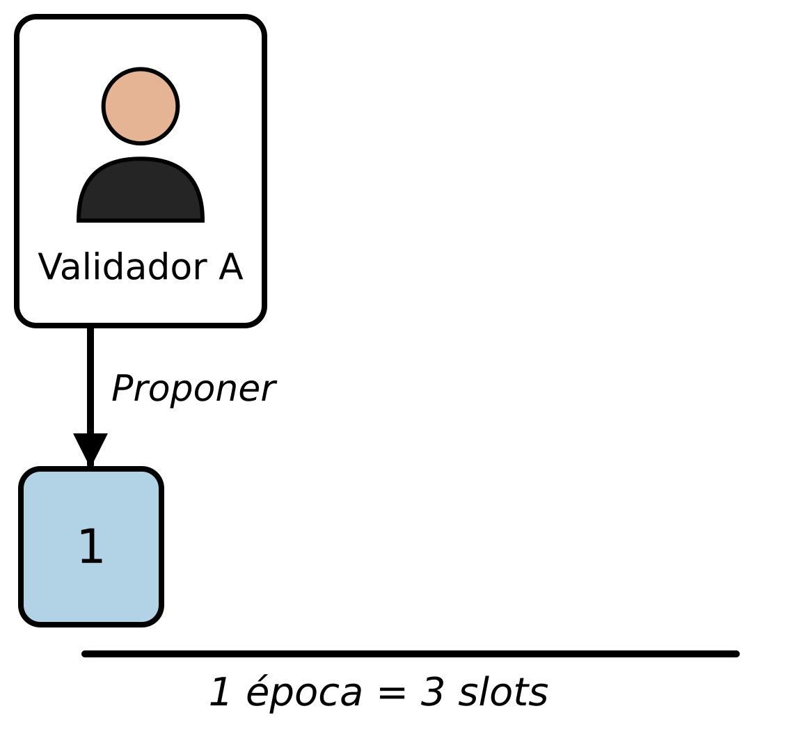

Figura 15-33. Propuesta del bloque 1

El validador A publica el bloque 1 y, de inmediato, ese bloque comienza a propagarse por la red. Poco después de la publicación, los validadores B y C lo reciben y lo guardan en su visión de la red.

Luego, todos los validadores realizan una atestación votando por el que consideran el último bloque cabeza de la cadena. Para hacerlo, deben ejecutar LMD-GHOST sobre sus visiones locales. El resultado es el bloque 1. Estas atestaciones se publican y se comparten con todos los validadores.

Ahora se selecciona al validador B para proponer el bloque en el siguiente slot, el slot 2, como se verá en la Figura 15-34. Para hacerlo, el validador todavía debe ejecutar LMD-GHOST sobre su visión local de la red para obtener el último bloque cabeza sobre el que construir.

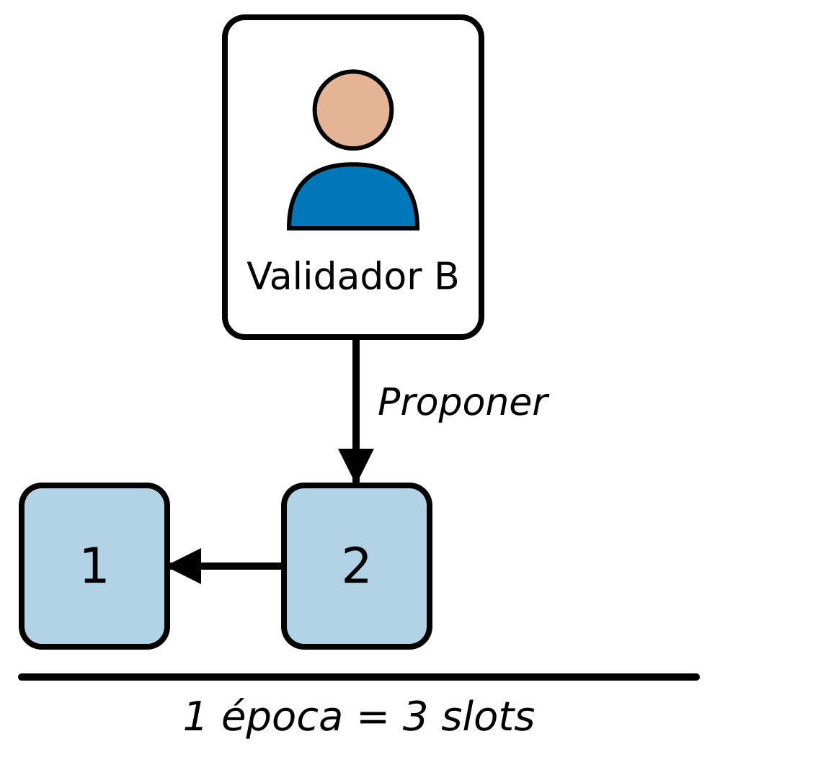

Figura 15-34. Propuesta del bloque 2

Esta es la visión de la red del validador B:

- Atestación del validador A: bloque cabeza: bloque 1
- Atestación del validador B: bloque cabeza: bloque 1
- Atestación del validador C: bloque cabeza: bloque 1

Por lo tanto, el resultado de LMD-GHOST para el validador B es el bloque 1. Ahora puede publicar el bloque 2 sobre el bloque 1. Dentro del bloque 2, el validador B también guarda todas las atestaciones que ha visto y que no se incluyeron en un bloque anterior. Así, guarda las tres atestaciones que contienen un voto por el bloque 1.

El bloque 2 se propaga por la red y, poco después de su publicación, los validadores A y C lo reciben. Recordemos que, mientras LMD-GHOST utiliza tanto los votos compartidos por P2P como los incluidos en bloques, Casper FFG solo considera los votos incluidos en bloques. Por lo tanto, aunque incluir los votos de LMD-GHOST en el bloque no afecta los resultados de LMD-GHOST si los validadores ya los están compartiendo por la red P2P, es fundamental para Casper FFG, ya que esa es la única manera en que los validadores llegan a conocerlos.

De nuevo, todos los validadores realizan una atestación votando por el que consideran el último bloque cabeza de la cadena. Como todos tienen el bloque 2 en sus visiones locales, todos votan por él como cabeza de la cadena. Luego publican estas atestaciones para que todos los validadores puedan verlas.

Ahora se selecciona al validador C para proponer el siguiente bloque en el slot 3. Ejecuta LMD-GHOST sobre su visión local para obtener el bloque cabeza. Esta es la visión de la red del validador C:

- Atestación del validador A: bloque cabeza: bloque 2
- Atestación del validador B: bloque cabeza: bloque 2
- Atestación del validador C: bloque cabeza: bloque 2

El resultado es el bloque 2, así que el validador C publica el bloque 3 sobre él, como se muestra en la Figura 15-35.

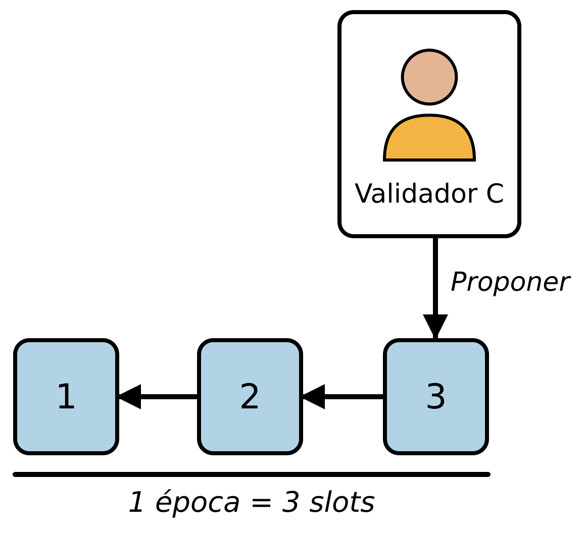

Figura 15-35. Propuesta del bloque 3

Dentro del bloque 3, el validador C guarda las tres atestaciones que votan por el bloque 2 porque no se incluyeron en los bloques anteriores.

El bloque 3 se propaga por la red y, poco después de su publicación, los validadores A y B lo reciben. Luego, los validadores realizan una atestación votando por él.

Ahora volvemos al validador A. Debe proponer el siguiente bloque, en el slot 4, que también es el primer bloque de la nueva época, la época 2, como se verá en la Figura 15-36.

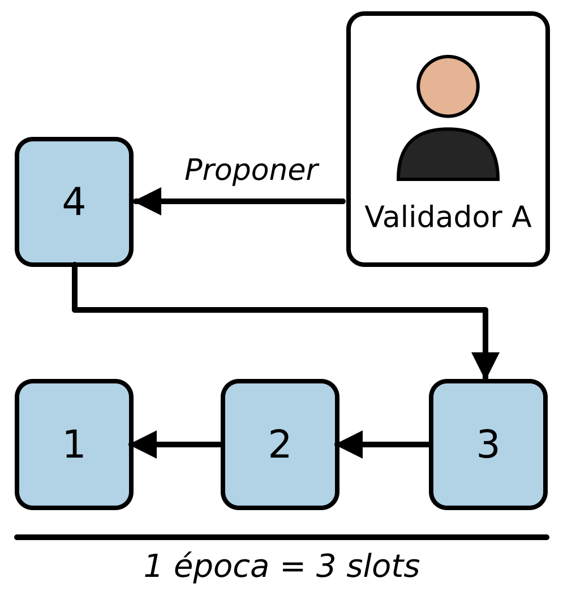

Figura 15-36. Propuesta del bloque 4: nueva época

El validador A ejecuta LMD-GHOST sobre su visión local para obtener la cabeza de la cadena. Esta es la visión de la red del validador A:

- Atestación del validador A: bloque cabeza: bloque 3
- Atestación del validador B: bloque cabeza: bloque 3
- Atestación del validador C: bloque cabeza: bloque 3

El resultado es el bloque 3, así que el validador A publica el bloque 4 sobre él.

Dentro del bloque 4, el validador A guarda las tres atestaciones que votan por el bloque 3 porque no se incluyeron en los bloques anteriores.

El bloque 4 se propaga por la red y, poco después de su publicación, los validadores B y C lo reciben. Los validadores deben realizar una nueva atestación votando por él como cabeza de la cadena. Pero esta vez algo cambia.

Estamos en una nueva época, así que los validadores deben actualizar la parte del voto correspondiente a Casper FFG. De hecho, antes ignoramos que una atestación incluye no solo un voto por el último bloque cabeza de la cadena, la parte LMD-GHOST del protocolo de consenso, sino también un voto por los puntos de control de Casper-FFG. En particular, cada atestación incluye un voto de origen y otro de destino. El voto de origen es el último punto de control justificado que conoce el validador, mientras que el voto de destino representa lo que el validador cree que debería ser el próximo bloque en justificarse.

Así, la atestación que realizan los validadores A, B y C es la siguiente:

**Atestación**

- Bloque cabeza: bloque 4
- Bloque de origen: bloque 1
- Bloque de destino: bloque 4

El bloque de destino es fácil de seleccionar porque es simplemente el primer bloque de la época, aunque podría haber casos límite en los que el bloque de destino no fuera el primero de una época, que ignoramos por simplicidad. El bloque de origen se calcula examinando las atestaciones que tiene un validador y verificando si hay un bloque por el que más de dos tercios de los validadores hayan votado como bloque de destino. No incluimos el bloque de origen ni el de destino en las atestaciones anteriores, pero digamos que todas incluyen el bloque 1 como bloque de destino. Así que ahora hemos justificado el bloque 1 porque existe un enlace de supermayoría del bloque 1 al bloque 4. Véase la Figura 15-37.

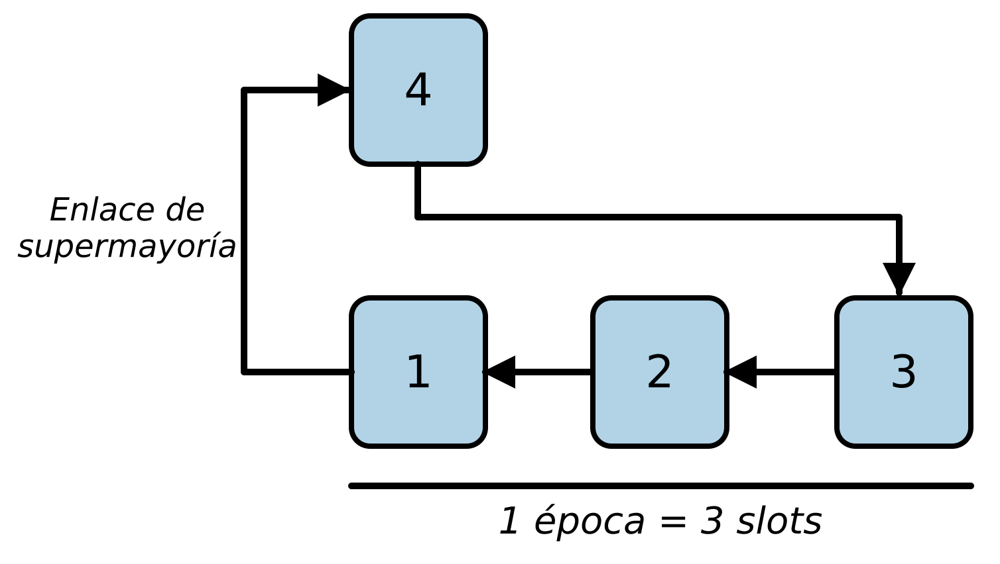

Figura 15-37. Bloque 1 justificado

Estas atestaciones se publican y se comparten con todos los validadores y se incluirán en los próximos slots, generalmente en el slot inmediatamente siguiente. Podemos saltarnos los bloques 5 y 6 e ir directamente al bloque 7, el primer bloque de la siguiente época: la época 3, que se muestra en la Figura 15-38.

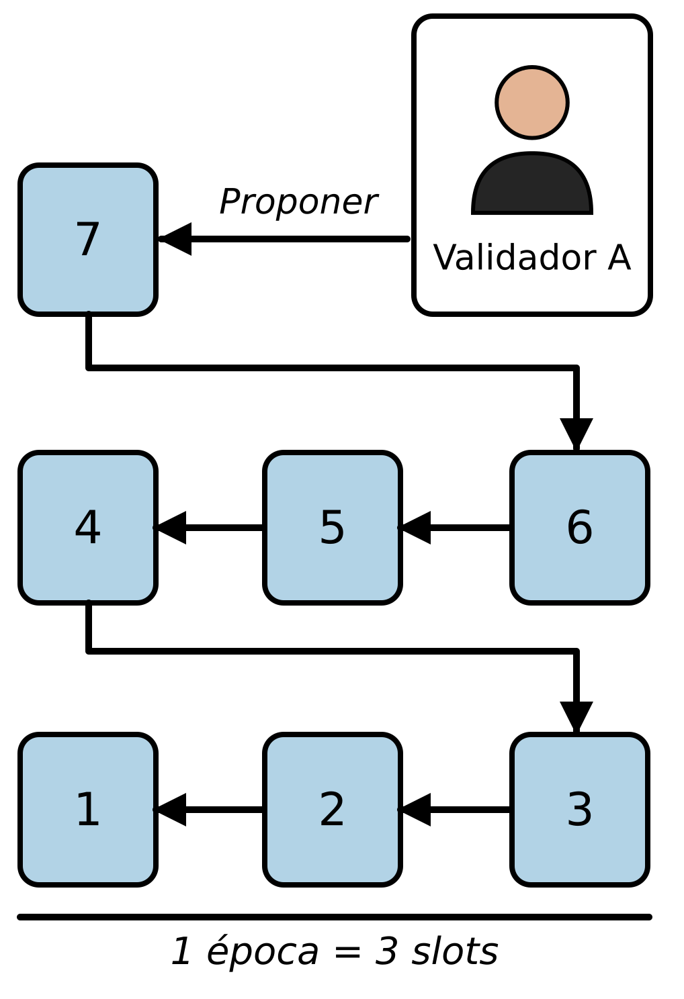

Figura 15-38. Propuesta del bloque 7: época 3

De nuevo, se selecciona al validador A para proponer el bloque. Ejecuta LMD-GHOST sobre su visión local. Esta es la visión de la red del validador A:

- Atestación del validador A: bloque cabeza: bloque 6, bloque de origen: 1, bloque de destino: 4
- Atestación del validador B: bloque cabeza: bloque 6, bloque de origen: 1, bloque de destino: 4
- Atestación del validador C: bloque cabeza: bloque 6, bloque de origen: 1, bloque de destino: 4

El resultado es el bloque 6, así que publica el bloque 7 sobre él.

El bloque 7 se propaga por la red y, poco después de su publicación, los validadores B y C lo reciben. Los validadores deben realizar una nueva atestación votando por él como cabeza de la cadena. Y aquí vuelve a cambiar algo.

Estamos en la siguiente época, la época 3, así que la parte de la atestación correspondiente a Casper-FFG vuelve a cambiar. De hecho, la atestación que realizan los validadores A, B y C es así:

**Atestación**

- Bloque cabeza: bloque 7
- Bloque de origen: bloque 4
- Bloque de destino: bloque 7

Como se puede ver, el bloque de destino ahora es el bloque 7 y el bloque de origen es el bloque 4. Esto es así porque los validadores A, B y C votaron todos por un bloque de destino igual al bloque 4 en la atestación anterior. Ahora hemos justificado el bloque 4 porque tenemos un nuevo enlace de supermayoría del bloque 4 al bloque 7, como se muestra en la Figura 15-39.

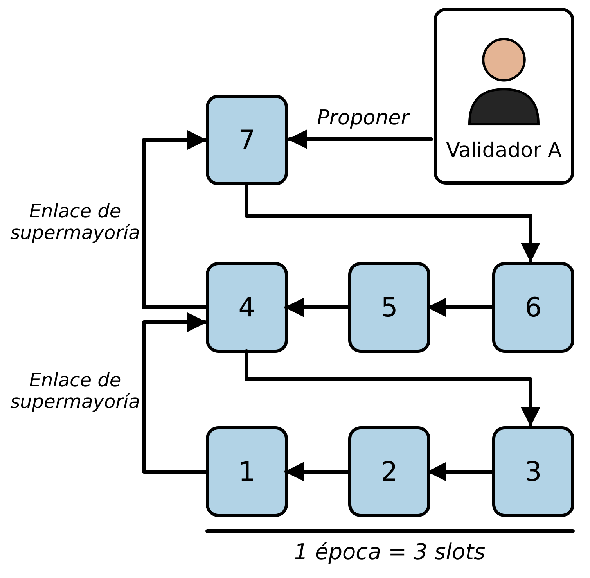

Figura 15-39. Bloque 4 justificado, bloque 1 finalizado

También hemos finalizado el bloque 1 porque es un punto de control justificado cuyo hijo directo, el bloque 4, también está justificado. Cuando un validador considera que un bloque está finalizado, significa que ha visto una confirmación de más de dos tercios de los validadores de que todos han visto que ese bloque está justificado. De hecho, si tomamos al validador A, y esto también se aplica a los validadores B y C, ha visto las atestaciones de B y C en las que votaron por el bloque 1 como bloque de origen. Votar por el bloque 1 como bloque de origen significa que B y C habían visto previamente una mayoría de dos tercios de votos por el bloque 1 como bloque de destino. Por lo tanto, podemos estar seguros de que, para revertir el bloque 1, al menos un tercio de los validadores debe sufrir slashing porque emitieron votos dobles.

## Controversia y competencia

En este punto, quizá se pregunte por qué necesitamos tantos algoritmos de consenso diferentes. ¿Cuál funciona mejor? La respuesta a esta pregunta está en el centro del área de investigación más apasionante de los sistemas distribuidos de la última década. Todo se reduce a lo que se considere "mejor", que, en el contexto de las ciencias de la computación, se refiere a supuestos, objetivos y concesiones inevitables.

Es probable que ningún algoritmo pueda optimizar todas las dimensiones del problema del consenso descentralizado. Cuando alguien sugiera que un algoritmo de consenso es "mejor" que los demás, conviene empezar a hacer preguntas que aclaren en qué es mejor: ¿inmutabilidad? ¿Finalidad? ¿Descentralización? ¿Costo? No hay una respuesta clara, al menos todavía. Además, el diseño de algoritmos de consenso está en el centro de una industria de miles de millones de dólares y genera enormes controversias y discusiones acaloradas. Al final, puede que no exista una respuesta "correcta", así como puede haber respuestas diferentes para distintas aplicaciones.

Toda la industria blockchain es un experimento gigantesco en el que estas preguntas se pondrán a prueba bajo condiciones adversas, con un enorme valor monetario en juego. Al final, la historia resolverá la controversia.

Las controversias en un protocolo de consenso pueden ser muchas, y coordinar la red para resolverlas es un desafío. Alinear los incentivos es crucial, pero no siempre es posible. Examinaremos dos problemas actuales del algoritmo de consenso de Ethereum.

### Juegos de temporización

En el protocolo de Ethereum, el tiempo se estructura en unidades de 12 segundos llamadas slots. Cada slot asigna a un validador la función de proponer un bloque justo al comienzo (*t* = 0). Luego, un comité de atestadores se encarga de validar este bloque, con el objetivo de hacerlo a más tardar a los cuatro segundos de iniciado el slot (*t* = 4), lo que se considera el plazo límite para la atestación.

Los *juegos de temporización* son estrategias en las que los validadores esperan tanto como sea posible antes de proponer un bloque para maximizar sus recompensas de MEV, como se muestra en la Figura 15-40. Esta práctica implica un equilibrio delicado, ya que requiere que los validadores retrasen sus propuestas para capturar más valor y, al mismo tiempo, garanticen que su bloque cuente con el apoyo de una proporción suficiente del comité de atestación para permanecer en la cadena canónica.

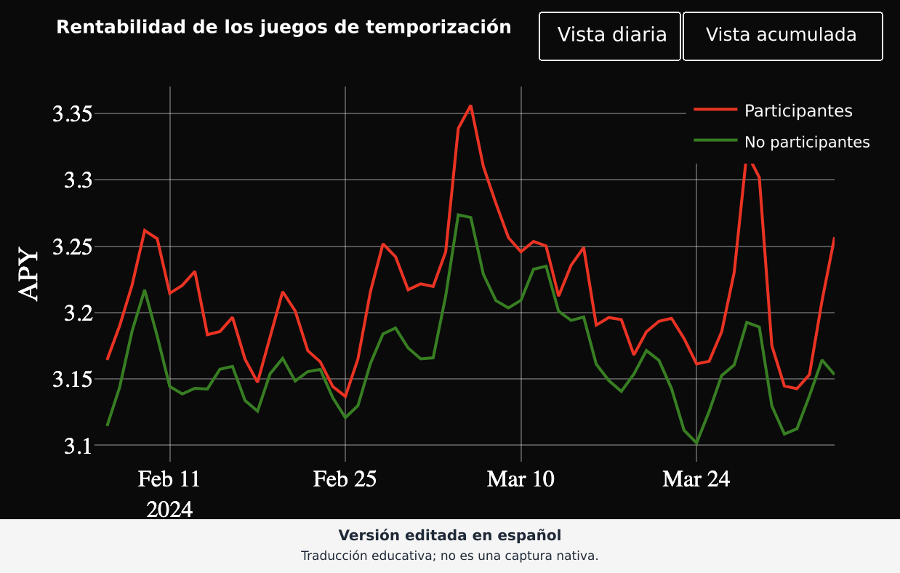

Figura 15-40. Estrategia de juegos de temporización

**Nota de la traducción:** Imagen traducida al español mediante inteligencia artificial (IA). Revisión humana pendiente. No es una captura nativa ni una actualización de la aplicación. La captura original en inglés se conserva en el desplegable.

Vista diaria y Vista acumulada conservan sus botones. La leyenda Participantes corresponde a la curva roja; No participantes, a la verde. APY, fechas Feb 11, Feb 25, Mar 10 y Mar 24 de 2024 y valores 3.1 a 3.35 quedan literales. Participantes significa participantes en los juegos de temporización, no todos los validadores.

Texto seleccionable de la versión editada:

- Rentabilidad de los juegos de temporización
- Vista diaria
- Vista acumulada
- Participantes
- No participantes

Figura 15-40: ver captura original en inglés

> **Nota de la traducción:** "Timing games profitability" indica la rentabilidad de los juegos de temporización. "Daily View" y "Cumulative View" son las vistas diaria y acumulada. La línea roja, "Gamers", corresponde a quienes participan en esos juegos; la verde, "Non-Gamers", a quienes no participan. APY es el rendimiento porcentual anual. Las fechas y cifras pertenecen a la captura original, no a una medición actual.

Los juegos de temporización en Ethereum crean un entorno competitivo en el que las ganancias de MEV de un validador pueden traducirse en desventajas para otros. Esta competencia puede perturbar el consenso al aumentar la cantidad de slots perdidos y las posibles reorganizaciones de bloques. Además, motiva a los atestadores a posponer sus validaciones, lo que agrega capas de complejidad al proceso.

"Principios del consenso" señala la importancia de la vivacidad para el proceso de consenso de Ethereum. Sin embargo, los juegos de temporización amenazan esta característica crítica al comprometer la confiabilidad de la red.

¿Qué es un juego de temporización? Es como esperar el momento perfecto para actuar, con el objetivo de sacarle el máximo provecho. Esto es lo que intentan hacer algunas de las personas que mantienen la red en funcionamiento. Esperan el momento adecuado para actuar y obtener la mayor cantidad de recompensas. Pero este juego de espera puede ser arriesgado. Si su conexión a internet es lenta o no tienen mucha experiencia, pueden perder la oportunidad de cumplir su parte. Y perder demasiadas oportunidades podría hacer que la red sea menos confiable.

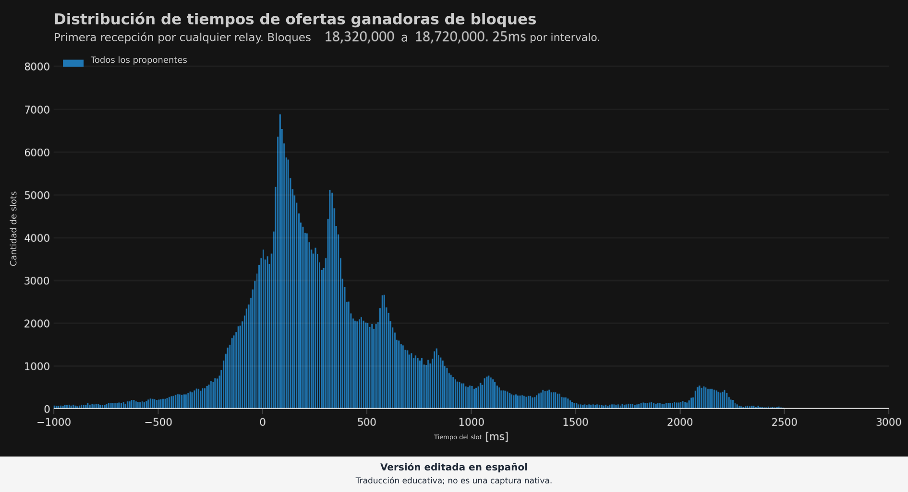

Figura 15-41. Visualización del riesgo de los juegos de temporización

**Nota de la traducción:** Imagen traducida al español mediante inteligencia artificial (IA). Revisión humana pendiente. No es una captura nativa ni una actualización de la aplicación. La captura original en inglés se conserva en el desplegable.

El histograma considera la primera recepción por cualquier relay de los bloques 18,320,000 a 18,720,000, en intervalos de `25ms`. La leyenda incluye todos los proponentes. El eje vertical cuenta slots y el horizontal muestra el tiempo del slot en `[ms]`. Se conservan las barras y todos los números.

Texto seleccionable de la versión editada:

- Distribución de tiempos de ofertas ganadoras de bloques
- Primera recepción por cualquier relay. Bloques
- a
- por intervalo.
- Todos los proponentes
- Cantidad de slots
- Tiempo del slot

Figura 15-41: ver captura original en inglés

> **Nota de la traducción:** la gráfica muestra la distribución de los tiempos de las ofertas ganadoras de bloques, tomando la primera recepción por cualquier relay. Incluye los bloques 18,320,000 a 18,720,000 en intervalos de 25 ms. "All Proposers" significa todos los proponentes; "Count of Slots", cantidad de slots; "Slot Time [ms]", tiempo del slot en milisegundos. Se conservan los datos de la imagen original.

En este momento, esto no es un gran problema. La mayoría de las entidades que funcionan como validadores no participan demasiado en estos juegos de temporización o no participan en absoluto, como se muestra en la Figura 15-41.

> **Nota**  
>
> Desde que escribimos este capítulo en 2024, las cosas han cambiado un poco. Actualmente se ha agregado una solución en el [hard fork Dencun](https://oreil.ly/TXJYS) llamada "proposer boost" que sí castiga a los proponentes de bloques tardíos. El proposer boost agrega peso a las atestaciones del proponente del bloque en el slot en el que se propone el bloque.

### Centralización de la supermayoría

El concepto de riesgo de un cliente con supermayoría en Ethereum consiste en equilibrar el buen estado y la seguridad de la red. Ethereum decidió usar múltiples clientes para evitar cualquier punto único de falla. Esto se debe a que todo el software, incluidos estos clientes, puede tener errores. El verdadero problema comienza cuando hay un error de consenso, que podría provocar algo grave, como crear ether infinito de la nada. Si un solo cliente controlara todo y sufriera un error así, corregirlo sería una pesadilla. La red podría seguir funcionando con el error activo el tiempo suficiente para que un atacante causara daños irreversibles.

Analicemos un ejemplo rápido de lo que podría ocurrir si un cliente mayoritario tuviera un error. Nótese que cada bloque de la Figura 15-42 es un punto de control y no un bloque de la blockchain.

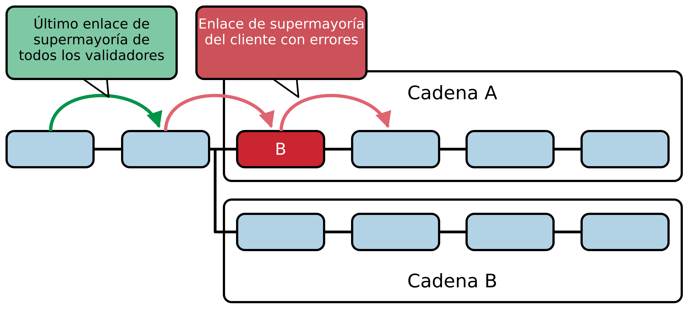

Figura 15-42. Escenario de error en un cliente mayoritario

Los clientes que funcionan correctamente ignoran la época que contiene el bloque inválido, etiquetado como "B". La flecha que apunta al bloque B sirve para justificar la época inválida, mientras que la que sale de él la finaliza.

Suponiendo que el error se resuelva y que los validadores que finalizaron la época inválida deseen volver a la cadena correcta B, una acción previa necesaria es justificar la época X, como se muestra en la Figura 15-43.

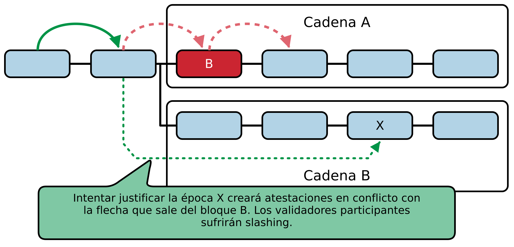

Figura 15-43. La recuperación del error requiere justificación

Para participar en la justificación de la época X, que requiere un enlace de supermayoría como muestra la flecha discontinua, los validadores deben eludir la flecha que sale del bloque B, que representa la finalización de la época inválida. Emitir votos por ambos enlaces podría conllevar penalizaciones para estos validadores.

El enfoque de múltiples clientes ofrece una red de seguridad. Si aparece un error en un cliente que utiliza menos de la mitad de la red, el resto de la red, que ejecuta otros clientes, simplemente ignora el bloque defectuoso. Esto mantiene la red en su curso y minimiza las perturbaciones. Pero si un cliente mayoritario, especialmente uno utilizado por más de dos tercios de los validadores, introduce un error, podría finalizar incorrectamente la cadena y provocar una posible división.

Ethereum fomenta la diversificación de clientes porque, si todos usaran el mismo cliente y este fallara, toda la red estaría en riesgo. Las penalizaciones por ejecutar un cliente que se aparta del resto buscan desalentar que pongamos todos los huevos en la misma canasta. De esta manera, si un cliente tiene un error, el daño queda contenido y afecta a menos usuarios. Si un cliente minoritario causa problemas, el impacto es menor porque la mayoría puede corregir el rumbo y seguir finalizando la cadena.

Cuanto más distribuyamos nuestras elecciones entre distintos clientes, más seguro será Ethereum. No se trata solo de evitar fallas técnicas; se trata de proteger el futuro de Ethereum frente a cualquier punto único de falla. Esta diversidad es nuestra mejor defensa contra crisis que afecten a toda la red y garantiza que Ethereum siga siendo robusto y resiliente sin importar lo que ocurra.

Cuando escribimos este capítulo por primera vez, el porcentaje de uso de Geth era del 63%, lo que representaba un problema, como explicamos antes. Actualmente la situación es más saludable, pero aún tendrá que mejorar en el futuro; en este momento, el 41% de los clientes de ejecución utiliza Geth y el 38% utiliza Nethermind, como se muestra en la Figura 15-44.

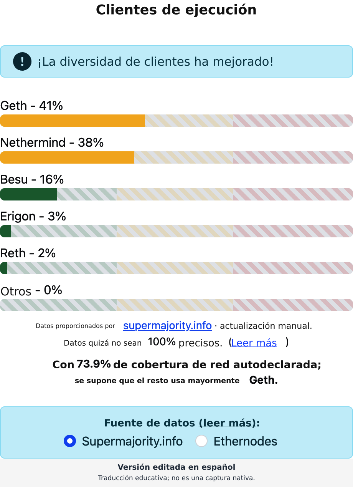

Figura 15-44. Distribución actual de clientes de ejecución

**Nota de la traducción:** Imagen traducida al español mediante inteligencia artificial (IA). Revisión humana pendiente. No es una captura nativa ni una actualización de la aplicación. La captura original en inglés se conserva en el desplegable.

El aviso conserva su estado informativo y anuncia una mejora de diversidad. Geth registra 41%, Nethermind 38%, Besu 16%, Erigon 3%, Reth 2% y Otros 0%. Supermajority.info sigue seleccionado frente a Ethernodes. La captura advierte que los datos quizá no sean 100% precisos, con 73.9% de cobertura autodeclarada y el supuesto de que el resto usa mayormente Geth.

Texto seleccionable de la versión editada:

- Clientes de ejecución
- ¡La diversidad de clientes ha mejorado!
- Otros
- Fuente de datos (leer más):
- Datos proporcionados por
- · actualización manual.
- Con
- de cobertura de red autodeclarada;
- se supone que el resto usa mayormente
- Datos quizá no sean
- precisos.
- Leer más

Figura 15-44: ver captura original en inglés

> **Nota de la traducción:** "Execution Clients" significa clientes de ejecución y "Other", otros. "Client diversity has improved!" anuncia una mejora en la diversidad de clientes en el momento de la captura. La fuente seleccionada es Supermajority.info, con actualización manual; los datos pueden no ser 100% precisos. La estimación se basa en una cobertura autodeclarada de 73.9% de la red y supone que el resto utiliza mayormente Geth. "Data source" permite elegir la fuente y "Read more" enlaza más información. Los porcentajes y controles corresponden a la interfaz del original, no a datos actuales.

Este problema no solo afecta a los clientes de ejecución, sino también a los clientes de consenso, aunque el problema del lado del consenso se abordó rápidamente y la situación es ahora relativamente saludable y estable, como se muestra en la Figura 15-45.

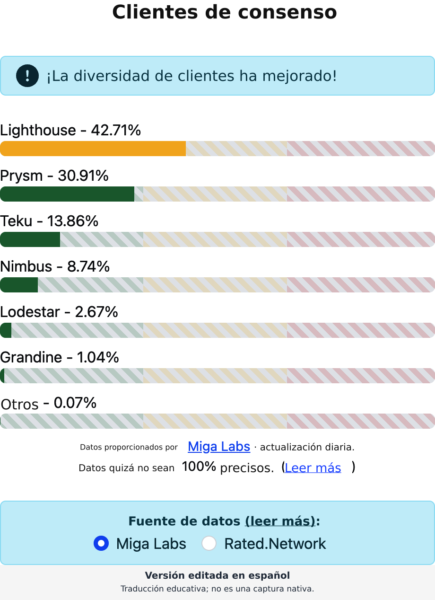

Figura 15-45. Distribución actual de clientes de consenso

**Nota de la traducción:** Imagen traducida al español mediante inteligencia artificial (IA). Revisión humana pendiente. No es una captura nativa ni una actualización de la aplicación. La captura original en inglés se conserva en el desplegable.

El aviso informativo anuncia una mejora de diversidad. Lighthouse registra 42.71%, Prysm 30.91%, Teku 13.86%, Nimbus 8.74%, Lodestar 2.67%, Grandine 1.04% y Otros 0.07%. Miga Labs sigue seleccionado frente a Rated.Network. La fuente se actualiza diariamente y advierte que los datos quizá no sean 100% precisos.

Texto seleccionable de la versión editada:

- Clientes de consenso
- ¡La diversidad de clientes ha mejorado!
- Otros
- Fuente de datos (leer más):
- Datos proporcionados por
- · actualización diaria.
- Datos quizá no sean
- precisos.
- Leer más

Figura 15-45: ver captura original en inglés

> **Nota de la traducción:** "Consensus Clients" significa clientes de consenso y "Other", otros. "Client diversity has improved!" anuncia una mejora en la diversidad de clientes en el momento de la captura. La fuente seleccionada es Miga Labs y la interfaz indica actualización diaria, con la advertencia de que los datos pueden no ser 100% precisos. "Data source" permite elegir la fuente y "Read more" enlaza más información. Los porcentajes y controles corresponden a la interfaz del original, no a datos actuales.

## Conclusión

El algoritmo de consenso es una de las cosas más complicadas y delicadas de Ethereum. Representa un recorrido interminable de innovación y mejora, con propuestas continuas para mejorar su funcionalidad y eficiencia. Características como la finalidad en un solo slot y la capacidad de aumentar el saldo efectivo máximo de los validadores ilustran los esfuerzos continuos por perfeccionar y optimizar el sistema.

Comprender los principios centrales del consenso proporciona una base sólida para apreciar estos avances y su impacto en la robustez y la escalabilidad de la red Ethereum. A medida que Ethereum evolucione, también lo harán sus mecanismos de consenso, impulsando las capacidades de esta tecnología blockchain pionera.

Para profundizar, recomendamos:

- [Artículo sobre Gasper](https://oreil.ly/1BoMt)
- [Upgrading Ethereum](https://oreil.ly/Jzh-9), de Ben Edgington
- ["Decentralization Is Good or Not? Defending Consensus in Ethereum 2.0"](https://oreil.ly/VNC1Q)
