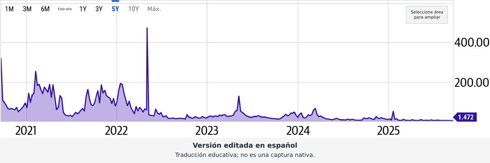
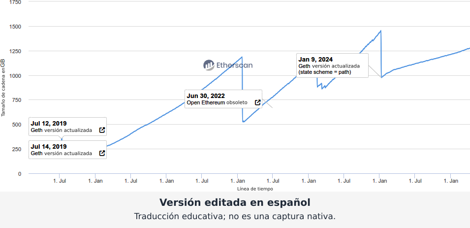
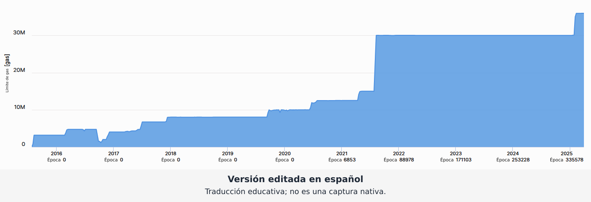
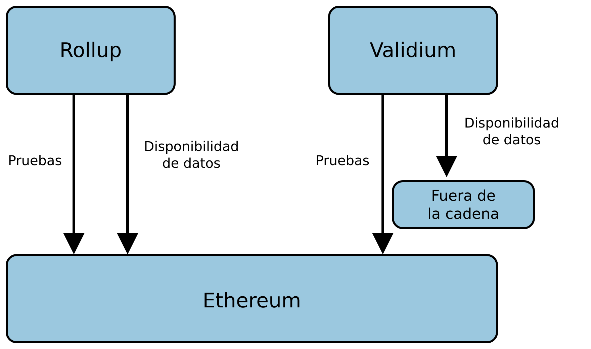
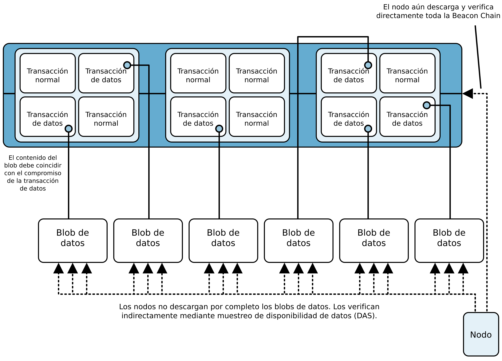
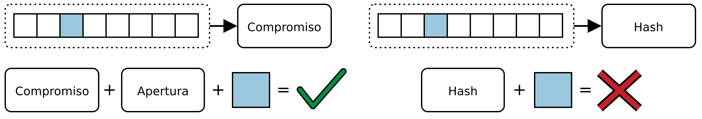
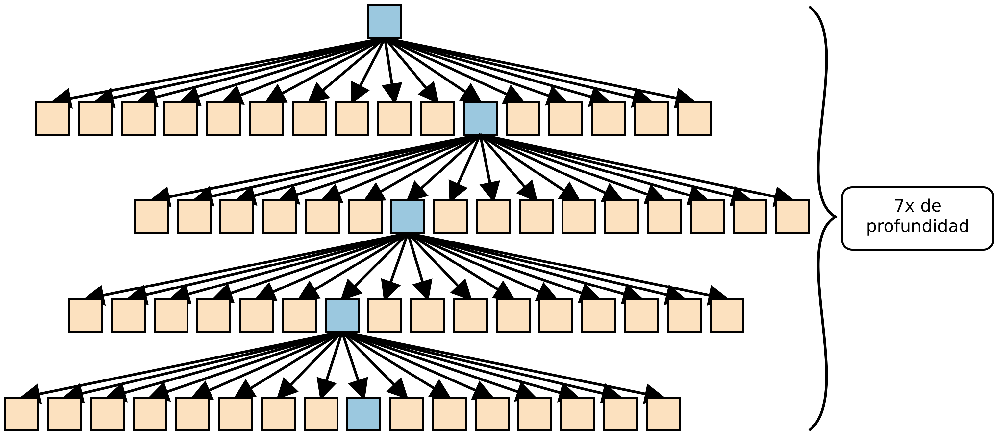
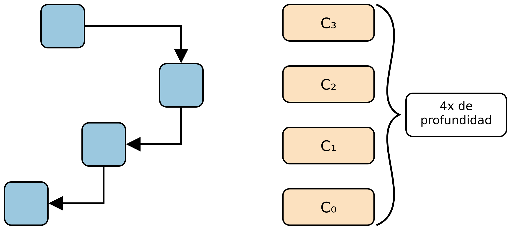
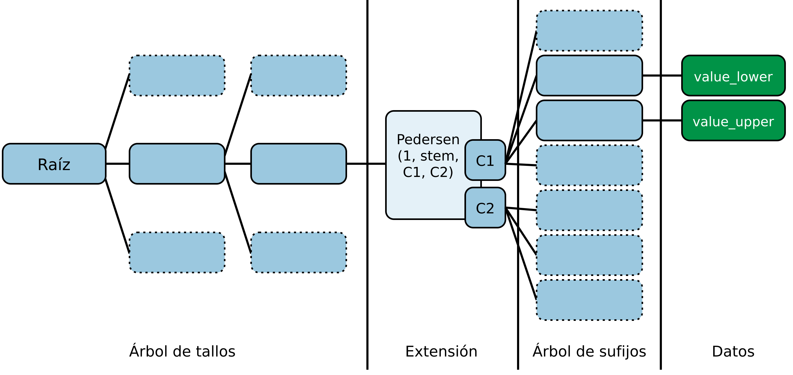

# Capítulo 16. Escalar Ethereum

Ethereum es una de las plataformas blockchain más potentes y utilizadas, pero, como hemos visto una y otra vez, el éxito trae dificultades de crecimiento. Ethereum se ha vuelto tan popular que su capa base tiene problemas para seguir el ritmo, las comisiones de gas a menudo suben tanto que las transacciones resultan demasiado costosas y el sistema se ve sobrecargado por todos los datos que debe manejar. Aunque los desarrolladores de Ethereum han ido implementando actualizaciones como EIP-1559 (descrita en el capítulo 6), The Merge (el hard fork de 2022 que cambió el protocolo de consenso de PoW a PoS) y EIP-4844 (proto-danksharding, descrito más adelante en este capítulo), las restricciones fundamentales de L1 siguen siendo un cuello de botella para la adopción masiva. Estas mejoras ayudan, pero no eliminan la necesidad de soluciones de escalado adicionales como los rollups de L2.

> **Nota**  
>
> Los rollups de L2 son soluciones de escalado que procesan transacciones fuera de la cadena y luego publican un resumen (como una prueba o un lote de datos) en la capa 1 de Ethereum. Esto reduce la congestión y las comisiones, pero sigue dependiendo de Ethereum para la seguridad. Hay dos tipos principales: los rollups optimistas (suponen la validez e impugnan lo incorrecto) y los rollups de conocimiento cero (demuestran la corrección mediante criptografía). Ethereum se convierte, en esencia, en una capa de liquidación, lo que significa que su función principal pasa a centrarse en verificar pruebas, asegurar la disponibilidad de datos y proporcionar las garantías de seguridad definitivas para las transacciones de L2. Exploraremos los rollups en detalle en la segunda parte de este capítulo.

## Los problemas de la capa 1 de Ethereum

Para comprender por completo los desafíos de escalado de Ethereum, debemos desglosarlos en cuatro problemas principales: el trilema de la escalabilidad, los costos de gas y la congestión de la red, el crecimiento del estado y el almacenamiento persistente, y la propagación de bloques y el MEV. Estos problemas no son exclusivos de Ethereum; otras cadenas se enfrentan a los mismos problemas de distintas formas, pero la popularidad de Ethereum los amplifica. Profundicemos en cada uno.

### El trilema de la escalabilidad

Ethereum, como cualquier blockchain sin permiso, tiene tres objetivos fundamentales: *descentralización*, *seguridad* y *escalabilidad*. Pero hay un problema: mejorar uno de ellos a menudo implica comprometer otro. Esto es lo que Vitalik Buterin llama el *trilema de la escalabilidad*.

Desglosémoslo:

**Descentralización**

La descentralización es lo que hace que Ethereum sea resistente a la censura y no requiera confianza. Cualquiera puede ejecutar un nodo, validar transacciones y participar en la red sin necesitar permiso de una autoridad central.

**Seguridad**

La seguridad garantiza que Ethereum siga siendo resiliente frente a los ataques. Las transacciones deben ser irreversibles, los contratos inteligentes deben ser inmutables y los actores maliciosos no deberían tener una forma fácil de manipular el sistema.

**Escalabilidad**

La escalabilidad es lo que permite que la red maneje miles o incluso millones de transacciones por segundo (TPS), lo que la hace viable para la adopción global.

El desafío es que las blockchains tradicionales como Ethereum están diseñadas para ser completamente descentralizadas y seguras a costa de la escalabilidad. Todos los nodos procesan cada transacción, lo que garantiza la corrección, pero también crea un cuello de botella.

¿Por qué no podemos aumentar sin más la capacidad de procesamiento? Si intentamos acelerar el sistema aumentando el tamaño de los bloques (para que puedan contener más transacciones), menos personas podrán ejecutar nodos completos porque los requisitos de hardware serán demasiado exigentes. Esto podría empujar a Ethereum hacia la centralización, donde solo un puñado de entidades poderosas controlan la red, exactamente lo que intentamos evitar.

Otras blockchains, como Solana, han adoptado un enfoque distinto. Han optimizado la velocidad y la escalabilidad, pero a costa de la descentralización, al requerir hardware más potente para ejecutar un nodo. Ethereum se ha negado a comprometer la descentralización, lo que hace aún más difícil el desafío del escalado.

PoS, introducido con The Merge, reemplazó el sistema PoW de alto consumo energético. Esto no solo redujo drásticamente el consumo de energía de Ethereum, sino que también disminuyó el dominio de los grandes actores que podían costear enormes instalaciones de minería. Aunque el staking introduce nuevos riesgos de centralización, sigue siendo un paso hacia una red más accesible y eficiente. Sin embargo, PoS trae nuevos desafíos, como el riesgo de centralización que representan los grandes pools de staking. Las soluciones de staking líquido ayudan a mantener accesible el ETH en staking, pero también concentran el control en manos de unas pocas plataformas. Encontrar el equilibrio adecuado sigue siendo un trabajo en curso.

### Costos de gas y congestión de la red

Una de las experiencias más frustrantes para los usuarios de Ethereum son las elevadas comisiones de gas, con costos de transacción que fluctúan enormemente según la demanda de la red. ¿Cómo sucede esto y por qué las comisiones se vuelven tan costosas en los períodos de máxima demanda?

Las transacciones de Ethereum requieren *gas*, una unidad que mide el esfuerzo computacional necesario para ejecutar operaciones como transferencias o interacciones con contratos inteligentes. Cuanto más compleja es la operación, más gas requiere. Cada bloque puede incluir una cantidad limitada de gas, lo que significa que hay competencia por el espacio de bloque. Cuando la demanda es alta, los usuarios pujan unos contra otros y hacen subir las comisiones.

Hemos visto manifestaciones drásticas de esto:

**Furor por CryptoKitties (2017)**

Esta fue la primera prueba real de los límites de Ethereum. Un juego sencillo en el que los usuarios podían criar e intercambiar gatos digitales congestionó tanto la red que las transacciones se volvieron lentísimas y las comisiones de gas se dispararon.

**Verano DeFi (2020)**

La explosión de aplicaciones DeFi como Uniswap y Compound llevó una enorme actividad a Ethereum. Los operadores se apresuraban a realizar transacciones y a veces pagaban cientos de dólares en comisiones de gas para obtener prioridad en el mempool.

**Auge de los NFT (2021)**

Los lanzamientos de NFT se convirtieron en guerras de gas, con personas que pagaban miles solo por acuñar un nuevo coleccionable digital antes que alguien más. Algunas transacciones fallaban a pesar de que los usuarios gastaban cantidades exorbitantes en gas.

La capa 1 de Ethereum no fue diseñada para manejar este nivel de demanda de manera eficiente. Sin embargo, la introducción de EIP-1559 en 2021 cambió el funcionamiento de las comisiones al introducir tamaños de bloque variables y un nuevo mecanismo de precios del gas, que redujo los picos de las comisiones de gas durante períodos de alta actividad en la red. La creciente popularidad de las soluciones de L2 ha permitido que Ethereum descargue una parte importante de su carga computacional, lo que reduce aún más las comisiones de gas. Más recientemente, se implementó EIP-4844 (proto-danksharding), que redujo considerablemente las comisiones, en especial para los rollups de L2, e hizo que las transacciones de Ethereum fueran más asequibles para los usuarios. A pesar de estas mejoras, los costos de transacción de Ethereum siguen siendo más altos que los de la mayoría de las otras blockchains (véase la figura 16-1).

Figura 16-1. Comparación de los costos de gas entre blockchains

**Nota de la traducción:** Imagen traducida al español mediante inteligencia artificial (IA). Revisión humana pendiente. No es una captura nativa ni una actualización de la aplicación. La captura original en inglés se conserva en el desplegable.

La captura contiene una sola serie sin nombre visible. `5Y` continúa seleccionado en azul; `10Y` y Máx. conservan su tono gris. Este año traduce el control YTD y Seleccione área para ampliar explica el control de ampliación. Ejes 2021 a 2025, 400.00, 200.00 y valor 1.472 permanecen literales. No se infiere una comparación de blockchains que la imagen no muestra.

Texto seleccionable de la versión editada:

- Seleccione área para ampliar
- Este año
- Máx.

- La leyenda menciona una comparación entre blockchains, pero la captura muestra una única serie histórica sin identificar.

Figura 16-1: ver captura original en inglés

> **Nota de la traducción:** La captura conserva los controles originales. "Select area to zoom" significa seleccionar un área para ampliar; "5Y" indica una ventana de cinco años y "YTD", el período transcurrido del año.

### Crecimiento del estado y problemas de almacenamiento persistente

Ethereum no se utiliza solo para transacciones; es una *máquina de estados global* que realiza un seguimiento continuo de los saldos de las cuentas, los datos de los contratos inteligentes, las posiciones DeFi, los NFT y otras actividades en la cadena. A diferencia de las bases de datos tradicionales, que pueden archivar o eliminar registros antiguos, Ethereum está diseñado para conservar todo su historial, lo que garantiza la transparencia y la verificabilidad. ¿El problema? A medida que Ethereum crece, necesita almacenar más datos y esa carga de almacenamiento se vuelve cada vez mayor.

Actualmente, el tamaño del estado de Ethereum, en esencia, el conjunto de todas las cuentas activas, los saldos de los contratos y los slots de almacenamiento persistente, crece a un ritmo alarmante. Cada nuevo contrato inteligente añade datos a este estado y cada transacción lo modifica. Los nodos completos, que desempeñan un papel fundamental en la verificación de la integridad de la red, deben almacenar y actualizar constantemente estos datos. A medida que el estado crece, resulta cada vez más difícil que las personas ejecuten nodos completos sin hardware costoso, lo que genera preocupación por la descentralización.

Los nodos de archivo enfrentan un desafío aún mayor. Estos nodos almacenan no solo el estado actual, sino también todo el registro histórico de Ethereum, incluidas todas las transacciones y ejecuciones de contratos pasadas. El volumen de estos datos alcanza los terabytes, lo que requiere una capacidad de almacenamiento y un ancho de banda considerables. La cantidad de personas capaces de ejecutar estos nodos disminuye, lo que plantea interrogantes sobre quién conservará el historial de Ethereum a largo plazo.

Los validadores, responsables de proponer bloques y atestarlos en el sistema PoS de Ethereum, también sienten el peso del crecimiento del estado. Para verificar las transacciones de manera eficiente, necesitan acceso rápido al estado más reciente de la blockchain. Pero, a medida que el estado se expande, acceder a esta información y procesarla se vuelve más lento y costoso. Si esta tendencia continúa sin control, corremos el riesgo de crear un entorno en el que solo quienes tienen hardware de alta gama puedan participar en la validación, lo que empujaría a Ethereum hacia la centralización.

Los desarrolladores de Ethereum han explorado soluciones para frenar el crecimiento excesivo del estado, entre ellas la caducidad del historial y el alquiler del estado, que analizaremos en detalle más adelante en este capítulo, en "Escalar L1".

La diversidad de clientes también ayuda. Aunque Geth ha sido históricamente el cliente dominante de Ethereum (véase la figura 16-2), alternativas como Nethermind, Erigon y Besu introducen optimizaciones que mejoran la eficiencia del almacenamiento. Erigon, por ejemplo, se especializa en manejar los datos históricos de manera más eficiente, lo que reduce la carga de los nodos completos.

Figura 16-2. Distribución de los clientes de Ethereum

**Nota de la traducción:** Imagen traducida al español mediante inteligencia artificial (IA). Revisión humana pendiente. No es una captura nativa ni una actualización de la aplicación. La captura original en inglés se conserva en el desplegable.

La serie azul conserva sus valores y quiebres. Las anotaciones Jul 12, 2019, Jul 14, 2019 y Jan 9, 2024 indican versiones de Geth actualizadas; Jun 30, 2022 señala Open Ethereum obsoleto. La anotación `(state scheme = path)` es técnica y permanece literal. Se conservan fechas, enlaces, marca Etherscan y escala 0 a 1750.

Texto seleccionable de la versión editada:

- Tamaño de cadena en
- Línea de tiempo
- versión actualizada
- obsoleto

- La leyenda describe una distribución de clientes, pero la imagen grafica el tamaño de los datos de la cadena a lo largo del tiempo.

Figura 16-2: ver captura original en inglés

> **Nota de la traducción:** "Chain data size in GB" indica el tamaño de los datos de la cadena en GB y "Timeline", la línea de tiempo. Los recuadros señalan actualizaciones de Geth y la obsolescencia de Open Ethereum; "state scheme = path" conserva el nombre literal del esquema.

### Propagación de bloques y MEV

Incluso si Ethereum pudiera manejar una mayor capacidad de procesamiento de transacciones, existe otro cuello de botella fundamental: el tiempo que tardan los bloques nuevos en propagarse por la red. En cuanto un validador produce un bloque nuevo, ese bloque debe difundirse a miles de otros nodos en todo el mundo. Cuanto mayor es el bloque, más tarda en propagarse. Y cuanto más tarda, mayor es la probabilidad de desacuerdos en la red, o incluso de bifurcaciones temporales, en las que distintas partes de la red divergen momentáneamente.

PoS ha ayudado a reducir estos riesgos, pero los retrasos en la propagación de bloques todavía afectan el rendimiento. Los equipos de los clientes han estado trabajando en optimizaciones de la red para acelerar el proceso, pero es un desafío cuyo tratamiento seguiremos perfeccionando a medida que escalemos Ethereum.

Hay otro problema que acecha bajo la superficie: el MEV. Aunque Ethereum ha pasado a PoS, el nombre "valor extraíble por mineros" ha perdurado. Hoy es más preciso llamarlo *valor máximo extraíble*, es decir, el beneficio que los validadores y los buscadores pueden obtener al reordenar, incluir o excluir estratégicamente transacciones en un bloque.

El MEV surge porque las transacciones no siempre se procesan en el orden en que se envían. En cambio, los validadores pueden priorizar transacciones según sus propios intereses de rentabilidad. Esto crea oportunidades para que actores sofisticados extraigan valor de formas que perjudican a los usuarios comunes. Los bots de operaciones de alta frecuencia examinan el mempool (la sala de espera de Ethereum para transacciones que aún no se han incluido en un bloque) en busca de oportunidades rentables. Por ejemplo, si alguien envía una operación grande a una plataforma de intercambio descentralizada como Uniswap, los bots pueden adelantarse, comprar primero el activo y venderlo después a un precio más alto. Esto se conoce como *ataque sándwich*, que es una forma de front-running y una de las formas más notorias de MEV.

Una medida de mitigación que lleva años en funcionamiento es MEV-Boost, un protocolo desarrollado por Flashbots que hace que el MEV sea más democrático y transparente. Sin embargo, la solución a largo plazo es un rediseño más fundamental: una implementación nativa de la *separación entre proponente y constructor* (PBS). Exploraremos estas soluciones en mayor detalle en la siguiente sección.

> **Nota**  
>
> El MEV está en gran medida ausente en la mayoría de las cadenas de L2 porque suelen depender de secuenciadores de transacciones centralizados. Un único secuenciador centralizado generalmente procesa las transacciones en el orden exacto en que las recibe, lo que elimina las oportunidades de reordenar transacciones o hacer front-running. Aunque este enfoque centralizado reduce considerablemente el MEV, introduce posibles compromisos relacionados con la descentralización y la resistencia a la censura. Los desarrollos futuros de L2 buscan equilibrar estos compromisos mediante la introducción de mecanismos de secuenciación descentralizados.

## Soluciones

¿Qué se está haciendo para superar los desafíos de escalado de Ethereum? Aunque no existe una solución única y sencilla, los desarrolladores trabajan activamente en diversas mejoras para que la red sea más rápida, más económica y esté mejor preparada para la adopción masiva. Veamos más de cerca las principales estrategias que están explorando.

### Escalar L1

Escalar la capa base de Ethereum, la capa 1, es uno de los desafíos más difíciles que hemos enfrentado desde el primer día. La realidad es que ninguna solución aislada resolverá todo; el escalado no es un interruptor que podamos activar. En cambio, es un proceso a largo plazo: una combinación de optimizaciones que gradualmente hacen que Ethereum sea más eficiente sin sacrificar la descentralización ni la seguridad. Aunque los rollups de L2 son nuestra mejor apuesta para manejar la mayoría de las transacciones, mejorar la capa base de Ethereum sigue siendo importante. Si podemos aumentar la capacidad de procesamiento y la eficiencia en L1, los rollups se vuelven aún más potentes, las comisiones de gas bajan y Ethereum sigue siendo competitivo sin recurrir a la centralización. Repasemos algunas de las principales formas en que estamos mejorando la capa base de Ethereum.

#### Aumentar el límite de gas

Los bloques de Ethereum no están limitados por la cantidad de transacciones que pueden contener, sino por cuánto gas cabe dentro de cada bloque. Este es el *límite de gas*. Podemos pensarlo como un presupuesto. Cada transacción consume gas según su complejidad, y el gas disponible en un bloque está definido por los mecanismos de EIP-1559. Aumentar el límite de gas significa que podemos incluir más transacciones en cada bloque, lo que aumenta efectivamente la capacidad de procesamiento de Ethereum.

Pero no es tan sencillo como subir sin más el límite de gas. Los bloques más grandes tardan más en propagarse por la red, lo que hace a Ethereum más susceptible a divisiones de la cadena. También aumentan los requisitos de hardware de los nodos completos, lo que nos acerca a la centralización. Por eso, los aumentos del límite de gas se realizan de forma gradual y cuidadosa, equilibrando las mejoras de capacidad de procesamiento con la salud de la red (véase la figura 16-3).

Figura 16-3. Cambios históricos del límite de gas

**Nota de la traducción:** Imagen traducida al español mediante inteligencia artificial (IA). Revisión humana pendiente. No es una captura nativa ni una actualización de la aplicación. La captura original en inglés se conserva en el desplegable.

El eje de límite de gas conserva `[gas]` y las marcas 0, 10M, 20M y 30M. Bajo los años 2016 a 2025, Época traduce cada aparición de Epoch sin mover sus valores: cinco ceros, 6853, 88978, 171103, 253228 y 335578. Los escalones y el área azul son los originales.

Texto seleccionable de la versión editada:

- Límite de gas
- Época

Figura 16-3: ver captura original en inglés

> **Nota de la traducción:** "Gas Limit [gas]" significa límite de gas, expresado en gas; "Epoch" significa época. "M" indica millones.

#### El futuro de la ejecución paralela en Ethereum

Ethereum procesa las transacciones de forma secuencial debido a su modelo de estado compartido. Esto garantiza la seguridad y la consistencia, pero limita la escalabilidad, ya que las transacciones no pueden ejecutarse en paralelo. En cambio, algunas blockchains más nuevas como Solana y Aptos han adoptado la ejecución paralela, pero dependen de arquitecturas más centralizadas y requieren que los validadores utilicen hardware de alto rendimiento.

El desafío en Ethereum es que las transacciones a menudo interactúan con el mismo estado; por ejemplo, dos operaciones DeFi que modifican el mismo pool de liquidez. Reordenarlas sin un sistema robusto de gestión de dependencias podría romper la lógica de los contratos inteligentes. Otra complejidad es que los nodos completos deben verificar todas las transacciones, e introducir ejecución paralela requeriría una sincronización cuidadosa entre hilos.

Los investigadores de Ethereum exploran activamente soluciones para introducir ejecución paralela parcial sin perder la descentralización. Un enfoque es la *ejecución sin estado*, que reduce la dependencia del almacenamiento persistente de los nodos completos y hace más eficiente el procesamiento de transacciones. Otro es la *concurrencia optimista*, en la que se supone que las transacciones son independientes y solo se revierten si surgen conflictos. Explicaremos estos conceptos en detalle en la segunda parte de este capítulo.

Han surgido varias implementaciones experimentales de EVM paralela en cadenas compatibles con la EVM, entre ellas Monad, Polygon PoS y Shardeum. Monad, por ejemplo, implementa un modelo de ejecución paralela optimista que alcanza más de 10,000 TPS. Polygon PoS ha logrado un aumento de 1.6x en la capacidad de procesamiento de gas con su enfoque Block-STM, que permite la paralelización parcial de las transacciones. Estos avances aportan información valiosa, pero Ethereum debe implementar la paralelización sin perder la descentralización, un equilibrio que sigue siendo un desafío clave. Estudios recientes sugieren que alrededor del 64.85% de las transacciones de Ethereum podrían paralelizarse, lo que pone de manifiesto un potencial considerable de mejora del rendimiento. Sin embargo, a marzo de 2025, no hay un plan concreto para integrar la ejecución paralela en la red principal de Ethereum. Continúan las discusiones sobre paralelizar la EVM mediante transacciones virtuales al final del bloque, pero la complejidad del modelo de ejecución de Ethereum dificulta la implementación. La hoja de ruta de la escalabilidad de Ethereum incluye seguir investigando la resolución de dependencias entre transacciones, modelos de ejecución alternativos y mejoras graduales en la eficiencia de la EVM.

#### Crecimiento y caducidad del estado

El estado de Ethereum, que comprende el conjunto de todos los saldos de las cuentas, el almacenamiento persistente de los contratos inteligentes y otros datos en la cadena, no deja de crecer. Cada nuevo contrato añade más datos y, una vez que algo se escribe en el estado de Ethereum, permanece allí para siempre. Esto es excelente para la descentralización y la verificabilidad, pero terrible para la escalabilidad. Los nodos completos deben almacenar y procesar todos estos datos y, a medida que el estado aumenta, el costo de ejecutar un nodo crece.

Actualmente, el tamaño del estado de Ethereum es de alrededor de 1.2 TB para los nodos completos, pero los nodos de archivo, que almacenan todo el estado histórico y los datos de las transacciones, necesitan más de 21 TB de almacenamiento. Esta enorme cantidad de datos hace cada vez más difícil que las personas ejecuten nodos de archivo y concentra esta función en manos de unas pocas entidades con buenos recursos financieros. Cabe mencionar que los clientes de ejecución Erigon y Reth están optimizados para requerir menos almacenamiento, ya que ambos necesitan alrededor de 2 TB para un nodo de archivo.

A menudo se confunden la caducidad del estado y la caducidad del historial, pero abordan problemas distintos. La *caducidad del estado* busca reducir el tamaño del estado que Ethereum mantiene activamente al exigir que los contratos inteligentes paguen periódicamente un alquiler por el almacenamiento persistente que consumen. Si un contrato no paga, se vuelve inaccesible hasta que alguien pague explícitamente para reactivarlo. Esto ralentizaría considerablemente el crecimiento del estado y facilitaría la operación de los nodos completos.

La *caducidad del historial*, por otro lado, aborda el enorme tamaño de los datos de transacciones pasadas. En lugar de obligar a cada nodo a almacenar todas las transacciones históricas, Ethereum podría podar los datos más antiguos y trasladarlos a soluciones de almacenamiento externas. Esto no afectaría el estado activo, pero haría que las consultas históricas dependieran más de proveedores de datos externos. Ambos enfoques implican compromisos y la investigación continúa para determinar el mejor equilibrio entre eficiencia y accesibilidad.

Para explorar más este tema, recomendamos consultar EIP-4444, que aborda la caducidad del historial. En cuanto a la caducidad del estado, todavía está en fase de investigación, por lo que aún no hay una estrategia clara, pero puede encontrarse más información en la hoja de ruta de Ethereum.

#### Separación entre proponente y constructor

El MEV ha sido un problema persistente en Ethereum, incluso después de la transición a PoS. Los validadores y los buscadores especializados recurren al reordenamiento de transacciones, al front-running y a otras estrategias para extraer beneficios a costa de los usuarios comunes. Esto no es solo un problema económico; también afecta la salud de la red, al aumentar la congestión y volver impredecibles las comisiones de gas.

PBS es una de las soluciones más prometedoras para mitigar el MEV. Actualmente, los validadores proponen y construyen bloques, lo que significa que tienen control total sobre el orden de las transacciones. PBS cambia esto al dividir estas funciones: los validadores siguen proponiendo bloques, pero la construcción efectiva del bloque se delega en constructores especializados mediante una subasta competitiva. Esto elimina el incentivo directo para que los validadores extraigan MEV y hace más transparente la inclusión de transacciones.

PBS ya se ha probado mediante MEV-Boost, que permite a los validadores delegar la construcción de bloques en el mejor postor. Sin embargo, es importante entender que MEV-Boost y PBS no eliminarán el MEV; solo lo harán más transparente y equitativo. El MEV seguirá existiendo porque los incentivos subyacentes que impulsan el arbitraje, el front-running y los ataques sándwich no desaparecerán. Lo que hace PBS es garantizar que, en lugar de que unos pocos actores privilegiados se beneficien de estrategias de MEV opacas, el proceso de capturar MEV sea más abierto, equitativo y competitivo. A largo plazo, será necesario integrar soluciones adicionales, como subastas del flujo de órdenes, mempools cifrados y otras técnicas de mitigación del MEV, junto con PBS para reducir aún más su impacto negativo.

### Rollups

Ethereum ha enfrentado desafíos persistentes de escalabilidad, capacidad de procesamiento de transacciones (medida en TPS) y comisiones elevadas. Para abordar estos problemas, ha surgido el concepto de rollups.

Los *rollups* son mecanismos que ejecutan transacciones "fuera de la cadena" en una L2 dedicada y luego publican datos agregados ("agrupados") o pruebas en la blockchain de L1. Como el trabajo pesado del cómputo y las actualizaciones de estado ocurre fuera de L1, la blockchain evita sus cuellos de botella habituales de capacidad de procesamiento, lo que aumenta la velocidad de las transacciones y reduce las comisiones. En efecto, el propio entorno de ejecución del rollup maneja con mayor eficiencia las comprobaciones de firmas, la ejecución de contratos y las transiciones de estado, mientras que L1 sigue siendo la "capa de liquidación" autoritativa.

Los rollups buscan preservar la mayor parte posible de la seguridad de L1. Los objetivos de seguridad son asegurar la disponibilidad de datos, verificar las transiciones de estado correctas y proporcionar resistencia a la censura. La disponibilidad de datos exige que toda la información de las transacciones y del estado sea accesible para que, en caso de disputa, los participantes puedan verificar de forma independiente el estado de la cadena o retirar fondos de manera segura basándose en datos publicados en L1 (o garantizados por ella). La integridad de las transiciones de estado garantiza que los cambios en L2 sean válidos según las reglas de la red, generalmente mediante pruebas de validez (como las pruebas de conocimiento cero) o pruebas de fraude. Por último, la resistencia a la censura garantiza que ninguna entidad individual ni grupo pequeño de participantes pueda bloquear o retener indefinidamente las transacciones de los usuarios.

> **Nota**  
>
> La disponibilidad y la validez de los datos son componentes esenciales de las implementaciones seguras de rollups, que garantizan que los actores maliciosos no puedan falsificar transacciones, robar fondos ni inflar saldos artificialmente. La validez de los datos suele depender de uno de dos enfoques principales. El primero utiliza pruebas de conocimiento cero, en las que cada lote de transacciones de L2 viene acompañado de una prueba criptográfica que da fe de su ejecución correcta. Cuando esta prueba se envía a L1, un contrato inteligente verifica su corrección antes de aceptar la nueva raíz del estado. El segundo enfoque utiliza pruebas de fraude bajo un supuesto optimista: el operador de L2 publica nuevos estados en L1 y cualquiera puede impugnar esos envíos proporcionando evidencia de una conducta indebida. Si se confirma una prueba de fraude, se revierte el lote inválido y el actor malicioso recibe penalizaciones.
>
> Más allá de la validez, la disponibilidad de datos garantiza que los usuarios siempre puedan reconstruir la cadena si el operador de L2 desaparece o actúa de manera deshonesta. Existen distintos métodos para lograrlo. Algunos sistemas almacenan todos los datos de las transacciones directamente en L1, a menudo como calldata de Ethereum o, más comúnmente hoy en día, blobs, de modo que queden registrados de forma transparente en los registros de la blockchain. Otros diseños dependen de capas de disponibilidad de datos fuera de la cadena, redes especializadas o soluciones de almacenamiento externas que ofrecen incentivos criptoeconómicos para mantener y proporcionar datos. Los enfoques híbridos pueden combinar ambos métodos: la información crítica se coloca en la cadena, mientras que los datos menos esenciales se almacenan fuera de ella.

Los rollups dependen de un contrato inteligente especializado desplegado en L1 que mantiene el estado canónico de todas las cuentas de L2. Este contrato almacena una raíz (habitualmente una raíz de Merkle) que representa el estado actual de L2, acepta lotes de nuevas transacciones enviados por actores designados (a veces llamados secuenciadores, agregadores u operadores) y verifica la validez de esos lotes. Según el tipo de rollup, puede comprobar pruebas de conocimiento cero o manejar pruebas de fraude para garantizar que las actualizaciones de estado sean legítimas. Si se detecta una infracción (por ejemplo, una prueba de fraude exitosa), el contrato puede revertir el lote inválido.

Cualquiera que cumpla los requisitos del rollup, como hacer staking de una garantía, puede enviar al contrato inteligente una actualización de estado de las transacciones de L2. Esto no siempre es así. De hecho, actualmente la mayoría de los rollups con mayor volumen de transacciones y valor total bloqueado están centralizados a nivel del secuenciador. Aunque algunos rollups han logrado la descentralización, para la mayoría sigue siendo un objetivo final. Cada actualización de estado incluye la raíz del estado anterior (para demostrar continuidad), una nueva raíz del estado propuesta (que refleja el resultado de las transacciones enviadas) y datos de transacción comprimidos o referencias a ellos. Si se cumplen las reglas del rollup (y no surgen impugnaciones válidas, en el caso de los rollups optimistas), el contrato actualiza la raíz del estado que almacena con la nueva, convirtiéndola en el estado canónico de L2.

Los distintos rollups manejan el fraude o las actualizaciones de estado inválidas de diferentes maneras. Los rollups optimistas suponen por defecto que las nuevas actualizaciones de estado son correctas, pero ofrecen una ventana de impugnación (que a menudo dura varios días) para que cualquiera pueda presentar una prueba de fraude. Si se verifica una prueba, se revierte la actualización de estado inválida y se aplica slashing al stake de quien la envió de forma maliciosa. Por su parte, los rollups de conocimiento cero exigen que cada nueva raíz del estado vaya acompañada de una prueba de conocimiento cero. Como esta prueba se verifica en la cadena, la cadena sabe de inmediato si las actualizaciones son válidas; si la prueba es correcta, no es necesario un período de impugnación prolongado.

#### Etapas de los rollups

Durante sus primeras fases, la mayoría de los rollups conservan controles centralizados parciales, a menudo llamados *ruedas de apoyo*, que permiten a los operadores intervenir rápidamente en caso de errores o actualizaciones críticas. Aunque esto es práctico para un sistema nuevo, una verdadera descentralización exige que estas ruedas de apoyo se retiren gradualmente.

Para trazar esta transición, se ha propuesto un marco, basado en los hitos iniciales de Vitalik Buterin, que clasifica los rollups en tres etapas de madurez. Cada etapa indica cuánta autoridad permanece en manos centralizadas y qué tan cerca está el rollup de heredar la seguridad de la capa base de Ethereum.

En la *etapa 0*, un rollup se autodenomina rollup, pero todavía está fuertemente controlado por el operador. Publica raíces del estado en L1 y proporciona disponibilidad de datos en L1, lo que permite reconstruir el estado de L2 si algo sale mal. Sin embargo, en este punto, el "mecanismo de pruebas" del sistema (pruebas de fraude o de validez) puede no estar completamente impuesto por un contrato inteligente en la cadena; la intervención del operador es el principal recurso de respaldo si ocurren errores. En esencia, la etapa 0 garantiza que estén presentes los elementos básicos de un rollup, datos en la cadena, raíces del estado y software de nodos para los usuarios, pero la gobernanza sigue centralizada.

> **Nota**  
>
> Los requisitos de este marco de tres etapas pueden cambiar. Por ejemplo, al momento de escribir este libro (febrero de 2025), Arbitrum es un rollup de etapa 1, pero con los nuevos requisitos podría convertirse en un rollup de etapa 0 si no actualiza la red a tiempo.

Los rollups de *etapa 1* deben tener un sistema de pruebas adecuado (pruebas de fraude para los rollups optimistas o pruebas de validez para los rollups de conocimiento cero), y debe haber al menos cinco actores externos que puedan presentar estas pruebas. Los usuarios también deberían poder retirar fondos o "salir" del sistema sin necesitar la cooperación del operador, lo que los protege de la censura. Otro criterio es una ventana de salida mínima de siete días para los usuarios que no estén de acuerdo con una actualización propuesta del sistema, aunque un "Consejo de Seguridad" todavía puede intervenir más rápidamente si aparece un error crítico. Este consejo debe constituirse mediante una multifirma que requiera al menos el 50% de ocho o más firmantes,[^1] con la mitad externos a la organización principal del rollup. Aunque este consejo puede corregir errores o revertir transacciones maliciosas, todavía existe un posible punto único de falla.

[^1]: Esto se modificó recientemente y los requisitos cambiaron un poco. No analizaremos los cambios en este capítulo; véase el artículo de Luca Donno en Medium para más información.

La *etapa 2* significa que el rollup está verdaderamente descentralizado, al depender de pruebas sin permiso y protecciones sólidas para los usuarios.[^2] El sistema de pruebas de fraude o de validez debe estar abierto a cualquiera, sin listas de permitidos. Un usuario debe tener al menos 30 días para salir si se introduce una propuesta de gobernanza o una actualización, lo que garantiza que no se le impongan cambios. La función del Consejo de Seguridad se limita estrictamente a errores en la cadena relacionados con la solidez, como la presentación de pruebas contradictorias, en lugar de amplios poderes de gobernanza o discrecionales. Así, en esta etapa final, la intervención humana tiene un alcance muy acotado y el rollup se rige principalmente por contratos inteligentes y el consenso de la comunidad, lo que refleja de cerca el espíritu de confianza mínima de Ethereum.

[^2]: La etapa 2 no indica una mejor experiencia de usuario ni una mayor adopción; solo indica una mayor descentralización.

Queremos agradecer a todas las personas involucradas en el desarrollo y la actualización de este marco, y a quienes participan en el análisis y la publicación de la información sobre las etapas del rollup; su servicio es muy apreciado y necesario.

#### Rollups optimistas

Los rollups optimistas dependen de pruebas de fraude. El operador publica raíces del estado en L1 bajo el supuesto de que son válidas. Los observadores, sin embargo, conservan la opción de impugnar los lotes que consideren fraudulentos. Si se demuestra que la impugnación es correcta, se revierte el lote inválido y se penaliza al operador. Como la validez no se confirma instantáneamente, los usuarios a menudo deben esperar durante una ventana de impugnación, a veces una semana o más, antes de retirar fondos con confianza o alcanzar la finalidad. Este diseño da lugar a tiempos de retiro más largos, pero ofrece una compatibilidad sencilla con la EVM y una menor complejidad de las pruebas. Los operadores no necesitan construir circuitos de conocimiento cero, lo que simplifica algunos aspectos de la operación del sistema. No obstante, los tiempos de retiro prolongados pueden afectar la experiencia del usuario y existe la posibilidad de ataques económicos si la garantía del operador es menor que el valor total bloqueado. Entre los ejemplos de rollups optimistas se encuentran Arbitrum, Optimism, Base y varios otros proyectos inspirados en el modelo "Optimistic Ethereum".

#### Rollups de conocimiento cero

Los rollups ZK operan sobre la base de pruebas de validez. Cuando un proveedor agrupa transacciones en L2, genera pruebas criptográficas (a menudo SNARKs o STARKs) que dan fe de la corrección de las transiciones de estado. Estas pruebas se verifican en la cadena y ofrecen finalidad casi instantánea porque no se necesita una ventana de impugnación prolongada. Los usuarios se benefician de retiros rápidos, ya que no se requiere un período de espera para confirmar la legitimidad. La alta seguridad proviene de la verificación directa de las pruebas, lo que reduce la dependencia de observadores o de grandes cantidades de stake de los operadores. Validar una prueba en la cadena suele ser más eficiente que procesar cada transacción individualmente. Sin embargo, implementar pruebas de conocimiento cero para cómputos de propósito general de la EVM es computacionalmente costoso y puede requerir hardware especializado.

##### El riesgo de las pruebas de conocimiento cero

La realidad es que la criptografía de vanguardia es riesgosa. Tomemos Zcash como ejemplo. Zcash utilizó parte de las implementaciones presentadas en el artículo "Succinct Non-Interactive Zero Knowledge for a von Neumann Architecture", que describe la construcción zk-SNARK utilizada en el lanzamiento original de Zcash.

En 2018, años después de la publicación de este artículo y de docenas de revisiones por pares, Ariel Gabizon, un criptógrafo que trabajaba para Zcash en ese momento, descubrió una falla criptográfica sutil que permitía una vulnerabilidad de falsificación, en esencia, un ataque de doble gasto. La vulnerabilidad se corrigió en la actualización Sapling de Zcash y parece que nadie la explotó, pero había permanecido latente en un artículo muy público y citado durante años antes de que alguien la detectara.

En este capítulo, nos referimos a las pruebas de conocimiento cero como muy seguras y confiables. Esto es cierto en general, pero es un supuesto peligroso si nunca se lo cuestiona.

Algunos sistemas de conocimiento cero también requieren una *configuración de confianza*[^3] (común en los SNARKs) para generar los parámetros iniciales, lo que conlleva sus propias consideraciones de seguridad. Entre los principales proyectos de rollups ZK se encuentran ZKsync, Starknet, Scroll y Aztec. Este último también incorpora funciones de privacidad bajo la etiqueta "ZK-ZK-rollup".

[^3]: Como se analizó en el capítulo 4.

Los rollups ZK eran originalmente adecuados para tareas sencillas, como transferencias de tokens o intercambios, pero tenían dificultades con funcionalidades más complejas. Esto cambió con la aparición de *zk-EVM*, un desarrollo que busca replicar toda la EVM fuera de la cadena. Al generar pruebas para cómputos Turing completos, incluida la ejecución de bytecode de la EVM, zk-EVM amplía el alcance de los rollups ZK y permite que una amplia gama de DApps se beneficien tanto de la escalabilidad como de una seguridad de nivel de conocimiento cero.

Los proyectos siguen distintos caminos para lograr la funcionalidad de zk-EVM. Un método utiliza un transpilador, que convierte Solidity (u otros lenguajes de alto nivel de la EVM) en un lenguaje adecuado para circuitos, como Cairo (utilizado por StarkWare). Otro enfoque interpreta directamente el bytecode estándar de la EVM, código de operación por código de operación, construyendo circuitos que reflejan cada instrucción. Las soluciones híbridas o de múltiples tipos ajustan partes de la EVM (como las estructuras de datos o los algoritmos de hash) para que sean más aptas para pruebas, mientras intentan mantener una compatibilidad casi total con Ethereum. No profundizaremos más en las zk-EVM en este capítulo; lo haremos en el capítulo 17.

### Otros tipos de soluciones de escalado

Los rollups optimistas y ZK no son los únicos tipos de soluciones de escalado; son los dos principales que se han adoptado por ahora, pero esto podría cambiar en el futuro. Analizaremos otras soluciones de escalado: brevemente las que son antiguas y tienen menos posibilidades de volverse relevantes ahora, y con mayor profundidad las soluciones que están por llegar y tienen un futuro prometedor.

#### Validiums

Los *validiums* no almacenan los datos de las transacciones en Ethereum. En cambio, publican en Ethereum pruebas que verifican el estado de la cadena de L2, como se muestra en la figura 16-4. En esencia, un validium es un rollup que utiliza soluciones alternativas de disponibilidad de datos, como Celestia, Avail o EigenLayer.

Figura 16-4. Arquitectura de un validium

Como L2, un validium no paga las elevadas comisiones de gas asociadas con almacenar datos en Ethereum. Este enfoque es más económico que los rollups, lo que significa que las comisiones de gas son mucho menores para los usuarios. Sin embargo, los validiums suelen considerarse menos seguros que otros rollups, ya que almacenan los datos de las transacciones fuera de Ethereum utilizando soluciones como un comité de disponibilidad de datos o soluciones alternativas de disponibilidad de datos.

#### Cadenas laterales

Una *cadena lateral* es una red blockchain que opera en paralelo con otra blockchain (llamada cadena principal). Generalmente, una cadena lateral se conecta con la cadena principal mediante un puente bidireccional que permite transferir activos y, posiblemente, datos arbitrarios como el estado de los contratos, pruebas de Merkle y resultados de transacciones específicas entre las dos redes.

La mayoría de las cadenas laterales tienen sus mecanismos de consenso y conjuntos de validadores separados de la cadena principal. Esto permite que las cadenas laterales liquiden transacciones y les den finalidad sin depender de otra blockchain. Sin embargo, también significa que la seguridad de los fondos transferidos por puente a la cadena lateral depende de la existencia de incentivos criptoeconómicos sólidos que desalienten la conducta maliciosa entre los validadores.

#### Rollups basados

Los *rollups basados* dependen de las capacidades de secuenciación nativas de una blockchain de L1. Este diseño permite una integración fluida que aprovecha las propiedades de descentralización, vivacidad y seguridad de L1.

Los rollups basados utilizan un enfoque de secuenciación más sencillo que los rollups tradicionales. Mientras que la mayoría de los rollups implementan sus propios secuenciadores, los rollups basados aprovechan el secuenciador de la capa 1 subyacente. En esencia, la diferencia principal es que los validadores de L1 son los secuenciadores del rollup, en lugar de tener uno externo, como ocurre con los rollups optimistas.

Las capas de consenso, disponibilidad de datos y liquidación son simplemente Ethereum. El único componente integrado en el propio rollup es la capa de ejecución, que se encarga de ejecutar transacciones y actualizar sus estados. Este diseño permite que los proponentes de bloques de L1 se asocien directamente con los constructores de bloques y los buscadores de L2 para incorporar el siguiente bloque del rollup al bloque de L1. Como la secuenciación basada depende únicamente del enfoque de validación existente de Ethereum, no depende de ningún consenso externo.

> **Nota**  
>
> Los rollups basados son probablemente la solución más prometedora y podrían superar en uso a los rollups optimistas. Esto se debe principalmente a que, como la finalidad es la misma que la del propio Ethereum, podría haber transacciones atómicas entre rollups basados sin la ventana de impugnación. Por ejemplo, la liquidez DeFi podría agregarse entre rollups basados. Antes, esto solo era posible en los rollups ZK.

#### Rollups potenciadores

Los *rollups potenciadores* son rollups que procesan transacciones como si se ejecutaran directamente en L1, lo que les otorga acceso completo al estado de L1. Al mismo tiempo, mantienen su propio almacenamiento persistente separado. De este modo, tanto la ejecución como el almacenamiento persistente escalan a nivel de L2, mientras que la infraestructura de L1 sirve como base compartida. Otra forma de verlo es que cada L2 refleja L1 y añade efectivamente nuevo espacio de bloque para todas las aplicaciones desplegadas en L1 mediante sharding de la ejecución de transacciones y del almacenamiento persistente.

Si el futuro de Ethereum exige el uso de cientos o incluso miles de rollups para satisfacer las altas demandas de escalabilidad, que cada rollup funcione como una cadena aislada, con su propio conjunto de reglas y contratos, podría no ser ideal. Los desarrolladores terminarían duplicando código en cada rollup.

Los rollups potenciadores, en cambio, añaden directamente espacio de bloque adicional a cualquier DApp que se ejecute en L1. Implementar un rollup potenciador puede verse como añadir núcleos de CPU o más espacio de disco duro a una computadora. Siempre que una aplicación sepa cómo aprovechar múltiples hilos (múltiples rollups, en el sentido de una blockchain), puede utilizar automáticamente esa capacidad ampliada. Los desarrolladores solo tienen que considerar cómo utilizar mejor ese entorno adicional.

#### Rollups nativos

La propuesta de rollups nativos introduce el precompilado `EXECUTE`, diseñado para servir como verificador de las transiciones de estado de los rollups; esto simplifica considerablemente el desarrollo de rollups equivalentes a la EVM al eliminar la necesidad de infraestructura compleja, como juegos de pruebas de fraude, circuitos SNARK y consejos de seguridad. Con `EXECUTE`, se pueden desplegar rollups nativos y basados mínimos en apenas unas líneas de código Solidity.

Como este nuevo precompilado se asemeja mucho a la idea de "EVM dentro de EVM", se actualizará mediante el proceso normal de hard forks de Ethereum, regido por el consenso social. Esta alineación garantiza que las actualizaciones de la EVM también se apliquen al precompilado, de modo que los rollups hereden las reglas de validación de Ethereum sin requerir estructuras de gobernanza como consejos de seguridad o multifirmas, lo que en última instancia los hace más seguros para los usuarios finales.

El precompilado `EXECUTE` valida las transiciones de estado de la EVM, lo que permite a los rollups aprovechar la infraestructura nativa de Ethereum en la capa de aplicación. Comprueba las transiciones de estado de la EVM mediante entradas como `pre_state_root`, `post_state_root`, `trace` y `gas_used`, a la vez que emplea un mecanismo similar a EIP-1559 para fijar el precio del gas. Para hacer cumplir la corrección, los validadores pueden depender de la reejecución o de pruebas SNARK, según cómo cada rollup equilibre la escala y la complejidad. Este diseño, combinado con un enfoque de rollup basado, en el que tanto la secuenciación como los sistemas de pruebas operan directamente bajo Ethereum, simplifica la creación de "rollups que no requieren confianza".

### Danksharding

*Danksharding* es el enfoque más reciente de Ethereum para el sharding y ofrece simplificaciones notables respecto de diseños anteriores.

> **Nota**  
>
> Como mencionamos el sharding por primera vez, tiene sentido introducir brevemente el concepto. Hay que tener en cuenta que este es un tema que puede investigarse mucho más. Está fuera del alcance de este libro, pero no deja de ser un tema interesante.
>
> El concepto básico del sharding es dividir la red en distintas partes para que cada fragmento pueda procesar un subconjunto de transacciones y mejorar el rendimiento y los costos.
>
> Otras cadenas ya lo han implementado de distintas formas. En Ethereum, nunca llegaremos realmente a la primera idea pura de sharding que se concibió hace años porque ya no es necesaria. La hoja de ruta se ha orientado a escalar L1 de una manera centrada en L2.

Una diferencia clave entre las propuestas recientes de sharding de Ethereum (tanto danksharding como proto-danksharding) y la mayoría de las otras soluciones de sharding radica en la estrategia de Ethereum centrada en rollups. En lugar de ampliar directamente la capacidad de transacciones, el sharding de Ethereum se centra en proporcionar más espacio para grandes "blobs" de datos que el protocolo central no interpreta. (En cuanto a estos blobs, los exploraremos en mayor detalle en una sección posterior). Un requisito importante para verificar estos blobs de datos es comprobar que sigan siendo accesibles, es decir, que puedan recuperarse de la red. Los protocolos de rollups de L2 utilizarán entonces estos blobs de datos para permitir una alta capacidad de procesamiento de transacciones, como se muestra en la figura 16-5.

Figura 16-5. Arquitectura de danksharding

Los rollups almacenan las transacciones ejecutadas en blobs de datos y generan un "compromiso criptográfico"[^4] para la verificación. Para crear este compromiso, codifican los datos mediante una función polinómica. Luego, este polinomio puede evaluarse en puntos específicos.

[^4]: Un compromiso polinómico es como un "resumen" breve y seguro de un polinomio (una expresión matemática como *f(x) = 2x − 1*) que permite demostrar valores específicos de este sin revelar el polinomio completo. Imaginemos que escribimos una fórmula secreta y la colocamos en una caja fuerte cerrada. Después, alguien puede preguntar: "¿Cuál es el resultado si establecemos *x = 10*?" Sin abrir la caja fuerte ni mostrar la fórmula completa, podemos proporcionar rápida y fácilmente una prueba de que la respuesta correcta es un número determinado. Los compromisos polinómicos hacen exactamente esto, pero de forma matemática: permiten demostrar de manera segura y eficiente la exactitud de puntos específicos (como *x = 10*) dentro de un conjunto de datos matemáticos más grande, sin exponer todos los detalles. Encontrará una explicación más detallada de los compromisos polinómicos en el capítulo 4.

Por ejemplo, consideremos una función polinómica sencilla como *f(x) = 2x − 1*. Evaluar esta función en los puntos *x = 1, 2, 3* da los valores 1, 3, 5. Un probador aplica de forma independiente el mismo polinomio a los datos originales y comprueba sus valores en estos puntos. Si los datos subyacentes cambian aunque sea ligeramente, el polinomio y, por lo tanto, sus valores evaluados ya no coincidirán, lo que alertará a los participantes de las inconsistencias.

Cuando un rollup publica datos en un blob, también proporciona un compromiso publicado en la cadena. Este compromiso se crea ajustando un polinomio a los datos y evaluándolo en puntos específicos determinados por números aleatorios producidos durante la ceremonia KZG (analizada en el capítulo 4). Los probadores evalúan de forma independiente el polinomio en estos mismos puntos. Si su evaluación coincide con los valores del compromiso, se confirma que los datos son exactos. En la práctica, estos compromisos y sus pruebas son más complejos, ya que se protegen mediante métodos criptográficos para garantizar la integridad.

El principal avance de danksharding es la introducción de un mercado de comisiones unificado, concebido como una combinación del mercado de comisiones de gas y el mercado de comisiones de blobs. En lugar de tener múltiples fragmentos, cada uno con su propio bloque y proponente, danksharding designa a un único proponente para seleccionar todas las transacciones y los datos de cada slot.

Para evitar que este enfoque imponga altos requisitos de hardware a los validadores, se utiliza PBS. En PBS, los "constructores de bloques" especializados compiten pujando por el derecho de ensamblar el contenido del slot, mientras que el proponente se limita a elegir el encabezado válido con la oferta más alta. Solo los constructores de bloques deben manejar el bloque completo, e incluso este paso puede descentralizarse aún más mediante protocolos de oráculos especializados. Mientras tanto, los validadores y los usuarios pueden depender de DAS para verificar el bloque; recordemos que una gran parte del bloque son solo datos.

> **Nota**  
>
> Los términos *danksharding* y *proto-danksharding* llevan los nombres de las dos figuras principales de la Ethereum Foundation que ayudaron a dar forma a este tipo de sharding. Dank corresponde a Dankrad Feist y proto a Protolambda, también conocido como Diederik Loerakker. Ambos son investigadores: Feist trabaja para la Ethereum Foundation y Loerakker trabaja para OP Labs al momento de escribir este libro.

### Proto-danksharding

*Proto-danksharding* (también conocido como EIP-4844) propone implementar la mayor parte de la lógica y la infraestructura fundamentales necesarias para el danksharding completo, como los formatos de transacción y las reglas de verificación, pero sin DAS real.[^5] Con proto-danksharding, los validadores y los usuarios todavía verifican directamente la disponibilidad completa de todos los blobs de datos.

[^5]: El muestreo de disponibilidad de datos es un mecanismo para verificar la disponibilidad de datos sin tener que descargar todos los datos de un bloque.

La principal innovación que introduce proto-danksharding es un nuevo tipo de transacción, conocido como *transacción portadora de blobs*. Estas transacciones (que ya analizamos en el capítulo 6) funcionan de manera similar a las transacciones normales, pero incluyen un componente de datos adicional llamado blob. Los blobs son relativamente grandes (aproximadamente 125 KB) y pueden ser considerablemente más económicos que una cantidad equivalente de calldata.[^6] Sin embargo, la EVM no puede acceder directamente a los datos del blob; solo puede acceder a un compromiso criptográfico con el blob. Los datos de estos blobs también se eliminan automáticamente tras un período fijo (establecido en 4,096 épocas al momento de escribir este libro, o alrededor de 18 días).

[^6]: Datos sin procesar utilizados para almacenar los argumentos de función pasados durante llamadas externas en la EVM.

Como los validadores y los clientes todavía deben descargar el contenido completo de cada blob, proto-danksharding limita el ancho de banda de datos a alrededor de 1 MB por slot. A pesar de esta restricción, proto-danksharding sigue ofreciendo beneficios considerables de escalabilidad, ya que los datos de los blobs no compiten directamente con los costos de gas de las transacciones estándar de Ethereum.

Después de leer esto, podrían surgir algunas preguntas.

**¿Por qué está bien eliminar los datos de los blobs después de 18 días? ¿Cómo accederían los usuarios a blobs más antiguos?**

Los rollups publican compromisos criptográficos con los datos de sus transacciones en la cadena y, simultáneamente, ponen a disposición los datos de transacción subyacentes mediante blobs de datos. Esta disposición permite que probadores independientes verifiquen la exactitud de los compromisos o impugnen datos incorrectos si es necesario. A nivel de la red, los clientes de consenso almacenan temporalmente estos blobs de datos y atestan que los datos se han propagado y puesto a disposición en toda la red de Ethereum. Para evitar que los nodos se vuelvan excesivamente grandes y consuman demasiados recursos con el tiempo, estos datos se podan automáticamente después de 18 días. Las atestaciones proporcionadas por los clientes de consenso garantizan que los probadores tuvieron tiempo y acceso adecuados para verificar o impugnar los datos durante este período. Después de la poda, los operadores de rollups, los usuarios u otros terceros pueden seguir almacenando los datos reales fuera de la cadena.

Existen varios métodos prácticos para almacenar datos históricos y hacerlos fácilmente accesibles a largo plazo. Por ejemplo, los protocolos específicos de una aplicación (como los rollups individuales) pueden exigir que sus propios nodos conserven los datos históricos relevantes específicamente para sus aplicaciones. Como la pérdida de datos históricos no representa un riesgo para Ethereum en sí, sino solo para las aplicaciones individuales, tiene sentido que cada aplicación gestione su almacenamiento de datos de forma independiente. Otras posibles soluciones incluyen utilizar sistemas descentralizados como BitTorrent, por ejemplo, para generar y distribuir regularmente instantáneas diarias de los datos de los blobs, o aprovechar la Portal Network de Ethereum, que puede ampliarse para admitir el almacenamiento de datos históricos. Además, es probable que servicios como los exploradores de bloques, los proveedores de API o las plataformas de indexación de terceros como The Graph mantengan archivos completos. Por último, los investigadores individuales, los aficionados o las instituciones académicas que realizan análisis de datos también podrían mantener registros históricos completos de forma local, beneficiándose de la comodidad y las mejoras de rendimiento del acceso directo a los datos.

**¿No sería mejor reducir los costos de calldata de las transacciones normales en lugar de tener 1 MB de ancho de banda por slot dedicado a blobs?**

El problema aquí está relacionado con la diferencia entre la carga promedio de la red de Ethereum y su carga en el peor caso (máxima). Actualmente, los bloques de Ethereum tienen un promedio de alrededor de 90 KB, aunque el tamaño máximo teórico de un bloque, que se alcanzaría si los 36 millones de gas de un bloque se utilizaran íntegramente para calldata,[^7] es de aproximadamente 2 MB. Ethereum ha procesado ocasionalmente bloques cercanos a este tamaño máximo sin problemas importantes. Sin embargo, si redujéramos sin más el costo de gas de calldata a una décima parte mientras el tamaño promedio del bloque siguiera siendo manejable, el tamaño potencial del bloque en el peor caso aumentaría a alrededor de 20 MB y sobrecargaría la red de Ethereum.

[^7]: Calldata se refiere a la parte de una transacción que contiene datos que no se ejecutan directamente, sino que se publican en la cadena principalmente para fines de registro y verificación.

El modelo actual de precios del gas de Ethereum dificulta gestionar por separado los escenarios de carga promedio y del peor caso porque la relación entre ambos depende de cómo los usuarios distribuyen su gasto de gas entre calldata y otros recursos. Como resultado, Ethereum debe fijar el precio del gas según los escenarios del peor caso, limitando artificialmente la carga promedio por debajo de lo que la red puede soportar con comodidad. Al introducir un mercado de comisiones multidimensional, en el que la fijación de precios del gas distingue explícitamente entre distintos tipos de recursos, podemos alinear mejor el uso promedio de la red con su capacidad real y admitir de forma segura más datos por bloque. Proto-danksharding y EIP-4488 son dos propuestas diseñadas específicamente para abordar este problema mediante la mejora del modelo de precios del gas de Ethereum.

> **Advertencia**  
>
> No debe confundirse EIP-4488 con EIP-4844 (gracias por los números para nada confusos de estas EIP). EIP-4488 es un intento anterior y más sencillo de resolver el mismo problema de desajuste entre la carga promedio y la del peor caso. Actualmente está estancada, así que probablemente nunca se implemente. EIP-4844, en cambio, ya está activa.

Una motivación adicional es que el objetivo final es permitir que los nodos no descarguen todos los blobs de datos. Esto es posible con los blobs, pero no puede hacerse con calldata.

> **Consejo**  
>
> Es posible que haya muchas más preguntas. Para encontrar respuestas, véase la lista completa de lecturas adicionales al final de este capítulo.

### Ethereum sin estado

La capacidad de ejecutar nodos de Ethereum en hardware modesto es fundamental para lograr una descentralización genuina. Esto se debe a que operar un nodo permite a los usuarios verificar de manera independiente la información de la blockchain mediante comprobaciones criptográficas en lugar de depender de terceros. Ejecutar un nodo también permite a los usuarios enviar transacciones directamente a la red P2P de Ethereum sin intermediarios. Si estos beneficios se limitan solo a los usuarios con equipos costosos, no puede lograrse una verdadera descentralización. Por lo tanto, los nodos de Ethereum deben tener requisitos mínimos de procesamiento y memoria e, idealmente, poder ejecutarse en hardware cotidiano como teléfonos móviles, microcomputadoras o de manera imperceptible en computadoras domésticas.

Hoy, los altos requisitos de espacio en disco son el principal obstáculo que impide el acceso generalizado a la operación de nodos de Ethereum. La razón principal es la necesidad de almacenar los extensos datos de estado de Ethereum, que son importantes para procesar correctamente los nuevos bloques y transacciones.

Aunque los discos duros más económicos pueden almacenar datos antiguos, suelen ser demasiado lentos para manejar con eficiencia los bloques entrantes. Hacer que el almacenamiento sea más económico o eficiente solo ofrece un alivio temporal, porque el crecimiento de los datos de estado de Ethereum es, en la práctica, ilimitado; las necesidades de almacenamiento aumentarán continuamente y obligarán a que las mejoras tecnológicas mantengan constantemente el ritmo. Un enfoque más sostenible consiste en desarrollar nuevos métodos de los clientes para verificar bloques y transacciones que no dependan de recuperar datos del almacenamiento local.

El término *ausencia de estado* puede ser algo engañoso, ya que en realidad no elimina por completo el concepto de estado. Más bien, cambia la forma en que los nodos de Ethereum gestionan los datos de estado. Hay dos tipos principales de ausencia de estado: débil y fuerte. La *ausencia de estado débil* permite que la mayoría de los nodos operen sin almacenar datos de estado, al trasladar esa responsabilidad a un número limitado de nodos especializados. En cambio, la *ausencia de estado fuerte* elimina por completo el requisito de que cualquier nodo almacene todos los datos de estado.

> **Consejo**  
>
> En las siguientes subsecciones, explicaremos la ausencia de estado débil y la ausencia de estado fuerte. También vale la pena mencionar que estas no son las únicas formas de alcanzar un "Ethereum sin estado", como acabamos de decir; aquí, ausencia de estado significa básicamente cambiar la manera en que los nodos de Ethereum gestionan los datos de estado. Otra forma de hacerlo es con clientes ligeros como Helios. Helios convierte un punto de acceso RPC centralizado y no confiable en un RPC local seguro y no manipulable para sus usuarios. Es lo suficientemente ligero como para ejecutarse en dispositivos móviles y requiere muy poco almacenamiento.

#### Ausencia de estado débil

La *ausencia de estado débil*, mencionada brevemente en el capítulo 14, implica cambios en la manera en que los nodos de Ethereum verifican las actualizaciones de estado, pero no elimina por completo la necesidad de almacenar el estado en toda la red. En cambio, asigna la responsabilidad de almacenar todos los datos de estado a nodos especializados conocidos como proponentes o constructores de bloques. Todos los demás nodos de la red pueden entonces verificar bloques sin necesidad de mantener todos los datos de estado localmente. Con la ausencia de estado débil, crear (proponer) nuevos bloques requiere acceso completo a los datos de estado de Ethereum, mientras que verificar estos bloques puede hacerse sin almacenar ningún dato de estado.

La implementación de la ausencia de estado débil depende de que los clientes de Ethereum adopten una nueva estructura de datos conocida como *árboles de Verkle* (tratada con mayor detalle en la siguiente sección). Los árboles de Verkle reemplazan las estructuras actuales de almacenamiento del estado de Ethereum y permiten crear testigos pequeños de tamaño fijo[^8] que los nodos intercambian para verificar bloques sin consultar bases de datos locales. Además, PBS es necesaria porque permite que los constructores de bloques, nodos especializados con hardware más potente, manejen la tarea intensiva de mantener todos los datos de estado, mientras que los nodos comunes operan sin estado.

[^8]: Verificar un bloque significa volver a ejecutar sus transacciones, actualizar el estado de Ethereum y confirmar que la raíz del estado calculada coincide con la proporcionada por el proponente del bloque. Actualmente, los clientes de Ethereum requieren todo el trie del estado, almacenado localmente, para verificar bloques. Un testigo incluye solo las partes de los datos de estado necesarias para ejecutar las transacciones de un bloque. Sin embargo, al utilizar árboles de Merkle tradicionales, estos testigos se vuelven demasiado grandes, lo que dificulta que los nodos los descarguen y procesen rápidamente dentro del tiempo de slot de 12 segundos de Ethereum. Esta limitación favorece a los nodos con conexiones rápidas a internet, lo que lleva a la centralización. Los árboles de Verkle resuelven esto al reducir considerablemente el tamaño de los testigos, lo que permite la verificación sin estado sin requerir almacenamiento local del estado.

#### Árboles de Verkle

El término *árbol de Verkle* combina "compromiso vectorial" y "árbol de Merkle" (que explicamos en el capítulo 14). Los árboles de Verkle son esenciales para permitir clientes de Ethereum sin estado, que verifican bloques sin almacenar todo el estado de Ethereum localmente. En cambio, estos clientes dependen de testigos,[^9] acompañados de pruebas criptográficas que confirman su validez. Los tamaños pequeños de los testigos son fundamentales porque los nodos deben distribuirlos y procesarlos eficientemente dentro de los slots de 12 segundos de Ethereum. La estructura actual de datos de estado basada en Merkle produce testigos demasiado grandes, lo que la hace inadecuada para la verificación sin estado. Los árboles de Verkle abordan este problema al reducir considerablemente el tamaño de los testigos.

[^9]: Los testigos son conjuntos compactos de datos de estado necesarios para ejecutar las transacciones de un bloque.

Tal como indica el nombre, los árboles de Verkle utilizan *compromisos vectoriales*: concretamente, compromisos polinómicos KZG, que son compromisos criptográficos que permiten demostrar de manera eficiente los valores de datos en posiciones específicas dentro de un conjunto de datos grande sin revelar todo el conjunto. Escalan mucho mejor y su cómputo es más rápido que el de los hashes que se utilizan actualmente en los árboles de Merkle, como se muestra en la figura 16-6. En los árboles de Merkle, tenemos solo la raíz de Merkle (hash), mientras que en los árboles de Verkle también tenemos el compromiso vectorial.

Figura 16-6. Árbol de Merkle frente a árbol de Verkle

Con solo el hash, no podemos demostrar que un elemento determinado está presente en una ubicación específica de un vector de valores determinado; hay que pasar el vector completo. Pero con un compromiso vectorial y una apertura, una pequeña porción del vector completo de valores, es posible demostrar que un elemento determinado existe en esa ubicación específica.

Los árboles de Merkle permiten que los nodos de Ethereum verifiquen pequeñas partes de datos sin descargar toda la blockchain. Sin embargo, cuando los árboles de Merkle se vuelven muy grandes, el tamaño de la prueba (la información necesaria para verificar los datos) también crece considerablemente. Estas pruebas grandes ralentizan la red y dificultan mantener la eficiencia a medida que Ethereum sigue escalando, como se muestra en la figura 16-7.

Figura 16-7. Tamaño de la prueba de un árbol de Merkle

Para demostrar que una hoja específica X está presente en este árbol de Merkle, es obligatorio pasar todos los hermanos de un nodo dado a lo largo del camino; esto se debe a que el hash no tendría sentido sin este dato.

Los árboles de Verkle abordan este problema al reducir considerablemente el tamaño de estas pruebas. En lugar de tener pruebas que aumentan de tamaño a medida que crece la cantidad de datos, los árboles de Verkle utilizan un método criptográfico llamado compromisos vectoriales. Los compromisos vectoriales permiten demostrar grandes cantidades de datos con pruebas muy breves y compactas. Esto significa que, incluso si la blockchain de Ethereum crece, las pruebas se mantienen pequeñas y eficientes, como se muestra en la figura 16-8.

Figura 16-8. Tamaño de la prueba de un árbol de Verkle

Al utilizar los compromisos vectoriales analizados anteriormente, podemos evitar datos innecesarios y reducir considerablemente el tamaño de la prueba del árbol de Verkle.

El tamaño de la prueba de un árbol de Merkle es el siguiente (obsérvese que los tamaños de las pruebas se calculan a partir de las figuras 16-5 y 16-6):

- Datos de la hoja más 15 hermanos (datos innecesarios enviados por cada nivel de profundidad, 32 bytes por cada hermano) multiplicados por los siete niveles de profundidad = 3.58 MB para mil hojas

El tamaño de la prueba de un árbol de Verkle es mucho menor:

- Datos de la hoja más un compromiso (32 bytes) más un valor (32 bytes) más un índice (1 byte) multiplicados por los cuatro niveles de profundidad más algunos datos pequeños de tamaño constante = 150 KB para mil hojas

Una pequeña pregunta que podría surgir después de esta explicación es: ¿por qué contamos siete niveles de profundidad para el árbol de Merkle y solo cuatro para el árbol de Verkle? La respuesta es muy sencilla: los nodos de los árboles de Merkle tienen solo 15 hermanos, mientras que los nodos de los árboles de Verkle tienen 255. Como la anchura de cada nivel es mucho mayor con la misma profundidad, podemos almacenar muchos más datos en los árboles de Verkle.

Un árbol de Verkle organiza los datos en pares (clave, valor), donde cada clave tiene 32 bytes que constan de un "tallo" de 31 bytes y un "sufijo" de un byte, como se muestra en la figura 16-9. El esquema de claves está diseñado de esta manera para que las ubicaciones de almacenamiento persistente cercanas tengan el mismo tallo y un sufijo distinto, lo que hace más económico acceder a posiciones de almacenamiento persistente "vecinas".

Figura 16-9. Estructura de las claves de un árbol de Verkle

Estas claves se estructuran en tres tipos de nodos:

- Nodos de extensión (u hoja) que representan un tallo con hasta 256 sufijos distintos
- Nodos internos que contienen hasta 256 nodos hijos, que pueden incluir otros nodos de extensión
- Nodos vacíos

Para construir un árbol de Verkle completo, se parte de los nodos hoja y se calculan los compromisos polinómicos progresivamente hacia arriba (de abajo hacia arriba) hasta llegar al compromiso del nivel superior o raíz. Este compromiso raíz representa de manera sucinta todos los datos del árbol, lo que permite que los nodos verifiquen rápidamente los datos de la blockchain consultando solo este único compromiso raíz. Cuando un nodo necesita verificar datos específicos de la blockchain, como el saldo de la cuenta de un usuario o la validez de una transacción, obtiene este compromiso raíz conocido junto con una prueba criptográfica muy pequeña, generalmente de apenas unos cientos de bytes.

#### Ausencia de estado fuerte

La *ausencia de estado fuerte* elimina el requisito de que los nodos almacenen cualquier dato de estado. En este modelo, las transacciones incluyen pequeños testigos que los productores de bloques pueden agregar. Estos productores solo necesitan entonces almacenar la cantidad mínima de estado necesaria para generar testigos de las cuentas a las que se accede con frecuencia. Esto traslada la mayor parte de la responsabilidad de la gestión del estado a los propios usuarios, ya que estos deben proporcionar los testigos y especificar con precisión con qué cuentas y claves de almacenamiento persistente interactúan sus transacciones mediante listas de acceso. Aunque este enfoque permitiría que los nodos se volvieran extremadamente ligeros, introduce ciertos compromisos, en particular una mayor complejidad y dificultad al interactuar con contratos inteligentes.

La ausencia de estado fuerte se ha explorado en investigaciones, pero actualmente no está prevista en la hoja de ruta inmediata de Ethereum. Es más probable que Ethereum busque la ausencia de estado débil, ya que parece suficiente para cumplir los objetivos de escalado de la red en el futuro previsible.

## Conclusión

El enfoque de Ethereum para el escalado no consiste solo en hacer las cosas más rápidas; consiste en mejorar todo el sistema sin sacrificar lo que lo hace confiable: la descentralización y la seguridad. En lugar de soluciones rápidas, Ethereum utiliza rollups y danksharding, y busca la ausencia de estado para construir un sistema por capas mientras sigue mejorando la capa 1. En esta configuración, las redes de L2 manejan la mayor parte del trabajo de ejecución, pero siguen dependiendo de la capa base de Ethereum para la seguridad y la liquidación final. Es un camino modular y reflexivo que mantiene intactos los valores fundamentales mientras sienta las bases para el crecimiento y la innovación a largo plazo.

Para más información, véanse las siguientes lecturas:

- Propuesta de danksharding
- Propuesta de proto-danksharding
- EIP-4844
- Danksharding (fácil de comprender para cualquiera)
- EIP-4488
- Árboles de Verkle para la ausencia de estado
- Pruebas de Verkle
- EIP del árbol de Verkle
- Estructura del árbol de Verkle
- Informe sobre criptografía basada en emparejamientos para comprender mejor la curva BLS12-318
- BLS12-318 explicada "sencillamente"
