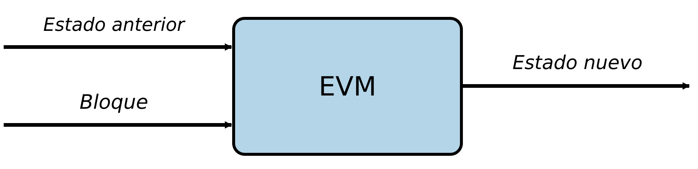
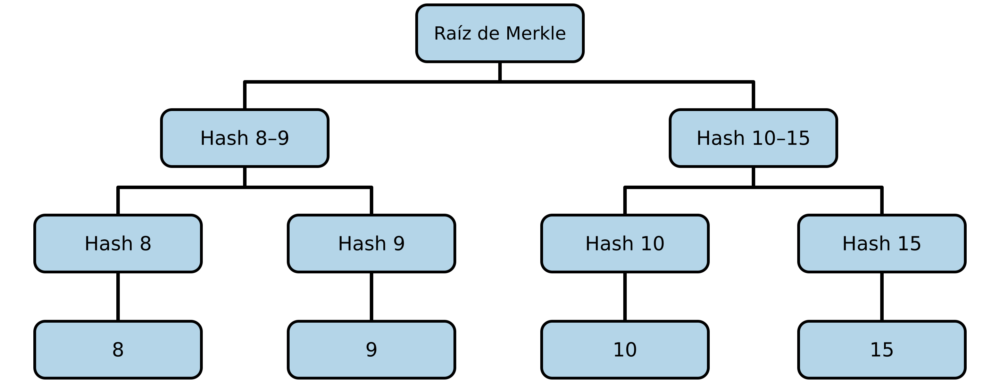
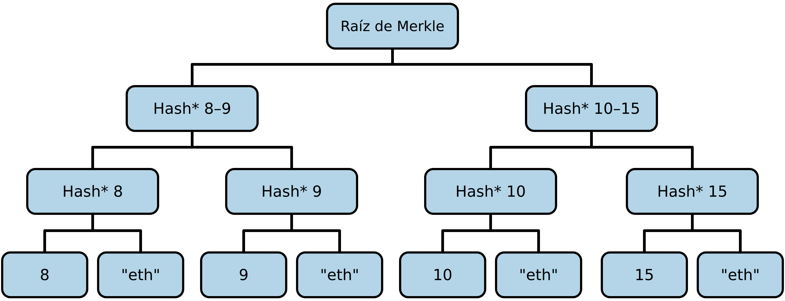
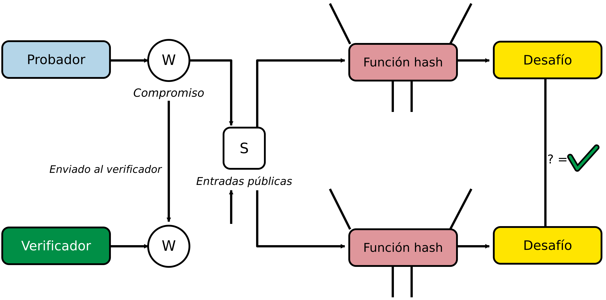
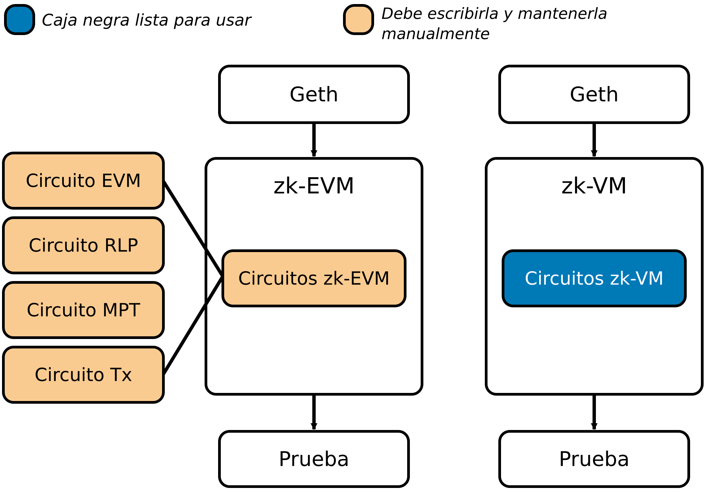

# Capítulo 17. Pruebas de conocimiento cero

En este capítulo, exploraremos el fascinante mundo de la *criptografía de conocimiento cero* y veremos cómo se aplica perfectamente a la hoja de ruta de Ethereum, al permitir escalar realmente y satisfacer la demanda de espacio de bloque que genera la adopción masiva. La tecnología de conocimiento cero es un tema muy complejo y se basa en muchas reglas matemáticas que no podremos explicar en detalle. El objetivo de este capítulo es que se comprenda por qué la criptografía de conocimiento cero ofrece una oportunidad única para Ethereum y encaja bien en su hoja de ruta de escalabilidad. Al terminar el capítulo, sabrá cómo funciona la criptografía de conocimiento cero a grandes rasgos, cuáles son sus propiedades útiles y cómo Ethereum la utilizará para mejorar el protocolo.

## Historia

Las *pruebas de conocimiento cero* se presentaron en el artículo ["The Knowledge Complexity of Interactive Proof-Systems"](https://oreil.ly/a6KH6), de Shafi Goldwasser, Silvio Micali y Charles Rackoff, en 1985. Allí describen una prueba de conocimiento cero como una forma de demostrar a otra parte que se sabe que algo es verdadero sin revelar ninguna información aparte del hecho de que la afirmación es efectivamente verdadera.
Aunque las pruebas de conocimiento cero se descubrieron en la década de 1980, sus casos de uso prácticos eran muy limitados. Todo cambió en 2011 con la llegada del artículo [BIT+11](https://oreil.ly/C6HvM), que presentó los *SNARKs* (*argumentos de conocimiento sucintos no interactivos*) como un marco teórico para crear pruebas de conocimiento cero de cómputos arbitrarios. Dos años después, en 2013, el artículo [Pinocchio PGHR13](https://oreil.ly/4uU6x) proporcionó la primera implementación práctica de un SNARK de propósito general, lo que hizo viables los SNARKs para aplicaciones del mundo real. Por primera vez, era posible demostrar que un programa genérico se había ejecutado correctamente sin tener que volver a ejecutarlo y sin revelar los detalles del cómputo.

La revolución había comenzado. A partir de ese momento, el campo de las pruebas de conocimiento cero evolucionó a un ritmo impresionantemente rápido. En 2016, el [algoritmo Groth16](https://oreil.ly/rxlOL) mejoró significativamente la eficiencia de los zk-SNARKs al reducir el tamaño de las pruebas y el tiempo de verificación. Por su excepcional concisión, Groth16 sigue utilizándose ampliamente hoy en día, a pesar de que existen sistemas más nuevos. Por ejemplo, Tornado Cash, una aplicación mezcladora descentralizada, lo utiliza para implementar pruebas de conocimiento cero en la cadena.

En 2017, [Bulletproofs](https://oreil.ly/ZUeIe) introdujo un avance revolucionario al eliminar la necesidad de una *configuración de confianza* (en secciones posteriores, profundizaremos en qué es exactamente una configuración de confianza), aunque a costa de pruebas más grandes. Le siguieron en 2018 los [*zk-STARKs*](https://oreil.ly/TCnTT), que no solo eliminaron el requisito de configuraciones de confianza, sino que también proporcionaron seguridad poscuántica, es decir, sus fundamentos criptográficos son resistentes a ataques de computadoras cuánticas. Los primeros se utilizan actualmente en el proyecto de criptomonedas Monero para ocultar los montos de las transacciones, mientras que los segundos constituyen la base criptográfica de Starknet, una L2 de Ethereum.

En 2019, [PLONK](https://oreil.ly/3453_) y [Sonic](https://oreil.ly/f6_Sq) hicieron aportes importantes al introducir configuraciones de confianza universales y actualizables, que hicieron que los SNARKs fueran más flexibles y prácticos para aplicaciones de propósito general. Estas innovaciones siguen influyendo en los sistemas modernos de conocimiento cero.

Las pruebas de conocimiento cero siguen en desarrollo activo, con avances recientes que mejoran el tiempo de generación de pruebas, la eficiencia de la recursión y aplicaciones prácticas como las zk-EVMs y las zk-VMs modernas. Continúan apareciendo regularmente nuevas construcciones y optimizaciones que amplían los límites de lo que es posible con la tecnología de conocimiento cero.

Esto es una realidad en gran medida gracias al dinero aportado por el sector de las criptomonedas. La propia Ethereum Foundation ha contribuido (y sigue contribuyendo) al otorgar múltiples subvenciones y contar con equipos dedicados a investigar el tema.

## Definición y propiedades

Ahora seamos más específicos y definamos qué es una prueba de conocimiento cero y qué propiedades debe tener. Ya dijimos que una prueba de conocimiento cero es un protocolo que permite a una parte, habitualmente llamada *probador*, P, demostrar a otra parte, habitualmente llamada *verificador*, V, que una afirmación es verdadera sin revelar nada aparte del hecho de que esa afirmación específica es verdadera.

Formalizamos algunas definiciones importantes:

**Afirmación**

La aseveración que se demuestra. La afirmación es pública y verificable por cualquiera, y no incluye información privada.

**Testigo**

La información secreta que demuestra que la afirmación es verdadera. Solo el probador conoce el testigo.

**Prueba**

El objeto criptográfico que convence a un verificador de que la afirmación es verdadera sin revelar el testigo.

Todos los sistemas de pruebas de conocimiento cero deben cumplir las siguientes tres propiedades:

**Completitud**

Si el probador P tiene una afirmación verdadera, debe poder calcular una prueba de conocimiento cero válida siguiendo las reglas del protocolo. No puede haber un caso en que un probador no pueda producir una prueba válida si sigue correctamente todas las reglas.

**Solidez**

Debe ser inviable que un probador malicioso falsifique una prueba válida de una afirmación falsa. Si un verificador acepta una prueba de conocimiento cero, la única manera en que el probador debe haberla creado es siguiendo todas las reglas del protocolo de manera correspondiente, a partir de una afirmación verdadera.

**Conocimiento cero**

Como su nombre lo indica, un verificador no debería conocer nada más que la validez de la afirmación inicial mientras sigue el protocolo.

## Cómo utiliza Ethereum las pruebas de conocimiento cero

Tal vez se pregunte por qué esta incorporación tan reciente a la criptografía es importante para el desarrollo futuro y la hoja de ruta de Ethereum. La respuesta es bastante directa.

El verdadero poder de los sistemas de pruebas de conocimiento cero, en el contexto de Ethereum, es que permiten verificar la validez de una afirmación sin tener que realizar todos los cómputos necesarios para llegar a esa afirmación final. Primero, un probador calcula una determinada afirmación y le adjunta una prueba de conocimiento cero; después, todos los verificadores pueden utilizar el protocolo de conocimiento cero y dar por verdadera esa afirmación sin necesidad de confianza, sin realizar el mismo cómputo que hizo el probador.

Un lector atento quizá ya haya identificado dónde se aplica esto perfectamente a Ethereum: la ejecución de bloques y las actualizaciones de estado, en otras palabras, la *función de transición de estado de la EVM*. Cada bloque nuevo actualiza el estado actual al procesar todas las transacciones incluidas en él. La Figura 17-1 ofrece una buena representación de esto.



Figura 17-1. Función de transición de estado de la EVM

Podemos imaginar la EVM como una caja negra que recibe como entrada el estado actual de la blockchain y el bloque recién recibido lleno de transacciones, y luego devuelve el nuevo estado actualizado de la cadena. Actualmente, cuando un nodo completo de Ethereum recibe un bloque nuevo, vuelve a ejecutar todas las transacciones que contiene para poder actualizar el estado sin necesidad de confianza y sin depender de ningún tercero de confianza.
El principal problema de este enfoque es que la ejecución de bloques se convierte en un posible cuello de botella porque impone una carga muy intensa. Se termina teniendo que equilibrar los requisitos de hardware que un nodo completo debe cumplir para funcionar bien y mantenerse al día con la punta de la cadena con el nivel de descentralización que se desea tener en la red. Cuanto más se quiera escalar elevando los requisitos de un nodo completo, más se compromete la descentralización, porque los actores menos sofisticados ya no pueden sostener económicamente la operación de un nodo completo. Y viceversa: cuanto más bajos se mantengan los requisitos de hardware para que cualquiera pueda ejecutar un nodo, más limitado será el rendimiento máximo que la blockchain puede manejar. Ethereum siempre ha preferido la descentralización en esta disyuntiva, manteniendo requisitos de hardware lo suficientemente bajos para permitir que existan quienes hacen staking de forma individual y quienes operan nodos completos.

Aquí entran en juego los sistemas de pruebas de conocimiento cero. ¿Y si hubiera una forma de que un nodo completo actualizara su estado sin necesidad de confianza y sin ejecutar ninguna transacción, es decir, sin realizar el pesado cómputo de la función de transición de estado de la EVM? Esta idea puede resumirse en el siguiente ejemplo:

1. Algunos actores realizan el cómputo real de la EVM ejecutando todas las transacciones incluidas en un bloque nuevo y produciendo el estado actualizado de la cadena.
2. Estos actores crean una prueba de conocimiento cero que da fe de la validez del estado y la comparten, junto con el nuevo estado actualizado, con todos los nodos completos.
3. Cuando todos los demás nodos completos reciben el nuevo estado de la cadena y la prueba de conocimiento cero, solo verifican la validez de la prueba y, si es válida, pueden actualizar sin necesidad de confianza sus propios estados de la cadena con el nuevo estado que acaban de recibir.

De esta manera, sigue siendo necesario contar con nodos, probablemente mantenidos por empresas con abundante financiación, que sí deban ejecutar todas las transacciones, pero todos los demás nodos pueden ser económicos porque solo necesitan verificar una prueba. Se pueden elevar mucho los requisitos de hardware del primer tipo de nodos para manejar un rendimiento mucho mayor y aun así mantener un alto nivel de descentralización gracias a la "magia" de las pruebas de conocimiento cero.

Hasta ahora, siempre hemos supuesto que generar una prueba de conocimiento cero y verificarla es rápido y sencillo. De hecho, los pasos anteriores solo tienen sentido si verificar una prueba de conocimiento cero es más rápido que volver a ejecutar todas las transacciones contenidas en un bloque promedio de Ethereum. Y resulta que hoy es bastante difícil lograr esa propiedad. Pero ese es un problema de optimización: es solo cuestión de cuándo, no de si será posible. Pronto llegaremos al punto en que será viable generar y verificar una prueba de conocimiento cero de un bloque de Ethereum en tiempo real. Ethproofs es un sitio web muy interesante para seguir si le interesa el desarrollo de este tema.

## Las L2 también se benefician de ZK

La red principal de Ethereum no es la única que se beneficia de la tecnología de pruebas de conocimiento cero. De hecho, como quizá ya haya leído en el Capítulo 16, existe una categoría de rollups llamados *rollups ZK*. Como su nombre lo indica, utilizan sistemas de pruebas de conocimiento cero para demostrar la ejecución de la EVM y poder publicar actualizaciones de estado de sus cadenas acompañadas de una prueba de conocimiento cero que garantiza que el nuevo estado se calculó correctamente.

Tal vez se pregunte cómo pueden los rollups ZK utilizar la tecnología de conocimiento cero si, como dijimos antes, actualmente no es posible generar pruebas en tiempo real para bloques promedio de Ethereum. La respuesta es que no lo hacen; ni siquiera necesitan generar pruebas en tiempo real para cada bloque de la L2. Habitualmente publican una prueba agregada de conocimiento cero aproximadamente una vez por hora, que demuestra que todas las actualizaciones de estado ocurridas entre la última y la más reciente se ejecutaron correctamente.

El tiempo transcurrido entre cada prueba de conocimiento cero solo afecta al tiempo hasta la finalidad del propio rollup. Si se publica una prueba una vez por hora, eso significa que, en promedio, hay que esperar 30 minutos para poder considerar que una transacción realmente alcanzó la finalidad (en la L1).

## Un pequeño ejemplo

Para familiarizarnos con el funcionamiento de los sistemas de pruebas de conocimiento cero, comencemos con un ejemplo pequeño y sencillo: el *problema de partición*. Es un problema conocido que consiste en la tarea de "decidir si un multiconjunto dado S de enteros positivos puede dividirse en dos subconjuntos S1 y S2 tales que la suma de los números de S1 sea igual a la suma de los números de S2".

> **Nota**  
>
> El problema de partición es un problema de decisión, mientras que Ethereum utiliza pruebas de conocimiento cero para verificar trazas de cómputo. Aunque el principal caso de uso de las pruebas de conocimiento cero en Ethereum es la verificación de trazas de ejecución, trabajar con el problema de partición sigue siendo una excelente manera de desarrollar la intuición sobre el funcionamiento de los sistemas de pruebas de conocimiento cero.


Si tenemos S = [1, 1, 5, 7], podemos satisfacer el problema al dividirlo en S1 = [1, 1, 5] y S2 = [7]. Pero no siempre es posible generar una solución correcta para este problema; de hecho, si S = [1, 1, 5, 8], es imposible dividirlo en dos subconjuntos que sumen el mismo número.

El problema de partición es NP-completo, lo que significa que no existe un algoritmo que pueda resolverlo en tiempo polinómico, es decir, proporcionar una solución si existe o demostrar que no existe una solución en poco tiempo.

### Demostrémoslo

La estructura del problema de partición se aplica perfectamente a las propiedades de los sistemas de pruebas de conocimiento cero que hemos visto hasta ahora. De hecho, como es difícil encontrar una solución, podría ser interesante delegar la capacidad de cómputo necesaria para encontrarla a un probador con muchos recursos, equipado con una supercomputadora, y luego utilizar tecnología de conocimiento cero para demostrar que encontró una solución válida sin que todos los demás realicen el mismo cómputo pesado, pero también sin revelar esa solución.

Para adaptar el problema de partición a los sistemas de pruebas de conocimiento cero, debemos modificarlo un poco. Supongamos que tenemos una lista `s` de enteros positivos. Diremos que otra lista `a` es una *asignación satisfactoria* si:

1. `len(s) == len(a)`
2. Todos los elementos de `a` son 1 o –1
3. El producto punto entre `s` y `a` es 0

Observe que esta construcción es completamente análoga al problema de partición. Si tomamos nuestra lista inicial anterior S = [1, 1, 5, 7], la asignación satisfactoria `a` es igual a:

```
a = [1, 1, 1, –1]
```

Se puede comprobar manualmente que las tres condiciones se cumplen:

1. `len(s) = 4 == len(a) = 4`
2. Todos los elementos de `a` son 1 o –1
3. Producto punto: 1 × 1 + 1 × 1 + 1 × 5 + (–1) × 7 = 1 + 1 + 5 – 7 = 0

El *producto punto* entre dos listas de igual longitud se calcula multiplicando cada miembro de la primera lista por el elemento correspondiente de la segunda y sumando todos los resultados. Más técnicamente, si tenemos las listas `s = [s0, s1, s2, sn]` y `a = [a0, a1, a2, an]` de igual longitud `n`, el producto punto se calcula de la siguiente manera:

<math xmlns="http://www.w3.org/1998/Math/MathML">
  <mi mathcolor="#000000">s</mi>
  <mo mathcolor="#000000">⋅</mo>
  <mi mathcolor="#000000">a</mi>
  <mo mathcolor="#000000">=</mo>
  <mrow>
    <munderover>
      <mo stretchy="false">∑</mo>
      <mrow>
        <mi mathcolor="#000000">i</mi>
        <mo mathcolor="#000000">=</mo>
        <mn mathcolor="#000000">0</mn>
      </mrow>
      <mrow>
        <mi mathcolor="#000000">n</mi>
      </mrow>
    </munderover>
    <mrow>
      <mfenced separators="">
        <mrow>
          <msub>
            <mrow>
              <mi mathcolor="#000000">s</mi>
            </mrow>
            <mrow>
              <mi mathcolor="#000000">i</mi>
            </mrow>
          </msub>
          <mo mathcolor="#000000">×</mo>
          <msub>
            <mrow>
              <mi mathcolor="#000000">a</mi>
            </mrow>
            <mrow>
              <mi mathcolor="#000000">i</mi>
            </mrow>
          </msub>
        </mrow>
      </mfenced>
    </mrow>
  </mrow>
  <mo mathcolor="#000000">=</mo>
  <msub>
    <mrow>
      <mi mathcolor="#000000">a</mi>
    </mrow>
    <mrow>
      <mn mathcolor="#000000">0</mn>
    </mrow>
  </msub>
  <msub>
    <mrow>
      <mi mathcolor="#000000">s</mi>
    </mrow>
    <mrow>
      <mn mathcolor="#000000">0</mn>
    </mrow>
  </msub>
  <mo mathcolor="#000000">+</mo>
  <msub>
    <mrow>
      <mi mathcolor="#000000">a</mi>
    </mrow>
    <mrow>
      <mn mathcolor="#000000">1</mn>
    </mrow>
  </msub>
  <msub>
    <mrow>
      <mi mathcolor="#000000">s</mi>
    </mrow>
    <mrow>
      <mn mathcolor="#000000">1</mn>
    </mrow>
  </msub>
  <mo mathcolor="#000000">+</mo>
  <msub>
    <mrow>
      <mi mathcolor="#000000">a</mi>
    </mrow>
    <mrow>
      <mn mathcolor="#000000">2</mn>
    </mrow>
  </msub>
  <msub>
    <mrow>
      <mi mathcolor="#000000">s</mi>
    </mrow>
    <mrow>
      <mn mathcolor="#000000">2</mn>
    </mrow>
  </msub>
  <mo mathcolor="#000000">+</mo>
  <mo mathcolor="#000000">.</mo>
  <mo mathcolor="#000000">.</mo>
  <mo mathcolor="#000000">.</mo>
  <mo mathcolor="#000000">+</mo>
  <msub>
    <mrow>
      <mi mathcolor="#000000">a</mi>
    </mrow>
    <mrow>
      <mi mathcolor="#000000">n</mi>
    </mrow>
  </msub>
  <msub>
    <mrow>
      <mi mathcolor="#000000">s</mi>
    </mrow>
    <mrow>
      <mi mathcolor="#000000">n</mi>
    </mrow>
  </msub>
</math>

Por supuesto, podríamos proporcionar inmediatamente `a` al verificador, y este podría comprobar fácilmente que es una solución válida, pero eso violaría el supuesto de conocimiento cero de no revelar la solución.

Comencemos generando una lista diferente `w` mediante la creación de la *lista de sumas parciales*, es decir, `w[i]` es igual al producto punto parcial entre `s` y `a` hasta `i`. En el contexto de los sistemas de pruebas de conocimiento cero, `w` también se denomina *testigo*. Siguiendo nuestro ejemplo, podemos calcular `w`:

```
w = [1, 2, 7, 0]
```

Observe que, si `a` es una asignación satisfactoria válida, `w` siempre termina en 0.

Para que el sistema de pruebas funcione mejor, apliquemos una pequeña modificación a la prueba `p` que hemos construido hasta ahora. En particular, pondremos el último elemento de la lista `w` en la primera posición, de modo que nuestra `w` anterior ahora se convierte en:

```
w = [0, 1, 2, 7]
```

¡Excelente! Esta lista `w` tiene una propiedad muy interesante:

```
|s[i]| = |w[i + 1] – w[i]|
```

Se puede comprobar la validez de esta afirmación:

```
|s[0]| = |w[0 + 1] – w[0]| = |w[1] – w[0]| = |1 – 0| = |1| = 1
|s[1]| = |w[1 + 1] – w[1]| = |w[2] – w[1]| = |2 – 1| = |1| = 1
|s[2]| = |w[2 + 1] – w[2]| = |w[3] – w[2]| = |7 – 2| = |5| = 5
|s[3]| = |w[3 + 1] – w[3]| = |w[4] – w[3]| = |w[0] – w[3]| = |0 – 7| = |–7| = 7
```

Observe que, para calcular `s[3]`, necesitaríamos acceder a `w[4]`, que no existe porque `w` solo tiene cuatro elementos (y comenzamos a indexar desde cero). Aun así, hay una solución muy sencilla: solo hay que volver al primer elemento de `w` como si `w` fuera cíclica.

Un verificador podría solicitar dos elementos consecutivos de `w` y comprobar que se cumple la relación anterior. Recuerde que el verificador tiene acceso a `s` porque está disponible públicamente; representa la entrada de este problema, pero no tiene acceso a `a`, la asignación satisfactoria, que representa la solución. Si la ecuación se cumple, significa que el probador conoce una asignación satisfactoria `a` para este problema.

### Problemas

Lo que hemos construido hasta ahora es un sistema de pruebas muy ingenuo. De hecho, tiene tres grandes problemas:

1. Antes dijimos que, una vez que el verificador ha solicitado dos elementos consecutivos de `w` y la ecuación se cumple, ha verificado que el probador conoce una solución para este problema. Esto no es cierto. Con una sola consulta, el verificador no puede estar completamente seguro; debe realizar varias consultas de elementos consecutivos de `w` antes de tener certeza con una probabilidad muy alta.
2. Aunque es cierto que el verificador puede verificar que el probador tiene una solución para el problema, este sistema de pruebas depende de la integridad del probador. ¿Qué pasa si el probador es malicioso y miente? Cuando el verificador solicita dos elementos consecutivos de `w`, el probador podría proporcionar dos números aleatorios que aun así satisfagan la ecuación.
3. Además, este sistema de pruebas no es de conocimiento cero. De hecho, al solicitar elementos consecutivos de `w`, el verificador llega a saber mucho sobre la asignación satisfactoria `a`. El verificador sabe cómo se construyó `w`, así que cuanto más sabe sobre `w`, más sabe sobre la solución `a`.

Abordemos ahora estos problemas e intentemos construir un sistema de pruebas mejor.

### Conocimiento cero

Agreguemos conocimiento cero al sistema. El principal problema del protocolo que hemos construido hasta ahora es que enviamos los valores reales de `w` al verificador, lo que le permite obtener mucha información sobre `a`. Para verlo en la práctica, hagamos dos pasos sencillos de interacción entre probador y verificador.

El verificador solicita `w[1]` y `w[2]` y comprueba que `|w[2] – w[1]| = |s[1]|`, por lo que el probador proporciona `w[1] = 1` y `w[2] = 2`, y el verificador puede confirmar que la ecuación se cumple:

<math xmlns="http://www.w3.org/1998/Math/MathML">
  <mfenced open="|" close="" separators="|">
    <mrow>
      <mi mathcolor="#000000">s</mi>
      <mo stretchy="false" mathcolor="#000000">[</mo>
      <mn mathcolor="#000000">1</mn>
      <mo stretchy="false" mathcolor="#000000">]</mo>
    </mrow>
    <mrow>
      <mo mathcolor="#000000">=</mo>
    </mrow>
    <mrow>
      <mi mathcolor="#000000">w</mi>
      <mo stretchy="false" mathcolor="#000000">[</mo>
      <mn mathcolor="#000000">2</mn>
      <mo stretchy="false" mathcolor="#000000">]</mo>
      <mo mathcolor="#000000">−</mo>
      <mi mathcolor="#000000">w</mi>
      <mo stretchy="false" mathcolor="#000000">[</mo>
      <mn mathcolor="#000000">1</mn>
      <mo stretchy="false" mathcolor="#000000">]</mo>
    </mrow>
    <mrow>
      <mo mathcolor="#000000">=</mo>
    </mrow>
    <mrow>
      <mn mathcolor="#000000">2</mn>
      <mo mathcolor="#000000">−</mo>
      <mn mathcolor="#000000">1</mn>
    </mrow>
    <mrow>
      <mo mathcolor="#000000">=</mo>
    </mrow>
    <mrow>
      <mn mathcolor="#000000">1</mn>
    </mrow>
    <mrow>
      <mo mathcolor="#000000">=</mo>
      <mn mathcolor="#000000">1</mn>
    </mrow>
  </mfenced>
</math>

Después, el verificador realiza otra consulta: `w[2]` y `w[3]`. El probador proporciona `w[2] = 2` y `w[3] = 7`, y el verificador comprueba la ecuación:

<math xmlns="http://www.w3.org/1998/Math/MathML">
  <mfenced open="|" close="" separators="|">
    <mrow>
      <mi mathcolor="#000000">s</mi>
      <mo stretchy="false" mathcolor="#000000">[</mo>
      <mn mathcolor="#000000">2</mn>
      <mo stretchy="false" mathcolor="#000000">]</mo>
    </mrow>
    <mrow>
      <mo mathcolor="#000000">=</mo>
    </mrow>
    <mrow>
      <mi mathcolor="#000000">w</mi>
      <mo stretchy="false" mathcolor="#000000">[</mo>
      <mn mathcolor="#000000">3</mn>
      <mo stretchy="false" mathcolor="#000000">]</mo>
      <mo mathcolor="#000000">−</mo>
      <mi mathcolor="#000000">w</mi>
      <mo stretchy="false" mathcolor="#000000">[</mo>
      <mn mathcolor="#000000">2</mn>
      <mo stretchy="false" mathcolor="#000000">]</mo>
    </mrow>
    <mrow>
      <mo mathcolor="#000000">=</mo>
    </mrow>
    <mrow>
      <mn mathcolor="#000000">7</mn>
      <mo mathcolor="#000000">−</mo>
      <mn mathcolor="#000000">2</mn>
    </mrow>
    <mrow>
      <mo mathcolor="#000000">=</mo>
    </mrow>
    <mrow>
      <mn mathcolor="#000000">5</mn>
    </mrow>
    <mrow>
      <mo mathcolor="#000000">=</mo>
      <mn mathcolor="#000000">5</mn>
    </mrow>
  </mfenced>
</math>

Con estas dos interacciones, el verificador llega a conocer tres elementos de w:

<math xmlns="http://www.w3.org/1998/Math/MathML">
  <mtable>
    <mtr>
      <mtd/>
      <mtd>
        <mi mathcolor="#000000">w</mi>
        <mo stretchy="false" mathcolor="#000000">[</mo>
        <mn mathcolor="#000000">1</mn>
        <mo stretchy="false" mathcolor="#000000">]</mo>
        <mo mathcolor="#000000">=</mo>
        <mn mathcolor="#000000">1</mn>
      </mtd>
    </mtr>
    <mtr>
      <mtd/>
      <mtd>
        <mi mathcolor="#000000">w</mi>
        <mo stretchy="false" mathcolor="#000000">[</mo>
        <mn mathcolor="#000000">2</mn>
        <mo stretchy="false" mathcolor="#000000">]</mo>
        <mo mathcolor="#000000">=</mo>
        <mn mathcolor="#000000">2</mn>
      </mtd>
    </mtr>
    <mtr>
      <mtd/>
      <mtd>
        <mi mathcolor="#000000">w</mi>
        <mo stretchy="false" mathcolor="#000000">[</mo>
        <mn mathcolor="#000000">3</mn>
        <mo stretchy="false" mathcolor="#000000">]</mo>
        <mo mathcolor="#000000">=</mo>
        <mn mathcolor="#000000">7</mn>
      </mtd>
    </mtr>
  </mtable>
</math>

Como el verificador ya conoce `s = [1, 1, 5, 7]` y sabe cómo se calculó `w`, puede deducir que la parte inicial de la solución `a` es igual a `[1, 1, 1]`, porque esa es la única forma de obtener `w[3] = 7`, `w[2] = 2` y `w[1] = 1`.

Debemos encontrar una forma de ocultar los valores reales de `w` y aun así satisfacer la relación entre la nueva `w` y la lista de entrada `s`. Para lograrlo, debemos agregar cierto grado de aleatoriedad de una manera muy específica.

Primero, en lugar de `a`, lanzamos una moneda y, si sale cara, la dejamos como está; de lo contrario, cambiamos los signos de todos los elementos, de modo que todos los 1 se convierten en –1 y viceversa. Observe que este cambio no rompe las tres propiedades principales de la asignación satisfactoria `a` del problema.

Después, obtenemos un nuevo valor entero aleatorio `r`. Calculamos `w` de la misma manera que antes, pero agregamos `r` a cada uno de sus elementos. Este cambio tampoco rompe la relación clave entre `s` y `w`.

Cada vez que el verificador realiza una nueva consulta, debemos lanzar una moneda y calcular un valor aleatorio `r` diferente. De esta manera, aunque el verificador sigue pudiendo verificar la validez de la ecuación, no puede averiguar nada sobre `a` porque todos los valores de `w` le parecerán aleatorios.

Hagamos una pequeña demostración. Recuerde que el probador (nosotros, en este ejemplo) comienza tanto con `s` como con `a`:

<math xmlns="http://www.w3.org/1998/Math/MathML">
  <mtable>
    <mtr>
      <mtd/>
      <mtd>
        <mi mathcolor="#000000">s</mi>
        <mo mathcolor="#000000">=</mo>
        <mo stretchy="false" mathcolor="#000000">[</mo>
        <mn mathcolor="#000000">1</mn>
        <mo mathcolor="#000000">,</mo>
        <mn mathcolor="#000000">1</mn>
        <mo mathcolor="#000000">,</mo>
        <mn mathcolor="#000000">5</mn>
        <mo mathcolor="#000000">,</mo>
        <mn mathcolor="#000000">7</mn>
        <mo stretchy="false" mathcolor="#000000">]</mo>
      </mtd>
    </mtr>
    <mtr>
      <mtd/>
      <mtd>
        <mi mathcolor="#000000">a</mi>
        <mo mathcolor="#000000">=</mo>
        <mo stretchy="false" mathcolor="#000000">[</mo>
        <mn mathcolor="#000000">1</mn>
        <mo mathcolor="#000000">,</mo>
        <mn mathcolor="#000000">1</mn>
        <mo mathcolor="#000000">,</mo>
        <mn mathcolor="#000000">1</mn>
        <mo mathcolor="#000000">,</mo>
        <mo mathcolor="#000000">−</mo>
        <mn mathcolor="#000000">1</mn>
        <mo stretchy="false" mathcolor="#000000">]</mo>
      </mtd>
    </mtr>
  </mtable>
</math>

Ahora, el verificador solicita `w[1]` y `w[2]` para comprobar que `|w[2] – w[1]| = |s[1]|`.

Primero, debemos lanzar una moneda para posiblemente cambiar todos los valores de `a`. Sale cruz, así que debemos invertir todos los signos y `a` se convierte en:

<math xmlns="http://www.w3.org/1998/Math/MathML">
  <mi mathcolor="#000000">a</mi>
  <mo mathcolor="#000000">′</mo>
  <mo mathcolor="#000000">=</mo>
  <mo stretchy="false" mathcolor="#000000">[</mo>
  <mo mathcolor="#000000">−</mo>
  <mn mathcolor="#000000">1</mn>
  <mo mathcolor="#000000">,</mo>
  <mo mathcolor="#000000">−</mo>
  <mn mathcolor="#000000">1</mn>
  <mo mathcolor="#000000">,</mo>
  <mo mathcolor="#000000">−</mo>
  <mn mathcolor="#000000">1</mn>
  <mo mathcolor="#000000">,</mo>
  <mn mathcolor="#000000">1</mn>
  <mo stretchy="false" mathcolor="#000000">]</mo>
</math>

Después, calculamos un valor aleatorio `r = 4`. Calculamos `w` y agregamos `r` a cada elemento:

<math xmlns="http://www.w3.org/1998/Math/MathML">
  <mtable>
    <mtr>
      <mtd/>
      <mtd>
        <mi mathcolor="#000000">w</mi>
        <mo mathcolor="#000000">=</mo>
        <mo stretchy="false" mathcolor="#000000">[</mo>
        <mn mathcolor="#000000">0</mn>
        <mo mathcolor="#000000">,</mo>
        <mo mathcolor="#000000">−</mo>
        <mn mathcolor="#000000">1</mn>
        <mo mathcolor="#000000">,</mo>
        <mo mathcolor="#000000">−</mo>
        <mn mathcolor="#000000">2</mn>
        <mo mathcolor="#000000">,</mo>
        <mo mathcolor="#000000">−</mo>
        <mn mathcolor="#000000">7</mn>
        <mo stretchy="false" mathcolor="#000000">]</mo>
      </mtd>
    </mtr>
    <mtr>
      <mtd/>
      <mtd>
        <mi mathcolor="#000000">w</mi>
        <mo mathcolor="#000000">′</mo>
        <mo mathcolor="#000000">=</mo>
        <mo stretchy="false" mathcolor="#000000">[</mo>
        <mn mathcolor="#000000">4</mn>
        <mo mathcolor="#000000">,</mo>
        <mn mathcolor="#000000">3</mn>
        <mo mathcolor="#000000">,</mo>
        <mn mathcolor="#000000">2</mn>
        <mo mathcolor="#000000">,</mo>
        <mo mathcolor="#000000">−</mo>
        <mn mathcolor="#000000">3</mn>
        <mo stretchy="false" mathcolor="#000000">]</mo>
      </mtd>
    </mtr>
  </mtable>
</math>

Y proporcionamos <math xmlns="http://www.w3.org/1998/Math/MathML">
  <msup>
    <mrow>
      <mi mathcolor="#000000">w</mi>
    </mrow>
    <mrow>
      <mo mathcolor="#000000">′</mo>
    </mrow>
  </msup>
  <mo stretchy="false" mathcolor="#000000">[</mo>
  <mn mathcolor="#000000">1</mn>
  <mo stretchy="false" mathcolor="#000000">]</mo>
  <mo mathcolor="#000000">=</mo>
  <mn mathcolor="#000000">3</mn>
</math> y <math xmlns="http://www.w3.org/1998/Math/MathML">
  <msup>
    <mrow>
      <mi mathcolor="#000000">w</mi>
    </mrow>
    <mrow>
      <mo mathcolor="#000000">′</mo>
    </mrow>
  </msup>
  <mo stretchy="false" mathcolor="#000000">[</mo>
  <mn mathcolor="#000000">2</mn>
  <mo stretchy="false" mathcolor="#000000">]</mo>
  <mo mathcolor="#000000">=</mo>
  <mn mathcolor="#000000">2</mn>
</math>.

El verificador aún puede confirmar la validez de la ecuación:

<math xmlns="http://www.w3.org/1998/Math/MathML">
  <mfenced open="|" close="|" separators="|">
    <mrow>
      <mi mathcolor="#000000">s</mi>
      <mo stretchy="false" mathcolor="#000000">[</mo>
      <mn mathcolor="#000000">1</mn>
      <mo stretchy="false" mathcolor="#000000">]</mo>
    </mrow>
    <mrow>
      <mo mathcolor="#000000">=</mo>
    </mrow>
  </mfenced>
  <msup>
    <mrow>
      <mi mathcolor="#000000">w</mi>
    </mrow>
    <mrow>
      <mo mathcolor="#000000">′</mo>
    </mrow>
  </msup>
  <mo stretchy="false" mathcolor="#000000">[</mo>
  <mn mathcolor="#000000">2</mn>
  <mo stretchy="false" mathcolor="#000000">]</mo>
  <mo mathcolor="#000000">−</mo>
  <msup>
    <mrow>
      <mi mathcolor="#000000">w</mi>
    </mrow>
    <mrow>
      <mo mathcolor="#000000">′</mo>
    </mrow>
  </msup>
  <mfenced open="" close="" separators="|">
    <mrow>
      <mo stretchy="false" mathcolor="#000000">[</mo>
      <mn mathcolor="#000000">1</mn>
      <mo stretchy="false" mathcolor="#000000">]</mo>
    </mrow>
    <mrow>
      <mo mathcolor="#000000">=</mo>
    </mrow>
    <mrow>
      <mn mathcolor="#000000">2</mn>
      <mo mathcolor="#000000">−</mo>
      <mn mathcolor="#000000">3</mn>
    </mrow>
    <mrow>
      <mo mathcolor="#000000">=</mo>
    </mrow>
    <mrow>
      <mo mathcolor="#000000">−</mo>
      <mn mathcolor="#000000">1</mn>
    </mrow>
    <mrow>
      <mo mathcolor="#000000">=</mo>
      <mn mathcolor="#000000">1</mn>
    </mrow>
  </mfenced>
</math>

Ahora, el verificador realiza otra consulta, solicitando `w[2]` y `w[3]`. Nuevamente, debemos lanzar una moneda para posiblemente cambiar todos los valores de `a`. Esta vez sale cara, así que no cambiamos los signos:

Después, calculamos un valor aleatorio `r = 1`. Calculamos `w` y agregamos `r` a cada elemento:

<math xmlns="http://www.w3.org/1998/Math/MathML">
  <mi mathcolor="#000000">a</mi>
  <mo mathcolor="#000000">=</mo>
  <mo stretchy="false" mathcolor="#000000">[</mo>
  <mn mathcolor="#000000">1</mn>
  <mo mathcolor="#000000">,</mo>
  <mn mathcolor="#000000">1</mn>
  <mo mathcolor="#000000">,</mo>
  <mn mathcolor="#000000">1</mn>
  <mo mathcolor="#000000">,</mo>
  <mo mathcolor="#000000">−</mo>
  <mn mathcolor="#000000">1</mn>
  <mo stretchy="false" mathcolor="#000000">]</mo>
</math>

Y proporcionamos <math xmlns="http://www.w3.org/1998/Math/MathML">
  <msup>
    <mrow>
      <mi mathcolor="#000000">w</mi>
    </mrow>
    <mrow>
      <mo mathcolor="#000000">″</mo>
    </mrow>
  </msup>
  <mo stretchy="false" mathcolor="#000000">[</mo>
  <mn mathcolor="#000000">2</mn>
  <mo stretchy="false" mathcolor="#000000">]</mo>
  <mo mathcolor="#000000">=</mo>
  <mn mathcolor="#000000">3</mn>
</math> y <math xmlns="http://www.w3.org/1998/Math/MathML">
  <msup>
    <mrow>
      <mi mathcolor="#000000">w</mi>
    </mrow>
    <mrow>
      <mo mathcolor="#000000">″</mo>
    </mrow>
  </msup>
  <mo stretchy="false" mathcolor="#000000">[</mo>
  <mn mathcolor="#000000">3</mn>
  <mo stretchy="false" mathcolor="#000000">]</mo>
  <mo mathcolor="#000000">=</mo>
  <mn mathcolor="#000000">8</mn>
</math>.
El verificador aún puede confirmar la validez de la ecuación:

<math xmlns="http://www.w3.org/1998/Math/MathML">
  <mfenced open="|" close="|" separators="|">
    <mrow>
      <mi mathcolor="#000000">s</mi>
      <mo stretchy="false" mathcolor="#000000">[</mo>
      <mn mathcolor="#000000">2</mn>
      <mo stretchy="false" mathcolor="#000000">]</mo>
    </mrow>
    <mrow>
      <mo mathcolor="#000000">=</mo>
    </mrow>
  </mfenced>
  <msup>
    <mrow>
      <mi mathcolor="#000000">w</mi>
    </mrow>
    <mrow>
      <mo mathcolor="#000000">″</mo>
    </mrow>
  </msup>
  <mo stretchy="false" mathcolor="#000000">[</mo>
  <mn mathcolor="#000000">3</mn>
  <mo stretchy="false" mathcolor="#000000">]</mo>
  <mo mathcolor="#000000">−</mo>
  <msup>
    <mrow>
      <mi mathcolor="#000000">w</mi>
    </mrow>
    <mrow>
      <mo mathcolor="#000000">″</mo>
    </mrow>
  </msup>
  <mfenced open="" close="" separators="|">
    <mrow>
      <mo stretchy="false" mathcolor="#000000">[</mo>
      <mn mathcolor="#000000">2</mn>
      <mo stretchy="false" mathcolor="#000000">]</mo>
    </mrow>
    <mrow>
      <mo mathcolor="#000000">=</mo>
    </mrow>
    <mrow>
      <mn mathcolor="#000000">8</mn>
      <mo mathcolor="#000000">−</mo>
      <mn mathcolor="#000000">3</mn>
    </mrow>
    <mrow>
      <mo mathcolor="#000000">=</mo>
    </mrow>
    <mrow>
      <mn mathcolor="#000000">5</mn>
    </mrow>
    <mrow>
      <mo mathcolor="#000000">=</mo>
      <mn mathcolor="#000000">5</mn>
    </mrow>
  </mfenced>
</math>

Pero ahora, el verificador no puede averiguar mucho sobre la asignación satisfactoria a. De hecho, ahora tiene la siguiente información:

<math xmlns="http://www.w3.org/1998/Math/MathML">
  <mtable>
    <mtr>
      <mtd/>
      <mtd>
        <msup>
          <mrow>
            <mi mathcolor="#000000">w</mi>
          </mrow>
          <mrow>
            <mo mathcolor="#000000">′</mo>
          </mrow>
        </msup>
        <mo stretchy="false" mathcolor="#000000">[</mo>
        <mn mathcolor="#000000">1</mn>
        <mo stretchy="false" mathcolor="#000000">]</mo>
        <mo mathcolor="#000000">=</mo>
        <mn mathcolor="#000000">3</mn>
      </mtd>
    </mtr>
    <mtr>
      <mtd/>
      <mtd>
        <msup>
          <mrow>
            <mi mathcolor="#000000">w</mi>
          </mrow>
          <mrow>
            <mo mathcolor="#000000">′</mo>
          </mrow>
        </msup>
        <mo stretchy="false" mathcolor="#000000">[</mo>
        <mn mathcolor="#000000">2</mn>
        <mo stretchy="false" mathcolor="#000000">]</mo>
        <mo mathcolor="#000000">=</mo>
        <mn mathcolor="#000000">2</mn>
      </mtd>
    </mtr>
    <mtr>
      <mtd/>
      <mtd>
        <msup>
          <mrow>
            <mi mathcolor="#000000">w</mi>
          </mrow>
          <mrow>
            <mo mathcolor="#000000">″</mo>
          </mrow>
        </msup>
        <mo stretchy="false" mathcolor="#000000">[</mo>
        <mn mathcolor="#000000">2</mn>
        <mo stretchy="false" mathcolor="#000000">]</mo>
        <mo mathcolor="#000000">=</mo>
        <mn mathcolor="#000000">3</mn>
      </mtd>
    </mtr>
    <mtr>
      <mtd/>
      <mtd>
        <msup>
          <mrow>
            <mi mathcolor="#000000">w</mi>
          </mrow>
          <mrow>
            <mo mathcolor="#000000">″</mo>
          </mrow>
        </msup>
        <mo stretchy="false" mathcolor="#000000">[</mo>
        <mn mathcolor="#000000">3</mn>
        <mo stretchy="false" mathcolor="#000000">]</mo>
        <mo mathcolor="#000000">=</mo>
        <mn mathcolor="#000000">8</mn>
      </mtd>
    </mtr>
  </mtable>
</math>

Los valores de `w` de las diferentes consultas le parecen aleatorios, y no puede reconstruir la asignación `a`.

¡Bien! Logramos agregar conocimiento cero al sistema de pruebas. Abordemos ahora el caso de un probador malicioso.

### Compromiso del probador

El problema que debemos abordar es que el probador puede mentirle al verificador y proporcionar números completamente inventados en lugar de los valores reales del testigo calculado `w`. Esto es muy malo porque el probador podría proporcionar una prueba válida de una afirmación falsa, es decir, aunque el probador no tenga realmente una asignación satisfactoria `a`, podría engañar al verificador para que crea que sí la tiene.

Debemos encontrar una forma de garantizar que el probador no pueda mentir sin ser descubierto. En esencia, necesitamos que el probador genere un *compromiso criptográfico* de todos los valores de `w` antes de proporcionárselos al verificador.

Aquí los árboles de Merkle vuelven a ayudarnos. Los presentamos en el Capítulo 14, así que aquí no entraremos en muchos detalles sobre su funcionamiento.

Hagamos un nuevo ejemplo para ver la nueva construcción en la práctica. Nosotros (el probador) tenemos:

<math xmlns="http://www.w3.org/1998/Math/MathML">
  <mtable>
    <mtr>
      <mtd>
        <mi mathcolor="#000000">s</mi>
      </mtd>
      <mtd>
        <mo mathcolor="#000000">=</mo>
        <mo stretchy="false" mathcolor="#000000">[</mo>
        <mn mathcolor="#000000">1</mn>
        <mo mathcolor="#000000">,</mo>
        <mn mathcolor="#000000">1</mn>
        <mo mathcolor="#000000">,</mo>
        <mn mathcolor="#000000">5</mn>
        <mo mathcolor="#000000">,</mo>
        <mn mathcolor="#000000">7</mn>
        <mo stretchy="false" mathcolor="#000000">]</mo>
      </mtd>
    </mtr>
    <mtr>
      <mtd>
        <mi mathcolor="#000000">a</mi>
      </mtd>
      <mtd>
        <mo mathcolor="#000000">=</mo>
        <mo stretchy="false" mathcolor="#000000">[</mo>
        <mn mathcolor="#000000">1</mn>
        <mo mathcolor="#000000">,</mo>
        <mn mathcolor="#000000">1</mn>
        <mo mathcolor="#000000">,</mo>
        <mn mathcolor="#000000">1</mn>
        <mo mathcolor="#000000">,</mo>
        <mo mathcolor="#000000">−</mo>
        <mn mathcolor="#000000">1</mn>
        <mo stretchy="false" mathcolor="#000000">]</mo>
      </mtd>
    </mtr>
  </mtable>
</math>

Lanzamos una moneda y sale cara, así que no necesitamos cambiar todos los signos de la asignación `a`. Después calculamos `w` como el producto punto entre `a` y `s` (con un intercambio entre el primer y el último elemento):

<math xmlns="http://www.w3.org/1998/Math/MathML">
  <mi mathcolor="#000000">w</mi>
  <mo mathcolor="#000000">=</mo>
  <mo stretchy="false" mathcolor="#000000">[</mo>
  <mn mathcolor="#000000">0</mn>
  <mo mathcolor="#000000">,</mo>
  <mn mathcolor="#000000">1</mn>
  <mo mathcolor="#000000">,</mo>
  <mn mathcolor="#000000">2</mn>
  <mo mathcolor="#000000">,</mo>
  <mn mathcolor="#000000">7</mn>
  <mo stretchy="false" mathcolor="#000000">]</mo>
</math>

Calculamos un valor aleatorio `r = 8` y lo agregamos a cada elemento de `w`:

<math xmlns="http://www.w3.org/1998/Math/MathML">
  <mi mathcolor="#000000">w</mi>
  <mo mathcolor="#000000">′</mo>
  <mo mathcolor="#000000">=</mo>
  <mo stretchy="false" mathcolor="#000000">[</mo>
  <mn mathcolor="#000000">8</mn>
  <mo mathcolor="#000000">,</mo>
  <mn mathcolor="#000000">9</mn>
  <mo mathcolor="#000000">,</mo>
  <mn mathcolor="#000000">10</mn>
  <mo mathcolor="#000000">,</mo>
  <mn mathcolor="#000000">15</mn>
  <mo stretchy="false" mathcolor="#000000">]</mo>
</math>

Ahora debemos comprometernos con todos los valores de `w′` y enviar el compromiso al verificador para garantizar que, si alguna vez hacemos trampa proporcionando valores falsos de `w′`, sea trivial detectarlo. La Figura 17-2 muestra el árbol de Merkle construido utilizando todos los valores de `w′` como hojas.



Figura 17-2. Árbol de Merkle construido utilizando valores de `w′`

La raíz de Merkle es el compromiso final que se envía al verificador.

En este punto, el verificador comienza con la primera consulta: <math xmlns="http://www.w3.org/1998/Math/MathML">
  <msup>
    <mrow>
      <mi mathcolor="#000000">w</mi>
    </mrow>
    <mrow>
      <mo mathcolor="#000000">′</mo>
    </mrow>
  </msup>
  <mo stretchy="false" mathcolor="#000000">[</mo>
  <mn mathcolor="#000000">1</mn>
  <mo stretchy="false" mathcolor="#000000">]</mo>
</math> y <math xmlns="http://www.w3.org/1998/Math/MathML">
  <msup>
    <mrow>
      <mi mathcolor="#000000">w</mi>
    </mrow>
    <mrow>
      <mo mathcolor="#000000">′</mo>
    </mrow>
  </msup>
  <mo stretchy="false" mathcolor="#000000">[</mo>
  <mn mathcolor="#000000">2</mn>
  <mo stretchy="false" mathcolor="#000000">]</mo>
</math>. Podemos proporcionar <math xmlns="http://www.w3.org/1998/Math/MathML">
  <msup>
    <mrow>
      <mi mathcolor="#000000">w</mi>
    </mrow>
    <mrow>
      <mo mathcolor="#000000">′</mo>
    </mrow>
  </msup>
  <mo stretchy="false" mathcolor="#000000">[</mo>
  <mn mathcolor="#000000">1</mn>
  <mo stretchy="false" mathcolor="#000000">]</mo>
  <mo mathcolor="#000000">=</mo>
  <mn mathcolor="#000000">9</mn>
</math> y <math xmlns="http://www.w3.org/1998/Math/MathML">
  <msup>
    <mrow>
      <mi mathcolor="#000000">w</mi>
    </mrow>
    <mrow>
      <mo mathcolor="#000000">′</mo>
    </mrow>
  </msup>
  <mo stretchy="false" mathcolor="#000000">[</mo>
  <mn mathcolor="#000000">2</mn>
  <mo stretchy="false" mathcolor="#000000">]</mo>
  <mo mathcolor="#000000">=</mo>
  <mn mathcolor="#000000">10</mn>
</math> al verificador, y este puede comprobar:

<math xmlns="http://www.w3.org/1998/Math/MathML">
  <mfenced open="|" close="|" separators="|">
    <mrow>
      <mi mathcolor="#000000">s</mi>
      <mo stretchy="false" mathcolor="#000000">[</mo>
      <mn mathcolor="#000000">1</mn>
      <mo stretchy="false" mathcolor="#000000">]</mo>
    </mrow>
    <mrow>
      <mo mathcolor="#000000">=</mo>
    </mrow>
  </mfenced>
  <msup>
    <mrow>
      <mi mathcolor="#000000">w</mi>
    </mrow>
    <mrow>
      <mo mathcolor="#000000">′</mo>
    </mrow>
  </msup>
  <mo stretchy="false" mathcolor="#000000">[</mo>
  <mn mathcolor="#000000">2</mn>
  <mo stretchy="false" mathcolor="#000000">]</mo>
  <mo mathcolor="#000000">−</mo>
  <msup>
    <mrow>
      <mi mathcolor="#000000">w</mi>
    </mrow>
    <mrow>
      <mo mathcolor="#000000">′</mo>
    </mrow>
  </msup>
  <mfenced open="" close="" separators="|">
    <mrow>
      <mo stretchy="false" mathcolor="#000000">[</mo>
      <mn mathcolor="#000000">1</mn>
      <mo stretchy="false" mathcolor="#000000">]</mo>
    </mrow>
    <mrow>
      <mo mathcolor="#000000">=</mo>
    </mrow>
    <mrow>
      <mn mathcolor="#000000">10</mn>
      <mo mathcolor="#000000">−</mo>
      <mn mathcolor="#000000">9</mn>
    </mrow>
    <mrow>
      <mo mathcolor="#000000">=</mo>
    </mrow>
    <mrow>
      <mn mathcolor="#000000">1</mn>
    </mrow>
    <mrow>
      <mo mathcolor="#000000">=</mo>
      <mn mathcolor="#000000">1</mn>
    </mrow>
  </mfenced>
</math>

Ahora, el verificador debe asegurarse de que no hicimos trampa, así que también solicita al probador la *ruta de verificación*, que contiene todos los datos que necesita para reconstruir por su cuenta el árbol de Merkle y comprobar que la raíz de Merkle sea igual al compromiso que enviamos. Si es así, tiene la certeza de que no hicimos trampa; de lo contrario, sabe inmediatamente que sí la hicimos.

En concreto, la ruta de verificación de esta consulta contiene:

- Hash 8
- Hash 15

De esta manera, el verificador puede reconstruir el árbol de Merkle hasta la raíz y verificar el compromiso. Así, enviamos el hash de 8 y el hash de 15 al verificador, este comprueba la validez del compromiso y, finalmente, termina esta consulta.

Sin embargo, quizá haya detectado un nuevo problema. De hecho, debido al requisito de la ruta de verificación, terminamos enviando algunos datos adicionales sobre `w′`: el hash de 8 y el hash de 15. Aunque es cierto que debería ser computacionalmente inviable invertir una función hash, es decir, obtener los valores reales 8 y 15 a partir de sus hashes, un verificador malicioso podría intentar un ataque de fuerza bruta y lograr descubrir una parte del árbol de Merkle que no pretendíamos revelar. Por suerte, existe una modificación sencilla y útil que resuelve este problema.

### Agregar aleatoriedad al compromiso

La idea es análoga a lo que hicimos anteriormente para agregar la propiedad de conocimiento cero a nuestro sistema de pruebas. Esta vez, debemos agregar aleatoriedad al compromiso para no revelar ninguna información sobre `w` (o `w′`) en la ruta de verificación.

Cuando creamos el árbol de Merkle, en lugar de utilizar solo el hash del valor exacto de cada elemento de `w′` para las hojas del árbol, agregamos una cadena aleatoria que no proporcionaremos al verificador. La Figura 17-3 muestra el nuevo árbol de Merkle construido con esta nueva metodología.



Figura 17-3. Árbol de Merkle con aleatoriedad agregada para la propiedad de conocimiento cero

En este ejemplo, utilizamos la cadena "eth" para ocultar cada elemento del testigo `w′`. Observe que, si no se tiene esta cadena secreta, es imposible decodificar los valores reales. Ahora, cuando enviamos hash* 8 y hash* 15 al verificador en la ruta de verificación, realmente no tiene ninguna pista sobre los valores concretos de `w′` detrás del hash. Incluso si intenta un ataque de fuerza bruta, no conoce la cadena secreta que utilizamos para ocultar aún más los elementos de `w′`.

### ¿Conclusión? ¿O no…?

¡Lo logramos! ¡Conseguimos crear un sistema de pruebas de conocimiento cero (muy ingenuo y básico) para nuestro problema de partición inicial!

Quizá todavía piense: "Es un gran sistema de pruebas, pero sigue requiriendo mucha interacción entre el probador y el verificador. Deben estar en línea al mismo tiempo para garantizar que el protocolo tenga éxito. ¿Hay alguna forma de solucionarlo y transformar este sistema de pruebas de conocimiento cero interactivo en uno no interactivo?".

Y tendría toda la razón. Es cierto que nuestro sistema requiere interacción entre probador y verificador para funcionar correctamente, y eso resulta muy molesto para la mayoría de los casos de uso. Volvemos a tener suerte (¡cuánta suerte por aquí!, ¿no?). Hay un artículo científico que podría ayudarnos.

## Heurística de Fiat-Shamir

En 1986, dos reconocidos criptógrafos, Amos Fiat y Adi Shamir, publicaron el artículo ["How to Prove Yourself: Practical Solutions to Identification and Signature Problems"](https://oreil.ly/TGfa-), en el que inventaron el protocolo de transformación que todavía se utiliza ampliamente y lleva sus nombres: la *heurística de Fiat-Shamir* o transformación.

> **Nota**  
>
> Adi Shamir es una verdadera leyenda de la criptografía: es la S del algoritmo RSA, uno de los primeros criptosistemas de clave pública y uno de los más utilizados. Amos Fiat era su colega en el Weizmann Institute of Science, en Israel.


La heurística de Fiat-Shamir es un protocolo que puede transformar un sistema de pruebas de conocimiento cero interactivo en uno no interactivo al reemplazar los desafíos aleatorios del verificador por una función hash criptográfica.

Si pensamos en lo que tiene que hacer el verificador en el sistema que hemos construido hasta ahora, notaremos que, en esencia, le da al probador algunos números aleatorios, las consultas, que el probador debe utilizar para generar la prueba correspondiente.

Recuerde que solíamos decir: "Ahora el verificador solicita `w[1]` y `w[2]`". Esto puede interpretarse como que el verificador le da al probador los números 1 y 2 para crear la prueba de `w[1]` y `w[2]`.

Podemos resumir el protocolo interactivo original de la siguiente manera, omitiendo la parte en que el probador crea el testigo `w` y lo modifica para obtener `w′`:

1. El probador genera un compromiso de `w′` y lo envía al verificador.
2. El verificador envía un desafío aleatorio, una consulta.
3. El probador envía una respuesta al desafío, una prueba.
4. El verificador verifica la validez de la prueba.
Este proceso se repite para cada consulta diferente que realiza el verificador. Y todo funciona bien porque el probador no sabe de antemano qué consultas hará el verificador: para el probador son aleatorias. Por lo tanto, si encontramos una forma de hacer que el propio probador genere todas las consultas de manera aleatoria pero predecible, podemos transformar todo el proceso en un protocolo no interactivo.

En su artículo de 1986, Fiat y Shamir proponen utilizar una función hash como un "oráculo aleatorio" que simula los desafíos aleatorios del verificador. Hagamos un ejemplo rápido con solo dos rondas del protocolo.

En la primera ronda:

1. El probador genera un compromiso.
2. El probador toma el compromiso y las entradas públicas del problema, los concatena y les aplica una función hash. El resultado será el primer desafío:

    ```
    challenge = hash(commitment || public inputs)
    ```

3. El probador calcula una respuesta al desafío, una prueba.

En la segunda ronda:

1. El probador genera un nuevo compromiso.
2. El probador toma el nuevo compromiso y todo lo calculado hasta ese momento en el protocolo (el compromiso anterior, la prueba y las entradas públicas), los concatena y les aplica una función hash. El resultado será el nuevo desafío:

    ```
    new challenge = hash(commitment || proof || new_commitment || public inputs)
    ```

3. El probador calcula una respuesta al nuevo desafío, una nueva prueba.

En este punto, el probador puede enviar la transcripción completa del protocolo al verificador. El verificador debe:

1. Asegurarse de que todos los desafíos se hayan calculado correctamente utilizando la función hash y todas las entradas válidas. Esto garantiza que el probador no haya intentado hacer trampa con desafíos inventados.
2. Verificar la validez de todas las pruebas de la misma manera que antes en el protocolo interactivo. Esto garantiza que el probador realmente conozca una solución para el problema inicial.

La Figura 17-4 muestra el proceso mediante el cual el verificador se asegura de que el desafío se haya calculado correctamente antes de verificar la validez de la prueba de conocimiento cero.



Figura 17-4. La heurística de Fiat-Shamir hace que el protocolo sea no interactivo

¡Y eso es todo! Gracias a la heurística de Fiat-Shamir, ahora tenemos un sistema de pruebas de conocimiento cero no interactivo. Una característica interesante que obtenemos sin costo adicional es que un probador ahora puede generar una prueba válida que cualquiera puede verificar. Así que solo necesitamos una parte honesta que verifique la prueba para detectar si el probador intenta hacer trampa o no.

### ¿Conclusión?

En esta sección, construimos nuestro primer sistema de pruebas de conocimiento cero no interactivo para el problema de partición. Las arquitecturas modernas de conocimiento cero son mucho más complejas, y este libro definitivamente no explicará todo eso (aunque al final del capítulo encontrará artículos muy buenos para seguir leyendo). Aun así, lo que hemos analizado hasta ahora es la base de toda la nueva tecnología de conocimiento cero. Si lo comprende, puede adentrarse en el mundo del conocimiento cero y comenzar a explorar todos los detalles minuciosos que lo sustentan.

En la siguiente sección, veremos dos de los marcos reales más utilizados para construir un sistema de pruebas de conocimiento cero: SNARK y STARK.

## SNARK frente a STARK

Anteriormente, pudimos crear un sistema de pruebas de conocimiento cero para nuestro problema de partición inicial. Es un buen comienzo. Ahora, ¿qué pasa si queremos crear un sistema de pruebas de conocimiento cero para un cómputo completamente diferente? ¿Podemos reutilizar la misma arquitectura que construimos antes para el problema de partición?

Resulta que no podemos: el compromiso `w` y sus propiedades, por ejemplo, `|s[i]| = |w[i+1] – w[i]|`, son demasiado específicos del problema de partición para aplicarlos a otros problemas. Sin embargo, esto no es una gran desventaja: podemos utilizar lo que aprendimos al construir este sistema de pruebas de conocimiento cero para desarrollar un enfoque más general.
Y aquí entra en escena SNARK. Como ya comentamos en "Historia", SNARK se presentó en 2011 en el artículo BIT+11 como un marco general para construir pruebas de conocimiento cero de cómputos arbitrarios. Solo dos años después, el artículo Pinocchio creó la primera implementación utilizable en aplicaciones del mundo real.

Los sistemas SNARK dependen de un secreto criptográfico llamado *configuración de confianza* para funcionar de manera no interactiva. Puede verse como una base de conocimiento común compartida con todos los participantes de un protocolo criptográfico: una especie de fase de inicialización en la que se deben generar algunos secretos y utilizarlos para calcular otros valores, las claves de generación de pruebas y de verificación, que serán necesarios para la correcta ejecución del protocolo SNARK.

Habitualmente, la configuración de confianza se obtiene mediante *cómputo multipartito*: muchos actores generan, cada uno, un secreto diferente (también llamado *residuo tóxico*), calculan las claves de generación de pruebas y de verificación, y eliminan sus secretos iniciales. Después, esas claves se suman para obtener dos claves finales que se utilizarán en el protocolo SNARK. El principal beneficio es que solo se necesita que una entidad benévola elimine su residuo tóxico para tener la certeza de que nadie puede hacer trampa y de que la configuración de confianza se generó de una manera resistente a manipulaciones. En el Capítulo 4, cubrimos esto al hablar de los compromisos KZG.

Aunque los protocolos SNARK funcionan perfectamente bien, el supuesto de confianza de 1 de N de la configuración de confianza, junto con la dificultad de crear una ceremonia inicial muy resiliente para generar las claves públicas finales, siempre ha generado mucha discusión y ha llevado a varios investigadores y empresas a estudiar sistemas de pruebas de conocimiento cero sin necesidad de confianza que pudieran funcionar completamente sin ella. Además, los sistemas SNARK se basan en criptografía de curva elíptica que no es resistente a ataques cuánticos, otro aspecto crítico que se ha señalado.

En 2018, un artículo escrito por Eli Ben-Sasson, Iddo Bentov, Yinon Horesh y Michael Riabzev, titulado ["Scalable, Transparent, and Post-Quantum Secure Computational Integrity"](https://oreil.ly/TCnTT), presentó un nuevo marco sin necesidad de confianza para construir sistemas generales de pruebas de conocimiento cero: zk-STARK.
STARK significa "*argumento de conocimiento escalable y transparente*". En particular, *transparente* se refiere a la revolucionaria propiedad de no necesitar una configuración de confianza. También se basa en funciones hash resistentes a colisiones en lugar de criptografía de curva elíptica, lo que incluso lo hace resistente a ataques cuánticos.

Estas ventajas explican por qué la mayoría considera actualmente a STARK el sistema de pruebas de conocimiento cero más moderno. Sin embargo, los SNARKs no son una tecnología obsoleta. Tienen algunas ventajas en ciertos contextos, principalmente en el tamaño de las pruebas, que puede ser fundamental en entornos con ancho de banda limitado, como las blockchains. Además, se han desarrollado varios enfoques mixtos que intentan aprovechar lo mejor de ambos mundos.

## Zk-EVM y zk-VM

Ahora que hemos profundizado técnicamente en el funcionamiento de los sistemas de pruebas de conocimiento cero, finalmente podemos volver a Ethereum y ver cómo ha evolucionado la tecnología en los últimos años.

Ya explicamos cómo podemos utilizar sistemas de pruebas de conocimiento cero para mejorar Ethereum, es decir, demostrar la ejecución de un bloque en la EVM para que los nodos completos no tengan que volver a ejecutar todas las transacciones incluidas en ese bloque para actualizar sus estados sin necesidad de confianza. En su lugar, pueden verificar una prueba de conocimiento cero y, si es válida, saben que el nuevo estado se calculó correctamente. También vimos un ejemplo básico de cómo crear un sistema de pruebas de conocimiento cero para un cómputo muy específico, el problema de partición, y luego presentamos los marcos SNARK y STARK, que permiten generalizar la arquitectura y aplicarla a cualquier cómputo arbitrario.
Por lo tanto, podemos preguntarnos inmediatamente: ¿podemos utilizar un sistema de pruebas de conocimiento cero SNARK o STARK para demostrar correctamente la ejecución de bloques en la EVM? Sí, sin duda podemos, pero debemos tomar un par de decisiones.

En el ejemplo del problema de partición, tuvimos que transformar ligeramente la proposición inicial, es decir, si se puede dividir un conjunto de enteros en dos subconjuntos de modo que la suma de los números de ambos subconjuntos sea igual, en algo más fácil de demostrar con el sistema que construimos después, es decir, agregamos la asignación satisfactoria `a` y tres restricciones que debe satisfacer para ser válida. La transformación es necesaria para poder abordar el problema de manera matemática. Y se aplica a los marcos SNARK y STARK.

De hecho, aunque es cierto que se puede demostrar cualquier cómputo arbitrario mediante conocimiento cero utilizando un marco SNARK o STARK, primero es necesario transformar el cómputo en una forma que el marco pueda asimilar y procesar correctamente, habitualmente llamada *circuito*. Resulta que esa es una tarea muy difícil. En particular, transformar un cómputo complejo como la función de transición de estado de la EVM en un circuito de conocimiento cero es muy propenso a errores, y también es difícil depurarlo si hay errores o problemas. Si el circuito no es correcto o tiene errores, no se puede confiar en la prueba de conocimiento cero que se genera después porque no refleja el cómputo real que se realizó, por lo que incluso podría ser posible generar una prueba válida de conocimiento cero de una afirmación falsa, es decir, afirmar que el nuevo estado de la EVM es "state1" cuando el correcto debería ser "state2".

Una implementación de la EVM que también incluye un sistema de generación de pruebas de conocimiento cero se denomina *zk-EVM*. Puede encontrar una zk-EVM concreta en el repositorio de ZKsync.

Inicialmente, cada proyecto que quería construir un rollup ZK debía afrontar el arduo trabajo de crear el circuito de conocimiento cero correcto para la función de transición de estado de la EVM. Por eso, al momento de escribir este libro (junio de 2025), tenemos muchos más rollups optimistas que rollups ZK. Pero las cosas están cambiando muy rápido gracias a la llegada de las zk-VMs.
Las *zk-VMs* cambian drásticamente la perspectiva de construir un rollup ZK y, de forma más general, un sistema de pruebas de conocimiento cero para la función de transición de estado de la EVM. La idea es bastante directa: en lugar de tener que crear un circuito personalizado para cada cómputo diferente y después aplicar un marco SNARK o STARK, ¿qué pasaría si pudiéramos crear un circuito universal que pudiera utilizarse para todo tipo de cómputos? Sería una especie de computadora de conocimiento cero de propósito general que podría manejar cualquier cómputo arbitrario. Esta capa de abstracción es muy poderosa: "un circuito para gobernarlos a todos".

De esta manera, solo hay que concentrarse en el cómputo que se quiere demostrar, y la zk-VM se encarga de todo el trabajo difícil de generar una prueba. Las zk-VMs más famosas actualmente son [SP1](https://oreil.ly/kgVYY) y [RISC Zero](https://oreil.ly/z6v2l).

La Figura 17-5 ofrece una visualización simplificada que presenta los elementos principales de los marcos zk-EVM y zk-VM.



Figura 17-5. Comparación de los marcos zk-EVM y zk-VM

## Conclusión

En este capítulo final, exploramos los fundamentos de la tecnología de conocimiento cero: desde su invención en 1985 hasta las innovaciones revolucionarias de los artículos Bit+11 y Pinocchio que realmente la llevaron a aplicaciones del mundo real, en particular en el mundo de las blockchains. Utilizamos el pequeño problema de partición como ejemplo para desarrollar la intuición sobre el funcionamiento interno de estos sistemas complejos, y después examinamos enfoques más generales, como los marcos SNARK y STARK, que permiten aplicar una metodología estándar para construir un sistema de pruebas de conocimiento cero para cualquier cómputo arbitrario. Finalmente, presentamos un desarrollo muy reciente: las zk-VMs, que están revolucionando rápidamente el sector gracias a su importante ventaja de contar con un único circuito capaz de manejar cómputos arbitrarios, lo que elimina la necesidad de que los desarrolladores dediquen tiempo a crear circuitos personalizados vinculados a los cómputos específicos que quieren demostrar.

El futuro de Ethereum sin duda se cruzará con la tecnología de conocimiento cero, tanto en las L2 como directamente en la L1. Todavía no se sabe qué solución concreta terminará prevaleciendo; quizá sea una combinación de diferentes enfoques para garantizar una mayor resiliencia frente a errores o fallas. Solo el tiempo lo dirá...

Para seguir leyendo sobre este tema, consulte lo siguiente:

- [Un ejemplo sencillo](https://oreil.ly/jVNdu)
- ["You Could Have Invented SNARKs"](https://oreil.ly/jiaOa), de Ethan Buchman
- ["Why and How zk-SNARK Works: Definitive Explanation"](https://oreil.ly/EUUzt), de Maksym Petkus
- [The RareSkills Book of Zero Knowledge](https://oreil.ly/tpHrl)
