# Capítulo 2. Conceptos básicos de Ethereum

En este capítulo, comenzaremos a explorar Ethereum. Veremos cómo usar billeteras, crear transacciones y ejecutar un contrato inteligente básico.

## Unidades monetarias de ether

La unidad monetaria de Ethereum se llama *ether*, también identificada como ETH o con los símbolos Ξ (de la letra griega *Xi*, que parece una *E* mayúscula estilizada) o, con menos frecuencia, ♦: por ejemplo, 1 ether, 1 ETH, Ξ1 o ♦1.

> **Consejo**  
>
> Utilice los caracteres Unicode U+039E para Ξ y U+2666 para ♦.

El ether se subdivide en unidades más pequeñas, hasta la unidad mínima posible, llamada *wei*. Un ether equivale a 1 trillón de wei (1 × 10^18^, o 1,000,000,000,000,000,000). También es posible escuchar que se refieren a la moneda como "Ethereum", pero este es un error común de principiantes. Ethereum es el sistema; ether es la moneda.

El valor del ether siempre se representa internamente en Ethereum como un valor entero sin signo denominado en wei. Al realizar una transacción de 1 ether, la transacción codifica 1,000,000,000,000,000,000 wei como valor.

Las distintas denominaciones del ether tienen tanto un nombre científico que utiliza el Sistema Internacional de Unidades (SI) como un nombre coloquial que rinde homenaje a muchas de las grandes mentes de la computación y la criptografía. La Tabla 2-1 enumera las distintas unidades, sus nombres coloquiales (comunes) y sus nombres del SI. En consonancia con la representación interna del valor, la tabla muestra todas las denominaciones en wei (primera fila), y ether aparece como 10^18^ wei en la séptima fila.

**Tabla 2-1. Denominaciones de ether y nombres de las unidades**

| Valor (en wei) | Exponente | Nombre común | Nombre del SI |
|---|---|---|---|
| 1 | 1 | Wei | Wei |
| 1,000 | 10^3^ | Babbage | Kilowei o femtoether |
| 1,000,000 | 10^6^ | Lovelace | Megawei o picoether |
| 1,000,000,000 | 10^9^ | Shannon | Gigawei o nanoether |
| 1,000,000,000,000 | 10^12^ | Szabo | Microether o micro |
| 1,000,000,000,000,000 | 10^15^ | Finney | Milliether o milli |
| *1,000,000,000,000,000,000* | *10^18^* | *Ether* | *Ether* |
| 1,000,000,000,000,000,000,000 | 10^21^ | Grand | Kiloether |
| 1,000,000,000,000,000,000,000,000 | 10^24^ | | Megaether |

## Elegir una billetera de Ethereum

El término *billetera* ha adquirido muchos significados, aunque todas las definiciones están relacionadas y, en el uso cotidiano, todas se reducen prácticamente a lo mismo. Usaremos el término *billetera* para referirnos a una aplicación de software que ayuda a administrar una cuenta de Ethereum. En pocas palabras, una billetera de Ethereum es la puerta de entrada al sistema Ethereum. Guarda las claves y puede crear y difundir transacciones en su nombre. Elegir una billetera de Ethereum puede ser difícil porque hay muchas opciones con distintas funciones y diseños. Algunas son más adecuadas para principiantes y otras para expertos. La propia plataforma Ethereum sigue mejorando, y las "mejores" billeteras suelen ser las que se adaptan a los cambios que traen las actualizaciones de la plataforma.

¡Pero no hay de qué preocuparse! Si elige una billetera y no le gusta cómo funciona, o si al principio le gusta pero después quiere probar otra cosa, puede cambiar de billetera con bastante facilidad. Solo tiene que realizar una transacción que envíe los fondos de la billetera anterior a la nueva, o exportar las claves privadas e importarlas en la nueva.

Recuerde que, para que una aplicación de billetera funcione, debe tener acceso a sus claves privadas, por lo que es vital descargar y usar únicamente aplicaciones de billetera de fuentes de confianza. Afortunadamente, en general, cuanto más popular es una aplicación de billetera, más probable es que sea confiable. Sin embargo, es una buena práctica evitar "poner todos los huevos en una sola canasta" y distribuir las cuentas de Ethereum entre un par de billeteras y frases semilla.

Las siguientes son algunas buenas billeteras para comenzar; la selección de estas billeteras no constituye un aval de su calidad o seguridad. Son tan solo un buen punto de partida para demostraciones y pruebas. Todas las siguientes billeteras están disponibles como extensiones de navegador y como billeteras móviles:

**MetaMask**

MetaMask es fácil de usar y conveniente para realizar pruebas, ya que puede conectarse a diversos nodos de Ethereum y blockchains de prueba.

**Rabby Wallet**

Rabby suele ser una buena opción para usuarios nuevos, ya que está diseñada para ser sencilla y fácil de usar. Incorpora muchas funciones de seguridad.

**Phantom**

Phantom es una billetera compatible con Ethereum y otras redes EVM y no EVM.

## Control y responsabilidad

Las blockchains abiertas como Ethereum son importantes porque funcionan como un sistema *descentralizado*. Esto significa muchas cosas, pero un aspecto fundamental es que cada usuario de Ethereum puede, y debe, controlar sus propias *claves privadas*, que controlan el acceso a los fondos y los contratos inteligentes. A veces llamamos *cuenta* o *billetera* a la combinación del acceso a los fondos y los contratos inteligentes. Estos términos pueden abarcar funciones bastante complejas, por lo que profundizaremos en ellos más adelante. Sin embargo, como principio fundamental, es tan sencillo como que una clave privada equivale a una "cuenta". Algunos usuarios optan por ceder el control de sus claves privadas al utilizar un custodio externo, como una plataforma de intercambio centralizada en línea. En este libro, enseñaremos cómo tomar el control y administrar sus propias claves privadas.

El control conlleva una gran responsabilidad. Si pierde sus claves privadas, pierde el acceso a sus fondos y contratos. Nadie puede ayudarle a recuperar el acceso; sus fondos quedarán bloqueados para siempre. Estos son algunos consejos para ayudarle a manejar esta responsabilidad:

- No improvise en materia de seguridad. Use métodos estándar probados.

- Cuanto más importante sea la cuenta (por ejemplo, cuanto mayor sea el valor de los fondos controlados en comparación con su patrimonio neto total), mayores deben ser las medidas de seguridad.

- Una billetera de hardware ofrece uno de los niveles más altos de seguridad, pero este nivel no es necesario para todas las cuentas.

- Nunca guarde su clave privada sin protección, especialmente en formato digital. Afortunadamente, la mayoría de las interfaces de usuario actuales ni siquiera permiten ver la clave privada en bruto sin mostrar múltiples advertencias.

- Cuando se le solicite respaldar una clave como una secuencia de palabras mnemónicas, use papel y lápiz para hacer una copia de respaldo física. No deje esa tarea "para después"; se le olvidará. Estos respaldos pueden usarse para reconstruir su clave privada si pierde todos los datos guardados en el sistema o si olvida o pierde su contraseña. Sin embargo, los atacantes también pueden usarlos para obtener sus claves privadas, así que nunca los guarde en formato digital y mantenga al menos una copia física en un lugar seguro.

- Antes de transferir cualquier cantidad grande (especialmente a direcciones nuevas), haga primero una pequeña transacción de prueba (por ejemplo, de menos de $1 de valor) y espere la confirmación de recepción.

- Al crear una cuenta nueva, comience enviando solo una pequeña transacción de prueba a la dirección nueva. Una vez que reciba la transacción de prueba, intente devolverla desde esa cuenta. Hay muchas razones por las que la creación de una cuenta puede salir mal y, si ha salido mal, es mejor descubrirlo con una pérdida pequeña. Si las pruebas funcionan, todo está bien (también podría usarse una red de prueba para evitar cualquier tipo de pérdida).

- Los exploradores de bloques públicos son una forma sencilla de comprobar de manera independiente si la red ha aceptado una transacción; aunque esta información ya es pública en la blockchain, los exploradores de bloques facilitan enormemente el acceso. Sin embargo, esta comodidad perjudica su privacidad porque revela sus direcciones a los exploradores de bloques, que pueden rastrearle.

- Los exploradores de bloques públicos suelen ser confiables, pero no siempre; no confíe en ellos ciegamente.

- No envíe dinero a ninguna de las direcciones que aparecen en este libro. Las claves privadas figuran en el libro y alguien podría llevarse ese dinero de inmediato.

Ahora que hemos visto algunas buenas prácticas básicas de administración de claves y seguridad, ¡pongámonos a trabajar con MetaMask!

## Primeros pasos con MetaMask

Abra el navegador Google Chrome y vaya a [Extensions](https://oreil.ly/0rOvX). Busque "MetaMask" y haga clic en el logotipo de un zorro. Debería ver algo similar a la Figura 2-1.

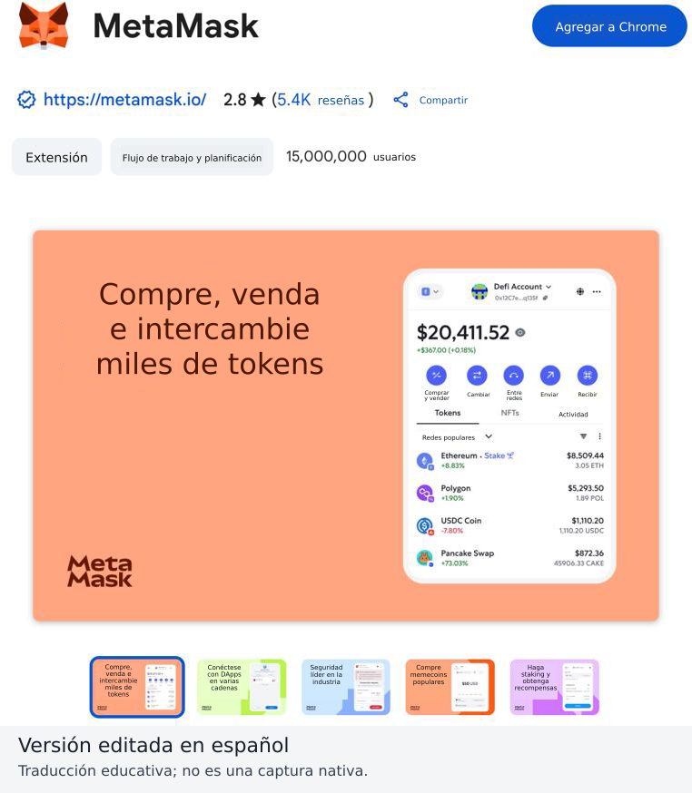

Figura 2-1. Página de detalles de la extensión de MetaMask para Chrome

**Nota de la traducción:** Imagen traducida al español mediante inteligencia artificial (IA). Revisión humana pendiente. No es una captura nativa ni una actualización de la aplicación. La captura original en inglés se conserva en el desplegable.

La ficha permite agregar MetaMask a Chrome y compartirla. Conserva calificación, recuentos de reseñas y usuarios. El panel promocional muestra compra y venta, intercambio, transferencias entre redes, envío y recepción, actividad y redes populares; debajo aparecen cinco anuncios. Los datos financieros son valores de la publicidad histórica, no resultados actuales.

Texto seleccionable de la versión editada:

- Agregar a Chrome
- reseñas
- Compartir
- Extensión
- Flujo de trabajo y planificación
- usuarios
- Compre, venda e intercambie miles de tokens
- Comprar/vender
- Cambiar
- Entre redes
- Enviar
- Recibir
- Actividad
- Redes populares
- Conéctese con DApps en varias cadenas
- Seguridad líder en la industria
- Compre memecoins populares
- Haga staking y obtenga recompensas

- Publicidad histórica, no cotizaciones actuales. Las miniaturas conservan texto de aplicación ilegible; las etiquetas legibles de sus anuncios sí se traducen.
- Las etiquetas dentro de la publicidad son diminutas a escala nativa; se incluye texto seleccionable para lectura.

Algunos textos pequeños, recortados u ocultos por la interfaz original se conservaron sin reconstruirlos; su ubicación y limitaciones se registran en el manifiesto.

<details>
<summary>Figura 2-1: ver captura original en inglés</summary>


> **Nota de la traducción:** "Add to Chrome" agrega la extensión al navegador; "Share" comparte su ficha. La publicidad interna dice "Compre, venda e intercambie miles de tokens". Los valores y reseñas pertenecen a la captura original.

</details>

Es importante comprobar que está descargando la extensión auténtica de MetaMask porque, a veces, algunas personas logran introducir extensiones maliciosas que pasan los filtros de Google. La auténtica cumple lo siguiente:

- Muestra el ID `nkbihfbeogaeaoehlefnkodbefgpgknn` en la barra de direcciones

- La ofrece [*https://metamask.io*](https://metamask.io)

- Tiene más de 5,400 reseñas

- Tiene más de 15 millones de usuarios

Una vez que confirme que está viendo la extensión correcta, haga clic en "Add to Chrome" para instalarla.

### Crear una billetera

Una vez instalado MetaMask, debería ver un icono nuevo (la cabeza de un zorro) en la barra de herramientas del navegador. Haga clic en él para comenzar. Se le pedirá que acepte los términos y condiciones y luego que cree su nueva billetera de Ethereum ingresando una contraseña (consulte la Figura 2-2).

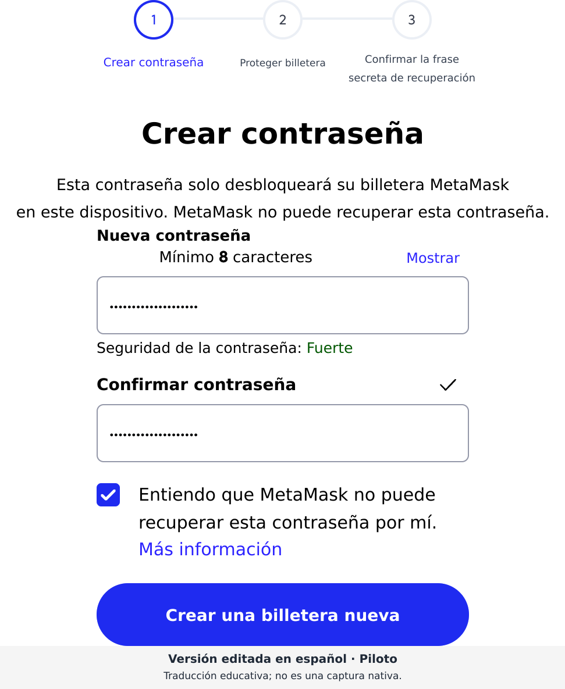

Figura 2-2. Página de contraseña de la extensión de MetaMask para Chrome

**Nota de la traducción:** Imagen traducida al español mediante inteligencia artificial (IA). Revisión humana pendiente. No es una captura nativa ni una actualización de la aplicación. La captura original en inglés se conserva en el desplegable. La versión de la aplicación de la captura original no está documentada; el catálogo `es_419` de MetaMask v13.52.0 se consultó solo como referencia terminológica.

Texto seleccionable de la versión editada:

- Pasos: Crear contraseña; Proteger billetera; Confirmar la frase secreta de recuperación.
- Aviso: Esta contraseña solo desbloqueará su billetera MetaMask en este dispositivo. MetaMask no puede recuperar esta contraseña.
- Campos: Nueva contraseña, mínimo 8 caracteres; Mostrar; Seguridad de la contraseña: Fuerte; Confirmar contraseña.
- Casilla marcada: Entiendo que MetaMask no puede recuperar esta contraseña por mí. Más información.
- Botón: Crear una billetera nueva.

<details>
<summary>Figura 2-2: ver captura original en inglés</summary>


> **Nota de la traducción:** "Create password" crea la contraseña local; "Confirm password" pide repetirla. "Strong" indica contraseña fuerte. La casilla confirma que MetaMask no puede recuperarla; "Create a new wallet" continúa.

</details>

> **Consejo**  
>
> La contraseña controla el acceso a MetaMask para que no pueda usarlo cualquier persona que tenga acceso al navegador. Esta contraseña es solo para su dispositivo local; si un atacante obtiene acceso a la clave privada o la frase semilla, podrá acceder a los fondos de sus direcciones. El atacante no necesita la contraseña si tiene la clave privada o la frase semilla.

Una vez establecida una contraseña, MetaMask generará una billetera y mostrará un *respaldo mnemónico* compuesto por 12 palabras en inglés (consulte la Figura 2-3). Estas palabras pueden usarse en cualquier billetera compatible para recuperar el acceso a sus fondos si le ocurre algo a MetaMask o a su computadora. No necesita la contraseña para esta recuperación; las 12 palabras son suficientes.

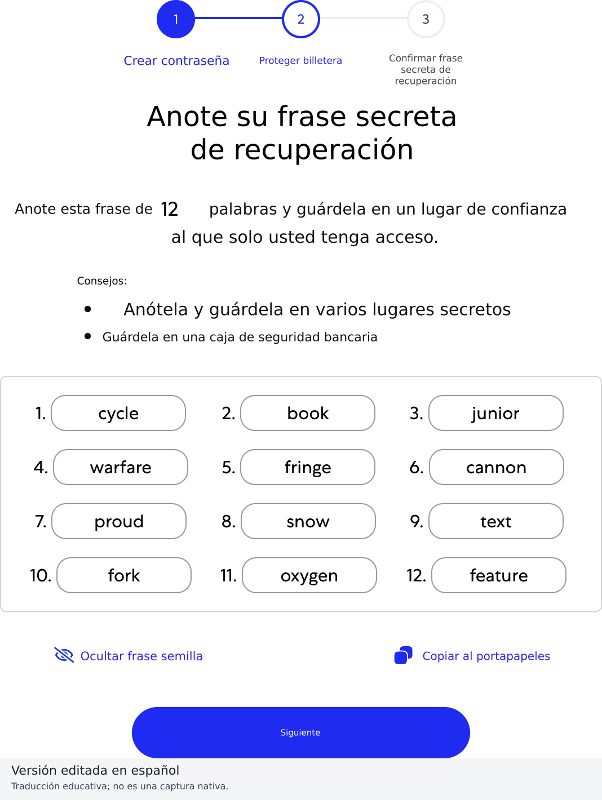

Figura 2-3. Respaldo mnemónico de la billetera creada por MetaMask

**Nota de la traducción:** Imagen traducida al español mediante inteligencia artificial (IA). Revisión humana pendiente. No es una captura nativa ni una actualización de la aplicación. La captura original en inglés se conserva en el desplegable.

El indicador conserva el paso 1 completo, el paso 2 activo y el paso 3 pendiente. La pantalla pide anotar la frase secreta de recuperación de 12 palabras y guardarla donde solo su titular tenga acceso. Recomienda varios lugares secretos o una caja de seguridad bancaria. Permite ocultarla, copiarla al portapapeles o continuar. Las palabras visibles siguen en su orden original y no se transcriben aquí.

Texto seleccionable de la versión editada:

- Crear contraseña
- Proteger billetera
- Confirmar frase secreta de recuperación
- Anote su frase secreta de recuperación
- Anote esta frase de 12 palabras y guárdela en un lugar de confianza al que solo usted tenga acceso.
- Consejos: anótela y guárdela en varios lugares secretos; guárdela en una caja de seguridad bancaria.
- Ocultar frase semilla
- Copiar al portapapeles
- Siguiente

- La frase de recuperación mostrada es pública. Nunca debe usarse para guardar fondos. Sus palabras no se traducen ni se duplican en el texto accesible.

<details>
<summary>Figura 2-3: ver captura original en inglés</summary>


> **Nota de la traducción:** "Write down your Secret Recovery Phrase" pide anotar la frase de recuperación; "Hide seed phrase" la oculta y "Next" continúa. Las doce palabras son datos literales: no se traducen. Esta frase es pública y no debe usarse para guardar fondos.

</details>

> **Consejo**  
>
> Haga dos copias de respaldo en papel de su frase mnemónica (12 palabras). Guarde las dos copias en dos lugares seguros separados, como una caja fuerte resistente al fuego, un cajón con cerradura o una caja de seguridad bancaria. Trate los respaldos en papel como dinero en efectivo de valor equivalente al que guarda en su billetera de Ethereum. Cualquier persona con acceso a estas palabras puede acceder a su dinero y robarlo. En el Capítulo 5 profundizaremos mucho más en cómo mantener segura su frase semilla.

Una vez que confirme que ha guardado la frase mnemónica de forma segura, podrá ver los detalles de su cuenta de Ethereum, como se muestra en la Figura 2-4.

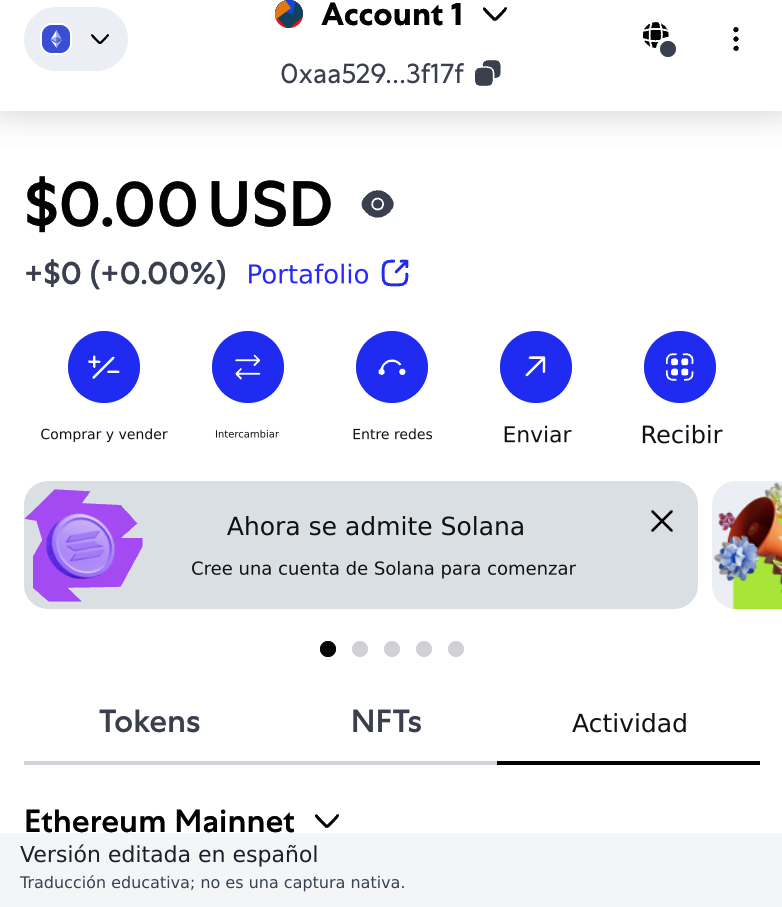

Figura 2-4. Cuenta de Ethereum en MetaMask

**Nota de la traducción:** Imagen traducida al español mediante inteligencia artificial (IA). Revisión humana pendiente. No es una captura nativa ni una actualización de la aplicación. La captura original en inglés se conserva en el desplegable.

La cuenta conserva su nombre, dirección abreviada y saldo $0.00 USD. Portafolio abre otra vista. Las cinco acciones permiten comprar y vender, intercambiar, transferir entre redes, enviar y recibir. Un anuncio ofrece crear una cuenta de Solana. Actividad sigue seleccionada, junto a Tokens y NFTs, en Ethereum Mainnet.

Texto seleccionable de la versión editada:

- Portafolio
- Comprar y vender
- Intercambiar
- Entre redes
- Enviar
- Recibir
- Ahora se admite Solana
- Cree una cuenta de Solana para comenzar
- Actividad

- Account 1 es el nombre de cuenta mostrado y Ethereum Mainnet es el nombre de red; ambos se conservan como identificadores de esta captura.

<details>
<summary>Figura 2-4: ver captura original en inglés</summary>


> **Nota de la traducción:** "Send" envía fondos y "Receive" muestra opciones para recibirlos; "Activity" presenta la actividad. "Ethereum Mainnet" identifica la red principal.

</details>

> **Nota**  
>
> No envíe ningún activo a las direcciones que aparecen en este libro. La frase semilla es pública con fines educativos y probablemente se perderá todo activo enviado a estas direcciones.

La página de su cuenta muestra el nombre de la cuenta ("Account 1" de forma predeterminada), una dirección de Ethereum (`0xaa529…f17f` en el ejemplo) y un icono de colores que ayuda a distinguir visualmente esta cuenta de otras. En la parte superior de la página de la cuenta, puede ver en qué red de Ethereum está trabajando ("Main Network" en el ejemplo).

¡Felicitaciones! Ha configurado su primera billetera de Ethereum.

### Cambiar de red

Como puede verse en la página de cuenta de MetaMask, es posible elegir entre varias redes de Ethereum. De forma predeterminada, MetaMask intentará conectarse a la red principal. Las otras opciones son redes de prueba públicas, cualquier nodo de Ethereum que elija o nodos que ejecutan blockchains privadas en su propia computadora (localhost):

**Main Ethereum Network**

La blockchain pública principal de Ethereum. ETH real, valor real y consecuencias reales.

**Sepolia Test Network**

Lanzada en octubre de 2021 como una red de prueba de autoridad por los desarrolladores principales de Ethereum, Sepolia pasó después al consenso PoS, reflejando el entorno de la red principal de Ethereum.

**Holesky Test Network**

La red de prueba Holesky es el entorno de pruebas avanzado de Ethereum para staking, infraestructura y desarrollo del protocolo.

**Localhost 8545**

Conecta con un nodo que se ejecuta en la misma computadora que el navegador. El nodo puede formar parte de cualquier blockchain pública (principal o de prueba) o de una red de prueba privada.

**Custom RPC**

Permite conectar MetaMask con cualquier nodo que tenga una interfaz de llamada a procedimiento remoto (RPC) compatible con Geth. El nodo puede formar parte de cualquier blockchain pública o privada.

> **Nota**  
>
> Su billetera MetaMask utiliza la misma clave privada y dirección de Ethereum en todas las redes a las que se conecta. Sin embargo, el saldo de su dirección de Ethereum será distinto en cada red de Ethereum. Por ejemplo, si usa sus claves para enviar ether en la red de prueba Sepolia, sus saldos en otras redes no se verán afectados.

### Obtener ether de prueba

La primera tarea es agregar fondos a su billetera. No lo hará en la red principal porque el ether real cuesta dinero y manejarlo requiere algo más de experiencia. Por ahora, cargará su billetera con algo de ether de una red de prueba.

Cambie MetaMask a Sepolia Test Network haciendo clic en el icono de Ethereum en la parte superior izquierda; active la opción "Show test networks" y haga clic en Sepolia, como se muestra en la Figura 2-5.

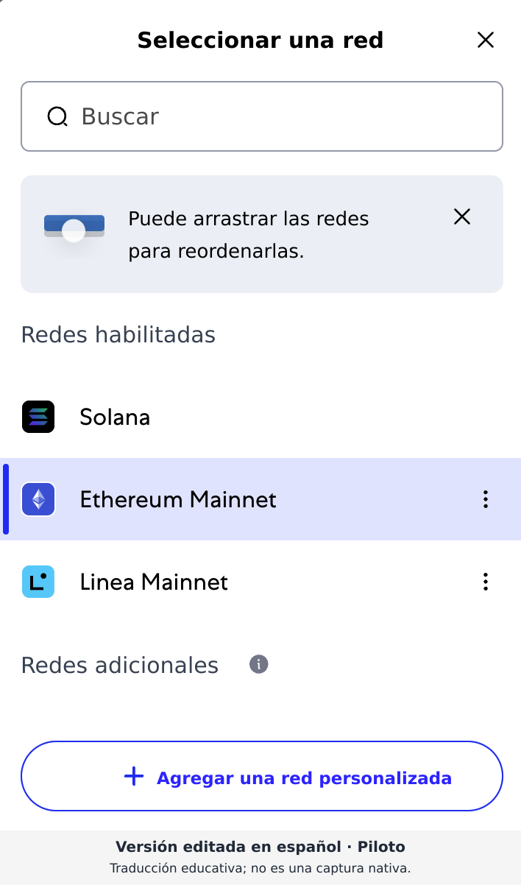

Figura 2-5. Redes de MetaMask

**Nota de la traducción:** Imagen traducida al español mediante inteligencia artificial (IA). Revisión humana pendiente. No es una captura nativa ni una actualización de la aplicación. La captura original en inglés se conserva en el desplegable. La versión de la aplicación de la captura original no está documentada; el catálogo `es_419` de MetaMask v13.52.0 se consultó solo como referencia terminológica. Ethereum Mainnet sigue seleccionada. Esta imagen no muestra Sepolia ni los controles para habilitar redes de prueba.

Texto seleccionable de la versión editada:

- Título y búsqueda: Seleccionar una red; Buscar.
- Consejo: Puede arrastrar las redes para reordenarlas.
- Secciones: Redes habilitadas; Redes adicionales.
- Redes conservadas, en su orden original: Solana; Ethereum Mainnet, seleccionada; Linea Mainnet.
- Botón: Agregar una red personalizada.

<details>
<summary>Figura 2-5: ver captura original en inglés</summary>


> **Nota de la traducción:** "Select a network" significa «Seleccionar una red» y es el título de esta ventana; "Search" busca y "Add a custom network" agrega una red personalizada. La captura muestra Ethereum Mainnet seleccionada, no Sepolia.

</details>

Haga clic en Buy y luego vaya a uno de los faucets de [esta lista](https://oreil.ly/VE0t0). Una vez que decida qué faucet quiere usar (todos son prácticamente equivalentes), puede solicitar ether en la red de prueba, como se muestra en la Figura 2-6.

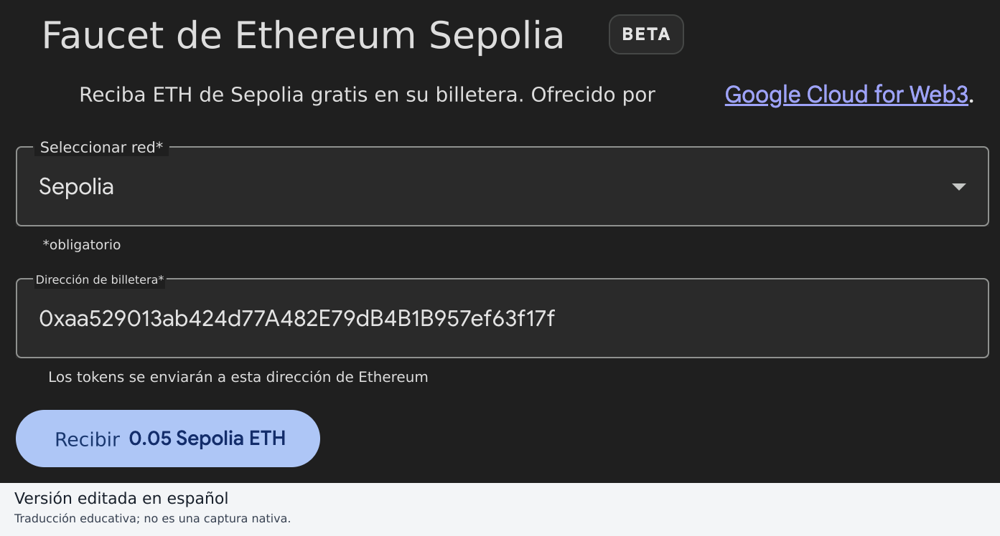

Figura 2-6. Faucet de prueba de Sepolia en MetaMask

**Nota de la traducción:** Imagen traducida al español mediante inteligencia artificial (IA). Revisión humana pendiente. No es una captura nativa ni una actualización de la aplicación. La captura original en inglés se conserva en el desplegable.

El formulario oscuro conserva BETA, la red Sepolia y la dirección de Ethereum ingresada. Seleccionar red y Dirección de billetera son campos obligatorios; el texto explica el destino de los tokens. Recibir conserva a su lado el importe literal 0.05 Sepolia ETH. La atribución enlazada a Google Cloud for Web3 permanece intacta.

Texto seleccionable de la versión editada:

- Faucet de Ethereum Sepolia
- Reciba ETH de Sepolia gratis en su billetera. Ofrecido por
- Seleccionar red*
- *obligatorio
- Dirección de billetera*
- Los tokens se enviarán a esta dirección de Ethereum
- Recibir

- La leyenda del capítulo atribuye el faucet a MetaMask, pero la captura muestra una página de Google Cloud for Web3. Se conserva la captura y se registra la discrepancia, sin actualizar el texto fuente.
- Los ETH de Sepolia mostrados son de prueba. No se solicitó ni ejecutó ninguna operación.

<details>
<summary>Figura 2-6: ver captura original en inglés</summary>


> **Nota de la traducción:** "Wallet address" solicita la dirección receptora; "Receive 0.05 Sepolia ETH" pide 0.05 ETH de prueba en Sepolia.

</details>

El ID de transacción de la solicitud de ether de prueba se ve así:

    0x471273d9417e98e7f1adaae61e53a353b2d2313de2e71fc4b6184bf5a63fa0ae

En unos segundos, la red Sepolia procesará la nueva transacción y su billetera MetaMask mostrará un saldo de 0.05 ETH (esto depende de cuánto ether esté dispuesto a enviar el faucet). Ahora, haga clic en la primera transacción de la extensión del navegador y luego en "View on block explorer", como se muestra en la Figura 2-7. Esto abrirá un *explorador de bloques*, un sitio web que permite visualizar y explorar bloques, direcciones y transacciones.

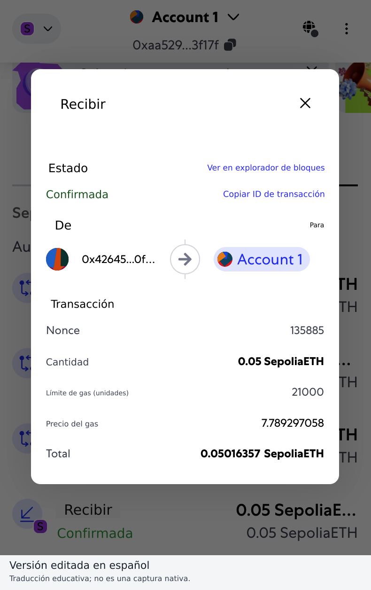

Figura 2-7. Transacción vista desde MetaMask

**Nota de la traducción:** Imagen traducida al español mediante inteligencia artificial (IA). Revisión humana pendiente. No es una captura nativa ni una actualización de la aplicación. La captura original en inglés se conserva en el desplegable.

El diálogo muestra una recepción Confirmada en verde, desde una dirección abreviada hacia Account 1. Ofrece ver el explorador de bloques y copiar el ID de transacción. La sección Transacción conserva nonce 135885, cantidad 0.05 SepoliaETH, límite de gas 21000, precio del gas 7.789297058 y total 0.05016357 SepoliaETH. El fondo permanece atenuado; la recepción inferior también indica Confirmada.

Texto seleccionable de la versión editada:

- Recibir
- Estado
- Confirmada
- Ver en explorador de bloques
- Copiar ID de transacción
- De
- Para
- Transacción
- Cantidad
- Límite de gas (unidades)
- Precio del gas

- Nonce se conserva por convención terminológica; Total coincide en español. Account 1 es nombre de cuenta, no etiqueta genérica.
- El fondo contiene texto oculto parcialmente por el diálogo; no se reconstruye el contenido tapado.

Algunos textos pequeños, recortados u ocultos por la interfaz original se conservaron sin reconstruirlos; su ubicación y limitaciones se registran en el manifiesto.

<details>
<summary>Figura 2-7: ver captura original en inglés</summary>


> **Nota de la traducción:** "Confirmed" indica confirmación; "View on block explorer" abre el explorador. "Amount" es la cantidad recibida, mientras "Total" incluye gas.

</details>

MetaMask utiliza el [explorador de bloques Etherscan](https://etherscan.io), uno de los exploradores de bloques de Ethereum más populares. La transacción que contiene el pago del faucet de prueba de Sepolia se muestra en la Figura 2-8.

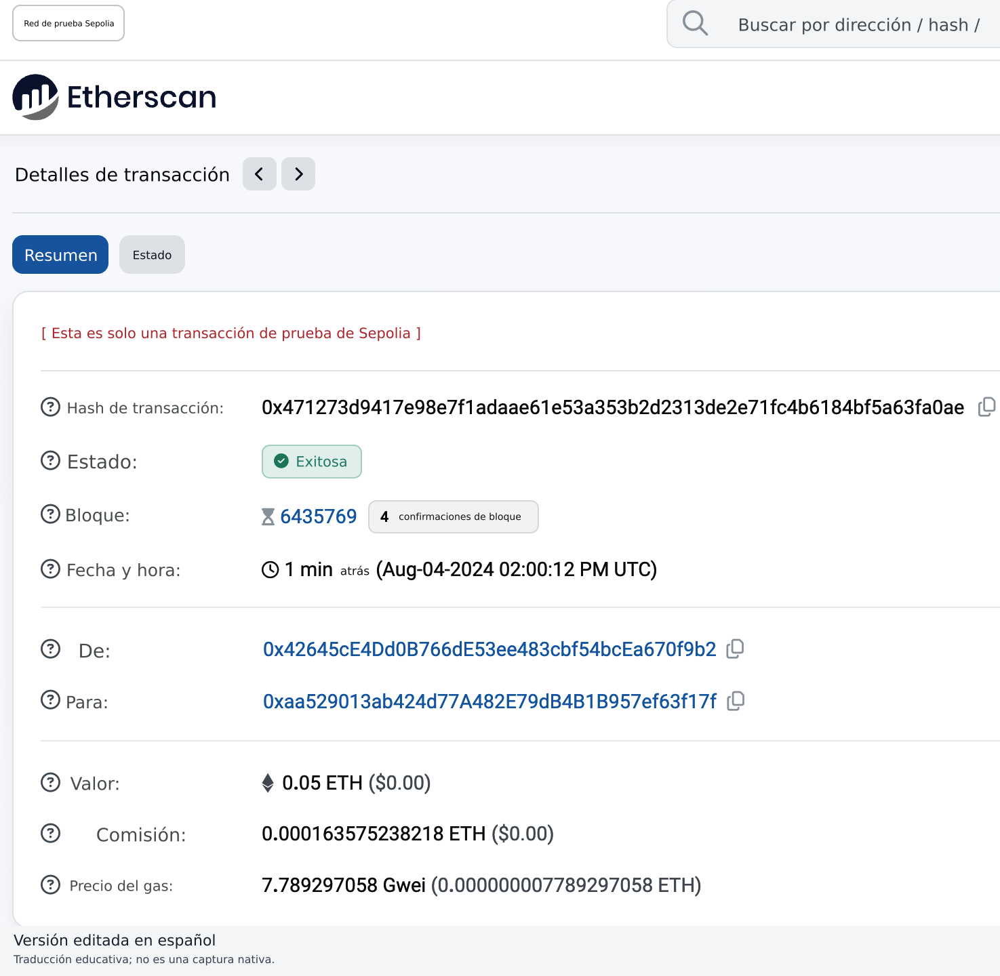

Figura 2-8. Explorador de bloques Etherscan para Sepolia

**Nota de la traducción:** Imagen traducida al español mediante inteligencia artificial (IA). Revisión humana pendiente. No es una captura nativa ni una actualización de la aplicación. La captura original en inglés se conserva en el desplegable.

Resumen sigue seleccionado frente a Estado. Un aviso rojo limita la operación a la red de prueba Sepolia. La ejecución es Exitosa en verde. Se conservan hash completo, bloque 6435769, 4 confirmaciones, intervalo 1 min y fecha literal Aug-04-2024 02:00:12 PM UTC. Las filas relacionan origen, destino, valor, comisión y precio del gas sin alterar sus cifras.

Texto seleccionable de la versión editada:

- Red de prueba Sepolia
- Buscar por dirección / hash /
- Detalles de transacción
- Resumen
- Estado
- [ Esta es solo una transacción de prueba de Sepolia ]
- Hash de transacción:
- Estado:
- Exitosa
- Bloque:
- confirmaciones de bloque
- Fecha y hora:
- atrás
- De:
- Para:
- Valor:
- Comisión:
- Precio del gas:

- La fecha, el intervalo 1 min, el recuento 4 y los datos de transacción son literales históricos. Solo ago se traduce como atrás. No representan estado actual de la red.

<details>
<summary>Figura 2-8: ver captura original en inglés</summary>


> **Nota de la traducción:** "Success" indica ejecución exitosa; "Value" es el ether transferido y "Transaction Fee" la comisión. El aviso rojo aclara que es una transacción de prueba en Sepolia.

</details>

La transacción se ha registrado en la blockchain Sepolia y cualquier persona puede verla en cualquier momento buscando su ID de transacción. Pruebe ingresar el hash de la transacción en el [sitio web *sepolia.etherscan.io*](http://sepolia.etherscan.io) para verlo:

    0x471273d9417e98e7f1adaae61e53a353b2d2313de2e71fc4b6184bf5a63fa0ae

### Enviar ether desde MetaMask

Una vez que haya recibido su primer ether de prueba del faucet de prueba de Sepolia, puede experimentar con el envío de ether intentando devolver una parte al faucet o enviarla a cualquier otra dirección. En este ejemplo, intentaremos enviar algo de ether de prueba a Vitalik Buterin, como se muestra en la Figura 2-9.

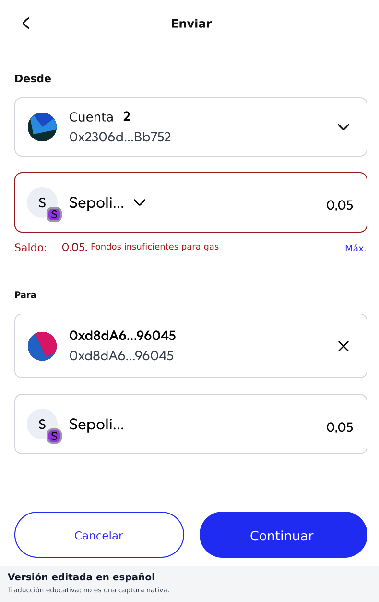

Figura 2-9. Envío de 0.05 ether a una dirección

**Nota de la traducción:** Imagen traducida al español mediante inteligencia artificial (IA). Revisión humana pendiente. No es una captura nativa ni una actualización de la aplicación. La captura original en inglés se conserva en el desplegable.

MetaMask muestra origen y destino, el importe 0.05 y un aviso rojo de saldo insuficiente. Cancelar y Continuar conservan sus estilos originales.

Texto seleccionable de la versión editada:

- Enviar
- Desde
- Cuenta
- Saldo:
- Fondos insuficientes para gas
- Máx.
- Para
- Cancelar
- Continuar

- La captura usa separadores distintos en el importe y el saldo: 0,05 y 0.05. Se conservan ambos.

<details>
<summary>Figura 2-9: ver captura original en inglés</summary>


> **Nota de la traducción:** "Insufficient funds for gas" advierte que el saldo no cubre el envío más gas. "Cancel" cancela y "Continue" continúa.

</details>

¡Ups! Probablemente notó que no puede completar la transacción; MetaMask indica que el saldo es insuficiente. A primera vista, esto puede parecer confuso: tiene 0.05 ETH y quiere enviar 0.05 ETH, así que ¿por qué MetaMask indica que no tiene fondos suficientes?

La respuesta es el costo del gas. Toda transacción de Ethereum requiere el pago de una comisión, que la red cobra para validar la transacción. Las comisiones de Ethereum se cobran en una moneda virtual llamada *gas*. El gas se paga con ether como parte de la transacción.

> **Nota**  
>
> Las redes de prueba también requieren comisiones. Sin comisiones, una red de prueba se comportaría de manera distinta a la red principal, lo que la convertiría en una plataforma de pruebas inadecuada. Las comisiones también protegen las redes de prueba de ataques DoS y contratos mal construidos (por ejemplo, bucles infinitos), de la misma manera que protegen la red principal.

Al enviar la transacción, MetaMask calculará el precio promedio del gas de las transacciones recientes exitosas, por ejemplo, 3 gwei, que significa gigawei. Wei es la subdivisión más pequeña de la moneda ether, como vimos en "Unidades monetarias de ether". El límite de gas se establece en el costo de enviar una transacción básica: 21,000 unidades de gas, que es la cantidad mínima de gas que puede usarse para enviar una transacción. Por lo tanto, la cantidad máxima de ETH que gastará es 3 × 21,000 gwei = 63,000 gwei = 0.000063 ETH. (Tenga en cuenta que los precios promedio del gas pueden fluctuar. En un capítulo posterior veremos cómo aumentar o disminuir el límite de gas para que su transacción tenga prioridad si es necesario).

Todo esto significa que realizar una transacción de 0.05 ETH cuesta 0.050063 ETH. Haga clic en Reject para cancelar esta transacción. Intentémoslo de nuevo, esta vez enviando 0.01 ETH.

### Explorar el historial de transacciones de una dirección

A estas alturas, ya domina el uso de MetaMask para enviar y recibir ether de prueba. Su billetera ha recibido y enviado pagos. Puede ver todas estas transacciones utilizando el [explorador de bloques *sepolia.etherscan.io*](http://sepolia.etherscan.io). Puede copiar la dirección de su billetera y pegarla en el cuadro de búsqueda del explorador de bloques o dejar que MetaMask abra la página. Junto al icono de su cuenta en MetaMask, verá un botón con tres puntos. Haga clic en él para mostrar un menú de opciones relacionadas con la cuenta (consulte la Figura 2-10).

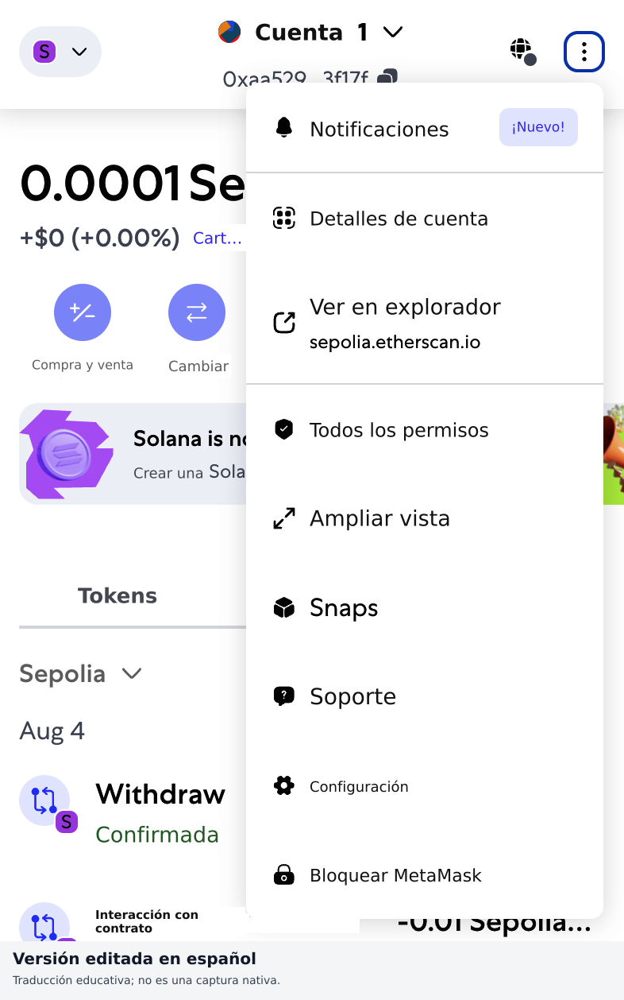

Figura 2-10. Menú contextual de cuenta de MetaMask

**Nota de la traducción:** Imagen traducida al español mediante inteligencia artificial (IA). Revisión humana pendiente. No es una captura nativa ni una actualización de la aplicación. La captura original en inglés se conserva en el desplegable.

El menú ofrece notificaciones, detalles, explorador, permisos, vista ampliada, Snaps, soporte, configuración y bloqueo. Detrás se ven acciones, actividad y una confirmación verde.

Texto seleccionable de la versión editada:

- Cuenta
- Cart…
- Compra y venta
- Cambiar
- Crear una
- Tokens
- Confirmada
- Interacción con contrato
- Notificaciones
- ¡Nuevo!
- Detalles de cuenta
- Ver en explorador
- Todos los permisos
- Ampliar vista
- Soporte
- Configuración
- Bloquear MetaMask

- El menú oculta partes de la página. No se reconstruye texto oculto ni el importe cortado.
- Withdraw es nombre del método y permanece literal; Aug 4 conserva la fecha original.

Algunos textos pequeños, recortados u ocultos por la interfaz original se conservaron sin reconstruirlos; su ubicación y limitaciones se registran en el manifiesto.

<details>
<summary>Figura 2-10: ver captura original en inglés</summary>


> **Nota de la traducción:** "View on explorer" abre sepolia.etherscan.io; "Settings" abre la configuración y "Lock MetaMask" bloquea la billetera.

</details>

> **Consejo**  
>
> La configuración predeterminada de MetaMask no está muy orientada a la privacidad. Se recomienda analizar cuidadosamente los ajustes de Settings → Security and Privacy. Una vez que se familiarice con el funcionamiento de MetaMask, también se recomienda cambiar la conexión predeterminada a la red principal de Ethereum por otra que use una RPC con ajustes de privacidad adecuados para sus necesidades. La solución más privada sería tener su propio nodo con una RPC a la que pueda conectarse; veremos cómo hacerlo en el Capítulo 3.

Seleccione "View account on Etherscan" para abrir una página web en el explorador de bloques que muestre el historial de transacciones de su cuenta, como se muestra en la Figura 2-11.

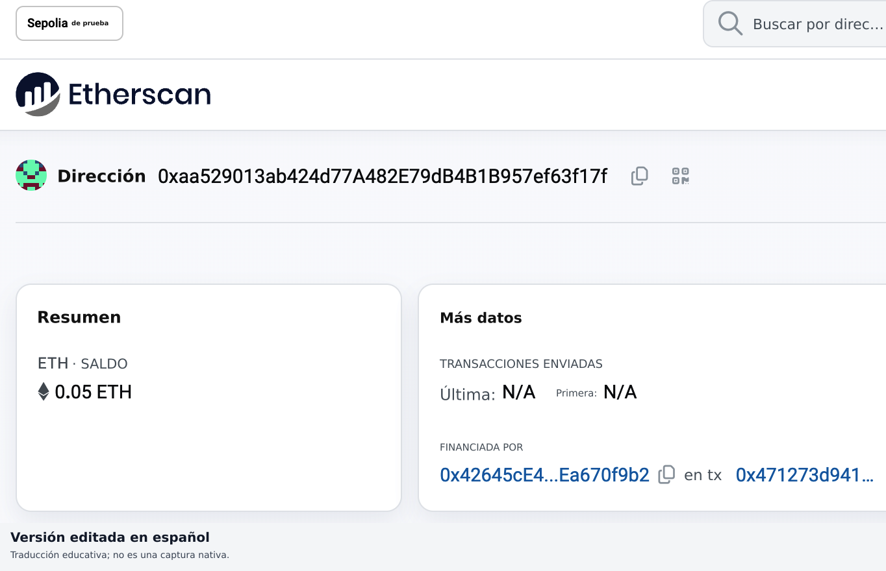

Figura 2-11. Historial de transacciones de una dirección en Etherscan

**Nota de la traducción:** Imagen traducida al español mediante inteligencia artificial (IA). Revisión humana pendiente. No es una captura nativa ni una actualización de la aplicación. La captura original en inglés se conserva en el desplegable.

La vista muestra dirección, saldo de 0.05 ETH y datos de financiación. Los campos de último y primer envío muestran N/A.

Texto seleccionable de la versión editada:

- de prueba
- Buscar por direc…
- Dirección
- Resumen
- Saldo en ETH
- Más datos
- TRANSACCIONES ENVIADAS
- Última:
- Primera:
- FINANCIADA POR
- en tx

- El capítulo presenta la figura como historial; la captura solo muestra resumen y N/A en transacciones enviadas.
- Campo de búsqueda cortado por el borde derecho; no se reconstruye el resto del marcador de posición.

<details>
<summary>Figura 2-11: ver captura original en inglés</summary>


> **Nota de la traducción:** "ETH BALANCE" muestra el saldo; "TRANSACTIONS SENT" resume los envíos y "FUNDED BY" identifica quién financió la cuenta.

</details>

Aquí puede ver todo el historial de transacciones de su dirección de Ethereum. Muestra todas las transacciones registradas en la blockchain Sepolia en las que su dirección es remitente o destinataria. Haga clic en algunas de estas transacciones para ver más detalles.

> **Advertencia**  
>
> Tenga cuidado: existe un ataque conocido, llamado *envenenamiento de direcciones*, que puede mostrar transacciones con direcciones falsificadas en el explorador de bloques. El explorador de bloques debe usarse para una comprobación rápida, pero la información que muestra podría no ser exacta.

Puede explorar el historial de transacciones de cualquier dirección. Observe el historial de transacciones de la dirección del faucet de prueba de Sepolia (pista: es la dirección "sender" que aparece en el pago más antiguo a su dirección). Puede ver todo el ether de prueba enviado desde el faucet a usted y a otras direcciones. Cada transacción que vea puede llevarle a más direcciones y más transacciones. En poco tiempo, se perderá en el laberinto de datos interconectados. Las blockchains públicas contienen una enorme cantidad de información, que puede explorarse íntegramente de forma programática, como veremos en ejemplos posteriores.

## Introducción a la computadora mundial

Ya ha creado una billetera y ha enviado y recibido ether. Hasta ahora, hemos tratado Ethereum como una criptomoneda. Pero Ethereum es mucho, mucho más. De hecho, la función de criptomoneda está subordinada a la función de Ethereum como computadora mundial descentralizada. El ether está pensado para pagar la ejecución de *contratos inteligentes* (smart contracts), que son programas informáticos que se ejecutan en una computadora emulada llamada *EVM*.

La EVM es un singleton global, lo que significa que funciona como si fuera una computadora global de instancia única, que se ejecuta en todas partes. Cada nodo de la red Ethereum ejecuta una copia local de la EVM para validar la ejecución de contratos, mientras que la blockchain Ethereum registra el *estado* cambiante de esta computadora mundial a medida que procesa transacciones y contratos inteligentes. Trataremos esto con mucho más detalle en el Capítulo 14.

## Cuentas de propiedad externa y contratos

El tipo de cuenta que creó en la billetera MetaMask se llama *cuenta de propiedad externa* (EOA). Las EOA son aquellas que tienen una clave privada; tener la clave privada significa controlar el acceso a los fondos o contratos.

Probablemente imagina que existe otro tipo de cuenta. Ese otro tipo de cuenta es una *cuenta de contrato*. Una cuenta de contrato tiene código de contrato inteligente, algo que una EOA simple no puede tener. Además, una cuenta de contrato no tiene clave privada. En cambio, su propiedad y control corresponden a la lógica de su código de contrato inteligente: el programa de software registrado en la blockchain Ethereum al crear la cuenta de contrato y ejecutado por la EVM.

Los contratos tienen direcciones, al igual que las EOA. Los contratos también pueden enviar y recibir ether, al igual que las EOA. Sin embargo, cuando el destino de una transacción es una dirección de contrato, esto hace que ese contrato se *ejecute* en la EVM, usando la transacción y sus datos como entrada. Además de ether, las transacciones pueden contener *datos* que indican qué función específica del contrato debe ejecutarse y qué parámetros deben pasarse a esa función. De esta manera, las transacciones pueden *llamar* a funciones dentro de los contratos.

Observe que, como una cuenta de contrato no tiene clave privada, no puede *iniciar* una transacción. Solo las EOA pueden iniciar transacciones, pero los contratos pueden *reaccionar* a las transacciones llamando a otros contratos y construyendo rutas de ejecución complejas.

En las próximas secciones, escribiremos nuestro primer contrato. Luego aprenderá a crear, financiar y usar ese contrato con su billetera MetaMask y ether de prueba en la red de prueba Sepolia.

## Un contrato sencillo: un faucet de ether de prueba

Ethereum tiene varios lenguajes de alto nivel, todos los cuales pueden usarse para escribir un contrato y producir bytecode de la EVM. Puede leer sobre los más destacados e interesantes en el Capítulo 7. Un lenguaje de alto nivel es, por mucho, la opción dominante para programar contratos inteligentes: Solidity. Solidity fue creado por Gavin Wood y se ha convertido en el lenguaje más utilizado en Ethereum (y más allá). Usaremos Solidity para escribir nuestro primer contrato.

Para nuestro primer ejemplo (Ejemplo 2-1), escribiremos un contrato que controla un faucet. Ya ha usado un faucet para obtener ether de prueba en la red de prueba Sepolia. Un *faucet* es algo relativamente sencillo: entrega ether a cualquier dirección que lo solicite y puede recargarse.

##### Ejemplo 2-1. *Faucet.sol*: un contrato de Solidity que implementa un faucet

```solidity
pragma solidity 0.8.26;
// SPDX-License-Identifier: GPL-3.0

// ¡Nuestro primer contrato es un faucet!
contract Faucet {

    // Entregar ether a cualquiera que lo solicite
    function withdraw(uint256 _withdrawAmount, address payable _to) public {

        // Limitar la cantidad del retiro
        require(_withdrawAmount <= 1000000000000);

        // Enviar la cantidad a la dirección que la solicitó
        _to.transfer(_withdrawAmount);
    }

    // Función para recibir Ether. msg.data debe estar vacío
    receive() external payable {}

    // La función fallback se llama cuando msg.data no está vacío
    fallback() external payable {}
}
```

Este es un contrato muy sencillo, casi tan sencillo como podemos hacerlo. También es un contrato *defectuoso*, que demuestra varias malas prácticas y vulnerabilidades de seguridad. Aprenderemos examinando muchas de sus fallas en secciones posteriores. Pero, por ahora, veamos qué hace este contrato y cómo funciona, línea por línea. Pronto notará que muchos elementos de Solidity son similares a los de lenguajes de programación existentes, como JavaScript, Java o C++.

La primera línea es la instrucción `pragma`:

    pragma solidity 0.8.26;

Al incluir esta línea al principio de un archivo fuente de Solidity, se garantiza que el código se compile con la versión 0.8.26 del compilador de Solidity, lo que asegura la compatibilidad y evita posibles problemas que podrían surgir al usar una versión distinta del compilador.

A continuación hay un comentario que indica que el contrato inteligente tiene la licencia GPL-3.0:

    // SPDX-License-Identifier: GPL-3.0

Esto es importante por razones legales y de cumplimiento, porque informa a los usuarios y desarrolladores sobre sus derechos y obligaciones respecto al uso y la distribución del código.

Los comentarios son para que los lean las personas y no se incluyen en el bytecode ejecutable de la EVM. Normalmente los ponemos en la línea anterior al código que intentamos explicar, o a veces en la misma línea. Los comentarios comienzan con dos barras diagonales: `//`. Todo lo que va desde la primera barra hasta el final de esa línea se trata igual que una línea en blanco y se ignora.

Esto también es un comentario:

    // ¡Nuestro primer contrato es un faucet!

La siguiente línea es donde realmente comienza nuestro contrato:

    contract Faucet {

Esta línea declara un objeto `contract`, de forma similar a una declaración `class` en otros lenguajes orientados a objetos. La definición del contrato incluye todas las líneas entre las llaves (`{}`), que definen un *ámbito*, de manera muy similar al uso de llaves en muchos otros lenguajes de programación.

A continuación, declaramos la primera función del contrato `Faucet`:

    function withdraw(uint256 _withdrawAmount, address payable _to) public {

La función se llama `withdraw` y recibe un entero sin signo (`uint256`) llamado `_withdrawAmount` y un `address payable` llamado `_to`. Se declara como función pública, lo que significa que otros contratos pueden llamarla. La definición de la función aparece a continuación, entre llaves. La primera parte de la función `withdraw` establece un límite para los retiros:

    require(_withdrawAmount <= 1000000000000);

Utiliza la función integrada `require` de Solidity para comprobar una precondición: que `_withdrawAmount` sea menor o igual que 1,000,000,000,000 wei, que es la unidad base del ether (consulte la Tabla 2-1) y equivale a 0.000001 ether. Si se llama a la función `withdraw` con un `withdraw_amount` mayor que esa cantidad, la función `require` hará que la ejecución del contrato se detenga y falle con una *excepción*. Observe que las instrucciones de Solidity deben terminar con un punto y coma.

Esta parte del contrato es la lógica principal de nuestro faucet. Controla la salida de fondos del contrato al imponer un límite a los retiros. Es un control muy sencillo, pero permite vislumbrar el poder de una blockchain programable: software descentralizado que controla dinero.

Aquí tenemos la primera falla de diseño del contrato. No es una falla de seguridad, pero sería mejor agregar siempre un mensaje de error a la instrucción `require`. De esta manera, cuando la transacción de un usuario falla debido a una instrucción `require`, la razón queda clara.

La instrucción `require` corregida es:

    require(_withdrawAmount <= 1000000000000, "The requested amount is too much, try a smaller amount!");

A continuación viene el retiro en sí:

    _to.transfer(_withdrawAmount);

Aquí ocurren un par de cosas interesantes. La función `transfer` es una función integrada que transfiere ether del contrato actual a otra dirección especificada, en este caso, la dirección `_to`. La función `transfer` recibe una cantidad como único argumento. Le pasamos el valor `_withdrawAmount`, que era el parámetro de la función `withdraw` declarada unas líneas antes.

Esto es posible porque la dirección `_to` se definió como payable. Las funciones integradas `transfer` y `send` solo pueden llamarse sobre direcciones payable. Aquí está la segunda falla del código: aunque `transfer` funciona perfectamente si una EOA llama a la función `withdraw`, se vuelve problemática si otro contrato activa esta función. En ese caso, la transacción podría fallar porque la función `transfer` solo puede utilizar hasta 2,300 unidades de gas, y es probable que varias llamadas a contratos superen este límite. Para resolver este problema, puede usar la función integrada `call` en lugar de `transfer` y `send`. Sin embargo, esta función integrada debe manejarse correctamente para evitar fallas de seguridad. Por ahora, dejaremos la función integrada `transfer` tal como está.

La línea siguiente es la llave de cierre, que indica el final de la definición de nuestra función `withdraw`.

A continuación, declaramos dos funciones más:

    receive() external payable {}
    fallback() external payable {}

Estas son las funciones `fallback` y `receive`, que se llaman si la transacción que activó el contrato no nombró ninguna de las funciones declaradas en el contrato, no nombró ninguna función en absoluto o no contenía datos. Los contratos pueden tener estas funciones y suelen ser los que reciben ether. Cuando *msg.data* está vacío, se activará la función `receive`; cuando *msg.data* no está vacío, se activará la función `fallback`.

Justo debajo de nuestra función `fallback` está la última llave de cierre, que cierra la definición del contrato `Faucet`. ¡Eso es todo!

## Compilar el contrato Faucet

Ahora que tenemos nuestro primer contrato de ejemplo, debemos usar un compilador de Solidity para convertir el código Solidity en bytecode de la EVM, de modo que la EVM pueda ejecutarlo en la propia blockchain.

El compilador de Solidity está disponible como ejecutable independiente, como parte de varios frameworks y como componente incluido en entornos de desarrollo integrados (IDE). Para simplificar, usaremos uno de los IDE más populares: Remix.

Use su navegador Chrome (con la billetera MetaMask que instaló antes) para ir al [IDE Remix](https://remix.ethereum.org).

Cuando cargue Remix por primera vez, se abrirá con un contrato de ejemplo llamado *Storage.sol*. No lo necesitamos, así que ciérrelo haciendo clic en la `x` de la esquina de la pestaña, como se ve en la Figura 2-12.

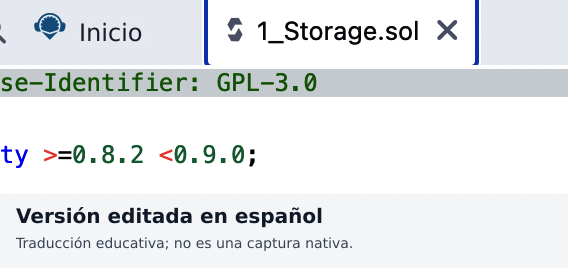

Figura 2-12. Cierre de la pestaña del ejemplo predeterminado

**Nota de la traducción:** Imagen traducida al español mediante inteligencia artificial (IA). Revisión humana pendiente. No es una captura nativa ni una actualización de la aplicación. La captura original en inglés se conserva en el desplegable.

Inicio aparece junto a la pestaña 1_Storage.sol y su botón de cierre. El fragmento de código inferior permanece literal.

Texto seleccionable de la versión editada:

- Inicio

<details>
<summary>Figura 2-12: ver captura original en inglés</summary>


> **Nota de la traducción:** La pestaña "1_Storage.sol" contiene el ejemplo predeterminado; la x a su derecha lo cierra. "Home" vuelve al inicio.

</details>

Ahora, cree un archivo nuevo, como se muestra en la Figura 2-13. Llame al archivo nuevo *Faucet.sol*.

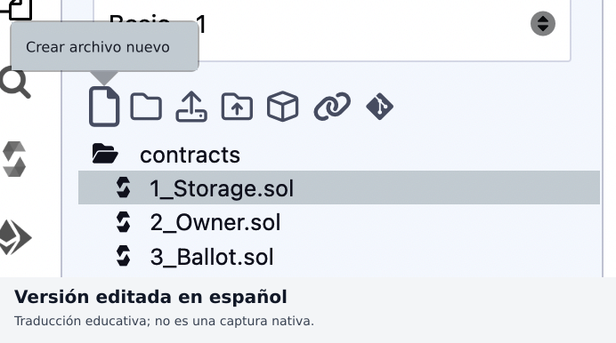

Figura 2-13. Creación de un contrato nuevo

**Nota de la traducción:** Imagen traducida al español mediante inteligencia artificial (IA). Revisión humana pendiente. No es una captura nativa ni una actualización de la aplicación. La captura original en inglés se conserva en el desplegable.

Un mensaje sobre el icono de archivo indica Crear archivo nuevo. El explorador conserva contratos y nombres de archivos de ejemplo literales.

Texto seleccionable de la versión editada:

- Crear archivo nuevo

<details>
<summary>Figura 2-13: ver captura original en inglés</summary>


> **Nota de la traducción:** "Create new file" crea un archivo nuevo. Los nombres de carpeta y archivos del explorador se conservan como rutas literales.

</details>

Una vez abierta la pestaña nueva, copie y pegue el código de nuestro ejemplo *Faucet.sol*, como se muestra en la Figura 2-14.

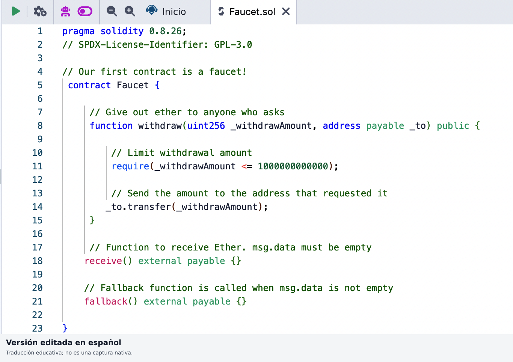

Figura 2-14. Copia del código de ejemplo Faucet en el contrato nuevo

**Nota de la traducción:** Imagen traducida al español mediante inteligencia artificial (IA). Revisión humana pendiente. No es una captura nativa ni una actualización de la aplicación. La captura original en inglés se conserva en el desplegable.

El editor conserva íntegros código, comentarios, números de línea, licencia y formato de Faucet.sol. Solo cambia Home por Inicio.

Texto seleccionable de la versión editada:

- Inicio

- El ejemplo de código se conserva en inglés, incluidos sus comentarios; la traducción del ejemplo está en el capítulo.

<details>
<summary>Figura 2-14: ver captura original en inglés</summary>


> **Nota de la traducción:** La captura conserva el código y sus comentarios en inglés. Estos explican que el faucet entrega ether a quien lo solicita, limita cada retiro y envía la cantidad a la dirección indicada. receive recibe llamadas sin msg.data y fallback atiende llamadas con msg.data. El ejemplo traducido figura en el texto del capítulo.

</details>

Una vez cargado el contrato *Faucet.sol* en el IDE Remix, vaya a la sección de compilación de Remix y haga clic en Compile *Faucet.sol*. Si todo sale bien, verá un recuadro verde (consulte la Figura 2-15).

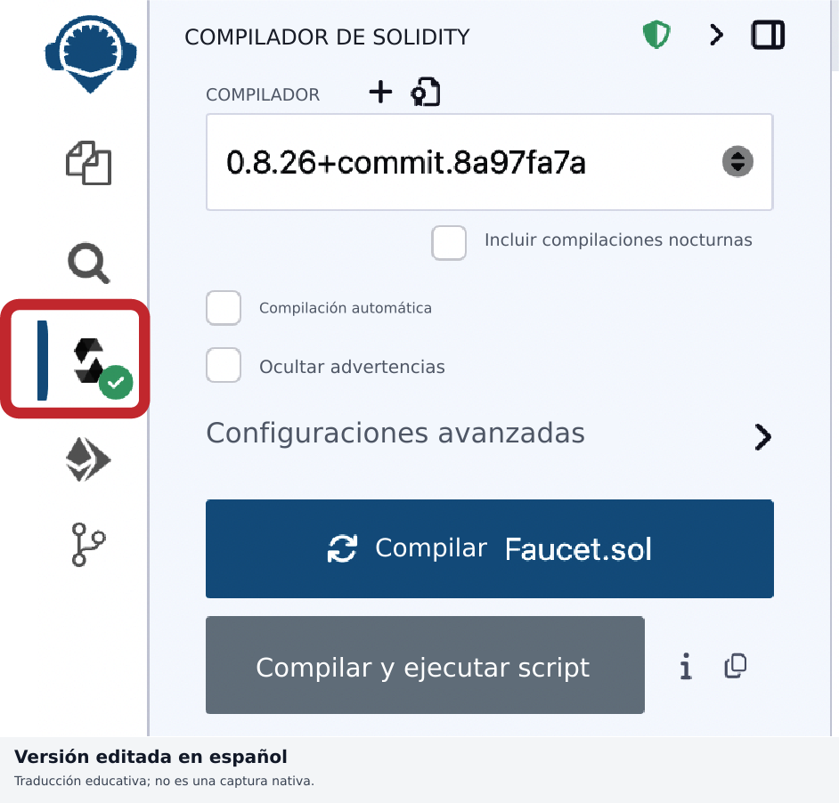

Figura 2-15. Remix compila correctamente el contrato *Faucet.sol*

**Nota de la traducción:** Imagen traducida al español mediante inteligencia artificial (IA). Revisión humana pendiente. No es una captura nativa ni una actualización de la aplicación. La captura original en inglés se conserva en el desplegable.

Se conserva la versión 0.8.26+commit.8a97fa7a, tres casillas sin marcar y el icono verde de compilación correcta dentro del recuadro rojo.

Texto seleccionable de la versión editada:

- COMPILADOR DE SOLIDITY
- COMPILADOR
- Incluir compilaciones nocturnas
- Compilación automática
- Ocultar advertencias
- Configuraciones avanzadas
- Compilar
- Compilar y ejecutar script

<details>
<summary>Figura 2-15: ver captura original en inglés</summary>


> **Nota de la traducción:** "Compile Faucet.sol" compila el archivo. "COMPILER" selecciona la versión; el icono con marca verde indica compilación correcta. "Hide warnings" oculta advertencias.

</details>

Si algo sale mal, lo más probable es que el IDE Remix esté utilizando una versión del compilador de Solidity distinta de 0.8.26. En ese caso, nuestra directiva `pragma` impedirá que se compile *Faucet.sol*. Para cambiar la versión del compilador, vaya a la pestaña Compiler, establezca la versión en 0.8.26 e inténtelo de nuevo.

El compilador de Solidity ya ha compilado nuestro *Faucet.sol* en bytecode de la EVM. Si tiene curiosidad, el bytecode se ve así:

    6080604052348015600e575f80fd5b506101af8061001c5f395ff3fe608060405260043610610020575f3560
    e01c8062f714ce1461002957610027565b3661002757005b005b348015610034575f80fd5b5061004f600480
    360381019061004a919061013b565b610051565b005b64e8d4a51000821115610062575f80fd5b8073ffffff
    ffffffffffffffffffffffffffffffffff166108fc8390811502906040515f60405180830381858888f19350
    5050501580156100a5573d5f803e3d5ffd5b505050565b5f80fd5b5f819050919050565b6100c0816100ae56
    5b81146100ca575f80fd5b50565b5f813590506100db816100b7565b92915050565b5f73ffffffffffffffff
    ffffffffffffffffffffffff82169050919050565b5f61010a826100e1565b9050919050565b61011a816101
    00565b8114610124575f80fd5b50565b5f8135905061013581610111565b92915050565b5f80604083850312
    15610151576101506100aa565b5b5f61015e858286016100cd565b925050602061016f85828601610127565b
    915050925092905056fea26469706673582212207de2f4d88c747c9332dceef5dcd739f3380ec8a8c2167a29
    2ba64ee24fa32a8a64736f6c634300081a0033

¿No le alegra usar un lenguaje de alto nivel como Solidity en lugar de programar directamente en bytecode de la EVM? ¡A nosotros también!

## Crear el contrato en la blockchain

Ya tenemos un contrato. Lo hemos compilado en bytecode. Ahora debemos "registrar" el contrato en la blockchain Ethereum. Usaremos la red de prueba Sepolia para probar nuestro contrato, así que esa es la blockchain a la que queremos enviarlo.

Registrar un contrato en la blockchain implica crear una transacción especial cuyo campo `to` se deja vacío (null). Este destino vacío indica a la blockchain Ethereum que se quiere desplegar un contrato nuevo en lugar de enviar una transacción a una dirección existente. El campo `data` de la transacción contiene el bytecode compilado del contrato. Afortunadamente, el IDE Remix se encargará de todo esto y enviará la transacción a MetaMask.

Primero, cambie a la pestaña Run y seleccione Injected Web3 en el cuadro desplegable Environment. Esto conecta el IDE Remix con la billetera MetaMask y, a través de MetaMask, con la red de prueba Sepolia. Una vez hecho esto, puede ver Sepolia debajo de Environment. Además, el cuadro de selección Account muestra la dirección de su billetera (consulte la Figura 2-16).

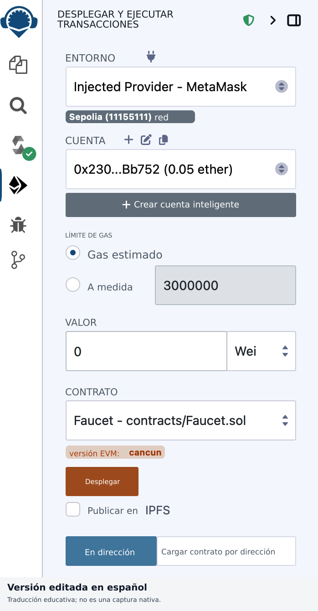

Figura 2-16. Pestaña Run del IDE Remix con el entorno Injected Web3 seleccionado

**Nota de la traducción:** Imagen traducida al español mediante inteligencia artificial (IA). Revisión humana pendiente. No es una captura nativa ni una actualización de la aplicación. La captura original en inglés se conserva en el desplegable.

Proveedor, cuenta con 0.05 ether, versión EVM cancun, archivo del contrato, valores y unidades conservan los literales. Gas estimado sigue seleccionado; A medida y Publicar en IPFS permanecen sin seleccionar.

Texto seleccionable de la versión editada:

- DESPLEGAR Y EJECUTAR TRANSACCIONES
- ENTORNO
- red
- CUENTA
- Crear cuenta inteligente
- LÍMITE DE GAS
- Gas estimado
- A medida
- VALOR
- CONTRATO
- versión EVM:
- Desplegar
- Publicar en
- En dirección
- Cargar contrato por dirección

- El texto del capítulo dice Injected Web3; la captura muestra Injected Provider - MetaMask. No se actualiza ninguno.

<details>
<summary>Figura 2-16: ver captura original en inglés</summary>


> **Nota de la traducción:** "ENVIRONMENT" selecciona el proveedor; "Injected Provider - MetaMask" conecta con MetaMask. "VALUE" indica ether enviado y "Deploy" despliega el contrato. La red visible es Sepolia.

</details>

Justo debajo de los ajustes de Run que acaba de confirmar está el contrato `Faucet`, listo para crearse. Haga clic en el botón Deploy que se muestra en la Figura 2-16.

Remix construirá la transacción especial de "creación" y MetaMask le pedirá que la apruebe, como se muestra en la Figura 2-17. Notará que la transacción de creación del contrato no contiene ether, pero sí algunos bytes de datos (el contrato compilado) y consumirá algunos gwei en gas. Haga clic en Submit para aprobarla.

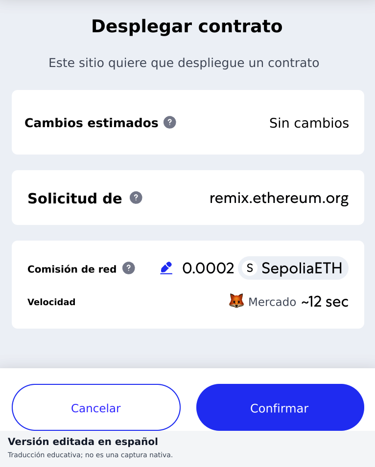

Figura 2-17. MetaMask muestra la transacción de creación del contrato

**Nota de la traducción:** Imagen traducida al español mediante inteligencia artificial (IA). Revisión humana pendiente. No es una captura nativa ni una actualización de la aplicación. La captura original en inglés se conserva en el desplegable.

La solicitud no prevé cambios de activos. Muestra comisión 0.0002 SepoliaETH, velocidad Mercado y estimación ~12 sec, con Cancelar y Confirmar.

Texto seleccionable de la versión editada:

- Desplegar contrato
- Este sitio quiere que despliegue un contrato
- Cambios estimados
- Sin cambios
- Solicitud de
- Comisión de red
- Velocidad
- Mercado
- Cancelar
- Confirmar

- El capítulo menciona Submit, pero la captura muestra Confirm. El tiempo de ~12 sec de la interfaz no se sustituye por los 15–30 segundos de la prosa.
- La captura no contiene un aviso de advertencia visible. Se conservan colores, estado y controles originales.

<details>
<summary>Figura 2-17: ver captura original en inglés</summary>


> **Nota de la traducción:** "Deploy a contract" solicita aprobar el despliegue. "Network fee" muestra la comisión; "Confirm" confirma y "Cancel" cancela.

</details>

Ahora debe esperar. El procesamiento del contrato en Sepolia tardará unos 15–30 segundos. Parecerá que Remix no está haciendo mucho, pero tenga paciencia.

Una vez creado el contrato, aparece en la parte inferior de la pestaña Run (consulte la Figura 2-18).

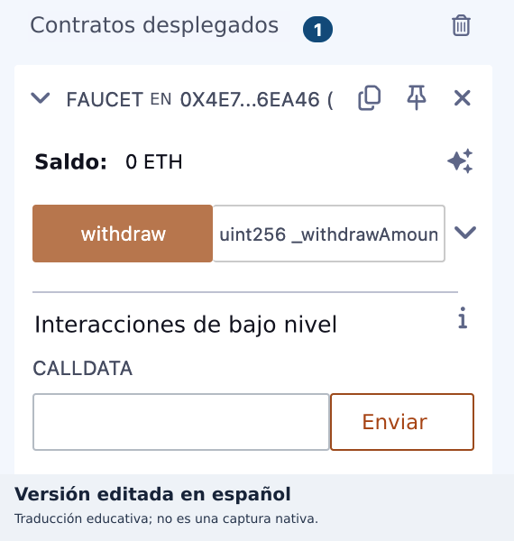

Figura 2-18. ¡El contrato Faucet está activo!

**Nota de la traducción:** Imagen traducida al español mediante inteligencia artificial (IA). Revisión humana pendiente. No es una captura nativa ni una actualización de la aplicación. La captura original en inglés se conserva en el desplegable.

Remix muestra una instancia desplegada de `FAUCET`, su dirección abreviada y saldo 0 ETH. La función `withdraw` y el campo de tipo `uint256` permanecen literales. Debajo aparecen las interacciones de bajo nivel, el campo `CALLDATA` y Enviar.

Texto seleccionable de la versión editada:

- Contratos desplegados
- Saldo:
- Interacciones de bajo nivel
- Enviar

<details>
<summary>Figura 2-18: ver captura original en inglés</summary>


> **Nota de la traducción:** "Deployed Contracts" lista contratos desplegados y "Balance" muestra su saldo. "withdraw" es el nombre literal de la función de retiro; "Transact" envía una transacción de bajo nivel.

</details>

Observe que el contrato `Faucet` ahora tiene su propia dirección: Remix lo muestra como "Faucet at 0x4E7…6EA46" (aunque su dirección, las letras y números aleatorios, será distinta).

## Interactuar con el contrato

Recapitulemos lo aprendido hasta ahora. Los contratos de Ethereum son programas que controlan dinero y se ejecutan dentro de una máquina virtual llamada EVM. Se crean mediante una transacción especial que envía sus bytecodes para registrarlos en la blockchain. Una vez creados en la blockchain, tienen una dirección de Ethereum, al igual que las billeteras. Cada vez que alguien envía una transacción a una dirección de contrato, hace que el contrato se ejecute en la EVM, con la transacción como entrada. Las transacciones enviadas a direcciones de contrato pueden contener ether, datos o ambos. Si contienen ether, este se "deposita" en el saldo del contrato. Si contienen datos, estos pueden especificar una función con nombre del contrato y llamarla, pasando argumentos a la función.

### Ver la dirección del contrato en un explorador de bloques

Ahora tenemos un contrato registrado en la blockchain y podemos ver que tiene una dirección de Ethereum. Veámoslo en el [explorador de bloques *sepolia.etherscan.io*](http://sepolia.etherscan.io) para observar cómo se ve un contrato. En el IDE Remix, copie la dirección del contrato haciendo clic en el icono junto a su nombre (consulte la Figura 2-19).

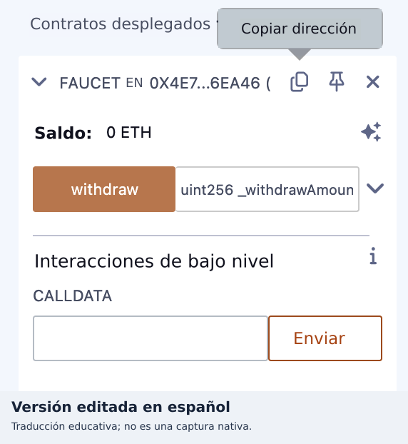

Figura 2-19. Copia de la dirección del contrato desde Remix

**Nota de la traducción:** Imagen traducida al español mediante inteligencia artificial (IA). Revisión humana pendiente. No es una captura nativa ni una actualización de la aplicación. La captura original en inglés se conserva en el desplegable.

La ayuda Copiar dirección apunta al icono de copia de la instancia `FAUCET`. El panel conserva saldo 0 ETH, la función `withdraw`, el argumento truncado y las interacciones de bajo nivel. La ayuda original tapa parte del encabezado; no se reconstruye contenido oculto.

Texto seleccionable de la versión editada:

- Contratos desplegados
- Copiar dirección
- Saldo:
- Interacciones de bajo nivel
- Enviar

- El tooltip original oculta parte de Deployed Contracts y el contador; no se reconstruyen datos tapados.

<details>
<summary>Figura 2-19: ver captura original en inglés</summary>


> **Nota de la traducción:** "Copy Address" copia la dirección del contrato. "Balance" es su saldo; "withdraw" conserva el identificador de la función.

</details>

Mantenga Remix abierto; volveremos a él más adelante. Ahora vaya con el navegador a [*sepolia.etherscan.io*](http://sepolia.etherscan.io) y pegue la dirección en el cuadro de búsqueda. Debería ver el historial de la dirección de Ethereum del contrato, como se muestra en la Figura 2-20.

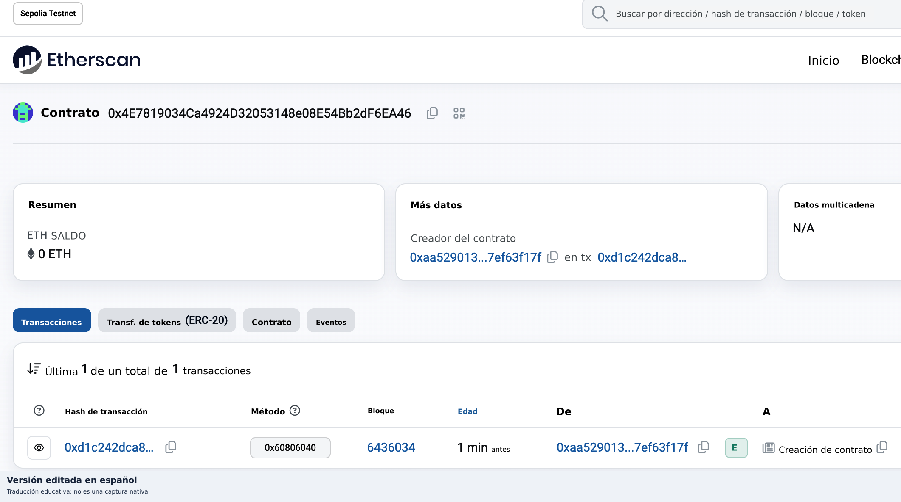

Figura 2-20. Dirección del contrato Faucet en el explorador de bloques Etherscan

**Nota de la traducción:** Imagen traducida al español mediante inteligencia artificial (IA). Revisión humana pendiente. No es una captura nativa ni una actualización de la aplicación. La captura original en inglés se conserva en el desplegable.

El resumen del contrato muestra saldo 0 ETH, creador y transacción de creación. La pestaña Transacciones está seleccionada y contiene una única fila, con el selector `0x60806040` y el bloque 6436034. Los dos conteos 1 se mantienen en sus posiciones originales. La etiqueta E significa entrada.

Texto seleccionable de la versión editada:

- Buscar por dirección / hash de transacción / bloque / token
- Inicio
- Contrato
- Resumen
- SALDO
- Más datos
- Creador del contrato
- en tx
- Datos multicadena
- Transacciones
- Transf. de tokens
- Eventos
- Última
- de un total de
- transacciones
- Hash de transacción
- Método
- Bloque
- Edad
- De
- A
- Creación de contrato
- Saldo en ETH
- Entrada (E)
- Última 1 de un total de 1 transacciones

- El menú Blockchain está recortado por el borde derecho del original; se conserva su fragmento como vocabulario técnico.
- La etiqueta visual ETH SALDO mantiene los píxeles originales de ETH; el texto accesible expresa Saldo en ETH.
- E abrevia Entrada para conservar el tamaño del indicador IN.

<details>
<summary>Figura 2-20: ver captura original en inglés</summary>


> **Nota de la traducción:** "CONTRACT CREATOR" identifica al creador; "Contract Creation" señala la transacción de creación. "ETH BALANCE" muestra 0 ETH antes de agregar fondos.

</details>

### Agregar fondos al contrato

Por ahora, el contrato solo tiene una transacción en su historial: la transacción de creación del contrato. Como puede verse, el contrato tampoco tiene ether (saldo cero). Esto se debe a que no enviamos ether al contrato en la transacción de creación, aunque podríamos haberlo hecho.

¡Nuestro faucet necesita fondos! Nuestro primer proyecto será usar MetaMask para enviar ether al contrato. Todavía debería tener la dirección del contrato en el portapapeles (si no, cópiela de nuevo desde Remix). Abra MetaMask y envíele 0.01 ether, exactamente como lo haría con cualquier otra dirección de Ethereum (consulte la Figura 2-21).

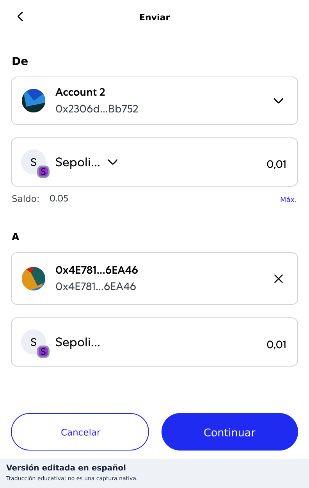

Figura 2-21. Envío de 0.01 ether a la dirección del contrato

**Nota de la traducción:** Imagen traducida al español mediante inteligencia artificial (IA). Revisión humana pendiente. No es una captura nativa ni una actualización de la aplicación. La captura original en inglés se conserva en el desplegable.

La pantalla Enviar muestra Account 2 como origen, saldo 0.05 y la dirección abreviada del contrato como destino. Los dos importes 0,01 y los nombres de activo truncados se conservan. Cancelar detiene el envío y Continuar avanza a la siguiente pantalla.

Texto seleccionable de la versión editada:

- Enviar
- De
- A
- Saldo:
- Máx.
- Cancelar
- Continuar

- Los nombres de activo Sepoli... y las direcciones ya están truncados en el original; no se completan.

<details>
<summary>Figura 2-21: ver captura original en inglés</summary>


> **Nota de la traducción:** "To" identifica el contrato destinatario. "Continue" continúa el envío de 0.01 ether mostrado como 0,01 en la interfaz.

</details>

En un minuto, si recarga el explorador de bloques Etherscan, mostrará otra transacción a la dirección del contrato y un saldo actualizado de 0.01 ether.

¿Recuerda la función `receive` de nuestro código *Faucet.sol*? Era así:

    receive() external payable {}

Cuando envía la transacción a la dirección del contrato, sin datos que especifiquen qué función llamar, se llama a esta función `receive`. Su transacción hizo que el contrato se ejecutara en la EVM y actualizara su saldo. ¡Ha agregado fondos a su faucet!

### Retirar fondos de nuestro contrato

A continuación, retiremos algunos fondos del faucet. Para retirar, debemos construir una transacción que llame a la función `withdraw` y le pase los argumentos `_withdrawAmount` y `_to`. Para simplificar por ahora, Remix construirá esa transacción y MetaMask la presentará para que la aprobemos.

Vuelva a la pestaña de Remix y observe el contrato en la pestaña Run. Debería ver un recuadro rojo con la etiqueta "withdraw" y un campo de entrada con la etiqueta "uint256 \_withdrawAmount, address \_to" (consulte la Figura 2-22).


Figura 2-22. Función withdraw de *Faucet.sol* en Remix

**Nota de la traducción:** Imagen traducida al español mediante inteligencia artificial (IA). Revisión humana pendiente. No es una captura nativa ni una actualización de la aplicación. La captura original en inglés se conserva en el desplegable.

La vista contraída conserva la función `withdraw`, el campo de argumento de tipo `uint256` truncado y la flecha para expandir parámetros. El saldo visible es 0 ETH. Las interacciones de bajo nivel y el botón Enviar están separados de la llamada a la función.

Texto seleccionable de la versión editada:

- Contratos desplegados
- Saldo:
- Interacciones de bajo nivel
- Enviar

- La captura muestra saldo 0 ETH aunque la prosa precedente explica la financiación del contrato. Se conserva ese estado histórico.

<details>
<summary>Figura 2-22: ver captura original en inglés</summary>


> **Nota de la traducción:** "withdraw" identifica la función de retiro. La flecha a su derecha expande los parámetros; los identificadores Solidity no se traducen.

</details>

Esta es la interfaz de Remix para el contrato. Nos permite construir transacciones que llaman a las funciones definidas en el contrato. Ingresaremos un `_withdrawAmount` y una dirección `_to` y haremos clic en el botón withdraw para generar la transacción.

Primero, determinemos el `_withdrawAmount`. Queremos intentar retirar 0.000001 ether, que es la cantidad máxima permitida por nuestro contrato. Recuerde que todos los valores monetarios en Ethereum se denominan internamente en wei, y nuestra función `withdraw` espera que `_withdrawAmount` también esté denominado en wei. La cantidad que queremos es 0.000001 ether, que equivale a 1,000,000,000,000 wei (un 1 seguido de 12 ceros).

Para la dirección `_to`, usaremos nuestra Account 1 de MetaMask.

> **Consejo**  
>
> Debido a una limitación de JavaScript, Remix no puede procesar un número tan grande como 10^17^. En cambio, lo encerramos entre comillas para que Remix pueda recibirlo como una cadena y manipularlo como un `BigNumber`. Si no lo encerramos entre comillas, el IDE Remix no podrá procesarlo y mostrará "Error encoding arguments: Error: Assertion failed."

Escriba `"1000000000000"` (con las comillas) en el cuadro `_withdrawAmount`, copie y pegue la dirección de su Account 1 desde MetaMask y haga clic en el botón transact. (Es posible que lo vea como el botón withdraw. La Figura 2-23 muestra una vista expandida de la función; si su vista no está expandida, el botón se llamará "withdraw").

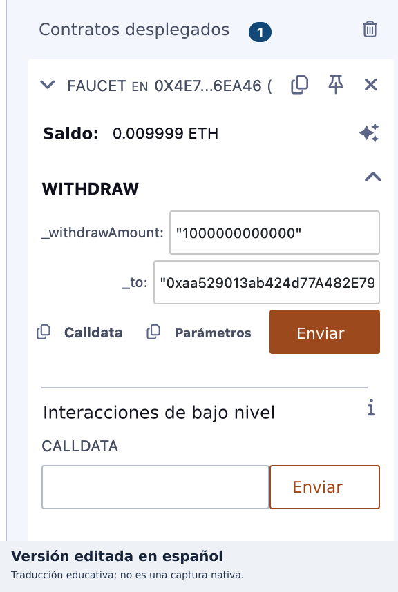

Figura 2-23. Haga clic en transact en Remix para crear una transacción de retiro

**Nota de la traducción:** Imagen traducida al español mediante inteligencia artificial (IA). Revisión humana pendiente. No es una captura nativa ni una actualización de la aplicación. La captura original en inglés se conserva en el desplegable.

La función `WITHDRAW` está expandida. `_withdrawAmount` contiene la cadena numérica entre comillas y `_to` contiene una dirección truncada. Los controles Calldata y Parámetros permiten copiar información, mientras Enviar solicita la transacción. El campo `CALLDATA` de bajo nivel y su botón Enviar siguen debajo.

Texto seleccionable de la versión editada:

- Contratos desplegados
- Saldo:
- Parámetros
- Enviar
- Interacciones de bajo nivel

- El saldo ya es 0.009999 ETH antes de la confirmación mostrada después. La captura representa un estado posterior.
- La dirección _to queda cortada por el campo; no se completa.
- Calldata y CALLDATA se conservan como vocabulario técnico, según el glosario.

<details>
<summary>Figura 2-23: ver captura original en inglés</summary>


> **Nota de la traducción:** La vista expandida de "WITHDRAW" permite ingresar _withdrawAmount en wei y la dirección _to. "transact" solicita enviar la llamada; "Calldata" copia sus datos y "Parameters" sus parámetros.

</details>

MetaMask abrirá una ventana de transacción para que la apruebe. Haga clic en Submit para enviar su llamada de retiro al contrato (consulte la Figura 2-24).

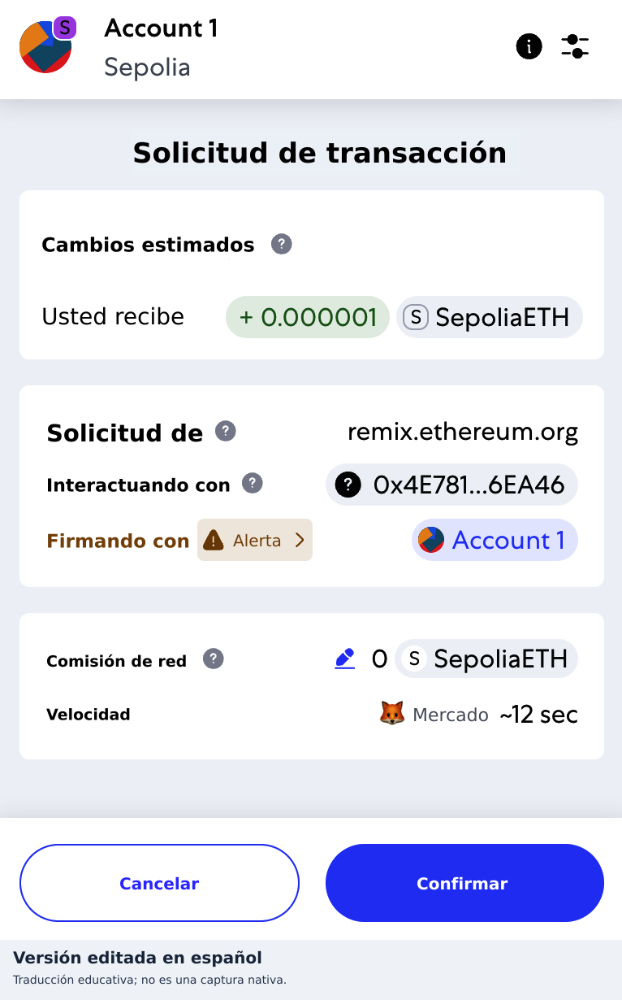

Figura 2-24. Transacción de MetaMask para llamar a la función withdraw

**Nota de la traducción:** Imagen traducida al español mediante inteligencia artificial (IA). Revisión humana pendiente. No es una captura nativa ni una actualización de la aplicación. La captura original en inglés se conserva en el desplegable.

La solicitud procede de `remix.ethereum.org` e interactúa con el contrato abreviado. La estimación muestra recepción verde de + 0.000001 SepoliaETH. La firma usa Account 1 y conserva una alerta marrón. La comisión visible es 0 SepoliaETH y la velocidad Mercado conserva ~12 sec. Cancelar y Confirmar mantienen sus roles.

Texto seleccionable de la versión editada:

- Solicitud de transacción
- Cambios estimados
- Usted recibe
- Solicitud de
- Interactuando con
- Firmando con
- Alerta
- Comisión de red
- Velocidad
- Mercado
- Cancelar
- Confirmar

- La comisión visible está redondeada a 0 SepoliaETH; no implica ausencia de gas.
- La prosa dice Submit, pero el control mostrado dice Confirm y se traduce Confirmar.

<details>
<summary>Figura 2-24: ver captura original en inglés</summary>


> **Nota de la traducción:** "You receive" estima que recibirá 0.000001 ETH de Sepolia. "Interacting with" identifica el contrato y "Signing with" la cuenta firmante. "Confirm" aprueba la llamada; la captura también muestra una alerta.

</details>

Espere un minuto y luego recargue el explorador de bloques Etherscan para ver la transacción reflejada en el historial de la dirección del contrato `Faucet` (consulte la Figura 2-25).

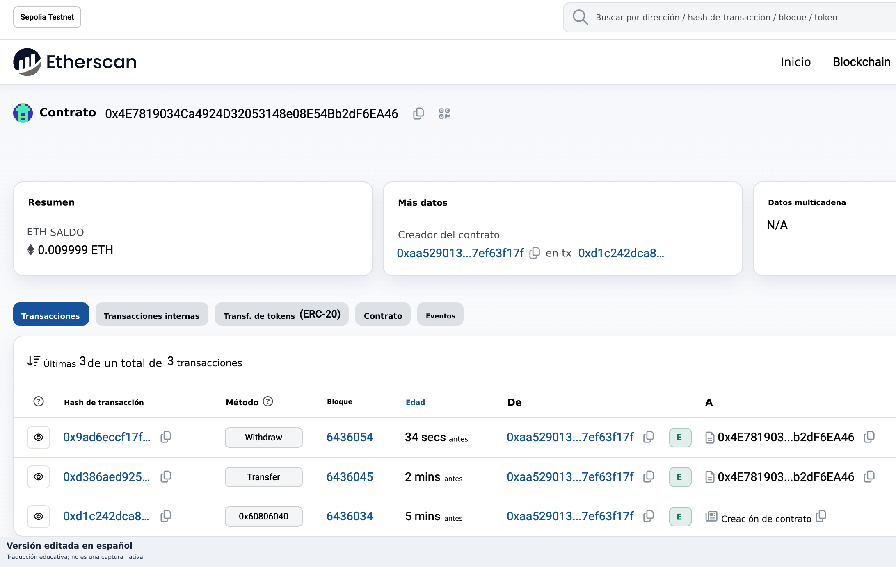

Figura 2-25. Etherscan muestra la transacción que llama a la función withdraw

**Nota de la traducción:** Imagen traducida al español mediante inteligencia artificial (IA). Revisión humana pendiente. No es una captura nativa ni una actualización de la aplicación. La captura original en inglés se conserva en el desplegable.

La pestaña Transacciones está seleccionada y Transacciones internas está disponible. Las filas conservan los métodos literales `Withdraw`, `Transfer` y `0x60806040`, de más reciente a más antigua. Permanecen hashes, bloques, direcciones, conteos 3 y tiempos con sus unidades originales. Cada indicador E significa entrada.

Texto seleccionable de la versión editada:

- Buscar por dirección / hash de transacción / bloque / token
- Inicio
- Contrato
- Resumen
- SALDO
- Más datos
- Creador del contrato
- en tx
- Datos multicadena
- Transacciones
- Transacciones internas
- Transf. de tokens
- Eventos
- Últimas
- de un total de
- transacciones
- Hash de transacción
- Método
- Bloque
- Edad
- De
- A
- Creación de contrato
- Saldo en ETH
- Entrada (E)
- Últimas 3 de un total de 3 transacciones

- Withdraw y Transfer en la columna Method son identificadores y conservan sus píxeles originales.
- E abrevia Entrada para conservar el tamaño del indicador IN.
- La etiqueta visual ETH SALDO mantiene los píxeles originales de ETH; el texto accesible expresa Saldo en ETH.

<details>
<summary>Figura 2-25: ver captura original en inglés</summary>


> **Nota de la traducción:** "Transactions" lista transacciones externas; "Internal Transactions" permite consultar transferencias internas. El historial muestra retiro, transferencia de fondos y creación, en ese orden. El saldo queda en 0.009999 ETH.

</details>

Ahora vemos una transacción nueva con la dirección del contrato como destino y un valor de 0 ether. El saldo del contrato ha cambiado y ahora es de 0.009999 ether porque nos envió 0.000001 ether, tal como solicitamos.

Pero no vemos una transacción "OUT" en el historial de la dirección del contrato. ¿Dónde está el retiro saliente? Ha aparecido una pestaña nueva llamada Internal Transactions en la página del historial de la dirección del contrato. Como la transferencia de 0.000001 ether se originó en el código del contrato, es una transacción interna (también llamada *mensaje*). Haga clic en esa pestaña para verla (consulte la Figura 2-26).

Esta "transacción interna" fue enviada por el contrato en esta línea de código (de la función `withdraw` en *Faucet.sol*):

    _to.transfer(_withdrawAmount);

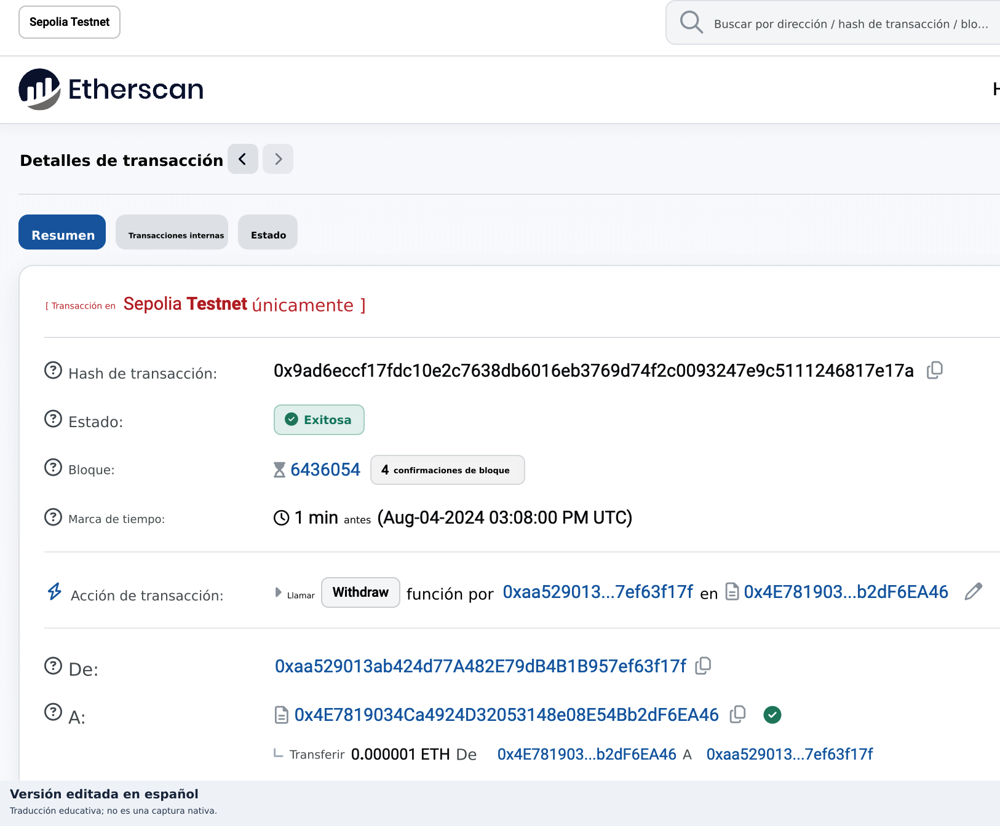

Figura 2-26. Etherscan muestra la transacción interna que transfiere ether desde el contrato

**Nota de la traducción:** Imagen traducida al español mediante inteligencia artificial (IA). Revisión humana pendiente. No es una captura nativa ni una actualización de la aplicación. La captura original en inglés se conserva en el desplegable.

Resumen está seleccionado en los detalles de la transacción de Sepolia Testnet. El estado Exitosa conserva el indicador verde; el bloque 6436054 muestra 4 confirmaciones. La acción llama al identificador `Withdraw`. Bajo el contrato destinatario se muestra la transferencia interna de 0.000001 ETH desde el contrato a la cuenta, sin alterar sus direcciones ni la marca UTC.

Texto seleccionable de la versión editada:

- Buscar por dirección / hash de transacción / blo…
- Detalles de transacción
- Resumen
- Transacciones internas
- Estado
- [ Transacción en
- únicamente ]
- Hash de transacción:
- Estado:
- Bloque:
- Marca de tiempo:
- Acción de transacción:
- De:
- A:
- Exitosa
- confirmaciones de bloque
- Llamar
- función por
- en
- Transferir
- De
- A

- La prosa indica abrir Internal Transactions, pero el original tiene Overview seleccionado y resume la transferencia interna en los detalles.
- Withdraw es identificador de función y conserva sus píxeles originales.
- El borde derecho contiene solo una H parcial del menú de navegación; no se infiere la palabra completa.

Algunos textos pequeños, recortados u ocultos por la interfaz original se conservaron sin reconstruirlos; su ubicación y limitaciones se registran en el manifiesto.

<details>
<summary>Figura 2-26: ver captura original en inglés</summary>


> **Nota de la traducción:** "Transaction Action" muestra la llamada a Withdraw. Debajo de "To", la línea "Transfer 0.000001 ETH" muestra la transferencia interna desde el contrato hacia la cuenta del usuario. "Success" indica ejecución exitosa.

</details>

Para recapitular: envió una transacción desde su billetera MetaMask que contenía instrucciones en los datos para llamar a la función `withdraw` con un argumento `_withdrawAmount` de 0.000001 ether y una dirección. Esa transacción hizo que el contrato se ejecutara dentro de la EVM. Mientras la EVM ejecutaba la función `withdraw` del contrato `Faucet`, primero llamó a la función `require` y validó que la cantidad solicitada fuera menor o igual que el retiro máximo permitido de 0.000001 ether. Luego llamó a la función `transfer` para enviarle el ether. La ejecución de la función `transfer` generó una transacción interna que depositó 0.000001 ether en la dirección de su billetera desde el saldo del contrato. Esa es la que aparece en la pestaña Internal Transactions de Etherscan.

## Conclusión

En este capítulo, configuró una billetera con MetaMask y le agregó fondos utilizando un faucet de la red de prueba Sepolia. Recibió ether en la dirección de Ethereum de su billetera y luego envió ether a otra dirección.

Después escribió un contrato `Faucet` en Solidity. Usó el IDE Remix para compilar el contrato en bytecode de la EVM y luego usó Remix para formar una transacción y crear el contrato `Faucet` en la blockchain Sepolia. Una vez creado, el contrato `Faucet` tenía una dirección de Ethereum y usted le envió algo de ether. Por último, construyó una transacción para llamar a la función `withdraw` y solicitó con éxito 0.000001 ether. El contrato comprobó la solicitud y le envió 0.000001 ether mediante una transacción interna.

Puede que no parezca mucho, pero acaba de interactuar con éxito con software que controla dinero en una computadora mundial descentralizada.

Programaremos muchos más contratos inteligentes en Solidity en el Capítulo 7 y aprenderemos sobre buenas prácticas y consideraciones de seguridad en el Capítulo 9.
