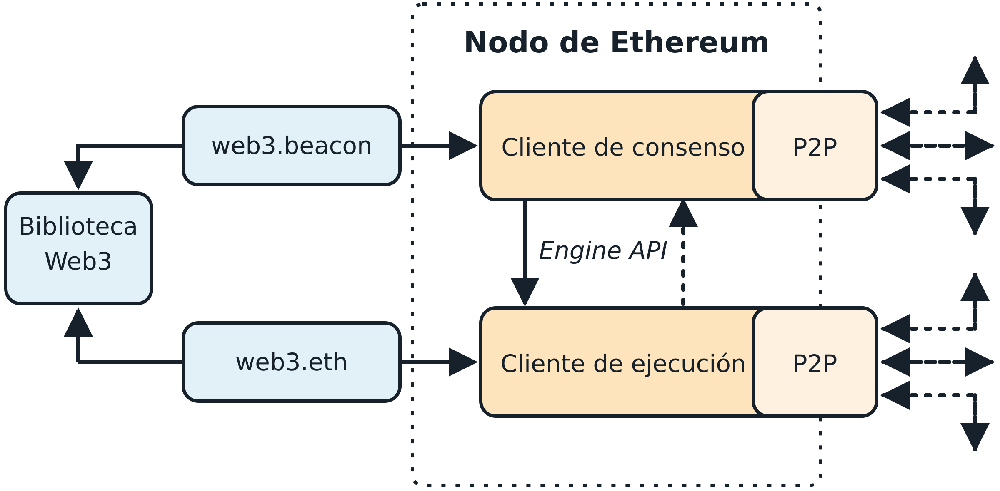

# Capítulo 3. Nodos de Ethereum

Un nodo de Ethereum es una aplicación de software que implementa la especificación de Ethereum y se comunica a través de la red P2P con otros nodos de Ethereum.

Al principio, un nodo solo tenía que ejecutar un único cliente para implementar por completo todos los requisitos necesarios para formar parte del ecosistema de Ethereum. El 15 de septiembre de 2022 se produjo el hard fork The Merge, que cambió el protocolo de consenso de un esquema basado en PoW a Gasper, el nuevo protocolo de consenso basado en PoS. Esto también llevó a separar las responsabilidades de consenso y ejecución y a crear un nuevo tipo de cliente de Ethereum: un cliente de consenso.

Así, al momento de escribir este libro, un nodo de Ethereum debe ejecutar dos programas al mismo tiempo para ser compatible con la especificación más reciente, como se muestra en la figura 3-1, con las siguientes definiciones:

**Cliente de consenso**

Este nuevo software ahora está a cargo del protocolo de consenso que permite que todos los nodos acuerden un único historial de la blockchain.

**Cliente de ejecución**

Este software se centra en recibir todos los bloques y las transacciones que se producen en la red, ejecutarlos dentro de la EVM y verificar que sean correctos.



Los distintos clientes de Ethereum, tanto de ejecución como de consenso, interoperan si cumplen con la especificación de referencia y los protocolos de comunicación estandarizados. Aunque distintos equipos implementan estos clientes en diferentes lenguajes de programación, todos "hablan" el mismo protocolo y siguen las mismas reglas. Por lo tanto, todos pueden usarse para operar e interactuar con la misma red de Ethereum.

Ethereum es un proyecto de código abierto, y el código fuente de todos los clientes principales está disponible bajo licencias de código abierto (por ejemplo, LGPL v3.0), y se puede descargar y usar gratuitamente para cualquier propósito. Sin embargo, código abierto significa más que simplemente uso gratuito. También significa que una comunidad abierta de voluntarios desarrolla Ethereum y que cualquiera puede modificarlo. Más ojos significan código más confiable.

Ethereum se definió originalmente mediante una única especificación formal llamada "Yellow Paper", escrita por uno de los coautores originales de este libro, Gavin Wood. Aunque esta especificación se actualiza periódicamente a medida que se introducen cambios importantes en Ethereum, hay un camino claro hacia dos implementaciones de referencia diferentes, una para clientes de ejecución y otra para clientes de consenso. Estas implementaciones de referencia están escritas en Python y priorizan la legibilidad y la simplicidad.

> **Nota**  
>
> Estas especificaciones no están pensadas como implementaciones de nodos completos. Funcionan como especificaciones en pseudocódigo ejecutable.

Esto contrasta, por ejemplo, con Bitcoin, que no se define de ninguna manera formal. Mientras que la "especificación" de Bitcoin es la implementación de referencia Bitcoin Core, la especificación de ejecución de Ethereum se documenta en un artículo que combina una especificación en inglés y otra matemática (formal). Esta especificación formal, junto con diversas propuestas de mejora de Ethereum (EIP) y la nueva especificación de consenso escrita en Python, define el comportamiento estándar de un nodo de Ethereum.

Como resultado de la clara especificación formal de Ethereum, existen varias implementaciones de software de un cliente de Ethereum desarrolladas de forma independiente pero interoperables. Ethereum tiene una mayor diversidad de implementaciones en funcionamiento en la red que cualquier otra blockchain, algo que en general se considera positivo. De hecho, esto ha demostrado ser, por ejemplo, una excelente forma de defenderse de los ataques a la red, porque explotar la estrategia de implementación de un cliente en particular solo causa inconvenientes a sus desarrolladores mientras corrigen la vulnerabilidad, en tanto los demás clientes mantienen la red en funcionamiento casi sin verse afectados.

## Redes de Ethereum

Existen diversas redes basadas en Ethereum que se ajustan en gran medida a la especificación formal definida en el "Yellow Paper" original de Ethereum, pero que pueden interoperar entre sí o no.

Varias cadenas compatibles con la EVM, como Ethereum Classic, BNB Chain y Polygon, comparten grandes partes de la especificación de ejecución, aunque muchas difieren en el consenso y los parámetros. Si bien son mayormente compatibles a nivel de protocolo, estas redes suelen tener características o atributos que requieren que quienes mantienen el software de los clientes de Ethereum hagan pequeños cambios para admitir cada red. Por eso, no todas las versiones del software de los clientes de Ethereum ejecutan todas las blockchains basadas en Ethereum.

A junio de 2025, existen cinco implementaciones principales del protocolo de ejecución de Ethereum, escritas en cuatro lenguajes diferentes, y cinco implementaciones del protocolo de consenso de Ethereum, escritas en cinco lenguajes diferentes:

Los clientes de ejecución son:

- Geth, escrito en Go
- Nethermind, escrito en C#
- Besu, escrito en Java
- Erigon, escrito en Go
- Reth, escrito en Rust

Los clientes de consenso son:

- Lighthouse, escrito en Rust
- Lodestar, escrito en TypeScript
- Nimbus, escrito en Nim
- Prysm, escrito en Go
- Teku, escrito en Java

En esta sección, veremos los siguientes dos clientes de ejecución:

**Geth**

El cliente de ejecución más antiguo y más utilizado, mantenido por la Ethereum Foundation

**Reth**

Un nuevo cliente de ejecución basado en Rust creado por Paradigm después de que se discontinuara Parity/OpenEthereum

Y veremos los siguientes dos clientes de consenso:

**Prysm**

El primer cliente de consenso, ahora mantenido por Offchain Labs

**Lighthouse**

El cliente de consenso más utilizado, mantenido por Sigma Prime

Mostraremos cómo configurar un nodo con cada cliente. En concreto, usaremos las combinaciones Geth-Prysm y Reth-Lighthouse, y exploraremos algunas de sus opciones de línea de comandos y API.

> **Nota**  
>
> Estas parejas son solo ejemplos; se puede elegir la combinación de clientes de ejecución y de consenso que se prefiera para ejecutar un nodo de Ethereum.

## ¿Debería ejecutar un nodo completo?

La salud, la resiliencia y la resistencia a la censura de las blockchains dependen de que tengan muchos nodos completos operados de forma independiente y distribuidos geográficamente, es decir, nodos que descargan la totalidad de la blockchain y conservan los datos indefinidamente. Cada nodo completo puede ayudar a otros nodos nuevos a obtener los datos de los bloques para iniciar sus operaciones, además de ofrecer a su operador una verificación autorizada e independiente de todas las transacciones y los contratos.

> **Nota**
>
> Para ser realmente precisos, hay una distinción entre estos nodos:  
>
> **Nodos de archivo**  
> Nodos de Ethereum que conservan todos los datos indefinidamente  
>
> **Nodos completos**  
> Nodos de Ethereum que descartan el estado histórico y los recibos, lo que suele ser la opción predeterminada al poner en marcha un nodo

Sin embargo, ejecutar un nodo completo implica un costo en recursos de hardware y ancho de banda. Un nodo completo debe descargar al menos 2 TB de datos (a junio de 2025, según la configuración del cliente) y almacenarlos en un disco duro local. Esta carga de datos aumenta con bastante rapidez cada día a medida que se agregan nuevas transacciones y bloques. Analizamos este tema con más detalle en la sección posterior "Requisitos de hardware para un nodo completo".

No es necesario contar con un nodo completo en funcionamiento en la red principal para desarrollar en Ethereum. Se puede hacer casi todo lo necesario con un nodo de una red de prueba (que conecta con una de las blockchains públicas de prueba más pequeñas), con una blockchain privada local como Anvil o con una API de un nodo alojado que ofrezca un proveedor de servicios como Infura o Alchemy.

También existe la opción de ejecutar un cliente remoto, que no almacena una copia local de la blockchain ni valida bloques y transacciones. Estos clientes ofrecen la funcionalidad de una billetera y pueden crear y difundir transacciones. Los clientes remotos pueden usarse para conectarse a redes existentes, como un nodo completo propio, una blockchain pública, una red de prueba pública o con permiso (de prueba de autoridad), o una blockchain privada local. En la práctica, es probable que se use un cliente remoto, como MetaMask, Rabby Wallet o Coinbase Wallet, como una forma cómoda de alternar entre las distintas opciones de nodos.

Los términos cliente remoto y billetera se usan indistintamente, aunque hay algunas diferencias. Por lo general, un cliente remoto ofrece una API (como la API de web3.js), además de la funcionalidad de transacciones de una billetera.

No se debe confundir el concepto de cliente remoto en Ethereum con el de cliente ligero (que es análogo a un cliente de verificación simplificada de pagos [SPV] en Bitcoin). Los clientes ligeros validan los encabezados de los bloques y usan pruebas de Merkle para validar la inclusión de las transacciones en la blockchain y determinar sus efectos, lo que les da un nivel de seguridad similar al de un nodo completo. En cambio, los clientes remotos de Ethereum no validan encabezados de bloques ni transacciones. Confían por completo en que un nodo completo les dé acceso a la blockchain y, por lo tanto, pierden importantes garantías de seguridad y anonimato. Estos problemas pueden mitigarse usando un nodo completo operado por uno mismo.

### Ventajas y desventajas de un nodo completo

Elegir ejecutar un nodo completo ayuda al funcionamiento de las redes a las que se lo conecta, pero también implica algunos costos de leves a moderados. Veamos algunas ventajas y desventajas.

**Ventajas**:

- Contribuye a la resiliencia y la resistencia a la censura de las redes basadas en Ethereum
- Valida todas las transacciones de manera autorizada
- Puede interactuar con cualquier contrato de la blockchain pública sin intermediarios
- Puede desplegar contratos directamente en la blockchain pública sin intermediarios
- Puede consultar (solo lectura) el estado de la blockchain (cuentas, contratos, etc.) sin conexión
- Puede consultar la blockchain sin revelar a un tercero la información que se está leyendo

**Desventajas**:

- Requiere recursos de hardware y ancho de banda considerables y crecientes
- Puede requerir varios días para sincronizarse por completo cuando se inicia por primera vez
- Debe mantenerse, actualizarse y permanecer en línea para seguir sincronizado

### Ventajas y desventajas de una red de prueba pública

Se elija o no ejecutar un nodo completo, probablemente se querrá ejecutar un nodo de una red de prueba pública. Veamos algunas ventajas y desventajas de usar una red de prueba pública.

**Ventajas:**

- Un nodo de una red de prueba necesita sincronizar y almacenar muchos menos datos, unos 100–300 GB según la red (a junio de 2025).
- Un nodo de una red de prueba puede sincronizarse por completo en pocas horas.
- Desplegar contratos o realizar transacciones requiere ether de prueba, que no tiene valor y se puede obtener gratis de varios "faucets".
- Las redes de prueba son blockchains públicas con muchos otros usuarios y contratos, que funcionan "en vivo".

**Desventajas:**

- No se puede usar dinero "real" en una red de prueba; funciona con ether de prueba. En consecuencia, no se puede probar la seguridad frente a adversarios reales, ya que no hay nada en juego.
- Hay algunos aspectos de una blockchain pública que no se pueden probar de manera realista en una red de prueba. Por ejemplo, las comisiones por transacción, aunque son necesarias para enviar transacciones, no son un factor a considerar en una red de prueba, ya que el gas es gratuito (lo que significa que el ETH de la red de prueba no tiene ningún valor económico real). Además, las redes de prueba no sufren la congestión que a veces experimenta la red principal pública.
- Algunas redes de prueba están diseñadas para fines específicos y podrían ser ligeramente diferentes de la red principal de Ethereum.

### Ventajas y desventajas de una simulación local de blockchain

Para muchos fines de prueba, la mejor opción es iniciar una blockchain privada de una sola instancia. Anvil es una de las simulaciones locales de blockchain más populares que se pueden ejecutar y con las que se puede interactuar sin otros participantes.

**Ventajas:**

- No requiere sincronización y casi no hay datos en disco; uno mismo produce el primer bloque.
- No es necesario obtener ether de prueba; uno mismo se "otorga" recompensas de bloque que puede usar para las pruebas.
- No hay otros usuarios, solo uno mismo.
- No hay otros contratos, solo los que se desplieguen después de iniciarla.

**Desventajas:**

- La ausencia de otros usuarios significa que la cadena local no se comporta igual que una blockchain pública. No hay competencia por el espacio para transacciones ni por su secuenciación.
- Que no haya otros productores de bloques significa que la producción de bloques es más predecible; por lo tanto, no se pueden probar algunos escenarios que ocurren en una blockchain pública. Vale la pena mencionar que Anvil (y otras herramientas como Hardhat) permite configurar los modos de producción de bloques para intentar reproducir un comportamiento similar al de la red principal, pero aun así no es lo mismo que estar en la red principal de Ethereum.
- Que no haya otros contratos significa que hay que desplegar todo lo que se quiera probar, incluidas las dependencias y las bibliotecas de contratos. Por suerte, herramientas como Anvil permiten bifurcar la cadena de la red principal de Ethereum en bloques arbitrarios y experimentar con los contratos inteligentes en un estado similar al de la red principal.

## Ejecución de un nodo de Ethereum

Si se dispone del tiempo y los recursos, se debería intentar ejecutar un nodo completo, aunque solo sea para aprender más sobre el proceso. En esta sección, explicamos cómo descargar, compilar y ejecutar los clientes de Ethereum Geth-Prysm y Reth-Lighthouse. Esto requiere cierta familiaridad con el uso de la interfaz de línea de comandos (CLI) del sistema operativo. Vale la pena instalar estos clientes, tanto si se decide ejecutarlos como nodos completos, como nodos de una red de prueba o como clientes de una blockchain privada local.

### Requisitos de hardware para un nodo completo

Antes de comenzar, hay que asegurarse de tener una computadora con recursos suficientes para ejecutar un nodo completo de Ethereum. Se necesitarán al menos 2 TB de espacio en disco para almacenar una copia completa de la blockchain de Ethereum. Si también se quiere ejecutar un nodo completo en la red de prueba de Ethereum, se necesitarán al menos 100–400 GB adicionales. Descargar 2 TB de datos de la blockchain puede llevar mucho tiempo, por lo que se recomienda trabajar con una conexión rápida a internet.

La sincronización de la blockchain de Ethereum exige muchas operaciones de entrada/salida (E/S). Lo mejor es tener una unidad de estado sólido (SSD). Si se tiene una unidad de disco duro mecánica (HDD), se necesitarán al menos 8 GB de RAM para usar como caché. De lo contrario, es posible que el sistema sea demasiado lento para mantenerse al día y sincronizarse por completo.

Este es un resumen de los requisitos mínimos para sincronizar una copia completa de una blockchain basada en Ethereum:

- CPU con 2 o más núcleos
- Al menos 2 TB de espacio de almacenamiento libre
- Un mínimo de 8 GB de RAM con una SSD, u 8+ GB si se tiene un HDD (es mucho más recomendable una SSD)
- Servicio de internet con 7+ Mbps de descarga

Si se quiere sincronizar en un tiempo razonable y almacenar todas las herramientas de desarrollo, bibliotecas, clientes y blockchains que analizamos en este libro, conviene tener una computadora más potente. Estas son nuestras especificaciones recomendadas:

- CPU rápida con 4+ núcleos; una frecuencia de reloj más alta es más importante que la cantidad de núcleos
- 16+ GB de RAM
- SSD NVMe rápida con al menos 2 TB de espacio libre
- Servicio de internet con 24+ Mbps de descarga
	
Es difícil predecir qué tan rápido aumentará el tamaño de una blockchain y cuándo se necesitará más espacio en disco, por lo que se recomienda comprobar su tamaño más reciente antes de comenzar la sincronización.

> **Nota**
>
> Los requisitos de espacio en disco que se indican aquí suponen que se ejecutará un nodo con la configuración predeterminada, en la que se "podan" los datos de estado antiguos de la blockchain. Si, en cambio, se ejecuta un nodo "de archivo" completo, en el que se conserva todo el estado en disco, es probable que se requieran más de 2 TB (hasta 12–15 TB) de espacio en disco, según el cliente. Antes de ejecutar un nodo, siempre se deben consultar los requisitos de hardware más recientes en el sitio web oficial del cliente.

### Requisitos de software para compilar y ejecutar un cliente

Esta sección trata sobre el software de los clientes Geth-Prysm y Reth-Lighthouse. También supone que se está usando un entorno de línea de comandos de tipo Unix. Los ejemplos muestran los comandos y las salidas tal como aparecen en macOS con el shell Bash (entorno de ejecución de línea de comandos). Las instrucciones funcionan sin cambios en la mayoría de las distribuciones de Linux. Los usuarios de Windows pueden usar Windows Subsystem for Linux (WSL2).

> **Consejo**
>
> En muchos de los ejemplos de este capítulo, usaremos la CLI del sistema operativo (también conocida como shell), a la que se accede mediante una aplicación de terminal. El shell mostrará un indicador; se escribe un comando y el shell responde con texto y un nuevo indicador para el siguiente comando. El indicador puede verse diferente en cada sistema, pero en los siguientes ejemplos se representa con el símbolo $. En los ejemplos, cuando se vea texto después de un símbolo $, no se debe escribir el símbolo $, sino el comando que aparece inmediatamente después (en negrita), y luego presionar Enter para ejecutarlo. En los ejemplos, las líneas que aparecen debajo de cada comando son las respuestas del sistema operativo a ese comando. Cuando aparezca el siguiente prefijo $, se sabrá que se trata de un nuevo comando y se deberá repetir el proceso.

Antes de comenzar, puede ser necesario instalar algo de software. Si nunca se ha desarrollado software en la computadora que se está usando, probablemente sea necesario instalar algunas herramientas básicas. Para los ejemplos que siguen, se necesitará instalar git, el sistema de gestión de código fuente; golang, el lenguaje de programación Go y sus bibliotecas estándar; y Rust, un lenguaje de programación de sistemas.

Estas son las páginas de documentación de los cuatro clientes que usaremos en este ejemplo:

- [Geth](https://oreil.ly/zYviP)
- [Prysm](https://oreil.ly/9-2FC)
- [Reth](https://oreil.ly/KDmMt)
- [Lighthouse](https://oreil.ly/RRpAs)

Se pueden consultar estos sitios web para conocer más detalles sobre la arquitectura de cada cliente y para resolver problemas durante la instalación.

### Fase de preparación

Desde el directorio personal, se debe crear una carpeta en la computadora llamada *ethereum-node1* y luego dos subcarpetas dentro de ella llamadas *execution* y *consensus*:

```bash
$ mkdir ethereum-node1
$ cd ethereum-node1
$ mkdir execution
$ mkdir consensus
```

Ahora debería haber una estructura de carpetas como esta:

```bash
ethereum-node1
├── consensus
└── execution
```

Se debe repetir el paso anterior con una nueva carpeta llamada *ethereum-node2*:

```bash
$ cd .. # este comando se usa para volver al directorio personal
$ mkdir ethereum-node2
$ cd ethereum-node2
$ mkdir execution
$ mkdir consensus
```

Al final debería haber dos carpetas raíz, *ethereum-node1* y *ethereum-node2*, con dos subcarpetas dentro de cada carpeta raíz: *execution* y *consensus*.

También será necesario instalar [Go](https://golang.org/) y [Rust](https://www.rust-lang.org/). Se pueden consultar sus sitios web oficiales para obtener una guía de instalación.

### Geth-Prysm

Se debe entrar en la carpeta recién creada *ethereum-node1*:

```bash
$ cd ethereum-node1
```

#### Geth

Primero vamos a instalar Geth compilándolo a partir del código fuente. Geth es una implementación en lenguaje Go de las especificaciones de ejecución que la Ethereum Foundation desarrolla activamente, por lo que se considera la implementación "oficial" del cliente de Ethereum. Por lo general, cada blockchain basada en Ethereum tendrá su propia implementación de Geth. Si se va a ejecutar Geth, conviene asegurarse de obtener la versión correcta para la blockchain mediante uno de los siguientes enlaces a repositorios:

- [Ethereum](https://oreil.ly/qzK-O)
- [BNB Chain](https://oreil.ly/tGtL3)
- [Polygon PoS](https://oreil.ly/ZWhh3)

> **Nota**
>
> Se pueden omitir estas instrucciones e instalar un binario precompilado para la plataforma que se prefiera. Las versiones precompiladas son mucho más fáciles de instalar y se encuentran en la sección "releases" de cualquiera de los repositorios que se enumeran aquí. Sin embargo, se puede aprender más al descargar y compilar el software por cuenta propia.

**Clonación del repositorio**. El primer paso es clonar el repositorio Git para obtener una copia del código fuente. Para crear un clon local del repositorio elegido, se debe usar el comando git de la siguiente manera en la subcarpeta execution:

```bash
$ cd execution
$ git clone https://github.com/ethereum/go-ethereum.git
```

Debería aparecer un informe de progreso a medida que se copia el repositorio al sistema local:

```bash
Cloning into 'go-ethereum'...
remote: Enumerating objects: 130745, done.
remote: Counting objects: 100% (11/11), done.
remote: Compressing objects: 100% (11/11), done.
remote: Total 130745 (delta 1), reused 6 (delta 0), pack-reused 130734
Receiving objects: 100% (130745/130745), 204.15 MiB | 6.13 MiB/s, done.
Resolving deltas: 100% (80729/80729), done.
```

¡Excelente! Ahora que se tiene una copia local de Geth, se puede compilar un ejecutable para la plataforma.

**Compilación de Geth a partir del código fuente**. Para compilar Geth, se debe cambiar al directorio en el que se descargó el código fuente y usar el comando make después de seleccionar la versión más reciente; en este momento es la v1.14.3, pero siempre se puede comprobar cuál es la última:

```bash
$ cd go-ethereum
$ git checkout v1.14.3
$ make geth
```

Si todo sale bien, se verá cómo el compilador de Go compila cada componente hasta producir el ejecutable de Geth:

```bash
go run build/ci.go install ./cmd/geth
go: downloading golang.org/x/crypto v0.22.0
go: downloading golang.org/x/net v0.24.0
[...]
github.com/ethereum/go-ethereum/cmd/utils
github.com/ethereum/go-ethereum/beacon/blsync
github.com/ethereum/go-ethereum/cmd/geth
Done building.
Run "./build/bin/geth" to launch geth.
```

Comprobemos que Geth funciona sin iniciarlo realmente:

```bash
$ ./build/bin/geth version

GethVersion: 1.14.3-stable
Git Commit: ab48ba42f4f34873d65fd1737fabac5c680baff6
Architecture: arm64
Go Version: go1.22.2
Operating System: darwin
[...]
```

El comando `geth version` puede mostrar información ligeramente distinta, pero debería aparecer un informe de versión muy similar al que se muestra aquí.

Todavía no se debe ejecutar Geth, porque aún tenemos que instalar un cliente de consenso para que el nodo de Ethereum pueda sincronizarse hasta el extremo más reciente de la cadena.

#### Prysm

Ahora es el turno del cliente de consenso. Prysm es una implementación en lenguaje Go de las especificaciones de consenso que Offchain Labs desarrolla activamente. Al principio, era por mucho el cliente de consenso más utilizado después de The Merge. Ahora, gracias a un gran esfuerzo de la comunidad para impulsar la diversidad de clientes, su cuota de mercado se ha reducido considerablemente y se sitúa en el 37%.

**Instalación del binario**. Prysm puede compilarse a partir del código fuente como hicimos con Geth, pero es un poco más complicado. La forma de instalación sugerida es el siguiente método. Primero, se debe ir a la carpeta *consensus*:

```bash
$ cd ../.. # este comando se usa para volver a la carpeta ethereum-node1
$ cd consensus
```

Ahora se debe ejecutar el siguiente comando:

```bash
$ curl https://raw.githubusercontent.com/prysmaticlabs/prysm/master/prysm.sh --output prysm.sh && chmod +x prysm.sh
```

**Generación de un secreto JWT**. Los clientes de ejecución y de consenso que conforman un nodo de Ethereum son dos programas distintos, pero siempre tienen que interactuar entre sí. Para lograrlo, existe una especie de contraseña que tanto el cliente de ejecución como el de consenso usan para autenticar su conexión. Ahora debemos generarla:

```bash
$ ./prysm.sh beacon-chain generate-auth-secret
```

Debería aparecer un archivo *jwt.hex*. Movámoslo a la carpeta superior:

```bash
$ mv jwt.hex ../jwt.hex
```

#### Ejecución del nodo

Ahora que se tienen los clientes de ejecución y de consenso y se ha generado correctamente el secreto JWT, se pueden poner en marcha los clientes y tener un nodo completo de Ethereum en funcionamiento.

**Ejecución del cliente de ejecución**. Primero, se debe ejecutar el cliente de ejecución, Geth. Se debe volver a la carpeta *execution* y ejecutar este comando:

```bash
$ cd .. # este comando se usa para volver a la carpeta ethereum-node1
$ cd execution
$ ./go-ethereum/build/bin/geth --mainnet \
	--http \
	--http.api eth,net,engine,admin,web3 \
	--authrpc.jwtsecret=../jwt.hex
```

Si aparece algo como esto, todo está funcionando bien:

```bash
INFO [06-08|17:56:38.738] Starting Geth on Ethereum mainnet...
INFO [06-08|17:56:38.738] Bumping default cache on mainnet         provided=1024 updated=4096
INFO [06-08|17:56:38.740] Maximum peer count                       ETH=50 total=50
INFO [06-08|17:56:38.745] Set global gas cap                       cap=50,000,000
INFO [06-08|17:56:38.752] Initializing the KZG library             backend=gokzg
INFO [06-08|17:56:38.771] Allocated trie memory caches             clean=614.00MiB dirty=1024.00MiB
INFO [06-08|17:56:38.772] Using pebble as the backing database…
```

**Ejecución del cliente de consenso**. Ahora se debe ejecutar el cliente de consenso, Prysm. No se debe cerrar la pestaña de la terminal en la que está el cliente de ejecución. Solo hay que abrir una nueva ventana o pestaña de terminal e ir a la carpeta *consensus*:

```bash
$ cd ethereum-node1
$ cd consensus
$ ./prysm.sh beacon-chain \
	--execution-endpoint=http://localhost:8551 \
	--mainnet \
	--jwt-secret=../jwt.hex \
	--checkpoint-sync-url=https://beaconstate.info \
	--genesis-beacon-api-url=https://beaconstate.info
```

Es posible que se solicite aceptar los términos y condiciones de Prysm. En ese caso, se debe escribir **accept** y eso debería ser todo:

```bash
Prysm Terms of Use
By downloading, accessing or using the Prysm implementation (“Prysm”), you (referenced
herein as “you” or the “user”) certify that you have read and agreed to the terms and
conditions below.
TERMS AND CONDITIONS: https://github.com/prysmaticlabs/prysm/blob/develop/TERMS_OF_SERVICE.md
Type “accept” to accept this terms and conditions [accept/decline]: (default: decline):
```

¡Y listo! Debería verse que tanto el cliente de ejecución como el de consenso comienzan a registrar muchos datos en la terminal.

Cliente de ejecución:

```bash
INFO [06-08|18:08:49.039] Forkchoice requested sync to new head    number=20,048,206 hash=8df21a..4afb49 finalized=unknown
INFO [06-08|18:08:52.507] Syncing beacon headers                   downloaded=322,560 left=19,725,577 eta=42m4.183s
INFO [06-08|18:08:57.515] Looking for peers                        peercount=1 tried=42 static=0
INFO [06-08|18:09:00.508] Syncing beacon headers                   downloaded=370,688 left=19,677,449 eta=43m35.827s
INFO [06-08|18:09:01.637] Forkchoice requested sync to new head    number=20,048,207 hash=d99dab..0293c9 finalized=unknown
```

Cliente de consenso:

```bash
[2024-06-08 18:09:24]  INFO blockchain: Called new payload with optimistic block payloadBlockHash=0xd44520a09a7a slot=9253245
[2024-06-08 18:09:24]  INFO blockchain: Called fork choice updated with optimistic block finalizedPayloadBlockHash=0x38916be8a559 headPayloadBlockHash=0xd44520a09a7a headSlot=9253245
[2024-06-08 18:09:24]  INFO blockchain: Synced new block block=0xec930e7c... epoch=289163finalizedEpoch=289161 finalizedRoot=0xb8065a78... slot=9253245
[2024-06-08 18:09:24]  INFO blockchain: Finished applying state transition attestations=123 payloadHash=0xd44520a09a7a slot=9253245 syncBitsCount=510 txCount=212
[2024-06-08 18:09:24]  INFO p2p: Peer summary activePeers=64 inbound=0 outbound=63
[2024-06-08 18:09:28]  INFO sync: Subscribed to topic=/eth2/6a95a1a9/beacon_attestation_35/ssz_snappy[2024-06-08 18:09:36]  INFO blockchain: Called new payload with optimistic block payloadBlockHash=0xff879102f29e slot=9253246
```

Ahora se tiene un nodo completo de Ethereum que se está sincronizando hasta el extremo más reciente de la cadena. Hay que tener en cuenta que la sincronización puede llevar mucho tiempo (horas o días, según el hardware y la conexión a internet).

> **Nota**
>
> Para obtener más información sobre los comandos específicos y las opciones de la CLI que usamos en este ejemplo, lo mejor es consultar la documentación oficial de [Geth](https://oreil.ly/zYviP) y [Prysm](https://oreil.ly/4sn6-).

### Reth-Lighthouse

Hagamos lo mismo, pero usando dos clientes diferentes: Reth como cliente de ejecución y Lighthouse como cliente de consenso.

#### Reth

Primero, se debe instalar Reth. Se debe entrar en la carpeta *ethereum-node2* y luego en la carpeta execution.

**Clonación del repositorio**. El primer paso es clonar el repositorio Git para obtener una copia del código fuente. Se debe volver al directorio personal y escribir los siguientes comandos:

```bash
$ cd ethereum-node2
$ cd execution
$ git clone https://github.com/paradigmxyz/reth
```

¡Excelente! Ahora que se tiene una copia local de Reth, se puede compilar un ejecutable para la plataforma.

**Compilación de Reth a partir del código fuente**. Para compilar Reth, se debe ejecutar el siguiente comando:

```bash
$ cd reth
$ cargo install --locked --path bin/reth --bin reth
```

La instalación podría tardar más de 10 minutos en completarse. Al terminar, se puede comprobar si Reth se instaló correctamente ejecutando:

```bash
$ reth --version
```

Debería aparecer algo como esto (la versión puede cambiar):

```bash
reth Version: 0.2.0-beta.6-dev
Commit SHA: ac29b4b73
Build Timestamp: 2024-04-22T17:29:01.000000000Z
Build Features: jemallocBuild Profile: maxperf+
```

#### Lighthouse

Ahora se debe instalar Lighthouse, el cliente de consenso. Se debe volver a la carpeta *ethereum-node2* y entrar en la carpeta *consensus*:

```bash
$ cd .. # este comando se usa para volver a la carpeta ethereum-node2
$ cd consensus
```

Primero hay que instalar algunas dependencias. Si se usa macOS, se debe ejecutar:

```bash
$ brew install cmake
```

Si se usa otro sistema operativo, se puede consultar la [documentación oficial de Lighthouse](https://oreil.ly/vEghS).

**Clonación del repositorio**. El primer paso es clonar el repositorio Git para obtener una copia del código fuente:

```bash
$ git clone https://github.com/sigp/lighthouse.git
```

¡Excelente! Ahora que se tiene una copia local de Lighthouse, se puede compilar un ejecutable para la plataforma.

**Compilación de Lighthouse a partir del código fuente**. Para compilar Lighthouse, se debe ejecutar el siguiente comando:

```bash
$ cd lighthouse
$ git checkout stable
$ make
```

Esto podría tardar más de 10 minutos en completarse.

#### Ejecución del nodo

Una vez más, primero se debe ejecutar el cliente de ejecución, Reth.

**Ejecución del cliente de ejecución**. Se debe volver a la carpeta *execution* y ejecutar este comando:

```bash
$ cd ../.. # este comando se usa para volver a la carpeta ethereum-node2
$ cp ../ethereum-node1/jwt.hex ./jwt.hex # usamos el mismo archivo jwt.hex que generamos antes
$ cd execution
$ reth node --full --http --http.api all --authrpc.jwtsecret=../jwt.hex
```

Si aparece algo como esto, todo está funcionando bien:

```bash
2024-06-08T16:58:43.498297Z  INFO Starting reth version="0.2.0-beta.6-dev (ac29b4b73)"
2024-06-08T16:58:43.498434Z  INFO Opening database path="/Users/alessandromazza/Library/Application Support/reth/mainnet/db"
2024-06-08T16:58:43.514141Z  INFO Configuration loaded path="/Users/alessandromazza/Library/Application Support/reth/mainnet/reth.toml"
2024-06-08T16:58:43.514778Z  INFO Database opened
2024-06-08T16:58:43.514917Z  INFO Pre-merge hard forks (block based):…
```

**Ejecución del cliente de consenso**. Ahora se debe ejecutar el cliente de consenso, Lighthouse. No se debe cerrar la pestaña de la terminal en la que está el cliente de ejecución. Solo hay que abrir una nueva ventana o pestaña de terminal e ir a la carpeta *consensus*:

```bash
$ cd ethereum-node2
$ cd consensus
$ lighthouse bn \
    --network mainnet \
	--checkpoint-sync-url https://mainnet.checkpoint.sigp.io \
	--execution-endpoint http://localhost:8551 \
	--execution-jwt ../jwt.hex \
	--http
```

¡Y listo! Debería verse que tanto el cliente de ejecución como el de consenso comienzan a registrar muchos datos en la terminal.

Cliente de ejecución:

```bash
2024-06-08T17:03:03.355648Z  INFO Received headers total=10000 from_block=18458372 to_block=18448373
2024-06-08T17:03:04.792262Z  INFO Received headers total=10000 from_block=18448372 to_block=18438373
2024-06-08T17:03:04.800043Z  INFO Received headers total=10000 from_block=18438372 to_block=18428373
2024-06-08T17:03:04.913377Z  INFO Received headers total=10000 from_block=18428372 to_block=18418373
```

Cliente de consenso:

```bash
Jun 08 17:03:24.929 INFO New block received                      root: 0xa49c057026cea3190df38548d49963e271ebdc4d6f93d2301adc4034d6563113, slot: 9253515
Jun 08 17:03:29.001 WARN Head is optimistic                      execution_block_hash: 0x5a14bfcb9e74c5b3a5121f99ef461ae066262200c269b5d11475274eb78aa7a5, info: chain not fully verified, block and attestation production disabled untilexecution engine syncs, service: slot_notifier
Jun 08 17:03:29.001 INFO Synced                                  slot: 9253515, block: 0xa49c…3113, epoch: 289172, finalized_epoch: 289170, finalized_root: 0xca35…2b06, exec_hash: 0x5a14…a7a5 (unverified), peers: 31, service: slot_notifier
```

Ahora se tiene un nodo completo de Ethereum que se está sincronizando hasta el extremo más reciente de la cadena. Hay que tener en cuenta que la sincronización puede llevar mucho tiempo (horas o días, según el hardware y la conexión a internet).

> **Nota**
>
> Para obtener más información sobre los comandos específicos y las opciones de la CLI que usamos en este ejemplo, lo mejor es consultar la documentación oficial de [Reth](https://reth.rs) y [Lighthouse](https://oreil.ly/vEghS).

La siguiente sección explica las dificultades de la sincronización inicial de la blockchain de Ethereum.

> **Consejo**
>
> ¿Todos estos pasos parecen complicados y confusos? ¿Aun así se quiere contribuir a la red y no depender realmente de ningún tercero de confianza al ejecutar un nodo completo de Ethereum propio?
>
> Existe una solución perfecta: BuidlGuidl Client, un proyecto que creó un comando de una sola línea que permite ejecutar un nodo de Ethereum. ¿Cuesta creerlo? [Se puede comprobar aquí](https://oreil.ly/9FKZd).
>
> Otra opción es usar [Dappnode](https://dappnode.com). Se puede elegir entre dos soluciones diferentes:
>
> - Comprar un dispositivo listo para usar que incluye un nodo completo de Ethereum integrado.
>
> - Instalar el software Dappnode Core, que facilita mucho la puesta en marcha de un nodo completo de Ethereum.

## Primera sincronización de blockchains basadas en Ethereum

Normalmente, al sincronizar una blockchain de Ethereum, el cliente descargará y validará cada bloque y cada transacción desde el inicio mismo, es decir, desde el bloque génesis. Si bien es posible sincronizar por completo la blockchain de esta manera, la sincronización llevará mucho tiempo y requiere muchos recursos (necesitará mucha más RAM y, de hecho, llevará muchísimo tiempo si no se dispone de almacenamiento rápido).

Muchas blockchains basadas en Ethereum fueron víctimas de ataques de DoS a fines de 2016. Las blockchains afectadas tenderán a sincronizarse lentamente cuando se realice una sincronización completa. Por ejemplo, en Ethereum, un cliente nuevo avanzará con rapidez hasta llegar al bloque 2,283,397. Este bloque se minó el 18 de septiembre de 2016 y marca el comienzo de los ataques de DoS. Desde este bloque hasta el bloque 2,700,031 (26 de noviembre de 2016), la validación de las transacciones se vuelve extremadamente lenta y exige mucha memoria y muchas operaciones de E/S. Esto da como resultado tiempos de validación superiores a un minuto por bloque en el hardware de la época, de 2016. Ethereum implementó una serie de actualizaciones mediante hard forks para abordar las vulnerabilidades subyacentes que se explotaron en los ataques de DoS. Estas actualizaciones también limpiaron la blockchain al eliminar unos 20 millones de cuentas vacías creadas por transacciones de spam.

Si se está sincronizando con validación completa, el cliente se ralentizará y puede llevar varios días, o quizá incluso más, validar los bloques afectados por los ataques de DoS. Por suerte, la mayoría de los clientes de Ethereum incluye una opción para realizar una sincronización "rápida" que omite la validación completa de las transacciones hasta haberse sincronizado con el extremo más reciente de la blockchain, y luego reanuda la validación completa a partir del nuevo extremo de la cadena. Para los clientes de ejecución, la opción para habilitar la sincronización rápida suele ser snap sync. Para los clientes de consenso, la opción de sincronización rápida es checkpoint sync.

En este tutorial, hemos usado de forma predeterminada la sincronización rápida tanto con snap sync en el cliente de ejecución como con checkpoint sync en el cliente de consenso, con la excepción de Reth, que todavía no admite snap sync (a junio de 2025).

## La interfaz JSON-RPC

Los clientes de Ethereum ofrecen una API y un conjunto de comandos RPC codificados en JSON. Esto se conoce como la API JSON-RPC. En esencia, la API JSON-RPC es una interfaz que nos permite escribir programas que usan un cliente de Ethereum como puerta de enlace a una red y una blockchain de Ethereum.

Por lo general, la interfaz RPC se ofrece como un servicio HTTP en el puerto 8545. Por razones de seguridad, está restringida de forma predeterminada para aceptar conexiones solo desde localhost (la dirección IP de la propia computadora, que es 127.0.0.1).

Para acceder a la API JSON-RPC, se puede usar una biblioteca especializada (escrita en el lenguaje de programación que se prefiera) que proporcione llamadas a funciones "stub" correspondientes a cada comando RPC disponible, o se pueden construir solicitudes HTTP manualmente y enviar/recibir solicitudes codificadas en JSON. Incluso se puede usar un cliente HTTP genérico de línea de comandos como curl para invocar la interfaz RPC. Probémoslo. Primero, hay que asegurarse de tener el cliente de ejecución configurado y en funcionamiento. Luego, se debe cambiar a una nueva ventana de terminal y escribir el siguiente comando:

```bash
$ curl -X POST -H "Content-Type: application/json" --data \
	'{"jsonrpc":"2.0","method":"web3_clientVersion","params":[],"id":1}' \
	http://localhost:8545

{"jsonrpc":"2.0","id":1,"result":"Geth/1.14.3-stable/darwin-arm64/go1.22.2"}
```

En este ejemplo, usamos curl para establecer una conexión HTTP con la dirección *http://localhost:8545*. Ya estamos ejecutando el cliente de ejecución, que ofrece la API JSON-RPC como un servicio HTTP en el puerto 8545. Indicamos a curl que use el método HTTP POST e identifique el contenido como de tipo **application/json**. Por último, pasamos una solicitud codificada en JSON como componente de datos de nuestra solicitud HTTP. La mayor parte de nuestra línea de comandos solo configura curl para establecer la conexión HTTP correctamente. Lo interesante es el comando JSON-RPC que enviamos:

```bash
{"jsonrpc":"2.0","method":"web3_clientVersion","params":[],"id":1}
```

La solicitud JSON-RPC tiene el formato indicado en la [especificación JSON-RPC 2.0](https://oreil.ly/m0HLL). Cada objeto de solicitud contiene cuatro miembros:

**jsonrpc**

Versión del protocolo JSON-RPC. Debe ser exactamente "2.0".

**method**

El nombre del método que se va a invocar.

**params**

Un valor estructurado que contiene los valores de los parámetros que se usarán durante la invocación del método. Este miembro puede omitirse.

**id**

Un identificador establecido por el cliente que, si se incluye, debe contener una cadena, un número o un valor NULL. Si se incluye, el servidor debe responder con el mismo valor en el objeto de respuesta. Este miembro se usa para correlacionar el contexto entre los dos objetos.

> **Consejo**
>
> El miembro **id** se usa principalmente cuando se realizan varias solicitudes en una sola llamada JSON-RPC, una práctica llamada procesamiento por lotes. El procesamiento por lotes se usa para evitar la sobrecarga de una nueva conexión HTTP y TCP para cada solicitud. En el contexto de Ethereum, por ejemplo, usaríamos procesamiento por lotes si quisiéramos recuperar miles de transacciones a través de una sola conexión HTTP. Al procesar por lotes, se establece un id diferente para cada solicitud y luego se lo hace coincidir con el id de cada respuesta del servidor JSON-RPC. La forma más sencilla de implementar esto es mantener un contador e incrementar su valor con cada solicitud.

La respuesta que recibimos es:

```bash
{"jsonrpc":"2.0","id":1,"result":"Geth/1.14.3-stable/darwin-arm64/go1.22.2"}
```

Esto nos indica que el cliente Geth versión 1.14.3-stable está sirviendo la API JSON-RPC.

Probemos algo un poco más interesante. En el siguiente ejemplo, pedimos a la API JSON-RPC el precio actual del gas en wei:

```bash
$ curl -X POST -H "Content-Type: application/json" --data \
	'{"jsonrpc":"2.0","method":"eth_gasPrice","params":[],"id":4213}' \
	http://localhost:8545
	
{"jsonrpc":"2.0","id":4213,"result":"0x1B1717FC7"}
```


La respuesta, 0x1B1717FC7, nos indica que el precio actual del gas es 7.27 gwei (gigawei o mil millones de wei). Si, como nosotros, no se piensa en hexadecimal, se puede convertir a decimal en la línea de comandos con un poco de destreza en Bash:

```bash
$ echo $((0x1B1717FC7))
7271972807
```

Se puede explorar la API JSON-RPC completa en la [wiki de Ethereum](https://oreil.ly/lO2Z0).

> **Consejo**
>
> En esta sección, usamos solicitudes directas con curl para mostrar la interfaz JSON-RPC de Ethereum. En la práctica, probablemente convenga acceder a ella de una manera mejor y más programática. Aquí es donde entran en juego las bibliotecas. Se pueden explorar las tres más conocidas y utilizadas:
>
> - [ethers.js](https://oreil.ly/JKvSJ)
>
> - [web3.py](https://oreil.ly/dHSF4)
>
> - [alloy](https://alloy.rs)

## Clientes remotos de Ethereum

Los clientes remotos ofrecen un subconjunto de la funcionalidad de un cliente completo. No almacenan la blockchain completa de Ethereum, por lo que son más rápidos de configurar y requieren mucho menos espacio de almacenamiento de datos.

Estos clientes suelen permitir realizar una o más de las siguientes tareas:

- Administrar claves privadas y direcciones de Ethereum en una billetera
- Crear, firmar y difundir transacciones
- Interactuar con contratos inteligentes mediante la carga de datos
- Explorar DApps e interactuar con ellas
- Ofrecer enlaces a servicios externos, como exploradores de bloques
- Convertir unidades de ether y obtener tipos de cambio de fuentes externas
- Inyectar una instancia de Web3 en el navegador web como un objeto JavaScript
- Usar una instancia de Web3 proporcionada o inyectada en el navegador por otro cliente
- Acceder a servicios RPC en un nodo local o remoto de Ethereum

Los clientes remotos suelen ofrecer algunas de las funciones de un cliente de nodo completo de Ethereum sin sincronizar una copia local de la blockchain de Ethereum, al conectarse a un nodo completo que se ejecuta en otro lugar, por ejemplo, operado por uno mismo de forma local en su computadora o en un servidor web, o por un tercero en su servidor.

Veamos algunos de los clientes remotos más populares y las funciones que ofrecen.

### Billeteras móviles (para teléfonos inteligentes)

La mayoría de las billeteras móviles en producción funciona como clientes remotos porque los teléfonos inteligentes no tienen recursos adecuados para ejecutar un cliente completo de Ethereum. Los clientes ligeros están en desarrollo y no son de uso generalizado en Ethereum. El más conocido es [Helios](https://oreil.ly/4joTo), que todavía es software experimental.

Entre las billeteras móviles populares se incluyen las siguientes (las enumeramos solo como ejemplos; esto no constituye una recomendación ni una indicación de la seguridad o funcionalidad de estas billeteras):

**Coinbase Wallet**

Una billetera móvil que admite muchas cadenas diferentes, como Ethereum (y todas las L2), L1 compatibles con la EVM, Bitcoin, Solana, Litecoin y Dogecoin. También puede conectarse a una cuenta de Coinbase.

**Phantom**

Phantom es otra billetera multicadena compatible con Ethereum, Solana, Bitcoin y Polygon.

**Trust Wallet**

Una billetera móvil multicadena que admite más de cien blockchains. Trust Wallet está disponible para iOS y Android.

**Uniswap Wallet**

Una billetera móvil que solo admite Ethereum y L2 y L1 compatibles con la EVM. La desarrolla el equipo de Uniswap. Es bastante nueva y está disponible tanto para iOS como para Android.

### Billeteras de navegador

Hay diversas billeteras y navegadores de DApps disponibles como complementos o extensiones de navegadores web como Chrome y Firefox. Son clientes remotos que se ejecutan dentro del navegador. Entre los más populares se incluyen:

**MetaMask**

[MetaMask](https://metamask.io), presentado en el [capítulo 2](https://masteringethereum.xyz/chapter_2.html#getting-started-with-metamask), es una billetera versátil basada en navegador, un cliente RPC y un explorador básico de contratos. Está disponible en Chrome, Firefox, Opera y Brave Browser.

**Phantom**

Phantom también tiene una billetera para navegador web con una interfaz de usuario muy agradable y sencilla.

**Rabby Wallet**

Rabby es una nueva billetera multicadena para navegador web que admite más de cien blockchains diferentes (cadenas compatibles con la EVM).

**Coinbase Wallet**

Coinbase Wallet también tiene una billetera para navegador web. Tiene las mismas características que la versión móvil.

### Billeteras de hardware

La mayoría de las billeteras móviles y de navegador puede combinarse con la mayor seguridad de las billeteras de hardware: dispositivos sin conexión diseñados para no conectarse nunca a internet y construidos para resistir manipulaciones y otras formas de ataques físicos, lo que proporciona un nivel de seguridad más alto. Varias empresas están construyendo este tipo de dispositivos, pero dos de los más utilizados son Ledger y Trezor.

## Conclusión

En este capítulo, exploramos los clientes de Ethereum. Se descargó, instaló y sincronizó un cliente, con lo que se pasó a participar en la red de Ethereum y a contribuir a la salud y la estabilidad del sistema al replicar la blockchain en la propia computadora.

En el futuro, habrá nuevos tipos de clientes de Ethereum, ya que la investigación y el desarrollo en torno a Ethereum son enormes. Algunas áreas de interés son:

**Poda del historial**

Podar los datos históricos para reducir los requisitos de almacenamiento de un nodo completo

**Árboles de Verkle y ausencia de estado**

Poder verificar un bloque sin disponer del estado completo de Ethereum

**zk-EVM**

Verificar que un bloque sea correcto mediante la verificación de una prueba de conocimiento cero, sin tener que volver a ejecutar todas las transacciones del bloque

Exploraremos cada uno de estos conceptos en los siguientes capítulos, pero primero tenemos que descubrir la verdadera magia que hace posible todo esto: la criptografía.
