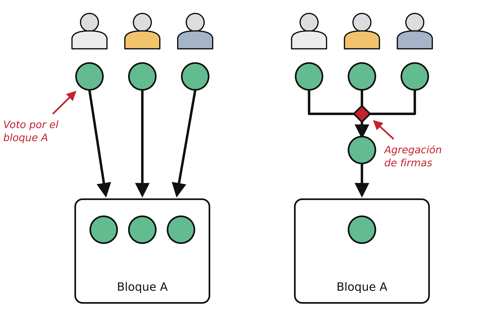
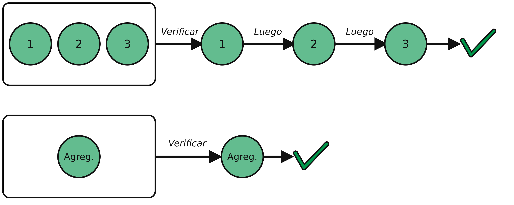
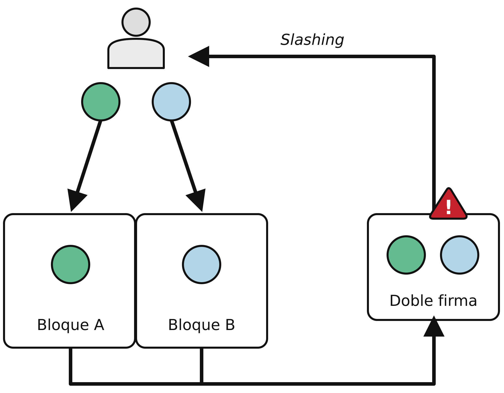
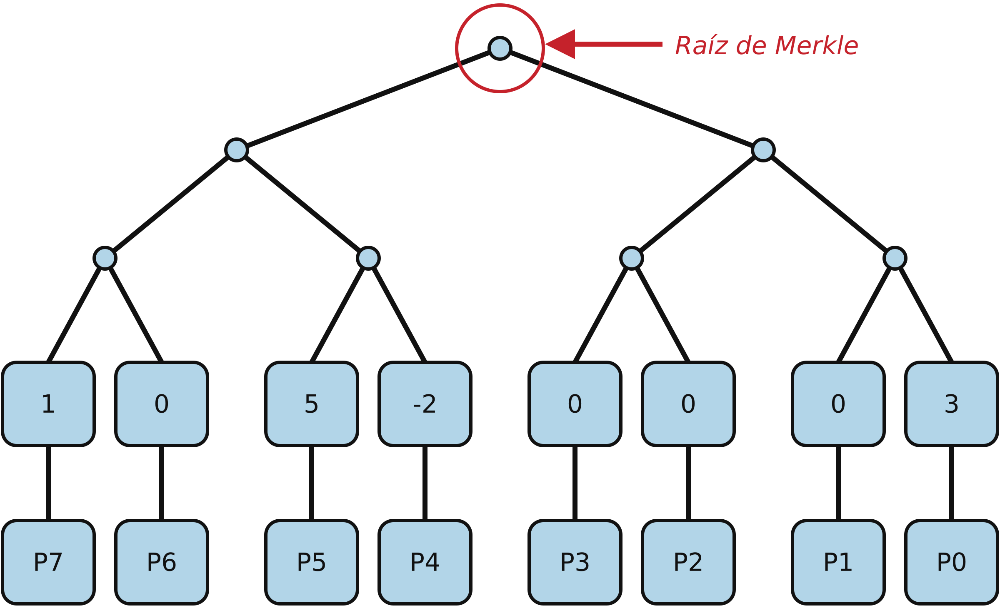
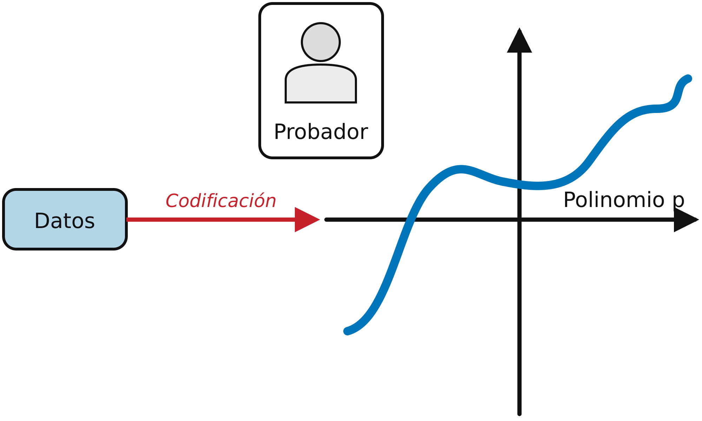
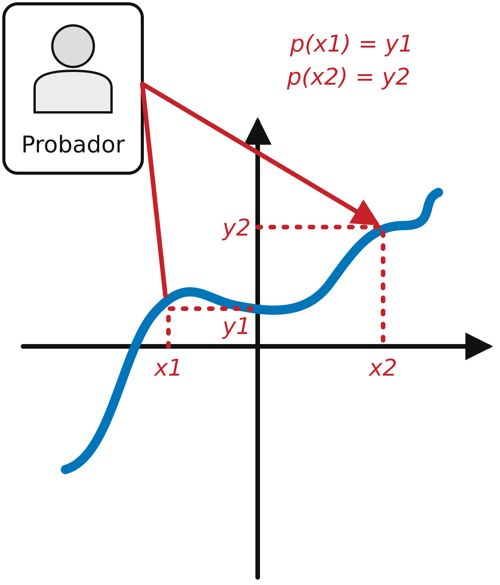
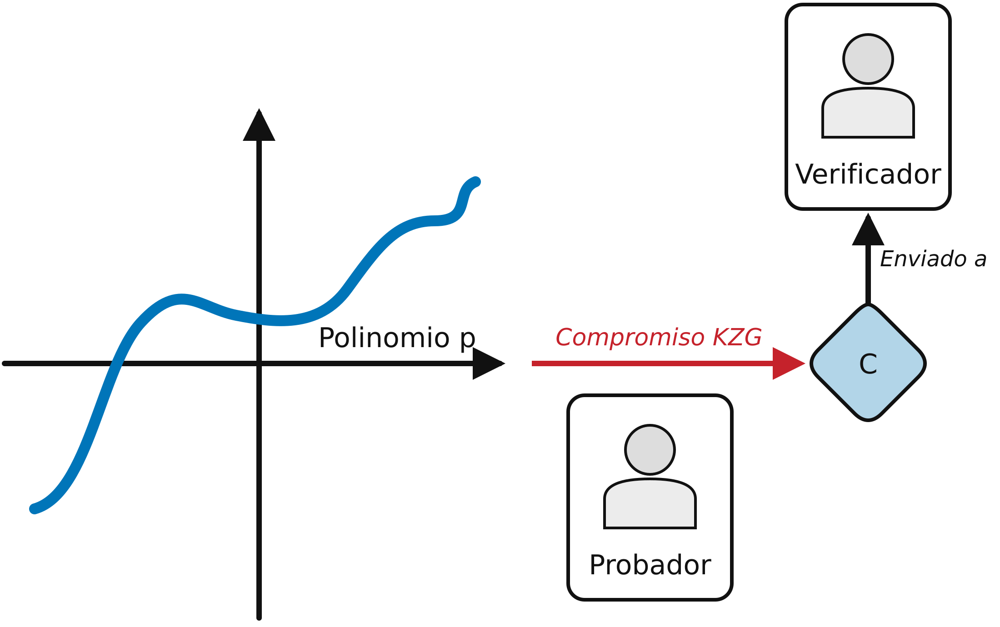
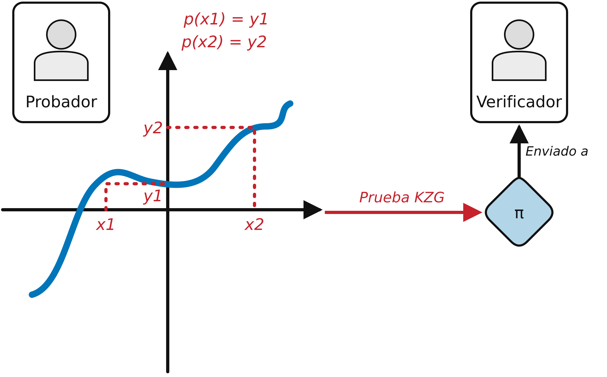
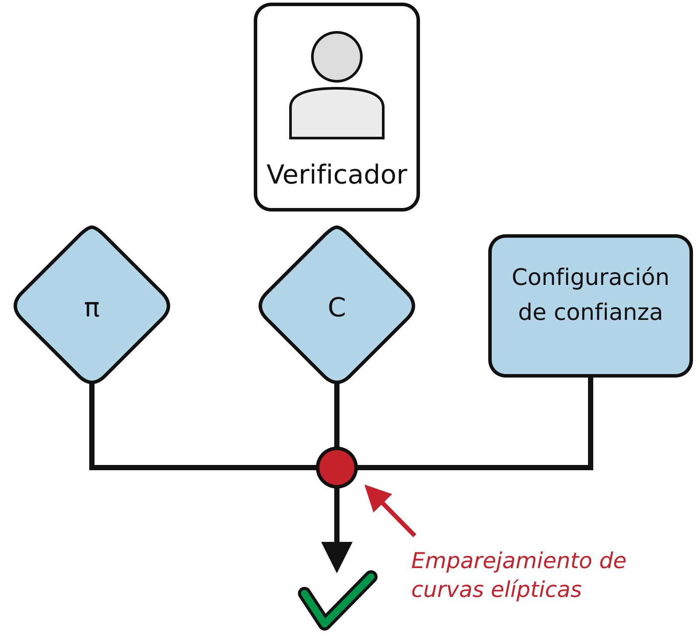

# Capítulo 4. Criptografía

Una de las tecnologías fundamentales de Ethereum es la *criptografía*, una rama de las matemáticas utilizada ampliamente en la seguridad informática. Criptografía significa "escritura secreta" en griego, pero su estudio abarca más que la escritura secreta, denominada *cifrado*. Por ejemplo, la criptografía también puede utilizarse para demostrar el conocimiento de un secreto sin revelarlo (p. ej., con una *firma digital*) o para demostrar la autenticidad de los datos (p. ej., con huellas digitales, también conocidas como *hashes*). Estos tipos de pruebas criptográficas son herramientas matemáticas esenciales para el funcionamiento de la plataforma Ethereum (y, de hecho, de todos los sistemas blockchain) y también se utilizan ampliamente en las aplicaciones de Ethereum.

Cabe señalar que, al momento de la publicación, ninguna parte del protocolo Ethereum implica cifrado; es decir, todas las comunicaciones con la plataforma Ethereum y entre nodos (incluidos los datos de las transacciones) están sin cifrar y cualquiera puede (necesariamente) leerlas. Esto permite que todos verifiquen la corrección de las actualizaciones de estado y que se alcance el consenso. En el futuro, estarán disponibles herramientas criptográficas avanzadas, como las pruebas de conocimiento cero y el cifrado homomórfico, que permitirán registrar algunos cálculos cifrados en la blockchain sin impedir el consenso; sin embargo, aunque se han previsto, todavía no se han desplegado por completo.

En este capítulo, presentaremos parte de la criptografía utilizada en Ethereum, concretamente la *criptografía de clave pública* (PKC), utilizada para controlar la propiedad de los fondos mediante claves privadas y direcciones.

## Claves y direcciones

Como aprendimos anteriormente en este libro, Ethereum tiene dos tipos diferentes de cuentas: EOA y contratos. La propiedad del ether de las EOA se establece mediante *claves privadas* digitales, *direcciones* de Ethereum y *firmas* digitales. Las claves privadas constituyen el núcleo de todas las interacciones de los usuarios con Ethereum. De hecho, las direcciones de las cuentas se derivan directamente de las claves privadas: una clave privada determina de forma unívoca una sola dirección de Ethereum, también conocida como cuenta.

Las claves privadas no se utilizan directamente de ninguna manera en el sistema Ethereum; nunca se transmiten ni se almacenan en Ethereum. Es decir, deben permanecer privadas y nunca aparecer en los mensajes enviados a la red, ni almacenarse en la cadena; solo las direcciones de las cuentas y las firmas digitales se transmiten y almacenan en el sistema Ethereum. Para obtener más información sobre cómo mantener seguras y protegidas las claves privadas, consulte "Buenas prácticas para billeteras".

El acceso y el control de los fondos se logran mediante firmas digitales, que también se crean con la clave privada. Las transacciones de Ethereum requieren una firma digital válida para incluirse en la blockchain. Cualquier persona que tenga una copia de una clave privada controla la cuenta correspondiente y todo el ether que contiene. Si un usuario mantiene segura su clave privada, las firmas digitales de las transacciones de Ethereum demuestran quién es el verdadero propietario de los fondos, porque demuestran la propiedad de la clave privada.

En los sistemas basados en PKC, como el que utiliza Ethereum, las claves vienen en pares formados por una clave privada (secreta) y una clave pública. La clave pública es similar a un número de cuenta bancaria y la clave privada es similar al PIN secreto; esta última proporciona el control sobre la cuenta y la primera la identifica ante los demás. Los usuarios de Ethereum rara vez ven las claves privadas en sí; en su mayoría, se almacenan (cifradas) en archivos especiales y se administran mediante software de billeteras de Ethereum.

En la parte del pago de una transacción de Ethereum, el destinatario previsto se representa mediante una dirección de Ethereum, utilizada del mismo modo que los datos de la cuenta beneficiaria de una transferencia bancaria. Como veremos en detalle en breve, una dirección de Ethereum de una EOA se genera a partir de la parte de clave pública de un par de claves. Sin embargo, no todas las direcciones de Ethereum representan pares de claves públicas y privadas; también pueden representar contratos que, como veremos en el capítulo 7, no están respaldados por claves privadas.

En el resto de este capítulo:

- Profundizaremos en los fundamentos de la criptografía y exploraremos sus bases matemáticas dentro de Ethereum
- Examinaremos los procesos de generación, almacenamiento y administración de claves
- Revisaremos los diversos formatos de codificación utilizados para las claves privadas, las claves públicas y las direcciones
- Investigaremos la criptografía de las claves de los validadores y el esquema de compromisos KZG, que representan las actualizaciones más recientes de la infraestructura criptográfica de Ethereum

## PKC y criptomonedas

La PKC (también llamada *criptografía asimétrica*) es una parte central de la seguridad de la información moderna. El *protocolo de intercambio de claves*, publicado por primera vez en la década de 1970 por Martin Hellman, Whitfield Diffie y Ralph Merkle, fue un avance monumental que provocó la primera gran ola de interés público en el campo de la criptografía. Antes de la década de 1970, los gobiernos mantenían en secreto los conocimientos criptográficos sólidos.

La PKC utiliza claves únicas para proteger la información. Estas claves se basan en funciones matemáticas con una propiedad especial: es fácil calcularlas, pero difícil calcular su inversa. A partir de estas funciones, la criptografía permite crear secretos digitales y firmas digitales imposibles de falsificar, protegidos por las leyes de las matemáticas.

Por ejemplo, multiplicar dos números primos grandes es trivial. Pero, dado el producto de dos primos grandes, es muy difícil encontrar los factores primos (un problema llamado *factorización en primos*). Supongamos que presentamos el número 8,018,009 e indicamos que es el producto de dos primos. Encontrar esos dos primos es mucho más difícil que multiplicarlos para obtener 8,018,009.

Algunas de estas funciones matemáticas pueden invertirse fácilmente si se conoce cierta información secreta. En el ejemplo anterior, si indicamos que uno de los factores primos es 2,003, se puede encontrar trivialmente el otro mediante una división sencilla: 8,018,009 ÷ 2,003 = 4,003. Estas funciones suelen llamarse *funciones de trampilla* porque son muy difíciles de invertir a menos que se proporcione información secreta que pueda utilizarse como atajo para invertir la función.

Una categoría más avanzada de funciones matemáticas útiles en criptografía se basa en operaciones aritméticas sobre una *curva elíptica*. En la aritmética de curvas elípticas, la multiplicación módulo un primo es sencilla, pero la división (la inversa) es prácticamente imposible. Esto se denomina *problema del logaritmo discreto* y actualmente no se conocen trampillas. La *criptografía de curvas elípticas* se utiliza ampliamente en los sistemas informáticos modernos y es la base del uso de claves privadas y firmas digitales en Ethereum (y otras criptomonedas).

> **Nota**
>
> Consulte los siguientes recursos si le interesa leer más sobre criptografía y las funciones matemáticas utilizadas en la criptografía moderna:
> - [Criptografía](https://oreil.ly/wOT_b)
> - [Función de trampilla](https://oreil.ly/WrxXr)
> - [Factorización en primos](https://oreil.ly/rxAnN)
> - [Logaritmo discreto](https://oreil.ly/pj8PD)
> - [Criptografía de curvas elípticas](https://oreil.ly/RP2QF)

En Ethereum, utilizamos PKC para crear el par de claves pública y privada del que hemos hablado en este capítulo. Se consideran un "par" porque la clave pública se deriva de la privada. Juntas representan una cuenta de Ethereum al proporcionar, respectivamente, un identificador de cuenta de acceso público (la dirección) y control privado sobre el acceso a cualquier ether de la cuenta y sobre cualquier autenticación que la cuenta necesite al utilizar contratos inteligentes. La clave privada controla el acceso porque es la información única necesaria para crear firmas digitales, requeridas para firmar las transacciones que gastan fondos de la cuenta. Las firmas digitales también se utilizan para autenticar a los propietarios o usuarios de contratos, como veremos en el capítulo 7.

> **Consejo**
>
> En la mayoría de las implementaciones de billeteras, las claves privada y pública se almacenan juntas como un par de claves por comodidad. Sin embargo, la clave pública puede calcularse trivialmente a partir de la privada, por lo que también es posible almacenar solo la clave privada.

Se puede crear una firma digital para firmar cualquier mensaje. En las transacciones de Ethereum, los detalles de la propia transacción se utilizan como mensaje. Las matemáticas de la criptografía, en este caso la criptografía de curvas elípticas, permiten combinar el mensaje (es decir, los detalles de la transacción) con la clave privada para crear un código que solo puede producirse conociendo la clave privada. Ese código se denomina firma digital.

Cabe señalar que una transacción de Ethereum es, en esencia, una solicitud de acceso a una cuenta específica con una dirección de Ethereum específica. Cuando se envía una transacción a la red Ethereum para mover fondos o interactuar con contratos inteligentes, debe enviarse con una firma digital creada con la clave privada correspondiente a la dirección de Ethereum en cuestión. Las matemáticas de curvas elípticas permiten que cualquiera verifique que una transacción es válida, al comprobar que la firma digital coincide con los detalles de la transacción y la dirección de Ethereum a la que se solicita acceso. La verificación no involucra en absoluto la clave privada; esta permanece privada. Sin embargo, el proceso de verificación determina sin lugar a dudas que la transacción solo pudo provenir de alguien que tiene la clave privada correspondiente a la clave pública detrás de la dirección de Ethereum. Esta es la "magia" de la PKC.

> **Consejo**
>
> El cifrado no forma parte del protocolo Ethereum: todos los mensajes enviados como parte del funcionamiento de la red Ethereum pueden (necesariamente) ser leídos por todos. Por tanto, las claves privadas solo se utilizan para crear firmas digitales que autentican las transacciones.

## Claves privadas

Una clave privada es simplemente un número elegido al azar. La propiedad y el control de la clave privada son la base del control del usuario sobre todos los fondos asociados con la dirección de Ethereum correspondiente, así como del acceso a los contratos que autorizan esa dirección. La clave privada se utiliza para crear las firmas necesarias para gastar ether al demostrar la propiedad de los fondos utilizados en una transacción. La clave privada debe permanecer secreta en todo momento, porque revelarla a terceros equivale a darles el control del ether y de los contratos protegidos por ella. También debe respaldarse y protegerse contra pérdidas accidentales. Si se pierde, no puede recuperarse, y los fondos que protege también se pierden para siempre.

> **Consejo**
>
> La clave privada de Ethereum no es más que un número. Una forma de elegir claves privadas al azar es utilizar una moneda, lápiz y papel: lance una moneda 256 veces y tendrá los dígitos binarios de una clave privada aleatoria que podrá utilizar en una billetera de Ethereum (probablemente; consulte los párrafos siguientes). Después pueden generarse la clave pública y la dirección a partir de la clave privada.

El primer paso, y el más importante, para generar claves es encontrar una fuente segura de *entropía*, o aleatoriedad. Crear una clave privada de Ethereum consiste esencialmente en elegir un número entre 1 y 2^256. El método exacto utilizado para elegirlo no importa, siempre que no sea predecible ni determinista. El software de Ethereum utiliza el *generador de números aleatorios* (RNG) del sistema operativo subyacente para producir 256 bits aleatorios. Por lo general, el RNG del sistema operativo se inicializa con una fuente humana de aleatoriedad; por eso puede solicitarse mover el ratón durante unos segundos o presionar teclas aleatorias. Una alternativa podría ser el ruido de radiación cósmica en el canal del micrófono de la computadora.

Más precisamente, una clave privada puede ser cualquier número distinto de cero hasta un número muy grande ligeramente menor que 2^256, un enorme número de 78 dígitos, aproximadamente 1.158 × 10^77. El número exacto comparte los primeros 38 dígitos con 2^256 y se define como el orden de la curva elíptica utilizada en Ethereum. Para crear una clave privada, elegimos al azar un número de 256 bits y comprobamos que esté dentro del rango válido. En términos de programación, esto suele lograrse introduciendo una cadena aún mayor de bits aleatorios (recopilados de una fuente de aleatoriedad criptográficamente segura) en un algoritmo hash de 256 bits como Keccak-256 o SHA-256; ambos producen convenientemente un número de 256 bits. Si el resultado está dentro del rango válido, tenemos una clave privada adecuada. De lo contrario, volvemos a intentarlo con otro número aleatorio.

> **Nota**
>
> El tamaño del espacio de claves privadas de Ethereum, 2^256, es un número inconcebiblemente grande. Es aproximadamente 10^77 en decimal, es decir, un número de 78 dígitos. Como comparación, se estima que el universo visible contiene 10^80 átomos. Por tanto, hay casi suficientes claves privadas para dar una cuenta de Ethereum a cada átomo del universo. Si se elige una clave privada al azar, no existe una forma concebible de que alguien llegue a adivinarla o elegirla por su cuenta.

Cabe señalar que la generación de claves privadas es un proceso sin conexión; no requiere ninguna comunicación con la red Ethereum ni, de hecho, con nadie. Por tanto, para elegir un número que nadie más vaya a elegir, debe ser verdaderamente aleatorio. Si se elige el número por cuenta propia, la probabilidad de que otra persona lo pruebe (y luego se lleve el ether) es demasiado alta. Utilizar un RNG deficiente (como la función seudoaleatoria `rand` de la mayoría de los lenguajes de programación) es aún peor porque resulta todavía más obvio y fácil de replicar. Al igual que las contraseñas de las cuentas en línea, la clave privada debe ser imposible de adivinar. Afortunadamente, nunca es necesario recordarla, por lo que puede adoptarse el mejor método posible para elegirla: la aleatoriedad verdadera.

> **Advertencia**
>
> No escriba su propio código para crear un número aleatorio ni utilice un RNG "simple" ofrecido por su lenguaje de programación. Los RNG basados en JavaScript de las billeteras de navegador pueden ser inseguros a menos que estén respaldados por la entropía del sistema operativo. Es vital utilizar un generador de números seudoaleatorios criptográficamente seguro (como CSPRNG) con una semilla procedente de una fuente con suficiente entropía. Estudie la documentación de la biblioteca de RNG elegida para asegurarse de que sea criptográficamente segura. La implementación correcta de la biblioteca CSPRNG es esencial para la seguridad de las claves.

A continuación se muestra una clave privada generada al azar en formato hexadecimal (256 bits representados como 64 dígitos hexadecimales, cada uno de 4 bits):

```
f8f8a2f43c8376ccb0871305060d7b27b0554d2cc72bccf41b2705608452f315
```

## Claves públicas

Una clave pública de Ethereum es un punto sobre una curva elíptica, es decir, un conjunto de coordenadas x e y que satisfacen la ecuación de la curva elíptica.

En términos más sencillos, una clave pública de Ethereum son dos números unidos. Estos números se producen a partir de la clave privada mediante un cálculo que solo puede realizarse en un sentido. Esto significa que es trivial calcular una clave pública si se tiene la privada, pero no se puede calcular la clave privada a partir de la pública.

> **Advertencia**
>
> ¡Se vienen las MATEMÁTICAS! No se asuste. Si empieza a perderse en algún punto de los párrafos siguientes, puede saltarse las próximas secciones. Hay muchas herramientas y bibliotecas que harán los cálculos por usted.

La clave pública se calcula a partir de la privada mediante la *multiplicación de curvas elípticas*, que es prácticamente irreversible: `K = k * G`, donde `k` es la clave privada, `G` es un punto constante llamado *punto generador*, `K` es la clave pública resultante y `*` es el operador especial de "multiplicación" de curvas elípticas. Cabe señalar que la multiplicación de curvas elípticas no es como la multiplicación normal. Comparte atributos funcionales con ella, pero no mucho más. Por ejemplo, la operación inversa (que sería la división para los números normales), conocida como "encontrar el logaritmo discreto", es decir, calcular `k` si se conoce `K`, es tan difícil como probar todos los valores posibles de `k` (una búsqueda por fuerza bruta que probablemente tardará más tiempo del que permitirá este universo).

En términos más sencillos, la aritmética sobre la curva elíptica es diferente de la aritmética "normal" de enteros. Un punto (`G`) puede multiplicarse por un entero (`k`) para producir otro punto (`K`). Pero no existe la división, por lo que no es posible simplemente "dividir" la clave pública `K` entre el punto `G` para calcular la clave privada `k`. Esta es la función matemática unidireccional descrita en la sección anterior "PKC y criptomonedas".

> **Nota**
>
> La multiplicación de curvas elípticas es un tipo de función que los criptógrafos llaman "unidireccional": es fácil realizarla en un sentido (multiplicación) e imposible en el sentido inverso (división). El propietario de la clave privada puede crear fácilmente la clave pública y compartirla con el mundo, sabiendo que nadie puede invertir la función y calcular la clave privada a partir de la pública. Este recurso matemático se convierte en la base de firmas digitales seguras e imposibles de falsificar que demuestran la propiedad de los fondos de Ethereum y el control de los contratos.

Antes de demostrar cómo generar una clave pública a partir de una privada, veamos la criptografía de curvas elípticas con un poco más de detalle.

### Explicación de la criptografía de curvas elípticas

La criptografía de curvas elípticas es un tipo de criptografía asimétrica o de clave pública basada en el problema del logaritmo discreto, expresado mediante la suma y la multiplicación de puntos sobre una curva elíptica. La figura 4-1 es un ejemplo de curva elíptica, similar a la utilizada por Ethereum.

> **Nota**
>
> Ethereum utiliza exactamente la misma curva elíptica que Bitcoin, llamada `secp256k1`. Esto permite reutilizar muchas de las bibliotecas y herramientas de curvas elípticas de Bitcoin.


Figura 4-1. Una curva elíptica

Ethereum utiliza una curva elíptica específica y un conjunto de constantes matemáticas, definidos en un estándar llamado `secp256k1`, establecido por el Instituto Nacional de Estándares y Tecnología de Estados Unidos (NIST). La curva `secp256k1` se define mediante la siguiente función, que produce una curva elíptica:

```
y^2 = (x^3 + 7) over (Fp)
```

o:

```
y^2 mod p = (x^3 + 7) mod p
```

`mod p` (módulo el número primo p) indica que esta curva está definida sobre un *campo finito* de orden primo p, también escrito Fp, donde p = 2^256 – 2^32 – 2^9 – 2^8 – 2^7 – 2^6 – 2^4 – 1, que es un número primo muy grande.

Como esta curva está definida sobre un campo finito de orden primo en lugar de sobre los números reales, parece un patrón de puntos dispersos en dos dimensiones, lo que dificulta visualizarla. Sin embargo, las matemáticas son idénticas a las de una curva elíptica sobre los números reales. Como ejemplo, la figura 4-2 muestra la misma curva elíptica sobre un campo finito mucho más pequeño, de orden primo 17, con un patrón de puntos sobre una cuadrícula. La curva elíptica `secp256k1` de Ethereum puede imaginarse como un patrón de puntos mucho más complejo sobre una cuadrícula inconcebiblemente grande.


Figura 4-2. Criptografía de curvas elípticas: visualización de una curva elíptica sobre F(p), con p=17

Por ejemplo, el siguiente punto Q con coordenadas (x, y) es un punto de la curva `secp256k1`:

```
Q = (49790390825249384486033144355916864607616083520101638681403973749255924539515, 59574132161899900045862086493921015780032175291755807399284007721050341297360)
```

El ejemplo 4-1 muestra cómo comprobarlo con Python. Las variables `x` e `y` son las coordenadas del punto Q, como en el ejemplo anterior. La variable `p` es el orden primo de la curva elíptica (el primo utilizado en todas las operaciones módulo). La última línea de Python es la ecuación de la curva elíptica (el operador `%` de Python es el operador módulo). Si `x` e `y` son realmente las coordenadas de un punto sobre la curva elíptica, satisfacen la ecuación y el resultado es cero. Pruébelo escribiendo `python` (o `python3`) en una línea de comandos y copiando cada línea (después del indicador `>>>`) del listado.

**Ejemplo 4-1. Uso de Python para confirmar que este punto está sobre la curva elíptica**

```python
Python 3.12.4 (main, Jun  6 2024, 18:26:44) [Clang 15.0.0 (clang-1500.3.9.4)] on darwin
Type "help", "copyright", "credits" or "license" for more information.
>>> p = 115792089237316195423570985008687907853269984665640564039457584007908834671663
>>> x = 49790390825249384486033144355916864607616083520101638681403973749255924539515
>>> y = 59574132161899900045862086493921015780032175291755807399284007721050341297360
>>> (x ** 3 + 7 - y**2) % p
0
```

### Operaciones aritméticas de curvas elípticas

Gran parte de las matemáticas de curvas elípticas se parece y funciona de forma muy similar a la aritmética de enteros que aprendimos en la escuela. En concreto, podemos definir un operador de suma que, en lugar de saltar por la recta numérica, salta a otros puntos de la curva. Una vez que tenemos el operador de suma, también podemos definir la multiplicación de un punto por un número entero, que equivale a una suma repetida.

La suma de curvas elípticas se define de modo que, dados dos puntos P1 y P2 sobre la curva elíptica, existe un tercer punto P3 = P1 + P2, también sobre la curva elíptica.

Geométricamente, este tercer punto P3 se calcula trazando una recta entre P1 y P2. Esta recta intersecará la curva elíptica en exactamente un punto adicional (sorprendentemente). Llamemos a este punto P3′ = (x, y). Luego, reflejémoslo respecto del eje x para obtener P3 = (x, –y), como se ve en la figura 4-3.


Figura 4-3. Suma de curvas elípticas: suma de dos puntos sobre una curva elíptica

Si P1 y P2 son el mismo punto, la recta "entre" P1 y P2 debe extenderse para ser la tangente a la curva en ese punto P1. Esta tangente intersecará la curva en exactamente un punto nuevo, como se muestra en la figura 4-4. Se pueden utilizar técnicas de cálculo para determinar la pendiente de la recta tangente. Curiosamente, estas técnicas funcionan, ¡aunque restringimos nuestro interés a los puntos de la curva con dos coordenadas enteras!


Figura 4-4. Suma de curvas elípticas: suma de un punto consigo mismo

En las matemáticas de curvas elípticas también existe un punto llamado *punto en el infinito*, que corresponde aproximadamente al papel del número cero en la suma. En las computadoras, a veces se representa mediante `x = y = 0` (que no satisface la ecuación de la curva elíptica, pero es un caso aparte fácil de comprobar). Hay un par de casos especiales que explican la necesidad del punto en el infinito.

En algunos casos (p. ej., si P1 y P2 tienen los mismos valores de x pero distintos valores de y, como se muestra en la figura 4-5), la recta será exactamente vertical; en ese caso, P3 = el punto en el infinito.


Figura 4-5. Suma de curvas elípticas: un caso especial da como resultado el punto en el infinito

Si P1 es el punto en el infinito, entonces P1 + P2 = P2. Del mismo modo, si P2 es el punto en el infinito, entonces P1 + P2 = P1. Esto muestra cómo el punto en el infinito desempeña el papel del cero en la aritmética "normal".

Resulta que `+` es asociativo, lo que significa que `(A + B) + C = A + (B + C)`. Esto permite escribir `A + B + C` (sin paréntesis) sin ambigüedad.

Ahora que hemos definido la suma, podemos definir la multiplicación de la manera habitual que extiende la suma. Para un punto P sobre la curva elíptica, si k es un número entero, entonces `k * P = P + P + P + … + P` (k veces). Cabe señalar que en este caso k se denomina a veces exponente (quizá de forma confusa).

### Generación de una clave pública

Partiendo de una clave privada en forma de un número `k` generado al azar, la multiplicamos por un punto predeterminado de la curva llamado punto generador `G` para producir otro punto en otra parte de la curva, que es la clave pública correspondiente `K`:

```
K = k * G
```

El punto generador se especifica como parte del estándar `secp256k1`; es el mismo para todas las implementaciones de `secp256k1`, y todas las claves derivadas de esa curva utilizan el mismo punto `G`. Como el punto generador siempre es el mismo para todos los usuarios de Ethereum, una clave privada `k` multiplicada por `G` siempre dará como resultado la misma clave pública `K`. La relación entre `k` y `K` es fija, pero solo puede calcularse en un sentido, de `k` a `K`. Por eso una dirección de Ethereum (derivada de `K`) puede compartirse con cualquiera y no revela la clave privada del usuario (`k`).

Como describimos en la sección anterior, la multiplicación `k * G` equivale a una suma repetida, es decir, `G + G + G + … + G`, repetida k veces. En resumen, para producir una clave pública `K` a partir de una clave privada `k`, sumamos el punto generador `G` consigo mismo k veces.

> **Consejo**
>
> Una clave privada puede convertirse en una clave pública, pero una clave pública no puede volver a convertirse en una clave privada, porque las matemáticas solo funcionan en un sentido.

Apliquemos este cálculo para encontrar la clave pública de la clave privada específica que mostramos en la sección "Claves privadas":

```
K = f8f8a2f43c8376ccb0871305060d7b27b0554d2cc72bccf41b2705608452f315 * G
```

Una biblioteca criptográfica puede ayudarnos a calcular `K` mediante la multiplicación de curvas elípticas. La clave pública `K` resultante se define como el punto:

```
K = (x, y)
```

donde:

```
x = 6e145ccef1033dea239875dd00dfb4fee6e3348b84985c92f103444683bae07b
y = 83b5c38e5e2b0c8529d7fa3f64d46daa1ece2d9ac14cab9477d042c84c32ccd0
```
En Ethereum, las claves públicas pueden representarse como una serialización de 130 caracteres hexadecimales (65 bytes). Esto se adopta de un formato de serialización estándar propuesto por el consorcio industrial Standards for Efficient Cryptography Group (SECG), documentado en [Standards for Efficient Cryptography (SEC1)](https://oreil.ly/Y_cOQ). El estándar define cuatro prefijos posibles que pueden utilizarse para identificar puntos sobre una curva elíptica, enumerados en la tabla 4-1.

**Tabla 4-1. Prefijos de claves públicas de curvas elípticas serializadas**

| Prefijo | Significado | Longitud (bytes, incluido el prefijo) |
|--------|---------|----------------------------------|
| 0x00 | Punto en el infinito | 1 |
| 0x04 | Punto sin comprimir | 65 |
| 0x02 | Punto comprimido con y par | 33 |
| 0x03 | Punto comprimido con y impar | 33 |

Ethereum solo utiliza claves públicas sin comprimir, por lo que el único prefijo relevante es (hex) `04`. La serialización concatena las coordenadas x e y de la clave pública:

```
04 + x-coordinate (32 bytes / 64 hex) + y-coordinate (32 bytes / 64 hex)
```

Por tanto, la clave pública que calculamos anteriormente se serializa así:

```
046e145ccef1033dea239875dd00dfb4fee6e3348b84985c92f103444683bae07b83b5c38e5e2b0c8529d7fa3f64d46daa1ece2d9ac14cab9477d042c84c32ccd0
```

### Bibliotecas de curvas elípticas

Hay un par de implementaciones de la curva elíptica `secp256k1` utilizadas en proyectos relacionados con criptomonedas:

[**OpenSSL**](https://www.openssl.org)

La biblioteca OpenSSL ofrece un conjunto completo de primitivas criptográficas, incluida una implementación completa de `secp256k1`. Por ejemplo, para derivar la clave pública puede utilizarse la función `EC_POINT_mul`.

[**libsecp256k1**](https://oreil.ly/lv84W)

`libsecp256k1` de Bitcoin Core es una implementación en lenguaje C de la curva elíptica `secp256k1` y otras primitivas criptográficas. Se escribió desde cero para reemplazar OpenSSL en el software Bitcoin Core y se considera superior tanto en rendimiento como en seguridad.

## Funciones hash criptográficas

Las funciones hash criptográficas se utilizan en todo Ethereum. De hecho, las funciones hash se utilizan ampliamente en casi todos los sistemas criptográficos, un hecho que expresó el criptógrafo Bruce Schneier al decir: "Mucho más que los algoritmos de cifrado, las funciones hash unidireccionales son las herramientas de trabajo de la criptografía moderna".

En esta sección, analizaremos las funciones hash, exploraremos sus propiedades básicas y veremos cómo esas propiedades las hacen tan útiles en tantas áreas de la criptografía moderna. Abordamos aquí las funciones hash porque forman parte de la transformación de las claves públicas de Ethereum en direcciones. También pueden utilizarse para crear huellas digitales, que ayudan a verificar los datos.

En términos sencillos, una *función hash* es cualquier función que puede utilizarse para transformar datos de tamaño arbitrario en datos de tamaño fijo. La entrada de una función hash se llama *preimagen*, *mensaje* o simplemente datos de entrada. La salida se llama *hash*. Las funciones hash criptográficas son una subcategoría especial con propiedades específicas útiles para proteger plataformas como Ethereum.

Una función hash criptográfica es una *función hash unidireccional* que transforma datos de tamaño arbitrario en una cadena de bits de tamaño fijo. Su naturaleza "unidireccional" significa que es computacionalmente inviable reconstruir los datos de entrada si solo se conoce el hash de salida. La única forma de determinar una entrada posible es realizar una búsqueda por fuerza bruta, comprobando cada candidato para encontrar una salida coincidente; como el espacio de búsqueda es prácticamente infinito, es fácil comprender la imposibilidad práctica de la tarea. Incluso si se encuentran datos de entrada que crean un hash coincidente, puede que no sean los originales: las funciones hash son funciones de "muchos a uno". Encontrar dos conjuntos de datos de entrada que produzcan el mismo hash de salida se llama encontrar una *colisión de hash*. A grandes rasgos, cuanto mejor es la función hash, más raras son las colisiones. Para Ethereum, son imposibles en la práctica.

Veamos con más detalle las principales propiedades de las funciones hash criptográficas:

**Determinismo**

Un mensaje de entrada dado siempre produce el mismo hash de salida.

**Verificabilidad**

Calcular el hash de un mensaje es eficiente (complejidad lineal).

**Ausencia de correlación**

Un pequeño cambio en el mensaje (p. ej., un cambio de 1 bit) debería modificar el hash de salida de forma tan extensa que no pueda correlacionarse con el hash del mensaje original.

**Irreversibilidad**

Calcular el mensaje a partir de su hash es inviable, equivalente a una búsqueda por fuerza bruta entre todos los mensajes posibles.

**Protección contra colisiones**

Debería ser inviable calcular dos mensajes diferentes que produzcan el mismo hash de salida.

La resistencia a las colisiones de hash es particularmente importante para evitar la falsificación de firmas digitales en Ethereum.

La combinación de estas propiedades hace que las funciones hash criptográficas sean útiles para una amplia variedad de aplicaciones de seguridad, entre ellas:

- Huellas digitales de datos
- Integridad de mensajes (detección de errores)
- Prueba de trabajo
- Autenticación (hash de contraseñas y fortalecimiento de claves)
- Generadores de números seudoaleatorios
- Compromisos de mensajes (mecanismos de compromiso y revelación)
- Identificadores únicos

Encontraremos muchas de estas aplicaciones en Ethereum a medida que avancemos por las distintas capas del sistema.

### La función hash criptográfica de Ethereum: Keccak-256

Ethereum utiliza la función hash criptográfica Keccak-256 en muchos lugares. Keccak-256 se diseñó como candidata para la competencia de funciones hash criptográficas SHA-3 organizada en 2007 por NIST. Keccak fue el algoritmo ganador y se estandarizó como Federal Information Processing Standard (FIPS) 202 en 2015.

Sin embargo, durante el período en que se desarrolló Ethereum, la estandarización de NIST aún no había finalizado. NIST ajustó algunos parámetros de Keccak después de completar el proceso de estandarización, supuestamente para mejorar su eficiencia. Al mismo tiempo, el heroico denunciante Edward Snowden reveló documentos que sugerían que NIST podría haber recibido influencia indebida de la Agencia de Seguridad Nacional para debilitar intencionalmente el estándar de RNG Dual_EC_DRBG, introduciendo en la práctica una puerta trasera en el RNG estándar. Esta controversia provocó un rechazo a los cambios propuestos y un retraso considerable en la estandarización de SHA-3. En ese momento, la Fundación Ethereum decidió implementar el algoritmo Keccak original propuesto por sus inventores, en lugar del estándar SHA-3 modificado por NIST.

> **Advertencia**
>
> Aunque puede encontrarse "SHA-3" en documentos y código de Ethereum, muchas de esas menciones, si no todas, se refieren en realidad a Keccak-256, no al estándar SHA-3 FIPS-202 finalizado. Las diferencias de implementación son leves y están relacionadas con los parámetros de relleno, pero son significativas porque Keccak-256 produce hashes distintos de los de SHA-3 FIPS-202 para una misma entrada.

### ¿Qué función hash estoy utilizando?

¿Cómo saber si la biblioteca de software utilizada implementa SHA-3 FIPS-202 o Keccak-256, si ambas pueden llamarse "SHA-3"?

Una forma sencilla de saberlo es utilizar un *vector de prueba*, una salida esperada para una entrada dada. La prueba más utilizada para una función hash es la entrada vacía. Si se ejecuta la función hash con una cadena vacía como entrada, deberían verse los siguientes resultados:

```
Keccak256("") = c5d2460186f7233c927e7db2dcc703c0e500b653ca82273b7bfad8045d85a470
SHA3("") = a7ffc6f8bf1ed76651c14756a061d662f580ff4de43b49fa82d80a4b80f8434a
```

Independientemente del nombre de la función, puede comprobarse si es Keccak-256 original o el estándar final SHA-3 FIPS-202 de NIST mediante esta prueba sencilla. Recuerde que Ethereum utiliza Keccak-256, aunque a menudo se lo llame SHA-3 en el código.

> **Nota**
>
> Debido a la confusión creada por la diferencia entre la función hash utilizada en Ethereum (Keccak-256) y el estándar finalizado (FIP-202 SHA-3), todas las apariciones de `sha3` en todo el código, los códigos de operación y las bibliotecas se han renombrado como `keccak256`. Consulte [ERC-59](https://oreil.ly/rTHDv) para conocer los detalles.

A continuación, examinemos la primera aplicación de Keccak-256 en Ethereum: producir direcciones de Ethereum a partir de claves públicas.

## Direcciones de Ethereum

Las direcciones de Ethereum son identificadores únicos que se derivan de claves públicas o contratos mediante la función hash unidireccional Keccak-256.

En nuestros ejemplos anteriores, partimos de una clave privada y utilizamos la multiplicación de curvas elípticas para derivar una clave pública.

**Clave privada k:**

```
k = f8f8a2f43c8376ccb0871305060d7b27b0554d2cc72bccf41b2705608452f315
```

**Clave pública K (coordenadas x e y concatenadas y representadas en hexadecimal):**

```
K = 6e145ccef1033dea239875dd00dfb4fee6e3348b84985c92f103444683bae07b83b5c38e5e...
```

> **Nota**
>
> Cabe señalar que la clave pública no lleva el prefijo (hex) `04` cuando se calcula la dirección.

Utilizamos Keccak-256 para calcular el hash de esta clave pública:

```
Keccak256(K) = 2a5bc342ed616b5ba5732269001d3f1ef827552ae1114027bd3ecf1f086ba0f9
```

Luego conservamos solo los últimos 20 bytes (los bytes menos significativos), que constituyen nuestra dirección de Ethereum:

```
001d3f1ef827552ae1114027bd3ecf1f086ba0f9
```

La mayoría de las veces, las direcciones de Ethereum aparecen con el prefijo `0x`, que indica que están codificadas en hexadecimal, así:

```
0x001d3f1ef827552ae1114027bd3ecf1f086ba0f9
```

### Formatos de las direcciones de Ethereum

Las direcciones de Ethereum son números hexadecimales, identificadores derivados de los últimos 20 bytes del hash Keccak-256 de la clave pública.

A diferencia de las direcciones de Bitcoin, que se codifican en la interfaz de usuario de todos los clientes para incluir una suma de verificación integrada que protege contra errores de escritura, las direcciones de Ethereum se presentan como hexadecimal sin procesar y sin ninguna suma de verificación. El razonamiento detrás de esa decisión era que las direcciones de Ethereum acabarían ocultas tras abstracciones (como servicios de nombres) en capas superiores del sistema, y que las sumas de verificación deberían añadirse en esas capas si fuera necesario.

En realidad, estas capas superiores se desarrollaron demasiado despacio, y esta decisión de diseño provocó diversos problemas en los primeros días del ecosistema, incluida la pérdida de fondos por direcciones mal escritas y errores de validación de entrada. Además, como los servicios de nombres de Ethereum se desarrollaron más despacio de lo esperado inicialmente, los desarrolladores de billeteras adoptaron las codificaciones alternativas con mucha lentitud. A continuación veremos algunas opciones de codificación.

> **Nota**
>
> Vale la pena mencionar Ethereum Name Service (ENS), presentado en 2017 por Alex Van de Sande y Nick Johnson. ENS proporciona una solución en la cadena para convertir nombres legibles por humanos, como `masteringethereum.eth`, en direcciones de Ethereum.

### Codificación hexadecimal con suma de verificación mediante mayúsculas y minúsculas (ERC-55)

Debido al lento despliegue de los servicios de nombres, se propuso un estándar mediante [ERC-55](https://oreil.ly/JfgWs). ERC-55 ofrece una suma de verificación compatible con versiones anteriores para las direcciones de Ethereum al modificar el uso de mayúsculas y minúsculas de la dirección hexadecimal. La idea es que las direcciones de Ethereum no distinguen entre mayúsculas y minúsculas, y se supone que todas las billeteras aceptan direcciones expresadas con caracteres en mayúsculas o minúsculas sin ninguna diferencia de interpretación. Al modificar las mayúsculas y minúsculas de los caracteres alfabéticos de la dirección, podemos transmitir una suma de verificación que proteja la integridad de la dirección contra errores de escritura o lectura. Las billeteras que no admiten las sumas de verificación ERC-55 simplemente ignoran que la dirección contenga una mezcla de mayúsculas y minúsculas, pero las que sí las admiten pueden validarla y detectar errores con una precisión del 99.986%.

La codificación que mezcla mayúsculas y minúsculas es sutil y puede pasar inadvertida al principio. Nuestra dirección de ejemplo es:

```
0x001d3f1ef827552ae1114027bd3ecf1f086ba0f9
```

Con una suma de verificación ERC-55 mediante mayúsculas y minúsculas, se convierte en:

```
0x001d3F1ef827552Ae1114027BD3ECF1f086bA0F9
```

¿Se nota la diferencia? Algunos caracteres alfabéticos (A–F) del alfabeto de codificación hexadecimal ahora están en mayúsculas, mientras que otros están en minúsculas.

ERC-55 es bastante sencillo de implementar. Tomamos el hash Keccak-256 de la dirección hexadecimal en minúsculas. Este hash actúa como una huella digital de la dirección y nos proporciona una suma de verificación conveniente. Cualquier pequeño cambio en la entrada (la dirección) debería causar un gran cambio en el hash resultante (la suma de verificación), lo que nos permite detectar errores eficazmente. Después, el hash de nuestra dirección se codifica mediante las mayúsculas y minúsculas de la propia dirección. Veámoslo paso a paso:

1. Calcular el hash de la dirección en minúsculas, sin el prefijo `0x`:

    ```
    Keccak256("001d3f1ef827552ae1114027bd3ecf1f086ba0f9") = 23a69c1653e4ebbb619b0b2cb8a9bad49892a8b9695d9a19d8f673ca991deae1
    ```

2. Convertir a mayúscula cada carácter alfabético de la dirección si el dígito hexadecimal correspondiente del hash es mayor o igual que `0x8`. Esto es más fácil de mostrar si alineamos la dirección y el hash:

    ```
    Address: 001d3f1ef827552ae1114027bd3ecf1f086ba0f9
    Hash   : 23a69c1653e4ebbb619b0b2cb8a9bad49892a8b9...
    ```

Nuestra dirección contiene un carácter alfabético `d` en la cuarta posición. El cuarto carácter del hash es `6`, que es menor que 8. Por tanto, dejamos la `d` en minúscula. El siguiente carácter alfabético de nuestra dirección es `f`, en la sexta posición. El sexto carácter del hash hexadecimal es `c`, que es mayor que 8. Por tanto, convertimos la `F` de la dirección a mayúscula, y así sucesivamente. Como puede verse, solo utilizamos los primeros 20 bytes (40 caracteres hexadecimales) del hash como suma de verificación, ya que solo tenemos 20 bytes (40 caracteres hexadecimales) en la dirección para cambiar apropiadamente a mayúsculas.

Compruebe la dirección resultante con mayúsculas y minúsculas e intente identificar qué caracteres se convirtieron a mayúsculas y a qué caracteres del hash de la dirección corresponden:

```
Address: 001d3F1ef827552Ae1114027BD3ECF1f086bA0F9
Hash   : 23a69c1653e4ebbb619b0b2cb8a9bad49892a8b9...
```

### Detección de un error en una dirección codificada con ERC-55

Ahora veamos cómo las direcciones ERC-55 nos ayudan a encontrar un error. Supongamos que hemos impreso una dirección de Ethereum codificada con ERC-55:

```
0x001d3F1ef827552Ae1114027BD3ECF1f086bA0F9
```

Ahora cometamos un error básico al leer esa dirección. El penúltimo carácter es una F mayúscula. Para este ejemplo, supongamos que lo leemos erróneamente como una E mayúscula e introducimos la siguiente dirección (incorrecta) en nuestra billetera:

```
0x001d3F1ef827552Ae1114027BD3ECF1f086bA0E9
```

¡Afortunadamente, nuestra billetera cumple con EIP-55! Detecta la mezcla de mayúsculas y minúsculas e intenta validar la dirección. La convierte a minúsculas y calcula el hash de suma de verificación:

```
Keccak256("001d3f1ef827552ae1114027bd3ecf1f086ba0e9") = 5429b5d9460122fb4b11af9cb88b7bb76d8928862e0a57d46dd18dd8e08a6927
```

Como puede verse, aunque la dirección solo cambió en un carácter (de hecho, solo un bit, ya que `e` y `f` difieren en un bit), su hash cambió radicalmente. ¡Esa es la propiedad de las funciones hash que las hace tan útiles para las sumas de verificación!

Ahora alineemos ambos y comprobemos las mayúsculas y minúsculas:

```
001d3F1ef827552Ae1114027BD3ECF1f086bA0E9
5429b5d9460122fb4b11af9cb88b7bb76d892886...
```

¡Todo está mal! Varios caracteres alfabéticos están incorrectamente en mayúsculas. Recuerde que el uso de mayúsculas y minúsculas codifica la suma de verificación correcta.

Las mayúsculas y minúsculas de la dirección introducida no coinciden con la suma de verificación recién calculada, lo que significa que algo cambió en la dirección y se introdujo un error.

## Criptografía de los validadores

En esta sección exploraremos la criptografía utilizada por los validadores en el nuevo protocolo de consenso basado en PoS. Aunque la idea central siempre es poder firmar digitalmente los mensajes y verificarlos, existen requisitos interesantes que llevan a decisiones de diseño e implementaciones finales diferentes de la criptografía utilizada en Ethereum para transacciones o direcciones.

### Introducción

Cuando Ethereum utilizaba *Ethash*, el algoritmo de consenso PoW, no había motivo para que los proponentes de bloques, entonces mineros, firmaran los bloques que producían. De hecho, los algoritmos de consenso basados en PoW no necesitan saber quién crea los bloques para funcionar correctamente. Si un proponente de bloques se comporta indebidamente, el protocolo lo castiga implícitamente al hacerle desperdiciar energía eléctrica y tiempo y, por tanto, dinero.
Tomemos el ejemplo de un minero que intenta realizar un doble gasto creando dos bloques al mismo tiempo. Para comprender mejor la idea central de este "ataque", imaginemos que un minero quiere comprar un automóvil y acuerda con el vendedor pagar en ETH, digamos 10 ETH. El minero crea entonces dos bloques al mismo tiempo. Supongamos que ambos son válidos: en el primero, el minero añade la transacción de pago en la que envía 10 ETH al vendedor, mientras que en el otro bloque no lo hace. El minero intenta dividir la cadena en dos partes.

Según factores (casi) aleatorios, el vendedor podría recibir primero el bloque en el que el minero le pagó 10 ETH. Por tanto, puede suponer que el pago se realizó correctamente. Pero todavía no entrega el automóvil al minero. De hecho, sabe que en los sistemas PoW normalmente se espera una cierta cantidad de bloques antes de considerar que una transacción está definitivamente liquidada.

Después de más o menos 12 segundos, otro minero produce un nuevo bloque sobre el bloque que no contiene el pago de 10 ETH. Esto es totalmente posible, ya que suele depender de qué bloque recibió primero este siguiente minero. Ahora hay una blockchain más larga y, gracias a la *regla de la cadena más pesada*, también conocida (de forma un poco incorrecta) como *regla de la cadena más larga*, todos los nodos consideran esa cadena como la única válida.

El vendedor observa que la blockchain válida no contiene el bloque que recibió anteriormente con el pago de 10 ETH, por lo que considera que el pago no se realizó y no entrega el automóvil al minero.

Recuerde que, en los sistemas PoW, los mineros deben gastar energía y tiempo reales para producir un bloque válido que supere la comprobación PoW, es decir, que el hash del bloque sea menor que un umbral dinámico. Por tanto, el hecho de gastar energía y tiempo para crear un bloque y luego ver que toda la red lo rechaza ya constituye un castigo implícito. Perdieron energía y tiempo valiosos que podrían haber aprovechado mejor creando solo bloques válidos, respetando todas las reglas y sin intentar hacer trampa.

Los sistemas PoS no tienen este mismo castigo implícito para los productores de bloques (es decir, validadores) que se comportan indebidamente. En cambio, utilizan un método explícito: *slashing*.

El *slashing* es la acción de castigar a un validador que no siguió las reglas restándole parte (o la totalidad) de sus ETH en staking. Esto explica por qué los validadores deben poner una cantidad mínima de ETH en stake para convertirse en validadores activos. Si no tienen nada en stake, el protocolo no podrá castigarlos si comienzan a actuar de forma maliciosa.

Castigar explícitamente a los validadores por no seguir las reglas requiere saber exactamente qué hace cada uno. Para ello, todos los mensajes (incluidos los bloques) que envían los validadores deben autenticarse con sus firmas digitales.

Recreemos el ejemplo análogo que utilizamos antes con el minero. Ahora tenemos un validador que propone dos bloques al mismo tiempo. Mientras que con PoW el minero habría tenido que gastar el doble de energía y tiempo para producir dos bloques válidos al mismo tiempo, con PoS esto es (casi) completamente gratuito.

Pero aquí entra en escena el slashing. La *doble firma*, proponer dos bloques al mismo tiempo, es un evento sujeto a slashing, por lo que se castiga inmediatamente al validador destruyendo (en este ejemplo específico) todos sus ETH en stake.

Ahora que sabemos por qué los validadores deben autenticar todos sus mensajes, podemos profundizar en la criptografía utilizada para ello: las firmas BLS. En la siguiente sección veremos los requisitos que llevaron a la decisión final de utilizar criptografía BLS.

### Requisitos

La primera solución que podría pensarse para este problema, es decir, la necesidad de autenticar todos los mensajes que los validadores se envían entre sí, es aplicar el mismo algoritmo de firma digital que Ethereum ya utiliza para firmar digitalmente cada transacción: el *algoritmo de firma digital de curva elíptica* (ECDSA).

Pero no funcionaría con la gran cantidad de validadores que tiene Ethereum, más de un millón. De hecho, existe un requisito fundamental que debe cumplir este algoritmo de firma digital: debe ser posible condensar las firmas para reducir el espacio que necesitan en el bloque y disminuir el tiempo que los nodos deben dedicar a validar las firmas de todos los validadores.

Actualmente, cada validador puede emitir un voto, un mensaje que debe autenticarse, una vez por *época*, o 32 *slots* (ampliaremos esto en el capítulo 15). Estos mensajes deben viajar por la capa de gossip P2P para llegar a otros validadores y nodos, ser validados por todos los demás nodos para comprobar que la firma sea válida e insertarse en un bloque.

Es muy fácil detectar aquí un cuello de botella: cuantos más validadores se unen a la red, más mensajes deben manejar los nodos. Incluso los bloques se hacen más grandes porque deben reservar cada vez más espacio para las firmas de esos validadores.

> **Nota**
>
> Se puede calcular fácilmente la cantidad de mensajes que deben manejar los nodos a partir de la cantidad de validadores activos:
> ```
> N = number of active validators
> 1 msg / 1 epoch × N =
> = 1 msg / 32 slots × N = ← one epoch is made of 32 slots
> = 1 msg / 32 × 12 seconds × N = ← every slot takes 12 seconds
> = 1 msg / 384 seconds × N =
> = 0.0026041667 msg / second × N
> ```
>
> Por tanto, tenemos unos 0.0026 mensajes por segundo que debemos multiplicar por N, la cantidad de validadores activos en la red:
>
> ```
> N = 1,000 → ~2.6 messages per second
> N = 10,000 → ~26 messages per second
> N = 100,000 → 260 messages per second
> N = 1,000,000 → 2,600 messages per second
> ```

Actualmente, el protocolo PoS de Ethereum maneja unos 2,600 mensajes por segundo.

Por estas razones, la mayoría de las blockchains PoS tiene un conjunto de validadores muy pequeño, de decenas o, como máximo, cientos. Incluso la propuesta inicial de Ethereum (véase [EIP-1011](https://oreil.ly/pQSCp)) apuntaba a un máximo de novecientos validadores, con 1,500 ETH como depósito mínimo para ser elegido dentro del conjunto de validadores activos.

Esta habría sido la especificación final del protocolo PoS de Ethereum si Justin Drake, investigador de la Fundación Ethereum, no hubiera propuesto la idea de la agregación de firmas BLS en mayo de 2018 en un [extenso artículo publicado en el sitio web ethresearch](https://oreil.ly/EbBib).

### Firmas digitales BLS

Las firmas BLS llevan el nombre de sus autores. BLS significa Boneh–Lynn–Shacham y hace referencia a los tres criptógrafos Dan Boneh, Ben Lynn y Hovav Shacham, que presentaron el esquema de firmas en su artículo titulado ["Short Signatures from the Weil Pairing"](https://oreil.ly/cJn6v) en 2001.

Al igual que ECDSA (que se explicará con más detalle en el capítulo 6), las firmas BLS también se basan en criptografía de curvas elípticas. En particular, Ethereum utiliza la curva *BLS12-381*, diseñada por Sean Bowe en 2017 mientras trabajaba para el protocolo Zcash. Se define mediante la siguiente función:

```
y^2 = x^3 + 4
```

sobre los enteros módulo q, donde q es un número de 115 dígitos decimales: `0x1a0111ea397fe69a4b1ba7b6434bacd764774b84f38512bf6730d2a0f6b0f6241eabfffeb153ffffb9feffffffffaaab`.

#### ¿Cómo funciona?

La idea central es muy similar al funcionamiento de ECDSA: existe una clave secreta de la que se deriva una clave pública. Luego, cada mensaje se firma con la clave secreta y todos los demás pueden verificar su integridad mediante la clave pública correspondiente.

La clave secreta (`sk`) es un entero entre 1 y r – 1, donde r es este enorme número: `0x73eda753299d7d483339d80809a1d80553bda402fffe5bfeffffffff00000001`. ¡Tiene 77 dígitos decimales!

La clave pública (`pk`) se obtiene mediante `sk * g1`, una multiplicación escalar del punto de la curva elíptica, donde `g1` es el generador de un grupo llamado G1. La `pk` se representa en un formato comprimido y serializado, lo que da una cadena de 48 bytes.

El mensaje (`m`) que se firma siempre se transforma en un punto de una curva elíptica que pertenece a un grupo diferente llamado G2. Esta transformación puede entenderse como una especie de función hash que toma un mensaje `m`, es decir, la atestación real del validador, y produce un punto `H(m)` en G2, representado en su forma serializada comprimida como una cadena de 96 bytes.

Por último, obtenemos la firma (σ) del mensaje `m` mediante `sk * H(m)`, un nuevo punto de curva elíptica en G2.

Las diferencias clave entre ECDSA y BLS se encuentran en los detalles de bajo nivel de ambos protocolos, es decir, en las técnicas matemáticas que utilizan para verificar la corrección de las firmas. De hecho, mientras que ECDSA implica cálculos matemáticos lineales, como la multiplicación escalar y la suma sobre la curva elíptica, las firmas BLS se basan en la aritmética más compleja de los *emparejamientos bilineales de curvas elípticas*.

De hecho, una firma σ es válida si y solo si se cumple la siguiente ecuación:

```
e(g1,σ) = e(pk, H(m))
```

donde `e` es un emparejamiento bilineal de curvas elípticas.

#### Dentro de las propiedades de las curvas elípticas

Comprender por completo la ecuación anterior requiere un conocimiento profundo de las curvas elípticas, los emparejamientos y todo ese vasto tema. Pero una forma sencilla de entenderla es seguir los pasos siguientes. No se comprenderán todos los detalles de por qué y cómo el emparejamiento tiene esa propiedad, pero aun así puede ayudar a familiarizarse con ella:

```
e(pk, H(m)) = e(sk * g1,H(m)) = ← pk = sk * g1
= e(g1, H(m))^sk = ← thanks to a pairing property
= e(g1, sk * H(m)) = ← thanks to the same property
= e(g1,σ) ← σ = sk * H(m)
```

Como señaló Vitalik Buterin en un [artículo de Medium](https://oreil.ly/v578s):

> Si se consideran los puntos de curvas elípticas como números cifrados de forma unidireccional, `encrypt(p) = p * G = P`, donde G es el punto generador, entonces, mientras las matemáticas tradicionales de curvas elípticas permiten comprobar restricciones lineales sobre los números (p. ej., si `P = G * p`, `Q = G * q` y `R = G * r`, comprobar `5 * P + 7 * Q = 11 * R` es en realidad comprobar que `5 * p + 7 * q = 11 * r`), los emparejamientos permiten comprobar restricciones cuadráticas (p. ej., comprobar `e(P, Q) * e(G, G * 5) = 1` es en realidad comprobar que `p * q + 1 * 5 = 0`).

Como puede imaginarse, una aritmética más compleja también implica más tiempo para producir y verificar una firma. La única razón por la que Ethereum utiliza firmas BLS para los validadores es su importantísima propiedad de *agregación de firmas*.

De hecho, si se toman dos firmas ECDSA y se suman, no se obtiene un resultado significativo. Si se intenta utilizar ese resultado para demostrar la integridad del mensaje firmado inicialmente, no se superará ninguna prueba.

En cambio, si se toman dos firmas BLS y se suman, simplemente se está realizando una suma de curvas elípticas. El resultado es un nuevo punto de curva elíptica, en G2, que puede utilizarse frente a la suma de las dos claves públicas correspondientes, que sigue siendo un punto de curva elíptica en G1, para verificar correctamente la integridad del mensaje firmado inicialmente.

> **Nota**
>
> Las firmas agregadas y las claves públicas agregadas son indistinguibles de una firma individual y una clave pública individual, por lo que puede utilizarse exactamente el mismo algoritmo para verificar la corrección de una firma agregada.
>
> **Firma y clave pública agregadas:**
> ```
> σagg = σ1 + σ2 + σ3 + … + σn
> pkagg = pk1 + pk2 + pk3 + … + pkn
> ```
>
> **Verificación de la firma agregada:**
>
> ```
> e(pkagg,H(m)) =
> = e(pk1 + pk2 + pk3 + ... + pkn,H(M)) =
> = e((sk1 + sk2 + sk3 + ... + skn) * g1,H(m)) =
> = e(g1,H(m))^(sk1 + sk2 + sk3 + ... + skn) =
> = e(g1,(sk1 + sk2 + sk3 + ... + skn) * H(m)) =
> = e(g1,σ1 + σ2 + σ3 + ... + σn) =
> = e(g1,σagg)
>```

#### En resumen

La criptografía es realmente difícil; requiere una base matemática profunda. Y este libro no está dirigido propiamente a criptógrafos, por lo que es fundamental resumir lo que abordamos brevemente en las secciones anteriores. Explicamos cómo funcionan las firmas BLS y por qué se eligieron como algoritmo de firma digital que utilizan los validadores en el nuevo protocolo de consenso basado en PoS: su propiedad de agregación permite condensar varias firmas digitales en una, lo que reduce el espacio necesario para almacenarlas y el tiempo para validarlas sin perder seguridad.

Ahora podemos hacer un ejemplo rápido para demostrar cómo los validadores utilizan los algoritmos BLS en la "vida real" y cómo interviene la agregación de firmas. La figura 4-6 ilustra un escenario con tres validadores que quieren expresar sus votos por un bloque, el bloque A. Por tanto, emiten sus votos, los firman y los comparten entre sí.



Figura 4-6. Agregación de firmas BLS: tres validadores votan y firman

Sin BLS, habría que guardar los tres votos firmados en el bloque para almacenarlos de forma permanente. Con BLS, pueden agregarse los tres votos firmados en un nuevo voto agregado y almacenar solo este en el bloque.

Esto no solo ahorra espacio, sino que también reduce drásticamente la cantidad de tiempo y cómputo que todos los nodos de Ethereum deben dedicar a validar todos los votos firmados, porque pueden validar directamente los agregados en lugar de validar cada voto firmado individual. Y la magia de la criptografía BLS es que el resultado agregado no es diferente de una firma normal: eso significa que verificar la validez de una firma agregada no es más difícil que verificar la validez de una firma individual. Así, al reducir considerablemente la cantidad de votos firmados que deben validarse, manteniendo la misma cantidad de cómputo para verificar cada firma, la cantidad total de cómputo y, por tanto, de tiempo que deben emplear los nodos completos es mucho menor de lo que sería sin firmas agregadas BLS, como se muestra en la figura 4-7.



Figura 4-7. La agregación de firmas BLS reduce el tiempo de validación

¿Qué ocurre si un validador no sigue las reglas? Si un validador se comporta de forma maliciosa, por ejemplo, mediante doble firma o votando por dos bloques diferentes al mismo tiempo, el protocolo puede detectar este comportamiento y castigarlo en consecuencia, como se muestra en la figura 4-8.



Figura 4-8. Las firmas BLS permiten detectar validadores maliciosos

De hecho, como todos los votos están firmados digitalmente mediante el esquema de firmas BLS, es trivial identificar a los validadores responsables de comportamientos indebidos y aplicarles slashing en consecuencia.

## Criptografía KZG

El 13 de marzo de 2024, Ethereum se actualizó al hard fork Cancun-Deneb (Dencun). Esta actualización incluyó muchos cambios, pero el más importante fue sin duda la introducción de un nuevo tipo de transacción: la transacción de blob EIP-4844.

No profundizaremos aquí en por qué las transacciones de blob son importantes para la hoja de ruta de Ethereum, ya que lo haremos con mucho más detalle en el capítulo 16. En cambio, en las próximas secciones exploraremos la criptografía que sustenta este nuevo tipo de transacción: los *esquemas de compromisos polinómicos* y, más específicamente, el *esquema de compromisos KZG*.

### Introducción

Antes de examinar los esquemas de compromisos polinómicos, es importante comprender el problema al que nos enfrentamos y el objetivo final que queremos alcanzar.

> **Nota**
>
> En esta sección mencionaremos brevemente el término capas 2 (L2). Aunque las L2 se explicarán debidamente y con más detalle en el capítulo 16, puede resultar útil al menos una breve introducción. Las L2 son una nueva solución de escalabilidad para Ethereum: son blockchains reales, con un historial y un estado únicos, que publican periódicamente todas sus actualizaciones y datos en la red principal de Ethereum. La idea es que debe ser posible derivar toda la blockchain L2 observando únicamente la red principal de Ethereum.

Sin entrar en demasiados detalles, las L2 publican muchos datos en la cadena principal de Ethereum todos los días. Todos los nodos de la red deben descargar y verificar todos estos datos. Esta situación suele provocar un aumento brusco en las comisiones de gas que, en escenarios críticos, pueden alcanzar $10–$20 por una sola transferencia de ETH.

Con el tiempo, en lugar de publicar todos estos datos directamente en la cadena, queremos almacenar solo un compromiso criptográfico de ellos, es decir, un hash criptográfico, y dejar los datos completos fuera de la cadena de Ethereum. Pero publicar solo un hash crea un nuevo problema: todos los nodos de la red deben asegurarse de que los datos a los que apunta el compromiso existan en algún lugar; de lo contrario, podríamos haber perdido datos esenciales.

La primera solución (obvia) sería obligar a todos los nodos a descargar temporalmente los datos completos para que puedan verificar fácilmente que el compromiso sea válido, es decir, que apunte a los datos completos que tienen. Esta es la situación al momento de escribir este capítulo (junio de 2025).

La solución a largo plazo consiste en no exigir que todos los nodos descarguen los datos completos, sino solo una parte muy pequeña. Los nodos pueden utilizar entonces pruebas criptográficas que aseguren que los datos estén disponibles en su totalidad. Estas pruebas deben ser pequeñas y verificarse rápidamente. La idea es que demostrar y verificar que los datos estén disponibles es mucho más rápido y liviano que descargarlos y verificarlos directamente. Esta estrategia se denomina *muestreo de disponibilidad de datos* (DAS), una de las áreas de investigación más importantes de la comunidad Ethereum.

Para alcanzar el objetivo final del DAS, queremos un sistema criptográfico que nos permita a todos los nodos:

- Crear un compromiso de ciertos datos (datos cuya existencia y disponibilidad íntegra se quiere demostrar)
- Generar pruebas pequeñas para los datos relacionados con el compromiso creado anteriormente
- Verificar fácilmente estas pruebas

Opcionalmente (pero idealmente), este sistema criptográfico no debería revelar mucha información sobre los datos a los que se refiere.

En la siguiente sección exploraremos un sistema criptográfico de este tipo: los esquemas de compromisos polinómicos y, más específicamente, el esquema de compromisos KZG.

> **Nota**
>
> Puede surgir la pregunta de por qué hablamos de esquemas de compromisos polinómicos en lugar de esquemas de compromisos de datos. Y es una muy buena pregunta: nuestro objetivo es poder comprometernos con ciertos datos, no con un polinomio. Pero aquí está el truco: los datos pueden representarse como un polinomio. Por tanto, si podemos producir un esquema de compromisos polinómicos, tenemos lo que necesitamos.

### Esquemas de compromisos polinómicos

Un *esquema de compromisos polinómicos* permite que un probador calcule un compromiso de un polinomio, con la propiedad de que este compromiso puede "abrirse", es decir, evaluarse, posteriormente en cualquier posición. El probador puede mostrar que el valor del polinomio en cierta posición es igual a un valor declarado y generar una prueba de esa afirmación. El verificador, con el compromiso y la prueba, puede verificar que la prueba sea válida si y solo si el probador no hizo trampa, es decir, si el polinomio comprometido realmente se evalúa al valor declarado en la posición seleccionada.

#### Introducción a los polinomios

Hablaremos mucho de polinomios en esta sección, por lo que es importante asegurarnos de que todos sepan qué es un polinomio, ya que puede haber pasado mucho tiempo desde que los estudiaron en la escuela.

Un polinomio es una expresión matemática como esta:

```
x^3 + 3x^2 – 9
```

donde `x` es la variable y todos los números (1, 3, 0, –9) son los coeficientes. Cabe señalar que incluimos un 0 como tercer coeficiente porque ese polinomio es en realidad el siguiente:

```
x^3 + 3x^2 + 0x – 9
```

Nos referiremos a un polinomio como `p(x)` a lo largo de esta sección:

```
p(x) = x^3 + 3x^2 + 0x – 9
```

También necesitaremos el *grado* `n` de un polinomio. Es el número de la potencia más alta del polinomio. El grado del polinomio de nuestro ejemplo es 3. Por tanto, `n = 3`.

La fórmula general para describir un polinomio es la siguiente:

```
p(x) = p₀ + p₁x + p₂x² + ... + pₙxⁿ
```

O, de manera más formal:

```
p(x) = Σ pᵢxⁱ  (for i = 0 to n)
```

donde `n` es el grado del polinomio y `pi` son todos sus coeficientes.

### Uso de árboles de Merkle

Comencemos por un esquema de compromisos polinómicos que utiliza la estructura de datos clásica del árbol de Merkle. Si le interesa profundizar en los árboles de Merkle, los ampliaremos en el capítulo 14.

Podemos comprometernos con un polinomio de grado `n = 2^d – 1`, donde `d` es la profundidad del árbol de Merkle, haciendo que todos los elementos hoja del árbol sean iguales a todos los coeficientes `pi` del polinomio con el que queremos comprometernos.

Veamos el siguiente ejemplo:

```
p(x) = x^7 + 5x^5 – 2x^4 + 3
n = 7 ← degree of p(x)
d = 3 ← depth of the required Merkle tree
```

La figura 4-9 muestra el esquema de compromisos polinómicos aplicado a este ejemplo, utilizando raíces de Merkle como primitiva criptográfica central.



Figura 4-9. Compromiso polinómico mediante árboles de Merkle

El compromiso final es la raíz de Merkle que obtenemos al construir el árbol de Merkle completo.
Ahora supongamos que queremos demostrar (a un verificador) que `p(1) = 7`. Esta afirmación es verdadera porque, si se toma `p(x)` y se establece `x = 1`, puede calcularse fácilmente que el polinomio evaluado en esa posición da 7.

Para demostrar nuestra afirmación de que `p(1) = 7`, debemos enviar al verificador:

- La afirmación que queremos demostrar: `p(1) = 7`
- La raíz de Merkle, es decir, el compromiso del polinomio `p(x)`
- Todos los coeficientes `pi` del polinomio

Así, el verificador puede tomar todos los coeficientes `pi` y calcular el valor del polinomio cuando `x = 1`. Aquí verifica que nuestra afirmación sea realmente verdadera. Luego toma todos los coeficientes `pi` y calcula el árbol de Merkle, comparando su raíz de Merkle con la que le proporcionamos. Aquí verifica que el polinomio con el que nos comprometimos inicialmente sea realmente el mismo que le enviamos.

Para recapitular las propiedades del compromiso polinómico mediante árboles de Merkle, tenemos lo siguiente:

**Tamaño del compromiso**

El compromiso es la raíz de Merkle, que es un solo hash, normalmente de 32 bytes de longitud.

**Tamaño de la prueba**

Para demostrar una evaluación, debemos enviar todos los coeficientes `pi` del polinomio. Esto significa que el tamaño de la prueba es lineal respecto del grado `n` del polinomio.

**Complejidad del verificador**

El verificador debe realizar un trabajo lineal (respecto del grado del polinomio) para verificar por completo nuestra afirmación. De hecho, tiene todos los coeficientes `pi` y debe calcular tanto el árbol de Merkle como la evaluación del polinomio en el punto declarado.

**Privacidad del esquema**

El esquema no oculta nada del polinomio, ya que el probador envía todos sus coeficientes `pi`.

Estas propiedades no son ideales porque el grado `n` del polinomio podría ser muy grande en el protocolo real de Ethereum, y el ancho de banda necesario para enviar todos sus coeficientes por la red es demasiado alto. Además, nos gustaría un protocolo que permita al probador revelar la menor cantidad posible de información sobre el polinomio comprometido.

Afortunadamente, existe un esquema que satisface todos nuestros requisitos, y aquí es donde entra en escena KZG.

### Compromiso KZG

KZG es una sigla de Kate, Zaverucha y Goldberg, los nombres de sus tres autores. Estos criptógrafos presentaron este esquema de compromisos en su artículo de 2010 ["Constant-Size Commitments to Polynomials and Their Applications"](https://oreil.ly/JnEc0).

#### La configuración de confianza

El esquema de compromisos KZG requiere una *configuración de confianza*. Puede entenderse como una base de conocimiento común compartida con todos los participantes de un protocolo criptográfico, es decir, tanto el probador como el verificador. Se llama configuración de confianza porque, para producir esa base de conocimiento común, algunos participantes deben generar números aleatorios (secretos), cifrarlos y crear los datos finales. Luego deben eliminar los secretos para garantizar que el protocolo siga siendo seguro. Como es necesario confiar en que estos participantes eliminen sus secretos, toda esta ceremonia se denomina configuración de confianza.

Las configuraciones modernas suelen utilizar la configuración [*Powers-of-Tau*](https://oreil.ly/uaS5x), que tiene un modelo de confianza de 1 de N. Esto significa que solo necesitamos un actor honesto para considerar segura toda la configuración de confianza.

La ceremonia de configuración de confianza KZG de Ethereum involucró a más de 140,000 participantes diferentes, como puede verse en la figura 4-10.


Figura 4-10. Participantes de la ceremonia de configuración de confianza KZG de Ethereum

Más específicamente, la configuración de confianza genera los elementos `[s^i]₁` y `[s^i]₂` para `i = 0, 1, … , n – 1`, donde:

- `s` es el secreto de la configuración de confianza que nadie conoce (formado por la suma de los secretos que generó cada participante)
- `[s^i]₁` y `[s^i]₂` son en realidad puntos de curvas elípticas (respectivamente en las curvas G1 y G2)
- `n` es el orden del polinomio

> **Consejo**
>
> Cuando aparece algo entre corchetes, representa un punto de una curva elíptica.

#### El compromiso

Como puede verse, el esquema de compromisos KZG involucra (de nuevo) curvas elípticas y emparejamientos, algo que ya vimos para las firmas digitales BLS.

Recuerde que, en las curvas elípticas, si se tiene un número secreto `a`, puede obtenerse un punto de curva elíptica `[a]` mediante una multiplicación de curvas elípticas:

```
[a]₁ = aG₁
```

Y es computacionalmente imposible volver atrás. Por tanto, si solo se tiene `[a]`, no puede obtenerse el secreto `a`.

Aunque ni el probador ni el verificador conocen `s`, el secreto de la configuración de confianza, aun así pueden realizar ciertas operaciones sobre él:

```
c[s^i]₁ = cs^iG₁ = [cs^i]₁  ← elliptic curve multiplication; c is an integer number
c[s^i]₁ + d[s^i]₁ = (cs^i + ds^i)G₁ = [cs^i + ds^i]₁  ← elliptic curve points addition
```

Por tanto, si `p(x) = p₀ + p₁x + p₂x² + ... + pₙxⁿ` es un polinomio, el probador puede calcular:

```
[p(s)]₁ = [p₀ + p₁s₁ + p₂s²₁ + ... + pₙsⁿ₁] = p₀ + p₁[s]₁ + p₂[s²]₁ + ... + pₙ[sⁿ]₁
```

Como `[s^i]₁` forma parte de la configuración de confianza y, por tanto, es de conocimiento común, el probador puede evaluar el polinomio en un punto secreto `s` que nadie conoce. Suena a magia, ¿verdad? Sin embargo, hay que tener cuidado con algo importante: la salida de la operación anterior no es un número entero, sino un punto de curva elíptica. Ese punto de curva elíptica `[p(s)]₁` es nuestro compromiso KZG del polinomio `p(x)`.

#### Solidez de KZG: por qué el probador no puede falsificar el compromiso

¿Puede el probador, sin conocer el secreto `s`, encontrar un polinomio diferente `q(x) != p(x)` que tenga el mismo compromiso KZG: `[q(s)]₁ = [p(s)]₁`? De ser así, podría hacer creer al verificador que conoce un polinomio `p` aunque no fuera cierto.

Supongamos que puede hacerlo, de modo que existe un polinomio `r(x) = p(x) – q(x)` no constante de grado `n`. Como `q(x) != p(x)`, esto significa que `r(x)` tiene a lo sumo `n` ceros, es decir, `r(x) = 0` en a lo sumo `n` posiciones. Esta es una propiedad fundamental del álgebra. Puede verificarse fácilmente que se cumple para todas las formas geométricas básicas estudiadas en la escuela: las rectas (polinomios de grado 1) tienen un cero, las parábolas (polinomios de grado 2) tienen a lo sumo dos, y así sucesivamente.

La única manera en que el probador puede lograr `q(s) = p(s)` es haciendo que `r(x) = p(x) - q(x) = 0` en tantas posiciones como sea posible. Pero puede elegir hasta `n` ceros, como dijimos anteriormente.

Como el probador no conoce `s`, es extremadamente improbable que pueda adivinarlo. De hecho, `n` (orden del polinomio) << `p` (orden de las curvas elípticas).

Si `n = 228` y `p = 2^256`, la probabilidad de que `s` sea uno de los ceros seleccionados es `2 × 10^-69`.

Por tanto, podemos decir que, aunque existen muchos polinomios con el mismo compromiso `C = [p(s)]₁`, es imposible calcularlos. Esto es una *vinculación computacional*.

Hasta ahora podemos comprometernos con un polinomio `p(x)` evaluándolo en un punto secreto `s`, pero todavía nos falta una forma de demostrar que la afirmación inicial del probador `p(z) = y` sea verdadera sin enviar todos los coeficientes `pi` al verificador. Aquí es donde vuelven a resultar útiles los emparejamientos de curvas elípticas.

### Prueba KZG

Para comprender la prueba KZG final, debemos recordar algunas propiedades importantes de los polinomios.

Un polinomio `p(x)` es divisible por `(x – z)` si tiene un cero en `z`. Esto es muy fácil de comprender. Tomemos el polinomio `p(x) = x² – 4`, que también puede representarse como `p(x) = (x + 2)(x – 2)`. Como `p(2) = 4 – 4 = 0`, `p(x)` es divisible por `(x – 2)`.

Lo contrario también es cierto. Un polinomio `p(x)` tiene un cero en `z` si `p(x)` es divisible por `(x – z)`. Con el mismo ejemplo anterior puede demostrarse fácilmente.

Recuerde que nosotros (como probador) queremos demostrar que `p(z) = y`. En este punto, tomamos el polinomio `p(x) – y`. Este polinomio se evalúa a cero en `x = z`, por lo que podemos utilizar las propiedades descritas anteriormente, en particular, el hecho de que, como `p(x) – y` tiene un cero en `z`, es divisible por `(x – z)`.

Por tanto, podemos calcular el polinomio cociente `q(x)`:

```
q(x) = [p(x) – y] / (x – z)
```

que podemos escribir en la forma equivalente:

```
q(x)(x – z) = p(x) – y
```

> **Nota**
>
> Es muy importante señalar aquí que solo es posible calcular el polinomio cociente `q(x)` porque `p(x) – y` es divisible por `x – z`. De lo contrario, sería imposible porque siempre tendríamos un resto.
>
> Para comprenderlo mejor, veamos un ejemplo. Tomemos de nuevo el polinomio `p(x) = (x + 2)(x – 2)`. Como este polinomio es divisible por `(x + 2)`, podemos calcular el polinomio cociente:
>
> ```
> q(x) = p(x) / (x + 2) = [(x + 2)(x – 2)] / (x + 2) = x – 2
> ```
> Si intentáramos dividir por `(x – 3)`, no podríamos obtener el polinomio cociente. Puede intentarlo con el ejemplo anterior si lo desea…

Ahora estamos completamente preparados para generar nuestra prueba. De hecho, una prueba KZG para la afirmación `p(z) = y` es `π = [q(s)]₁`. Básicamente, es el polinomio cociente evaluado en el punto secreto `s` (como punto de curva elíptica).

El verificador comprueba la validez de esta prueba calculando la siguiente ecuación:

```
e(π, [s – z]₂) = e(C – [y]₁, H)
```

donde:

- `π = [q(s)]₁` es la prueba KZG
- `C = [p(s)]₁` es el compromiso del polinomio `p(x)`
- `H` es el generador del grupo G2, conocido tanto por el probador como por el verificador

Demostremos que este esquema criptográfico tiene ambas propiedades:

**Corrección**

Si el probador sigue todas las reglas, debe poder producir una prueba válida que el verificador debería poder verificar correctamente.

**Solidez**

El probador no puede engañar al verificador calculando una prueba falsa, es decir, no puede hacerle creer que `p(z) = y′` para algún `y′ != y`.

#### Corrección

Si tomamos la ecuación del verificador y la escribimos en el grupo de emparejamiento, básicamente calculando la operación de emparejamiento, obtenemos:

```
[q(s)(s – z)]ₜ = [p(s) – y]ₜ
```

donde `T` es un subgrupo multiplicativo de una extensión de campo finito.

Puede verse que esta ecuación es exactamente la misma que calculamos antes:

```
q(x)(x – z) = p(x) – y
```

evaluada en el punto secreto `s`. La única diferencia es que tenemos puntos de curvas elípticas en lugar de números.

Esa ecuación siempre se cumple por construcción. Y eso es todo en cuanto a la corrección.

#### Solidez

¿Puede el probador falsificarla? Es decir, ¿puede afirmar que `p(z) = y′` aunque no sea cierto y aun así superar la comprobación del verificador?

Para intentarlo, el verificador tiene dos opciones:

1. El verificador puede intentar seguir el procedimiento normal cambiando solo el valor declarado `y′`. Por tanto, debe calcular el polinomio cociente dividiendo `p(x) – y′` por `(x – z)`. Pero eso es imposible porque `p(z) – y′ != 0`; aquí no puede realizarse la división polinómica. Puede surgir la pregunta: ¿y si el probador puede elegir un `y′ != y` tal que `p(x) – y′ = 0`? De hecho, ya respondimos en una nota anterior que la probabilidad es cercana a cero. El probador no puede calcular tal `y′`. Esta primera solución no es una opción concreta.

2. El verificador puede trabajar directamente sobre la curva elíptica al construir la prueba. De hecho, si puede generar la prueba:

   ```
   π′ = [C – y′] / [s – z]₂
   ```

   entonces puede demostrar lo que quiera:

   ```
   e(π′, [s – z]₂) = e(C – [y′]₁, H) →
   → e(π′, [s – z]₂) = e(C – [y′]₁, H) →
   → (C - y`)/(s - z)*(s - z) = C - y` →
   → C - y` = C - y`  ← This is always true.
   ```

   Pero, nuevamente, calcular esa prueba es computacionalmente imposible para el probador, ya que requiere conocer `s`, el secreto de la configuración de confianza cuyo valor nadie conoce.

### Propiedades de KZG

Para recapitular las propiedades del compromiso polinómico mediante el sistema de pruebas KZG, tenemos:

**Tamaño del compromiso**

El compromiso es un único elemento de grupo de una curva elíptica que admite emparejamientos; por ejemplo, con la curva BLS12_381, tiene una longitud de 48 bytes en su forma comprimida.

**Tamaño de la prueba**

El tamaño de la prueba es independiente del tamaño del polinomio `p(x)` con el que nos comprometemos. Siempre es un único elemento de grupo de una curva elíptica.

**Complejidad del verificador**

La verificación también es independiente del tamaño del polinomio y solo requiere dos multiplicaciones de grupo (de curva elíptica) y dos emparejamientos.

**Privacidad del esquema**

El esquema puede ocultar en gran medida el polinomio `p(x)` con el que se compromete el probador. De hecho, mientras que con los árboles de Merkle el probador debe enviar todos los coeficientes, con KZG solo necesita enviar el polinomio cociente evaluado en el punto secreto `s`, aunque se trata de un punto de curva elíptica y no de un número entero.

### Pruebas múltiples

Pudimos demostrar una sola evaluación de un polinomio `p(x)`, pero podemos hacer más. Podemos demostrar la evaluación de un polinomio en cualquier cantidad de puntos y hacerlo manteniendo el mismo tamaño de prueba.

Veamos cómo funciona. Queremos demostrar que, para cada `zᵢ`, `p(x)` se evalúa a `yᵢ`:

```
(z₀, y₀), (z₁, y₁), …, (zₖ₋₁, yₖ₋₁)
```

Siempre podemos encontrar un polinomio de grado menor que `k` que pase por todos estos puntos. Esta es una propiedad algebraica, y también existe una fórmula matemática que genera ese polinomio, llamado *polinomio de interpolación* `I(x)`:

```
I(x) = Σ yᵢ · ∏ (x – zⱼ)/(zᵢ – zⱼ)  (for i,j = 0 to k-1, j ≠ i)
```

Aunque suene difícil, es bastante fácil de comprender. Supongamos que tenemos dos puntos distintos, como se muestra en la figura 4-11:

```
A = (1, 0)
B = (2, 1)
```


Figura 4-11. Dos puntos distintos A y B

Es fácil comprender que existe una recta, un polinomio de grado 1 (menor que dos, la cantidad de puntos), que pasa tanto por A como por B.

Esa recta es:

```
I(x) = x – 1
```

La figura 4-12 lo ilustra mejor.


Figura 4-12. El polinomio de interpolación (recta) que pasa por los puntos A y B

Aquí utilizamos nuestra intuición, pero podemos utilizar la fórmula para demostrar que el resultado es el mismo. Recuerde que tenemos `k = 2`:

```
I(x) = y₀ · (x – z₁)/(z₀ – z₁) + y₁ · (x – z₀)/(z₁ – z₀)
     = 0 · (x – 2)/(1 – 2) + 1 · (x – 1)/(2 – 1)
     = 0 + (x – 1) = x – 1
```
Como el probador quiere demostrar que `p(x)` pasa por todos los puntos mencionados al inicio de esta sección, y suponemos que eso es cierto, es decir, que el probador es confiable, `p(x) – I(x)` es cero en cada punto `z₀, z₁, …, zₖ₋₁`.

Esto significa que es divisible por `(x – z₀)(x – z₁)...(x – zₖ₋₁)`. Llamamos a este polinomio `Z(x)` el *polinomio anulador*.

Ahora procedemos con el método habitual. El probador calcula el polinomio cociente `q(x)`:

```
q(x) = [p(x) – I(x)] / Z(x)
```

y genera la prueba `π = [q(s)]₁`. Cabe señalar que esta es la prueba KZG habitual (un único punto de curva elíptica).

Para comprobar la validez de esta prueba, el verificador debe:

1. Calcular `I(x)` aplicando la fórmula descrita anteriormente y luego calcular `[I(s)]₁`.
2. Calcular `Z(x)` y luego calcular `[Z(s)]₂`. Cabe señalar que el verificador puede calcular `Z(x)` porque conoce todos los puntos (y valores) declarados que el probador quiere demostrar.
3. Y luego aplicar la comprobación de equivalencia habitual:

```
e(π, [Z(s)]₂) = e(C – [I(s)]₁, H)
```

escribiendo la ecuación en el grupo de emparejamiento:

```
q(s)Z(s) = p(s) – I(s)
```

Esa es la misma ecuación que teníamos cuando el probador calculó anteriormente el polinomio cociente, con la única diferencia de que aquí se evalúa en el punto secreto `s`.

### En resumen

Resumamos todo el flujo probador↔verificador del esquema de compromisos KZG.

Comenzamos con el probador, que conoce ciertos datos. Inmediatamente codifica estos datos en un polinomio, como se muestra en la figura 4-13.



Figura 4-13. El probador codifica los datos en un polinomio p

El objetivo del probador es convencer al verificador de que conoce ciertos datos, ahora codificados como un polinomio. Sin embargo, no quiere revelar todo el conjunto de datos. En cambio, quiere que el verificador pueda verificar afirmaciones específicas sobre ellos. En particular, quiere que el verificador confirme que el polinomio se evalúa a los valores esperados en puntos específicos, como se muestra en la figura 4-14.



Figura 4-14. El probador quiere demostrar la evaluación del polinomio en puntos específicos

Para alcanzar este objetivo, el probador calcula el compromiso KZG del polinomio y lo envía al verificador, como se muestra en la figura 4-15.



Figura 4-15. El probador calcula el compromiso KZG C y lo envía al verificador

Luego, el probador debe calcular la prueba KZG de todas las evaluaciones que quiere demostrar al verificador, como se muestra en la figura 4-16.



Figura 4-16. El probador calcula la prueba KZG de diferentes evaluaciones de los polinomios y la envía al verificador

Ahora es el turno del verificador. Para asegurarse de que el probador sea honesto, debe calcular la comprobación de emparejamiento de curvas elípticas utilizando la información enviada previamente por el probador, junto con la configuración de confianza, como puede verse en la figura 4-17.



Figura 4-17. El verificador comprueba la validez de las evaluaciones mediante una operación de emparejamiento de curvas elípticas

## Conclusión

Presentamos un panorama de la PKC y nos enfocamos en el uso de claves públicas y privadas en Ethereum y de herramientas criptográficas, como las funciones hash, en la creación y verificación de direcciones de Ethereum. También examinamos las firmas digitales y cómo pueden demostrar la propiedad de una clave privada sin revelarla. En el capítulo 5, reuniremos estas ideas y veremos cómo pueden utilizarse las billeteras para administrar colecciones de claves.
