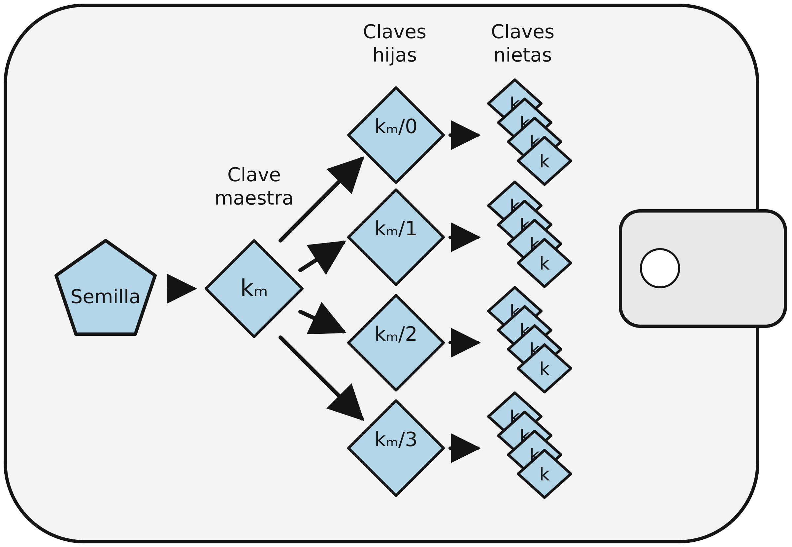
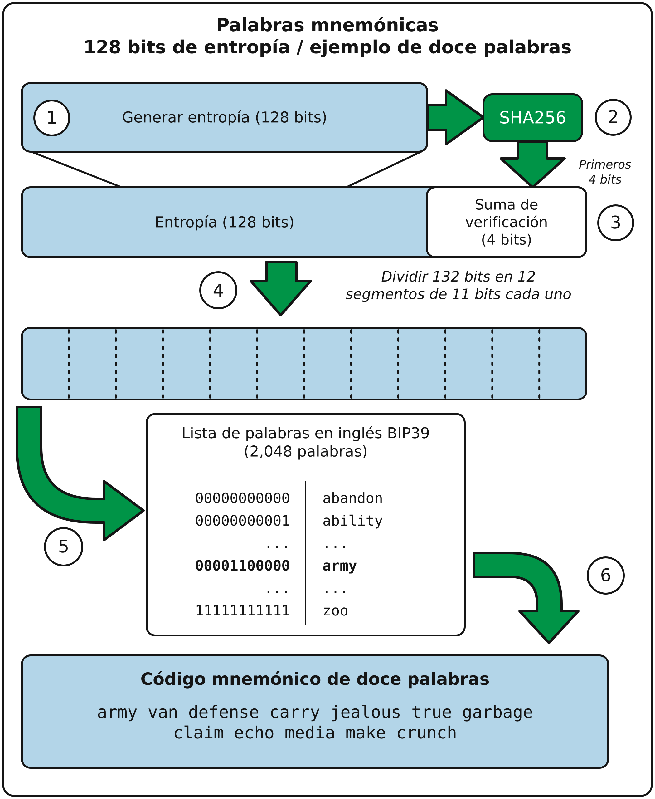
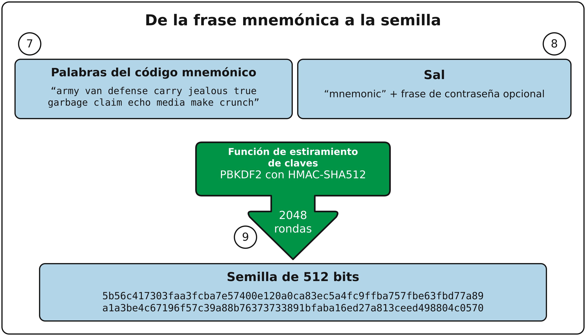
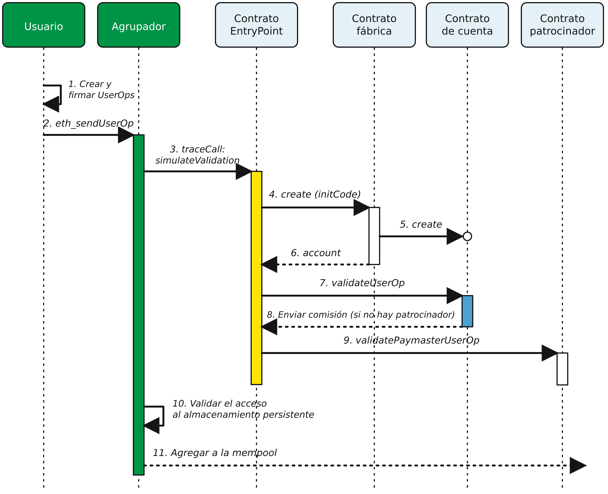
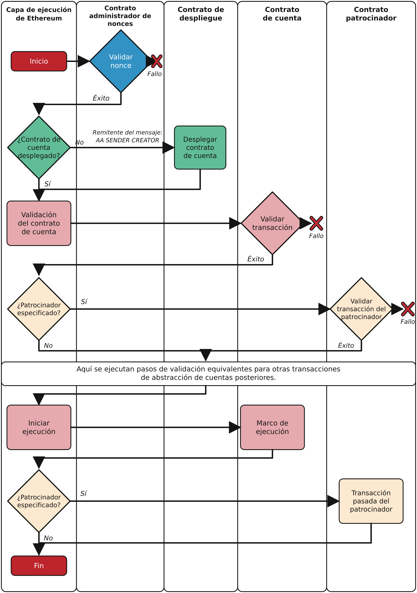
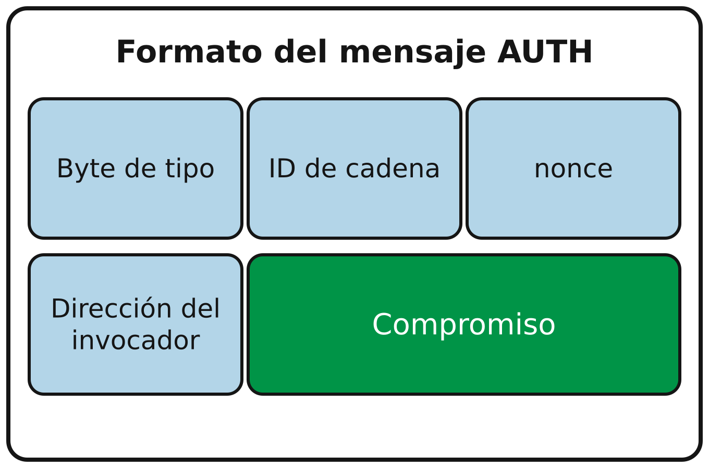
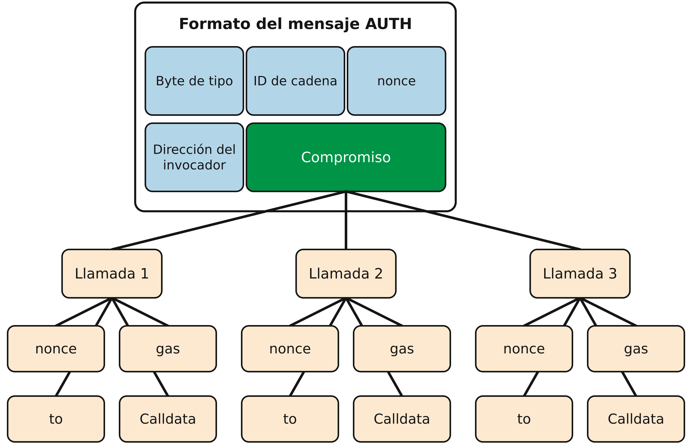
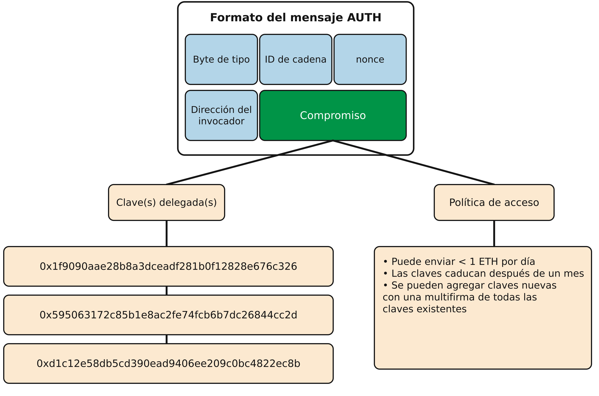
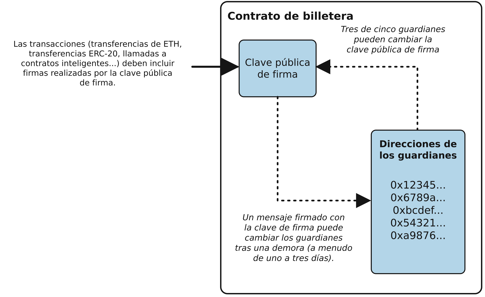

# Capítulo 5: Billeteras

La palabra *billetera* se usa para describir varias cosas distintas en Ethereum. A grandes rasgos, una billetera es una aplicación de software que funciona como interfaz principal del usuario con Ethereum. La billetera controla el acceso al dinero del usuario, administra claves y direcciones, lleva registro del saldo y crea y firma transacciones. Además, algunas billeteras de Ethereum pueden interactuar con contratos, como los tokens ERC-20.

En un sentido más acotado, desde la perspectiva de quien programa, la palabra *billetera* se refiere al sistema utilizado para almacenar y administrar las claves de un usuario. Toda billetera tiene un componente de administración de claves. En algunas billeteras, eso es todo. Otras forman parte de una categoría mucho más amplia, la de los *navegadores*, que son interfaces para DApps basadas en Ethereum y que examinaremos con más detalle en el capítulo 12. No existen límites claros entre las distintas categorías que se agrupan bajo el término *billetera*.

En este capítulo, veremos las billeteras como contenedores de claves privadas y como sistemas para administrar estas claves.

## Panorama de las tecnologías de billeteras

En esta sección, resumimos las distintas tecnologías utilizadas para construir billeteras de Ethereum fáciles de usar, seguras y flexibles.

Una consideración clave al diseñar billeteras es equilibrar la comodidad y la privacidad. La billetera de Ethereum más cómoda es aquella que tiene una sola clave privada y una dirección que se reutilizan para todo. Por desgracia, esta solución es una pesadilla para la privacidad, ya que cualquiera puede rastrear y correlacionar fácilmente todas las transacciones. Usar una clave nueva para cada transacción es lo mejor para la privacidad, pero resulta muy difícil de administrar. Alcanzar el equilibrio adecuado es difícil, por lo que un buen diseño de billetera es fundamental.

Una idea equivocada común sobre Ethereum es que las billeteras de Ethereum contienen ether o tokens. En realidad, hablando en sentido estricto, la billetera solo guarda claves. El ether u otros tokens se registran en la blockchain de Ethereum. Los usuarios controlan los tokens en la red al firmar transacciones con las claves de sus billeteras. En cierto sentido, una billetera de Ethereum es un *llavero*. Dicho esto, como las claves que guarda la billetera son lo único necesario para transferir ether o tokens a otros, en la práctica esta distinción es bastante irrelevante.

La diferencia sí importa al cambiar la mentalidad de operar con el sistema centralizado de la banca convencional (donde solo usted y el banco pueden ver el dinero de su cuenta, y solo necesita convencer al banco de que desea mover fondos para realizar una transacción) a operar con el sistema descentralizado de las plataformas blockchain (donde todos pueden ver el saldo de ether de una cuenta, aunque probablemente no sepan quién es su propietario, y todos necesitan convencerse de que el propietario desea mover fondos para que se ejecute una transacción). En la práctica, esto significa que existe una forma independiente de consultar el saldo de una cuenta sin necesitar su billetera. Además, puede trasladar la administración de su cuenta de la billetera actual a otra, si deja de gustarle la aplicación de billetera que empezó a usar.

> **Nota**  
>
> Las billeteras de Ethereum contienen claves, no ether ni tokens. Las billeteras son como llaveros que contienen pares de claves privadas y públicas. Los usuarios firman transacciones con las claves privadas y así demuestran que son propietarios del ether. El ether se almacena en la blockchain.

Existen dos tipos principales de billeteras, que se distinguen según si las claves que contienen están relacionadas entre sí o no.

El primer tipo es una *billetera no determinista*, donde cada clave se genera de manera independiente a partir de un número aleatorio distinto. Las claves no están relacionadas entre sí. Este tipo de billetera también se conoce como *billetera JBOK*, por la expresión inglesa "just a bunch of keys", es decir, "solo un montón de claves".

El segundo tipo es una *billetera determinista*, donde todas las claves se derivan de una única clave maestra, conocida como *semilla*. Todas las claves de este tipo de billetera están relacionadas entre sí y pueden generarse de nuevo si se dispone de la semilla original. En las billeteras deterministas se utilizan varios métodos distintos de derivación de claves. El método de derivación más común usa una estructura de árbol, como se describe en "Billeteras deterministas jerárquicas (BIP-32/BIP-44)".

Para que las billeteras deterministas sean un poco más seguras frente a accidentes que provoquen pérdida de datos, como el robo del teléfono o su caída al inodoro, las semillas suelen codificarse como una lista de palabras (en inglés u otro idioma) para anotarlas y usarlas en caso de accidente. Se conocen como las *palabras del código mnemónico* de la billetera. Por supuesto, si alguien obtiene esas palabras, también puede volver a crear su billetera y así acceder a su ether y sus contratos inteligentes. Por eso, ¡tenga muchísimo cuidado con su lista de palabras de recuperación! Nunca la guarde de forma electrónica, en un archivo de su computadora o teléfono. Anótela en papel y guárdela en un lugar seguro y protegido.

Las siguientes secciones presentan, a grandes rasgos, cada una de las tecnologías de billeteras.

### Billeteras no deterministas (aleatorias)

En la primera billetera de Ethereum (producida para la preventa de Ethereum), cada archivo de billetera almacenaba una sola clave privada generada aleatoriamente. Estas billeteras están siendo reemplazadas por billeteras deterministas porque las de "estilo antiguo" son inferiores en muchos aspectos. Por ejemplo, se considera una buena práctica evitar reutilizar direcciones de Ethereum para maximizar la privacidad al usar Ethereum, es decir, usar una dirección nueva (que necesita una clave privada nueva) cada vez que se reciben fondos. Se puede ir más allá y usar una dirección nueva para cada transacción, aunque esto puede resultar costoso si se opera mucho con tokens. Para seguir esta práctica, una billetera no determinista necesitará ampliar regularmente su lista de claves, lo que significa que habrá que hacer copias de respaldo periódicas. Si alguna vez pierde sus datos (falla del disco, derrame de una bebida, robo del teléfono) antes de haber podido respaldar su billetera, perderá el acceso a sus fondos y contratos inteligentes. Las billeteras no deterministas de "tipo 0" son las más difíciles de manejar porque crean un archivo de billetera nuevo para cada dirección nueva, de manera "justo a tiempo".

No obstante, muchos clientes de Ethereum (incluido Geth) usan un *archivo de almacén de claves*, que es un archivo codificado en JSON que contiene una sola clave privada (generada aleatoriamente), cifrada mediante una frase de contraseña para mayor seguridad. El contenido del archivo JSON tiene este aspecto:

```json
{
    "address": "001d3f1ef827552ae1114027bd3ecf1f086ba0f9",
    "crypto": {
        "cipher": "aes-128-ctr",
        "ciphertext":
            "233a9f4d236ed0c13394b504b6da5df02587c8bf1ad8946f6f2b58f055507ece",
        "cipherparams": {
            "iv": "d10c6ec5bae81b6cb9144de81037fa15"
        },
        "kdf": "scrypt",
        "kdfparams": {
            "dklen": 32,
            "n": 262144,
            "p": 1,
            "r": 8,
            "salt":
                "99d37a47c7c9429c66976f643f386a61b78b97f3246adca89abe4245d2788407"
        },
        "mac": "594c8df1c8ee0ded8255a50caf07e8c12061fd859f4b7c76ab704b17c957e842"
    },
    "id": "4fcb2ba4-ccdb-424f-89d5-26cce304bf9c",
    "version": 3
}
```

El formato del almacén de claves usa una *función de derivación de claves* (KDF), también conocida como *algoritmo de estiramiento de contraseñas*, que protege contra ataques de fuerza bruta, de diccionario y de tablas arcoíris. En términos sencillos, la clave privada no se cifra directamente con la frase de contraseña. En cambio, la frase de contraseña se "estira" aplicándole un hash repetidamente. La función hash se repite durante 262,144 rondas, lo que puede verse en el JSON del almacén de claves como el parámetro `crypto.kdfparams.n`. Un atacante que intentara descubrir la frase de contraseña por fuerza bruta tendría que aplicar 262,144 rondas de hash por cada frase probada, lo que ralentiza el ataque lo suficiente como para volverlo inviable para frases de contraseña con una complejidad y longitud adecuadas.

> **Consejo**  
>
> Se desaconseja usar billeteras no deterministas para cualquier cosa que no sean pruebas sencillas. Son demasiado engorrosas de respaldar y usar salvo en las situaciones más básicas. En su lugar, use una billetera determinista jerárquica basada en estándares de la industria, con una semilla mnemónica para respaldo.

### Billeteras deterministas (con semilla)

Las billeteras deterministas o "con semilla" contienen claves privadas que se derivan de una única clave maestra, o semilla. La semilla es un número generado aleatoriamente que se combina con otros datos, como un número de índice o un "código de cadena" (véase "Claves públicas y privadas extendidas"), para derivar cualquier cantidad de claves privadas. En una billetera determinista, la semilla basta para recuperar todas las claves derivadas y, por tanto, una sola copia de respaldo, al momento de la creación, basta para proteger todos los fondos y contratos inteligentes de la billetera. La semilla también basta para exportar o importar una billetera, lo que permite migrar fácilmente todas las claves entre distintas implementaciones de billeteras.

Este diseño hace que la seguridad de la semilla sea de máxima importancia, ya que solo se necesita la semilla para acceder a toda la billetera. Por otro lado, poder concentrar los esfuerzos de seguridad en un solo dato puede considerarse una ventaja.

### Billeteras deterministas jerárquicas (BIP-32/BIP-44)

Las billeteras deterministas se desarrollaron para facilitar la derivación de muchas claves a partir de una sola semilla. Actualmente, una de las formas más avanzadas de billetera determinista es la *billetera determinista jerárquica (HD)* definida por el estándar BIP-32 de Bitcoin. Las billeteras HD contienen claves derivadas en una estructura de árbol, de modo que una clave madre puede derivar una secuencia de claves hijas, cada una de las cuales puede derivar una secuencia de claves nietas, y así sucesivamente. Esta estructura de árbol se ilustra en la figura 5-1.



Figura 5-1. Billetera HD: un árbol de claves generado a partir de una sola semilla

Las billeteras HD ofrecen algunas ventajas importantes frente a las billeteras deterministas más sencillas. Primero, la estructura de árbol puede usarse para expresar un significado organizativo adicional, como cuando una rama específica de subclaves se usa para recibir pagos entrantes y otra rama se usa para recibir el cambio de los pagos salientes. Las ramas de claves también pueden usarse en entornos empresariales, donde se pueden asignar distintas ramas a departamentos, subsidiarias, funciones específicas o categorías contables.

La segunda ventaja de las billeteras HD es que los usuarios pueden crear una secuencia de claves públicas sin tener acceso a las claves privadas correspondientes. Esto permite usar billeteras HD en un servidor inseguro o en una modalidad de solo observación o solo recepción, donde la billetera no dispone de las claves privadas que permiten gastar los fondos.

### Semillas y códigos mnemónicos (BIP-39)

Existen muchas formas de codificar una clave privada para respaldarla y recuperarla de manera segura. El método preferido actualmente es usar una secuencia de palabras que, tomadas juntas en el orden correcto, permitan volver a crear la clave privada de manera unívoca. Esto a veces se conoce como una *frase mnemónica*, y el enfoque se ha estandarizado mediante BIP-39. Hoy, muchas billeteras de Ethereum (así como billeteras de otras criptomonedas) usan este estándar y pueden importar y exportar semillas para respaldo y recuperación mediante frases mnemónicas interoperables.

Para ver por qué este enfoque se ha vuelto popular, veamos un ejemplo:

```
FCCF1AB3329FD5DA3DA9577511F8F137 ← semilla en hexadecimal
wolf juice proud gown wool unfair
wall cliff insect more detail hub ← semilla con representación BIP-39
```

En términos prácticos, la probabilidad de cometer un error al anotar la secuencia hexadecimal es inaceptablemente alta. En cambio, la lista de palabras conocidas es bastante fácil de manejar, principalmente porque existe un alto grado de redundancia en la escritura de las palabras (especialmente en inglés). Si se hubiera anotado *inzect* por accidente, al necesitar recuperar la billetera se podría determinar rápidamente que *inzect* no es una palabra válida en inglés y que debería usarse *insect*. Hablamos de anotar una representación de la semilla porque esa es una buena práctica al administrar billeteras HD: la semilla se necesita para recuperar la billetera en caso de pérdida de datos (ya sea por accidente o robo), por lo que conservar una copia de respaldo es muy prudente. Sin embargo, la semilla debe mantenerse en estricta privacidad, por lo que deben evitarse cuidadosamente las copias digitales; de ahí el consejo de respaldarla con papel y lápiz.

En resumen, usar una lista de palabras de recuperación para codificar la semilla de una billetera HD es la forma más sencilla de exportar de manera segura un conjunto de claves privadas, transcribirlo, registrarlo en papel, leerlo sin errores e importarlo a otra billetera.

## Buenas prácticas para billeteras

A medida que la tecnología de billeteras de criptomonedas ha madurado, han surgido ciertos estándares de la industria que hacen que las billeteras sean ampliamente interoperables, fáciles de usar, seguras y flexibles. Estos estándares también permiten que las billeteras deriven claves para varias criptomonedas distintas, todas a partir de una sola frase mnemónica. Estos estándares son:

- Palabras de códigos mnemónicos, basadas en BIP-39
- Billeteras HD, basadas en BIP-32
- Una estructura de billetera HD multipropósito, basada en BIP-43
- Billeteras multimoneda y multicuenta, basadas en BIP-44

Estos estándares pueden cambiar o quedar obsoletos por desarrollos futuros, pero por ahora forman un conjunto de tecnologías interconectadas que se han convertido en el estándar de facto de billeteras para la mayoría de las plataformas blockchain y sus criptomonedas.

Una amplia gama de billeteras de software y hardware ha adoptado estos estándares, lo que hace que todas estas billeteras sean interoperables. Un usuario puede exportar una frase mnemónica generada en una de estas billeteras e importarla a otra, recuperando todas las claves y direcciones.

Algunos ejemplos de billeteras de software compatibles con estos estándares incluyen Rabby Wallet, MetaMask y Phantom. Entre las billeteras de hardware compatibles con estos estándares se encuentran varios modelos de Ledger y Trezor.

Las siguientes secciones examinan en detalle cada una de estas tecnologías.

> **Consejo**  
>
> Si está implementando una billetera de Ethereum, debería construirla como una billetera HD, con una semilla codificada como código mnemónico para respaldo, siguiendo los estándares BIP-32, BIP-39, BIP-43 y BIP-44, como se describe en las siguientes secciones.

### Palabras de códigos mnemónicos (BIP-39)

Las palabras de códigos mnemónicos son secuencias de palabras que codifican un número aleatorio usado como semilla para derivar una billetera determinista. La secuencia de palabras basta para volver a crear la semilla y, a partir de ella, la billetera y todas las claves derivadas. Una aplicación que implemente billeteras deterministas con palabras mnemónicas mostrará al usuario una secuencia de 12–24 palabras al crear una billetera por primera vez. Esa secuencia es el respaldo de la billetera y puede usarse para recuperar y volver a crear todas las claves en la misma aplicación de billetera o en cualquier otra compatible. Como explicamos antes, las listas de palabras mnemónicas facilitan que los usuarios respalden sus billeteras porque son fáciles de leer y transcribir correctamente.

> **Nota**  
>
> Las palabras mnemónicas suelen confundirse con las *brainwallets*. No son lo mismo. La diferencia principal es que una brainwallet consiste en palabras elegidas por el usuario, mientras que las palabras mnemónicas son creadas aleatoriamente por la billetera y se presentan al usuario. Esta importante diferencia hace que las palabras mnemónicas sean mucho más seguras, porque los seres humanos son muy malas fuentes de aleatoriedad. Quizá más importante, usar el término *brainwallet* sugiere que las palabras deben memorizarse, lo que es una idea terrible y una receta para no tener su respaldo cuando lo necesite.

Los códigos mnemónicos se definen en BIP-39. Tenga en cuenta que BIP-39 es una implementación de un estándar de códigos mnemónicos. Existe un estándar distinto, con otro conjunto de palabras, que usa la billetera de Bitcoin Electrum y que es anterior a BIP-39. BIP-39 fue propuesto por la empresa detrás de la billetera de hardware Trezor y es incompatible con la implementación de Electrum. Sin embargo, BIP-39 ya ha logrado un amplio respaldo en la industria, con decenas de implementaciones interoperables, y debería considerarse el estándar de facto de la industria. Además, BIP-39 puede usarse para producir billeteras multimoneda compatibles con Ethereum, mientras que las semillas de Electrum no.

BIP-39 define la creación de un código mnemónico y una semilla, que aquí describimos en nueve pasos. Para mayor claridad, el proceso se divide en dos partes: los pasos 1 a 6 se enumeran en "Generación de palabras mnemónicas", y los pasos 7 a 9, en "De la frase mnemónica a la semilla".

#### Generación de palabras mnemónicas

La billetera genera palabras mnemónicas automáticamente mediante el proceso estandarizado definido en BIP-39. La billetera parte de una fuente de entropía, agrega una suma de verificación y luego asigna la entropía a una lista de palabras siguiendo estos pasos:

1. Crear una secuencia criptográficamente aleatoria *S* de 128–256 bits.

2. Crear una suma de verificación de *S* tomando los primeros (longitud de *S* ÷ 32) bits del hash SHA-256 de *S*.

3. Agregar la suma de verificación al final de la secuencia aleatoria *S*.

4. Dividir la concatenación de la secuencia y la suma de verificación en secciones de 11 bits.

5. Asignar cada valor de 11 bits a una palabra del diccionario predefinido de 2,048 palabras.

6. Crear el código mnemónico a partir de la secuencia de palabras, manteniendo el orden.

La figura 5-2 muestra cómo se usa la entropía para generar palabras mnemónicas.



Figura 5-2. Generación de palabras mnemónicas

La tabla 5-1 muestra la relación entre el tamaño de los datos de entropía y la longitud de los códigos mnemónicos en palabras.

**Tabla 5-1. Códigos mnemónicos: entropía y longitud en palabras**

| Entropía (bits) | Suma de verificación (bits) | Entropía + suma de verificación (bits) | Longitud mnemónica (palabras) |
|---|---|---|---|
| 128 | 4 | 132 | 12 |
| 160 | 5 | 165 | 15 |
| 192 | 6 | 198 | 18 |
| 224 | 7 | 231 | 21 |
| 256 | 8 | 264 | 24 |

#### De la frase mnemónica a la semilla

Las palabras mnemónicas representan una entropía de 128–256 bits de longitud. Luego, la entropía se usa para derivar una semilla más larga (de 512 bits) mediante la función de estiramiento de claves PBKDF2. La semilla producida se usa para construir una billetera determinista y derivar sus claves.

La función de estiramiento de claves recibe dos parámetros: la frase mnemónica y una sal. El propósito de una sal en una función de estiramiento de claves es dificultar la construcción de una tabla de consulta que permita un ataque de fuerza bruta. En el estándar BIP-39, la sal tiene otro propósito: permite introducir una frase de contraseña que funciona como factor de seguridad adicional para proteger la semilla, lo que describiremos con más detalle en la siguiente sección.

El proceso continúa desde la sección anterior con los siguientes pasos:

7. El primer parámetro de la función de estiramiento de claves PBKDF2 es la frase mnemónica producida en el paso 6.

8. El segundo parámetro de la función de estiramiento de claves PBKDF2 es una *sal*. La sal se compone de la cadena constante `"mnemonic"` concatenada con una frase de contraseña opcional proporcionada por el usuario.

9. PBKDF2 estira los parámetros de frase mnemónica y sal mediante 2,048 rondas de hash con el algoritmo HMAC-SHA512 y produce un valor de 512 bits como salida final. Ese valor de 512 bits es la semilla.

La figura 5-3 muestra cómo se usa una frase mnemónica para generar una semilla.



Figura 5-3. De la frase mnemónica a la semilla

> **Nota**  
>
> La función de estiramiento de claves, con sus 2,048 rondas de hash, es una protección de cierta eficacia frente a ataques de fuerza bruta contra la frase mnemónica o la frase de contraseña. Hace costoso (en cómputo) probar más de unos pocos miles de combinaciones de frases de contraseña y frases mnemónicas, mientras que la cantidad de semillas derivadas posibles es enorme (2^512^, o aproximadamente 10^154^), mucho mayor que la cantidad de átomos en el universo visible (aproximadamente 10^80^).

Las tablas 5-2, 5-3 y 5-4 muestran algunos ejemplos de códigos mnemónicos y las semillas que producen.

**Tabla 5-2. Un código mnemónico de 128 bits de entropía sin frase de contraseña y la semilla resultante**

| | |
|---|---|
| **Entropía** | 0c1e24e5917779d297e14d45f14e1a1a |
| **Frase mnemónica** | army van defense carry jealous true garbage claim echo media make crunch |
| **Frase de contraseña** | (ninguna) |
| **Semilla** | 5b56c417303faa3fcba7e57400e120a0ca83ec5a4fc9ffba757fbe63fbd77a89a1a3be4c67196f57c39... |

**Tabla 5-3. Un código mnemónico de 128 bits de entropía con una frase de contraseña y la semilla resultante**

| | |
|---|---|
| **Entropía** | 0c1e24e5917779d297e14d45f14e1a1a |
| **Frase mnemónica** | army van defense carry jealous true garbage claim echo media make crunch |
| **Frase de contraseña** | SuperDuperSecret |
| **Semilla** | 3b5df16df2157104cfdd22830162a5e170c0161653e3afe6c88defeefb0818c793dbb28ab3ab091897d0... |

**Tabla 5-4. Un código mnemónico de 256 bits de entropía sin frase de contraseña y la semilla resultante**

| | |
|---|---|
| **Entropía** | 2041546864449caff939d32d574753fe684d3c947c3346713dd8423e74abcf8c |
| **Frase mnemónica** | cake apple borrow silk endorse fitness top denial coil riot stay wolf luggage oxygen faint major edit measure invite love trap field dilemma oblige |
| **Frase de contraseña** | (ninguna) |
| **Semilla** | 3269bce2674acbd188d4f120072b13b088a0ecf87c6e4cae41657a0bb78f5315b33b3a04356e53d062e5... |

#### Frase de contraseña opcional en BIP-39

El estándar BIP-39 permite usar una frase de contraseña opcional al derivar la semilla. Si no se usa una frase de contraseña, la frase mnemónica se estira con una sal que consiste en la cadena constante `"mnemonic"`, lo que produce una semilla específica de 512 bits a partir de cualquier frase mnemónica dada. Si se usa una frase de contraseña, la función de estiramiento produce una semilla *distinta* a partir de esa misma frase mnemónica. De hecho, dada una sola frase mnemónica, cada frase de contraseña posible conduce a una semilla distinta. En esencia, no existe una frase de contraseña "incorrecta". Todas son válidas y todas conducen a semillas distintas, lo que forma un vasto conjunto de posibles billeteras sin inicializar. El conjunto de billeteras posibles es tan grande (2^512^) que no existe una posibilidad práctica de descubrir por fuerza bruta o adivinar accidentalmente una que esté en uso, siempre que la frase de contraseña tenga suficiente complejidad y longitud.

> **Consejo**  
>
> No existen frases de contraseña "incorrectas" en BIP-39. Cada frase de contraseña conduce a alguna billetera que, a menos que se haya usado previamente, estará vacía.

La frase de contraseña opcional aporta dos características importantes:

- Un segundo factor (algo memorizado) que hace que una frase mnemónica sea inútil por sí sola, lo que protege los respaldos mnemónicos frente al acceso de un ladrón

- Una forma de negación plausible o "billetera bajo coacción", donde una frase de contraseña elegida conduce a una billetera con una pequeña cantidad de fondos, utilizada para distraer a un atacante de la billetera "real" que contiene la mayoría de los fondos

Sin embargo, es importante señalar que usar una frase de contraseña también introduce el riesgo de pérdida:

- Si el propietario de la billetera queda incapacitado o muere y nadie más conoce la frase de contraseña, la semilla es inútil y todos los fondos almacenados en la billetera se pierden para siempre.

- Por el contrario, si el propietario respalda la frase de contraseña en el mismo lugar que la semilla, eso anula el propósito de un segundo factor.

Si bien las frases de contraseña son muy útiles, solo deberían usarse junto con un proceso de respaldo y recuperación cuidadosamente planificado, considerando que los herederos que sobrevivan al propietario puedan recuperar la criptomoneda.

#### Trabajo con códigos mnemónicos

BIP-39 está implementado como biblioteca en muchos lenguajes de programación distintos, como:

**python-mnemonic**

La implementación de referencia del estándar, en Python, del equipo de SatoshiLabs que propuso BIP-39

**ConsenSys/eth-lightwallet**

Una billetera ligera de Ethereum en JavaScript para nodos y navegador (con BIP-39)

**npm/bip39**

Una implementación en JavaScript de BIP-39 de Bitcoin

También existe un generador BIP-39 implementado en una página web independiente (figura 5-4), que es sumamente útil para pruebas y experimentación. El [convertidor de códigos mnemónicos](https://iancoleman.io/bip39/) genera frases mnemónicas, semillas y claves privadas extendidas. Puede usarse sin conexión en un navegador o accederse a él en línea.

> **Nota**  
>
> Esto se enfatizará repetidamente a lo largo del capítulo porque es la regla más importante para la seguridad de la semilla: nunca, bajo ninguna circunstancia, guarde su frase semilla en formato digital.


Figura 5-4. La página web del generador BIP-39

### Creación de una billetera HD a partir de la semilla

Las billeteras HD se crean a partir de una única *semilla raíz*, que es un número aleatorio de 128, 256 o 512 bits. Esta semilla suele generarse a partir de una frase mnemónica, como se detalló en la sección anterior.

Cada clave de la billetera HD se deriva de manera determinista de esta semilla raíz, lo que permite volver a crear toda la billetera HD a partir de esa semilla en cualquier billetera HD compatible. Esto facilita exportar, respaldar, restaurar e importar billeteras HD que contienen miles o incluso millones de claves transfiriendo solo la frase mnemónica de la que se deriva la semilla raíz.

### Billeteras HD (BIP-32)

La mayoría de las billeteras HD siguen el estándar BIP-32, que se ha convertido en un estándar de facto de la industria para la generación determinista de claves. Aquí no trataremos todos los detalles de BIP-32, sino solo los componentes necesarios para comprender cómo se usa en las billeteras. El aspecto más importante son las relaciones jerárquicas en forma de árbol que pueden tener las claves derivadas, como puede verse en la figura 5-1. También es importante comprender los conceptos de claves extendidas y claves endurecidas, que se explican en las siguientes secciones.

Existen decenas de implementaciones interoperables de BIP-32 disponibles en muchas bibliotecas de software. En su mayoría están diseñadas para billeteras de Bitcoin, que implementan las direcciones de una manera distinta, pero comparten la misma implementación de derivación de claves que las billeteras de Ethereum compatibles con BIP-32. Use una diseñada para Ethereum o adapte una de Bitcoin agregando una biblioteca de codificación de direcciones de Ethereum.

También existe un generador BIP-32 implementado como una página web independiente que resulta muy útil para probar y experimentar con BIP-32.

> **Advertencia**  
>
> El generador BIP-32 independiente no es un sitio HTTPS. Esto es para recordarle que usar esta herramienta no es seguro. Es solo para pruebas. No debería usar las claves producidas por este sitio con fondos reales.

#### Claves públicas y privadas extendidas

En la terminología de BIP-32, las claves pueden ser "extendidas". Con las operaciones matemáticas adecuadas, estas claves "madre" extendidas pueden usarse para derivar claves "hijas", produciendo así la jerarquía de claves y direcciones descrita antes. Una clave madre no tiene que estar en la parte superior del árbol. Puede elegirse de cualquier lugar de la jerarquía del árbol. Extender una clave consiste en tomar la propia clave y agregarle un *código de cadena* especial. Un código de cadena es una cadena binaria de 256 bits que se mezcla con cada clave para producir claves hijas.

Si la clave es privada, se convierte en una *clave privada extendida* que se distingue por el prefijo `xprv`:

    xprv9s21ZrQH143K2JF8RafpqtKiTbsbaxEeUaMnNHsm5o6wCW3z8ySyH4UxFVSfZ8n7ESu7fgir8i...

Una *clave pública extendida* se distingue por el prefijo `xpub`:

    xpub661MyMwAqRbcEnKbXcCqD2GT1di5zQxVqoHPAgHNe8dv5JP8gWmDproS6kFHJnLZd23tWevhdn...

Una característica muy útil de las billeteras HD es la capacidad de derivar claves públicas hijas a partir de claves públicas madre *sin* tener las claves privadas. Esto nos da dos formas de derivar una clave pública hija: directamente a partir de la clave privada hija o a partir de la clave pública madre. Por tanto, una clave pública extendida puede usarse para derivar todas las claves públicas (y *solo* las claves públicas) de esa rama de la estructura de la billetera HD.

Este atajo puede usarse para crear despliegues sumamente seguros que solo contienen claves públicas, donde un servidor o una aplicación tiene una copia de una clave pública extendida, pero ninguna clave privada. Ese tipo de despliegue puede producir una cantidad infinita de claves públicas y direcciones de Ethereum, pero no puede gastar el dinero enviado a esas direcciones. Mientras tanto, en otro servidor más seguro, la clave privada extendida puede derivar todas las claves privadas correspondientes para firmar transacciones y gastar el dinero.

Una aplicación común de este método es instalar una clave pública extendida en un servidor web que aloja una aplicación de comercio electrónico. El servidor web puede usar la función de derivación de claves públicas para crear una dirección de Ethereum nueva para cada transacción (por ejemplo, para el carrito de compras de un cliente) y no tendrá claves privadas que puedan ser robadas. Sin billeteras HD, la única forma de hacer esto es generar miles de direcciones de Ethereum en un servidor seguro separado y luego precargarlas en el servidor de comercio electrónico. Ese enfoque es engorroso y requiere mantenimiento constante para asegurar que el servidor no se quede sin claves; de ahí la preferencia por usar claves públicas extendidas de billeteras HD.

Otra aplicación común de esta solución es para billeteras de almacenamiento en frío o de hardware. En ese escenario, la clave privada extendida puede almacenarse en una billetera de hardware, mientras que la clave pública extendida puede mantenerse en línea. El usuario puede crear direcciones de "recepción" a voluntad mientras las claves privadas permanecen almacenadas de forma segura sin conexión. Para gastar los fondos, el usuario puede usar la clave privada extendida en un cliente de Ethereum con firma sin conexión o firmar transacciones en el dispositivo de billetera de hardware.

#### Derivación endurecida de claves hijas

La capacidad de derivar una rama de claves públicas a partir de una clave pública extendida, o `xpub`, es muy útil, pero conlleva un riesgo potencial. Acceder a una `xpub` no da acceso a las claves privadas hijas. Sin embargo, como la `xpub` contiene el código de cadena (usado para derivar claves públicas hijas a partir de la clave pública madre), si se conoce o se filtra de alguna manera una clave privada hija, puede usarse junto con el código de cadena para derivar todas las demás claves privadas hijas. Una sola clave privada hija filtrada, junto con un código de cadena de la madre, revela todas las claves privadas de todas las hijas. Peor aún, la clave privada hija junto con un código de cadena de la madre puede usarse para deducir la clave privada madre.

Para contrarrestar este riesgo, las billeteras HD usan una función de derivación alternativa llamada *derivación endurecida*, que "rompe" la relación entre la clave pública madre y el código de cadena hijo. La función de derivación endurecida usa la clave privada madre para derivar el código de cadena hijo, en lugar de la clave pública madre. Esto crea un "cortafuegos" en la secuencia madre-hija, con un código de cadena que no puede usarse para comprometer una clave privada madre o hermana.

En términos sencillos, si desea aprovechar la comodidad de una `xpub` para derivar ramas de claves públicas sin exponerse al riesgo de un código de cadena filtrado, debería derivarla de una madre endurecida en lugar de una madre normal. La buena práctica es que las hijas de nivel uno de las claves maestras siempre se deriven mediante derivación endurecida, para evitar que las claves maestras se vean comprometidas.

#### Números de índice para derivación normal y endurecida

Es claramente deseable poder derivar más de una clave hija a partir de una clave madre dada. Para administrar esto, se usa un número de índice. Cada número de índice, al combinarse con una clave madre mediante la función especial de derivación de hijas, da una clave hija distinta. El número de índice usado en la función de derivación de madre a hija de BIP-32 es un entero de 32 bits. Para distinguir fácilmente entre las claves derivadas mediante la función de derivación normal (no endurecida) y las derivadas mediante derivación endurecida, este número de índice se divide en dos rangos. Los números de índice entre 0 y 2^31^–1 (0x0 a 0x7FFFFFFF) se usan *solo* para derivación normal. Los números de índice entre 2^31^ y 2^32^–1 (0x80000000 a 0xFFFFFFFF) se usan *solo* para derivación endurecida. Por tanto, si el número de índice es menor que 2^31^, la hija es normal, mientras que si es igual o mayor que 2^31^, la hija es endurecida.

Para facilitar la lectura y visualización de los números de índice, los índices de las hijas endurecidas se muestran comenzando desde cero, pero con un símbolo de prima. Así, la primera clave hija normal se muestra como 0, mientras que la primera hija endurecida (índice 0x80000000) se muestra como 0′. Siguiendo la secuencia, la segunda clave endurecida tendría un índice de 0x80000001 y se mostraría como 1′, y así sucesivamente. Cuando vea un índice de billetera HD *i*′, significa 2^31^ + *i*.

#### Identificador de clave de billetera HD (ruta)

Las claves de una billetera HD se identifican mediante una convención de nombres de "ruta", con cada nivel del árbol separado por un carácter de barra (`/`) (véase la tabla 5-5). Las claves privadas derivadas de la clave privada maestra comienzan con `m`. Las claves públicas derivadas de la clave pública maestra comienzan con `M`. Por tanto, la primera clave privada hija de la clave privada maestra es `m/0`. La primera clave pública hija es `M/0`. La segunda nieta de la primera hija es `m/0/1`, y así sucesivamente.

La "ascendencia" de una clave se lee de derecha a izquierda, hasta llegar a la clave maestra de la que se derivó. Por ejemplo, el identificador `m/x/y/z` describe la clave que es la hija número *z* de la clave `m/x/y`, que es la hija número *y* de la clave `m/x`, que es la hija número *x* de `m`.

**Tabla 5-5. Ejemplos de rutas de billeteras HD**

| Ruta HD | Clave descrita |
|---|---|
| m/0 | La primera (0) clave privada hija de la clave privada maestra (m) |
| m/0/0 | La primera clave privada nieta de la primera hija (m/0) |
| m/0'/0 | La primera nieta normal de la primera hija endurecida (m/0') |
| m/1/0 | La primera clave privada nieta de la segunda hija (m/1) |
| M/23/17/0/0 | La primera clave pública tataranieta de la primera bisnieta de la 18.ª nieta de la 24.ª hija |

### Navegación por la estructura de árbol de la billetera HD

La estructura de árbol de la billetera HD es tremendamente flexible. La contrapartida es que también permite una complejidad sin límites: cada clave madre extendida puede tener cuatro mil millones de hijas, dos mil millones normales y dos mil millones endurecidas. Cada una de esas hijas puede tener otros cuatro mil millones de hijas, y así sucesivamente. El árbol puede ser tan profundo como se desee, con una cantidad potencialmente infinita de generaciones. Con todo ese potencial, puede resultar bastante difícil navegar por estos árboles tan grandes.

Dos BIP ofrecen una forma de administrar esta complejidad potencial mediante estándares para la estructura de los árboles de billeteras HD. BIP-43 propone usar el primer índice de hija endurecida como identificador especial que indica el "propósito" de la estructura del árbol. Según BIP-43, una billetera HD debería usar solo una rama de nivel uno del árbol, cuyo número de índice define el propósito de la billetera al identificar la estructura y el espacio de nombres del resto del árbol. Más específicamente, una billetera HD que usa solo la rama `m/i′/...` pretende indicar un propósito específico, y ese propósito se identifica mediante el número de índice *i*.

Ampliando esa especificación, BIP-44 propone una estructura multimoneda y multicuenta que se indica fijando el número de "propósito" en `44′`. Todas las billeteras HD que siguen la estructura BIP-44 se identifican porque usan una sola rama del árbol: `m/44′/*`. BIP-44 especifica una estructura que consta de cinco niveles de árbol predefinidos:

    m / purpose′ / coin_type′ / account′ / change / address_index

El primer nivel, `purpose′`, siempre se fija en `44′`. El segundo nivel, `coin_type′`, especifica el tipo de criptomoneda y permite billeteras HD multimoneda donde cada moneda tiene su propio subárbol bajo el segundo nivel. Hay varias monedas definidas en el documento de estándares SLIP-0044; por ejemplo, Ethereum es `m/44′/60′`, Ethereum Classic es `m/44′/61′`, Bitcoin es `m/44′/0′` y la red de pruebas para todas las monedas es `m/44′/1′`.

El tercer nivel del árbol es `account′`, que permite a los usuarios subdividir sus billeteras en subcuentas lógicas separadas con fines contables u organizativos. Por ejemplo, una billetera HD podría contener dos cuentas de Ethereum: `m/44′/60′/0′` y `m/44′/60′/1′`. Cada cuenta es la raíz de su propio subárbol.

Como BIP-44 se creó originalmente para Bitcoin, contiene una "peculiaridad" que no es relevante en el mundo de Ethereum. En el cuarto nivel de la ruta, `change`, una billetera HD tiene dos subárboles: uno para crear direcciones de recepción y otro para crear direcciones de cambio. En Ethereum solo se usa la ruta de "recepción", ya que no se necesita una dirección de cambio como en Bitcoin. Observe que, mientras los niveles anteriores usaban derivación endurecida, este nivel usa derivación normal. Esto permite que el nivel de cuenta del árbol exporte claves públicas extendidas para usarlas en un entorno no protegido.

La billetera HD deriva las direcciones utilizables como hijas del cuarto nivel, de modo que el quinto nivel del árbol es `address_index`. Por ejemplo, la tercera dirección de recepción para pagos de Ethereum en la cuenta principal sería `M/44′/60′/0′/0/2`. La tabla 5-6 muestra algunos ejemplos más.

**Tabla 5-6. Ejemplos de estructura de billetera HD BIP-44**

| Ruta HD | Clave descrita |
|---|---|
| M/44′/60′/0′/0/2 | La tercera clave pública de recepción de la cuenta principal de Ethereum |
| M/44′/0′/3′/1/14 | La 15.ª clave pública de dirección de cambio de la cuarta cuenta de Bitcoin |
| m/44′/2′/0′/0/1 | La segunda clave privada de la cuenta principal de Litecoin, para firmar transacciones |

## Seguridad

Comencemos por introducir el concepto de seguridad frente a facilidad de recuperación. Llevando estos conceptos al extremo: ¿cuál es la semilla más segura? Aquella que nadie puede recuperar, ni siquiera usted. Así que, si se crea la semilla y se destruyen todas las copias (físicas o digitales), esa es la semilla más segura del mundo. No es una gran solución, ya que no podría recuperarla, pero técnicamente es la más segura.

Por otro lado, en cuanto a facilidad de recuperación, ¿cuál es la semilla más fácil de recuperar? Una cuya frase semilla esté escrita por todas partes, como tatuársela en el cuerpo, a plena vista. Esa semilla será facilísima de recuperar, pero no será segura en absoluto.

Cualquier decisión que tome para su seguridad operativa (OpSec) en autocustodia probablemente aumentará la seguridad o la facilidad de recuperación de su frase semilla. Aumentar la seguridad suele reducir la facilidad de recuperación, y viceversa. A veces, puede terminar reduciendo ambas, lo que debería evitarse.

Incluso con un sistema de alta seguridad, ninguna configuración es 100% segura. Puede hacer todo lo que esté a su alcance para crear un sistema perfecto, pero aun así habrá vulnerabilidades. Una de las más interesantes son las colisiones de claves privadas: en esencia, generar una semilla que ya se haya usado. Como las semillas de las billeteras de hardware se generan sin conexión y no existe una base de datos de semillas generadas, técnicamente es posible generar la misma billetera dos veces. Las probabilidades de que esto ocurra son astronómicamente pequeñas (es más probable ganar la lotería dos veces seguidas), pero sigue siendo una posibilidad.

> **Advertencia**  
>
> A menudo, no hay urgencia en la seguridad de la semilla. O su semilla ha sido robada, en cuyo caso ya está en problemas, o no lo ha sido. Esto es especialmente cierto para las billeteras de Bitcoin. En Ethereum sigue siendo así, pero hay situaciones donde actuar rápido puede salvar fondos, por ejemplo, revocar aprobaciones a contratos inteligentes peligrosos. Si recibe mensajes urgentes sobre su semilla, probablemente se trate de una estafa.

Los mecanismos de seguridad complejos para ocultar su semilla no son una buena práctica. Aunque al principio parezcan infalibles, los profesionales del sector a menudo pueden recuperar este tipo de semillas con las herramientas adecuadas. Y si el sistema es tan complejo que ni siquiera los profesionales pueden recuperarla, es muy probable que usted tampoco pueda hacerlo cuando lo necesite.

Otra mala práctica es depender de la oscuridad para la seguridad. Su sistema debería tener la menor cantidad posible de componentes "secretos", siendo la propia semilla el principal. Si revelar partes del sistema hace que colapse, no es seguro.

Una buena práctica es seguir lo que hace la mayoría. Intentar inventar sistemas nuevos o, peor aún, crear todo desde cero está mal. No es seguro, y la mayoría de las personas no tiene las habilidades técnicas para hacerlo. Mantenga las cosas sencillas. La sencillez es, sin duda, una buena práctica.

Hacer una copia de respaldo de su semilla es probablemente la buena práctica más importante. Ya sea una billetera de hardware o una billetera de navegador, un respaldo es esencial. El almacenamiento del respaldo debería (a) resistir desastres naturales, (b) estar separado geográficamente de su billetera de hardware, (c) estar en un lugar seguro y (d) tener un empaque que evidencie cualquier manipulación. Dividir su semilla entre varias hojas de papel no es una buena práctica. Da una falsa sensación de seguridad.

> **Consejo**  
>
> Si no tiene un lugar seguro para guardar su semilla, considere usar una frase de contraseña. Esta agrega una capa adicional de protección al combinarse con su semilla durante el proceso de generación de claves. Incluso puede guardar la frase de contraseña de forma digital, ya que es inútil sin la semilla. Si alguien obtiene su semilla, pero no su frase de contraseña, no podrá acceder a sus fondos durante cierto tiempo; esto se debe a que la frase de contraseña puede descubrirse por fuerza bruta si el atacante tiene la semilla.

Las necesidades de cada persona son distintas, y sus requisitos de seguridad variarán en consecuencia. Pero siempre debería seguir las buenas prácticas. Sus necesidades pueden cambiar con el tiempo, así que manténgase atento y ajuste su OpSec si es necesario.

Después de configurar su billetera de hardware, pruebe su capacidad para recuperar la semilla. Hágalo al menos una vez cada 12 meses, asegurándose de que su respaldo funcione y sea accesible.

¿Cómo es un sistema seguro? Una billetera de hardware de confianza (como Trezor), al menos un respaldo seguro (nunca guardado de forma digital) y un plan de herencia por si le sucede algo.

> **Nota**  
>
> La herencia es un tema muy complicado. Recomendamos leer *Cryptoasset Inheritance Planning: A Simple Guide for Owners*, de Pamela Morgan (Merkle Bloom).

## Mejoras en la experiencia de usuario

Como mencionamos antes, a grandes rasgos, una billetera es una aplicación de software que funciona como interfaz principal del usuario con Ethereum. Por eso, para la mayoría de los usuarios de Ethereum, la billetera constituye gran parte de la experiencia de usuario. Durante años, esta no ha mejorado realmente. Por ejemplo, la billetera de navegador más popular al momento de escribir este libro es MetaMask, que no ha evolucionado demasiado desde su creación; recientemente ha surgido Rabby, que ocupa un cercano segundo lugar. Ahora examinaremos algunas actualizaciones de las billeteras que podrían mejorar drásticamente la experiencia de usuario.

### Abstracción de cuentas

La abstracción de cuentas (AA) en Ethereum es una forma de hacer que las cuentas de usuario sean más flexibles y fáciles de usar. Normalmente, existen dos tipos de cuentas en Ethereum, como se describe en el capítulo 2: EOA y cuentas de contratos inteligentes. La AA combina las ventajas de ambos tipos. Permite que las cuentas normales (EOA) se comporten más como contratos inteligentes, lo que significa que los usuarios pueden establecer reglas personalizadas para el funcionamiento de sus cuentas, como agregar funciones de seguridad o permitir que varias personas firmen transacciones.

Con la AA, Ethereum puede volverse más fácil de usar y flexible. Por ejemplo, podría recuperar una cuenta perdida sin depender únicamente de una clave privada, o pagar las comisiones de transacción en cualquier token, no solo en ether.

Ha habido múltiples propuestas para implementar la AA. La distinción principal es que un grupo de propuestas intentó implementarla sin cambiar el protocolo de Ethereum. Otro grupo de propuestas, que se implementará en la actualización Pectra, terminará cambiando el protocolo de Ethereum.

Veamos las principales EIP y solicitudes de comentarios de Ethereum (ERC) para la AA. Tenga en cuenta que estas propuestas evolucionan rápidamente y que, para cuando se publique este libro, la situación de la AA podría haber cambiado significativamente. No obstante, sigue siendo útil explorar lo que se ha implementado y lo previsto para el futuro cercano.

> **Consejo**  
>
> Es importante comprender la diferencia entre una ERC, una EIP y una propuesta de mejora de rollups (RIP). En esencia, las EIP y RIP son mejoras centradas en cambios en las redes de Ethereum, mientras que las ERC son cambios relacionados con las aplicaciones que no tienen ningún impacto en las capacidades fundamentales de la red.

#### ERC-4337

ERC-4337 es un avance en la blockchain de Ethereum que busca hacer las cuentas de usuario más versátiles, seguras y fáciles de usar. A diferencia de las actualizaciones típicas que alteran el protocolo de Ethereum, ERC-4337 introduce funciones nuevas mediante contratos inteligentes y componentes fuera de la cadena. A septiembre de 2024, la principal implementación de AA en la cadena es ERC-4337.

Como dijimos en el capítulo 2, las cuentas tradicionales de Ethereum se dividen en dos tipos: las EOA, controladas únicamente por claves privadas, y las cuentas de contrato, que operan mediante contratos inteligentes. Las EOA predominan hoy en las billeteras de usuario porque son sencillas y económicas; sin embargo, también tienen funciones limitadas y son propensas a riesgos de seguridad. Perder una clave privada puede significar la pérdida permanente de fondos, y las EOA no pueden personalizarse con funciones de seguridad como configuraciones de multifirma u opciones de recuperación de cuentas. Las cuentas de contrato pueden incorporar estas medidas de seguridad y más, pero su complejidad y sus mayores comisiones de transacción han impedido su uso generalizado entre los usuarios cotidianos. ERC-4337 supera esto al permitir que las EOA funcionen como contratos inteligentes, combinando la sencillez de las EOA con la seguridad y flexibilidad de las cuentas de contrato.

La implementación de ERC-4337 introduce *UserOperations* para manejar las transacciones de manera distinta, como se muestra en la figura 5-5. En lugar de difundir directamente cada transacción a la blockchain, los usuarios envían UserOperations a una mempool de alto nivel, donde las transacciones se almacenan temporalmente. Participantes especiales, conocidos como *agrupadores*, recopilan y procesan estas UserOperations, empaquetándolas en una sola transacción de Ethereum. Este proceso reduce la congestión de la red y permite procesar múltiples operaciones de forma más eficiente y agrupada. ERC-4337 también establece un nuevo rol llamado *patrocinadores de gas*. Normalmente, las transacciones de Ethereum requieren pagar las comisiones de gas en ETH, pero los patrocinadores de gas permiten que los usuarios cubran esas comisiones con tokens alternativos o incluso que un tercero patrocinador las pague en su nombre. Este cambio elimina una barrera importante, especialmente para los recién llegados que quizá no tengan ETH, y hace que la red de Ethereum sea más inclusiva y accesible.



Figura 5-5. Diagrama de implementación de ERC-4337

En lugar de usar la mempool pública tradicional, que aloja transacciones pendientes de las EOA, las UserOperations se envían a una *mempool de UserOperation* especializada: una mempool de nivel superior diseñada específicamente para estas operaciones. Los agrupadores supervisan la mempool de UserOperation y recopilan múltiples UserOperations para empaquetarlas en una sola transacción "clásica". Comienzan verificando la validez de cada UserOperation mediante los métodos de EntryPoint. Después de la validación, el agrupador envía esta transacción agrupada directamente al siguiente bloque propuesto, sin pasar por la mempool normal. Los agrupadores pueden actuar como constructores de bloques o colaborar con ellos para agregar la transacción a la blockchain.

#### EIP-2938

Mientras que ERC-4337 se centra en la AA a un nivel alto mediante contratos inteligentes sin cambiar el núcleo de Ethereum, EIP-2938 va un paso más allá al proponer que la AA se incorpore a la propia capa de protocolo. Este enfoque de nivel inferior permite interacciones aún más directas y flexibles entre usuarios, contratos inteligentes y aplicaciones al cambiar fundamentalmente cómo la EVM trata las cuentas. Mediante EIP-2938, los usuarios podrían manejar operaciones sin EOA tradicionales, eliminando la dependencia de cuentas basadas en claves privadas y permitiendo una mayor diversidad de sistemas de administración de cuentas, como cuentas multifirma o de recuperación social, directamente en el nivel de protocolo de Ethereum.

La diferencia principal entre EIP-2938 y algunas propuestas de AA existentes radica en el enfoque de integrar la abstracción directamente en el protocolo, en lugar de superponerla. Con EIP-2938, Ethereum admitiría "operaciones" en lugar de "transacciones", donde cada operación podría representar un tipo de transacción más versátil y personalizable. EIP-2938 puede redefinir las transacciones de Ethereum como objetos programables, admitiendo un espectro más amplio de casos de uso. Al tratar las cuentas y transacciones como inherentemente programables, amplía la utilidad de Ethereum más allá de los pagos estándar y las interacciones con contratos, encajando perfectamente con las aplicaciones cada vez más complejas que se construyen en la red.

#### RIP-7560

La propuesta RIP-7560 integra EIP-2938 y ERC-4337 en un enfoque unificado de AA nativa, dividiendo el ámbito de las transacciones de Ethereum en pasos de validación, ejecución y posteriores a la transacción. Al separar la validación de transacciones en procesos distintos para la autorización y el pago de comisiones de gas, permite que un contrato patrocine las comisiones de gas de la transacción de otra cuenta. Este enfoque mantiene la compatibilidad con el ecosistema de ERC-4337 mientras avanza hacia el objetivo de una AA completamente nativa.

ERC-4337 introduce la AA en el nivel de aplicación, pero tiene limitaciones debido a su diseño externo al protocolo. Estas desventajas incluyen costos adicionales de gas, resistencia limitada a la censura, dependencia de métodos RPC no estándar y restricciones que limitan la compatibilidad con las expectativas de los contratos existentes. La AA nativa, como se propone en EIP-2938, presenta una alternativa más robusta al incorporar estas funciones directamente en el protocolo. Sin embargo, EIP-2938 no se alinea completamente con la estructura de ERC-4337, que se ha probado e implementado ampliamente sin cambios de protocolo.

Al combinar las funciones de nivel de protocolo incorporadas en EIP-2938 con los conocimientos prácticos obtenidos de ERC-4337, esta propuesta reúne lo mejor de ambos enfoques. Este enfoque híbrido busca reducir los costos de gas, mejorar la fiabilidad de las transacciones al hacerlas más resistentes a la censura y asegurar la compatibilidad con los contratos actuales y futuros de Ethereum. La transición gradual de EOA a cuentas de contratos inteligentes también reduciría los riesgos asociados a las claves privadas, haciendo que Ethereum sea más seguro y fácil de usar. Es importante que esta configuración permite a quienes ya usan ERC-4337 adoptar estas nuevas funciones sin dificultades.

La figura 5-6 representa el flujo de transacciones de AA descrito en RIP-7560. El proceso incorpora varios contratos clave que manejan la validación, el despliegue y la ejecución, creando un enfoque simplificado y modular para administrar cuentas de usuario y transacciones en la blockchain de Ethereum.



Figura 5-6. Flujo de transacciones de RIP-7560

El flujo comienza con una comprobación del nonce por parte del contrato administrador de nonces para asegurar que la transacción sea única y no se haya reproducido. Este es un paso fundamental para la integridad de las transacciones porque evita el doble gasto o las repeticiones accidentales. Si el nonce es válido, el sistema avanza; de lo contrario, la transacción se detiene.

A continuación, el proceso comprueba si el contrato de cuenta del usuario (una billetera inteligente) ya existe. Si no, el contrato de despliegue interviene para crear esta billetera, permitiendo al usuario participar en transacciones. Una vez desplegado, o si ya existe, el propio contrato de cuenta realiza una comprobación de validación para confirmar que la transacción sea legítima y se ajuste a la lógica del contrato. Esto asegura que solo continúen las acciones autorizadas, agregando una capa de seguridad y personalización a la billetera de cada usuario.

Una característica interesante de este flujo es la participación opcional de un contrato patrocinador de gas. Si se especifica, este contrato puede cubrir las comisiones de gas de la transacción u ofrecer métodos de pago alternativos. Cuando interviene un patrocinador de gas, pasa por su propio proceso de validación para asegurar que pueda cubrir legítimamente los costos de la transacción. Esta flexibilidad permite modelos de patrocinio y puede reducir la carga de las comisiones de transacción para los usuarios.

Una vez completadas todas las validaciones, la capa de ejecución de Ethereum comienza a procesar la transacción. Durante la ejecución, se usa un marco de ejecución para manejar los detalles de la transacción y supervisar su avance. Después de la ejecución, si intervino un patrocinador de gas, este realiza el posprocesamiento necesario para finalizar el patrocinio de la transacción.

#### EIP-5806

EIP-5806 introduce un nuevo tipo de transacción que permite a las EOA ejecutar código personalizado mediante un mecanismo de "llamada delegada".

Actualmente, las EOA solo pueden desplegar contratos o enviar transacciones de "llamada", lo que limita las interacciones del usuario con la blockchain. Esta restricción afecta la facilidad de uso, ya que las EOA no pueden realizar tareas como agrupar múltiples acciones en una transacción o ejecutar operaciones complejas. Si bien la AA podría resolver estos problemas, su camino de adopción sigue siendo incierto y no todos los usuarios pueden migrar debido a los costos y a la custodia de activos no transferibles.

Esta propuesta ofrece una forma directa para que las EOA ejecuten código personalizado con cambios mínimos en la EVM y estándares de seguridad conocidos. Al permitir que las EOA deleguen llamadas a contratos específicos, los usuarios obtienen más control y flexibilidad, lo que permite operaciones complejas como agrupar múltiples llamadas o transferir tokens de forma segura. A diferencia de otras propuestas de AA, este enfoque busca mejorar la experiencia de usuario de las EOA sin reemplazar los métodos de abstracción existentes, lo que lo convierte en una opción accesible para ampliar las funciones de las EOA en el futuro cercano.

#### EIP-3074

EIP-3074 introduce dos códigos de operación, `AUTH` y `AUTHCALL`, para permitir que las EOA deleguen el control de sus transacciones a un contrato "invocador". El usuario firma un mensaje que contiene el invocador y un compromiso (un hash de los valores de la transacción), asegurando que el invocador solo procese transacciones autorizadas. El invocador maneja la protección contra reproducción, y los usuarios deben confiar en este contrato para evitar comportamientos maliciosos. Esta propuesta mejora la agrupación de transacciones y permite una delegación flexible de cuentas.

`AUTH` permite a los usuarios otorgar a un contrato inteligente permiso para actuar en su nombre. Usa una firma digital (ECDSA) para verificar esta autorización y luego almacena la dirección del usuario para transacciones futuras. `AUTHCALL` permite al contrato inteligente autorizado realizar transacciones, como enviar tokens o interactuar con otros contratos. Por ejemplo, si desea intercambiar 10 DAI por ETH, puede autorizar al invocador (mediante `AUTH`) con una sola firma. El invocador usará `AUTHCALL` para autorizar a Uniswap a gastar sus DAI y luego ejecutar el intercambio.

Inicialmente, también se firmaban la protección contra reproducción y campos como el valor, el gas y otros argumentos de `AUTHCALL`. El diseño evolucionó para delegar estas tareas al contrato invocador, haciendo fundamental que los usuarios confíen en él. Los usuarios pueden "comprometerse" con propiedades particulares de la llamada aplicándoles un hash. El invocador valida solo si los valores comprometidos, como el nonce para la protección contra reproducción, coinciden con el compromiso del usuario, como se muestra en la figura 5-7. Esto asegura que el invocador procese exactamente lo que el usuario autorizó.



Figura 5-7. Validación del compromiso de EIP-3074

El hash del compromiso permite a los invocadores aplicar diversas reglas, como permitir nonces paralelos o agrupar múltiples llamadas bajo una sola firma. Esto permite flujos de múltiples llamadas, como consolidar una aprobación y transferencia ERC-20 en una sola transacción, como se ve en la figura 5-8.



Figura 5-8. Flujo de múltiples llamadas de EIP-3074

Además, permite delegar el control de la EOA a otras claves al firmar un mensaje de compromiso con la dirección del delegado y una política de acceso, que el invocador verifica antes de retransmitir llamadas en nombre de la EOA, como se ve en la figura 5-9.



Figura 5-9. Flujo de delegación de EIP-3074

#### EIP-5003

EIP-5003 introduce el código de operación `AUTHUSURP`, que permite desplegar código en una dirección autorizada mediante EIP-3074, eliminando efectivamente la clave de firma de la EOA original (cuando se usa con EIP-3607). Las EOA tradicionales controlan mucho valor en Ethereum, pero enfrentan limitaciones. No existe una forma sencilla de rotar claves, agrupar transacciones por eficiencia o habilitar el patrocinio de gas sin tener ETH. Las cuentas de contrato y la AA abordan estos problemas, permitiendo que los usuarios personalicen funciones de seguridad, métodos de autenticación, límites de gasto, rotación de claves, recuperación social y más. Sin embargo, estas ventajas se limitan principalmente a usuarios que adoptan activamente estándares nuevos mediante billeteras de contratos inteligentes y soluciones en la capa de aplicación, como las propuestas por ERC-4337. Esto deja a una cantidad considerable de usuarios existentes, que han dependido de las EOA desde el inicio de Ethereum, con mejoras limitadas en seguridad y facilidad de uso.

Si bien EIP-3074 ofrece una solución inicial al permitir que las EOA deleguen la autoridad de firma a una cuenta de contrato, no llega a permitir que la EOA revoque completamente esta clave de firma original. Esta brecha introduce un riesgo de seguridad: incluso con autoridad delegada, la clave privada principal sigue siendo una vulnerabilidad potencial. Si se ve comprometida, toda la cuenta sigue en riesgo, ya que actualmente no existe una opción de revocación para una clave privada expuesta. Si la clave privada de un usuario se filtra, ya sea por accidente o por un ataque malicioso, la única opción es crear una billetera nueva y migrar los activos individualmente con mucho esfuerzo, un proceso costoso y a menudo incompleto debido a la inmovilidad de ciertos activos dentro de contratos inteligentes existentes.

Con esta EIP, `AUTHUSURP` proporciona una vía de transición segura para los titulares de EOA. Permite que las EOA transfieran completamente el control a un contrato inteligente, eliminando la autoridad de la clave original y, por tanto, eliminándola como amenaza de seguridad.

#### EIP-7702

EIP-7702 es la principal EIP de AA que se espera implementar en Pectra para principios de 2025. (Nota: este capítulo se escribió en septiembre y octubre de 2024, por eso usamos el tiempo futuro). EIP-7702 introduce una "transacción de establecimiento de código" bajo EIP-2718, permitiendo que una EOA delegue cierto código para que direcciones autorizadas lo ejecuten en su nombre.

> **Nota**  
>
> EIP-2718 introduce un formato de "sobre de transacción tipada" para Ethereum, que admite múltiples tipos de transacciones dentro del protocolo. Este formato estandarizado permite actualizaciones de transacciones compatibles con versiones anteriores, habilitando mejoras futuras con tipos de transacciones nuevos mientras se mantienen las estructuras existentes. Esto se explicará con más detalle en el capítulo 6. Esta EIP también ajusta las restricciones de EIP-3607, permitiendo transacciones de EOA marcadas con una designación de delegación. Habilita la delegación segura para las EOA y agrega capacidades mejoradas de administración de cuentas a Ethereum.
>
> Surge una pregunta sobre cómo deberían especificar los usuarios el código que pretenden ejecutar en sus cuentas. Las opciones principales son incluir el bytecode directamente en la transacción o hacer referencia a un puntero al código. El puntero más sencillo es la dirección de algún código desplegado en la cadena. La especificación directa del código permite que las EOA ejecuten código arbitrario dentro de calldata de la transacción. Una consideración al firmar un puntero al código es si esa dirección apunta al código previsto en otra cadena; quienes mantienen las billeteras pueden fijar en el código un único mensaje de autorización EIP-7702, asegurando la coherencia del código entre cadenas.

Hay una consideración de seguridad importante. Una vez que se incorpora código en una EOA, las transacciones EIP-7702 pueden permitir `msg.sender == tx.origin`, donde quien crea la transacción también es la dirección que la difunde cada vez que el código de la EOA emite una llamada. Sin EIP-7702, este escenario solo ocurre en la capa de ejecución superior de una transacción. Como EIP-7702 permitiría el patrocinio de transacciones, esto también sería posible en otras capas de ejecución. En consecuencia, esta EIP rompe esa invariante y afecta a los contratos inteligentes que contienen comprobaciones `require(msg.sender == tx.origin)`. Esta comprobación cumple al menos tres propósitos:

1. Verificar que `msg.sender` sea una EOA (ya que `tx.origin` siempre debe ser una EOA). Esta invariante no se ve afectada por la profundidad de la capa de ejecución; aún es posible asegurar que `tx.origin` sea `msg.sender` si la profundidad de la llamada es 1.

2. Evitar ataques sándwich atómicos, como los préstamos flash, que dependen de alterar el estado antes y después de la ejecución del contrato objetivo dentro de la misma transacción atómica. Esta protección se ve comprometida por esta EIP. Sin embargo, usar `tx.origin` con este fin generalmente se considera una mala práctica y los mineros ya pueden eludirlo incluyendo transacciones de forma selectiva.

3. Proteger contra la reentrada.

Hay ejemplos de los dos primeros casos en contratos de la red principal de Ethereum, siendo el primero el más común (y sin verse afectado por esta EIP). Sin embargo, el tercer caso es más vulnerable con esta EIP, aunque durante la revisión inicial realizada por los creadores de la propuesta no se observaron casos de protección contra reentrada que dependieran de `tx.origin`.

> **Consejo**  
>
> A diferencia de versiones anteriores de esta EIP y propuestas similares, la designación de delegación puede revocarse en cualquier momento firmando y enviando una autorización EIP-7702 que apunte a una dirección nueva, usando el nonce actual de la cuenta. Sin esa acción, una delegación sigue siendo válida indefinidamente.

Existe un interés considerable en agregar mejoras de funcionalidad a las EOA, mejorando su facilidad de uso y, en algunos casos, su seguridad. Una aplicación clave es el patrocinio de transacciones, que permite a los usuarios operar sin tener ETH para cubrir las comisiones de gas. En las transacciones tradicionales de Ethereum, las comisiones de gas se pagan en ETH, lo que puede ser inconveniente para usuarios que solo tienen otros tokens o que son nuevos en el ecosistema. EIP-7702 introduce un modelo donde terceros pueden cubrir las comisiones de transacción, temporal o permanentemente, permitiendo a los usuarios completar transacciones sin ETH. Esto podría simplificar la incorporación y hacer que las aplicaciones de Ethereum sean más accesibles para usuarios nuevos interesados en DApps o tokens específicos, sin requerir la administración de ETH.

Las cuentas tradicionales de Ethereum dependen únicamente de una sola clave privada, por lo que perderla significa perder el acceso a la cuenta y a los activos. La estructura de EIP-7702 admite diversos mecanismos de recuperación, permitiendo que los usuarios recuperen el acceso si pierden sus claves privadas. Los mecanismos de recuperación son especialmente valiosos para usuarios enfocados en la seguridad y para quienes son nuevos en blockchain y pueden encontrar intimidante la administración de claves. Las posibles opciones de recuperación incluyen multifirma y recuperación social, que permiten a contactos seleccionados ayudar a restaurar la cuenta; esto es un gran paso en la seguridad y facilidad de uso de las cuentas de Ethereum.

EIP-7702 también introduce la agrupación y la reducción de privilegios. La agrupación permite procesar múltiples acciones dentro de una sola transacción atómica, permitiendo que los usuarios completen flujos de trabajo complejos, como una aprobación ERC-20 seguida del gasto de tokens, en un paso en lugar de dos. La reducción de privilegios ofrece subclaves con permisos restringidos, que autorizan acciones como gastar una cantidad específica o interactuar solo con ciertas aplicaciones, para mejorar la seguridad al minimizar la exposición en caso de compromiso.

Esta EIP también modifica las invariantes que tradicionalmente rigen el comportamiento del saldo y del nonce de las cuentas. Rompe la expectativa de que el saldo de una cuenta EOA solo puede disminuir debido a transacciones de esa cuenta, y de que el nonce de una EOA no puede incrementarse una vez que comienza la ejecución de la transacción. Estos cambios afectan el diseño de la mempool y otras EIP. Sin embargo, como las cuentas se enumeran estáticamente en la transacción externa, las reglas de propagación de transacciones pueden ajustarse para impedir el reenvío de transacciones en conflicto. Sí tiene compatibilidad futura con ERC-4337 y RIP-7560. Entre otras ventajas, permite que las EOA se presenten como contratos compatibles con los paquetes de ERC-4337 mediante el mecanismo EntryPoint existente.

> **Nota**  
>
> Un objetivo general de diseño para los cambios de transición de estado es minimizar los casos especiales en una EIP. Las primeras iteraciones de esta EIP se resistían a agregar un caso especial para borrar la designación de delegación de una cuenta. En general, una cuenta delegada a 0x0 se comporta como una verdadera EOA; sin embargo, la mayoría de las operaciones que interactúan con esa cuenta generan un costo adicional. Este costo extra puede influir en la adopción general de la EIP. Por estas razones, se incluyó un mecanismo para permitir a los usuarios restaurar sus EOA a su estado original.

Esta EIP implica múltiples consideraciones de seguridad, que serán responsabilidad de la implementación y deberían evaluarse cuidadosamente. Además del problema señalado con `tx.origin`, hay tres consideraciones clave:

- Permitir que las EOA actúen como contratos inteligentes plantea dificultades para la propagación de transacciones. Tradicionalmente, las EOA solo podían enviar valor mediante transacciones. Con esta EIP, cualquiera puede invocar el código delegado de una EOA en cualquier momento dentro de una transacción, impidiendo la validación estática del saldo por parte de los nodos; en esencia, dificulta que los nodos validen el saldo de una dirección.

- Quienes desarrollan billeteras de contratos inteligentes deben considerar las implicaciones de establecer código en una cuenta sin ejecución. Normalmente, los contratos se despliegan con initcode, que inicializa de forma determinista los slots de almacenamiento persistente. Esta EIP omite la ejecución de initcode para la delegación, por lo que los desarrolladores deben verificar calldata inicial para impedir que un observador se adelante mediante front-running a la configuración con una cuenta que controle.

- La protección contra reproducción (por ejemplo, el manejo del nonce) debería ser implementada por el delegado y firmada. Sin esto, un actor malicioso podría reutilizar una firma y obtener control casi completo sobre la EOA del firmante.

#### El futuro de la abstracción de cuentas

La AA en Ethereum es una idea compleja pero prometedora, con muchos caminos posibles. Cada propuesta ofrece una forma distinta de hacer las interacciones del usuario más sencillas y seguras. Algunas mejoran propuestas anteriores, como EIP-5003 que se apoya en EIP-3074, mientras que otras, como EIP-5806, son independientes o incluso carecen de compatibilidad con versiones anteriores. Esta variedad refleja una búsqueda de la mejor solución, cuya dirección final probablemente estará determinada por las opciones que los usuarios encuentren más fáciles y eficaces. Aunque el futuro exacto no está claro, la AA ofrece una promesa real de mejorar la experiencia de usar Ethereum.

### Recuperación social

La principal EIP relacionada con la recuperación social es EIP-2429. Titulada "Secret Multisig Recovery", EIP-2429 introduce un mecanismo que permite a los usuarios recuperar el acceso a sus billeteras al designar personas o entidades de confianza como "guardianes". En caso de que un usuario pierda su clave privada, puede recurrir a estos guardianes para ayudar a recuperar el control de la billetera. Los guardianes solo intervienen durante el proceso de recuperación, lo que limita su poder, como se muestra en la figura 5-10.



Figura 5-10. Flujo de recuperación social

> **Nota**  
>
> Vitalik Buterin publicó un artículo en 2021 que decía, y citamos: "Esto nos lleva a mi método preferido para proteger una billetera: la recuperación social". No sabemos si la situación ha cambiado, pero aún podría ser que la recuperación social sea el método preferido de Buterin.

En el uso normal, una billetera de recuperación social funciona como una billetera común, permitiendo al usuario firmar transacciones con su clave de firma. Si la clave se pierde, se activa la recuperación social, permitiendo al usuario contactar a los guardianes, quienes firman una transacción para actualizar la clave de firma de la billetera. Los guardianes pueden ser personas, dispositivos o instituciones de confianza. Pueden permanecer anónimos y, para evitar ataques, sus identidades no se almacenan en la cadena. En caso de muerte del usuario, los guardianes pueden coordinarse para recuperar sus fondos.

### ENS

Ethereum Name Service es como una versión Web3 de los nombres de dominio tradicionales, pero en lugar de enlazar a sitios web, conecta nombres legibles para las personas con direcciones de Ethereum. Esto facilita mucho el manejo de las direcciones largas y complejas de blockchain. Por ejemplo, en lugar de tener que enviar criptomonedas a una dirección como `0xd8dA6BF...`, puede enviarlas a algo como `vitalik.eth`. Esto simplifica las transacciones y hace que todo el proceso sea mucho menos intimidante, especialmente para quienes recién llegan al mundo de las criptomonedas.

Si se compara ENS con el mundo Web2, es similar al funcionamiento de DNS. DNS toma direcciones IP (que son difíciles de recordar) y las conecta con URL como `google.com`, de modo que no hace falta recordar una cadena de números para visitar un sitio web. Sin embargo, hay una diferencia clave entre ENS y DNS: ENS es descentralizado. Ninguna autoridad central controla su nombre `.eth` una vez que es suyo. En Web2, los nombres de dominio son administrados por registradores y pueden censurarse, suspenderse o restringirse. En ENS, controla su nombre completamente a través de su billetera de Ethereum, lo que significa que su nombre `.eth` es tan seguro como la billetera que lo contiene.

Al enviar o recibir criptomonedas, usar un nombre como `andreas.eth` en lugar de una dirección de Ethereum larga y compleja hace que todo sea más fluido y seguro. Reduce la posibilidad de equivocarse al introducir una dirección, lo que de otro modo puede representar un gran riesgo en una transacción.

Otro aspecto interesante de ENS es que proporciona una sensación de identidad digital. Al igual que tener un nombre de dominio para su sitio web, tener un nombre `.eth` único puede funcionar como su identidad pública en la blockchain.

## Conclusión

Las billeteras son la base de cualquier aplicación blockchain orientada al usuario. Permiten que los usuarios administren conjuntos de claves y direcciones. Las billeteras también permiten a los usuarios demostrar que son propietarios de ether y autorizar transacciones mediante firmas digitales, como veremos en el capítulo 6.
