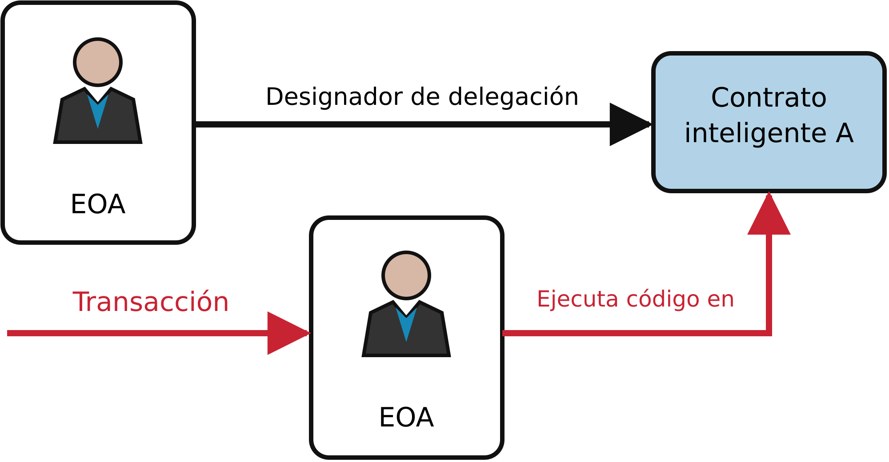
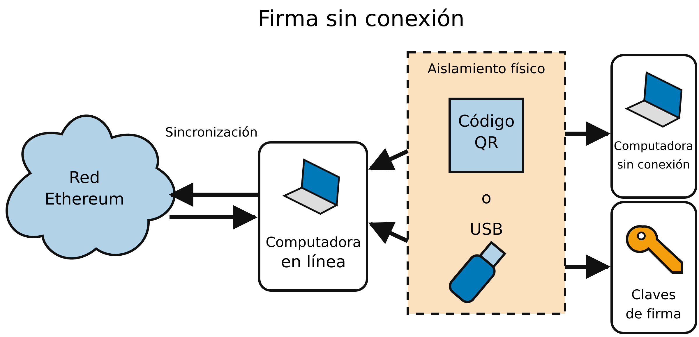
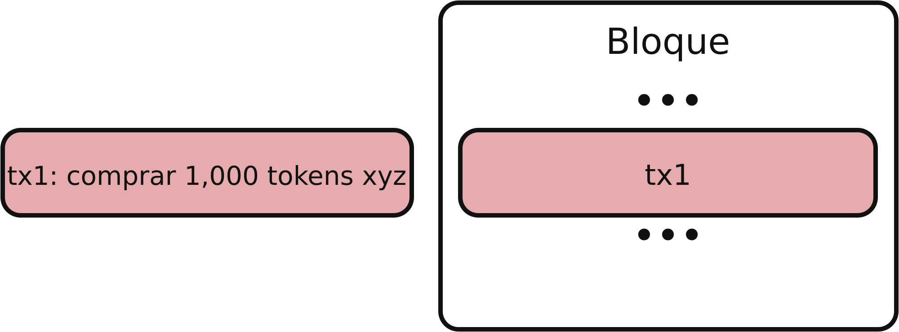
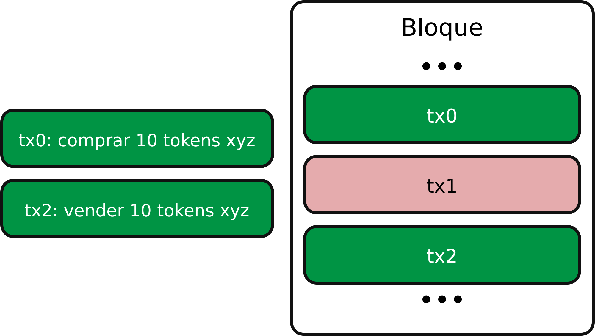

# Capítulo 6. Transacciones

Las *transacciones* son mensajes firmados que se originan en una cuenta de propiedad externa, se transmiten por la red Ethereum y se registran en la blockchain de Ethereum. Esta definición básica oculta muchos detalles sorprendentes y fascinantes. Otra forma de ver las transacciones es que son lo único que puede desencadenar un cambio de estado o hacer que un contrato se ejecute en la EVM. Ethereum es una máquina de estados global de estado único (singleton), y las transacciones son lo que hace que esa máquina de estados "avance", cambiando su estado. Los contratos no se ejecutan por sí solos. Ethereum no funciona de manera autónoma. Todo comienza con una transacción.

En este capítulo, desglosaremos las transacciones, mostraremos cómo funcionan y examinaremos los detalles. Se debe tener en cuenta que gran parte de este capítulo está dirigido a quienes tienen interés en gestionar sus propias transacciones a bajo nivel, quizá porque están desarrollando una aplicación de billetera; no es necesario preocuparse por esto si basta con usar las aplicaciones de billetera existentes, ¡aunque los detalles pueden resultar interesantes!

## La estructura de una transacción

Primero, veamos la estructura básica de una transacción tal como se serializa y se transmite por la red Ethereum. Cada cliente que recibe una transacción serializada la almacena en memoria usando su propia estructura de datos interna, quizá enriquecida con metadatos que no existen en la propia transacción serializada de la red. La serialización de red es la única forma estándar de una transacción.

Aunque en los primeros días de Ethereum solo había un tipo de transacción, [*EIP-2718*](https://oreil.ly/6Ku5V) introdujo una forma de trabajar con distintos tipos de transacciones y manejarlos de manera diferente. En particular, cada transacción comienza con un solo byte que especifica su tipo:

```
transaction = tx_type || tx_payload
```

Al momento de escribir este texto (junio de 2025), existen cinco tipos de transacciones, enumerados en la Tabla 6-1.

**Tabla 6-1. Tipos de transacciones de EIP-2718**

| Identificador de tipo | Nombre |
|-----------------|------|
| `0x00` | Transacciones heredadas |
| `0x01` | Transacciones EIP-2930 |
| `0x02` | Transacciones EIP-1559 |
| `0x03` | Transacciones EIP-4844 |
| `0x04` | Transacciones EIP-7702 |

Analicemos todos estos tipos con más detalle.

### Transacciones heredadas

Una *transacción heredada* es un mensaje binario serializado que contiene los siguientes datos:

**ID de cadena**

El ID de cadena de la red a la que se envía la transacción. Se agregó con EIP-155 como un mecanismo sencillo de protección contra ataques de repetición.

**Nonce**

Un número de secuencia, emitido por la EOA de origen y utilizado para evitar la repetición de mensajes.

**Precio del gas**

El precio del gas (en wei) que el emisor está dispuesto a pagar.

**Límite de gas**

La cantidad máxima de gas que el emisor está dispuesto a comprar para esta transacción. Se debe tener en cuenta que solo se pagará por el gas realmente utilizado en la transacción. El límite de gas solo representa la cantidad máxima de gas que se está dispuesto a pagar.

**Destinatario**

La dirección de Ethereum de destino.

**Valor**

La cantidad de ether que se enviará al destino.

**Datos**

La carga de datos binarios de longitud variable.

**v,r,s**

Los tres componentes de una firma digital ECDSA de la EOA de origen.

La estructura del mensaje de la transacción se serializa mediante el esquema de codificación de *prefijo de longitud recursiva (RLP)*, que se creó específicamente para una serialización de datos sencilla y exacta a nivel de bytes en Ethereum. Todos los números en Ethereum se codifican como enteros big-endian, con longitudes que son múltiplos de 8 bits.

Se debe tener en cuenta que las etiquetas de los campos (`to`, `gas limit`, etc.) se muestran aquí para mayor claridad, pero no forman parte de los datos serializados de la transacción, que contienen los valores de los campos codificados en RLP. En general, RLP no contiene delimitadores ni etiquetas de campos. El prefijo de longitud de RLP se utiliza para identificar la longitud de cada campo. Todo lo que esté más allá de la longitud definida pertenece al siguiente campo de la estructura.

Aunque esta es la estructura real de la transacción que se transmite, la mayoría de las representaciones internas y las visualizaciones de la interfaz de usuario la enriquecen con información adicional derivada de la transacción o de la blockchain. Por ejemplo, se puede notar que no hay datos "from" en la dirección que identifica la EOA de origen. Esto se debe a que la clave pública de la EOA puede derivarse de los componentes `v`, `r`, `s` de la firma ECDSA. A su vez, la dirección puede derivarse de la clave pública. Cuando se ve una transacción que muestra un campo `from`, este fue agregado por el software utilizado para visualizar la transacción. Otros metadatos que el software cliente agrega con frecuencia a la transacción incluyen el número de bloque (una vez que se publica y se incluye en la blockchain) y un ID de transacción (hash calculado). De nuevo, estos datos se derivan de la transacción y no forman parte del propio mensaje de la transacción.

### Transacciones EIP-2930

Las transacciones [EIP-2930](https://oreil.ly/1dSza) son las primeras en utilizar la envoltura de transacciones tipadas de EIP-2718, con `0x01` como tipo de transacción. Son básicamente iguales al tipo de transacción anterior, pero se agrega un nuevo campo llamado *lista de acceso*. Es un arreglo de (direcciones, slots de almacenamiento persistente) que permite al usuario pagar por adelantado por las direcciones y los slots de almacenamiento persistente a los que accederá la transacción. De esta manera, durante la ejecución en la EVM, se le cobra menos gas al usuario.

> **Nota**  
>
> Para ser más precisos, las direcciones y sus slots de almacenamiento persistente contenidos en la lista de acceso se incluyen, respectivamente, en `accessed_addresses` y `accessed_storage_keys`, que la EVM utiliza para diferenciar entre un acceso caliente y uno frío. Los accesos fríos cobran mucho más gas que los calientes. Por ejemplo, el código de operación `SLOAD` cobra 100 gas si el slot de almacenamiento persistente al que se accede está caliente, y 2,100 en caso contrario.

Este nuevo tipo de transacción se introdujo principalmente para abordar problemas derivados de [EIP-2929](https://oreil.ly/_9kTv). EIP-2929 aumentó los costos de gas de los códigos de operación de acceso al estado, lo que provocó que algunos contratos inteligentes fallaran al procesar transacciones correctamente debido a errores por agotamiento de gas. Al introducir las listas de acceso, los usuarios pueden pagar por adelantado por las direcciones y los slots de almacenamiento persistente a los que accederán sus transacciones, evitando estas fallas.

### Transacciones EIP-1559

Las transacciones [EIP-1559](https://oreil.ly/ZBON6) se introdujeron durante el hard fork London el 5 de agosto de 2021, utilizando `0x02` como tipo de transacción. Cambian por completo la estructura del mercado de comisiones en Ethereum al introducir un nuevo parámetro del protocolo: la *comisión base*.

La comisión base representa la comisión mínima que debes pagar para enviar una transacción en la red Ethereum. El límite de gas del bloque se duplica de 15 millones a 30 millones de gas, y se introduce el *objetivo de gas del bloque*, igual a la mitad del límite de gas del bloque: 15 millones de gas. La idea es mantener, en promedio, la misma cantidad de carga en la red Ethereum que antes, pero permitir que los bloques tengan un tamaño mucho mayor (potencialmente el doble) si es necesario.

Para mantener los bloques en un promedio de 15 millones de gas utilizado, la comisión base no es un valor fijo: cambia según la tasa de utilización de los bloques. Si el gas utilizado de un bloque es mayor que el objetivo de gas del bloque, la comisión base aumenta; si el gas utilizado es menor que el objetivo de gas, disminuye.

El límite de gas del bloque (casi) siempre se ha incrementado en bloques específicos a valores fijos y redondeados: 10 millones, 12.5 millones, 15 millones y 30 millones, como se puede ver en la Figura 6-1. De hecho, aunque los validadores (y los mineros con el antiguo protocolo de consenso PoW) pueden ajustar ligeramente el objetivo de gas en cada bloque, lo que se traduce directamente en el límite de gas, el límite de gas del bloque es un valor crucial, y todos suelen seguir las recomendaciones de los desarrolladores principales.


**Figura 6-1.** Evolución del límite de gas del bloque

Las comisiones base no van a los validadores (o mineros) que crean bloques; en cambio, se queman de inmediato, reduciendo el suministro total de ETH. Se introduce una nueva comisión, la *comisión de prioridad*, que se puede considerar como la propina que se paga a los validadores (o mineros) para incentivarlos a incluir las transacciones propias en el siguiente bloque.

> **Consejo**  
>
> En teoría, se podrían crear transacciones que solo paguen la comisión base, que es obligatoria, y una comisión de prioridad de cero. El protocolo no obliga a pagar una propina a los validadores. Pero, en la práctica, siempre se debería incluirla para que las transacciones se confirmen en un tiempo razonable. Se debe tener en cuenta que las billeteras normalmente gestionan las comisiones base y de prioridad de forma automática y las establecen en los valores correctos.

Una transacción EIP-1559 es un mensaje binario serializado que contiene los siguientes datos:

**ID de cadena**

Igual que en las transacciones heredadas

**Nonce**

Igual que en las transacciones heredadas

**Comisión de prioridad máxima por gas**

El precio del gas (en wei) que el emisor está dispuesto a pagar directamente a los validadores como propina por incluir la transacción en el bloque

**Comisión máxima por gas**

El precio del gas (en wei) que el emisor está dispuesto a pagar en total, incluidas la comisión base y la comisión de prioridad

**Límite de gas**

Igual que en las transacciones heredadas

**Destinatario**

Igual que en las transacciones heredadas

**Lista de acceso**

Igual que en las transacciones EIP-2930

**Valor**

Igual que en las transacciones heredadas

**Datos**

Igual que en las transacciones heredadas

**v,r,s**

Igual que en las transacciones heredadas

Como ocurre con todos los tipos de transacciones, la estructura del mensaje se serializa mediante el esquema de codificación RLP.

### Transacciones EIP-4844

Las transacciones [EIP-4844](https://oreil.ly/JMJmB) se introdujeron con el hard fork Cancun el 13 de marzo de 2024, utilizando `0x03` como tipo de transacción. Ya las mencionamos en la sección "Compromiso KZG" del Capítulo 4, y las analizaremos con más detalle en el Capítulo 16. También se denominan *transacciones portadoras de blobs* porque vienen con un anexo, un *blob*, que contiene una gran cantidad de datos (alrededor de 131,000 bytes cada uno) a los que la EVM no puede acceder, pero a cuyo compromiso sí puede acceder.

Se utiliza un nuevo tipo de gas, el *gas de blobs*, para los blobs. Está completamente separado del gas normal y es independiente de este. Sigue su propia regla de objetivo, aunque sigue estando profundamente inspirado en EIP-1559. La idea es que, si el gas de blobs utilizado es mayor que el objetivo de gas de blobs utilizado, el precio del gas de blobs aumenta; de lo contrario, disminuye.

El mensaje binario serializado comparte el mismo formato que EIP-1559 con dos nuevas adiciones:

**Comisión máxima por gas de blobs**

El precio del gas de blobs (en wei) que el emisor está dispuesto a pagar por los blobs

**Hash versionado de blob**

Una lista de valores de 32 bytes que representan el hash versionado de cada compromiso KZG relacionado con el blob

> **Nota**  
>
> Con el hard fork Cancun y la introducción de las transacciones EIP-4844, el encabezado del bloque se amplía con dos nuevos elementos:
>
> **Gas de blobs utilizado**
>
> La cantidad total de gas de blobs utilizado por todas las transacciones EIP-4844 del bloque
>
> **Exceso de gas de blobs**
>
> Un total acumulado del gas de blobs consumido por encima del objetivo, antes del bloque

### Transacciones EIP-7702

Las transacciones [EIP-7702](https://oreil.ly/W_28X) se incluyeron en el hard fork Pectra el 7 de mayo de 2025, utilizando `0x04` como tipo de transacción. Permiten a las EOA establecer el código de su cuenta. Tradicionalmente, las EOA tienen un código vacío; solo pueden iniciar una transacción, pero no pueden realizar realmente operaciones complejas, a menos que interactúen con un contrato inteligente. EIP-7702 cambia esto y permite a las EOA realizar operaciones como las siguientes.

**Agrupación por lotes**

Permite realizar múltiples operaciones del mismo usuario en una sola transacción atómica, como una aprobación ERC-20 seguida del uso de esa aprobación, lo que constituye un flujo de trabajo muy común en muchas plataformas de intercambio descentralizadas.

**Patrocinio**

La cuenta X paga una transacción en nombre de la cuenta Y.

**Reducción de privilegios**

Los usuarios pueden firmar subclaves y darles permisos específicos que son mucho más limitados que el acceso global a la cuenta; por ejemplo, un permiso para gastar hasta el 1% del saldo total por día o para interactuar únicamente con una aplicación específica.

Los detalles de bajo nivel son bastante complicados, y recomendamos leer el [sitio web oficial de la EIP](https://oreil.ly/W_28X) si resulta de interés. Sin embargo, la descripción general de alto nivel es sencilla y, a la vez, muy potente. EIP-7702 permite a las EOA asignarse un *designador de delegación*. Este designador de delegación apunta a un contrato inteligente (activo en la red principal de Ethereum) y, cuando se envía una transacción a la EOA, esta ejecuta el código de la dirección designada como si fuera el código real de la EOA, como se muestra en la Figura 6-2.



**Figura 6-2.** Mecanismo de delegación de EIP-7702

## El nonce de la transacción

El *nonce* es uno de los componentes más importantes y menos comprendidos de una transacción. Su definición en el "Yellow Paper" dice:

> Nonce: Un valor escalar igual al número de transacciones enviadas desde esta dirección o, en el caso de las cuentas con código asociado, al número de creaciones de contratos realizadas por esta cuenta.

Estrictamente hablando, el nonce es un atributo de la dirección de origen; es decir, solo tiene significado en el contexto de la dirección del remitente. Sin embargo, el nonce se almacena explícitamente como parte del estado de la cuenta. Para una cuenta de propiedad externa (EOA), se incrementa cada vez que una transacción de esa cuenta se incluye en la blockchain, incluso si la ejecución se revierte. El procesamiento de autorizaciones de EIP-7702 también puede incrementarlo.

Hay dos escenarios en los que es importante la existencia de un nonce que cuente las transacciones: la característica de usabilidad de que las transacciones se incluyan en el orden de creación y la característica vital de protección contra la duplicación de transacciones. Veamos un escenario de ejemplo para cada uno:

**Escenario 1**

Imaginemos que queremos realizar dos transacciones. Tenemos que hacer un pago importante de 6 ether y otro pago de 8 ether. Firmamos y difundimos primero la transacción de 6 ether porque es la más importante, y después firmamos y difundimos la transacción de 8 ether. Lamentablemente, hemos pasado por alto que nuestra cuenta solo contiene 10 ether, por lo que la red no puede aceptar ambas transacciones: una de ellas fallará. Como enviamos primero la de 6 ether, que es la más importante, es comprensible que esperemos que se complete y que la de 8 ether sea rechazada. Sin embargo, en un sistema descentralizado como Ethereum, los nodos pueden recibir las transacciones en cualquier orden; no hay garantía de que una transacción se propague a un nodo determinado antes que la otra. Por lo tanto, es casi seguro que algunos nodos reciban primero la transacción de 6 ether y otros reciban primero la de 8 ether. Sin el nonce, sería aleatorio cuál se acepta y cuál se rechaza. Sin embargo, con el nonce incluido, la primera transacción que enviamos tendrá un nonce de, digamos, 3, mientras que la transacción de 8 ether tendrá el siguiente valor de nonce (es decir, 4). Por lo tanto, esa transacción se ignorará hasta que se hayan procesado las transacciones con nonces de 0 a 3, incluso si se recibe primero. ¡Uf!

**Escenario 2**

Ahora imaginemos que tenemos una cuenta con 100 ether. ¡Fantástico! Encontramos a alguien en línea que acepta pagos en ether por un artilugio mcguffin que realmente queremos comprar. Le enviamos 2 ether y esa persona nos envía el artilugio mcguffin. Excelente. Para realizar ese pago de 2 ether, firmamos una transacción que enviaba 2 ether de nuestra cuenta a la suya y luego la difundimos a la red Ethereum para que se verificara y se incluyera en la blockchain. Ahora bien, sin un valor de nonce en la transacción, una segunda transacción que envíe 2 ether a la misma dirección por segunda vez se verá exactamente igual que la primera transacción. Esto significa que cualquiera que vea nuestra transacción en la red Ethereum (lo que significa todos, incluidos el destinatario o nuestros enemigos) puede "repetir" la transacción una y otra vez hasta que se agote todo nuestro ether, simplemente copiando y pegando nuestra transacción original y reenviándola a la red. Sin embargo, con el valor de nonce incluido en los datos de la transacción, cada transacción es única, incluso cuando se envía la misma cantidad de ether a la misma dirección de destinatario varias veces. Por lo tanto, con el nonce incremental como parte de la transacción, sencillamente no es posible que alguien "duplique" un pago que hayamos realizado.

En resumen, es importante señalar que el uso del nonce es realmente vital para un protocolo basado en cuentas, en contraste con el mecanismo de *salida de transacción no gastada (UTXO)* del protocolo Bitcoin.

### Seguimiento de los nonces

En esta sección y en las siguientes, utilizaremos el conjunto de herramientas Foundry; en particular, la herramienta `cast`, que resulta muy útil para interactuar con la blockchain de una forma muy sencilla. Es necesario instalarla si se desea reproducir los siguientes ejemplos.

Primero, debemos configurar la billetera que vamos a usar a lo largo de este capítulo. Abra una ventana de terminal y escriba:

```bash
$ cast wallet new
Successfully created new keypair.
Address:     0x7e41354AfE84800680ceB104c5Fc99eCB98A25f0
Private key: 0xd6d2672c6b4489e6bcd4e93b9af620fa0204b639b7d7f93765479c0846be0b58
```

> **Advertencia**  
>
> Si envía fondos a la dirección mencionada aquí, estará desperdiciando su dinero, ya que la clave privada es conocida y cualquiera podría usarla para enviarse todos los fondos.

Ahora, debemos importar la clave privada al almacén de claves de la computadora para poder usarla fácilmente más adelante:

```bash
$ cast wallet import example \
    --private-key 0xd6d2672c6b4489e6bcd4e93b9af620fa0204b639b7d7f93765479c0846be0b58
Enter password:
`example` keystore was saved successfully. Address: 0x7e41354afe84800680ceb104c5fc99ecb98a25f0
```

Opcionalmente, puede establecer una contraseña (recomendado) que se le solicitará cuando cree transacciones con esa cuenta. Ahora tenemos todo configurado correctamente, pero todavía no tenemos ETH.

Siempre puede consultar su saldo. Primero, debe obtener la dirección asociada con la cuenta:

```bash
$ cast wallet address --account example
Enter keystore password:
0x7e41354AfE84800680ceB104c5Fc99eCB98A25f0
```

Luego, puede consultar el saldo en la blockchain. En todos los ejemplos de este capítulo, vamos a usar Ethereum Sepolia, una blockchain de pruebas:

```bash
$ cast balance 0x7e41354AfE84800680ceB104c5Fc99eCB98A25f0 --rpc-url https://ethereum-sepolia-rpc.publicnode.com
0
```

> **Nota**  
>
> Observe la opción `--rpc-url` en el último comando `cast`. Debe apuntar a un punto de conexión RPC de la blockchain que le interese. Los puntos de conexión RPC confiables suelen requerir un pago, pero si solo quiere experimentar con ellos (como haremos en este capítulo), hay muchas opciones gratuitas, como:
>
> - [Public Node](https://www.publicnode.com)
> - [LlamaNodes](https://llamarpc.com/eth)
> - [ChainList](https://chainlist.org)


Para obtener algunos tokens ETH de Sepolia gratuitos, puede usar uno de los faucets en línea. Vamos a usar el faucet de Google Cloud Web3 que entrega 0.05 ETH, que se muestra en la Figura 6-3. Vaya a [Ethereum Sepolia Faucet](https://cloud.google.com/application/web3/faucet/ethereum/sepolia). Pegue su dirección y haga clic en el botón "Receive 0.05 Sepolia ETH". Debería recibir 0.05 ETH muy pronto.


**Figura 6-3.** Faucet de Google Cloud Web3

Puede comprobar que su saldo ahora ha cambiado y es distinto de 0:

```bash
$ cast balance 0x7e41354AfE84800680ceB104c5Fc99eCB98A25f0 --rpc-url https://ethereum-sepolia-rpc.publicnode.com
50000000000000000
```

¡Excelente! Ahora tenemos todo configurado y podemos volver a nuestros experimentos con el nonce de la transacción.

En términos prácticos, el nonce es un contador actualizado de la cantidad de transacciones confirmadas (es decir, en la cadena) que se han originado desde una cuenta. Para averiguar cuál es el nonce, puede consultar la blockchain usando `cast`. Simplemente abra una nueva ventana de terminal y escriba:

```bash
$ cast nonce 0x7e41354AfE84800680ceB104c5Fc99eCB98A25f0 --rpc-url https://ethereum-sepolia-rpc.publicnode.com
0
```

> **Consejo**  
>
> El nonce es un contador que comienza en cero, lo que significa que la primera transacción tiene el nonce 0. De hecho, en este ejemplo todavía no hemos enviado ninguna transacción. Observe también que la respuesta RPC siempre indica el siguiente nonce disponible; por ejemplo, si una dirección ya ha enviado 10 transacciones, lo que significa que ha usado los nonces del 0 al 9, la respuesta RPC a una consulta del nonce sería 10.


Intentemos enviar algo de ETH ahora. Enviaremos 0.001 ether a `vitalik.eth`, que es la dirección ENS de Vitalik Buterin, cofundador de Ethereum:

```bash
$ cast send --account example vitalik.eth --value 0.001ether --rpc-url https://ethereum-sepolia-rpc.publicnode.com
blockHash               0xa1171309fd406e44e86be9695a597d2bf5c728738d140b9958cfb50276c32b1b
blockNumber             6989355
contractAddress
cumulativeGasUsed       18009816
effectiveGasPrice       11163498011
from                    0x7e41354AfE84800680ceB104c5Fc99eCB98A25f0
gasUsed                 21000
logs                    []
logsBloom               0x00000000000000000000000000000000000000000000000000000000000000000000000000000000000000000000000000000000000000000000000000000000000000000000000000000000000000000000000000000000000000000000000000000000000000000000000000000000000000000000000000000000000000000000000000000000000000000000000000000000000000000000000000000000000000000000000000000000000000000000000000000000000000000000000000000000000000000000000000000000000000000000000000000000000000000000000000000000000000000000000000000000000000000000000000000000
root
status                  1 (success)
transactionHash         0xeb7bb0322858a4e1ed85271a60d2f8353075dc0bcd0c80448ee1d5ca0bb85def
transactionIndex        60
type                    2
blobGasPrice
blobGasUsed
authorizationList
to                      0xd8dA6BF26964aF9D7eEd9e03E53415D37aA96045
```

Su billetera llevará un registro de los nonces de cada dirección que gestione. Hacerlo es bastante sencillo siempre que origine transacciones desde un único punto. Supongamos que está escribiendo su propio software de billetera o alguna otra aplicación que origine transacciones. ¿Cómo lleva el registro de los nonces?

Cuando crea una nueva transacción, le asigna el siguiente nonce de la secuencia. Pero hasta que se confirme, no contará para el total de nonces. Veamos este ejemplo ejecutando rápidamente los siguientes comandos uno tras otro:

```bash
$ cast nonce 0x7e41354AfE84800680ceB104c5Fc99eCB98A25f0 --rpc-url https://ethereum-sepolia-rpc.publicnode.com
10
$ cast send --account example vitalik.eth --value 0.001ether --async --rpc-url https://ethereum-sepolia-rpc.publicnode.com
0x85f5b0db44407a6e9252590dc809087a2e232e00a951c9cb8853a109da5ddad4
$ cast nonce 0x7e41354AfE84800680ceB104c5Fc99eCB98A25f0 --rpc-url https://ethereum-sepolia-rpc.publicnode.com
10
$ cast nonce 0x7e41354AfE84800680ceB104c5Fc99eCB98A25f0 --rpc-url https://ethereum-sepolia-rpc.publicnode.com
11
```

Como puede ver, la transacción que enviamos no incrementó inmediatamente el contador de nonces; se mantuvo en 10 incluso después de enviar la transacción. Si esperamos unos segundos para que se completen las comunicaciones de red y la transacción se incluya en un bloque, la llamada para consultar el nonce devolverá el número esperado, 11.

> **Nota**  
>
> Observe la opción `--async` utilizada en el comando `cast send`: si no la usa, `cast` bloqueará la terminal hasta que la transacción se confirme dentro de un bloque. Con esa opción, envía la transacción a la red y devuelve inmediatamente el hash de la transacción, sin esperar a que se incluya en un bloque.


Ahora veamos un ejemplo diferente:

```bash
$ cast nonce 0x7e41354AfE84800680ceB104c5Fc99eCB98A25f0 --rpc-url https://ethereum-sepolia-rpc.publicnode.com
11
$ cast send --account example vitalik.eth --value 0.001ether --async --rpc-url https://ethereum-sepolia-rpc.publicnode.com
0x63188aa73247ffe06388a9adf399fa715e42fbc37ca53f77642a7860c80feb9d
$ cast nonce 0x7e41354AfE84800680ceB104c5Fc99eCB98A25f0 --rpc-url https://ethereum-sepolia-rpc.publicnode.com
11
$ cast rpc eth_getTransactionCount 0x7e41354AfE84800680ceB104c5Fc99eCB98A25f0 pending --rpc-url https://ethereum-sepolia-rpc.publicnode.com
"0xc"
$ cast nonce 0x7e41354AfE84800680ceB104c5Fc99eCB98A25f0 --rpc-url https://ethereum-sepolia-rpc.publicnode.com
12
```

Antes de enviar la transacción, nuestro contador de nonces está en 11; luego enviamos la transacción e inmediatamente consultamos el nuevo nonce. Como cabría esperar a partir del ejemplo anterior, el nonce todavía no se ha actualizado, ya que la transacción sigue pendiente en la mempool y no se ha incluido en un bloque. Sin embargo, usamos una nueva consulta que sí puede obtener el número real del nonce aunque la transacción aún no esté confirmada (`0xc` es 12 en formato hexadecimal). Después de unos segundos, la transacción se agrega a un bloque y la llamada `cast nonce` devuelve el nuevo valor correcto.

La diferencia entre `cast nonce` y `eth_getTransactionCount pending` es simplemente que el primero considera solo las transacciones confirmadas, es decir, incluidas en un bloque, mientras que el segundo intenta incluir también las transacciones que aún están pendientes en la mempool.

> **Advertencia**  
>
> Tenga cuidado al usar `eth_getTransactionCount pending` para contar transacciones pendientes. De hecho, aunque intenta devolver el valor real del nonce de una dirección, no hay forma de tener la certeza absoluta de que no haya otras transacciones pendientes en la mempool esperando ser confirmadas.
>
> La mempool pública no es universal. Cada nodo tiene su propia mempool: una especie de repositorio dinámico de transacciones pendientes que las almacena temporalmente hasta que se confirman en la blockchain. Se puede personalizar estableciendo diferentes reglas para aceptar o rechazar nuevas transacciones. Si bien es cierto que las empresas de RPC tienen una gran red de nodos y deberían tener una visión (casi) completa de todas las transacciones pendientes, aun así debe tener cuidado al tratar ese valor como 100% correcto.

### Huecos en los nonces, nonces duplicados y confirmación

Es importante llevar un registro de los nonces si está creando transacciones de forma programática, especialmente si lo hace desde varios procesos independientes simultáneamente.

La red Ethereum procesa las transacciones secuencialmente según el nonce. Eso significa que, si transmite una transacción con nonce 0 y luego transmite una transacción con nonce 2, la segunda transacción no se incluirá en ningún bloque. Se almacenará en la mempool mientras la red Ethereum espera a que aparezca el nonce faltante. Todos los nodos supondrán que el nonce faltante simplemente se ha retrasado y que la transacción con nonce 2 se recibió fuera de secuencia.

Si luego transmite una transacción con el nonce 1 faltante, ambas transacciones (nonces 1 y 2) se procesarán e incluirán (si son válidas, por supuesto). Una vez que llene el hueco, la red podrá minar la transacción fuera de secuencia que mantenía en la mempool.

Esto significa que, si crea varias transacciones en secuencia y una de ellas no se incluye oficialmente en ningún bloque, todas las transacciones posteriores quedarán "atascadas", esperando el nonce faltante. Una transacción puede crear un "hueco" involuntario en la secuencia de nonces porque no es válida o tiene gas insuficiente. Para que todo vuelva a avanzar, debe transmitir una transacción válida con el nonce faltante. También debe tener presente que, una vez que la red valida una transacción con el nonce "faltante", todas las transacciones difundidas con nonces posteriores pasarán a ser válidas de forma progresiva; ¡no es posible "retirar" una transacción!

Si, por el contrario, duplica accidentalmente un nonce, por ejemplo, al transmitir dos transacciones con el mismo nonce pero con destinatarios o valores diferentes, una de ellas se confirmará y la otra se rechazará. La que se confirme estará determinada por la secuencia en que lleguen al primer nodo validador que las reciba; es decir, será bastante aleatorio.

Como puede ver, es necesario llevar un registro de los nonces y, si su aplicación no gestiona ese proceso correctamente, tendrá problemas. Desafortunadamente, las cosas se complican aún más si intenta hacerlo de manera concurrente, como veremos en la siguiente sección.

### Concurrencia, origen de transacciones y nonces

La *concurrencia* es un aspecto complejo de las ciencias de la computación y a veces surge de forma inesperada, especialmente en sistemas descentralizados y distribuidos en tiempo real como Ethereum.

En términos sencillos, la concurrencia ocurre cuando varios sistemas independientes realizan cálculos simultáneamente. Estos pueden estar en el mismo programa (p. ej., con múltiples hilos), en la misma CPU (p. ej., con múltiples procesos) o en diferentes computadoras (p. ej., en sistemas distribuidos). Ethereum, por definición, es un sistema que permite la concurrencia de operaciones (nodos, clientes, DApps), pero impone un estado único mediante el consenso.

Ahora, imagine que tiene varias aplicaciones de billetera independientes que generan transacciones desde la misma dirección o las mismas direcciones. Un ejemplo de esta situación sería una plataforma de intercambio que procesa retiros desde su *billetera caliente* (una billetera cuyas claves se almacenan en línea, a diferencia de una *billetera fría*, cuyas claves nunca están en línea). Idealmente, querría tener más de una computadora procesando retiros, para que no se convierta en un cuello de botella o un punto único de falla. Sin embargo, esto pronto se vuelve problemático, porque tener más de una computadora generando retiros provocará algunos problemas complejos de concurrencia, entre los cuales la selección de nonces no es menor. ¿Cómo se coordinan varias computadoras que generan, firman y difunden transacciones desde la misma cuenta de billetera caliente?

Podría usar una sola computadora para asignar nonces, por orden de llegada, a las computadoras que firman transacciones. Sin embargo, esta computadora ahora es un punto único de falla. Peor aún, si se asignan varios nonces y uno de ellos nunca se usa (debido a una falla en la computadora que procesa la transacción con ese nonce), todas las transacciones posteriores quedarán atascadas.

Otro enfoque sería generar las transacciones sin asignarles un nonce (y, por lo tanto, dejarlas sin firmar; recuerde que el nonce es una parte integral de los datos de la transacción y, por lo tanto, debe incluirse en la firma digital que autentica la transacción). Luego podría ponerlas en una cola para que un único nodo las firme y lleve el registro de los nonces. Sin embargo, una vez más, esto sería un cuello de botella en el proceso: la firma y el seguimiento de los nonces es la parte de su operación que probablemente se congestione bajo carga, mientras que generar la transacción sin firmar es la parte que en realidad no necesita paralelizar. Tendría cierta concurrencia, pero faltaría en una parte crítica del proceso.

En definitiva, estos problemas de concurrencia, sumados a la dificultad de llevar un registro de los saldos de las cuentas y las confirmaciones de transacciones en procesos independientes, obligan a la mayoría de las implementaciones a evitar la concurrencia y crear cuellos de botella, como un único proceso que gestiona todas las transacciones de retiro en una plataforma de intercambio o una configuración de varias billeteras calientes que pueden funcionar de manera completamente independiente para los retiros y solo necesitan reequilibrarse de forma intermitente.

## Gas de las transacciones

Hablamos un poco sobre el *gas* en capítulos anteriores y lo analizaremos con más detalle en el Capítulo 14. Sin embargo, veamos algunos conceptos básicos sobre el papel de los componentes `gasPrice` y `gasLimit` de una transacción.

El gas es el combustible de Ethereum. El gas no es ether: es una moneda virtual independiente con su propio tipo de cambio frente al ether. Ethereum usa gas para controlar la cantidad de recursos que una transacción puede usar, ya que se procesará en miles de computadoras de todo el mundo. El modelo de cómputo sin restricciones (Turing completo) requiere alguna forma de medición para evitar ataques DoS o transacciones que consuman recursos desmesuradamente de forma involuntaria.

El gas es independiente del ether para proteger el sistema de la volatilidad que podría surgir con los cambios rápidos en el valor del ether y como una forma de gestionar las importantes y delicadas relaciones entre los costos de los diversos recursos que se pagan con gas (cómputo, memoria y almacenamiento persistente).

El campo `gasPrice` de una transacción permite que quien la origina establezca el precio que está dispuesto a pagar a cambio de gas. El precio se mide en wei por unidad de gas.

> **Consejo**  
>
> El popular sitio [Etherscan](https://oreil.ly/ZIqcq) proporciona información sobre los precios actuales del gas y otras métricas de gas relevantes para la red principal de Ethereum.


Las billeteras pueden ajustar el `gasPrice` de las transacciones que originan para lograr una confirmación más rápida. Cuanto mayor sea el `gasPrice`, más probable será que la transacción se confirme rápidamente. Por el contrario, las transacciones de menor prioridad pueden tener un precio reducido, lo que da como resultado una confirmación más lenta. El valor mínimo que se puede establecer para `gasPrice` es igual a la comisión base (que presentamos con las transacciones EIP-1559) del bloque en el que se incluyen.

> **Nota**  
>
> Antes de el hard fork London y EIP-1559, el `gasPrice` mínimo aceptable era cero. Eso significa que las billeteras podían generar transacciones completamente gratuitas. Según la capacidad, estas podrían no confirmarse nunca, pero no había nada en el protocolo que prohibiera las transacciones gratuitas. Puede encontrar varios ejemplos de estas transacciones incluidas con éxito en la blockchain de Ethereum durante los primeros meses de Ethereum.

### EIP-1559: comisión base y comisión de prioridad

Como ya explicamos brevemente, EIP-1559 cambia por completo la estructura del mercado de comisiones en Ethereum al introducir un nuevo parámetro del protocolo: la comisión base. Representa el precio mínimo del gas que una transacción debe pagar para considerarse válida e incluirse en un bloque.

La diferencia entre la comisión base y la comisión de gas que realmente paga una transacción se denomina *comisión de prioridad*. Se destina directamente al validador que crea el bloque en el que se encuentra esa transacción.

### Cómo conocer el precio "correcto" del gas

Cast ofrece una sugerencia de precio del gas calculando la mediana del precio a lo largo de varios bloques:

```bash
$ cast gas-price --rpc-url https://ethereum-sepolia-rpc.publicnode.com
4845187414
```

El segundo campo importante relacionado con el gas es `gasLimit`. En términos sencillos, `gasLimit` indica la cantidad máxima de unidades de gas que quien origina la transacción está dispuesto a comprar para completarla. Para pagos simples, es decir, transacciones que transfieren ether de una EOA a otra EOA, la cantidad de gas necesaria es fija: 21,000 unidades de gas. Para calcular cuánto ether costará, multiplique 21,000 por el `gasPrice` (o el `maxFeePerGas` para transacciones EIP-1559) que está dispuesto a pagar.

Si la dirección de destino de su transacción es un contrato, la cantidad de gas necesaria puede estimarse, pero no determinarse con precisión. Esto se debe a que un contrato puede evaluar diferentes condiciones que llevan a distintas rutas de ejecución, con diferentes costos totales de gas. El contrato puede ejecutar solo un cálculo simple o uno más complejo, según condiciones que están fuera de su control y no pueden predecirse. Para demostrarlo, veamos un ejemplo: podemos escribir un contrato inteligente que incremente un contador cada vez que se lo llama y ejecute un bucle determinado tantas veces como indique el contador de llamadas. Tal vez en la centésima llamada entregue un premio especial, como una lotería, pero necesite realizar cálculos adicionales para calcular el premio. Si llama al contrato 99 veces, ocurre una cosa, pero en la centésima llamada ocurre algo muy diferente. La cantidad de gas que pagaría por eso depende de cuántas otras transacciones hayan llamado a esa función antes de que su transacción se incluya en un bloque. Quizá su estimación se base en que será la transacción número 99, pero justo antes de que se confirme su transacción, alguien más llama al contrato por 99.ª vez. Ahora su transacción es la centésima en llamar, y el esfuerzo de cómputo (y el costo de gas) es mucho mayor.

Retomando una analogía común en Ethereum, puede pensar en `gasLimit` como la capacidad del tanque de combustible de su automóvil (su automóvil es la transacción). Llena el tanque con tanto gas como cree que necesitará para el viaje (el cómputo necesario para validar su transacción). Puede estimar la cantidad hasta cierto punto, pero podría haber cambios inesperados en su viaje, como un desvío (una ruta de ejecución más compleja), que aumenten el consumo de combustible.

La analogía del tanque de combustible es imperfecta. Antes de que se acepte una transacción, el remitente debe tener suficiente ether para cubrir su valor y el costo máximo posible de gas: gasLimit × maxFeePerGas para una transacción EIP-1559, o gasLimit × gasPrice para una transacción heredada. Una vez que comienza la ejecución, se reserva ese monto máximo y, en última instancia, al remitente solo se le cobra el gas consumido, al precio efectivo del gas de la transacción. Todo gas no utilizado se reembolsa. La comisión base se quema, mientras que la comisión de prioridad se paga al validador.

## Destinatario de la transacción

El destinatario de una transacción se especifica en el campo `to`. Este contiene una dirección de Ethereum de 20 bytes. La dirección puede ser una EOA o una dirección de contrato.

Ethereum no realiza ninguna validación adicional de este campo. Cualquier valor de 20 bytes se considera válido. Si el valor de 20 bytes corresponde a una dirección sin una clave privada correspondiente o sin un contrato correspondiente, la transacción sigue siendo válida. Ethereum no tiene forma de saber si una dirección se derivó correctamente de una clave pública (y, por lo tanto, de una clave privada) existente.

> **Advertencia**  
>
> El protocolo de Ethereum no valida las direcciones de los destinatarios en las transacciones. Puede enviar a una dirección que no tenga una clave privada o un contrato correspondiente, con lo que "quema" el ether y hace que sea imposible gastarlo para siempre. La validación debe realizarse a nivel de la interfaz de usuario.

Enviar una transacción a la dirección equivocada probablemente queme el ether enviado y lo vuelva inaccesible para siempre (imposible de gastar), ya que la mayoría de las direcciones no tienen una clave privada conocida y, por lo tanto, no se puede generar ninguna firma para gastarlo. Se supone que la validación de la dirección ocurre a nivel de la interfaz de usuario (véase "Codificación hexadecimal con suma de verificación mediante mayúsculas (ERC-55)"). De hecho, existen varias razones válidas para quemar ether, por ejemplo, como desincentivo para hacer trampa en canales de pago y otros contratos inteligentes, y dado que la cantidad de ether es finita, quemar ether distribuye efectivamente el valor quemado entre todos los poseedores de ether (en proporción a la cantidad de ether que poseen).

## Valor y datos de una transacción

La "carga útil" principal de una transacción está contenida en dos campos: `value` y `data`. Las transacciones pueden tener tanto valor como datos, solo valor, solo datos, o ni valor ni datos. Las cuatro combinaciones son válidas.

Una transacción con solo valor es un pago. Una transacción con solo datos es una invocación. Una transacción con valor y datos es tanto un pago como una invocación. Una transacción sin valor ni datos... bueno, ¡probablemente sea solo un desperdicio de gas! Pero sigue siendo posible.

Probemos todas estas combinaciones. Usaremos `cast` de la misma manera que antes para enviar transacciones en la red de pruebas Sepolia.

Nuestra primera transacción contiene solo un valor (pago) y ninguna carga de datos:

```bash
$ cast send --account example vitalik.eth --value 0.001ether --rpc-url https://ethereum-sepolia-rpc.publicnode.com
```

En la Figura 6-4, puede ver que el valor enviado es de 0.001 ether y que la carga de datos (input data en etherscan) está vacía (`0x00`).


**Figura 6-4.** Transacción con solo valor (pago)

El siguiente ejemplo especifica tanto un valor como una carga de datos (aunque esta carga útil se ignorará, ya que enviaremos una transacción a una EOA):

```bash
$ cast send --account example vitalik.eth 0x0001 --value 0.001ether --rpc-url https://ethereum-sepolia-rpc.publicnode.com
```

En la Figura 6-5, puede ver que input data ahora contiene algún valor, en particular `0x0001`.


**Figura 6-5.** Transacción con valor y datos

La siguiente transacción incluye una carga de datos, pero especifica un valor de cero:

```bash
$ cast send --account example vitalik.eth 0x0001 --rpc-url https://ethereum-sepolia-rpc.publicnode.com
```

La Figura 6-6 muestra una pantalla de confirmación que indica un valor de cero ether enviado en la transacción y que la carga de datos es igual a `0x0001`.


**Figura 6-6.** Transacción con solo datos (invocación)

Por último, la última transacción no incluye ni un valor para enviar ni una carga de datos:

```bash
$ cast send --account example vitalik.eth --rpc-url https://ethereum-sepolia-rpc.publicnode.com
```

La Figura 6-7 muestra nuestra transacción, que envió cero ether e incluyó una carga útil vacía.


**Figura 6-7.** Transacción sin valor ni datos

## Transmisión de valor a EOA y contratos

Cuando construye una transacción de Ethereum que contiene un valor, eso equivale a un pago. Estas transacciones se comportan de manera diferente según si la dirección de destino es un contrato o no.

Para las direcciones de EOA, o más bien, para cualquier dirección que no esté marcada como un contrato en la blockchain, Ethereum registrará un cambio de estado y sumará el valor que envió al saldo de la dirección. Si la dirección no se ha visto antes, se agregará a la representación interna del estado del cliente y su saldo se inicializará con el valor de su pago.

Si la dirección de destino (`to`) es un contrato (o una EOA que previamente haya delegado un contrato mediante una transacción EIP-7702), la EVM ejecutará el contrato e intentará llamar a la función indicada en la carga de datos de su transacción. Si no hay datos en su transacción, la EVM llamará a una *función de respaldo* y, si esa función admite pagos, la ejecutará para determinar qué hacer a continuación. Si no hay una función de respaldo, el efecto de la transacción será aumentar el saldo del contrato, exactamente igual que un pago a una billetera.

Un contrato puede rechazar los pagos entrantes al lanzar una excepción inmediatamente cuando se llama a una función o según lo determinen las condiciones codificadas en una función. Si la función termina correctamente (sin una excepción), el estado del contrato se actualiza para reflejar un aumento en el saldo de ether del contrato.

## Transmisión de una carga de datos a una EOA o un contrato

Cuando su transacción contiene datos, lo más probable es que esté dirigida a una dirección de contrato. Eso no significa que no pueda enviar una carga de datos a una EOA: eso es completamente válido en el protocolo de Ethereum. Sin embargo, en ese caso, la interpretación de los datos depende de la billetera que utilice para acceder a la EOA. El protocolo de Ethereum los ignora. La mayoría de las billeteras también ignoran cualquier dato recibido en una transacción dirigida a una EOA que controlan. En el futuro, podrían surgir estándares que permitan a las billeteras interpretar los datos de la misma manera que los contratos, lo que permitiría que las transacciones invoquen funciones que se ejecutan dentro de las billeteras de los usuarios. La diferencia fundamental es que cualquier interpretación de la carga de datos por parte de una EOA no está sujeta a las reglas de consenso de Ethereum, a diferencia de la ejecución de un contrato.

Por ahora, supongamos que su transacción entrega datos a una dirección de contrato. En ese caso, la EVM interpretará los datos como una invocación de contrato. La mayoría de los contratos usan estos datos más específicamente como una invocación de función, llamando a la función indicada y pasándole los argumentos codificados.

La carga de datos enviada a un contrato que es compatible con una *interfaz binaria de aplicación (ABI)*, lo cual puede suponer que se cumple para todos los contratos, es una codificación serializada en hexadecimal de lo siguiente:

**Un selector de función**

Los primeros 4 bytes del hash Keccak-256 del prototipo de la función. Esto permite que el contrato identifique de forma inequívoca qué función desea invocar.

**Los argumentos de la función**

Los argumentos de la función, codificados según las reglas para los distintos tipos elementales definidos en la especificación de la ABI.

En el Ejemplo 2-1, definimos una función para retiros:

```solidity
function withdraw(uint256 _withdrawAmount, address payable _to) public {
```

El prototipo de una función se define como la cadena que contiene el nombre de la función, seguido de los tipos de datos de cada uno de sus argumentos, encerrados entre paréntesis y separados por comas. El nombre de la función aquí es `withdraw`, y recibe dos argumentos:

- `_withdrawAmount`, que es un `uint256`
- `_to`, que es un `address`

Por lo tanto, el prototipo de `withdraw` sería:

```
withdraw(uint256,address)
```

> **Nota**  
>
> La palabra clave `payable` se usa en Solidity para indicar que la dirección puede recibir ether, pero no forma parte del cálculo del selector de función. Solo el tipo base `address` se incluye en el prototipo.

Calculemos el hash Keccak-256 de esta cadena:

```bash
$ cast keccak256 "withdraw(uint256,address)"
0x00f714ce93c4a188ecc0c802ca78036f638c1c4b3ee9b98f3ed75364b45f50b1
```

Los primeros 4 bytes del hash son `0x00f714ce`. Ese es el valor de nuestro selector de función, que le indicará al contrato qué función queremos llamar.

A continuación, calculemos dos valores para pasar como los argumentos `withdraw_amount` y `_to`. Queremos retirar 0.000001 ether a la dirección `vitalik.eth`, que es `0xd8dA6BF26964aF9D7eEd9e03E53415D37aA96045`. Codifiquémoslos junto con el selector de función calculado en el paso anterior para obtener la carga de datos final (también se denomina *calldata*):

```bash
$ cast calldata "withdraw(uint256,address)" 0.000001ether 0xd8dA6BF26964aF9D7eEd9e03E53415D37aA96045
0x00f714ce000000000000000000000000000000000000000000000000000000e8d4a51000000000000000000000000000d8da6bf26964af9d7eed9e03e53415d37aa96045
```

Esa es la carga de datos de nuestra transacción, que invoca la función `withdraw` y solicita 0.000001 ether como `withdraw_amount` y `vitalik.eth` como la dirección `_to`.

## Transacción especial: creación de contratos

Un caso especial que debemos mencionar es una transacción que crea un nuevo contrato en la blockchain y lo despliega para su uso futuro. Las *transacciones de creación de contratos* se identifican por un campo `to` vacío (nulo). Cuando el campo `to` está vacío, el protocolo de Ethereum lo interpreta como una solicitud para desplegar un nuevo contrato, con el bytecode proporcionado en el campo `data`.

Tenga en cuenta que la *dirección cero* (`0x0000000000000000000000000000000000000000`) es un concepto distinto: es una dirección válida de 20 bytes que puede recibir ether. Enviar una transacción a la dirección cero no crea un contrato, simplemente transfiere ether a esa dirección como cualquier otra transacción. La dirección cero a veces recibe pagos de varias direcciones. Hay dos explicaciones para esto: o bien es accidental, lo que resulta en la pérdida de ether, o bien es una *quema de ether* intencional (destruir ether deliberadamente al enviarlo a una dirección desde la cual nunca se podrá gastar). Sin embargo, si desea realizar una quema de ether intencional, debe dejar clara su intención a la red y usar en su lugar la dirección de quema especialmente designada:

```
0x000000000000000000000000000000000000dEaD
```

> **Advertencia**  
>
> Cualquier ether enviado a la dirección de quema designada será imposible de gastar y se perderá para siempre.


Una transacción de creación de contrato solo necesita contener una carga de datos que contenga el bytecode compilado que creará el contrato. El único efecto de esta transacción es crear el contrato. Puede incluir una cantidad de ether en el campo `value` si desea configurar el nuevo contrato con un saldo inicial, pero eso es completamente opcional. Si envía un valor (ether) a la dirección de creación de contrato sin una carga de datos (sin contrato), el efecto es el mismo que enviar a una dirección de quema: no hay ningún contrato al cual acreditar el valor, por lo que el ether se pierde.

Como ejemplo, podemos crear el contrato `Faucet.sol` utilizado en el Capítulo 2 creando manualmente una transacción con un campo `to` vacío y el bytecode del contrato en la carga de datos. El contrato debe compilarse en una representación en bytecode. Esto se puede hacer con el compilador de Solidity:

```bash
$ solc --bin Faucet.sol
Binary:
6080604052348015600e575f5ffd5…0033
```

La misma información se puede obtener del compilador en línea Remix.

Ahora podemos usar la salida binaria para crear la transacción:

```bash
$ cast send --account example --rpc-url https://ethereum-sepolia-rpc.publicnode.com --create 6080604052348015600e575f5ffd5…0033
```

Una vez publicado el contrato, podemos verlo en el explorador de bloques Etherscan, como se muestra en la Figura 6-8.


**Figura 6-8.** Transacción de creación de contrato en Etherscan

Podemos consultar el recibo de transacción (usando el hash de la transacción para referenciarla) para obtener información sobre el contrato:

```bash
$ cast receipt 0xa6b077d7d0ea21ff5f32a5a7243a81f0ab63e3b5e09c8e388c230fb067967cbb \
    --rpc-url https://ethereum-sepolia-rpc.publicnode.com
blockHash               0x6eb071eac79a84793321b086af96b32c1d861f04b0efc7354d0f6b8d5a8fa36a
blockNumber             7135544
contractAddress         0x4658eD241397F08cba8d5F3a69c7774cebE7f67F
cumulativeGasUsed       28390874
effectiveGasPrice       8867964529
from                    0x7e41354AfE84800680ceB104c5Fc99eCB98A25f0
gasUsed                 145123
logs                    []
logsBloom               0x00000000000000000000000000000000000000000000000000000000000000000000000000000000000000000000000000000000000000000000000000000000000000000000000000000000000000000000000000000000000000000000000000000000000000000000000000000000000000000000000000000000000000000000000000000000000000000000000000000000000000000000000000000000000000000000000000000000000000000000000000000000000000000000000000000000000000000000000000000000000000000000000000000000000000000000000000000000000000000000000000000000000000000000000000000000
root
status                  1 (success)
transactionHash         0xa6b077d7d0ea21ff5f32a5a7243a81f0ab63e3b5e09c8e388c230fb067967cbb
transactionIndex        136
type                    2
blobGasPrice
blobGasUsed            
authorizationList
```

Esto incluye la dirección del contrato (véase `contractAddress`), que podemos usar para enviar fondos al contrato y recibir fondos de él, como se muestra en la sección anterior.

Comencemos por guardar la dirección del contrato recién creado en una variable:

```bash
$ CONTRACT_ADDRESS=0x4658eD241397F08cba8d5F3a69c7774cebE7f67F
```

Ahora podemos depositarle algo de ether:

```bash
$ cast send --account example $CONTRACT_ADDRESS --value 0.02ether --rpc-url https://ethereum-sepolia-rpc.publicnode.com
```

Y, por último, llamemos a la función `withdraw` usando la carga de datos que calculamos anteriormente, retirando 0.000001 ether a la dirección `vitalik.eth`:

```bash
$ cast send --account example $CONTRACT_ADDRESS \
0x00f714ce000000000000000000000000000000000000000000000000000000e8d4a51000000000000000000000000000d8da6bf26964af9d7eed9e03e53415d37aa96045 \
  --rpc-url https://ethereum-sepolia-rpc.publicnode.com
```

Después de un tiempo, ambas transacciones son visibles en Etherscan, como se muestra en la Figura 6-9.


**Figura 6-9.** Transacciones de depósito de fondos y retiro del contrato

## Firmas digitales

Hasta ahora, no hemos profundizado en los detalles de las firmas digitales. En esta sección, veremos cómo funcionan las firmas digitales y cómo pueden utilizarse para presentar una prueba de propiedad de una clave privada sin revelar esa clave privada.

### El ECDSA

El algoritmo de firma digital utilizado en Ethereum es el *algoritmo de firma digital de curva elíptica (ECDSA)*. Se basa en pares de claves privada–pública de curva elíptica, como se describe en "Explicación de la criptografía de curva elíptica".

Una firma digital cumple tres propósitos en Ethereum (véase el siguiente recuadro). Primero, la firma demuestra que el propietario de la clave privada, quien por implicación es el propietario de una cuenta de Ethereum, ha autorizado el gasto de ether o la ejecución de un contrato. Segundo, garantiza el *no repudio*: la prueba de autorización es innegable. Tercero, la firma demuestra que los datos de la transacción no han sido modificados ni pueden ser modificados por nadie después de que la transacción haya sido firmada.

#### Definición de una firma digital

Según [Wikipedia](https://oreil.ly/kRnY2), una firma digital es un esquema matemático para presentar la autenticidad de mensajes o documentos digitales. Una firma digital válida le da al destinatario razones para creer que el mensaje fue creado por un remitente conocido (autenticación), que el remitente no puede negar haber enviado el mensaje (no repudio) y que el mensaje no fue alterado en tránsito (integridad).

### Cómo funcionan las firmas digitales

Una firma digital es un esquema matemático que consta de dos partes. La primera parte es un algoritmo para crear una firma, utilizando una clave privada (la clave de firma), a partir de un mensaje (que en nuestro caso es la transacción). La segunda parte es un algoritmo que permite a cualquier persona verificar la firma utilizando únicamente el mensaje y una clave pública.

#### Creación de una firma digital

En la implementación de ECDSA de Ethereum, el "mensaje" que se firma es la transacción o, más precisamente, el hash Keccak-256 de los datos de la transacción codificados en RLP. La clave de firma es la clave privada de la EOA. El resultado es la firma:

```
Sig = Fsig (Fkeccak256 (m), k)
```

donde:

- `k` es la clave privada de firma
- `m` es la transacción codificada en RLP
- `Fkeccak256` es la función hash Keccak-256
- `Fsig` es el algoritmo de firma
- `Sig` es la firma resultante

La función `Fsig` produce una firma `Sig` que se compone de dos valores, comúnmente denominados `r` y `s`:

```
Sig = (r, s)
```

#### Verificación de la firma

Para verificar la firma, se debe contar con la firma (`r` y `s`), la transacción serializada y la clave pública que corresponde a la clave privada utilizada para crear la firma. En esencia, verificar una firma significa que solo el propietario de la clave privada que generó esta clave pública podría haber producido esta firma para esta transacción.

El algoritmo de verificación de firmas recibe el mensaje (es decir, un hash de la transacción para nuestro caso de uso), la clave pública del firmante y la firma (los valores `r` y `s`), y devuelve verdadero si la firma es válida para este mensaje y esta clave pública.

### Matemáticas de ECDSA

Como se mencionó anteriormente, las firmas se crean mediante una función matemática `Fsig` que produce una firma compuesta por dos valores, `r` y `s`. En esta sección, examinaremos la función `Fsig` con más detalle.

El algoritmo de firma primero genera una clave privada *efímera* (temporal) de forma criptográficamente segura. Esta clave temporal se utiliza en el cálculo de los valores `r` y `s` para garantizar que los atacantes que observan las transacciones firmadas en la red Ethereum no puedan calcular la clave privada real del remitente.

Como sabemos por el Capítulo 4, la clave privada efímera se utiliza para derivar la clave pública (efímera) correspondiente, por lo que tenemos:

- Un número aleatorio criptográficamente seguro `q`, que se utiliza como clave privada efímera
- La clave pública efímera correspondiente `Q`, generada a partir de `q` y del punto generador `G` de la curva elíptica

El valor `r` de la firma digital es entonces la coordenada x de la clave pública efímera `Q`.

A partir de ahí, el algoritmo calcula el valor `s` de la firma, de modo que:

```
s ≡ q-1 (Keccak256(m) + r * k) (mod p)
```

donde:

- `q` es la clave privada efímera
- `r` es la coordenada x de la clave pública efímera
- `k` es la clave privada de firma (del propietario de la EOA)
- `m` son los datos de la transacción
- `p` es el orden primo de la curva elíptica

La verificación es la inversa de la función de generación de firmas: utiliza los valores `r` y `s` y la clave pública del remitente para calcular un valor `Q`, que es un punto de la curva elíptica (la clave pública efímera utilizada en la creación de la firma). Los pasos son los siguientes:

1. Verificar que todas las entradas estén correctamente formadas.
2. Calcular `w = s-1 mod p`.
3. Calcular `u1 = Keccak256(m) * w mod p`.
4. Calcular `u2 = r * w mod p`.
5. Por último, calcular el punto de la curva elíptica `Q ≡ u1 * G + u2 * K (mod p)`

donde:

- `r` y `s` son los valores de la firma
- `K` es la clave pública del firmante (propietario de la EOA)
- `m` son los datos de la transacción que se firmaron
- `G` es el punto generador de la curva elíptica
- `p` es el orden primo de la curva elíptica

Si la coordenada x del punto calculado `Q` es igual a `r`, entonces quien verifica puede concluir que la firma es válida. Nótese que, al verificar la firma, la clave privada no se conoce ni se revela.

> **Consejo**  
>
> ECDSA implica necesariamente matemáticas bastante complejas; una explicación completa está fuera del alcance de este libro. Varias guías en línea explican el proceso paso a paso: busque "ECDSA explained" o consulte [esta guía](https://oreil.ly/KUv9P).

## Firma de transacciones en la práctica

Para producir una transacción válida, el originador debe firmar digitalmente el mensaje utilizando ECDSA. Cuando decimos "firmar la transacción", en realidad queremos decir "firmar el hash Keccak-256 de los datos de la transacción serializados en RLP". La firma se aplica al hash de los datos de la transacción, no a la transacción en sí.

Para firmar una transacción en Ethereum, el originador debe:

1. Crear una estructura de datos de transacción que contenga todos los campos requeridos para ese tipo particular de transacción.
2. Producir un mensaje serializado codificado en RLP a partir de la estructura de datos de la transacción.
3. Calcular el hash Keccak-256 de este mensaje serializado.
4. Calcular la firma ECDSA, firmando el hash con la clave privada de la EOA de origen.
5. Añadir a la transacción los valores calculados `v`, `r` y `s` de la firma ECDSA.

La variable especial de firma `v` indica dos cosas: el ID de la cadena y el identificador de recuperación que ayuda a la función ECDSArecover a verificar la firma. En las transacciones no heredadas, la variable `v` ya no codifica el ID de la cadena porque este se incluye directamente como uno de los elementos que forman la transacción en sí. Para obtener más información sobre el ID de la cadena, consulte "Creación de transacciones en bruto con EIP-155". El identificador de recuperación se utiliza para indicar la paridad del componente y de la clave pública (consulte "El valor de prefijo de la firma (v) y la recuperación de la clave pública" para obtener más detalles).

> **Nota**  
>
> En el bloque 2,675,000, Ethereum implementó el hard fork Spurious Dragon, que, entre otros cambios, introdujo un nuevo esquema de firma que incluye protección contra la reproducción de transacciones (lo que impide que las transacciones destinadas a una red se reproduzcan en otras). Este nuevo esquema de firma se especifica en EIP-155. Este cambio afecta la forma de la transacción y su firma, por lo que se debe prestar atención a la primera de las tres variables de firma (es decir, `v`), que adopta una de dos formas e indica los campos de datos incluidos en el mensaje de la transacción del que se calcula el hash.

### Creación y firma de transacciones en bruto

En esta sección, crearemos una transacción en bruto y la firmaremos utilizando la biblioteca `ethers.js`. El Ejemplo 6-1 muestra las funciones que normalmente se utilizarían dentro de una billetera o una aplicación que firma transacciones en nombre de un usuario.

**Ejemplo 6-1. Creación y firma de una transacción de Ethereum en bruto**

```javascript
// Cargar primero los requisitos:
//
// npm install ethers
//
// Run with: node eip1559_tx.js
import { ethers } from "ethers";

// Crear un proveedor con su punto de conexión RPC
const provider = new ethers.JsonRpcProvider("https://ethereum-sepolia-rpc.publicnode.com");

// Clave privada
const privKey = "0xd6d2672c6b4489e6bcd4e93b9af620fa0204b639b7d7f93765479c0846be0b58";

// Crear una instancia de billetera
const wallet = new ethers.Wallet(privKey);

// Obtener el nonce y crear los datos de la transacción
const txData = {
  nonce: await provider.getTransactionCount(wallet.address), // Obtener el nonce del proveedor
  to: "0xb0920c523d582040f2bcb1bd7fb1c7c1ecebdb34", // Dirección del destinatario
  value: ethers.parseEther("0.0001"), // Monto a enviar (0.0001 ETH aquí)
  gasLimit: ethers.toBeHex(0x30000), // Límite de gas
  maxFeePerGas: ethers.parseUnits("100", "gwei"), // Comisión máxima por gas
  maxPriorityFeePerGas: ethers.parseUnits("2", "gwei"), // Comisión de prioridad máxima
  data: "0x", // Datos opcionales
  chainId: 11155111, // ID de la cadena Sepolia
};

// Calcular el hash de la transacción codificada en RLP (antes de firmarla)
const unsignedTx = ethers.Transaction.from(txData).unsignedSerialized;
console.log("RLP-Encoded Tx (Unsigned): " + unsignedTx);
const txHash = ethers.keccak256(unsignedTx);
console.log("Tx Hash (Unsigned): " + txHash);

// Firmar la transacción
async function signAndSend() {
  // Firmar la transacción con la billetera
  const signedTx = await wallet.signTransaction(txData);
  console.log("Signed Raw Transaction: " + signedTx);

  // Enviar la transacción firmada a la red Ethereum
  const txResponse = await provider.broadcastTransaction(signedTx);
  console.log("Transaction Hash: " + txResponse.hash);

  // Esperar a que se mine la transacción
  const receipt = await txResponse.wait();
  console.log("Transaction Receipt: ", receipt);
}

signAndSend().catch(console.error);
```

La ejecución del código de ejemplo produce los siguientes resultados:

```bash
$ node eip1559_tx.js 
RLP-Encoded Tx (Unsigned): 0x02f283aa36a714847735940085174876e8008303000094b0920c523d582040f2bcb1bd7fb1c7c1ecebdb34865af3107a400080c0
Tx Hash (Unsigned): 0x31d43a580534a77c71324a8434df6f2df993b3d551b29d4b70d8a889768a53f7
Signed Raw Transaction: 0x02f87583aa36a714847735940085174876e8008303000094b0920c523d582040f2bcb1bd7fb1c7c1ecebdb34865af3107a400080c001a03f8ed18cb03ee0fe3fbc3f0a7477a2f68db6ec84450e77e702b82a3f2c873aa4a0205c4f6a16ea8ad13a148cc3105814cd4a6860cd26a771651199c85ccb7c7f0f
Transaction Hash: 0x07bfbeb337e19763a1f74d989dae2953807dcb06822354cfefb16405a11beb93
Transaction Receipt:  TransactionReceipt {
  provider: JsonRpcProvider {},
  to: '0xB0920c523d582040f2BCB1bD7FB1c7C1ECEbdB34',
  from: '0x7e41354AfE84800680ceB104c5Fc99eCB98A25f0',
  contractAddress: null,
  hash: '0x07bfbeb337e19763a1f74d989dae2953807dcb06822354cfefb16405a11beb93',
  index: 1,
  blockHash: '0x0ac051e8f615805c69eec6e193e39637adeb7cf314a0098d455e7d9ac395a7ee',
  blockNumber: 7135937,
  logsBloom: '0x00000000000000000000000000000000000000000000000000000000000000000000000000000000000000000000000000000000000000000000000000000000000000000000000000000000000000000000000000000000000000000000000000000000000000000000000000000000000000000000000000000000000000000000000000000000000000000000000000000000000000000000000000000000000000000000000000000000000000000000000000000000000000000000000000000000000000000000000000000000000000000000000000000000000000000000000000000000000000000000000000000000000000000000000000000000',
  gasUsed: 21000n,
  blobGasUsed: null,
  cumulativeGasUsed: 42000n,
  gasPrice: 3096751769n,
  blobGasPrice: null,
  type: 2,
  status: 1,
  root: undefined
}
```

### Construcción manual de bajo nivel de una transacción en bruto EIP-1559

El siguiente ejemplo muestra el proceso completo de bajo nivel para crear y firmar una transacción EIP-1559 (tipo 0x02) mediante la construcción manual de la lista de campos, su codificación en RLP y la firma de la carga útil con tipo. Este enfoque revela exactamente lo que ocurre dentro de `wallet.signTransaction`.

```javascript
// npm install ethers@6
import { ethers } from "ethers";
const RLP = require('@ethereumjs/rlp');

// Reemplazar con su propio RPC y clave privada
const rpcUrl = "https://ethereum-sepolia-rpc.publicnode.com"; // o la red principal, etc.
const provider = new ethers.JsonRpcProvider(rpcUrl);
const privateKey = "0xYOUR_PRIVATE_KEY_HERE";
const wallet = new ethers.Wallet(privateKey, provider);

const recipient = "0xRECIPENT_ADDRESS"; // dirección de ejemplo

async function createAndSendRawEip1559Tx() {
  const network = await provider.getNetwork(); // Esta es una llamada RPC
  const chainId = network.chainId;
  const nonce = await provider.getTransactionCount(wallet.address); // Esta es una llamada RPC

  // Parámetros de ejemplo: ajustar según sea necesario (o usar provider.estimateGas + getFeeData)
  const maxPriorityFeePerGas = ethers.parseUnits("2", "gwei");   // propina
  const maxFeePerGas = ethers.parseUnits("30", "gwei");         // tope de comisión (comisión base + propina)
  const gasLimit = 21000n;
  const value = ethers.parseEther("0.01"); // 0.01 ETH
  const data = "0x"; // o calldata del contrato
  const accessList = []; // [] o una lista de acceso adecuada para ahorros al estilo EIP-2930

  // Campos sin firmar en orden estricto para el tipo de transacción 2
  const unsignedFields = [
    chainId,                              // chainId
    nonce,                                // nonce
    maxPriorityFeePerGas,                 // maxPriorityFeePerGas
    maxFeePerGas,                         // maxFeePerGas
    gasLimit,                             // gasLimit
    recipient,                            // to
    value,                                // value
    data,                                 // data
    accessList                            // accessList
  ];

  // Codificar los campos sin firmar con RLP
  const encodedUnsigned = RLP.encode(unsignedFields);

  // Anteponer el byte del tipo de transacción (0x02)
  const txType = Buffer.from('02', 'hex');
  const fullTx = Buffer.concat([txType, encodedUnsigned]);

  // Este es el hash que se firma
  const signingHash = ethers.keccak256(fullTx);

  // Firmar el hash
  const signingKey = new ethers.SigningKey(wallet.privateKey);
  const signature = signingKey.sign(ethers.getBytes(signingHash));

  // Para las transacciones tipadas usamos yParity (0 o 1) en lugar del valor v heredado
  const signedFields = [
    ...unsignedFields,
    signature.v - 27, // yParity (0 o 1)
    signature.r,
    signature.s
  ];

  const encodedSigned = RLP.encode(signedFields);

  const rawTransaction = '0x02' + Buffer.from(encodedSigned).toString('hex');

  console.log("Raw transaction hex:\n", rawTransaction);

  // Enviar la transacción en bruto
  const txHash = await provider.send("eth_sendRawTransaction", [rawTransaction]);
  console.log("Transaction sent! Hash:", txHash);

  const receipt = await provider.waitForTransaction(txHash);
  console.log("Mined in block", receipt.blockNumber);
}

createAndSendRawEip1559Tx().catch(console.error);
```

## Deserialización de la transacción

Ahora que hemos creado y enviado una transacción a la red Ethereum desde cero, podemos seguir el proceso inverso e intentar reconstruir cada campo de la transacción, a partir de la transacción en bruto firmada que obtuvimos en el ejemplo anterior. Esto ayudará a entender cómo se incluye realmente cada campo de la transacción en la propia transacción: solo se necesita extraerlo de la manera correcta.

Comencemos con la transacción en bruto firmada completa:

```
0x02f87583aa36a714847735940085174876e8008303000094b0920c523d582040f2bcb1bd7fb1c7c1ecebdb34865af3107a400080c001a03f8ed18cb03ee0fe3fbc3f0a7477a2f68db6ec84450e77e702b82a3f2c873aa4a0205c4f6a16ea8ad13a148cc3105814cd4a6860cd26a771651199c85ccb7c7f0f
```

Recordando EIP-2718, todas las transacciones de Ethereum se componen de:

- El primer byte, que especifica el tipo de transacción
- La carga útil del tipo de transacción

Esto casi siempre se traduce en la codificación RLP de todos los campos de ese tipo específico de transacción.

Nuestra transacción comienza con `0x02`. Esto representa el tipo de transacción, y `0x02` significa que es una transacción EIP-1559. La siguiente parte es la codificación RLP de todos los campos que componen la transacción EIP-1559.

Para decodificarlos rápidamente, podemos usar `cast` y el comando `from-rlp`, proporcionando el resto de la transacción como entrada:

```bash
$ cast from-rlp f87583aa36a714847735940085174876e8008303000094b0920c523d582040f2bcb1bd7fb1c7c1ecebdb34865af3107a400080c001a03f8ed18cb03ee0fe3fbc3f0a7477a2f68db6ec84450e77e702b82a3f2c873aa4a0205c4f6a16ea8ad13a148cc3105814cd4a6860cd26a771651199c85ccb7c7f0f
["0xaa36a7","0x14","0x77359400","0x174876e800","0x030000","0xb0920c523d582040f2bcb1bd7fb1c7c1ecebdb34","0x5af3107a4000","0x",[],"0x01","0x3f8ed18cb03ee0fe3fbc3f0a7477a2f68db6ec84450e77e702b82a3f2c873aa4","0x205c4f6a16ea8ad13a148cc3105814cd4a6860cd26a771651199c85ccb7c7f0f"]
```

Se puede ver que la salida del último comando `cast` contiene una lista de elementos hexadecimales: son los campos de la transacción EIP-1559. Analicémoslos uno por uno y reconstruyamos la transacción:

**`0xaa36a7`**

El ID de cadena de Sepolia: 11155111 en decimal.

**`0x14`**

El nonce utilizado en la transacción: 20. Se puede ir al explorador de bloques y comprobar que es correcto.

**`0x77359400`**

La comisión de prioridad máxima por gas: 2000000000 en decimal. Equivale a 2 gwei por gas.

**`0x174876e800`**

La comisión máxima por gas: 100000000000 en decimal. Equivale a 100 gwei por gas.

**`0x030000`**

El límite de gas: 196608 en decimal.

**`0xb0920c523d582040f2bcb1bd7fb1c7c1ecebdb34`**

La dirección del destinatario.

**`0x5af3107a4000`**

El valor en wei enviado del remitente al destinatario: 10^14 en decimal. Equivale a 0.0001 ether.

**`0x`**

La carga de datos vacía.

**`[]`**

La lista de acceso vacía.

**`0x01`**

El valor `v` de la firma; `0x01` significa una coordenada y impar de la curva elíptica (`0x00` significa una coordenada y par).

**`0x3f8ed18cb03ee0fe3fbc3f0a7477a2f68db6ec84450e77e702b82a3f2c873aa4`**

El valor `r` de la firma.

**`0x205c4f6a16ea8ad13a148cc3105814cd4a6860cd26a771651199c85ccb7c7f0f`**

El valor `s` de la firma.

## Creación de transacciones en bruto con EIP-155

El estándar EIP-155 "Simple Replay Attack Protection" especifica una codificación de transacciones protegida contra ataques de repetición, que incluye un ID de cadena dentro de los datos de la transacción antes de firmarla. Esto garantiza que las transacciones creadas para una blockchain (p. ej., la red principal de Ethereum) no sean válidas en otra blockchain (p. ej., Ethereum Classic o la red de pruebas Sepolia). Por lo tanto, las transacciones difundidas en una red no pueden repetirse en otra; de ahí el nombre del estándar.

Al incluir el ID de cadena en los datos que se firman, la firma de la transacción impide cualquier cambio, ya que se invalida si se modifica el ID de cadena. Por lo tanto, EIP-155 hace imposible que una transacción se repita en otra cadena porque la validez de la firma depende del ID de cadena.

El campo de ID de cadena toma un valor según la red a la que está destinada la transacción, como se indica en la Tabla 6-2.

**Tabla 6-2. Identificadores de cadena**

| Cadena | ID de cadena |
|-------|----------|
| Red principal de Ethereum | 1 |
| Ethereum Sepolia | 11155111 |
| Ethereum Holesky | 17000 |

Para obtener una lista exhaustiva de identificadores de cadena, consulte [ChainList](https://chainlist.org).

La estructura de transacción resultante se codifica con RLP, se calcula su hash y se firma. Para obtener más detalles, consulte la especificación EIP-155.

## El valor de prefijo de la firma (v) y la recuperación de la clave pública

Como se mencionó en "La estructura de una transacción", el mensaje de la transacción no incluye un campo "from". Esto se debe a que la clave pública del originador se puede calcular directamente a partir de la firma ECDSA. Una vez que se tiene la clave pública, se puede calcular la dirección fácilmente. El proceso de recuperar la clave pública del firmante se denomina *recuperación de la clave pública*.

Dados los valores `r` y `s` que se calcularon en "Matemáticas de ECDSA", podemos calcular dos posibles claves públicas.

Primero, calculamos dos puntos de la curva elíptica, `R` y `R′`, a partir del valor `r` de la coordenada x que está en la firma. Hay dos puntos porque la curva elíptica es simétrica respecto al eje x, por lo que, para cualquier valor x, hay dos valores posibles que pertenecen a la curva, uno a cada lado del eje x.

A partir de `r` también calculamos `r–1`, que es el inverso multiplicativo de `r`.

Por último, calculamos `z`, que corresponde a los n bits menos significativos del hash del mensaje, donde n es el orden de la curva elíptica.

Las dos posibles claves públicas son entonces:

```
K1 = r–1 (sR – zG)
```

y:

```
K2 = r–1 (sR′ – zG)
```

donde:

- `K1` y `K2` son las dos posibilidades para la clave pública del firmante
- `r-1` es el inverso multiplicativo del valor `r` de la firma
- `s` es el valor `s` de la firma
- `R` y `R′` son las dos posibilidades para la clave pública efímera `Q`
- `z` corresponde a los n bits menos significativos del hash del mensaje
- `G` es el punto generador de la curva elíptica

Para hacer el proceso más eficiente, la firma de la transacción incluye un valor de prefijo `v`, que nos indica cuál de los dos valores R posibles es la clave pública efímera. Si `v` es par, entonces `R` es el valor correcto. Si `v` es impar, entonces es `R′`. De esta manera, solo necesitamos calcular un valor para R y un valor para K.

## Separación de la firma y la transmisión (firma sin conexión)

Una vez que una transacción está firmada, está lista para transmitirse a la red Ethereum. Los tres pasos de crear, firmar y difundir una transacción normalmente ocurren como una sola operación; por ejemplo, al usar el comando `cast send`. Sin embargo, como se vio en "Creación y firma de transacciones en bruto", se puede crear y firmar la transacción en dos pasos separados. Una vez que se tiene una transacción firmada, se puede transmitirla usando `ethers.JsonRpcProvider("..."").broadcastTransaction`, que toma una transacción firmada y codificada en hexadecimal y la transmite a la red Ethereum.

¿Por qué se querría separar la firma y la transmisión de las transacciones? La razón más común es la seguridad. La computadora que firma una transacción debe tener las claves privadas desbloqueadas y cargadas en la memoria. La computadora que realiza la transmisión debe estar conectada a internet (y ejecutar un cliente de Ethereum). Si estas dos funciones están en una misma computadora, entonces se tienen claves privadas en un sistema conectado a internet, lo cual es bastante peligroso.

> **Advertencia**  
>
> Si se mantienen las claves privadas en línea, se está expuesto a varias formas de ataque, como software malicioso e intrusiones remotas, y también se es mucho más susceptible a los ataques de suplantación de identidad.

Separar las funciones de firma y transmisión y realizarlas en máquinas diferentes (en un dispositivo sin conexión y en uno conectado a internet, respectivamente) se denomina *firma sin conexión* y es una práctica de seguridad común.

La Figura 6-10 muestra el proceso, que sigue estos pasos:

1. Crear una transacción sin firmar en la computadora conectada a internet, donde se puede obtener el estado actual de la cuenta, en particular, el nonce actual y los fondos disponibles.
2. Transferir la transacción sin firmar a un dispositivo sin conexión "aislado físicamente" para firmarla (p. ej., mediante un código QR o una memoria USB).
3. Transmitir la transacción firmada (de vuelta) a un dispositivo conectado a internet para su difusión en la blockchain de Ethereum (p. ej., mediante un código QR o una memoria USB).



**Figura 6-10.** Proceso de firma sin conexión

Según el nivel de seguridad que se necesite, la computadora de "firma sin conexión" puede tener distintos grados de separación de la computadora conectada a internet, desde una subred aislada y protegida por un cortafuegos (conectada, pero segregada) hasta un sistema completamente sin conexión conocido como *sistema aislado físicamente*. En un sistema aislado físicamente, no hay conectividad de red en absoluto: la computadora está separada del entorno en línea por una brecha de "aire". Para firmar transacciones, se transfieren hacia y desde la computadora aislada físicamente mediante medios de almacenamiento de datos o (mejor aún) una cámara web y un código QR. Por supuesto, esto significa que se debe transferir manualmente cada transacción que se desee firmar, y esto no es escalable.

Aunque no muchos entornos pueden utilizar un sistema completamente aislado de la red, incluso un pequeño grado de aislamiento ofrece beneficios de seguridad significativos. Por ejemplo, una subred aislada con un firewall que solo permite el paso de un protocolo de cola de mensajes puede ofrecer una superficie de ataque mucho menor y una seguridad mucho mayor que firmar en el sistema en línea. Muchas empresas utilizan un protocolo como ZeroMQ (0MQ) para este propósito. Con una configuración así, las transacciones se serializan y se ponen en cola para su firma. El protocolo de cola transmite el mensaje serializado, de manera similar a un socket TCP, a la computadora de firma. La computadora de firma lee las transacciones serializadas de la cola (con cuidado), aplica una firma con la clave adecuada y las coloca en una cola de salida. La cola de salida transmite las transacciones firmadas a una computadora con un cliente de Ethereum que las extrae de la cola y las transmite.

## Ciclo de vida de una transacción

En esta sección, exploraremos el ciclo de vida completo de una transacción, desde el momento en que se firma hasta que se incluye en un bloque y el bloque se finaliza.

### Creación y firma de la transacción

El primer paso es crear la transacción, eligiendo el tipo de transacción y completando todos los campos que requiere. Por ejemplo, en la sección "Creación y firma de transacciones en bruto", creamos una transacción EIP-1559.

Una vez que tenemos la transacción, debemos firmarla con la clave privada correcta (o la transacción será inválida debido a la firma inválida) para obtener la transacción firmada final y definitiva. Estos son los datos concretos que debemos enviar a la red y esperar a que se incluyan en un bloque.

### Envío de la transacción a la red

La transacción debe incluirse en un bloque para que el protocolo de Ethereum la considere confirmada; de lo contrario, es solo una transacción firmada que únicamente nosotros conocemos.

> **Consejo**  
>
> Es muy importante entender que el protocolo de Ethereum solo considera válidas las transacciones que se incluyen en bloques que forman parte de la cadena válida. Para actualizar su estado, se debe enviar la transacción firmada a la red y esperar a que esta la incluya en un bloque. La transacción firmada por sí sola no hace nada si no se incluye en un bloque.

Así que debemos enviar nuestra transacción firmada a la red. Para hacerlo, solo debemos enviar nuestra transacción a un nodo de Ethereum: puede ser nuestro propio nodo o uno de un tercero, como Alchemy, Infura o Public Node (que es el que usamos en nuestro ejemplo anterior).

> **Nota**  
>
> De forma predeterminada, todas las billeteras utilizan un nodo de un tercero para que el usuario no tenga que instalar nada para comenzar a utilizar la red Ethereum. Sin embargo, si se desea maximizar la privacidad y realmente no depender de nadie, se debe utilizar un cliente propio. Se puede consultar el Capítulo 3 para obtener una guía detallada sobre cómo instalar el primer nodo de Ethereum.


Cuando nuestra transacción firmada llega al primer nodo, el nodo realiza algunas validaciones para eliminar de inmediato las transacciones inválidas enviadas como spam. Si la validación tiene éxito, el nodo agrega la transacción a su *mempool* y la propaga a un subconjunto de todos sus pares. Cada uno de ellos la valida, la agrega a su propia mempool y continúa propagándola.

Este proceso forma parte del protocolo gossip P2P de Ethereum, y el resultado es que, en apenas unos segundos, una transacción de Ethereum se propaga a todos los nodos de Ethereum del mundo. Desde la perspectiva de cada nodo, no es posible determinar el origen de la transacción. El vecino que la envió al nodo puede ser quien originó la transacción o puede haberla recibido de uno de sus vecinos. Para poder rastrear los orígenes de las transacciones o interferir con su propagación, un atacante tendría que controlar un porcentaje significativo de todos los nodos. Esto forma parte del diseño de seguridad y privacidad de las redes P2P, especialmente cuando se aplica a redes de blockchain.

> **Nota**  
>
> Quizá surja la pregunta de por qué los nodos no envían masivamente las transacciones a todos sus vecinos y, en cambio, las envían solo a un subconjunto de ellos. La respuesta es la eficiencia y la conservación del ancho de banda. De hecho, sería muy ineficiente enviar todas las transacciones a todos los nodos: habría muchos mensajes duplicados, el tráfico de red sería enorme y la escalabilidad sería deficiente, ya que el tráfico de red crecería exponencialmente con la cantidad de transacciones.

### Construcción del bloque

En este momento, nuestra transacción ha llegado a casi todos los nodos de Ethereum, pero aún no está confirmada porque no se ha incluido en un bloque; esto ocurre cuando un validador seleccionado para proponer el siguiente bloque finalmente toma todas las transacciones de su propia mempool, las agrega al bloque y publica el bloque en la red.

Una vez que las transacciones se incluyen en un bloque, modifican el estado de Ethereum, ya sea modificando el saldo de una cuenta (en el caso de un pago simple) o invocando contratos que cambian su estado interno. Estos cambios se registran junto con la transacción, en forma de un *recibo de transacción*, que también puede incluir eventos. En el ejemplo de "Creación y firma de transacciones en bruto", se puede encontrar el recibo final de nuestra transacción.

### Finalización de la transacción

Nuestra transacción ahora está incluida en un bloque y ya ha modificado el estado de Ethereum. Sin embargo, el bloque que la contiene aún podría revertirse y sustituirse por otro que no incluya nuestra transacción, aunque es muy poco probable que eso ocurra. Esto se denomina *reorganización de bloques*, o *reorgs de bloques* para abreviar.

Para estar completamente seguros de que nuestra transacción no puede revertirse, debemos esperar a que el protocolo de consenso de Ethereum finalice el bloque que la incluye (exploraremos esto con mucho más detalle en el Capítulo 15). Esto suele tardar alrededor de 12 minutos.

> **Nota**  
>
> Aunque es cierto que se debe esperar a la finalización para tener la certeza absoluta de que la transacción está confirmada en la blockchain, por lo general se puede esperar solo un par de bloques. Las billeteras suelen mostrar la transacción como confirmada inmediatamente después de que se haya incluido en un bloque.

## Un ciclo de vida alternativo

El ciclo de vida que exploramos en la sección anterior es el flujo estándar tradicional que sigue una transacción, desde su inicio hasta su final dentro de un bloque finalizado. Durante los últimos tres o cuatro años, y aún más en la actualidad, se ha establecido un nuevo ciclo de vida para las transacciones. Para explicarlo, debemos presentar un concepto llamado *separación entre proponente y constructor*.

### MEV y separación entre proponente y constructor

Como exploraremos con más detalle en el Capítulo 15, cada 12 segundos un validador debe proponer un nuevo bloque para hacer avanzar la cadena de Ethereum. El validador recopila transacciones de su mempool, las organiza para llenar el bloque y publica el bloque en la red para que todos los demás nodos puedan validarlo y propagarlo.

Tradicionalmente, los nodos de Ethereum han priorizado las transacciones en función de las comisiones de transacción pagadas al validador (específicamente, la comisión de prioridad para las transacciones EIP-1559) con el fin de maximizar las ganancias. Este enfoque fue el método estándar para optimizar los ingresos de mineros y validadores durante muchos años.

Sin embargo, con la creciente popularidad de Ethereum durante el "DeFi Summer" de 2020, y aún más durante el mercado alcista de 2021, surgió un nuevo fenómeno: el *valor máximo extraíble* (*MEV*, anteriormente llamado valor extraíble por mineros). Este concepto ha alterado significativamente la forma en que los mineros y validadores de Ethereum crean bloques.

MEV se refiere al valor máximo que los productores de bloques pueden extraer de un bloque al tomar decisiones estratégicas sobre:

- Qué transacciones incluir en el bloque
- El orden de las transacciones dentro del bloque
- Qué transacciones excluir del bloque

Aunque esto puede parecer inocuo, tuvo y sigue teniendo un enorme impacto en la dinámica de producción de bloques. Por ejemplo, pensemos en una transacción que va a comprar una gran cantidad de cierto token X en una plataforma de intercambio descentralizada como Uniswap. El validador puede ver esta transacción y saber de antemano que hará que el precio suba mucho. Eso significa que el validador podría agregar dos transacciones para obtener ganancias de esta situación:

1. La primera es una transacción que compra algunos tokens X, y se ordena para que ocurra antes de la transacción de compra grande.
2. La segunda vende los tokens X comprados en la transacción anterior, y se ordena para que ocurra después de la transacción de compra grande.

Esto se denomina un *ataque sándwich*: el validador obtiene ganancias del deslizamiento de precio generado por la transacción de compra grande. Demostremos este concepto con un ejemplo sencillo (y simplificado).

Un usuario envía una transacción (tx1) que compra mil tokens xyz, como se muestra en la Figura 6-11. Supongamos que el precio del token xyz es de $1,000, por lo que este usuario va a comprar tokens por un valor de $1 millón. Esta presión de compra elevará el precio del token a $1,010.



**Figura 6-11.** Transacción del usuario antes de la intervención de MEV

Pero el validador ve una oportunidad de ganar dinero al hacer front-running a tx1. Crea dos transacciones: tx0 y tx2, donde tx0 contiene una orden de compra de 10 tokens xyz y tx2 una orden de venta de la misma cantidad. El validador coloca estas transacciones exactamente antes y después de la tx1 del usuario, como se puede ver en la Figura 6-12. Se debe recordar que el validador puede hacer esto porque es el actor que realmente está creando el bloque, por lo que puede elegir libremente el orden de las transacciones dentro de él.



**Figura 6-12.** Ataque sándwich del validador

El resultado es que el validador puede comprar 10 tokens xyz a $1,000 y venderlos a $1,010, obteniendo una ganancia de $10 × 10 = $100.

Esta es una estrategia muy simple que utilizan los validadores para maximizar sus ganancias. Hay muchas otras estrategias más complejas. La competencia es tan intensa que ha surgido un nuevo actor: los *constructores*.

De hecho, ejecutar todas estas estrategias requiere mucha capacidad de procesamiento, mucho más de lo que tiene el validador promedio (se debe recordar que se puede ejecutar un nodo validador con solo 16 GB de RAM). Eso significa que MEV también amenazaba la descentralización de los validadores, favoreciendo a grandes entidades que podían permitirse gastar millones de dólares en infraestructura y en personas que trabajaran intensamente para descubrir nuevas estrategias rentables para construir bloques "mejores".

La solución a este problema llegó en enero de 2021 con el lanzamiento de Flashbots v0.1. Permite a los proponentes de bloques (primero mineros, ahora validadores) delegar, sin necesidad de confianza, la tarea de encontrar la construcción óptima del bloque a estas nuevas entidades llamadas constructores. Gracias a esta separación de funciones, los validadores pueden seguir ejecutándose en equipos comerciales de prestaciones promedio: los constructores llenan el bloque con transacciones y crean el bloque con el mayor monto de comisión pagado a los validadores (los constructores también se quedan con una parte de esta comisión), y los validadores proponen el bloque a la red.

### Mempools privadas

El ecosistema de MEV ha crecido tanto que, en la actualidad, los constructores compiten no solo por encontrar la mejor estrategia para maximizar las ganancias, sino también por las transacciones que pueden utilizar para llenar el bloque. Cuantas más transacciones tengan, mejor podrán aplicar sus estrategias.

Eso ha llevado a la creación de *mempools privadas*. Estas mempools permiten a los usuarios o entidades enviar transacciones directamente a los productores de bloques sin exponerlas a la red general. Desempeñan un papel importante en la mitigación de riesgos como el front-running y en la habilitación de flujos de trabajo centrados en la privacidad.

Flashbots desarrolló su propia solución llamada [Flashbots Protect](https://oreil.ly/Jq4rT). MetaMask, la billetera más popular, ha comenzado a utilizar mempools privadas de forma predeterminada para sus usuarios (llamados [smart transactions](https://oreil.ly/nnZVR)).

### Nuevo ciclo de vida de las transacciones

MEV, la separación entre proponente y constructor, y las mempools privadas han cambiado drásticamente el entorno de la producción de bloques. Hoy en día, muchas transacciones no siguen el ciclo de vida habitual que explicamos en la sección anterior; después de crearse y firmarse, se envían directamente a un constructor a través de una mempool privada. El constructor se encargará de ellas, intentando incluirlas en un bloque óptimo y, finalmente, enviando el bloque completo al validador que va a proponer el siguiente bloque. Las transacciones omiten la propagación por la mempool pública y aparecen directamente en un bloque construido.

## Transacciones de múltiples firmas

Si se conocen las capacidades de scripting de Bitcoin, se sabe que es posible crear una cuenta *multifirma* de Bitcoin que solo puede gastar fondos cuando varias partes firman la transacción (p. ej., dos de dos o tres de cuatro firmas). Las transacciones básicas de transferencia de valor de las EOA de Ethereum no contemplan múltiples firmas; sin embargo, los contratos inteligentes pueden imponer restricciones de firma arbitrarias con cualquier condición que se pueda imaginar para gestionar la transferencia tanto de ether como de tokens.

Para aprovechar esta capacidad, el ether debe transferirse a un contrato de billetera programado con las reglas de gasto deseadas, como requisitos de múltiples firmas o límites de gasto (o combinaciones de ambos). El contrato de billetera envía entonces los fondos cuando una EOA autorizada se lo solicita, una vez que se han cumplido las condiciones de gasto. Por ejemplo, para proteger el ether propio bajo una condición de multifirma, se transfiere el ether a un contrato multifirma. Siempre que se desee enviar fondos a otra cuenta, todos los usuarios requeridos deberán enviar transacciones al contrato mediante una aplicación de billetera normal, autorizando así al contrato a realizar la transacción final.

Estos contratos también pueden diseñarse para requerir múltiples firmas antes de ejecutar código local o para activar otros contratos. La seguridad del esquema está determinada, en última instancia, por el código del contrato multifirma.

La capacidad de implementar transacciones de múltiples firmas como un contrato inteligente demuestra la flexibilidad de Ethereum. Actualmente, Gnosis Safe se ha convertido en el estándar de facto para crear cuentas de múltiples firmas. Este conjunto de contratos inteligentes probados en condiciones reales es ampliamente utilizado por los principales protocolos y las DAO, y protege más de $6 mil millones en ETH y más de $74 mil millones en tokens ERC-20 a noviembre de 2024, como se ilustra en la Figura 6-13.


**Figura 6-13.** Gnosis Safe protege miles de millones en valor

> **Nota**  
>
> Con Gnosis Safe, el flujo de trabajo habitual para ejecutar una transacción es el siguiente:
>
> 1. Uno de los firmantes del Safe propone una transacción que quiere firmar y enviar a la red Ethereum.
> 2. Los demás firmantes ven la transacción y la firman si están de acuerdo con su propósito.
> 3. Cuando se alcanza un cuórum, la transacción finalmente se envía a la red, donde se procesa y ejecuta.

## Conclusión

Las transacciones son el punto de partida de toda actividad en el sistema Ethereum. Las transacciones son las "entradas" que hacen que la EVM evalúe contratos, actualice saldos y, de forma más general, modifique el estado de la blockchain de Ethereum. A continuación, trabajaremos con contratos inteligentes con mucho más detalle y aprenderemos a programar en Solidity, el lenguaje orientado a contratos.
