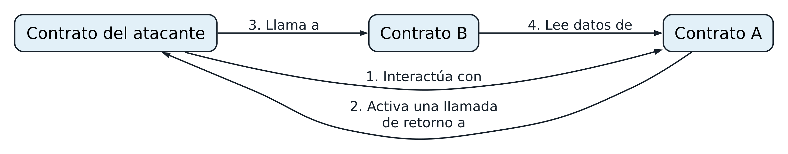

# Capítulo 9. Seguridad de los contratos inteligentes

La seguridad es una de las consideraciones más importantes al escribir contratos inteligentes. En el campo de la programación de contratos inteligentes, los errores son costosos y fáciles de explotar. En este capítulo, veremos buenas prácticas de seguridad y patrones de diseño, así como *antipatrones de seguridad*, que son prácticas y patrones que pueden introducir vulnerabilidades en los contratos inteligentes.

Como ocurre con otros programas, un contrato inteligente ejecutará exactamente lo que está escrito, que no siempre coincide con lo que pretendía quien lo programó. Además, todos los contratos inteligentes son públicos y cualquier usuario puede interactuar con ellos con solo crear una transacción. Cualquier vulnerabilidad puede explotarse, y las pérdidas casi siempre son imposibles de recuperar. Por lo tanto, es fundamental seguir buenas prácticas y utilizar patrones de diseño bien probados.

Pensemos en el desarrollo robusto como la primera capa de un "modelo del queso suizo" de seguridad. Cada capa de protección actúa como una rebanada de queso suizo: ninguna es perfecta por sí sola, pero juntas crean una defensa más sólida. La primera capa consiste en seguir prácticas de desarrollo sólidas: utilizar patrones de diseño confiables, escribir código claro y deliberado, y evitar activamente los errores conocidos. Esta capa fundamental nos brinda el mejor punto de partida para proteger nuestros contratos de las vulnerabilidades. Más allá de ella, otras capas, como las pruebas, las revisiones de código y las recompensas por errores, agregan protección adicional, pero todo comienza con nuestras prácticas de desarrollo.

## Buenas prácticas de seguridad

La *programación defensiva* es un estilo de programación especialmente adecuado para los contratos inteligentes. Hace hincapié en los siguientes aspectos, todos ellos buenas prácticas:

**Minimalismo/simplicidad**

Incluso antes de escribir código, vale la pena tomar distancia y preguntarse si realmente se necesita cada componente. ¿Se puede simplificar el diseño? ¿Ciertas estructuras de datos introducen una superficie innecesaria? Una vez definida la arquitectura, aun así deberíamos volver a revisar el código con mirada crítica, buscando oportunidades para reducir líneas, eliminar casos límite o descartar funciones no esenciales. Los contratos más simples son más fáciles de razonar, probar y auditar. Y aunque algunos protocolos DeFi crecen legítimamente hasta alcanzar unos miles de líneas, sigue siendo conveniente mantener el escepticismo cuando alguien presume del tamaño de su base de código. Más código suele significar más errores, no más valor.

**Reutilización de código**

Procure no reinventar la rueda. Si ya existe una biblioteca o un contrato que hace la mayor parte de lo que necesita, reutilícelo. [OpenZeppelin](https://www.openzeppelin.com), por ejemplo, ofrece un conjunto de contratos ampliamente adoptados, probados a fondo y revisados continuamente por la comunidad. Dentro de su propio código, siga el principio DRY: no se repita. Si ve un fragmento de código repetido más de una vez, pregúntese si podría escribirse como una función o biblioteca y reutilizarse. El código que ha sido probado en la práctica en muchos despliegues casi siempre es más seguro que algo que acaba de escribir, por mucha confianza que le tenga. Tenga cuidado con el síndrome de "no se inventó aquí", que lleva a sentir la tentación de "mejorar" una función o un componente construyéndolo desde cero. El riesgo de seguridad suele superar el valor de la mejora. Reutilizar no es pereza. Es ingeniería defensiva inteligente.

**Calidad del código**

El código de los contratos inteligentes no perdona. Cada error puede provocar pérdidas monetarias. No se debe tratar la programación de contratos inteligentes igual que la programación de propósito general. Escribir una DApp en Solidity no es como crear un widget web en JavaScript. Por el contrario, se deben aplicar metodologías rigurosas de ingeniería y desarrollo de software, como se haría en ingeniería aeroespacial o en cualquier disciplina con una tolerancia a los errores igualmente escasa. Una vez que "lanza" su código, hay poco que pueda hacer para solucionar los problemas. E incluso si el código se puede actualizar, suele haber muy poco tiempo para responder si algo sale mal. Si alguien detecta un error en su proyecto antes que usted, es probable que la explotación se produzca en una sola transacción o en unas pocas, lo que significa que el daño ocurre en segundos, mucho antes de que pueda intervenir.

**Legibilidad/auditabilidad**

Su código debe ser claro y fácil de comprender. Cuanto más fácil sea leerlo, más fácil será auditarlo. Los contratos inteligentes son públicos: todo el mundo puede leer el bytecode, y cualquiera con suficiente conocimiento puede aplicarle ingeniería inversa. Por lo tanto, conviene desarrollar su trabajo de forma pública, con metodologías colaborativas y de código abierto, para aprovechar el conocimiento colectivo de la comunidad de desarrolladores y beneficiarse del máximo denominador común del desarrollo de código abierto. Debe escribir código bien documentado y fácil de leer, siguiendo las convenciones de estilo y nomenclatura de la comunidad de Ethereum.

**Cobertura de pruebas**

Pruebe todo lo que pueda. Los contratos inteligentes se ejecutan en un entorno de ejecución público, donde cualquiera puede ejecutarlos con las entradas que quiera. Nunca se debe suponer que las entradas, como los argumentos de las funciones, están bien formadas o debidamente acotadas, ni que tienen un propósito benigno. Verifique todos los argumentos para asegurarse de que estén dentro de los rangos esperados y tengan el formato adecuado antes de permitir que continúe la ejecución de su código.

## Riesgos y antipatrones de seguridad

Quien programa contratos inteligentes debe conocer los riesgos de seguridad más comunes para poder detectar y evitar los patrones de programación que dejan los contratos expuestos a esos riesgos. En las próximas secciones, veremos distintos riesgos de seguridad, ejemplos de cómo pueden surgir vulnerabilidades y contramedidas o soluciones preventivas que pueden utilizarse para abordarlas.

Los siguientes antipatrones suelen combinarse para ejecutar un ataque, de manera muy similar a lo que ocurre en la seguridad de Web2. Los ataques reales suelen ser más complejos que los ejemplos de este capítulo.

### Reentrada

Una de las características de los contratos inteligentes de Ethereum es su capacidad para llamar y utilizar código de otros contratos externos. Los contratos también suelen manejar ether y, por ello, a menudo envían ether a diversas direcciones de usuarios externos. Estas operaciones requieren que los contratos realicen llamadas externas. Los atacantes pueden secuestrar estas llamadas externas y obligar a los contratos a ejecutar más código mediante una llamada de retorno: ya sea una función fallback o algún hook, por lo general `transfer`, incluidas llamadas de vuelta a sí mismos. Se utilizaron ataques de este tipo en el tristemente célebre y aún recordado ataque a The DAO de 2016. Incluso después de todos estos años, [seguimos viendo muchos ataques que explotan esta vulnerabilidad](https://oreil.ly/87VUR), aunque es bastante sencilla de detectar y económica de corregir.

#### La vulnerabilidad

Este tipo de ataque ocurre cuando un atacante logra tomar el control durante la ejecución de otro contrato antes de que ese contrato haya terminado de actualizar su estado. Como el contrato todavía está en medio de su proceso, aún no ha actualizado su estado, por ejemplo, variables críticas. El atacante puede entonces "reentrar" en el contrato en ese momento vulnerable y aprovechar el estado inconsistente para desencadenar acciones que no se pretendían ni se esperaban. Esta reentrada permite al atacante eludir las medidas de protección, manipular datos o vaciar los fondos, todo porque el contrato todavía no ha alcanzado por completo un estado seguro y consistente.

La reentrada puede ser difícil de comprender sin un ejemplo práctico. Observe el sencillo contrato vulnerable del ejemplo 9-1, que funciona como una bóveda de Ethereum que permite a los depositantes retirar solo 1 ether por semana.

**Ejemplo 9-1. EtherStore: un contrato vulnerable a la reentrada**

```solidity
1 contract EtherStore {
2      uint256 public withdrawalLimit = 1 ether;
3      mapping(address => uint256) public lastWithdrawTime;
4    mapping(address => uint256) balances;
5
6    function depositFunds() public payable{
7      balances[msg.sender] += msg.value;
8    }
9
10    function withdrawFunds() public {
11        require(block.timestamp >= lastWithdrawTime[msg.sender] + 1 weeks);
12        uint256 _amt = balances[msg.sender];
13        if(_amt > withdrawalLimit){
14            _amt = withdrawalLimit;
15        }
16      (bool res, ) = address(msg.sender).call{value: _amt}("");
17        require(res, "Transfer failed");
18      balances[msg.sender] -= _amt; // se supone Solidity <0.8: el subdesbordamiento ajusta el valor de forma cíclica (explotable); Solidity >=0.8: revierte aquí
19        lastWithdrawTime[msg.sender] = block.timestamp;
20    }
21 }
```

Este contrato tiene dos funciones públicas, `depositFunds` y `withdrawFunds`. La función `depositFunds` solo incrementa el saldo del remitente. La función `withdrawFunds` permite al remitente retirar su saldo. Esta función está diseñada para tener éxito solo si no se ha realizado un retiro en la última semana.

La vulnerabilidad está en la línea 16, donde el contrato envía al usuario la cantidad de ether que solicitó. Consideremos a un atacante que ha creado el contrato del ejemplo 9-2.

**Ejemplo 9-2. Attack.sol: un contrato utilizado para explotar la vulnerabilidad de reentrada del contrato EtherStore**

```solidity
1 contract Attack {
2  EtherStore public etherStore;
3
4  // inicializar la variable etherStore con la dirección del contrato
5  constructor(address _etherStoreAddress) {
6      etherStore = EtherStore(_etherStoreAddress);
7  }
8
9  function attackEtherStore() public payable {
10      // attack to the nearest ether
11      require(msg.value >= 1 ether, "no bal");
12      // enviar eth a la función depositFunds()
13      etherStore.depositFunds{value: 1 ether}();
14      // comenzar la magia
15      etherStore.withdrawFunds();
16  }
17
18  function collectEther() public {
19      payable(msg.sender).transfer(address(this).balance);
20  }
21
22  // función receive: la función fallback() también habría funcionado
23  receive() external payable {
24      if (address(etherStore).balance >= 1 ether) {
25          // llamada reentrante al contrato víctima
26          etherStore.withdrawFunds();
27      }
28  }
29 }
```

¿Cómo podría ocurrir el ataque? Primero, el atacante crearía el contrato malicioso, digamos en la dirección `0x0...123`, con la dirección del contrato `EtherStore` como único parámetro del constructor. Esto inicializaría la variable pública `etherStore` y la haría apuntar al contrato que se va a atacar.

Después, el atacante llamaría a la función `attackEtherStore` con alguna cantidad de ether mayor o igual que 1; supongamos por ahora 1 ether. En este ejemplo, también supondremos que varios usuarios más han depositado ether en este contrato, por lo que su saldo actual es de 10 ether. A continuación, ocurrirá lo siguiente:

- *Attack.sol*, línea 13: se llamará a la función `depositFunds` del contrato `EtherStore` con un `msg.value` de `1 ether` y mucho gas. El remitente (`msg.sender`) será el contrato malicioso (`0x0...123`). Por lo tanto, `balances[0x0..123] = 1 ether`.
- *Attack.sol*, línea 15: el contrato malicioso llamará entonces a la función `withdrawFunds` del contrato `EtherStore`. Se cumplirá el requisito de la línea 11 del contrato `EtherStore`, ya que no se han realizado retiros previos.
- *EtherStore.sol*, línea 16: el contrato enviará `1 ether` de vuelta al contrato malicioso.
- *Attack.sol*, línea 23: el pago al contrato malicioso ejecutará entonces la función `receive`.
- *Attack.sol*, línea 24: el saldo total del contrato `EtherStore` era de 10 ether y ahora es de 9 ether, por lo que se cumple esta condición `if`.
- *Attack.sol*, línea 26: la función fallback llama de nuevo a la función `withdrawFunds` de `EtherStore` y *reentra* en el contrato `EtherStore`.
- *EtherStore.sol*, línea 10: en esta segunda llamada a `withdrawFunds`, el saldo del contrato atacante sigue siendo de 1 ether, ya que la línea 18 todavía no se ha ejecutado. Por lo tanto, aún tenemos `balances[0x0..123] = 1 ether`. Lo mismo ocurre con la variable `lastWithdrawTime`. De nuevo, cumplimos el requisito.
- *EtherStore.sol*, línea 16: el contrato atacante retira otro `1 ether`.
- Reentrar en el contrato EtherStore hasta que deje de cumplirse `EtherStore.balance >= 1`, como establece la línea 24 de *Attack.sol*.
- *Attack.sol*, línea 24: una vez que quede menos de 1 ether en el contrato `EtherStore`, esta condición `if` no se cumplirá. Esto permitirá entonces que se ejecuten las líneas 17–19 del contrato `EtherStore` para cada llamada a la función `withdrawFunds`.
- *EtherStore.sol*, líneas 18 y 19: se establecerán los mappings `balances` y `lastWithdrawTime`, y la ejecución terminará.

El resultado final es que el atacante ha retirado todo el ether del contrato `EtherStore` en una sola transacción.

Aunque las transferencias de ether nativo interceptadas por funciones fallback son un vector común de ataques de reentrada, no son el único mecanismo que puede introducir este riesgo. Varios estándares de tokens, como ERC-721 y ERC-777, incluyen mecanismos de llamadas de retorno que también pueden permitir ataques de reentrada. Por ejemplo, la función `safeTransfer` de ERC-721 garantiza que las transferencias de tokens a contratos llamen a la función `onERC721Received` del destinatario. De manera similar, los tokens ERC-777 permiten invocar hooks mediante la función `tokensReceived` durante las transferencias.

#### Más allá del patrón clásico de reentrada
Los ataques de reentrada no se limitan a una sola función o contrato. Aunque la reentrada clásica implica volver a entrar en la misma función antes de que termine, existen variantes más difíciles de detectar, como la reentrada entre funciones, la reentrada entre contratos y, la más difícil de todas, la reentrada de solo lectura.
La reentrada de solo lectura aprovecha los contratos que dependen de funciones de vista de otros contratos. Estas funciones no modifican el estado, pero devuelven datos de los que dependen otros contratos, a menudo sin protección contra reentrada. El problema ocurre cuando una llamada reentrante permite a un atacante poner temporalmente el contrato objetivo en un estado inconsistente, lo que le permite utilizar otro contrato, la víctima, para consultar este estado inestable mediante una función de vista.
Veamos cómo se desarrolla:
1. El contrato del atacante interactúa con un contrato vulnerable, al que llamaremos Contrato A, en el que se puede reentrar. Este contrato mantiene datos de los que dependen otros protocolos.
2. El Contrato A desencadena una llamada de retorno al contrato del atacante, lo que permite ejecutar la lógica del contrato del atacante.
3. Mientras aún está en la función fallback, el contrato del atacante llama a un protocolo diferente, el Contrato B, que está conectado al Contrato A y depende de los datos que este proporciona.
4. El Contrato B, sin advertir ningún problema, lee datos del Contrato A. Sin embargo, el estado del Contrato A está desactualizado porque todavía no ha terminado de actualizarse.
Para cuando termina este ciclo, el atacante ya ha explotado el Contrato B aprovechando los datos desactualizados del Contrato A y luego deja que la llamada de retorno y la llamada original del Contrato A se completen normalmente. El proceso se ilustra en la figura 9-1.


**Figura 9-1.** Reentrada de solo lectura

La clave es que el Contrato B confía en los datos del Contrato A, pero el estado del Contrato A aún no se ha actualizado, lo que permite al atacante aprovechar el desfase. Es más difícil defenderse de este tipo de ataque porque los desarrolladores a menudo no protegen las funciones de vista con bloqueos de reentrada, al pensar que son seguras porque no modifican el estado.
La reentrada de solo lectura nos enseña que incluso las funciones de solo lectura pueden ser peligrosas cuando otros contratos dependen de ellas.

#### Técnicas preventivas

La primera buena práctica para prevenir problemas de reentrada es apegarse al patrón de comprobación-efecto-interacción al escribir contratos inteligentes. Este patrón consiste en asegurar que todos los cambios en las variables de estado ocurran antes de interactuar con contratos externos. Por ejemplo, en el contrato *EtherStore.sol*, las líneas que modifican variables de estado deben aparecer antes de cualquier llamada externa. El objetivo es asegurar que cualquier fragmento de código que interactúe con direcciones externas sea lo último que se ejecute en la función. Esto impide que los contratos externos interfieran con el estado interno al reentrar, porque las actualizaciones necesarias ya se han realizado.

Otra técnica útil es aplicar un bloqueo de reentrada. Un *bloqueo de reentrada* es una variable de estado sencilla que "bloquea" el contrato mientras ejecuta una función, impidiendo que otras llamadas externas lo interrumpan. Esto puede implementarse con un modificador como este:

```solidity
contract EtherStore {
    bool lock;
      uint256 public withdrawalLimit = 1 ether;
      mapping(address => uint256) public lastWithdrawTime;
    mapping(address => uint256) balances;

      modifier nonReentrant {
      require(!lock, "Can't reenter");
      lock = true;
      _;
      lock = false;
    }

    function withdrawFunds() public nonReentrant{
        [...]
    }
}
```

En este ejemplo, el modificador `nonReentrant` utiliza la variable de bloqueo para impedir que se vuelva a entrar en la función `withdrawFunds` mientras aún se está ejecutando. El modificador `nonReentrant` bloquea el contrato al comenzar y lo desbloquea cuando termina la función. Sin embargo, no deberíamos reinventar la rueda. En lugar de crear nuestros propios bloqueos de reentrada, es mejor recurrir a bibliotecas bien probadas como ReentrancyGuard de OpenZeppelin. Estas bibliotecas proporcionan soluciones seguras y optimizadas en consumo de gas.

> **Nota**
>
> Con la llegada del almacenamiento transitorio a Ethereum en Solidity 0.8.24, OpenZeppelin introdujo ReentrancyGuardTransient, una nueva variante de ReentrancyGuard que aprovecha el almacenamiento transitorio para reducir considerablemente los costos de gas. El almacenamiento transitorio, habilitado por [EIP-1153](https://oreil.ly/fRvKl), proporciona una manera más económica de almacenar datos que se necesitan solo durante una única transacción, lo que lo hace ideal para protecciones contra reentrada y lógica temporal similar. Sin embargo, ReentrancyGuardTransient solo puede utilizarse en cadenas donde EIP-1153 esté disponible, por lo que debe asegurarse de que la cadena objetivo admita esta característica antes de implementarla.

Otro enfoque es utilizar las funciones integradas `transfer` y `send` de Solidity para enviar ether. Estas funciones solo reenvían una cantidad limitada de gas (2,300 unidades), que normalmente no basta para que el contrato receptor ejecute una llamada reentrante, por lo que son una forma sencilla de protegerse contra la reentrada. Sin embargo, tienen inconvenientes importantes. Si el destinatario es un contrato inteligente con lógica no maliciosa en su función fallback o receive, la transferencia podría fallar y posiblemente bloquear los fondos. Este riesgo adquiere mayor relevancia con la introducción de EIP-7702, que permite que las EOA tengan código asociado, incluida lógica fallback. A medida que más EOA adopten esta capacidad, será más probable que las transacciones que usan `transfer` o `send` reviertan durante su ejecución normal debido a gas insuficiente. Y desde el punto de vista de la seguridad, este enfoque no es resistente a cambios futuros: si un hard fork futuro reduce el costo de gas de ciertas operaciones, 2,300 unidades podrían llegar a ser suficientes para reentrar, invalidando supuestos que antes eran seguros. Por eso, aunque `transfer` y `send` todavía pueden resultar útiles en casos limitados, debemos utilizarlas con cautela y no depender de ellas como defensa principal.

La reentrada de solo lectura y la reentrada entre contratos merecen especial atención: estos ataques pueden ser difíciles de abordar porque podrían involucrar dos protocolos separados, lo que dificulta la prevención coordinada. Cuando nuestro proyecto depende de protocolos externos para obtener datos, debemos profundizar en cómo funciona la lógica combinada. Incluso si cada proyecto es seguro por sí solo, pueden surgir vulnerabilidades durante la integración.

#### Ejemplo real: el ataque a The DAO

La reentrada tuvo un papel importante en el ataque a The DAO de 2016, uno de los mayores ataques durante el desarrollo inicial de Ethereum. En ese momento, el contrato contenía más de $150 millones, el 15% del suministro circulante de ether. Para revertir los efectos del ataque, la comunidad de Ethereum finalmente optó por un hard fork que dividió la blockchain de Ethereum. Como resultado, Ethereum Classic (ETC) continuó como la cadena original, mientras que la versión bifurcada con reglas actualizadas para revertir el ataque se convirtió en el Ethereum que conocemos hoy.

#### Ejemplo real: Libertify

Un ataque reciente en el que la reentrada fue el único vector de ataque es el caso de julio de 2023 que involucró a Libertify, un protocolo DeFi del que se sustrajeron $400,000. Revisemos el código de la función explotada y veamos cómo ocurrió:

```solidity
function _deposit(
    uint256 assets,
    address receiver,
    bytes calldata data,
    uint256 nav
) private returns (uint256 shares) {
        /*
        validaciones
    */
    uint256 returnAmount = 0;
    uint256 swapAmount = 0;
    if (BASIS_POINT_MAX > invariant) {
        swapAmount = assetsToToken1(assets);
        returnAmount = userSwap( // Llamada externa
            data,
            address(this),
            swapAmount,
            address(asset),
            address(other)
        );
    }
    uint256 supply = totalSupply(); // Actualización de estado
    if (0 < supply) {
        uint256 valueToken0 = getValueInNumeraire(
            asset,
            assets - swapAmount,
            MathUpgradeable.Rounding.Down
        );
        uint256 valueToken1 = getValueInNumeraire(
            other,
            returnAmount,
            MathUpgradeable.Rounding.Down
        );
        shares = supply.mulDiv(
            valueToken0 + valueToken1,
            nav,
            MathUpgradeable.Rounding.Down
        );
    } else {
        shares = INITIAL_SHARE;
    }
    uint256 feeAmount = shares.mulDiv(
        entryFee, BASIS_POINT_MAX, MathUpgradeable.Rounding.Down
    );
    _mint(receiver, shares - feeAmount);
    _mint(owner(), feeAmount);
}
```

Este es un ejemplo clásico de un problema de reentrada. ¡Hoy en día no se ve uno tan directo muy a menudo! El problema central era la falta de protección contra reentrada. La función `userSwap()` permitía al atacante volver a entrar en la función `deposit()` antes de que la llamada original actualizara `totalSupply`. Esto significaba que el atacante podía acuñar más participaciones de las que realmente le correspondían, explotando el contrato para obtener una ganancia.

### DELEGATECALL

Los códigos de operación `CALL` y `DELEGATECALL` permiten a los desarrolladores de Ethereum modularizar su código. El código de operación `CALL` gestiona las llamadas externas de mensaje estándar a los contratos y ejecuta el código en el contexto del contrato *llamado*. En cambio, `DELEGATECALL` ejecuta el código de otro contrato, pero en el contexto del contrato *que realiza la llamada*. Eso significa que el almacenamiento persistente, `msg.sender` y `msg.value` permanecen sin cambios. Una manera útil de entender `DELEGATECALL` es que el contrato que realiza la llamada toma prestado temporalmente el bytecode del contrato llamado y lo ejecuta como si fuera propio. Esto permite patrones potentes, como los contratos proxy y las bibliotecas, en los que se despliega lógica reutilizable una vez y se reutiliza en muchos contratos. Aunque las diferencias entre estos dos códigos de operación son simples e intuitivas, el uso de `DELEGATECALL` puede generar comportamientos sutiles e inesperados, especialmente en lo referente a la disposición del almacenamiento persistente. Para más información, consulte la [pregunta de Loi.Luu sobre este tema en Ethereum Stack Exchange](https://oreil.ly/GJOUl) y la [documentación de Solidity](https://oreil.ly/gA7vg).

#### La vulnerabilidad

Debido a que `DELEGATECALL` conserva el contexto, crear bibliotecas personalizadas sin vulnerabilidades no es tan fácil como podría pensarse. El código de las bibliotecas puede ser seguro y estar libre de vulnerabilidades; sin embargo, cuando se ejecuta en el contexto de otra aplicación, pueden surgir nuevas vulnerabilidades. Veamos un ejemplo bastante complejo que utiliza números de Fibonacci. Consideremos la biblioteca del ejemplo 9-3, que puede generar la sucesión de Fibonacci y sucesiones de forma similar. (Nota: este código se modificó a partir de [*https://oreil.ly/EHjOb*](https://oreil.ly/EHjOb).)

**Ejemplo 9-3. FibonacciLib: una implementación defectuosa de una biblioteca personalizada**

```solidity
1 // contrato de biblioteca: calcula números de tipo Fibonacci
2 contract FibonacciLib {
3     // inicializar la sucesión de Fibonacci estándar
4     uint256 public start;
5     uint256 public calculatedFibNumber;
6
7     // modificar el número de índice cero de la sucesión
8     function setStart(uint256 _start) public {
9         start = _start;
10     }
11
12     function setFibonacci(uint256 n) public {
13         calculatedFibNumber = fibonacci(n);
14     }
15
16     function fibonacci(uint256 n) internal view returns (uint) {
17         if (n == 0) return start;
18         else if (n == 1) return start + 1;
19         else return fibonacci(n - 1) + fibonacci(n - 2);
20     }
21 }
```

Esta biblioteca proporciona una función que puede generar el *n*-ésimo número de Fibonacci de la sucesión. Permite a los usuarios cambiar el número inicial de la sucesión (`start`) y calcular el *n*-ésimo número de tipo Fibonacci de esta nueva sucesión.

Consideremos ahora un contrato que utiliza esta biblioteca:

```solidity
contract FibonacciBalance {
    address public fibonacciLibrary;
    // el número de Fibonacci actual que se retirará
    uint256 public calculatedFibNumber;
    // el número inicial de la sucesión de Fibonacci
    uint256 public start = 3;
    uint256 public withdrawalCounter;
    // el selector de la función de Fibonacci
    bytes4 constant fibSig = bytes4(keccak256("setFibonacci(uint256)"));
    // constructor: carga el contrato con ether
    constructor(address _fibonacciLibrary) payable {
        fibonacciLibrary = _fibonacciLibrary;
    }
    function withdraw() public {
        withdrawalCounter += 1;
        // calcular el número de Fibonacci para el usuario del retiro actual
        // esto establece calculatedFibNumber
        (bool success, ) = fibonacciLibrary.delegatecall(
            abi.encodeWithSelector(fibSig, withdrawalCounter)
        );
        require(success, "Delegatecall failed");
        payable(msg.sender).transfer(calculatedFibNumber * 1 ether);
    }
    // permitir a los usuarios llamar a las funciones de la biblioteca Fibonacci
    fallback() external {
        (bool success, ) = fibonacciLibrary.delegatecall(msg.data);
        require(success, "Delegatecall failed");
    }
}
```

Este contrato permite a un participante retirar ether del contrato, con una cantidad de ether igual al número de Fibonacci correspondiente al orden de retiro del participante; es decir, el primer participante recibe 1 ether, el segundo también recibe 1, el tercero recibe 2, el cuarto recibe 3, el quinto 5, y así sucesivamente, hasta que el saldo del contrato sea menor que el número de Fibonacci que se retira.

Hay varios elementos de este contrato que pueden requerir una explicación. Primero, hay una variable de aspecto interesante: `fibSig`. Contiene los primeros 4 bytes del hash Keccak-256 de la cadena `"setFibonacci(uint256)"`. Esto se conoce como el [*selector de función*](https://oreil.ly/u9uaH) y se coloca en calldata para especificar qué función de un contrato inteligente se llamará. Se utiliza en el `delegatecall` de la línea 18 para especificar que deseamos ejecutar la función `setFibonacci(uint256)`. Calldata también incluye el parámetro que pasamos a la función. Segundo, suponemos que la dirección de la biblioteca FibonacciLib está referenciada correctamente en el constructor.

¿Puede detectar algún error en este contrato? Si desplegara este contrato, lo llenara de ether y llamara a `withdraw`, probablemente revertiría.

Quizá haya notado que la variable de estado `start` se utiliza tanto en la biblioteca como en el contrato principal que realiza la llamada. En el contrato de biblioteca, `start` se utiliza para especificar el inicio de la sucesión de Fibonacci y se establece en `0`, mientras que en el contrato que realiza la llamada se establece en `3`. También puede haber notado que la función fallback del contrato `FibonacciBalance` permite pasar todas las llamadas al contrato de biblioteca, lo que permite llamar a la función `setStart` de este. Recordando que conservamos el estado del contrato, podría parecer que esta función permitiría cambiar el estado de la variable `start` en el contrato local `FibonacciBalance`. De ser así, esto permitiría retirar más ether, ya que el `calculatedFibNumber` resultante depende de la variable `start`, como se ve en el contrato de biblioteca. En realidad, la función `setStart` no modifica ni puede modificar la variable `start` del contrato `FibonacciBalance`. La vulnerabilidad subyacente de este contrato es considerablemente peor que simplemente modificar la variable `start`.

Antes de analizar el problema real, hagamos una breve pausa para entender cómo se almacenan realmente las variables de estado en los contratos. Las *variables de estado* o *de almacenamiento persistente*, que persisten entre transacciones individuales, se colocan en *slots* de forma secuencial a medida que se introducen en el contrato. (Hay algunas complejidades aquí; consulte la [documentación de Solidity](https://oreil.ly/LzV7L) para comprenderlo con mayor profundidad.)

Como ejemplo, observemos el contrato de biblioteca. Tiene dos variables de estado: `start` y `calculatedFibNumber`. La primera variable, `start`, se guarda en el almacenamiento persistente del contrato en `slot[0]`, es decir, el primer slot. La segunda variable, `calculatedFibNumber`, se coloca en el siguiente slot de almacenamiento disponible, `slot[1]`. La función `setStart` toma una entrada y establece `start` en el valor de esa entrada. Por lo tanto, esta función establece `slot[0]` en cualquier entrada que proporcionemos a la función `setStart`. De manera similar, la función `setFibonacci` establece `calculatedFibNumber` en el resultado de `fibonacci(n)`. De nuevo, esto simplemente establece el `slot[1]` del almacenamiento persistente en el valor de `fibonacci(n)`.

Ahora observemos el contrato `FibonacciBalance`. El `slot[0]` del almacenamiento persistente corresponde ahora a la dirección `fibonacciLibrary`, y `slot[1]` corresponde a `calculatedFibNumber`. La vulnerabilidad aparece en esta correspondencia incorrecta: `delegatecall` *conserva el contexto del contrato*. Esto significa que el código ejecutado mediante `delegatecall` actuará sobre el estado, es decir, el almacenamiento persistente, del contrato que realiza la llamada.

Observe ahora que en `withdraw`, en la línea 18, ejecutamos `fibonacciLibrary.delegatecall(abi.encodeWithSelector(fibSig, withdrawalCounter))`. Esto llama a la función `setFibonacci`, que, como comentamos, modifica el `slot[1]` del almacenamiento persistente, que en nuestro contexto actual es `calculatedFibNumber`. Esto es lo esperado; es decir, después de la ejecución, `calculatedFibNumber` se modifica. Sin embargo, recuerde que la variable `start` del contrato `FibonacciLib` se encuentra en el `slot[0]` del almacenamiento persistente, que es la dirección `fibonacciLibrary` en el contrato actual. Esto significa que la función `fibonacci` dará un resultado inesperado. Se debe a que hace referencia a `start` (`slot[0]`), que en el contexto actual de la llamada es la dirección `fibonacciLibrary`, que a menudo será bastante grande al interpretarse como un `uint`. Por lo tanto, es probable que la función `withdraw` revierta, ya que no contendrá la cantidad de ether `uint(fibonacciLibrary)`, que es lo que devolverá `calculatedFibNumber`.

Peor aún, el contrato `FibonacciBalance` permite a los usuarios llamar a todas las funciones de `fibonacciLibrary` mediante la función fallback de la línea 25. Como vimos antes, esto incluye la función `setStart`. Explicamos que esta función permite a cualquiera modificar o establecer el `slot[0]` del almacenamiento persistente. En este caso, el `slot[0]` es la dirección `fibonacciLibrary`. Por lo tanto, un atacante podría crear un contrato malicioso, convertir la dirección a un `uint256` (esto puede hacerse fácilmente en Python mediante `int('<address>',16)`) y luego llamar a `setStart(<attack_contract_address_as_uint>)`. Esto cambiará `fibonacciLibrary` a la dirección del contrato atacante. Entonces, cada vez que un usuario llame a `withdraw` o a la función fallback, se ejecutará el contrato malicioso, que puede robar todo el saldo del contrato, porque hemos modificado la dirección real de `fibonacciLibrary`. Un ejemplo de un contrato atacante de este tipo sería:

```solidity
contract Attack {
    uint256 private storageSlot0; // corresponde a fibonacciLibrary
    uint256 private storageSlot1; // corresponde a calculatedFibNumber
    // fallback: esto se ejecutará si no se encuentra una función especificada
    fallback() external {
        storageSlot1 = 0; // establecemos calculatedFibNumber en 0, por lo que si se llama a withdraw
        // no enviamos ningún ether
        payable(<attacker_address>).transfer(this.balance); // tomamos todo el ether
    }
}
```

Observe que este contrato atacante modifica `calculatedFibNumber` cambiando el `slot[1]` del almacenamiento persistente. En principio, un atacante podría modificar cualquier otro slot que eligiera para realizar todo tipo de ataques contra este contrato. Le recomendamos colocar estos contratos en [Remix](https://remix.ethereum.org) y experimentar con distintos contratos atacantes y cambios de estado mediante estas funciones `delegatecall`.

También es importante notar que, cuando decimos que `delegatecall` conserva el estado, no hablamos de los nombres de las variables del contrato, sino de los slots reales del almacenamiento persistente a los que apuntan esos nombres. Como se ve en este ejemplo, un simple error puede llevar a que un atacante tome el control de todo el contrato y de su ether.

#### Técnicas preventivas

Solidity proporciona la palabra reservada `library` para implementar contratos de biblioteca (consulte la [documentación](https://oreil.ly/K7kF1) para más detalles). Esto garantiza que el contrato de biblioteca no tenga estado ni pueda autodestruirse. Obligar a que las bibliotecas no tengan estado mitiga las complejidades del contexto de almacenamiento persistente demostradas en esta sección. Las bibliotecas sin estado también evitan ataques en los que los atacantes modifican directamente el estado de la biblioteca para afectar a los contratos que dependen de su código. Como regla general, al utilizar `DELEGATECALL`, preste mucha atención al posible contexto de llamada tanto del contrato de biblioteca como del contrato que realiza la llamada y, siempre que sea posible, construya bibliotecas sin estado.

#### Ejemplo real: billetera multifirma de Parity (segundo ataque)

El segundo ataque a la billetera multifirma de Parity es un ejemplo de cómo puede explotarse código de biblioteca bien escrito si se ejecuta fuera del contexto previsto. Hay varias buenas explicaciones de este ataque, como [“Parity Multisig Hacked. Again”](https://oreil.ly/OLt5Q). Para complementar estas referencias, exploremos los contratos que fueron explotados.

Como el ataque ocurrió hace siete años, los siguientes fragmentos de código se actualizaron para reflejar la sintaxis de versiones recientes de Solidity, lo que facilita su lectura y comprensión.

El contrato de biblioteca es el siguiente:

```solidity
1 contract WalletLibrary is WalletEvents {
2
3   ...
4
5   // lanzar un error salvo que el contrato aún no esté inicializado.
6   modifier only_uninitialized { if (m_numOwners > 0) revert(); _; }
7
8   // constructor: solo pasar el arreglo de propietarios a multiowned y
9   // el límite a daylimit
10   function initWallet(address[] memory _owners, uint256 _required, uint256
11        _daylimit) public only_uninitialized {
12     initDaylimit(_daylimit);
13     initMultiowned(_owners, _required);
14   }
15
16   // destruye el contrato y envía todo a `_to`.
17   function kill(address _to) onlymanyowners(keccak256(msg.data)) external {
18     selfdestruct(_to);
19   }
20
21   ...
22
23 }
```

Y este es el contrato de billetera:

```solidity
1 contract Wallet is WalletEvents {
2
3   ...
4
5   // MÉTODOS
6
7   // se llama cuando ninguna otra función coincide
8   fallback() external payable {
9     // ¿solo se está enviando algo de dinero?
10     if (msg.value > 0)
11       Deposit(msg.sender, msg.value);
12     else if (msg.data.length > 0)
13       _walletLibrary.delegatecall(msg.data);
14   }
15
16   ...
17
18   // CAMPOS
19   address constant _walletLibrary =
20     0xcafecafecafecafecafecafecafecafecafecafe;
21 }
```

Observe que el contrato `Wallet` esencialmente pasa todas las llamadas al contrato `WalletLibrary` mediante una llamada delegada. La dirección constante `_walletLibrary` de este fragmento de código sirve como marcador de posición del contrato `WalletLibrary` realmente desplegado, que estaba en `0x863DF6BFa4469f3ead0bE8f9F2AAE51c91A907b4`.

El funcionamiento previsto de estos contratos consistía en tener un contrato `Wallet` sencillo, de bajo costo y desplegable, cuya base de código y funcionalidad principal estuvieran en el contrato `WalletLibrary`. Por desgracia, el contrato `WalletLibrary` es en sí mismo un contrato y mantiene su propio estado. ¿Puede ver por qué esto podría ser un problema?

Es posible enviar llamadas al propio contrato `WalletLibrary`. En concreto, el contrato `WalletLibrary` podía inicializarse y pasar a tener un propietario. De hecho, un usuario lo hizo: llamó a la función `initWallet` del contrato `WalletLibrary` y se convirtió en propietario del contrato de biblioteca. Posteriormente, el mismo usuario llamó a la función `kill`. Como el usuario era propietario del contrato de biblioteca, se cumplió el modificador y el contrato de biblioteca se autodestruyó. Como todos los contratos `Wallet` existentes hacen referencia a este contrato de biblioteca y no contienen ningún método para cambiar esa referencia, toda su funcionalidad, incluida la capacidad de retirar ether, se perdió junto con el contrato `WalletLibrary`. Como resultado, todo el ether de todas las billeteras multifirma de Parity de este tipo se perdió al instante o se volvió irrecuperable de forma permanente.

> **Nota**
>
> El autor del ataque [apareció más tarde en GitHub](https://oreil.ly/VVgnm), donde dejó el memorable comentario: "Lo destruí por accidente". Afirmó ser un recién llegado a Ethereum que había estado experimentando con contratos inteligentes.

### Ilusión de entropía

Todas las transacciones de la blockchain de Ethereum son operaciones de *transición de estado determinista*. Esto significa que cada transacción modifica el estado global del ecosistema de Ethereum de una manera calculable, sin incertidumbre. Esto tiene una implicación fundamental: no hay ninguna fuente de entropía o aleatoriedad en Ethereum. Al principio, encontrar una manera descentralizada de crear aleatoriedad era un gran desafío. Pero, con los años, hemos desarrollado algunas soluciones sólidas para resolver este problema.

#### La vulnerabilidad

Cuando los desarrolladores construyen contratos inteligentes en Ethereum, a menudo necesitan una fuente de aleatoriedad, ya sea para juegos, loterías u otras funciones que requieren imprevisibilidad. El desafío es que Ethereum, como blockchain, es inherentemente determinista: cada nodo debe llegar al mismo resultado para mantener el consenso. Por eso, introducir verdadera aleatoriedad requiere algo de creatividad.

Un enfoque al que muchos desarrolladores han recurrido es utilizar variables de bloque, como hashes de bloques, marcas de tiempo o números de bloque, como semillas para generar números aleatorios. Estos valores pueden parecer aleatorios, pero en realidad los controla el validador que propone el bloque actual. Por ejemplo, imagine una DApp en la que el resultado de un juego dependa de si el hash del siguiente bloque termina en un número par. Un validador podría manipular el proceso: si está por proponer un bloque y el hash no se ajusta al resultado que desea, podría, por ejemplo, cambiar el orden de las transacciones para cambiar el hash del bloque de manera favorable.

La manipulación por parte de validadores no es el único riesgo al derivar aleatoriedad de variables de bloque. Otros contratos inteligentes conocen el valor de estas variables de bloque, lo que les permite interactuar con un contrato vulnerable solo cuando el resultado es favorable.

#### Técnicas preventivas

A diferencia del pasado, los desarrolladores de Ethereum ahora cuentan con métodos confiables para generar aleatoriedad: `PREVRANDAO` y las *funciones aleatorias verificables* (VRF).

Las VRF son pruebas criptográficas que garantizan que la aleatoriedad generada sea justa y sin sesgos. Múltiples proveedores, como Chainlink, admiten VRF. La VRF genera un número aleatorio junto con una prueba que verifica su imparcialidad. Cualquiera puede verificar esta prueba, lo que garantiza que la aleatoriedad sea segura. Las VRF se han convertido en una solución descentralizada estándar para obtener aleatoriedad de forma segura en contratos inteligentes.

Otra opción sólida es el código de operación `PREVRANDAO`, introducido en Ethereum con la transición a PoS. Este código de operación se utiliza para obtener el valor `PREVRANDAO`, que se origina en el proceso Randao, un componente integral de la producción de bloques de PoS. En esencia, Randao es un esfuerzo colectivo de los validadores para generar aleatoriedad mediante la contribución de un dato por parte de cada uno. `PREVRANDAO` es el resultado de este proceso del bloque anterior y sirve como una fuente confiable de aleatoriedad. Es confiable porque manipular el valor `PREVRANDAO` requeriría comprometer a un número significativo de validadores, lo que hace que esa explotación sea impráctica y económicamente inviable. Los desarrolladores pueden utilizar este valor en sus contratos, pero deben tener presente que `PREVRANDAO` representa el valor del bloque anterior, que ya es conocido. Para evitar que este valor sea predecible al momento de comprometerse, los contratos inteligentes deberían, en cambio, comprometerse con el valor `PREVRANDAO` de un bloque futuro. De esta manera, el valor no se conocerá cuando se asuma el compromiso.

> **Advertencia**
>
> Randao puede manipularse si un atacante obtiene el control de los proponentes asignados a los últimos slots de una época. Para decidir si `PREVRANDAO` es una opción confiable para generar aleatoriedad en su contrato inteligente, debe evaluar cuidadosamente los costos y beneficios de manipularlo. Aunque alterar Randao puede resultar costoso, si su contrato involucra activos valiosos, es más seguro utilizar en su lugar una solución de oráculo descentralizada.

Con soluciones como `PREVRANDAO` y las VRF ampliamente documentadas y accesibles, hoy en día es poco común ver que los desarrolladores utilicen variables de bloque inseguras como fuente de aleatoriedad. Sin embargo, todavía se cometen errores cuando se toman atajos o cuando los desarrolladores desconocen estas herramientas.

#### Ejemplo real: Fomo3D

Fomo3D era un juego de lotería de Ethereum en el que los jugadores compraban "llaves" para extender un temporizador y competían por ser el último comprador cuando el temporizador llegara a cero para ganar el fondo de premios. Incluía una función de airdrop con aleatoriedad deficiente, como se muestra en el siguiente código:

```solidity
function airdrop()
        private
        view
        returns(bool)
    {
        uint256 seed = uint256(keccak256(abi.encodePacked(

            (block.timestamp).add
            (block.difficulty).add
            ((uint256(keccak256(abi.encodePacked
            (block.coinbase)))) / (block.timestamp)).add
            (block.gaslimit).add
            ((uint256(keccak256(abi.encodePacked
            (msg.sender)))) / (block.timestamp)).add
            (block.number)
        )));
        if((seed - ((seed / 1000) * 1000)) < airDropTracker_) {
            return(true);
        } else {
            return(false);
        }
    }
```

Un contrato malicioso conocería de antemano los valores utilizados para calcular la semilla, lo que le permitiría activar la función `airdrop` solo cuando fuera a resultar en una victoria. No sorprende que el contrato haya sido explotado.

### Valores de retorno de CALL sin comprobar

Hay varias formas de realizar llamadas externas en Solidity. El envío de ether a cuentas externas suele realizarse mediante el método `transfer`. Sin embargo, también puede utilizarse la función `send` y, para llamadas externas más versátiles, puede emplearse directamente el código de operación `CALL` en Solidity. Las funciones `call` y `send` devuelven un booleano que indica si la llamada tuvo éxito o falló. Por lo tanto, estas funciones tienen una salvedad sencilla: la transacción que las ejecuta no revertirá si la llamada externa, iniciada por `call` o `send`, falla; en cambio, las funciones simplemente devolverán `false`. Un error común es que el desarrollador espere que se produzca una reversión si la llamada externa falla y no compruebe el valor de retorno.

#### La vulnerabilidad

Consideremos el contrato del ejemplo 9-4.

**Ejemplo 9-4. Contrato Lotto vulnerable**

```solidity
1 contract Lotto {
2
3     bool public payedOut;
4     address public winner;
5     uint256 public winAmount;
6
7     // ... funcionalidad adicional aquí
8
9     function sendToWinner() public {
10         require(!payedOut);
11         payable(winner).send(winAmount);
12         payedOut = true;
13     }
14
15     function withdrawLeftOver() public {
16         require(payedOut);
17         payable(msg.sender).send(address(this).balance);
18     }
19 }
```

Esto representa un contrato similar a una lotería, donde un `winner` recibe `winAmount` de ether, lo que normalmente deja un pequeño sobrante que cualquiera puede retirar. La vulnerabilidad existe en la línea 11, donde se utiliza `send` sin comprobar la respuesta. En este ejemplo trivial, un `winner` cuya transacción falla, ya sea por quedarse sin gas o por ser un contrato que lanza intencionalmente un error en la función fallback, permite que `payedOut` se establezca en `true` independientemente de si se envió ether o no. En este caso, cualquiera puede retirar las ganancias de `winner` mediante la función `withdrawLeftOver`.

#### Técnicas preventivas

La primera línea de defensa siempre es comprobar el valor de retorno de la función `send` y de las llamadas de bajo nivel, sin excepciones. Hoy en día, cualquier herramienta de análisis estático señalará este problema, por lo que es difícil pasarlo por alto.

Al enviar ether, debemos considerar cuidadosamente qué método utilizar. Si queremos que la transacción revierta automáticamente en caso de falla, `transfer` puede parecer atractiva porque maneja las fallas de forma predeterminada. Pero, como tanto `send` como `transfer` reenvían solo 2,300 unidades de gas, pueden fallar fácilmente cuando el destinatario, ya sea un contrato o, ahora con EIP-7702, incluso una EOA, tiene alguna lógica fallback. Ante este contexto cambiante, el enfoque más seguro y flexible es utilizar `call` en su lugar, comprobar explícitamente su valor de retorno y gestionar los errores según corresponda. Esto nos da control total sobre el reenvío de gas y mantiene nuestros contratos compatibles con una mayor variedad de destinatarios.

#### Ejemplo real: Etherpot y King of the Ether

[Etherpot](https://oreil.ly/_-iC-) era una lotería de contrato inteligente, no muy distinta del contrato del ejemplo 9-4. La caída de este contrato se debió principalmente al uso incorrecto de hashes de bloques (solo se pueden utilizar los últimos 256 hashes de bloques; véase "Variables y funciones globales predefinidas"). Sin embargo, este contrato también tenía un valor de `call` sin comprobar.

Consideremos la función `cash` del ejemplo 9-5: de nuevo, el siguiente fragmento de código se actualizó para reflejar la sintaxis de versiones recientes de Solidity.

**Ejemplo 9-5. Lotto.sol: fragmento de código**

```solidity
1 function cash(uint256 roundIndex, uint256 subpotIndex) public {
2    uint256 subpotsCount = getSubpotsCount(roundIndex);
3    if(subpotIndex>=subpotsCount)
4        return;
5    uint256 decisionBlockNumber = getDecisionBlockNumber(roundIndex,subpotIndex);
6    if(decisionBlockNumber>block.number)
7        return;
8    if(rounds[roundIndex].isCashed[subpotIndex])
9        return;
10    //Los subfondos solo pueden cobrarse una vez. Esto evita pagos duplicados
11    address winner = calculateWinner(roundIndex,subpotIndex);
12    uint256 subpot = getSubpot(roundIndex);
13    payable(winner).send(subpot);
14    rounds[roundIndex].isCashed[subpotIndex] = true;
15    //Marcar la ronda como cobrada
16 }
```

Observe que en la línea 13 no se comprueba el valor de retorno de la función `send`, y la siguiente línea establece un booleano que indica que los fondos se han enviado al ganador. Este error puede permitir un estado en el que el ganador no recibe su ether, pero el estado del contrato puede indicar que ya se le pagó.

Una versión más grave de este error ocurrió en el contrato [King of the Ether](https://oreil.ly/4zLMH). Se escribió un excelente [análisis posterior al incidente](https://oreil.ly/U8ckx) de este contrato que detalla cómo podía utilizarse un `send` fallido y sin comprobar para atacar el contrato.

#### El caso de ERC-20

Al trabajar con tokens ERC-20 en Solidity, comprobar únicamente el valor de retorno de las transferencias de tokens no basta para garantizar interacciones seguras. Esto se debe a que no todos los tokens ERC-20 siguen estrictamente el estándar ERC-20, especialmente los más antiguos. Algunos tokens devuelven un valor booleano al completar una transferencia en lugar de revertir o lanzar excepciones directamente cuando la operación falla. Otros podrían no devolver ningún valor, lo que genera un comportamiento ambiguo al interactuar con ellos mediante los métodos estándar. Tether (USDT) es un ejemplo destacado de un token de uso extendido que no cumple por completo el estándar ERC-20.

Para mitigar esto, utilizamos bibliotecas como SafeERC20 de OpenZeppelin. Esta biblioteca envuelve las operaciones estándar de ERC-20, como `transfer`, `transferFrom` y `approve`, de una manera que maneja adecuadamente estas variaciones. Si un token devuelve `false`, la biblioteca garantiza que la transacción revierta y, si un token no devuelve ningún valor, la biblioteca supone que la operación tuvo éxito si no se produjo ninguna reversión.

### Condiciones de carrera y front-running

Para comprender bien esta vulnerabilidad, repasemos brevemente cómo funcionan las transacciones en Ethereum. Cuando enviamos una transacción, se difunde a la red de nodos y se coloca en la mempool, una especie de sala de espera para las transacciones pendientes. Después, los validadores toman estas transacciones de la mempool para construir un bloque. Las transacciones de un bloque se ejecutan de forma secuencial en un orden específico y, como cada transacción cambia el estado global de la blockchain, el resultado de una transacción puede variar según su posición en el bloque. Este ordenamiento de transacciones es importante porque puede afectar considerablemente los resultados de su ejecución.

> **Nota**
>
> En la práctica, controlar la posición de una transacción en el bloque se reduce, en gran medida, al pago. Originalmente, se podía influir en el orden con solo ofrecer un precio de gas más alto. Hoy, gracias a la infraestructura de Flashbots que implementa la separación entre constructores y proponentes, que aún no forma parte nativa de Ethereum, los usuarios pueden enviar paquetes de transacciones en un orden específico y pujar por su inclusión mediante sistemas de retransmisión fuera de la cadena. Estos procesos, tanto el sistema anterior basado en mempool como el nuevo basado en constructores, se abordan con más detalle en el capítulo 6.

#### La vulnerabilidad

El *front-running* es la práctica de aprovechar esta ejecución secuencial insertando otras transacciones en el bloque de una manera que beneficie a quien lo realiza. En esencia, alguien observa transacciones pendientes que podrían afectar al mercado o a un contrato específico y luego envía su propia transacción para que se procese antes que la original. De esta forma, puede aprovechar la información de la transacción pendiente, a menudo en perjuicio del remitente original. Es importante que nuestro código tenga en cuenta esta dinámica y esté diseñado para resistir cambios en el orden de las transacciones dentro de un bloque.

Veamos cómo podría funcionar con un ejemplo sencillo. Consideremos el contrato que se muestra en el ejemplo 9-6.

**Ejemplo 9-6. FindThisHash: un contrato vulnerable al front-running**

```solidity
contract FindThisHash {
    bytes32 constant public hash =
      0xb5b5b97fafd9855eec9b41f74dfb6c38f5951141f9a3ecd7f44d5479b630ee0a;
    constructor() payable {} // cargar con ether
    function solve(string memory solution) public {
        // Si puede encontrar la preimagen del hash, recibe 1000 ether
        require(hash == keccak256(abi.encodePacked(solution)));
        payable(msg.sender).transfer(1000 ether);
    }
}
```

Supongamos que este contrato tiene 1,000 ether. El usuario que pueda encontrar la preimagen del hash SHA-3 `0xb5b5b97fafd9855eec9b41f74dfb6c38f5951141f9a3ecd7f44d​5479b630ee0a` puede enviar la solución y retirar los 1,000 ether. Supongamos que un usuario descubre que la solución es `Ethereum!`. Llama a `solve` con `Ethereum!` como parámetro. Por desgracia, un atacante detectó la transacción en la mempool, comprobó su validez y luego envió una transacción equivalente con mayor prioridad en el bloque. La transacción original revertirá porque la transacción del atacante se procesará primero.

#### Técnicas preventivas

Las vulnerabilidades de front-running pueden aparecer de diversas formas, a menudo según la lógica específica del contrato inteligente o del protocolo. Siempre que una operación pueda explotarse mediante el ordenamiento de transacciones, tenemos una vulnerabilidad de front-running. Por lo tanto, las soluciones suelen adaptarse al problema específico. Por ejemplo, los protocolos de creadores de mercado automatizados (AMM) abordan este problema permitiendo a los usuarios establecer una cantidad mínima de tokens que deben recibir durante un intercambio. Aunque esto no evita por completo el front-running, limita considerablemente la ganancia potencial que un atacante puede extraer, lo que reduce el daño y protege a los usuarios de un deslizamiento extremo.

Otra técnica general es utilizar un esquema de compromiso y revelación. En este enfoque, los usuarios primero envían una transacción que contiene información oculta, normalmente representada como un hash, en la fase de compromiso. Una vez incluida esta transacción en un bloque, el usuario envía una segunda transacción que revela los datos reales, en la fase de revelación. Este método evita eficazmente el front-running porque los atacantes no pueden ver los detalles de la transacción inicial hasta que es demasiado tarde para actuar sobre ella. La contrapartida, sin embargo, es que requiere dos transacciones separadas, lo que implica costos más altos y mayor latencia. Además de una peor experiencia de usuario, la demora requerida entre transacciones puede ser una limitación práctica en aplicaciones sensibles al tiempo.

#### Ejemplo real: AMM y minAmountOut

Exploremos una vulnerabilidad común de front-running en el mundo real. Ocurre cuando los contratos inteligentes que integran protocolos AMM realizan intercambios que no establecen una cantidad mínima de tokens que recibir, lo que hace que esos intercambios sean susceptibles a ataques de front-running. Si la cantidad mínima de tokens que recibir no se establece correctamente, o se deja demasiado baja, la transacción de intercambio se vuelve vulnerable a ataques sándwich, un tipo específico de front-running.

Así se desarrolla el ataque sándwich: quien realiza front-running monitorea las transacciones pendientes en la mempool y detecta nuestra transacción de intercambio que no exige una cantidad mínima de salida. El atacante envía una transacción de compra justo antes de nuestro intercambio para inflar artificialmente el precio del token. Nuestra transacción se ejecuta entonces a ese precio inflado, lo que resulta en menos tokens de los que podríamos haber esperado. Además, nuestra transacción infla aún más el precio. Inmediatamente después, el atacante vende sus tokens a ese precio más alto, hace que el precio vuelva a bajar y obtiene ganancias de la diferencia de precio creada por nuestra transacción. Esta estrategia coloca nuestra transacción entre sus dos operaciones como en un sándwich, de ahí el nombre de *ataque sándwich*. Para solucionar el problema, los contratos inteligentes que integran AMM deben obtener el precio real del activo de una fuente confiable, como un oráculo, incluso uno basado en el precio promedio ponderado por tiempo, y luego calcular y exigir una cantidad mínima de salida precisa al realizar un intercambio.

### Denegación de servicio

Esta categoría es muy amplia, pero consiste fundamentalmente en ataques en los que los usuarios pueden dejar un contrato o parte de él inoperante durante un período de tiempo o, en algunos casos, de forma permanente. Esto puede atrapar los fondos de estos contratos para siempre, como ocurrió en el caso descrito en "Ejemplo real: billetera multifirma de Parity (segundo ataque)".

#### La vulnerabilidad

Un contrato puede volverse inoperante de varias maneras. Aquí destacamos solo algunos patrones de programación de Solidity menos evidentes que pueden provocar vulnerabilidades de DoS.

#### Iterar sobre mappings o arreglos manipulados externamente

Este patrón suele aparecer cuando un propietario desea distribuir tokens a inversores con una función similar a `distribute`, como en el contrato del ejemplo 9-7.

**Ejemplo 9-7. Contrato DistributeTokens**

```solidity
1 contract DistributeTokens {
2     address public owner; // se establece en algún lugar
3     address[] investors; // arreglo de inversores
4     uint[] investorTokens; // la cantidad de tokens que recibe cada inversor
5
6     // ... funcionalidad adicional, incluida transfertoken()
7
8     function invest() public payable {
9         investors.push(msg.sender);
10         investorTokens.push(msg.value * 5); // 5 veces los wei enviados
11         }
12
13     function distribute() public {
14         require(msg.sender == owner); // solo el propietario
15         for(uint256 i = 0; i < investors.length; i++) {
16             // aquí transferToken(to,amount) transfiere "amount" de
17             // tokens a la dirección "to"
18             transferToken(investors[i],investorTokens[i]);
19         }
20     }
21 }
```

Observe que el bucle de este contrato recorre un arreglo que puede inflarse artificialmente. Un atacante puede crear muchas cuentas de usuario y hacer que el arreglo `investors` sea muy grande. El riesgo no es solo el bucle en sí, sino también el costo acumulativo de gas de las operaciones que contiene, como `transferToken` o cualquier otra lógica. Cada iteración adicional aumenta el gas total utilizado y, si el arreglo crece lo suficiente, el gas necesario para completar el bucle puede superar el límite de gas del bloque. En ese punto, la función `distribute` se vuelve, en la práctica, inutilizable.

> **Nota**
>
> Este tipo de DoS no se limita a las funciones que cambian el estado. Incluso las funciones de vista de solo lectura pueden volverse inaccesibles si recorren arreglos grandes. Aunque llamarlas no consume gas en la cadena, los puntos de acceso RPC imponen sus propios límites arbitrarios de gas a las ejecuciones de `eth_call`. Por eso, si una función de vista ejecuta suficiente lógica como para superar esos límites, la llamada RPC fallaría.

#### Avanzar de estado según llamadas externas

A veces, los contratos se escriben de modo que avanzar a un nuevo estado requiere enviar ether a una dirección o esperar alguna entrada de una fuente externa. Estos patrones pueden provocar DoS cuando la llamada externa falla o se impide por razones externas. En el ejemplo del envío de ether, un usuario puede crear un contrato que no acepte ether. Si un contrato requiere que se envíe ether para avanzar a un nuevo estado, el contrato nunca alcanzará ese nuevo estado, ya que nunca se podrá enviar ether al contrato del usuario que no acepta ether.

#### Problemas inesperados

Los problemas de DoS pueden aparecer de maneras inesperadas y no siempre implican ataques maliciosos. A veces, la funcionalidad de un contrato puede verse interrumpida simplemente por acontecimientos imprevistos. Por ejemplo, si un contrato inteligente depende de la clave privada de un propietario para llamar a funciones privilegiadas específicas y esa clave se pierde o se ve comprometida, tenemos un problema. Sin esa clave, esas funciones cruciales se vuelven permanentemente inaccesibles, lo que podría detener todas las operaciones del contrato. Imagine un contrato de oferta inicial de monedas (ICO) en el que el propietario deba llamar a una función para finalizar la venta. Si se pierde la clave, nadie podrá llamarla y los tokens permanecerán bloqueados para siempre.

Otro ejemplo de interrupción inesperada proviene del ether enviado a un contrato sin que este lo sepa ni lo pretenda. Se puede "forzar" la entrada de ether en un contrato mediante un método llamado `selfdestruct`, ahora obsoleto, o incluso enviando ether antes de que el contrato se despliegue en su dirección predeterminada. Si un contrato supone que controla la contabilidad de todo el ether que recibe a través de sus propias funciones, podría no saber qué hacer con estos fondos no solicitados, lo que provocaría un comportamiento no deseado. Es como recibir dinero inesperado en su cuenta bancaria: a veces es agradable, pero también podría significar que el saldo de su cuenta no cuadra y que cualquier sistema que dependa de esa cifra exacta puede empezar a funcionar mal.

#### Técnicas preventivas

Como los problemas de DoS aparecen de distintas formas, las soluciones también suelen ser específicas de cada situación.

Las listas largas que corren el riesgo de alcanzar el límite de gas del bloque son una situación bastante común, por lo que podemos dar algunas sugerencias para abordarla. En el primer ejemplo, los contratos no deberían recorrer estructuras de datos que puedan ser manipuladas artificialmente por usuarios externos. Se recomienda un patrón de retiro, en el que cada inversor llame a una función `withdraw` para reclamar tokens de forma independiente, un patrón que prioriza los retiros sobre los envíos. Para las funciones que recorren listas largas, una buena solución es implementar una función de paginación.

La solución genérica para DoS es investigar todo lo posible qué podría salir mal e implementar medidas de protección.

#### Ejemplo real: bloqueo de fondos de Gemholic en ZKsync Era

Como acabamos de decir, los errores más inesperados pueden provocar un problema de DoS en un contrato inteligente. Un ejemplo reciente involucra a Gemholic, un proyecto que desplegó un contrato inteligente en ZKsync Era, una solución L2 de Ethereum. Gemholic enfrentó un problema importante cuando no pudo acceder a 921 ETH, aproximadamente $1.7 millones, recaudados en una venta de tokens. ¿La causa raíz? El contrato inteligente dependía de la función `transfer()`, que ZKsync Era no admite. Aunque ZKsync Era es compatible con gran parte de la funcionalidad de la EVM, no es totalmente equivalente a la EVM, lo que significa que algunas características, como `transfer()`, no funcionan como lo harían en la red principal de Ethereum. Esta incompatibilidad hizo que los fondos de Gemholic quedaran atrapados porque el contrato inteligente no podía retirar el ether como estaba previsto. Afortunadamente, el equipo de ZKsync pudo intervenir y desarrollar lo que describió como una "solución elegante" para desbloquear los fondos y permitir que Gemholic volviera a acceder a ellos. Por desgracia, los detalles de esta "solución elegante" siguen sin divulgarse.

### Punto flotante y precisión

Al momento de escribir este libro, la versión v0.8.29 de Solidity no admite por completo los números de punto fijo y de punto flotante. Esta decisión de diseño surge de la necesidad fundamental de determinismo de la blockchain: cada nodo de la red debe alcanzar resultados idénticos a partir de las mismas entradas para mantener el consenso. Por desgracia, la aritmética de punto flotante es inherentemente no determinista entre distintas arquitecturas de hardware y puede producir resultados sutilmente diferentes a partir de cálculos idénticos.

Como las aplicaciones de blockchain requieren un determinismo absoluto para evitar bifurcaciones de la red y mantener la seguridad, Solidity obliga a los desarrolladores a implementar representaciones de punto flotante mediante tipos enteros. Aunque este enfoque es más engorroso y propenso a errores si no se implementa correctamente, garantiza que los cálculos financieros y la lógica de los contratos inteligentes produzcan resultados idénticos en todos los nodos de la red.

#### La vulnerabilidad

Solidity todavía no admite por completo los números de punto fijo. Pueden declararse, pero no se les pueden asignar valores ni asignar valores a partir de ellos, lo que significa que los desarrolladores deben implementar los suyos utilizando los tipos de datos enteros estándar. Los desarrolladores pueden encontrarse con varios problemas durante este proceso. Intentaremos destacar algunos de ellos en esta sección. Comencemos con un ejemplo de código, el ejemplo 9-8.

**Ejemplo 9-8. FunWithNumbers**

```solidity
1 contract FunWithNumbers {
2    uint256 constant public tokensPerEth = 10;
3    uint256 constant public weiPerEth = 1e18;
4    mapping(address => uint) public balances;
5
6    function buyTokens() public payable {
7        // convertir wei a eth y luego multiplicar por la tasa de tokens
8        uint256 tokens = msg.value/weiPerEth*tokensPerEth;
9        balances[msg.sender] += tokens;
10    }
11
12    function sellTokens(uint256 tokens) public {
13        require(balances[msg.sender] >= tokens);
14        uint256 eth = tokens/tokensPerEth;
15        balances[msg.sender] -= tokens;
16        payable(msg.sender).transfer(eth*weiPerEth);
17    }
18 }
```

Este sencillo contrato de compra y venta de tokens tiene algunos problemas evidentes. Aunque los cálculos matemáticos para comprar y vender tokens son correctos, la falta de números de punto flotante dará resultados erróneos. Por ejemplo, al comprar tokens en la línea 8, si el valor es menor que 1 ether, la división inicial dará 0 y dejará el resultado de la multiplicación final en `0`; por ejemplo, 200 wei divididos por `1e18` `weiPerEth` es igual a 0. De manera similar, al vender tokens, cualquier cantidad de tokens menor que 10 también dará 0 ether. De hecho, aquí el redondeo siempre es hacia abajo, por lo que vender 29 tokens dará 2 ether (29 tokens / 10 `tokensPerEth` = 2.9, que redondeado hacia abajo resulta en 2).

El problema de este contrato es que la precisión solo llega al ether entero más cercano, es decir, 1e18 wei. Esto puede complicarse al trabajar con decimales en tokens [ERC-20](https://oreil.ly/YzzyU) cuando se necesita mayor precisión. En los casos prácticos, las pérdidas de precisión pueden parecer pequeñas, pero pueden amplificarse y explotarse fácilmente. Los préstamos flash, por ejemplo, permiten a los atacantes tomar prestadas grandes cantidades de capital sin costo inicial, lo que hace posible explotar incluso inconsistencias menores.

#### Técnicas preventivas

Mantener la precisión adecuada en sus contratos inteligentes es muy importante, especialmente al trabajar con razones y tasas que reflejan decisiones económicas. Debe asegurarse de que cualquier razón o tasa que utilice permita numeradores grandes en las fracciones. Por ejemplo, utilizamos la tasa `tokensPerEth` en nuestro ejemplo. Habría sido mejor utilizar `weiPerTokens`, que sería un número grande. Para calcular la cantidad correspondiente de tokens, podríamos hacer `msg.value/weiPerTokens`. Esto daría un resultado más preciso.

Otra táctica es prestar atención al orden de las operaciones. En nuestro ejemplo, el cálculo para comprar tokens era `msg.value/weiPerEth*tokenPerEth`. Observe que la división ocurre antes que la multiplicación. Solidity, a diferencia de algunos lenguajes, garantiza que las operaciones se realicen en el orden en que están escritas. Este ejemplo habría logrado mayor precisión si el cálculo hubiera realizado primero la multiplicación y luego la división: `msg.value*tokenPerEth/weiPerEth`.

Por último, al definir una precisión arbitraria para los números, puede ser conveniente convertir los valores a una precisión mayor, realizar todas las operaciones matemáticas y luego volver a convertirlos a la precisión requerida para la salida. Normalmente se utilizan tipos `uint256`, ya que son óptimos en cuanto al consumo de gas; estos nos dan aproximadamente 60 órdenes de magnitud en su rango, algunos de los cuales pueden dedicarse a la precisión de las operaciones matemáticas. Es mejor mantener todas las variables con alta precisión en Solidity y convertirlas a una precisión menor en las aplicaciones externas. Así es, en esencia, como funciona la variable `decimals` en los contratos de tokens ERC-20: cuando enviamos 1,000 USDT en MetaMask, en realidad enviamos 1,000,000,000 unidades de USDT, que son 1,000 multiplicados por los decimales de USDT (1e6).

Para ver un ejemplo de cómo manejar operaciones matemáticas con mayor precisión, introduzcamos la matemática de Wad y Ray. Un *Wad* representa un número decimal con 18 dígitos de precisión, que se ajusta perfectamente a los 18 decimales comunes en tokens ERC-20 como ether. Esto lo hace ideal para representar saldos de tokens, ya que garantiza suficiente exactitud durante los cálculos. Un *Ray*, en cambio, va aún más lejos con 27 dígitos de precisión, útiles para calcular razones muy cercanas a cero. La primera biblioteca de matemática de punto fijo de Solidity, conocida como DS-Math, proporcionó una estructura para trabajar con estos números de alta precisión.

Los desarrolladores de MakerDAO crearon originalmente Wad y Ray específicamente para las necesidades de su proyecto. Dado el estándar de 18 decimales de ether, y el hecho de que la mayoría de los tokens ERC-20 también siguen esta convención, aunque hay muchas excepciones, Wad era perfecto para las unidades financieras principales, mientras que Ray se reservaba para los casos que requerían ajustes fraccionarios precisos. Y aunque DS-Math fue pionera en este enfoque, ahora hay muchas más bibliotecas disponibles para operaciones matemáticas precisas en Solidity. WadRayMath de Aave, FixedPointMathLib de Solmate y la biblioteca Math de OpenZeppelin son solo algunas de las opciones disponibles hoy.

#### Ejemplo real: ataque de inflación de ERC-4626

Ahora veremos una vulnerabilidad de pérdida de precisión que se explota comúnmente en la práctica, utilizando una versión simplificada de la implementación ERC-4626 de OpenZeppelin. ERC-4626 es un estándar de bóvedas tokenizadas que permite a los usuarios depositar activos, como USDT, en una bóveda y recibir participaciones que representan su parte de los activos de la bóveda. El ejemplo 9-9 es una versión simplificada del contrato con el que trabajamos.

**Ejemplo 9-9. Versión simplificada de la implementación original de ERC4626 de OpenZeppelin**

```solidity
1 abstract contract ERC4626 is ERC20, IERC4626 {
2    using Math for uint256;
3    IERC20 private immutable _asset;
4
5    constructor(IERC20 asset_) {
6        _asset = asset_;
7    }
8
9    function totalAssets() public view returns (uint256) {
10        return _asset.balanceOf(address(this));
11    }
12    function deposit(address receiver, uint256 assets) public {
13        uint256 shares = _convertToShares(assets, Math.Rounding.Down);
14        SafeERC20.safeTransferFrom(_asset, msg.sender, address(this), assets);
15        _mint(receiver, shares);
16        emit Deposit(msg.sender, receiver, assets, shares);
17    }
18    function _withdraw(address receiver, uint256 assets) public {
19        uint256 shares = _convertToShares(assets, Math.Rounding.Up);
20        _burn(msg.sender, shares);
21        SafeERC20.safeTransfer(_asset, receiver, assets);
22        emit Withdraw(msg.sender, receiver, msg.sender, assets, shares);
23    }
24    function _convertToShares(uint256 assets, Math.Rounding rounding) internal view
      returns (uint256) {
25        uint256 supply = totalSupply();
26        return
27            (assets == 0 || supply == 0)
28                ? assets
29                : assets.mulDiv(supply, totalAssets(), rounding); // (assets * supply) /
                  totalAssets()
30    }
31    function _convertToAssets(uint256 shares, Math.Rounding rounding) public view returns
      (uint256) {
32        uint256 supply = totalSupply();
33        return
34            (supply == 0)
35                ? shares
36                : shares.mulDiv(totalAssets(), supply, rounding); // (shares * totalAssets())
                  / supply
37    }
38 }
```

Ahora examinemos cómo se desarrolla el ataque.

Un atacante que vigila de cerca las bóvedas ERC-4626 recién creadas ve aparecer una. Sin perder tiempo, deposita una cantidad diminuta, solo una unidad del activo de la bóveda, para acuñar una participación para sí mismo. En este punto, los activos totales de la bóveda son solo uno, porque eso es todo lo que el atacante depositó, y el suministro total de participaciones también es uno, porque el atacante acuñó una participación.

Aquí es donde comienza el engaño. El atacante espera ahora a que otro usuario deposite una cantidad significativa, digamos 1,000 USDT. Pero antes de que se ejecute la transacción legítima, el atacante se adelanta al depósito mediante front-running, transfiriendo directamente 1,000 USDT al contrato de la bóveda. Es importante notar que el atacante no utiliza la función `deposit` de la bóveda; solo llama a `USDT.transfer()`. Esta "donación" de 1,000 USDT infla el `totalAssets()` de la bóveda a 1000e6 + 1, mientras que el `totalSupply()` de participaciones sigue siendo 1. Recuerde que 1,000 USDT en realidad se contabilizan como 1,000e6, que son 1,000 multiplicados por los decimales de USDT (1e6).

Cuando finalmente se procesa el depósito de la víctima, el contrato inteligente intenta calcular cuántas participaciones acuñar para el usuario. Recuerde que la fórmula para calcular las participaciones es:

(assets × supply) / `totalAssets()`

En nuestro caso, la víctima deposita 1,000e6 USDT y la fórmula se convierte en:

1,000e6 × 1 / (1,000e6 + 1) = 0.999

Debido al mecanismo de redondeo hacia abajo, esto da como resultado cero participaciones. La víctima no recibe nada por su depósito de 1,000 USDT.

Mientras tanto, el atacante, que aún conserva su única participación, ahora puede quemarla y retirar el saldo total de la bóveda, que es de 2,000 USDT. El atacante se lleva todos los fondos mientras la víctima se queda con las manos vacías.

> **Nota**
>
> Desde entonces, OpenZeppelin actualizó su implementación ERC-4626 para prevenir este ataque mediante la introducción tanto de un desplazamiento virtual como de un desplazamiento decimal. El desplazamiento decimal aumenta la cantidad de posiciones decimales utilizadas para las participaciones de la bóveda, lo que ayuda a minimizar los errores de redondeo y hace menos rentables los ataques de pérdida de precisión. El desplazamiento virtual agrega activos y participaciones virtuales al cálculo de la tasa de cambio, lo que limita la capacidad del atacante para manipular la tasa de conversión inicial y protege la bóveda de la creación de participaciones muertas.

### Manipulación de precios

La valoración precisa de los activos es esencial para que los protocolos DeFi funcionen sin problemas. Estos sistemas dependen de oráculos de precios para obtener los valores actuales de los activos. Pensemos en un *oráculo* como una fuente de datos que suministra información del mundo real a los contratos inteligentes. Los ataques de manipulación de precios se centran en estos oráculos; por lo tanto, no en el código del contrato inteligente en sí, sino en los datos de los que dependen los contratos. Esta manipulación puede cambiar considerablemente el comportamiento de los protocolos DeFi y crear oportunidades de arbitraje que normalmente no existirían. ¿El resultado? Un atacante puede explotar el sistema para obtener ganancias sustanciales.

#### La vulnerabilidad

Imagine este escenario sencillo: un atacante encuentra un protocolo de préstamos que depende de un oráculo inseguro para fijar sus precios. Al manipular el precio de un activo para que parezca más bajo de lo que realmente es, el atacante puede tomar prestada una cantidad de ese activo mayor de la que debería poder obtener. Después vende el activo prestado a su verdadero precio de mercado y obtiene una ganancia. La raíz de esta vulnerabilidad es la dependencia de métricas de precios en la cadena, que pueden manipularse, para determinar los precios de los activos. La manipulación suele amplificarse mediante *préstamos flash*: préstamos instantáneos y sin garantía que deben devolverse dentro del mismo bloque de transacciones.

#### Técnicas preventivas

Cuando necesitamos determinar un precio, nuestra mejor opción es utilizar oráculos descentralizados como Chainlink, RedStone, Pyth y muchos otros. Como estos oráculos son descentralizados, es mucho más difícil comprometerlos, ya que un atacante necesitaría controlar más del 50% de los nodos de la red. Sin embargo, tienen sus limitaciones. Por ejemplo, podrían no estar disponibles para todos los activos. En esos casos, podemos recurrir a un oráculo de precio promedio ponderado por tiempo (TWAP).

Los oráculos TWAP derivan los precios de los activos de datos en la cadena con cierta seguridad adicional. Funcionan calculando el precio promedio de un activo durante un intervalo definido, como los últimos cinco minutos. Al excluir el bloque actual de sus cálculos, los oráculos TWAP protegen eficazmente contra ataques de préstamos flash. Sin embargo, no son completamente inmunes a la manipulación por parte de un atacante bien financiado. La clave es ajustar la duración del período: cuanto más largo sea, más capital necesitaría un atacante para manipular el precio. Pero un período más largo también significa que el precio TWAP podría alejarse más del precio real de mercado. Por lo tanto, es importante ajustar cuidadosamente el TWAP según las necesidades específicas y el perfil de riesgo del proyecto.

Independientemente del oráculo que utilicemos, no debemos confiar ciegamente en los datos que proporciona. Es una buena práctica verificar regularmente los datos del oráculo contra otras fuentes. Por ejemplo, podríamos escribir un script que compare los precios del oráculo con los de otras fuentes y señale cualquier discrepancia significativa. Si se encuentran esas diferencias, puede pausarse el protocolo para prevenir más problemas.

#### Ejemplo prototípico: dependencia de datos de AMM en la cadena

A menudo, el módulo de oráculo vulnerable forma parte del propio protocolo, como veremos en este ejemplo. Un escenario común de ataque ocurre cuando un contrato inteligente deriva los precios de los activos directamente de protocolos AMM en la cadena como Uniswap. Imagine un pool de Uniswap V2 con reservas de 4,000 USDC y 1 ETH. Un contrato inteligente podría suponer que 1 ETH vale 4,000 USDC. Sin embargo, este supuesto puede ser muy riesgoso si el precio inferido se utiliza para operaciones posteriores que cambian el estado. En ese caso, un atacante podría obtener un préstamo flash para realizar un intercambio grande, alterar el saldo del pool y, por lo tanto, cambiar el precio inferido de ETH. El atacante explotará entonces el protocolo vulnerable que depende de este precio manipulado.

Afortunadamente, este vector de ataque específico es bien conocido. Aunque no se explota con tanta frecuencia como antes, sigue apareciendo en incidentes de alto perfil. En mayo de 2025, por ejemplo, Mobius Token sufrió un ataque por $2.1 millones. Aunque el desencadenante inmediato fue una multiplicación incorrecta por `10^18` en la función `mint`, el contrato también contenía una vulnerabilidad separada, pero igualmente crítica: dependía de métricas en la cadena para calcular el precio BNB/USDT, lo que lo exponía a la manipulación. Incluso sin el error matemático, el contrato habría sido explotado en poco tiempo. Quizá se pregunte cómo llegó un código así a producción y terminó protegiendo tanto valor total bloqueado (TVL). El equipo había decidido no publicar el código fuente del contrato, suponiendo que mantenerlo oculto brindaría seguridad; otro recordatorio de que la seguridad por oscuridad no funciona, especialmente cuando hay tanto en juego.

> **Nota**
>
> Utilizar precios inferidos de datos en la cadena es riesgoso solo cuando esos precios se aplican a operaciones que cambian el estado. Si los precios tienen un propósito exclusivamente informativo, como en una función de vista que los frontends utilizan para obtener datos, entonces el ataque no es viable. Sin embargo, si un contrato externo obtiene el precio de una función de vista de ese tipo y luego lo utiliza para operaciones que cambian el estado, es vulnerable a la manipulación.

#### Ejemplo real: Mango Markets

En el ataque a Mango Markets, un operador aprovechó las vulnerabilidades de manipulación de precios de la plataforma para extraer más de $116 millones. Utilizando $10 millones repartidos en dos billeteras, el atacante abrió 483 millones de futuros perpetuos de Mango (MNGO-PERPs) a un precio de 3.8 centavos cada uno. Después compró $4 millones en MNGO en tres plataformas de intercambio distintas, lo que hizo subir el precio informado por el oráculo un 2,300%. Utilizando esta posición inflada en perpetuos como garantía, el atacante tomó prestados $116 millones de Mango Markets, dejó una deuda incobrable significativa y huyó con los fondos. Como suele ocurrir con los ataques de manipulación de precios, no fue una intrusión, sino una manipulación de la mecánica del sistema que aprovechó la liquidez de Mango sin vulnerar su código subyacente.

#### Negociar con los atacantes
Los atacantes y los protocolos suelen negociar directamente en la cadena para decidir qué proporción de los fondos robados debe devolver el atacante a cambio de que el protocolo acepte retirar cualquier cargo. Aunque estos acuerdos son comunes, probablemente tengan poco peso legal ante los tribunales. Normalmente, los protocolos ofrecen al atacante una recompensa de alrededor del 10%, lo que significa que, si devuelve el 90% de los fondos robados, el protocolo aceptará dejar de perseguirlo. Aunque este tipo de negociaciones es común, lo ocurrido en este caso fue particularmente notable.
Después del ataque, el atacante propuso un acuerdo a la DAO de Mango Markets: devolvería la mayor parte de los fondos robados si la comunidad aceptaba cubrir cierta deuda incobrable que se había asumido previamente para salvar a otro proyecto de Solana, Solend. En respuesta, el equipo de Mango presentó una segunda propuesta según la cual el atacante devolvería hasta $67 millones y conservaría $47 millones como una especie de recompensa por errores. El acuerdo incluía una renuncia a cualquier reclamación relacionada con la deuda incobrable y un compromiso de no presentar cargos penales ni congelar los fondos del atacante una vez devueltos los tokens. La primera propuesta fue rechazada, mientras que la segunda fue aprobada. Esto llevó a Mango Markets a publicar en Twitter el 15 de octubre que efectivamente se habían devuelto $67 millones en activos.
El asunto tomó un giro judicial cuando uno de los atacantes reveló su identidad en Twitter, calificó el ataque como una "estrategia de negociación altamente rentable" y afirmó que todo se había hecho dentro del diseño previsto del protocolo. Pero las autoridades de Estados Unidos lo vieron de otra manera y lo arrestaron por cargos de manipulación de mercado. Mango Markets presentó entonces una demanda civil, argumentando que el acuerdo debía ser nulo porque se había celebrado bajo coacción, y reclamó $47 millones por daños y perjuicios. Como las DAO son un concepto relativamente nuevo desde el punto de vista jurídico, el caso ha atraído mucha atención y podría sentar un precedente sobre cómo las organizaciones descentralizadas manejan las disputas legales.
En un giro que refleja a la perfección el turbulento panorama jurídico de las criptomonedas, el atacante ganó su caso por fraude en mayo de 2025: el juez dictaminó que no se puede defraudar a un protocolo sin permiso que no tiene términos de servicio. Pero aquí está lo sorprendente: cuando las autoridades registraron sus dispositivos durante la investigación original de Mango Markets, descubrieron más de 1,200 imágenes y videos de material de abuso sexual infantil, y ahora cumple una condena de más de cuatro años por ello, lo que demuestra que ni siquiera los ataques brillantes a DeFi pueden librar a alguien de las consecuencias de vulnerar la decencia humana más básica.

### Validación incorrecta de entradas

Una vulnerabilidad importante que suele pasarse por alto es la validación incorrecta de entradas. Cuando las entradas de usuarios o fuentes externas no se validan adecuadamente, las consecuencias para los contratos inteligentes pueden variar mucho, desde problemas menores hasta pérdidas significativas de fondos. La validación adecuada de entradas ayuda a proteger tanto de actores maliciosos que podrían manipular el comportamiento del contrato como de errores genuinos de usuarios o administradores que, de otro modo, podrían provocar pérdidas de fondos. Si no tomamos las precauciones adecuadas, un descuido aparentemente inocente puede causar problemas importantes en la ejecución del contrato.

#### La vulnerabilidad

En esencia, la validación incorrecta de entradas ocurre cuando un contrato inteligente no comprueba a fondo los datos o parámetros que recibe antes de procesarlos. Si no nos aseguramos de que ciertos valores cumplan condiciones específicas, abrimos la puerta tanto a errores genuinos de los usuarios como a posibles ataques. Los usuarios podrían ingresar accidentalmente datos incorrectos, mientras que los atacantes podrían proporcionar deliberadamente datos inesperados a nuestros contratos. Esto puede eludir la lógica prevista y provocar cambios de estado inesperados, haciendo que nuestros contratos se comporten de manera impredecible.

Un caso sencillo de esta vulnerabilidad ocurre cuando una función de asignación no verifica que una dirección no sea la dirección cero antes de establecerla como destinataria de fondos. Si por error establecemos la dirección cero como destinataria, los fondos enviados a ella quedarán bloqueados para siempre y serán irrecuperables.

Una idea errónea común y peligrosa en el desarrollo de contratos inteligentes es creer que mantener privado el código fuente lo protegerá de alguna manera contra la explotación. Ya hemos analizado en este capítulo por qué la seguridad por oscuridad no funciona, y este principio también se aplica a la validación de entradas. A veces, los desarrolladores dejan funciones sin proteger, suponiendo que no se descubrirán si el código no se publica. Pero los atacantes pueden aplicar ingeniería inversa al bytecode de los contratos, y lo hacen, para identificar funciones sensibles y sin protección. Por ejemplo, varios bots MEV de código cerrado han sido explotados mediante llamadas de retorno de préstamos flash sin protección, lo que provocó pérdidas millonarias. Ocultar el código no oculta el riesgo.

#### Técnicas preventivas

Entonces, ¿cómo nos protegemos de la validación incorrecta de entradas? El primer paso es sencillo: nunca suponer que las entradas que recibimos son válidas. Ya sea que la entrada provenga de una EOA, de otro contrato o, a veces, incluso del mismo contrato, debe comprobarse rigurosamente. Debemos validar no solo las longitudes de las entradas, sino también los casos límite y las condiciones de frontera, como los valores mínimos y máximos. Un caso límite clásico que no debemos pasar por alto es el valor cero.

La lógica de validación reutilizable es una parte clave de la escritura de contratos inteligentes seguros y mantenibles. Podemos implementar estos bloques de validación mediante modificadores o funciones internas, según lo que se ajuste mejor. Los modificadores son especialmente útiles para asociar precondiciones o poscondiciones a múltiples funciones de forma coherente y declarativa. Por ejemplo, podríamos utilizar un modificador para asegurar que la entrada de una función no sea la dirección cero o para comprobar que quien realiza la llamada tenga los permisos adecuados antes de ejecutar una operación sensible. Las funciones internas pueden lograr los mismos objetivos y a veces ofrecen mayor flexibilidad, especialmente cuando la validación depende de lógica compleja o necesita devolver valores.

#### Control de acceso
Hablando de permisos, es importante implementar controles de acceso robustos: `msg.sender` es un parámetro y debe tratarse como tal. Aunque la lógica personalizada es una opción, utilizar bibliotecas confiables como OpenZeppelin nos ayuda a gestionar el acceso de forma segura y a minimizar la complejidad.
Para proyectos sencillos en los que una entidad necesita control total, los desarrolladores pueden utilizar el contrato Ownable de OpenZeppelin, que designa un único "propietario" con autoridad sobre funciones clave. Para mayor seguridad, recomendamos utilizar Ownable2Step. Esta versión incluye un proceso de transferencia de propiedad en dos pasos que ayuda a prevenir la pérdida accidental de la propiedad.
Para necesidades más complejas, AccessControl de OpenZeppelin nos permite crear múltiples roles, cada uno con permisos diferentes. El control de acceso basado en roles permite asignar tareas específicas a distintos usuarios, lo que lo hace ideal para proyectos más grandes.
Antes de implementar un control de acceso adecuado, debemos validar todos nuestros supuestos sobre quién podría llamar a las funciones externas y públicas. Los contratos inteligentes operan en un entorno público y sin necesidad de confianza, por lo que no podemos suponer que solo las entidades previstas interactuarán con el contrato. De hecho, siempre debemos suponer que un atacante intentará llamar a estas funciones para desencadenar comportamientos no deseados.

#### Ejemplo prototípico: llamadas arbitrarias

Los ataques más comunes implican llamadas arbitrarias. Aquí, un contrato inteligente vulnerable permite a un atacante proporcionar una dirección a la que llamar. En estas circunstancias, el contrato realizará efectivamente cualquier llamada que el atacante quiera. Una posible forma de explotar esto es devolver valores manipulados que engañen al contrato para que transfiera tokens que no debería transferir.

Revise este código de ejemplo de un protocolo agregador de rendimientos vulnerable:

```solidity
contract Aggregator {
    function stake( ... ) external {
        ...
    }
    function claimMultipleStakingRewards(address[] calldata _claimContracts) external {
        uint256 totalRewards;
        for (uint256 i = 0; i < _claimContracts.length; i++) {
            totalRewards += IClaimContract(_claimContracts[i]).claimStakingRewards(
            msg.sender
            );
        }
        IERC20(stakingToken).transfer(msg.sender, totalRewards);
    }
}
```

Su objetivo es sencillo: la función `claimMultipleStakingRewards` recorre un arreglo de direcciones de contratos de staking proporcionado por el usuario, llama a la función `claimStakingRewards` de cada uno y suma las recompensas totales. Por último, envía las recompensas acumuladas a la dirección del usuario. El problema es que el contrato no comprueba si las direcciones de `_claimContracts` realmente apuntan a contratos de staking confiables. Eso abre la puerta a llamadas externas arbitrarias.

Por ejemplo, un atacante puede desplegar un contrato como este:

```solidity
contract Attack {
    function claimStakingRewards(address ) external pure returns (uint256) {
        return 1_000_000 ether; // recompensa inventada
    }
}
```

Este contrato malicioso finge ser un contrato de staking y simplemente devuelve un valor de recompensa inflado. Cuando `Aggregator` llama a su función `claimStakingRewards`, se lo engaña para que crea que a quien realizó la llamada se le debe una cantidad enorme de tokens. Sin comprobaciones adicionales, `Aggregator` agrega ciegamente esa cantidad al total y transfiere tokens reales al atacante. Esto podría haberse evitado con una lista de permitidos básica que garantizara que en `claimMultipleStakingRewards` solo se admitieran contratos confiables.

### Ataque de repetición de firmas

Las firmas en Ethereum son sumamente útiles porque nos permiten autorizar acciones fuera de la cadena, lo que reduce la necesidad de transacciones costosas en la cadena. Por ejemplo, si autoriza a alguien a realizar una acción específica en su nombre, como transferir tokens o acceder a cierta función de un contrato inteligente, puede firmar un mensaje fuera de la cadena que le dé permiso. Después, el contrato verifica la firma y ejecuta la acción sin que usted tenga que interactuar directamente en la cadena. Esto también permite transacciones sin gas, en las que usted firma fuera de la cadena y un retransmisor presenta la firma en la cadena y paga las comisiones de gas. Los contratos inteligentes pueden verificar estas firmas para garantizar que las acciones estén autorizadas de forma segura sin requerir una interacción constante en la cadena.

Sin embargo, una vez que se firma un dato, lógicamente debería utilizarse solo una vez. Si una transacción firmada puede reutilizarse, abre la puerta a ataques de repetición, en los que un atacante reutiliza la firma para ejecutar la misma acción varias veces, como transferir fondos o cambiar estados del contrato sin permiso. Los contratos inteligentes deben diseñarse para prevenir esto, garantizando que cada mensaje firmado sea único y no pueda repetirse.

#### La vulnerabilidad

Veamos un contrato de ejemplo, el ejemplo 9-10, que es vulnerable a ataques de repetición.

**Ejemplo 9-10. Token: un contrato vulnerable a ataques de repetición de firmas**

```solidity
1 contract Token {
2    mapping(address => uint256) public balances;
3    struct Signature {
4        bytes32 r;
5        bytes32 s;
6        uint8 v;
7    }
8    event Transfer(address indexed from, address indexed to, uint256 amount);
9    function transfer(uint256[] memory _amount, address[] memory _from, address[]
     memory _to,  Signature memory _signature) public {
10        bytes32 messageHash = keccak256(abi.encodePacked(_from, _to, _amount));
11        address signer = ecrecover(messageHash, _signature.v, _signature.r, _signature.s);
12        for(uint256 i = 0; i < _from.length; i++){
13            address __from = _from[i];
14            address __to = _to[i];
15            uint256 __amount = _amount[i];
16            require(balances[__from] >= _amount[i], "Insufficient balance");
17            require(signer == _from[i], "Invalid signature");
18            balances[__from] -= __amount;
19            balances[__to] += __amount;
20            emit Transfer(__from, __to, __amount);
21        }
22    }
23 }
```

A primera vista, esta parece una función de contrato práctica. Permite a cualquiera con una firma válida realizar múltiples transferencias sin que el firmante tenga que pagar gas. Un administrador podría firmar los datos fuera de la cadena y otra persona, quizá un servicio, podría enviar la transacción en la cadena en su nombre. De todos modos, manejar firmas no es trivial y este código tan breve contiene una cantidad significativa de problemas.

El problema más evidente es que no hay ningún mecanismo que impida reutilizar la misma firma una y otra vez. Sin ninguna forma de llevar un registro de si una firma ya se utilizó, un atacante podría simplemente repetir la transacción hasta vaciar el saldo de la víctima. La solución es bastante sencilla: debemos agregar un *nonce*, un valor que se utiliza una sola vez, normalmente un contador que aumenta con cada transacción, a los datos que se firman. El contrato que verifica la firma tiene la responsabilidad de comprobar que los nonces proporcionados no se hayan utilizado antes. Esto también garantiza que cada firma sea única y evita las repeticiones. Las transacciones de Ethereum ya utilizan nonces por este motivo.

Otro problema crítico es la maleabilidad de las firmas. Esto ocurre cuando una firma criptográfica puede alterarse para producir una firma diferente, pero aún válida, para el mismo mensaje subyacente. La función integrada `ecrecover` utilizada en el contrato es vulnerable a este problema. Los atacantes pueden modificar una firma válida y crear otra que también funcione, aunque el mensaje firmado subyacente siga siendo el mismo. Para evitarlo, los desarrolladores deben utilizar un método de verificación de firmas más seguro, como el que proporciona la biblioteca ECDSA de OpenZeppelin. Las firmas maleables son la razón por la que no conviene utilizar firmas como identificadores únicos, por ejemplo, para evitar ataques de repetición; utilice nonces.

Hemos abordado la posible manipulación de firmas, pero ¿qué ocurre si los datos que se firman también pueden manipularse? En este contrato, se puede. El problema está en el uso de `abi.encodePacked`, que suele elegirse por su codificación compacta, que requiere menos memoria. Pero esa eficiencia tiene contrapartidas, y estamos por explorarlas. En concreto, `abi.encodePacked` concatena bytes sin procesar sin agregar información de longitud ni delimitaciones, lo que significa que distintos conjuntos de entradas pueden terminar produciendo la misma salida. Veamos cómo puede ocurrir.

Para simplificar, supongamos que las cantidades ocupan 8 bits, dos dígitos hexadecimales, y las direcciones ocupan 12 bits, tres dígitos hexadecimales. Supongamos que los parámetros son los siguientes:

```solidity
_from = [0x001, 0x002]
_to = [0x003, 0x003]
_amount = [0x64, 0x64]
```

Cuando utilizamos `abi.encodePacked`, combina estos valores en `0x0010020030036464`. Pero aquí es donde se complica. Si movemos `0x002` de `_from` a `_to`, seguimos obteniendo exactamente la misma salida de `abi.encodePacked` que antes:

```solidity
_from = [0x001]
_to = [0x002, 0x003, 0x003]
_amount = [0x64, 0x64]
```

Sobre este nuevo conjunto de valores, `abi.encodePacked` devolvería la misma salida: `0x0010020030036464`. Esto significa que el usuario `0x002` puede utilizar la firma válida, pero cambiar los parámetros de entrada `_from` y `_to`, engañando al contrato para que crea que la única transferencia que debe realizarse es de `0x001` a `0x002`. El código del ejemplo valida las entradas de manera pésima, lo que permite esta situación problemática. De todos modos, muestra por qué debe evitarse `encodePacked` al generar firmas sobre tipos de datos dinámicos, como los arreglos. En estos casos, debemos utilizar `abi.encode`, que produce una salida inequívoca incluso al concatenar datos dinámicos y previene eficazmente este tipo de ataque.

Pero espere, hay un problema más. ¿Qué ocurre si este contrato se despliega en múltiples cadenas? La misma firma sería válida en todas ellas, lo que crea una oportunidad para ataques de repetición entre cadenas. Un atacante podría monitorear la actividad de un usuario en una cadena y luego reutilizar su firma en otras cadenas. Para prevenirlo, debemos incluir datos de contexto en el mensaje firmado, como mínimo el `chainId`. Según el caso de uso, también podría incluirse la dirección del contrato o su versión. Afortunadamente, no tenemos que crear una solución nueva desde cero: EIP-712 es un estándar que resuelve esto al permitir firmas que incorporan el contexto. También mejora la experiencia de usuario al mostrar información legible sobre lo que se firma en lugar de una cadena de bytes confusa.

#### Técnicas preventivas

Para prevenir ataques de repetición y otras vulnerabilidades, debemos garantizar que cada firma sea única, segura y utilizable solo una vez. Podemos lograrlo fácilmente mediante nonces, un manejo seguro de las firmas y firmas que incorporen el contexto.

Los nonces se utilizan para garantizar la unicidad. Al agregar un nonce a cada mensaje firmado, impedimos que los atacantes reutilicen firmas. Los contratos que validan firmas se aseguran de que los nonces utilizados sean únicos. Una vez utilizada una firma, su nonce deja de ser válido, lo que detiene los intentos de repetición.

Al validar firmas, debemos evitar utilizar directamente la función integrada `ecrecover` y recurrir a la biblioteca ECDSA de OpenZeppelin, que es inmune a la maleabilidad de firmas. Tampoco debemos utilizar nunca las firmas como identificadores únicos, ya que pueden manipularse.

Para firmar datos dinámicos, utilizar `abi.encode` en lugar de `abi.encodePacked` evita la manipulación de las entradas al separarlas correctamente y garantiza que no puedan alterarse ni interpretarse de forma errónea.

Por último, debemos implementar EIP-712 siempre que trabajemos con firmas. Además de agregar información de contexto, como el `chainId` para prevenir repeticiones entre cadenas, EIP-712 mejora la experiencia de usuario al permitir que los usuarios vean una representación clara y significativa de los datos que firman en lugar de una cadena de bytes opaca. Esto no solo facilita la comprensión de las transacciones, sino que también mejora la seguridad del usuario al dificultar los ataques de phishing, ya que los usuarios pueden reconocer mejor las solicitudes sospechosas.

#### Ejemplo real: token TCH

En mayo de 2024, el token TCH fue explotado debido a una vulnerabilidad común de maleabilidad de firmas. El problema estaba en la función `burnToken` de un contrato, que verificaba firmas para autorizar quemas de tokens. Para prevenir ataques de repetición de firmas, el contrato almacenaba las firmas utilizadas en un mapping. Sin embargo, esta defensa podía eludirse si se alteraba la firma.

El atacante aprovechó esto recopilando firmas enviadas previamente y modificando los valores `v` y `s`, que forman parte de la firma. Aunque la firma estaba alterada, seguía superando la verificación mediante `ecrecover`. Como la firma modificada difería de la original, no se reconocía como ya utilizada y la nueva versión se almacenaba en el mapping. Con este truco, el atacante pudo quemar repetidamente grandes cantidades de tokens TCH pertenecientes al par de liquidez de PancakeSwap. Esto le permitió manipular el precio del token en el pool y obtener ganancias de las fluctuaciones de precio que había provocado.

### Configuración incorrecta de contratos inteligentes

La configuración incorrecta es uno de esos problemas sutiles que técnicamente no son una vulnerabilidad, pero que aun así pueden tener consecuencias graves para los contratos inteligentes. Después de escribir su contrato inteligente y hacerlo auditar, el trabajo no ha terminado; todavía debe desplegarlo, mantenerlo y, a veces, actualizarlo. Y es durante estas etapas cuando suelen producirse configuraciones incorrectas. Los protocolos DeFi, por ejemplo, tienen muchísimos parámetros y, si alguno está mal configurado, puede provocar pérdidas significativas. Por desgracia, este tipo de problemas es difícil de detectar, incluso en las auditorías, porque los auditores a menudo pasan por alto los scripts de despliegue y actualización. Por eso, aunque las configuraciones incorrectas no son vulnerabilidades en sí mismas, pueden abrir la puerta a ellas, lo que hace fundamental extremar la cautela durante las etapas de despliegue y gestión.

Los problemas de configuración incorrecta son difíciles de categorizar porque pueden variar mucho, así que, en lugar de intentar enumerarlos todos, pasemos directamente a algunos ejemplos reales para hacernos una idea de lo que puede salir mal.

#### Ejemplo real: yUSDT

Veamos el caso de configuración incorrecta más sencillo posible: una variable de almacenamiento persistente mal configurada en el token yUSDT de Yearn Finance, que provocó un ataque en abril de 2023. Se supone que el token yUSDT genera rendimiento invirtiendo en derivados basados en USDT, pero, debido a una configuración incorrecta, en realidad utilizaba un token diferente (IUSDC) como activo subyacente. Lo increíble es que esto pasó inadvertido durante más de mil días. La configuración incorrecta permitió a un atacante manipular el sistema, extraer valor del pool y acuñar yUSDT prácticamente gratis. Como resultado, el valor de yUSDT cayó a cero y el atacante se llevó $11.6 millones de ganancia.

#### Ejemplo real: Ronin Bridge

En agosto de 2024, Ronin Bridge sufrió un ataque apenas una hora después de una actualización del contrato. La causa raíz fue un error durante el proceso de actualización: no se inicializó una variable importante, `_totalOperatorWeight`. Se suponía que esta variable se establecería en la función `initializeV3`, pero durante la actualización solo se llamó a `initializeV4`, omitiendo la configuración necesaria de la versión anterior. Este descuido dejó expuesto al contrato. En este caso, un bot MEV de sombrero blanco pudo adelantarse al ataque mediante front-running y devolver los 4,000 ETH robados, pero esto resalta la importancia de revisar y probar a fondo los procedimientos de actualización.

> **Nota**
>
> Si cree que un ataque ocurrido poco después de una actualización de contrato es solo una coincidencia, se equivoca. Tanto los hackers de sombrero negro como los de sombrero blanco monitorean de cerca las actualizaciones de contratos: los primeros buscan debilidades que explotar, mientras que los segundos intentan prevenir ataques. Los equipos suelen subestimar los riesgos de seguridad incluso de pequeños cambios en el código y omiten el proceso de auditoría. Por desgracia, no hace falta mucho para romper un contrato y, como muestra este caso, la vulnerabilidad no siempre está en el propio contrato inteligente; a veces está en cómo se ejecuta la actualización.

#### Ejemplo real: Sonne Finance

La causa raíz del ataque de mayo de 2024 a Sonne Finance no fue solo un error típico de protocolo, sino una falla en su proceso de activación de mercados. Como muchos protocolos, Sonne conocía el error de "mercado vacío" encontrado en Compound v2, en el que un mercado abierto, pero sin fondos, podía explotarse para vaciar todo el protocolo. La solución estándar para este error es asegurar que los fondos se depositen en el mercado de forma atómica al activarlo, evitando que el mercado esté vacío en cualquier momento.

Sonne tenía un plan para manejar esto. Pretendía agregar el mercado, depositar fondos y después abrir el mercado para su uso, las tres acciones mediante bloqueos temporales. El proceso habría funcionado si se hubiera realizado en el orden correcto. El problema surgió porque Sonne programó cada uno de estos pasos como transacciones separadas en el controlador de bloqueos temporales de gobernanza, lo que significaba que no se imponía su orden de ejecución. El equipo de Sonne hizo que el `EXECUTOR_ROLE` de gobernanza fuera accesible para todo el mundo, permitiendo a cualquier usuario ejecutar transacciones de gobernanza una vez vencido el bloqueo temporal. Aunque esta configuración es inusual, no era problemática por naturaleza; sin embargo, resultó devastadora en esta situación específica. Dejó abierta la puerta para que cualquiera ejecutara las acciones fuera de orden una vez vencido el bloqueo temporal.

El atacante simplemente ejecutó todas las acciones en cola del bloqueo temporal sin esperar el depósito de fondos, dejando abierto un mercado vacío y vulnerable. Al explotar este mercado sin fondos, extrajo $20 millones del protocolo.

La lección clave es que, cuando las acciones de gobernanza deben ocurrir en un orden específico para garantizar la seguridad, deben hacerse atómicas. Por ejemplo, si utilizan Timelock de OpenZeppelin, deben programarse con `scheduleBatch()` en lugar de `schedule()`. El error de Sonne fue permitir que estas acciones se pusieran en cola por separado, lo que las dejó expuestas.

#### Técnicas preventivas

Para evitar problemas de configuración incorrecta y el tipo de errores costosos que hemos analizado, debemos adoptar un enfoque proactivo durante todo el ciclo de vida de un contrato inteligente, especialmente en lo referente al despliegue, las actualizaciones y cualquier acción crítica de gobernanza. Siempre debemos asegurarnos de que los scripts de despliegue y actualización se prueben y auditen a fondo. Debemos ir más allá de auditar el código en sí y prestar mucha atención a los scripts que interactúan con la red principal, asegurándonos de que cada aspecto del proceso se haya probado en un entorno similar al real.

## Bibliotecas de contratos

Hay mucho código existente disponible para reutilizar, tanto desplegado en la cadena como bibliotecas invocables como fuera de la cadena en forma de bibliotecas de plantillas de código. En Ethereum, el recurso más utilizado es el [conjunto de OpenZeppelin](https://oreil.ly/OSSoV), una amplia biblioteca de contratos que abarca desde implementaciones de diversos tokens hasta distintas arquitecturas proxy y comportamientos sencillos habituales en los contratos, como `Ownable`, `Pausable` o `ReentrancyGuard`. Los contratos de este repositorio se han probado exhaustivamente y, en algunos casos, incluso funcionan como implementaciones estándar de facto. Son de uso gratuito y los desarrolla y mantiene [OpenZeppelin](https://www.openzeppelin.com) junto con una lista cada vez mayor de colaboradores externos.

Otras bibliotecas de contratos destacadas son [Solmate](https://oreil.ly/yTuU9) de Paradigm y [Solady](https://oreil.ly/zqpib) de Vectorized. Solmate adopta decisiones de diseño más prescriptivas, mientras que Solady se centra principalmente en la optimización de gas.

## Recursos adicionales

Como la seguridad de los contratos inteligentes abarca tanta profundidad y tantos matices, aquí presentamos una lista de recursos a los que los lectores curiosos pueden acudir para aprender más sobre este tema tan avanzado:

**Cyfrin Updraft Smart Contract Security and Auditing**

Un curso integral de 24 horas (270+ lecciones)

**Secureum Bootcamp**

Un programa intensivo de tres meses centrado en la auditoría de seguridad de contratos inteligentes de Ethereum

**Ethernaut**

Un juego de guerra de OpenZeppelin basado en Solidity en el que los jugadores vulneran niveles de contratos inteligentes para aprender sobre vulnerabilidades comunes

**Damn Vulnerable DeFi**

Una plataforma de captura la bandera (CTF) con 18 desafíos que abarcan préstamos flash, oráculos de precios, gobernanza, NFT y más

**Capture the Ether**

Un juego clásico de seguridad de Ethereum al estilo CTF

**QuillCTF**

Una colección de acertijos de seguridad de Ethereum de QuillAudits

**Paradigm CTF**

Una competencia anual de CTF en línea organizada por Paradigm para hackers experimentados en contratos inteligentes, con desafíos muy avanzados que reflejan ataques de vanguardia; a menudo se publican soluciones oficiales y explicaciones, lo que también la convierte en un recurso de aprendizaje

## Conclusión

Gracias a sus actualizaciones, el compilador de Solidity ahora mitiga riesgos como los desbordamientos de enteros y los problemas de visibilidad predeterminada. Esto nos permitió eliminar algunos de los problemas antiguos mencionados en la primera edición del libro y utilizar ese espacio para centrarnos en vulnerabilidades más actuales y relevantes. De todos modos, todavía hay mucho que cualquier desarrollador que trabaje en el ámbito de los contratos inteligentes debe conocer y comprender. Al seguir buenas prácticas al diseñar sus contratos inteligentes y escribir su código, evitará muchos problemas y trampas graves.

Quizá el principio más fundamental de la seguridad del software sea maximizar la reutilización de código confiable. En criptografía, esto es tan importante que se ha condensado en un dicho: "No implemente su propia criptografía". En el caso de los contratos inteligentes, esto equivale a aprovechar al máximo las bibliotecas disponibles gratuitamente que la comunidad haya examinado a fondo.
